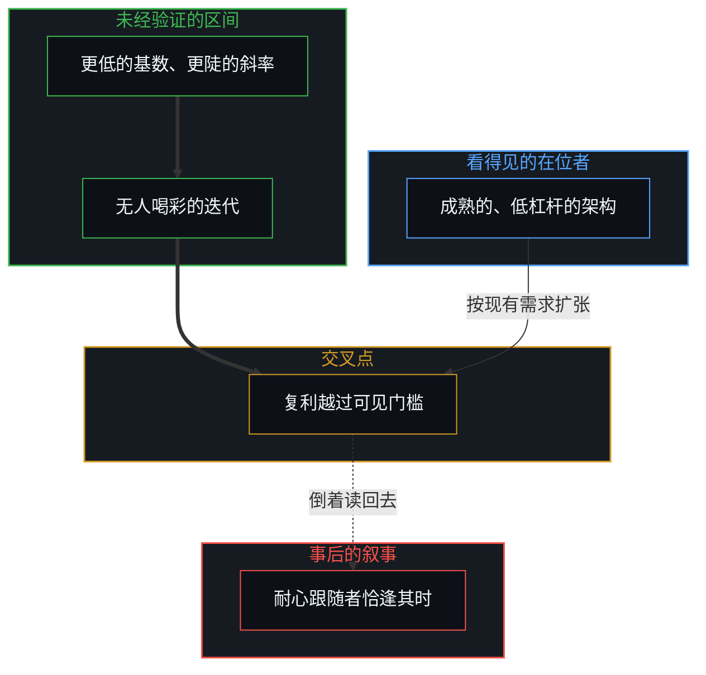
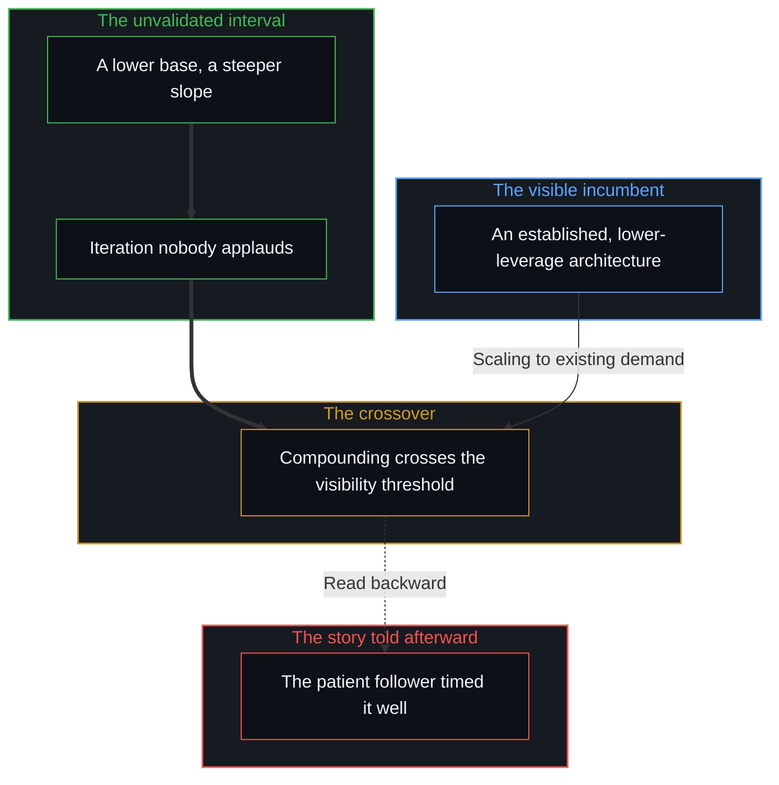

# 看不见的第一步 / The Invisible First Move

*事后被称作恰逢其时的后来居上，是早期未经验证的复利延迟显形 / What hindsight celebrates as a well-timed late entrance is the delayed visibility of early, unvalidated compounding.*

技术的民间传说常常颂扬后来者：耐心的跟随者让早期的先驱先挨箭，等市场明朗，再一举入场收割战果。这个叙事让旁观者安心，从第一人称的因果追下去却站不住。事后看来是一次晚到的入场，只是一条更早、更安静的复利曲线越过公共可见门槛的那一刻。技术上的超越不是从等待明朗里生出来的；它是一个看不见的第一步在结构上的结果：在一条更高杠杆的轨迹仍有争议、资源不足、被共识打发的时候，选中它。

Technological folklore often celebrates the latecomer: the patient follower who lets the early pioneers take the first arrows, waits for the market to clear, and sweeps in to collect the spoils. The story comforts spectators, but it does not hold when the causation is followed from the first person. What looks in retrospect like a late entrance is only the moment an earlier, quieter compounding curve crosses the threshold of public visibility. Technological overtaking is not born from waiting for clarity; it is the structural consequence of an invisible first move: choosing a higher-leverage trajectory while it is still contested, under-resourced and dismissed by consensus.

## 一、 耐心跟随者的事后神话 / 1. The Retroactive Myth of the Patient Follower

在被重述的技术史里，一个反复出现的剧本是这样展开的：一个早期的先驱主导了一个新兴的品类，浏览器里的网景，门户里的雅虎，前沿 AI 实验室的早期那一波，几年之后却被一个看似晚到的竞争者盖过。

In retold histories of technology, a recurring script unfolds: an early pioneer dominates a nascent category, Netscape in browsers, Yahoo in portals, the early wave of frontier AI labs, only to be eclipsed years later by a seemingly late-arriving competitor.

商业评论者从中得出的惯常教训，是时机与耐心胜过早期的技术投入：等市场成熟，保存资源，等架构显而易见时再出手。

The usual moral business commentators draw is that timing and patience outweigh early technical commitment: wait for the market to mature, conserve resources, and strike once the architecture is obvious.

这个解释是寻常的形象滞后。它只透过公共的记分牌去读历史，把公开发布的日期错当成开始的日期。胜者并没有等雾散。他们在数年之前，在那个方向还被在位者的共识看作边缘、没有前途或不可行的时候，就锁定了一种更好的架构或技术洞见。[进步叙事中的症候与原因](../symptom-and-cause-in-the-narratives-of-progress/)追踪的正是这种倒置：公众情绪只登记延迟的、集体的症候，却把这份延迟的登记当作原因。

This explanation is ordinary image lag. It reads history only through the public scoreboard, mistaking the date of public launch for the date of inception. The winners did not wait for the fog to clear. They locked onto a better architecture or technical insight years earlier, while the direction was still regarded by the incumbent consensus as marginal, unpromising or unviable. [Symptom and Cause in the Narratives of Progress](../symptom-and-cause-in-the-narratives-of-progress/) tracks this inversion: public sentiment registers only the delayed, collective symptom, and treats that delayed registration as if it were the cause.

## 二、 在未经验证的区间里复利 / 2. Compounding in the Unvalidated Interval

从外面看像是突然的超越，是不同的复利速率在一段未被观察的区间里的数学结果。

What looks from outside like a sudden overtake is the mathematical consequence of different compounding rates over an unobserved interval.

当看得见的在位者扩张一种成熟的、杠杆较低的架构去满足现有需求时，后来的挑战者正从更低的基数出发，走在一条更陡的斜率上。挑战者早期的迭代发生在相对的默默无闻里：内部的原型、基础的重构，以及得不到任何外部掌声的架构押注。

While the visible incumbent scales an established, lower-leverage architecture to meet existing demand, the eventual challenger works on a steeper slope from a lower base. The challenger's early iteration happens in relative obscurity: internal prototypes, foundational refactors and architectural bets that win no outside applause.

在这段区间里，挑战者的工作在随意的观察者眼中，像是无关紧要的试验，甚至是失败。可因为其轨迹底下的杠杆更高，每一次迭代都带来更深的结构性复利。等公众终于注意到挑战者，交叉点已经到了。这次超越不是靠更好的时机取得的；它是多年安静的功夫累积下的优势浮出水面。这是从结果倒着读回去的一种看法：并不是每一条安静的曲线都会浮出水面，结果里也有落到各人身上的那一份。[平均值是残余，不是引擎](../the-average-is-residue-not-the-engine/)守着这一点：大众采用的指标度量的是滞后的残余，而决定性的转变，是由在未经验证的边缘上复利的薄薄的少数写成的。

During this interval the challenger's work looks to casual observers like irrelevant experiment or outright failure. But because the leverage under its trajectory is higher, each iteration yields deeper structural compounding. By the time the public notices the challenger, the crossover point has already come. The overtake was not won through better timing; it was the surfacing of an advantage accumulated across years of quiet work. This is a reading backward from the outcome: not every quiet curve surfaces, and outcomes also hold what fell to each. [The Average Is Residue, Not the Engine](../the-average-is-residue-not-the-engine/) holds this point: mass-adoption metrics measure lagging residue, while decisive shifts are written by thin minorities compounding on unvalidated edges.

## 三、 “等待明朗”在构造上自我挫败 / 3. "Waiting for Clarity" Defeats Itself by Construction

“等路清楚了再走”这个处方，不只是次优的策略；它在构造上自相矛盾。

The prescription to "wait until the path is clear" is not merely a suboptimal strategy; it contradicts itself by construction.

明朗不是一种自行降临到某个行业的天气。明朗是有人已经走进雾里、承担了模糊的风险、确立了一条可行道路的经验证据之后，才留下的副产品。

Clarity is not a weather that descends on an industry of its own accord. Clarity is the by-product left after someone has already gone into the fog, borne the risk of ambiguity and established empirical proof of a viable path.

在投入之前要求明朗，等于放下了让超越成为可能的两种能力：一是自主的区分，在共识批准之前认出结构杠杆的眼光；二是未经验证的坚持，在没有社会确认、外部补贴或公众喝彩的情况下，维持严谨复利的能动性。

Demanding clarity before committing sets down the two capacities that make overtaking possible: autonomous distinction, the foresight to recognize structural leverage before consensus ratifies it; and unvalidated endurance, the agency to sustain rigorous compounding without social confirmation, outside subsidy or public cheering.

等到明朗对旁观者可见，早动的人已经筑起难以逾越的护城河：默会的知识、工具的整合、架构上的复利。一种以等待明朗为前提的策略，会让人一直留在被颠覆的一边。[不预测是没有觉察的预测](../not-predicting-is-predicting-without-awareness/)描绘的正是这个陷阱：拒绝选择一个未经验证的方向，并不能保持中立；它只是把跟随者绑在昨天领先者正在过时的假设上。

By the time clarity is visible to the spectator, the early movers have already built moats that are hard to cross: tacit knowledge, tool integration, architectural compounding. A strategy premised on waiting for clarity keeps one on the side of the disrupted. [Not Predicting Is Predicting Without Awareness](../not-predicting-is-predicting-without-awareness/) maps this trap: refusing to choose an unvalidated direction does not preserve neutrality; it only binds the follower to the ageing assumptions of yesterday's leaders.

## 四、 观察交付的是记分牌，不是引擎 / 4. Observation Delivers the Scoreboard, Never the Engine

这种结构上的不对称，说明了为什么技术超越的历史被反复研究，却很少被旁观者掌握。

This structural asymmetry explains why the history of technological overtaking is studied endlessly yet seldom mastered by spectators.

被动的观察只交付看得见的后果：成品、市场份额的曲线、凯旋的新闻稿。它抹去了真正的因果工作发生的那段艰苦而模糊的区间。只研究残余的观察者，吸收的是相反的教训：他们推崇战术上的耐心与市场共识，而这恰是让人落后的姿态。

Passive observation delivers only the visible aftermath: the finished product, the market-share graph, the triumphant press release. It erases the hard, ambiguous interval where the actual causal work took place. Observers who study only the residue absorb the inverse lesson: they prize tactical patience and market consensus, the very postures that leave one behind.

在人工智能这样快速变化的领域，这个错误代价很高。未来几十年里领先的组织与个人，未必是今天声音最大、资本最雄厚的那些。它们是已经投入一个更高杠杆的技术前提、从看似不利的位置高效迭代的安静中心。

In fast-moving fields like artificial intelligence, this error is costly. The organizations and individuals that lead the coming decades are not necessarily today's loudest or best-capitalized. They are the quiet centres that have already committed to a higher-leverage technical premise and are iterating efficiently from a position of apparent disadvantage.

真正的教训无法从回顾里提取出来。它要在有心智的前沿上被活出来，在那里信号微弱，外部的许可缺席，第一步要在黑暗中划下。后来者从来没有晚到；他们只是在任何人想到去看之前很久就开始移动了，所以[个体抉择是唯一的因果杠杆](../individual-choices-as-the-only-causal-levers/)。事后出现在公共回顾里的，只是已成之步的提交档案；如[你的代码库即是记忆](../your-codebase-is-memory/)所指出的，外化的痕迹只在活的前沿迈出那一步之后，才记下轨迹。

The real lesson cannot be extracted from retrospectives, because what public history inspects—much like the committed repository in [Your Codebase Is Memory](../your-codebase-is-memory/)—is only the externalized trace left after the living edge has already stepped. That edge has to be lived in the first person, where the signal is faint, outside permission is absent, and the first move is drawn in the dark. The latecomer was never late; they started moving long before anyone thought to look, demonstrating [Individual Choices as the Only Causal Levers](../individual-choices-as-the-only-causal-levers/) before the scoreboard ever registered a shift.
