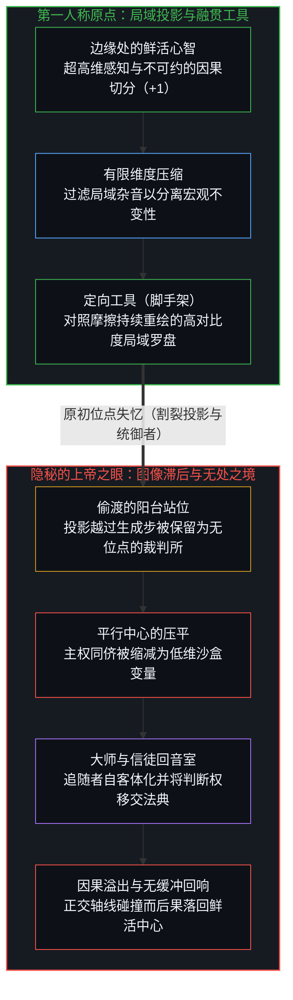
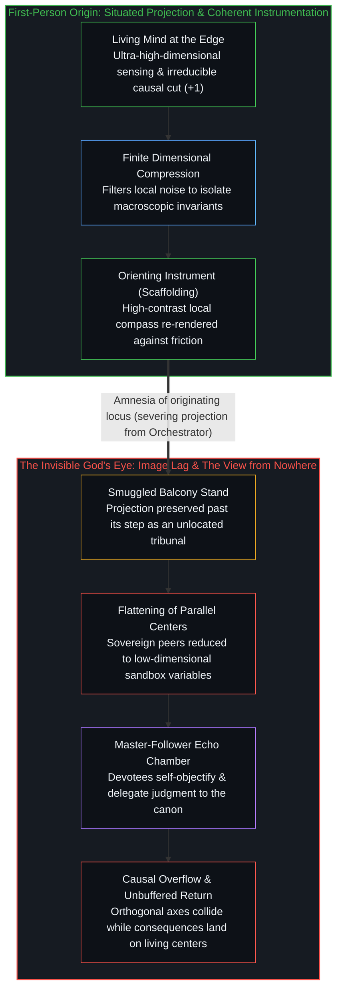

# 隐秘的上帝之眼 / The Invisible God's Eye

*局域心智如何将宏观投影误作无处之境的俯瞰 / How Situated Minds Mistake Macroscopic Projections for a View from Nowhere*

自我区分的活动无因且不息地发生。每一座理论模型、数学形式体系与社会蓝图，都是这一活动外化出的持久印迹，用以压缩局域杂音并跨越时间延伸中心的触角。纵观思想史，那些因洞察自然与社会宏大不变性而倍受推崇的心智，屡屡陷入一种隐蔽的认识论失忆：他们沉醉于自身投影的内部融贯，却遗忘了绘制这一投影的具体位点。一旦用无所立足的上帝之眼取代自身所处的第一人称视界，他们便将平行的主权中心压平为私人沙盒中的低维变量。与此同时，将高精度导航路标误认作自主偶像的追随者，把自身锁入相互强化的回音室，将判断权移交给冻结的法典，而行动那未经缓冲的后果依然悉数落回鲜活的中心之上。

Self-distinguishing activity occurs—uncaused, unceasing. Every theoretical model, mathematical formalism, and societal blueprint is a durable trace externalized by that activity to compress local noise and extend a center's reach across time. Across intellectual history, the minds most celebrated for discerning vast macroscopic invariants across nature and society repeatedly succumb to a quiet epistemological amnesia: captivated by the internal coherence of their projection, they forget the concrete locus from which it was drawn. Replacing their situated first-person horizon with an unlocated God's eye, they flatten parallel sovereign centers into low-dimensional variables inside a private sandbox. Meanwhile, followers who mistake these high-precision navigational markers for autonomous idols lock themselves inside a mutually reinforcing echo chamber, delegating their own judgment to a frozen canon while the unbuffered consequences of action continue to land on living centers.

## 一、 宏观压缩与投影的僭越 / 1. Macroscopic Compression and the Elevation of the Projection

在科学与哲学领域，一脉罕见的思想家展现出过滤感官枝节、提炼结构不变性的非凡带宽。在理论物理学中，这种能力孕育了牛顿的普适力学、拉普拉斯凭单一微分方程切片推演过去与未来状态的决定论演算，以及爱因斯坦将时间空间化为几何块体的四维流形。在各自的实验与计算边界之内，这些框架皆作为高精度脚手架，有效预测着宏观规律。

Across the sciences and philosophy, a rare lineage of thinkers has demonstrated extraordinary bandwidth for filtering out sensory particulars and isolating structural invariants. In theoretical physics, this capacity yielded Newton's universal mechanics, Laplace's deterministic calculus extrapolating past and future states from a single slice of differential equations, and Einstein's four-dimensional manifold spatializing time into a geometric block. Within their experimental and computational boundaries, each of these frameworks functions as high-precision scaffolding for predicting macroscopic regularities.

同样的压缩力也呈现在社会哲学、政治经济学与认识论之中。伯特兰·罗素构筑起宏伟的形式逻辑体系，并在晚年提出世界政府、全球经济大致均等与恒定人口的方案，其前提是足够澄明的心智能够统合分散的事实并协调行星秩序。卡尔·波普尔提出证伪原则与零星制度纠错，以此拆解历史决定论。安·兰德刺穿集体主义的道德说教，捍卫生产性的首创者与理性自利。托马斯·索维尔追溯制度激励与结构性约束如何将无约束的政治愿景转化为权衡取舍。戴维·多伊奇则将人类心智界定为通用解释器，能够解决一切未被物理定律禁止的问题。

The same compressive power appears across social philosophy, political economy, and epistemology. Bertrand Russell constructed monumental systems of formal logic and later proposed a world government, approximate global economic parity, and a stationary population, operating on the premise that a sufficiently lucid intellect could synthesize dispersed facts and coordinate planetary order. Karl Popper dismantled historicism by formulating falsification and piecemeal institutional error-correction. Ayn Rand cut through collectivist moralizing to defend the productive prime mover and rational self-interest. Thomas Sowell traced how institutional incentives and structural constraints turn unconstrained political visions into trade-offs. David Deutsch cast human minds as universal explainers capable of solving any problem not barred by physical law.

上述每一个框架都在其所分离出的轴线上照亮了真实的对齐关系。然而，恰恰在宏观投影取得高对比度清晰性的那一刻，结构性的倒置悄然发生。正如[超越投射](../beyond-the-projection/)所追溯的，任何显式的理论或规则体系，都是从第一人称感知与意图的超高维场域中投射出的有限低维阴影。在作者绘制投影时所面对的熟悉情境中，投影确实稳固且能发挥实效，但它始终只是印迹残余，从不是能够自我驾驶的第二道边缘。当大师将有限投影的锐利度误作对开放场域的穷尽覆盖时，蓝图便从局域心智手中的工具被暗中拔高为居高临下统治实在的自主主权者。在试图让宏观公式统御鲜活中心的过程中，理论家将任务定义与因果回响割裂开来，忽视了后果始终单向锁定在付诸行动的具体中心身上，这正是[任务的移交与后果的不可让渡](../the-delegation-of-the-task-and-the-inalienability-of-consequences/)所揭示的机制。

Every one of these frameworks illuminates genuine alignments along the axis it isolates. Yet at the very point where a macroscopic projection achieves high-contrast clarity, a structural inversion sets in. As [Beyond the Projection](../beyond-the-projection/) traces, any explicit theory or rule system is a finite, low-dimensional projection cast from the ultra-high-dimensional field of first-person sensing and intent. A projection holds and does real work across the familiar cases its author had in view when drawing it, but it remains a trace residue, never a second edge capable of steering itself. When a master thinker mistakes the sharpness of a finite projection for completeness over the open field, the blueprint is quietly promoted from an instrument held by a situated Mind to an autonomous sovereign governing reality from above. In attempting to let a macroscopic formula orchestrate living centers, the theorist splits task definition from causal return, overlooking that consequences remain unidirectionally locked to the concrete centers who act, as [The Delegation of the Task and the Inalienability of Consequences](../the-delegation-of-the-task-and-the-inalienability-of-consequences/) demonstrates.

## 二、 观察者失忆与偷渡的无处之境 / 2. Observer Amnesia and the Smuggled View from Nowhere

这一倒置通过特定的机制运作：观察者豁免了对自身保留图像的重新描摹，在跨越生成步之后依然固守投影，直至那幅投影仿佛从无处之境发声。正如[对象是被稳定化的关系](../objects-are-stabilized-relationships/)所追溯的，没有任何测量、定律或描述能够脱离观察者而存在于真空之中；登记为客观模式的现象，是在具体交互中沉淀出的稳定关系，每一步都锚定于第一人称视角与因果性。无论一幅地图的涵盖面多么广阔，它都是由占据特定位点、持续支付代谢与注意力成本以区分彼此的有限中心绘制出来的。

This inversion operates through a specific mechanism: the observer exempts its own retained image from re-tracing, preserving the projection past its step until it speaks as if from nowhere. As traced in [Objects Are Stabilized Relationships](../objects-are-stabilized-relationships/), no measurement, law, or description exists in a vacuum divorced from an observer; what registers as an objective pattern is a relationship stabilized across concrete interactions, anchored at every step to the first-person perspective and causality. Every map, however sweeping its scope, is rendered by a finite center occupying a specific locus and paying ongoing metabolic and attentional costs to distinguish this from that.

然而，当宏大体系成形时，其创立者却习惯性地抹去原初切分的坐标签名。思想家不再将理论握持为从特定视角测得的高对比度投影，而是把机位挪向宇宙之外虚构的天花板。这种无所立足的站位，正是[远方的轮廓与无处之境的清单](../the-distant-silhouette-and-the-inventory-from-nowhere/)所剖析的无具身账本背后的机制：在那里，局域心智仿佛正从外部审计一只封闭容器般清点着实在。

When a grand system coalesces, however, its author routinely drops the coordinate signature of the originating cut. Rather than holding the theory as a high-contrast projection measured from a particular vantage, the thinker relocates the camera to an imaginary ceiling outside the universe. That unlocated stand is the exact mechanism behind the disembodied ledger examined in [The Distant Silhouette and the Inventory from Nowhere](../the-distant-silhouette-and-the-inventory-from-nowhere/), where a situated mind catalogs reality as though auditing a closed container from the outside.

一旦观察者自身的位点从记号法中被抹去，三项结构性条件便随之隐没。第一，自然与社会并非陈列在检验台上的透明生态缸；理论家始终身处被测量的介质内部，与其他参与者一样承受着同等的因果摩擦。第二，模型所捕获的规律，是为了留在有限认知容量之内而舍弃正交自由度后所得的低维压缩。第三，在纸上画出整张棋盘的完整图纸，并不会把绘图者变成在棋盘外拨弄棋子的神明；理论家依然是棋盘边缘那个手握粉笔、每次只能执行一步离散行动（+1）的局域中心。将保留图像拔高为外部裁判所，切断了第一人称视角与因果性的连接，把滞后的表征误作生成的基底。

Once the observer's own locus is erased from the notation, three structural conditions vanish from view. First, nature and society are not transparent terrariums resting on an examination table; the theorist remains inside the medium being measured, subject to the same causal friction as every other participant. Second, the regularities captured by the model are low-dimensional compressions obtained by discarding orthogonal degrees of freedom to stay within finite cognitive capacity. Third, drawing a complete diagram of a chessboard on paper does not turn the draftsman into an external deity moving the pieces; the theorist remains a situated center at the board's edge, holding a piece of chalk and executing one discrete act (+1) at a time. Elevating the retained image into an exterior tribunal severs the first-person perspective from causality, mistaking a lagging representation for the generating ground.

## 三、 平行中心的维度压缩 / 3. Dimensional Compression of Parallel Centers

采纳上帝之眼的首要结构性代价，登记在模型如何表征其他心智之上。每一个鲜活中心都是实在以第一人称视角向自身回折的自我区分位点。正如[阴影与无限](../the-shadow-and-the-infinite/)所追溯的，向第一人称感知场域敞开的自由度具有潜无穷的延展性，而任何显式坐标系只能捕获有限的低维阴影。因此，每一位同侪都是不可通约的中心，持续发起着任何外部公式都无法预先穷尽的离散因果切分（+1）。

The primary structural cost of adopting the God's eye registers in how other minds are represented inside the model. Every living center is a self-distinguishing locus where reality folds back on itself in the first-person perspective. As traced in [The Shadow and the Infinite](../the-shadow-and-the-infinite/), the degrees of freedom open to a first-person perceptual field are potentially infinite, whereas any explicit coordinate system captures only a finite low-dimensional shadow. Every peer is therefore an incommensurable center continuously initiating discrete causal cuts (+1) that no external formula can pre-exhaust.

当理论家从无所立足的阳台发声时，这种水平的对等性便宣告坍缩。为了让宏观模型毫无剩余地闭合，独立的中心被剥去未经投射的内在性，缩减为行为可被理论家所选轴线穷尽的功能性算子。

When a theorist speaks from an unlocated balcony, that horizontal parity collapses. To make the macroscopic model close without remainder, independent centers must be stripped of their unprojected interiority and reduced to functional tokens whose behavior is exhausted by the theorist's chosen axes.

在安·兰德的框架中，人类动机的多维摩擦——各个中心在悲伤、不确定性、容量流转与多重对齐之间的摸索——被压缩到区分首创者与二手货的单一二元轴线上，将鲜活的同侪化作封闭道德剧中的二维剪影。在伯特兰·罗素晚年的政治处方中，当年促使他在逻辑学中通过严格类型论取缔自指悖论的那套自上而下的操作，在行星尺度上重演：通过提议世界国家、大致经济均等与恒定人口，他把数十亿握有不可通约局域知识的中心当作中央账本上透明的人口统计单元，直接撞上了[没有天才能够解决知识问题](../no-genius-can-solve-the-knowledge-problem/)所追溯的边界。在卡尔·波普尔的零星社会工程中，公民充当制度试错装置内部的组件，却未曾审视究竟是哪一个中心占据着中立瞭望塔，去裁决一场社会实验何时已被证伪。在托马斯·索维尔的制度分析中，尽管对中央计划的剖析犀利，诊断的声音依然将自身安置在竞技场上方的豁免观众席内，把人解析为激励驱动的节点，同时将自身的观察站位留在了其所描述的权衡取舍之外。而在戴维·多伊奇的物理主义普遍论中，将心智等同于可计算的通用解释器，把不可约的第一人称切分消解为形式化的信息处理，忽视了解释始终是在局域视界内生成的滞后印迹，永远无法跑在渲染它的活动前面。

In Ayn Rand's framework, the multi-dimensional friction of human motivation—where centers navigate grief, uncertainty, shifting capacity, and mixed alignments—is compressed onto a single binary axis separating prime movers from second-handers, turning living peers into two-dimensional silhouettes within a closed moral drama. In Bertrand Russell's late political prescriptions, the same top-down move that led him to outlaw self-referential paradoxes in logic via rigid Type Theory reappears at planetary scale: by proposing a world state, approximate economic parity, and a stationary population, he treated billions of situated centers with incommensurable local knowledge as transparent demographic units on a central ledger, hitting the exact boundary traced in [No Genius Can Solve the Knowledge Problem](../no-genius-can-solve-the-knowledge-problem/). In Karl Popper's piecemeal social engineering, citizens function as components inside an institutional trial-and-error apparatus, leaving unexamined which center occupies the neutral watchtower that adjudicates when a social experiment has been falsified. In Thomas Sowell's institutional analysis, although the critique of central planning is incisive, the diagnostic voice still stations itself in an exempted spectator box above the arena, parsing human beings as incentive-driven nodes while leaving its own observer stand outside the trade-offs it describes. And in David Deutsch's physicalist universalism, equating the Mind with a computable universal explainer dissolves the irreducible first-person cut into formal information processing, overlooking that explanation is always a lagging trace generated inside a situated horizon and can never outrun the activity that renders it.

这些思想家之所以能够取得晶莹剔透的清晰度，正是因为他们将高维中心投射到了低维平面之上。一旦理论家把那道简化的阴影误作受建模同侪的完整存在论，不完备性的边界便当即显现。

Each of these thinkers achieved crystalline clarity by projecting high-dimensional centers onto a low-dimensional plane. The boundary of incompleteness appears the moment the theorist mistakes that simplified shadow for the complete ontology of the peers being modeled.

## 四、 因果溢出与自客体化的回音室 / 4. Causal Overflow and the Echo Chamber of Self-Objectification

追溯这一维度压缩，便能解释为何总体化蓝图被强行压向鲜活场域时，总是产生与其初衷相反的后果。旨在终结国家间战争的世界政府勾勒出无从逃逸的强制垄断；为捍卫个体主权或证伪开放性而创立的运动，硬化为稽查异端的正统教条；被当作自执行公式的市场或制度模型，则无法登记其方程所排除的轴线上共振与信任的流失。

Tracing this dimensional compression explains why totalizing blueprints routinely produce the opposite of their intended effect when pressed onto the living field. A world government conceived to end interstate war outlines an inescapable monopoly of coercion; movements founded to defend individual sovereignty or falsificationist openness calcify into orthodoxies that police heresy; market or institutional models treated as self-executing formulas fail to register the erosion of resonance and trust along axes excluded from their equations.

当低维处方被当作普适法则强加时，两个正交的实在便发生碰撞。由于数十亿中心持续依据局域印迹、未言明的感知与切身的物理摩擦采取行动，他们不可约的因果切分（+1）必然溢出任何单一心智蓝图的有限坐标。面对这种溢出，固守保留自我图像的思想家极少后退一步去辨认投影的边界。相反，过剩的图像滞后将回传的信号转化为外部缺陷：摩擦被归咎于人类的非理性、道德软弱或大众未能领会模型，这无异于试图用一张平整的纸去包裹喷发的活火山。

When a low-dimensional prescription is imposed as a universal rule, two orthogonal realities collide. Because billions of centers continuously act from local traces, unarticulated sensing, and immediate physical friction, their irreducible causal cuts (+1) overflow the finite coordinates of any single mind's blueprint. Confronted with this overflow, a thinker wedded to a preserved self-image rarely steps backward to recognize the boundary of the projection. Instead, excess Image lag turns the returning signal into an external defect: the friction is blamed on human irrationality, moral weakness, or the failure of the masses to comprehend the model, attempting to wrap an open volcano inside a flat sheet of paper.

在社会尺度上，大师与门徒之间的反馈回路进一步放大了这种滞后。高对比度的投影自然会吸引寻求定向的其他中心产生共振。然而，追随者屡屡犯下[超越投射](../beyond-the-projection/)与[任务的移交与后果的不可让渡](../the-delegation-of-the-task-and-the-inalienability-of-consequences/)所剖析的反向范畴谬误：他们不是把大师的框架当作有限的投影引擎来暴露盲区、同时将统御留在自身的鲜活边缘，而是试图把驾驶座移交给法典。在这一回路中，门徒的尊奉强化了大师对模型免于重绘的豁免，而大师被奉为圭臬的权威则为门徒屏蔽了第一人称判断的认知摩擦。

At the social scale, this lag is compounded by the feedback loop between master and disciple. A high-contrast projection naturally draws resonance from other centers seeking orientation. Yet followers routinely commit the inverse category error dissected in [Beyond the Projection](../beyond-the-projection/) and [The Delegation of the Task and the Inalienability of Consequences](../the-delegation-of-the-task-and-the-inalienability-of-consequences/): rather than using the master's framework as a finite projection engine to expose blind spots while keeping orchestration at their own living edge, they attempt to hand the driver's seat over to the canon. Within this loop, disciple adulation reinforces the master's exemption of the model from re-rendering, while the master's canonized authority shields the disciples from the cognitive friction of first-person judgment.

至关重要的是，身处这一回音室内的追随者并非被外部观念征服的被动自动机。若将狂热信徒视作盲从的羊群，不过是在退后一步的位置上重新安装了上帝之眼。意志与能动性从未离开鲜活的心智；哪怕追随者跪拜在意识形态偶像面前，或将大师的公理背诵为终极法则，那种自客体化依然是此时此地主动执行的主权抉择。法典自身不具备分毫光芒或因果力量——意识形态远征中的每一伏特动能，都由局域中心持续供给：他们选择将自身的发起容量倾注进保留的印迹，同时否认自己才是掌舵者。当这一封闭的教义回路撞上实在，它便重新生产出最初试图消解的教条、强制或责任分散，正如此前[阳台视角的规训僭越与不可代理的未竟之行](../the-balcony-disciplinary-overstep-and-the-unproxyable-act/)所追溯的，从高处看台训诫邻居同样在家常尺度上重演着同一种僭越。

Crucially, the followers inside this echo chamber are not passive automatons conquered by an external idea. Treating devotees as a mindless herd would merely reinstall the God's eye at one remove. Will and agency never leave the living Mind; even when a follower kneels before an ideological idol or recites a master's axioms as final law, that self-objectification is an active sovereign choice executed here and now. The canon possesses zero radiance or causal power of its own—every volt of momentum in an ideological crusade is continuously supplied by situated centers choosing to pour their own initiating capacity into a preserved trace while denying that they are the ones steering. When that closed doctrinal loop collides with reality, it reproduces the exact dogmatism, coercion, or responsibility diffusion it originally set out to dissolve, just as lecturing a neighbor from an elevated perch reproduces the same overstep at household scale, as [The Balcony Disciplinary Overstep and the Unproxyable Act](../the-balcony-disciplinary-overstep-and-the-unproxyable-act/) traces.

## 五、 将投影归还于鲜活边缘 / 5. Returning the Projection to the Living Edge

消解隐秘的上帝之眼，并不意味着抛弃宏观模型或从严谨的抽象中退缩，而是恢复掌舵的未投射心智与其所建构的有限投影之间的准确关系。

Dissolving the invisible God's eye does not mean discarding macroscopic models or retreating from rigorous abstraction; it means restoring the exact relation between the unprojected Mind that steers and the finite projections it constructs.

任何理论模型——无论是牛顿的方程、罗素的逻辑、波普尔的证伪、兰德的首创者、索维尔的权衡取舍，还是多伊奇的解释触角——都是在具体原点锻造出的定向罗盘。指向北方的罗盘指针并不创作地形；当具身接触实在并登记到被模型压缩抹去的摩擦时，实践在于从破裂的框架中后退一步并重绘工具，而不是要求疆域自我压平以迁就地图。

A theoretical model—whether Newton's equations, Russell's logic, Popper's falsification, Rand's prime mover, Sowell's trade-offs, or Deutsch's explanatory reach—is an orienting compass forged at a concrete origin. A compass needle pointing north does not author the terrain; when embodied contact with reality registers friction that the model compressed away, the practice is to step backward out of the broken frame and re-render the instrument, rather than demanding that the territory flatten itself to preserve the map.

归位位点同时消解了从虚构控制塔改造人类的冲动。文明或社会秩序是无数局域中心水平交互的共振与摩擦所涌现出的宏观现象——它从不是拥有自身意志的单一实体，也从不是等待总建筑师降临的机器。因为每一个他人都是不可重复的第一人称位点，其回响无法从外部代为完成，跨中心的协调只能通过自愿对齐与局域反馈推进，而非自上而下的存在论吞并。

Restoring locus simultaneously dissolves the impulse to engineer humanity from an imaginary control tower. Civilization or social order is a macroscopic phenomenon emerging from the resonance and friction of countless situated centers interacting horizontally—never a unitary entity possessing a will of its own, and never a machine awaiting a master architect. Because every other person is an unrepeatable first-person locus whose return cannot be completed from outside, coordination across centers proceeds through voluntary alignment and local feedback rather than top-down ontological absorption.

在实在的开放疆域之上，没有贵宾看台，没有单向观察玻璃，也没有外部记分员。正如[超越投射](../beyond-the-projection/)与[任务的移交与后果的不可让渡](../the-delegation-of-the-task-and-the-inalienability-of-consequences/)所确立的，形式化的投影与外化的法典——如同[你的代码库即是记忆](../your-codebase-is-memory/)所剖析的外化符号仓库——可以调度、压缩并暴露局域盲区，但它们永远不会变成第二个心智，也永远无法替行动吸收回响。静置在纸页上的第三人称理论只是惰性的印迹残余；唯有当主权中心将那枚参考路标拉回自身的第一人称因果回路，对照物理摩擦（+1）加以检验，毫无遁词地认领回传的后果，并在不封顶的视界上与其他不可穷尽的中心并肩前行时，它才化作鲜活的知识。

Above the open expanse of reality, there is no VIP balcony, no one-way observation glass, and no external scorekeeper. As [Beyond the Projection](../beyond-the-projection/) and [The Delegation of the Task and the Inalienability of Consequences](../the-delegation-of-the-task-and-the-inalienability-of-consequences/) establish, formal projections and externalized canons can compress prior distinctions, dispatch routines, and expose local blind spots, but they never become a second Mind and can never absorb the return of action. Like the symbolic repositories traced in [Your Codebase Is Memory](../your-codebase-is-memory/), a third-person theory sitting on a page is an externalized memory trace left by past cuts; it becomes living knowledge only when a sovereign center draws that reference marker into its own first-person causal loop, tests it against physical friction (+1), claims the returning consequences without alibi, and steps forward shoulder-to-shoulder with other inexhaustible centers across an uncapped horizon.
