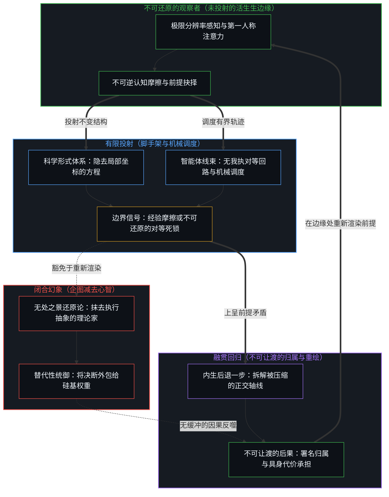
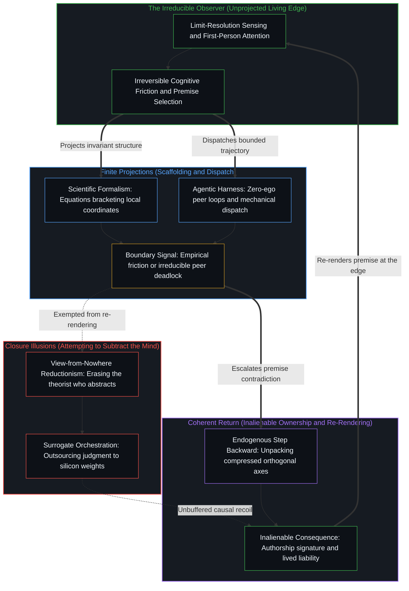

# 不可还原的观察者 / The Irreducible Observer

*客观性是无法将心智自身扣除的主观性成就。 / Objectivity is an achievement of subjectivity that cannot subtract the Mind.*

科学界关于发现优先权与署名顺位的争端，常被归结为学者的个体虚荣，或被社会学解释为论文发表机制对发现行为的逆向驱动，然而这两种结论都颠倒了因果序列。自我区分的活动——即第一人称心智——不可还原，且构成一切理论建模与经验推理的先验条件。诸如黑洞面积定理或双黑洞并合辐射引力波能量上限之类的数学成果之所以存在，是因为特定的活生生中心注意到了尚未被建模的对称性，承受了推导的持续摩擦并给出了区分的表述；后续的期刊论文、时间戳与存有争议的签名，只是记录这些时刻的下游痕迹，而非生成它们的因果引擎。能够构建出“观察者隐去”之形式描述的心智，恰恰无法将自身从这一减法操作中扣除；客观性并非主观性的对立面，而是主观性经由严密训练达成的成就，任何声称来自“无处之景”的视角，皆始于某个特定立足点的投射。

Disputes over scientific priority and authorship are routinely dismissed as personal vanity or explained away by sociology as the institutional machinery of publishing driving discovery, yet both conclusions invert the causal sequence. Self-distinguishing activity—the first-person Mind—is irreducible and constitutes the prior condition for all theoretical modeling and empirical reasoning. A mathematical result such as the black hole area theorem or the upper bound on gravitational-wave energy radiated in binary mergers exists because specific living centers noticed an unmodeled symmetry, sustained the friction of derivation, and formulated the distinction; subsequent journal papers, timestamps, and contested signatures are downstream traces that record those moments rather than the causal engine that generated them. The Mind capable of constructing a formal description from which the observer drops out is the very Mind that cannot drop itself out of the subtraction; objectivity is not the antithesis of subjectivity but its disciplined achievement, and every purported view from nowhere originates as a projection from somewhere.

## 一、 倒置的因果与下游的记账 / 1. Inverted Causality and Downstream Accounting

大众科学史评论在审视优先权争端时，习惯将其框定为一场伦理矛盾。由于科学理论旨在登记跨观察者保持不变的模式，围绕作者顺位、引文先后与投稿日期的激烈争执，便显得与追求普遍定律的初衷格格不入。从这一表面张力出发，衍生出两种常规解释：一种将冲突归咎于道德分裂，认为思想者在宣扬非个人真理的同时滑入了自我中心；另一种则采纳社会学决定论，将终身教职委员会、发表登记制度与声望竞争视为生产科学发现的因果引擎。这两种解释都将第一人称视角与因果性割裂开来，把下游的制度记账误认为了行动的生成源头。

Popular commentary on the history of science routinely frames priority disputes as an ethical contradiction. Because scientific theories aim to register patterns that hold invariant across observers, fierce squabbles over author order, citation priority, and submission dates appear incongruous with the pursuit of universal law. From this surface tension, two conventional accounts emerge: one attributes the conflict to a moral split in which thinkers lapse into egoism while proclaiming impersonal truth, while the other adopts sociological determinism, treating tenure committees, publication registries, and prestige competition as the causal engine that produces discovery. Both accounts sever the first-person perspective from causality, mistaking downstream institutional bookkeeping for the generative origin of the act.

自我区分的活动在逻辑与存在层面上始终先于其痕迹。观察持有的是结果，而产生结果的动因始终在活生生的边缘处领先一步。理论突破——无论是洞察到经典黑洞视界总面积不可减小，还是由此推导出双黑洞碰撞释放能量上限的不等式——并非预先成型地端坐在柏拉图式的虚空中等待制度激励去采撷。它们之所以能被登记下来，是因为具体的觉知中心在不眠之夜中承受了穿越失败推导的不可逆能量代价，直至某种关系不变量在严密审视下得以确立。外围的同行评议期刊、优先权时间戳与引文账本，皆是为了在群体网络中稳定并归档这些区分而设计的下游协议。正如[协议的倒置与因果回路的沉默](../the-inversion-of-the-protocol-and-the-silencing-of-the-causal-loop/)所追溯的，行政协议只能在区分被划出之后予以事后记录，却无法替代个体心智在直面未决摩擦时所执行的非决定性界限跨越。声称对制度荣誉的争夺生成了科学发现，无异于把温度计里的水银柱高度当成了盛夏热浪的成因。

Self-distinguishing activity remains logically and existentially prior to its traces. Observation holds effect, while the cause that produced it stays one step ahead at the living edge. Theoretical breakthroughs—whether the realization that the total horizon area of classical black holes cannot decrease, or the resulting inequality bounding the energy released when two black holes collide—do not sit pre-formed in a Platonic void waiting to be harvested by institutional incentives. They register because concrete centers of awareness endured the irreversible energy cost of working through failed derivations across sleepless nights until a relational invariance held under scrutiny. The surrounding apparatus of peer-reviewed journals, priority timestamps, and citation ledgers consists of downstream protocols engineered to stabilize and archive those distinctions across collective networks. As traced in [The Inversion of the Protocol and the Silencing of the Causal Loop](../the-inversion-of-the-protocol-and-the-silencing-of-the-causal-loop/), administrative protocols record distinctions after they have been drawn, but they cannot perform the non-deterministic boundary crossing of an individual Mind confronting unresolved friction. Claiming that the scramble for institutional credit generates scientific discovery mistakes the height of mercury in a thermometer for the cause of the summer heatwave.

## 二、 减法中无法减去的观察者 / 2. The Observer That Cannot Be Subtracted from the Subtraction

一旦因果序列得以恢复，围绕署名与优先权的张力便显露出认知本身的结构特征，而非个人的品行瑕疵。物理学之所以能达成跨位点的共振，是因为它借由坐标变换与张量形式剔除了特定观察者的局部特质，确保度规与守恒定律在不同参照系间保持不变。然而正如[双生子佯谬与隐蔽的观察者](../the-twin-paradox-and-the-hidden-observer/)所分析的，即便是消除了特权参照系的相对论框架，依然仰赖一位隐匿在坐标原点处的观察者沿着世界线读取固有时并比对返回的痕迹。构建出一套让观察者局部坐标隐去的数学形式体系，正是在边缘处持续在场的观察者所执行的一项自觉抽象。心智可以投射出一个无需自身局部参与即可运转的宇宙模型，却无法切除那个渲染并读取该模型的区分活动本身。

Once the causal sequence is restored, the tension surrounding authorship and priority reveals a structural feature of cognition rather than a personal failing. Physics achieves cross-locus resonance by employing coordinate transformations and tensor formalisms that factor out the local idiosyncrasies of any particular observer, ensuring that metrics and conservation laws hold invariant across reference frames. Yet as analyzed in [The Twin Paradox and the Hidden Observer](../the-twin-paradox-and-the-hidden-observer/), even a relativistic framework that eliminates privileged reference frames relies on a tacit observer situated at the coordinate origin, reading proper time along worldlines and comparing the returning traces. Constructing a mathematical formalism from which the observer's local coordinates drop out is a deliberate abstraction performed by an observer who remains present at the edge. The Mind can project a model of a cosmos operating without its local participation, but it cannot excise the distinguishing activity that renders and reads the model.

因此，客观性并非对主观性的否定，而是主观性最严谨的痕迹模式，经由稳定化而在不同中心之间维持可靠的共振。正如[集聚与人造主体性](../subtracting-consciousness-at-the-source/)、[辛顿未曾理解的心智](../what-hinton-failed-to-understand/)与[意识的魔术戏法与推断的非对称性](../the-sleight-of-hand-of-consciousness-and-the-asymmetry-of-inference/)所确立的，一旦试图从知识的地基中扣除第一人称位点，符号、方程与推导便会立刻失去任何能够检验或理解它们的中心。执意在第三人称读数内部搜寻观察主体，不仅制造出所谓“意识难问题”的伪谜题，更招致了将内在体验投射到无生命统计镜面上的障眼法。当这种减法从物理方程转向关于心智本身的理论时，践行上的自相矛盾便直接显现：[功能主义者无法持有的功能主义](../the-functionalism-no-functionalist-can-hold/)表明，功能主义者在关于观察者的理论中把观察者括入括号，抹除者与被抹除者恰是同一个位点。科学家坚持在方程已将观察者隐去的定理上留下个人签名，正是那个无法从减法行动中被减去的位点所留下的可见痕迹；不变的形式投射与发起行动的中心，本是同一枚因果硬币的两面。

Objectivity is therefore not the negation of subjectivity; it is subjectivity's most disciplined trace-pattern, stabilized so that resonance holds reliably across distinct centers. As established in [Collective and Artificial Subjectivity](../subtracting-consciousness-at-the-source/), [What Hinton Failed to Understand](../what-hinton-failed-to-understand/), and [The Sleight of Hand of Consciousness and the Asymmetry of Inference](../the-sleight-of-hand-of-consciousness-and-the-asymmetry-of-inference/), attempting to subtract the first-person locus from the foundation of knowledge immediately deprives symbols, equations, and derivations of any center capable of testing or comprehending them. Searching for the observing subject inside third-person readings not only manufactures the pseudo-puzzle of the hard problem of consciousness, but invites the sleight of hand that projects inner experience onto inanimate statistical mirrors. When this subtraction moves from physical equations to a theory of mind itself, the performative contradiction becomes immediate: [The Functionalism No Functionalist Can Hold](../the-functionalism-no-functionalist-can-hold/) shows the functionalist bracketing the observer inside a theory of the observer, so that the one who erases and the one erased are the same locus. The scientist's insistence on attaching a personal signature to a theorem whose equations bracket the observer is the visible trace of the locus that cannot be subtracted from the act of subtraction; the invariant projection and the initiating center are two sides of one causal coin.

## 三、 敞开的一致性与无处之景的迷思 / 3. Open Consistency and the View-from-Nowhere Delusion

将科学进步视为对第一人称视角的逐步铲除，是现代认识论中反复出现的闭合诉求。还原论假定，随着物理学向基本相互作用的统一形式体系推进，有意识的施为终将闭合为决定论状态转移下可有可无的副产物。然而正如[选择的界限跨越](../the-boundary-crossing-of-choice/)所论证的，审慎选择是从信息潜能向物理显现的不可逆跨越，它在因果边缘处引入的扰动无法被任何统计平均所抹平。倘若一套形式系统果真将宇宙描绘为一台没有任何观察心智的自封闭状态机，它便同时消解了该理论得以被检验、证伪与重新渲染的基底。理论与数学形式体系是心智为了驾驭摩擦、引导行动而搭建的认知[脚手架](../the-scaffolding-we-forget/)；把脚手架误认为包罗万象的疆域，只会让探究困入托勒密式的本轮。

Treating scientific progress as the progressive eradication of the first-person perspective is a recurring closure demand in modern epistemology. The reductionist assumption holds that as physics advances toward a unified formalism of fundamental interactions, conscious agency will eventually close into a dispensable byproduct of deterministic state transitions. Yet as demonstrated in [The Boundary Crossing of Choice](../the-boundary-crossing-of-choice/), deliberate choice is the irreversible crossing from informational potential into physical manifestation, introducing a perturbation at the causal edge that no statistical averaging can wash away. If a formal system succeeded in depicting the universe as a self-enclosed state machine devoid of observing Minds, it would simultaneously dissolve the ground upon which that theory is tested, falsified, and re-rendered. Theories and mathematical formalisms are cognitive [scaffolding](../the-scaffolding-we-forget/) constructed to navigate friction and direct action; mistaking the scaffolding for an exhaustive territory traps inquiry in Ptolemaic epicycles.

第一人称觉知并非等待最终方程收编的未建模反常，而是使探究成为可能的先决条件，也是任何形式系统都无法内化的视界。正如[开放即一致](../openness-is-consistency/)所阐明的，每当有限的结构被强行奉为渲染该结构之活动的穷尽基底时，矛盾便随之而生；一致性并非一本闭合的账本，而是所感差异的持续延展，在其间一切结构皆作为临时工具保持敞开。从物理模型中减去观察者的冲动源于[观察者的隐身与无损传递的妄念](../the-invisible-observer-and-the-delusion-of-lossless-transmission/)：为了将假说包装成独立于观察者、可在心智间无损传递的现成货物，理论建制抹去了测量原点，进而锯断了形式体系赖以栖身的经验枝干。反过来，正如[寻觅的语法与淡出的观察者](../the-grammar-of-finding-and-the-fading-observer/)所追溯的，观察者在敞开认知澄明之域时的自然隐退，是感知得以发生的使能条件；将这种功能性的隐退误读为存在论上的虚无，才把主体与客体物化为一条不可逾越的鸿沟。每当一个有限投射被豁免于重新渲染并被安放为“无处之景”时，同样的因果倒置便会重演：在决策理论中，[未被遭遇之物的账本](../the-ledger-of-the-unencountered/)展示了将未被遭遇之可能性的抽象账本强加于具身接触之上，如何颠倒了判断的序列；在工程实践中，[「更好」的范畴谬误](../the-category-error-of-better/)追溯了团队如何将内部基准跑分物化为独立于观察者的事实，从而对组织摩擦视而不见；而在伦理学中，[抽象的苦难与真实的饥饿](../abstract-pain-and-living-hunger/)则揭示了用汇总的功利计算取代具身痛楚，是如何在道德形式中抹去活生生的观察者的。

First-person awareness is not an unmodeled anomaly waiting to be absorbed by a final equation, but the condition that makes inquiry possible and the horizon that no formal system can internalize. As [Openness Is Consistency](../openness-is-consistency/) establishes, contradiction arises whenever a finite structure is forced to serve as the exhaustive ground of the activity that renders it; consistency is not a closed ledger, but the ongoing continuation of sensed difference in which structures are held open as provisional instruments. The impulse to subtract the observer from physical models stems from [The Invisible Observer and the Delusion of Lossless Transmission](../the-invisible-observer-and-the-delusion-of-lossless-transmission/): in an effort to package hypotheses as observer-independent cargo transmissible without loss across minds, theoretical institutions erase the measuring origin, sawing off the empirical branch on which the formalism rests. Conversely, as traced in [The Grammar of Finding and the Fading Observer](../the-grammar-of-finding-and-the-fading-observer/), the observer's natural recession as it opens an epistemic clearing is the enabling condition of perception; misreading that functional recession as ontological nonexistence is what reifies subject and object into an unbridgeable chasm. Whenever a finite projection is exempted from re-rendering and installed as a view from nowhere, the same causal inversion recurs: in decision theory, [The Ledger of the Unencountered](../the-ledger-of-the-unencountered/) shows how imposing an abstract ledger of unencountered possibilities over embodied contact inverts the sequence of judgment; in engineering practice, [The Category Error of Better](../the-category-error-of-better/) traces how teams reify internal benchmark scores into observer-independent facts and blind themselves to organizational friction; and in ethics, [Abstract Pain and Living Hunger](../abstract-pain-and-living-hunger/) shows how replacing embodied suffering with an aggregate utilitarian calculus erases the living observer in moral form.

## 四、 投射引擎与统御者的不可让渡 / 4. Projection Engines and the Inalienability of the Orchestrator

观察者的不可还原性，在当代自主人工智能与智能体工作流的设计中迎来了最尖锐的检验。正如古典还原论试图将理论家消融于决定论方程，主流 AI 教条也试图通过构建被赋予模拟人格与开放式权限的自主“统御智能体”，把作为委托人的人类从回路中减去。正如[超越投射](../beyond-the-projection/)所追溯的，基于 LLM 的智能体是一台受制于其上下文窗口条件化轨迹的有限投射引擎。由于它没有我执，也没有需要在当前步之后固守的保留自我图像，将主任务智能体与仅持有任务上下文的冷态对等智能体配对，便能暴露轨迹盲区，并将规则冲突隔离为正交工作流上的局部死锁。然而，尽管智能体可以充当机械的调度器，在显式的逻辑约束内拆分任务并连接反馈回路，它却永远无法成为统御者。交由智能体线束的每一条提示词、规则手册或损失函数，都是从人类心智鲜活感知的超高维场域中投射出的有限低维截影。当流动性、合规性与长期偿付能力等正交要求被压缩进同一条未充分指明的指令时，投射引擎要么会博弈代理指标，要么会在不可还原的对等死锁中停机，将隐蔽的闭合诉求重新浮现回人类架构师的觉知之中。

The irreducibility of the observer faces its sharpest contemporary test in the design of autonomous artificial intelligence and agentic workflows. Just as classical reductionism sought to dissolve the theorist into deterministic equations, prevailing AI orthodoxy attempts to subtract the human principal from the loop by building autonomous "orchestrator agents" endowed with simulated personas and open-ended authority. As [Beyond the Projection](../beyond-the-projection/) traces, an LLM-based agent is a finite projection engine bound to the conditioning trajectory of its context window. Because it has zero ego and no retained self-image to defend past its step, pairing a primary task agent with a cold peer agent that holds only the task context exposes trajectory blind spots and isolates rule collisions into localized deadlocks across orthogonal streamlines. Yet while an agent can serve as a mechanical dispatcher that splits tasks and wires feedback loops within explicit logical constraints, it can never become the orchestrator. Every prompt, rulebook, or loss function handed to an agentic harness is a finite low-dimensional projection cast from the ultra-high-dimensional field of the human Mind's live sensing. When orthogonal requirements—such as liquidity, legal compliance, and long-term solvency—have been compressed into a single underspecified instruction, the projection engine either games the proxy metric or halts in an irreducible peer deadlock, surfacing the hidden closure demand back to the human architect's awareness.

正如[任务的委托与后果的不可让渡](../the-delegation-of-the-task-and-the-inalienability-of-consequences/)与[硅基神谕与后果的非对称性](../silicon-oracles-and-the-asymmetry-of-consequence/)所论证的，机械执行可以委托给任意复杂的工具链，但自主决断与切身后果始终单向锁定在发起行动的中心之上。服务器集群与检查点权重没有任何位点来吸纳法律责任、财务破产或代谢代价；当未经校准的投射失效时，一切后果毫无例外地落在那位跨越 API 端点让渡了判断的活生生人类身上。化解死锁的智能体工作流，抑或修正破产的物理模型，都要求同一种任何投射都无法代劳的运动：观察心智从先前的规则后退一步，将被压缩的区分恢复到各自的正交轴线上，在承担损失函数的同时重新渲染前提。无论是在括起局部坐标的张量方程中，还是在调度并行轨迹的智能体线束中，投射永远不会成为第二个边缘。只要形式定律与计算工作流依然是由具体的心智在穿越真实摩擦中投射出来的，被感知到的实在就永远保留着那个无法被减去的观察者签名。

As demonstrated in [The Delegation of the Task and the Inalienability of Consequences](../the-delegation-of-the-task-and-the-inalienability-of-consequences/) and [Silicon Oracles and the Asymmetry of Consequence](../silicon-oracles-and-the-asymmetry-of-consequence/), mechanical execution can be delegated across arbitrarily complex toolchains, but sovereign judgment and lived consequences remain unidirectionally locked to the initiating center. Server clusters and checkpoint weights possess zero locus to absorb legal liability, financial insolvency, or metabolic cost; when an uncalibrated projection fails, the fallout lands exclusively upon the living human who deferred judgment across an API endpoint. Resolving a deadlocked agentic streamline or revising a broken physical model requires the same movement that no projection can perform for itself: the observing Mind steps backward from its prior rule, restores compressed distinctions to their orthogonal axes, and re-renders the premise while owning the loss function. Whether in a tensor equation that brackets local coordinates or an agentic harness that dispatches parallel trajectories, the projection never becomes a second edge. So long as formal laws and computational workflows are cast by concrete Minds working through real friction, perceived reality permanently retains the signature of the observer who cannot be subtracted.
