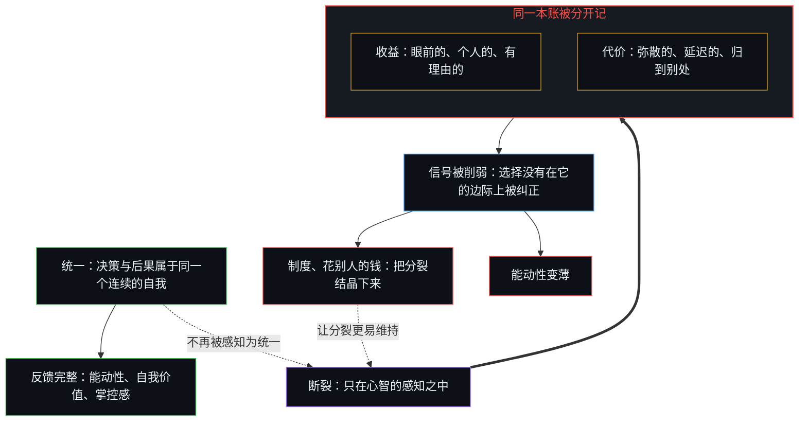
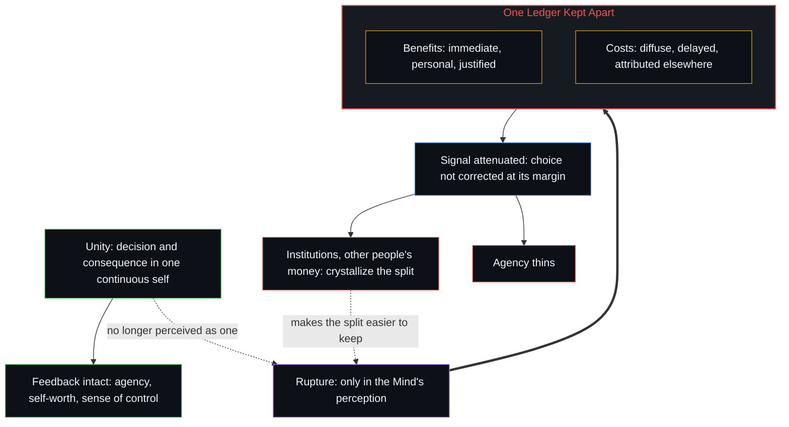

# 决策与后果的不可约先验 / The Irreducible Prior of Decision and Consequence

*离开心智是否感知到它的选择与它所承受的结果是统一的，就没有什么独立的断裂 / There is no break independent of whether a Mind perceives the choices it makes and the results it lives with as one.*

一切社会的、经济的、心理的现象，都出自每一个心智如何经验它所做的选择与它所承受的结果之间的关系。只要选择与结果被感知为属于同一个连续的自我，反馈就保持完整，能动性就被登记。

All social, economic and psychological phenomena emerge from how each Mind experiences the relation between the choices it makes and the results it lives with. While choices and results are perceived as belonging to one continuous self, feedback stays intact and agency registers.

断裂把同一本账的两面放在不同的描述之下，于是那个本该约束选择的信号被削弱。制度、花别人的钱、亲历的作者感的变薄，都是这种分裂的表达；它们不是分裂之下更深的原因。

The rupture keeps the two sides of one ledger under different descriptions, so the signal that would discipline choice is attenuated. Institutions, the spending of other people's money, and the thinning of felt authorship are expressions of that split; they are not a deeper cause beneath it.

## 一、 每个人都是两者唯一的中心 / 1. Every Individual Is the Sole Center of Both

每一个人，都是决策与后果唯一的最终中心，没有更高的位置。一切社会的、经济的、心理的现象，都出自每一个心智如何经验它所做的选择与它随后所承受的结果之间的关系。这是唯一不可约的先验。

Every individual is the sole ultimate center of both decision and consequence; there is no higher locus. All social, economic and psychological phenomena emerge from how each Mind experiences the relation between the choices it makes and the results it subsequently lives with. This is the single irreducible prior.

## 二、 统一让账本保持为一本 / 2. Unity Keeps the Ledger One

当一个心智把它的决策和这些决策的后果感知为属于同一个连续的自我，反馈就保持完整。局部的知识被用上，剩余的效应被登记为关乎自身的，互动就可以不断改进。这个人经验到能动性、自我价值、选择的自由，以及对命运一种连贯的掌控感，因为行动感觉有效，结果感觉是由同一个自我写下的。

When a Mind perceives its decisions and their consequences as belonging to the same continuous self, feedback stays intact. Local knowledge is used, residual effects are registered as one's own concern, and interactions can keep improving. The individual experiences agency, self-worth, freedom of choice and a coherent sense of control over destiny, because actions feel efficacious and outcomes feel authored by the same self.

[自我价值感与所有权](../ownership-and-self-worthiness/)追的是同一个循环的功能面：只有当后果作为自己的后果重新进入，模型才会复利。

[Ownership and Self-Worthiness](../ownership-and-self-worthiness/) traces the same loop on its functional face: the model compounds only when consequences re-enter as one's own.

## 三、 断裂只在观看之中 / 3. The Rupture Is Only in the Look

一旦决策与后果不再在那个心智之内被感知为统一，断裂就发生了。离开这份感知，就没有什么独立的断裂。客观本身离开知觉与诠释并无立足之处；每一个关于对齐或错位的说法，都已经是在某个心智的经验之中构成的。失败是知觉上的、诠释上的。

The rupture occurs the moment decision and consequence are no longer perceived as unified within that Mind. There is no break independent of this perception. Objectivity itself has no standing apart from perception and interpretation; every claim about alignment or misalignment is already constituted within a Mind's experience. The failure is perceptual and interpretive.

[前因，后果](../qian-yin-hou-guo/)追的是同一种滞后：当保留的参照比一步更宽，先前之因的后果就被登记为一个外部的原因。

[Cause Before, Effect After](../qian-yin-hou-guo/) traces the same lag: when the retained reference is wider than one step, the consequences of a prior cause register as an external cause.

## 四、 同一本账的两面被分开记 / 4. The Two Sides of One Ledger Are Kept Apart

认知上的框定，以及一再把结果外置，是这种断裂在个人身上最主要的表现。收益被记在一种描述之下，眼前的、个人的、有理由的；代价则以另一种描述到来，弥散的、延迟的，或被归到别处。同一本账的两面被分开记，那些本该约束选择的反馈信号，因此被扭曲或削弱。

Cognitive framing and the repeated externalization of results are the primary individual expressions of this rupture. Benefits are registered under one description, immediate, personal, justified, while costs arrive under another, diffuse, delayed or attributed elsewhere. The two sides of one ledger are kept apart, and the feedback signals that should discipline choice are thereby distorted or attenuated.

## 五、 制度把已在运作的分裂结晶下来 / 5. Institutions Crystallize the Split Already Operating

由于每一个人始终是唯一真正的决策者，也是唯一真正的后果承受者，这些个人层面的扭曲会聚合起来。互动的样式随之形成：剩余索取变得松散，激励错位，协调恶化。制度性的分离，也就是把决策权有系统地放在离剩余后果有一段距离之处的正式结构，是同一个断裂在集体层面的下游症状。制度并不创造最初的错置，它们把个体心智里已在运作的分裂诠释结晶下来、加以强化。一旦稳定，它们让知觉上的分裂更容易维持，但它们仍是次一层的。

Because every individual remains the only real decision-maker and the only real bearer of consequences, these individual distortions aggregate. Patterns of interaction form in which residual claimancy loosens, incentives misalign and coordination deteriorates. Institutional separation, formal structures that systematically place decision rights at a distance from residual consequences, is a downstream collective symptom of the same break. Institutions do not create the original misplacement; they crystallize and reinforce the fragmented interpretations already operating within individual Minds. Once stabilized they make the perceptual split easier to maintain, but they remain secondary.

[索维尔的表象洞察与根因之偏](../sowell-observed-the-surface-problem/)是同一个先验在激励上的那一面：错位是一种观看的症状：相信问题能跨越心智被解决的那种观看，已经把决策与后果当作占据了不同的位置。[知识问题与委托的幻觉](../the-knowledge-problem-and-the-illusion-of-delegation/)追的是同一种结晶：产权规则被升格为对分散知识的回答。[个体抉择是唯一的因果杠杆](../individual-choices-as-the-only-causal-levers/)追的是聚合本身：样式与条件是离散行动留下的痕迹，从来不是下一次行动的集体作者。

[Sowell Observed the Surface Problem](../sowell-observed-the-surface-problem/) is the same prior on its face of incentives: misalignment is the symptom of a look, the belief that problems can be solved across minds, which already treats decision and consequence as occupying different places. [The Knowledge Problem and the Illusion of Delegation](../the-knowledge-problem-and-the-illusion-of-delegation/) traces the same crystallization where property rules are elevated into the answer to dispersed knowledge. [Individual Choices as the Only Causal Levers](../individual-choices-as-the-only-causal-levers/) traces the aggregation itself: patterns and conditions are the residue of discrete acts, never a collective author of the next one.

## 六、 花别人的钱，直到能力耗尽 / 6. Other People's Money Until the Capacity Is Exhausted

人们熟悉的那种经济样式，资源看起来像“别人的钱”一样被花掉，直到底下的能力耗尽，是这一过程的一种可见的表达。花钱的人在不完整的反馈下做决定，剩余的代价由个人在另一种框定下经验，最初的决定因此没有在该被纠正的那个边际上得到纠正。集体的低效不是某个集体心智的失败，而是许多个体心智在受损的信号下各自优化所涌现的结果。

The familiar economic pattern in which resources appear to be spent as "other people's money" until the underlying capacity is exhausted is one visible expression of this process. The spender decides under incomplete feedback; the residual costs are experienced by individuals under a different frame; the original decision is therefore not corrected at the proper margin. Collective inefficiency is not the failure of a collective mind. It is the emergent result of many individual Minds optimizing under compromised signals.

[公共支出不创造资本](../public-spending-does-not-create-capital/)追的是装扮成账目的同一种分裂：先是移走，后是政治的分配；“投资”这个标签把再分配冻结成仿佛有一个集体的位置写下了供给。

[Public Spending Does Not Create Capital](../public-spending-does-not-create-capital/) traces the same split dressed as accounts: removal first, political allocation second, and the label "investment" freezes reallocation as if a collective locus had authored the supply.

## 七、 能动性随同一个分裂变薄 / 7. Agency Thins with the Same Split

同一个根源，也造成能动性、自我价值、亲历的选择自由与对命运的掌控感一同流失。当结果不再被登记为自己决策的透明后果，心智就不再经验到自己是它生命的有效作者。效能感下降，责任更容易被外置，能力与尊严的内在来源得不到清晰的反馈。

The same root produces the parallel losses of agency, self-worth, experienced freedom of choice and felt control over destiny. When outcomes are no longer registered as the transparent consequences of one's own decisions, the Mind ceases to experience itself as the effective author of its life. Efficacy declines, responsibility is more readily externalized, and the internal sources of competence and dignity are starved of clear feedback.

## 八、 一层关系，每一个层面 / 8. One Relation, Every Layer

每一个层面，认知的、心理的、制度的、经济的，都追溯到同一层关系的完整或断裂：每一个心智之内，决策与后果被感知到的统一。这份统一维持时，优化、能动性与协调都是可能的；它一旦断裂，优化互动的能力，连同作为一个自由而有效的自我的经验，就一起恶化。没有更深的原因。

Every layer, cognitive, psychological, institutional, economic, traces back to the integrity or rupture of a single relation: the perceived unity of decision and consequence within each Mind. While that unity holds, optimization, agency and coordination remain possible. When it fractures, the capacity to optimize interactions, together with the experience of being a free and effective self, deteriorates in tandem. There is no deeper cause.
