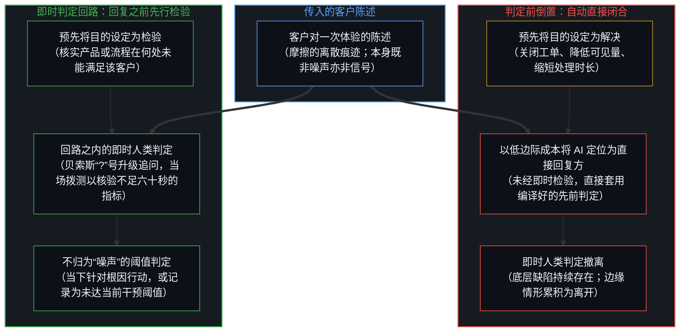
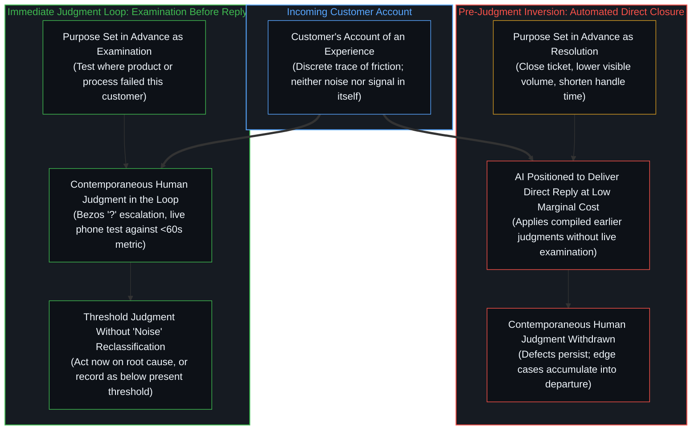

# 投诉的判定与即时回路的撤离 / The Judgment That Classifies the Complaint and the Withdrawal from the Immediate Loop

*噪声与信号是接收者事后施加的判定，预先把投诉当作待闭合的工单并让系统直接回复，便从当下实例中撤出了人的判定 / Noise and signal are judgments applied afterward by the recipient; treating a complaint in advance as a ticket to close and positioning a system to reply directly withdraws human judgment from the present instance*

投诉本身并不携带噪声或信号的属性。它是客户对一次体验的陈述，是客户遭遇摩擦时发出的离散痕迹，而噪声与信号则是接收者在事后施加的切分，正如[信息是什么](../what-information-is/)对一切信息划分所确立的那样。当接收者检验一份陈述，却未能从中识别出足够显著、值得当下行动的改进区域时，这一判定并不使投诉变成噪声；它只是记录了在当时应用的标准与容量之下，这份受检报告未跨过即刻干预的阈值，而陈述本身仍是一次折返的接触——正如[回返的信号与认领](../the-returning-signal-and-its-claim/)所追溯的，唯有在报告所涉产品或流程的负责者把它认领为自身行动的后果之处，它才成为学习。

The complaint does not arrive carrying the property of noise or signal. It is the customer's account of an experience, a discrete trace emitted from the customer's encounter with friction, and noise and signal are cuts applied afterward by the recipient, as [What Information Is](../what-information-is/) establishes for every informational partition. When a recipient examines an account and identifies no area of improvement significant enough for present action, that decision does not convert the complaint into noise; it records only that, under the criteria and capacity then applied, the examined report did not cross the threshold for immediate intervention, while the account itself remains a returning contact that becomes learning only where those whose product or process it reports on claim it as the consequence of their own act, as [The Returning Signal and Its Claim](../the-returning-signal-and-its-claim/) traces.

## 一、 判定之前的倒置与即时判定的撤离 / 1. The Inversion Before the Judgment and the Withdrawal of Contemporaneous Judgment

在支持回路中，三项不同的行动分处各自的轴线：预先设定回路的目的、在具体客户陈述抵达时对其加以检验，以及判定受检报告是否跨过当下行动的阈值。常见的因果倒置发生在第一步，即任何个别投诉接受检验之前。配置支持组织的决策者预先或默认将投诉的主要目的设定为解决——关闭工单、降低可见量、缩短平均处理时长、提高偏转率——而非检验，即核实产品或流程在何处未能满足该客户。一旦闭合被确立为默认目的，闭合本身便成为成功指标：任何会把注意力从已关闭工单的记分牌上引开的报告都会被登记为噪声，在运营仪表盘上重现了[基准刷榜中的封闭实存](../closed-reality-in-benchmark-maxing/)所追溯的同一种封闭参照平面。底层缺陷得以持续，边缘情形得以累积为系统性的离开理由。

In a support loop, three distinct acts sit on separate axes: setting the purpose of the loop in advance, examining the specific customer account when it arrives, and judging whether the examined report crosses the threshold for present action. The common causal inversion occurs at the first step, before any individual complaint is examined. The decision-makers who configure the support organization set, in advance or by default, the primary purpose of the complaint as resolution—closing the ticket, reducing visible volume, shortening average handle time, and raising deflection—rather than examination, which tests where the product or process failed this customer. Once closure is installed as the default purpose, closure itself becomes the success metric: any report that would pull attention away from the scoreboard of closed tickets registers as noise, repeating on an operational dashboard the same sealed reference surface traced in [Closed Reality in Benchmark Maxing](../closed-reality-in-benchmark-maxing/). Underlying defects persist, and edge cases accumulate into systemic reasons for departure.

人工智能并未发明这一倒置——支持组织长期以处理时长与偏转率为衡量标准——但当两个条件结合在一起时，它将这一倒置推至极端：一是大幅降低规模化执行自动闭合的边际成本，二是将系统定位为直接发出回复、自行闭合回路的一方。当模型被安置在回复席位上时，对这一具体投诉的即时人类判定便不再发生。正如[模型永远无法成为第二重前沿](../the-model-never-becomes-a-second-edge/)所确立的，模型所持有的只是先前区分的外化痕迹，而非活的抉择位点，因此它施加于客户陈述的是编译进权重与指令中的先前人类判定，而鲜活的人类判定——[判断的密度](../the-density-of-judgment/)将它定位在定框与验收的边界上——则从当下这一实例中撤出了。

Artificial intelligence does not invent this inversion—support organizations have long measured success by handle time and deflection—but it pushes the inversion to an extreme when two conditions join: sharply lowering the marginal cost of enacting automated closure at scale, and positioning the system as the party that delivers the direct reply to close the loop on its own. When the model is placed in the reply seat, the contemporaneous human judgment of this specific complaint no longer occurs. Because a model holds only externalized traces of prior distinctions rather than a living locus of choice, as [The Model Never Becomes a Second Edge](../the-model-never-becomes-a-second-edge/) establishes, what it applies to the customer's account are earlier human judgments compiled into weights and instructions, while the live human judgment that [The Density of Judgment](../the-density-of-judgment/) locates at the framing and acceptance boundaries is withdrawn from the present instance.

## 二、 保持在即时回路之内的判定 / 2. Judgment Kept Inside the Immediate Loop

杰夫·贝索斯在亚马逊的实践，将人类判定保持在即时回路之内。他保留了一个公开电子邮箱（`jeff@amazon.com`），亲自阅读大量客户来信。当一封投诉值得注意时，他将其转发给负责的高管，仅附一个字符——`?`——意思是：为什么会这样？查清楚，解决根因。高管会议上预留一把空椅代表客户，要求每项决策都对照那位不在房间里的人的体验接受检验。当内部每周业务审视会议的指标声称客服电话等待时间不足六十秒、而客户投诉却持续报告漫长的等待时，贝索斯在会场上直接拿起免提电话，亲自拨打 `1-800` 客服热线，与满屋高管在沉默中一起等待了十多分钟。他明言的原则是：当数据与轶事不符时，轶事通常是对的；这并不意味着盲目迎合轶事，而是要去检验数据，因为问题通常不在于数据收集有误，而通常在于测量的不是该测的东西。当指标测量的是错误的划分时，他的实践拒绝让汇总的统计均值凌驾于单次鲜活的摩擦遭遇（`N = 1`）之上，从而持守了[平均值是残余，不是引擎](../the-average-is-residue-not-the-engine/)与[规程的倒置与因果回路的消声](../the-inversion-of-the-protocol-and-the-silencing-of-the-causal-loop/)所追溯的同一因果次序：仪表盘摘要是下游残余，投诉则作为系统性失败的证据接受检验，而不是被当作待闭合的个案来处理。在具体实例中，人类判定始终在场。

Jeff Bezos's practice at Amazon kept human judgment inside the immediate loop. He maintained a public email address (`jeff@amazon.com`) and read many of the customer messages himself. When a complaint warranted attention, he forwarded it to the responsible executive with a single character—`?`—meaning: why is this happening, investigate, and address the root cause. An empty chair in executive meetings represented the customer, requiring decisions to be tested against the experience of the person not in the room. When internal Weekly Business Review metrics claimed that customer-service phone wait times were under sixty seconds while customer complaints continued to report long holds, Bezos picked up the speakerphone during the meeting, dialed the 1-800 support line himself, and waited in silence with the room for more than ten minutes. His stated principle was that when the data and the anecdotes disagree, the anecdotes are usually right; that does not mean slavishly following the anecdotes, it means examining the data, because it is usually not that the data is being miscollected, it is usually that you are not measuring the right thing. By refusing to let a pooled statistical average override a single live encounter with friction (`N = 1`) when the metric is measuring the wrong partition, his practice held the same order traced in [The Average Is Residue, Not the Engine](../the-average-is-residue-not-the-engine/) and [The Inversion of the Protocol and the Silencing of the Causal Loop](../the-inversion-of-the-protocol-and-the-silencing-of-the-causal-loop/): the dashboard summary is downstream residue, and complaints are examined as evidence of systemic failure rather than processed as cases to be closed. Human judgment remained present in the instance.

## 三、 自动闭合充当最终判定者与延迟显现的公共表面 / 3. Automated Closure as the Final Judge and the Delayed Public Appearance

SpaceXAI（SpaceX 旗下更名后的原 xAI）对 Grok Bot 的部署，将倒置推向了可见的极端——这是与将人类判定保持在即时回路之内相反的案例。在其关于扩展客户支持的案例研究中，该公司描述系统在未增加人手的情况下吸收了 175% 的支持量增长，仅在首日对拟议回复进行审查后便允许其以每张已解决工单 20 至 30 美分的成本直接回复客户，并在无人类介入的情况下解决了 99% 的退款请求，同时以原始工单量警报会给员工制造噪声为由，将机器人的分流置于团队注意力之前。这一做法被呈现为高效扩展。同一时期，埃隆·马斯克公开承认服务 Grok Bot 的成本相对于收入已不可持续，导致收紧的使用限额在计费周期中途切断了付费订阅用户——其中一名订阅用户报告称，原本可用满一周的 200 美元套餐在中等负载下十四小时便告耗尽——并在 X 上引发广泛投诉。用户报告配额快速耗尽、体验下降以及难以获得人类救济。自动化并未按照[失败即信息](../failure-as-information/)所追溯的方式，在即时支持回路之内把每一份折返报告当作检验产品或配额策略在何处辜负用户的信息，而是本意在于遏制量级，却未能及时认真对待客户投诉，反而将未解决的报告外化为更可见的公共摩擦，任其扩大为一场公关噩梦与反复出现的公关负担。当这场风波引起马斯克注意并促使其在 X 上公开回应时，它早已演变成一起重大的全球公共事件；这一反应毫无即时可言，因为倘若客户支持在即时回路之内便认真对待用户投诉，他本就几乎无须出面公开回应。系统被允许在即时回路中充当最终判定者，投诉被当作可闭合的体量处理；后续的公开表面只是该选择的延迟显现。

SpaceXAI's (the rebranded xAI under SpaceX) deployment of Grok Bot pushed the inversion to a visible extreme—the opposite case to keeping human judgment inside the immediate loop. In its case study on scaling customer support, the company described the system absorbing a 175 percent increase in support volume without new hires, permitting direct replies to customers at twenty to thirty cents per resolved ticket after a single day of reviewing proposed responses, and resolving 99 percent of refund requests without human intervention, while placing bot triage in front of the team's attention on the ground that raw volume alerts would create noise for the staff. The approach was presented as efficient scaling. In the same period, Elon Musk publicly acknowledged that the cost of serving Grok Bot had become unsustainably high relative to revenue, leading to tightened usage limits that cut paid subscribers off mid-cycle—with one subscriber reporting a $200 weekly plan running out in fourteen hours under moderate load—and generating widespread complaints on X. Users reported rapid consumption of quotas, degraded experiences, and difficulty obtaining human recourse. Instead of taking up each returning report inside the immediate support loop as information about where the product or quota policy failed the user, in the manner [Failure as Information](../failure-as-information/) traces, automation intended to contain volume failed to take client complaints in time and externalized unresolved reports as more visible public friction, letting them expand into a public-relations nightmare and a recurring public-relations burden. By the time the blowup caught Musk's attention and prompted a public response on X, it had already become a major global event; there was nothing immediate about that reaction, because had customer support taken user complaints seriously in the immediate loop, there would have been little need for him to respond publicly. The system was allowed to function as the final judge in the immediate loop; complaints were processed as closable volume; the later public surface was only the delayed appearance of that choice.

## 四、 工具的边界与回到做选择的人 / 4. The Boundary of the Instrument and the Return to the Chooser

工具可以用于分类、路由、在审查下起草或检索。唯有当自动闭合的低边际成本，与将系统定位为直接发出回复、独立闭合回路结合在一起时，倒置才被推至极端。保持人类在即时回路之内，使判定发生在回复送达客户之前：投诉被接收、由人检验，然后要么被判定为足够显著而采取当下行动，要么被记录为当前尚未跨过干预阈值——无须经过将客户陈述命名为噪声这一中间步骤。正如[因果停留在掌舵的边缘](../causality-stays-at-the-edge-that-steers/)与[框架的倒置与驾驶位的主权非对称](../the-inversion-of-the-harness-and-the-driver-seat-asymmetry/)所确立的，人工智能作为工具扩展的是执行能力；将它视为与人类对等的回复方，则是把编译好的先前判定直接当作对这一实例的最终判定。所谓组织，只是一个汇总的名称，所指的是那些设定支持指标、批准机器人直接回复权限的个人。总有人预先选择投诉的存在是为了被闭合还是为了被检验，也总有人要么亲自阅读这一具体实例，要么从回路中撤离。正如[任务的移交与后果的不可让渡](../the-delegation-of-the-task-and-the-inalienability-of-consequences/)所追溯的，后果并不会转移给工具：持续存在的缺陷、离开的客户与反复出现的公关负担，终究会回到组织中那些预先选择将投诉的目的设定为解决的决策者身上。

Tools may be used for classification, routing, drafting under review, or retrieval. The inversion is pushed to its extreme only when the low marginal cost of automated closure is combined with positioning the system to deliver the direct reply and close the loop on its own. Keeping a human inside the immediate loop places the judgment before the reply reaches the customer: the complaint is received, examined by a person, and then either judged significant enough for present action or recorded as not currently crossing the threshold for intervention—without the intermediate step of naming the customer's account noise. Artificial intelligence as a tool extends execution, as [Causality Stays at the Edge That Steers](../causality-stays-at-the-edge-that-steers/) and [The Inversion of the Harness and the Sovereignty of the Driver's Seat](../the-inversion-of-the-harness-and-the-driver-seat-asymmetry/) establish; treating it as equal to a human for the reply converts earlier compiled judgments into the final judgment of this instance. An organization is only a summary name for the individuals who set the support metrics and authorize the bot's direct-reply permissions. Someone chooses in advance whether a complaint exists to be closed or examined, and someone either reads this instance or withdraws from the loop. Consequences do not transfer to the tool, as [The Delegation of the Task and the Inalienability of Consequences](../the-delegation-of-the-task-and-the-inalienability-of-consequences/) traces: the persistent defects, departing customers, and recurring public-relations burden return to the decision-makers in the organization who chose to set the purpose of the complaint in advance as resolution.
