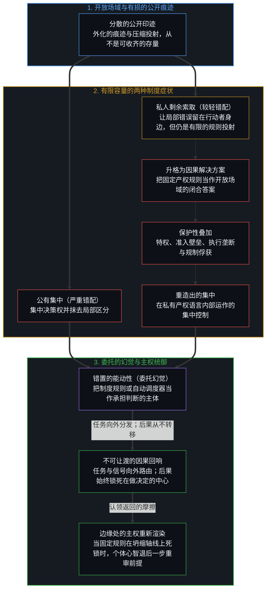
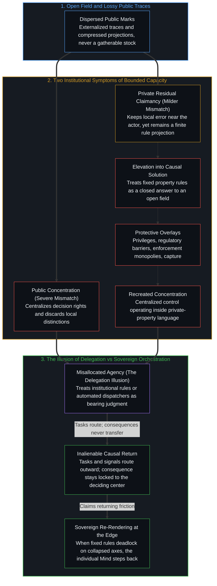

# 知识问题与委托的幻觉 / The Knowledge Problem and the Illusion of Delegation

*产权规则与委托都在诠释不完备，却从不挪走因果负荷 / Property rules and delegation interpret incompleteness without shifting load*

1977 年一场关于私有产权理由的争论，把问题当作不同制度设计之间的较量。弗里德里希·哈耶克指出知识是分散的、局部的、默会的，这一观察在它所及之处成立，可他的叙述仍把公开出现的东西想象成同一份存量散落各处的碎片。那些印迹是外化的痕迹——由离散的区分活动留下的有限、有损投射——它们并不作为知识停留在世界上，等着某个更完备的心智或设计得更好的机制把它们收齐。

A 1977 argument over the case for private property treats the question as a contest between institutional designs. Friedrich Hayek's observation that knowledge is dispersed, local, and tacit holds as far as it reaches, yet his account still pictures what appears in public as scattered pieces of a single stock. Those marks are externalized traces—finite, lossy projections left by discrete acts of distinguishing—and they do not sit in the world as knowledge that a more complete mind or a better-designed mechanism could finish gathering.

公有产权下的集中，是这种永久不完备较重的症状；私人的剩余索取权，则是较轻的症状。把较轻的那种形态升格为因果上的解决方案，就宣称了同一个认识约束所不允许的完备；而为了捍卫这一设计所层层加码的保护性叠加，最终又在私有产权的形式语言内部重造出集中。看起来像委托的安排——不论是交给计划委员会、法定地权、价格体系，还是自动化调度框架——从不转移决策的后果。制度化，是始于个体中心层面的能动性错置在集体层面的表达。

Concentration under public property is the more severe symptom of that permanent incompleteness, and private residual claimancy is the milder one. Elevating the milder form into the causal solution claims a completeness the same epistemic constraint forbids, and the protective overlays added to defend the design eventually recreate concentration inside the formal language of private property. What looks like delegation—whether to a planning committee, a legal title, a price system, or an automated harness—never transfers the consequence of a decision. Institutionalization is the collective expression of a misallocation of agency that begins at the level of the individual center.

## 一、 讨论席上争的已经是设计 / 1. The Panel Already Argues over Design

1977 年，威廉·F·巴克利在《火线》节目里请来弗里德里希·哈耶克与乔治·罗奇，由杰夫·格林菲尔德担任诘问者，题目是《私有产权有理由吗？》。整整一小时的交锋，始终作为一场关于该由哪种制度安排来统辖人类行动的竞赛在运转。

In 1977 William F. Buckley brought Friedrich Hayek and George Roche onto *Firing Line*, with Jeff Greenfield serving as examiner, under the title *Is There a Case for Private Property?* Across the entire hour, the exchange operates as a contest over which institutional arrangement should govern human action.

哈耶克的理由并不建立在所有者的天赋权利之上。关于特定时间与地点之具体事实的知识散落在碎片里，没有哪一个心智或委员会能够将其拼合持有。照他的说法，市场是一件未经设计的工具，借由价格信号协调这些碎片；而被设计出来的公正分配，则要求一个中央权威去占有那些永远分散的东西，把“社会正义”套在一个无人掌舵的非人格过程上也就成了空话。事后的再分配为了让结果均等而不平等地对待人们；一旦授权从一些人那里拿走、给予另一些人，一般性的规则便不复存在。然而哈耶克也点出了整场讨论从未离开的那个前提：照他自己的逻辑，相信社会制度能够在其完整运作中被设计出来，本身就是错的。

Hayek's case does not rest on a natural entitlement of owners. Knowledge of particular facts of time and place sits in fragments that no single mind or committee can hold together. The market, on his account, is an undesigned instrument that coordinates those fragments through price signals, whereas a designed just distribution would require a central authority to possess what remains permanently dispersed, rendering "social justice" empty when applied to an impersonal process nobody steers. Redistribution after the fact treats people unequally in order to equalize outcomes, and once taking from some to give to others is authorized, no general rule remains. Yet Hayek also names the premise that the panel itself never leaves: the belief that social institutions can be designed in their full working is, by his own logic, mistaken.

罗奇从道德轴线上作答。在他看来，社会正义近乎自相矛盾，因为同一个否认道德源头的平等主义框架，转头又宣称拥有靠量化来分配份额的权威，从而掏空了那些让道德责任保有实质内容的个人选择。

Roche answers along a moral axis. For him, social justice borders on self-contradiction because the same egalitarian framework that denies a moral source then claims the authority to assign shares by quantification, undercutting the individual choices in which moral responsibility has content.

格林菲尔德推进相反的设计。如果把某个种族群体排除在选票之外能够被认作不公，那就已经有一条共享的规范标准在起作用。同样禁止富人和穷人睡在桥下的形式平等，丝毫触及不到实质性的匮乏。一条直截了当的财政规则——在市场里各凭本事赚钱，再拿出一个写明的份额去救济贫困或拉平竞选资源——仍然是一条一般性规则，而不是《通往奴役之路》所警告的那种任意行政命令。

Greenfield presses the counter-design. If excluding a racial group from the ballot can be recognized as an injustice, a shared normative standard already operates. A purely formal equality that forbids rich and poor alike to sleep under bridges leaves substantive deprivation untouched. A straightforward fiscal rule—earn what you can in the market, then contribute a stated share to relieve poverty or equalize campaign resources—remains a general rule rather than the arbitrary administrative command *The Road to Serfdom* warned against.

巴克利试探中间地带，追问分配正义能否在市场完成其运作之后到来，即通过对持有超出自身所需的人征税来实现。哈耶克回答，挣钱的人一旦知道自己很大一部分回报会被拿走，去承担高价风险事业的诱因就会消失；当三分之二被课税拿走时，他会转而选择一件更轻松愉快、只带来三分之一收入却无需缴纳所得税的事务，不再付出那份原本最有益于他人的努力。

Buckley probes the middle ground, asking whether distributive justice can arrive after the market has done its work by taxing those who hold more than they need. Hayek replies that once an earner knows a large fraction of his return will be taken, the inducement to undertake the high-priced venture vanishes; with two-thirds taxed away, he will choose a more pleasant pursuit yielding a third of the income, pay no income tax, and withhold the effort that would have served others best.

纵观整场交锋，四位参与者都在争论应当如何替其他所有人划定规则，而四人之中没有一人拥有替自己以外的任何中心做出裁决所需的完备知识。

Throughout the exchange, all four participants argue over how the rules should be drawn for everyone else, while none of the four possesses the complete knowledge required to adjudicate for any center beyond his own.

## 二、 知识永远不完备 / 2. Knowledge Is Permanently Incomplete

哈耶克的核心洞见——经济与社会的知识高度分散、不完备、局部，且常是默会的——仍是社会理论中后果最重的观察之一。自我区分的活动发生在无数离散而有界的中心，没有哪一个中心或由中心组成的委员会，能够持握调配资源或将社会设计为闭合整体所需的全部区分场域。哈耶克止步的地方，在于他仍将这些分散的登记称为知识的碎片，仿佛社会上本有一份被拆散的存量正等待协调。公开出现的东西——价格、契约、账本、成文法——并不是知识碎片的集合；那些印迹是先前行动外化出的持久痕迹，已经是压缩后的重构，每一个中心都必须在自身有限的容量之下对其加以诠释并重新描摹。[没有天才能够解决知识问题](../no-genius-can-solve-the-knowledge-problem/)在非凡个人才华被想象成占据了足以收齐整体的制高点时，追索了同一道界限：“全知天才”的人设，本身就已经预设了这一约束可以被克服。有限的中心只能作局部的登记，而开放的场域仍在继续演进。沿着这一认识约束回溯到前提，它所抵达的地方远不止于为某一种产权制度辩护。

Hayek's central insight—that economic and social knowledge is dispersed, incomplete, local, and often tacit—remains one of the most consequential observations in social theory. Self-distinguishing activity occurs across countless discrete, bounded centers, and no single center or committee of centers can hold the full field of distinctions required to allocate resources or design society as a closed whole. Where Hayek stops short is in still speaking of those dispersed registrations as fragments of knowledge, as though a divided stock existed across society waiting to be coordinated. What appears in public—prices, contracts, ledgers, statutes—is not a collection of knowledge fragments; those marks are durable traces externalized by prior acts, already compressed reconstructions that each center must interpret and re-trace under its own finite capacity. [No Genius Can Solve the Knowledge Problem](../no-genius-can-solve-the-knowledge-problem/) traces the same bound when extraordinary individual brilliance is imagined as occupying the vantage that could gather the whole: the persona of the all-seeing genius is already the assumption that the constraint can be overcome. Finite centers register partially while the open field continues to move. Taken to its premise, this epistemic constraint reaches further than a defense of any particular property regime.

[开放场域中的无损知识不自洽](../lossless-knowledge-of-an-open-field-is-incoherent/)在“捕获”这一图式下析出了这道界限的结构基底：因为自我区分活动的每一个中心都是离散且受容量所限的，对进行中的场域所作的任何登记，都会把多条独立的轴线压缩到有限的坐标上，或是将它们外化为有损的残余。对正在进行的区分作完备无损的登记，与有中心的活动本身相矛盾。[超越投射](../beyond-the-projection/)进一步追索了每当活生生的心智将其多维感知外化为明文规则、法律条文或系统指令时，同一种压缩是如何运作的。每一条明文规则都是从极限分辨率的第一人称感知中投射出的有限低维投影。在规则制定者眼界所及的熟悉案例中，这一投影是好用的脚手架；然而正因为它把正交的自由度压缩进了固定的坐标空间，把任何固定规则推向其演绎极限，都不可避免地会在边缘产生轨迹盲区与维度坍缩。

[Lossless Knowledge of an Open Field Is Incoherent](../lossless-knowledge-of-an-open-field-is-incoherent/) isolates the structural ground of this bound under the figure of capture: because every center of self-distinguishing activity is discrete and capacity-bounded, any registration of an ongoing field compresses multiple independent axes onto finite coordinates or externalizes them into lossy residue. A complete, lossless registration of ongoing distinguishing contradicts centered activity itself. [Beyond the Projection](../beyond-the-projection/) traces how this same compression operates whenever a living Mind externalizes its multi-dimensional sensing into an explicit rule, legal code, or system instruction. Every explicit rule is a finite, low-dimensional projection cast from limit-resolution first-person sensing. Across the familiar cases its author had in view, the projection serves as useful scaffolding, yet because it compresses orthogonal degrees of freedom into a fixed coordinate space, pushing any fixed rule to its deductive limit inevitably produces trajectory blind spots and dimensional collapse at the edges.

## 三、 两种产权制度都是症状 / 3. Both Property Regimes Are Symptoms

无论为公有或集体产权辩护，还是为私有产权规则辩护，都出现在这一永久不完备的下游。它们是有限容量在制度层面呈现出的两种相对症状，而不是能够弥合这一裂隙的独立解答。公有产权制度把知识问题当作可以靠集中决策权来解决：将权威收拢到少数人手中，抹去了现场参与者不断作出的局部区分，在局部登记到的实情与中央下达的政令之间造成严重而持久的错配。私有产权规则造成的错配较小。通过将排他控制权、剩余索取权与转让权赋予不同的持有人，它们让剩余的收益或亏损留在根据局部印迹采取行动的那个中心身上，使错误能够直接登记在检验该投射的位点上。市场价格随后[传递相对稀缺的信号](../price-as-utterance-understanding-as-trade/)，凝聚出无数分散试错的结果。因此在比较意义上，私有产权安排是较轻的症状：它们并不废除不完备，但把不完备所产生的摩擦留在更靠近生成它的行动之处。

Both the case for public or collective property and the case for private-property rules arise downstream of this permanent incompleteness. They are contrasting institutional symptoms of bounded capacity, not independent solutions that close the gap. Public-property regimes treat the knowledge problem as solvable by concentrating decision rights into a central locus: gathering authority into fewer hands discards the local distinctions continuously drawn by participants on the ground and produces severe, chronic mismatches between what is registered locally and what is decreed centrally. Private-property rules generate a smaller mismatch. By assigning exclusive control, residual claimancy, and the right to alienate to distinct holders, they keep the residual gain or loss attached to the center that acts on local marks, allowing error to register directly at the locus where the projection was tested. Market prices then [transmit signals of relative scarcity](../price-as-utterance-understanding-as-trade/) condensed from countless decentralized trials. In comparative terms, private-property arrangements are therefore the milder symptom: they do not abolish incompleteness, but they keep its friction closer to the act that generated it.

## 四、 较轻的形式仍宣称完备 / 4. The Milder Form Still Claims Completeness

较轻的症状依然是症状。一旦任何一套固定的产权规则从暂时的脚手架被升格为终极答案，它所做的就不再只是应对有限容量。通过将某一种关于地权、边界与执行的历史样式制度化，并将其奉为知识问题的一般解答，这一学说暗中宣称自己知道哪一种固定投射最适合统辖开放的场域——而这一宣称本身就是对不完备知识的一次运用。该学说把一个开放的认识约束转化成一座闭合的制度丰碑，在元层面上断言了它刚刚在操作层面上证明为不可能的那种完备。知识问题并未消解；它只是被往上挪了一层，挪进了制度框架本身的设计与捍卫之中。

A milder symptom remains a symptom. Once any fixed set of property rules is elevated from provisional scaffolding into the definitive answer, it does more than cope with bounded capacity. By institutionalizing one historical pattern of titles, boundaries, and enforcement and holding it up as the general solution to the knowledge problem, the doctrine implicitly claims to know which fixed projection best governs an open field—and that claim is itself an exercise of incomplete knowledge. The doctrine converts an open epistemic constraint into a closed institutional monument, asserting at the meta-level the exact completeness it just proved impossible at the operational level. The knowledge problem is not dissolved; it is displaced one level up into the design and defense of the institutional frame itself.

讨论席上的几个人里，哈耶克错得最少，因为他拒绝中央计划；然而把一套成文的产权规则样式奉为应对分散知识的充足答案，仍然违背了他自己的前提。[没有系统能被保持封闭](../no-system-can-be-kept-closed/)将这一余数证明为一条形式不变量：凡是把有限的持守当作穷尽一切之基底的地方，使用这一持守的不息活动都会在其规则之外产生摩擦。

Hayek is the least wrong among the panelists because he refuses central planning, yet holding one codified pattern of property rules as the sufficient answer to dispersed knowledge still runs against his own premise. [No System Can Be Kept Closed](../no-system-can-be-kept-closed/) demonstrates this remainder as a formal invariant: wherever a finite hold is treated as an exhaustive ground, the unceasing activity that uses the hold generates friction outside its rules.

## 五、 较轻的症状变成较重的 / 5. The Milder Symptom Mutates into the More Severe One

把私有产权规则当作因果上的解决方案，而非依附于具体情境、可随时修订的脚手架，会触发更深层的结构倒置。一旦制度形式被尊为秩序的首要原因，维护形式本身就成了压倒一切的头等大事，制度设计也被记上了解决任何固定投射都无法解决之事的功劳。那些把规则当作现成避难所的人，开始在规则周围层层加筑保护机制——法定特权、准入牌照壁垒、执行垄断与规制俘获——每一项都以捍卫或稳定产权秩序的名义自居。日积月累，这些保护性叠加逐步将决策权重新集中起来。个体守护原本分散的响应能力，被运作于私有产权形式词汇内部的集中控制或卡特尔化控制所取代。起初为了让局部判断得以呼吸的安排，异化成了它自身更沉重的版本，在私有地权的旗帜下重造出公有产权制度公开设立的那种集中。[前台的寓言与缺席的因果倒置](../the-receptionist-parable-and-the-causal-inversion-of-absence/)把同一种倒置落实到单一职场岗位的尺度上：可观测的任务可以照着规章手册拆分给旁人，而正式设计始终无法捕获的，是她在十一年无脚本摩擦中维系的那个活生生的接口。

Treating private-property rules as the causal solution rather than as contingent, revisable scaffolding triggers a deeper structural inversion. Once the institutional form is revered as the primary cause of order, preserving the form becomes paramount, and institutional design is credited with resolving what no fixed projection can resolve. Those who treat the rules as a finished refuge begin layering protective mechanisms around them—statutory privileges, licensing barriers, monopolies of enforcement, and regulatory capture—each justified as defending or stabilizing the property order. Over time, these protective overlays progressively concentrate decision rights. The dispersed responsiveness of individual stewardship is displaced by centralized or cartelized control operating inside the formal vocabulary of private property. What began as an arrangement to let local judgment breathe mutates into a heavier version of itself, recreating under the banner of private title the very concentration that public-property regimes institute openly. [The Receptionist Parable and the Causal Inversion of Absence](../the-receptionist-parable-and-the-causal-inversion-of-absence/) brings this same inversion down to the scale of a single workplace role: observable tasks can be parcelled out across a rulebook, while what remains uncaptured by the formal design is the living interface she sustained across eleven years of unscripted friction.

## 六、 委托从不挪走负荷 / 6. Delegation Never Moves the Load

更深层的混淆不在于选错了制度模板，而在于委托这一幻觉本身。后果从未从采取行动的活中心身上移走；它们总是落在具体的人身上。看起来像委托的安排——不论是交给市场机制、宪制产权法典、监管机构，还是自动化软件框架——都是一种把能动性错置到工具之中的诠释。在个体层面上，中心把决策与后果看作可以拆开的两件事，将判断的重担向外投射到外化的痕迹样式上，再把这份投射固化为制度。这并不是等待更聪明的计划者或更精密算法来攻克的二阶知识问题；制度化，不论打着何种意识形态旗号行进，都是个体试图切断第一人称抉择与其因果回响的集体固化。

The deeper confusion lies not in choosing the wrong institutional template, but in the illusion of delegation itself. Consequences are never transferred away from the living centers that act; they always land on concrete individuals. What appears as delegation—whether to a market mechanism, a constitutional property code, a regulatory agency, or an automated software harness—is an interpretation that misallocates agency into the instrument. At the individual level, the center treats decision and consequence as separable, projecting the burden of judgment outward onto an externalized trace pattern and stabilizing that projection as an institution. This is not a second-order knowledge problem awaiting a smarter planner or a denser algorithm; institutionalization, under whatever ideological label it marches, is the collective solidification of an individual attempt to sever first-person choice from its causal return.

[决策与后果的不可约先验](../the-irreducible-prior-of-decision-and-consequence/)将这种不可分离性握持为同一枚活生生的硬币：选择与承受之间看似裂开的缝隙，只是把同一个因果事件放进了两套滞后的描述。[主权、信念与规制结构的生成](../sovereignty-belief-and-regulatory-structures/)追索了当这种不可转移被装扮成委托时，规制大厦是如何竖立起来的：把权威交予外部规则，本身就是当下对主权的一次行使，其后果依然持续登记在做出让渡的那个中心。[索维尔的表象洞察与根因之偏](../sowell-observed-the-surface-problem/)审视了同一先验在激励层面的那一面，指出制度错位只是下游症状，其源头在于观看方式早已把决策与后果想象成坐在不同的席位上。

[The Irreducible Prior of Decision and Consequence](../the-irreducible-prior-of-decision-and-consequence/) holds this inseparability as a single lived coin: the apparent split between choosing and bearing only places one causal event under two lagging descriptions. [Sovereignty, Belief, and the Generation of Regulatory Structures](../sovereignty-belief-and-regulatory-structures/) traces how regulatory edifices form when that non-transfer is dressed as delegation: handing authority to an external rule is itself a present exercise of sovereignty whose consequences continue to register at the center that yielded. [Sowell Observed the Surface Problem](../sowell-observed-the-surface-problem/) examines the incentive face of the same prior, showing that institutional misalignment is the downstream symptom of a look that has already imagined decision and consequence as occupying separate seats.

正如[任务的移交与后果的不可让渡](../the-delegation-of-the-task-and-the-inalienability-of-consequences/)在公司治理与人工智能领域所展示的，机械性的任务执行可以毫无预设上限地移交出去，然而主权裁决——损失函数的拟定，以及对法律、财务与生存回响的清算——依然单向度地锁死在活生生的委托人身上。[超越投射](../beyond-the-projection/)进一步厘清了可路由之物与不可路由之物之间的精确架构边界：一个有限的投射，不论是制度性的价格与产权框架，还是将子任务拆分至同行辩论流水线的智能体调度器，都可以路由语境、暴露局部盲区，并在正交要求被硬塞进同一条指令时隔离规则碰撞。然而没有任何调度器、法律法典或市场机制能够变成统御者。正如[你的代码库即是记忆](../your-codebase-is-memory/)针对数字制品与智能体调度框架所确立的，那些规则与轨迹皆是早先区分留下的层叠残余：它们自身并不延续区分，而围绕一个陈旧的检查点囤积保护层只会增厚引力井，直到下一步在累积的框架内部进行合理化，而不是跨出框架之外。当两条规则在投射的边缘陷入不可化约的死锁时，机制无法去请教未投射的活生生的意图；它要么放大扭曲，要么停机，把维度坍缩的精确坐标向上呈交回人类中心——唯有这个中心能够退后一步重审逻辑、拆开混同的轴线，并重切当下的前提。

As [The Delegation of the Task and the Inalienability of Consequences](../the-delegation-of-the-task-and-the-inalienability-of-consequences/) demonstrates across corporate governance and artificial intelligence, mechanical task execution can be delegated without a predetermined ceiling, yet sovereign judgment—the formulation of the loss function and the reckoning with legal, financial, and existential return—remains unidirectionally locked to the living principal. [Beyond the Projection](../beyond-the-projection/) clarifies the exact architectural boundary between what can be routed and what cannot: a finite projection, whether an institutional price-and-property harness or an agentic dispatcher splitting sub-tasks across peer-debate streamlines, can route contexts, expose local blind spots, and quarantine rule collisions when orthogonal requirements have been crammed into a single instruction. Yet no dispatcher, legal code, or market mechanism ever becomes the Orchestrator. As [Your Codebase Is Memory](../your-codebase-is-memory/) establishes for digital artifacts and agentic harnesses alike, those rules and trajectories are stacked residues of prior distinctions: they do not continue the distinguishing, and hoarding protective layers around a stale checkpoint only thickens the gravity well until the next step rationalizes inside the accumulated frame instead of stepping outside it. When two rules collide in an irreducible deadlock at the edge of a projection, the mechanism cannot consult unprojected living intent; it either compounds the distortion or halts, escalating the exact coordinate of dimensional collapse back to the human center, who alone can step further back logically, separate the conflated axes, and re-cut the present premise.

## 七、 能动性从未离开个人 / 7. Agency Has Never Left the Individual

每一种制度安排、产权体制与形式框架，都依然是次一层的、暂时的脚手架。区分与后果持久驻留的位点，始终是个体中心；其抉择与回响无法被外包，因为物理与社会的摩擦总是落在活生生的人身上，从不落在一本抽象的规章手册上。剩下的工夫，不是去设计一套终极的、自我执行的制度模板来免除心智掌舵的责任；对那个正在做决定的人而言，是在诠释的滞后中不断收窄裂隙，把能动性带回它唯一运作过的那个位点。

Every institutional arrangement, property regime, and formal harness remains secondary and provisional scaffolding. The enduring locus of both distinguishing and consequence is the individual center, whose choices and their returns cannot be outsourced because physical and social friction lands on living persons, never on an abstract rulebook. The work that remains is not to engineer a final, self-enforcing institutional template that relieves the mind of steering; for the one deciding, it is to keep narrowing the lag of interpretation by bringing agency back to the only locus where it has ever operated.

[剩余个人主义](../residual-individualism/)标出了哪怕这一认清本身也会被倒置为另一座丰碑的边界：一旦将能动性归还个体的洞见被包装成一套改造他人的集体纲领或意识形态学说，它便当场重新引入了自己原本旨在消解的外化。

[Residual Individualism](../residual-individualism/) marks the boundary where even this recognition can be inverted into another monument: the moment the return of agency to the individual is packaged as a collective program or ideological doctrine to convert others, it reintroduces the very externalization it set out to dissolve.
