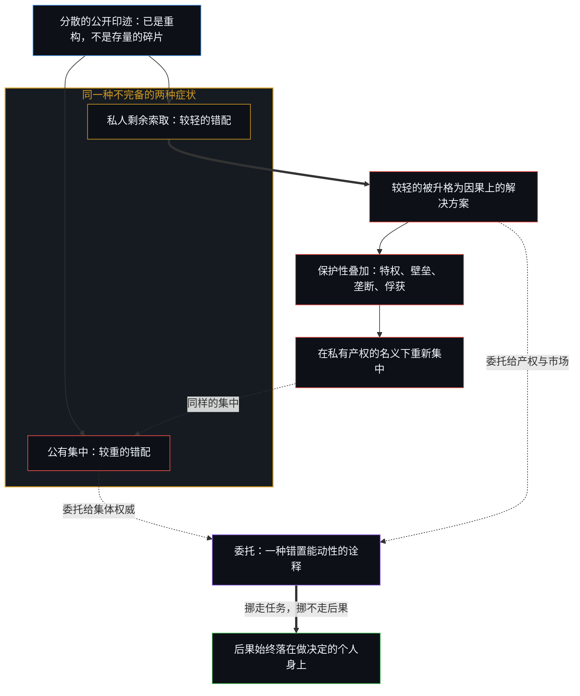
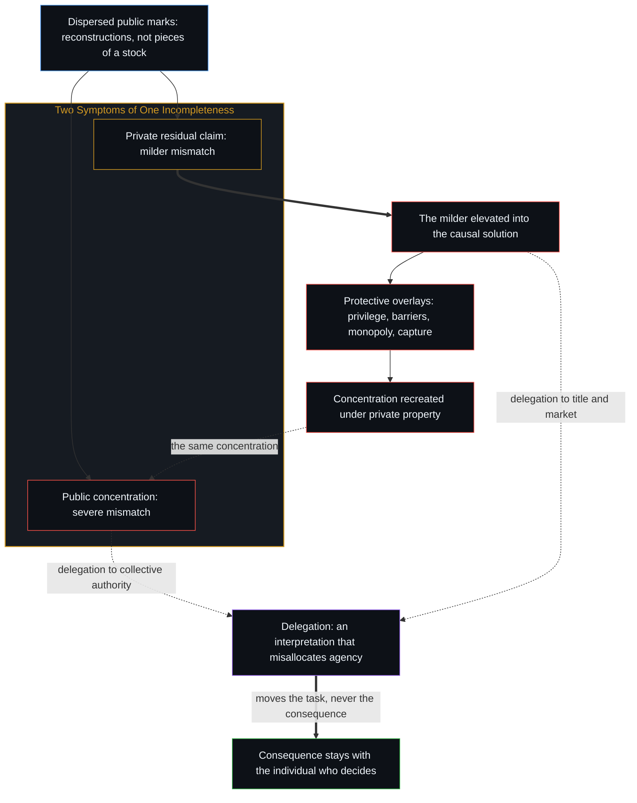

# 知识问题与委托的幻觉 / The Knowledge Problem and the Illusion of Delegation

*产权规则与其他每一种委托，都在诠释不完备，它们并不收集知识，也不挪走负荷 / Property rules and every other delegation interpret incompleteness; they do not gather knowledge or move the load.*

1977 年一场关于私有产权理由的争论，把问题当作几种设计之间的竞争。哈耶克说知识是分散的、局部的、默会的，这在它所及之处成立；可它仍把公开出现的东西想象成一份存量的碎片。那些印迹是外化，并不是一个更完整的心智能够收齐的知识。

A 1977 argument over the case for private property treats the question as a contest between designs. Hayek's observation that knowledge is dispersed, local and tacit holds as far as it reaches, yet his account still pictures what appears in public as pieces of a stock. Those marks are externalizations; they do not sit as knowledge that a more complete mind could finish gathering.

公有产权的集中，是这种不完备较重的症状；私人的剩余索取，是较轻的症状。把较轻的那种升格为因果上的解决方案，就宣称了同一个约束所不允许的完备；随后用来保护这一设计的种种叠加，又在私有产权的语言下重造出集中。看起来像委托的东西，从不转移后果；制度化，是个人层面对能动性的错置在集体层面的表达。

Concentration under public property is the more severe symptom of that incompleteness, private residual claimancy the milder one. Elevating the milder form into the causal solution claims a completeness the same constraint forbids, and the overlays that then protect the design recreate concentration in the language of private property. What looks like delegation never transfers consequence; institutionalization is the collective expression of a misallocation of agency at the level of the individual.

## 一、 讨论席上争的已经是设计 / 1. The Panel Already Argues over Design

1977 年，威廉·F·巴克利在《火线》节目里请来弗里德里希·哈耶克与乔治·罗奇，由杰夫·格林菲尔德担任诘问者，题目是《私有产权有理由吗？》。这一小时，是一场关于该由哪种安排来治理的较量。

In 1977 William F. Buckley put Friedrich Hayek and George Roche on *Firing Line*, with Jeff Greenfield as examiner, under the title *Is There a Case for Private Property?* The hour is a contest over which arrangement should govern.

哈耶克的理由不是所有者理当拥有。关于具体事实的知识散落在碎片里，没有哪一个心智、哪一个委员会能够持有。他说，市场是一件未经设计的工具，借着价格使用这些碎片；一种被设计出来的公正分配，要求一个中央权威拥有那些永远分散的东西；把“社会正义”套在一个没有人控制的非人格过程上，是空的。事后的再分配为了让人们平等而不平等地对待他们；一旦允许从一些人那里拿走、给予另一些人，就再没有一般的规则。他还点出了这一小时始终没有离开的那个假定：照他自己的说法，以为社会制度能在其运作中被设计出来，是错的。

Hayek's case is not that owners are entitled. Knowledge of particular facts sits in fragments that no single mind or committee can hold. The market, he says, is an undesigned instrument that uses those fragments through prices; a designed just distribution would require a central authority to possess what is permanently dispersed; and "social justice" applied to an impersonal process nobody controls is empty. Redistribution after the fact treats people unequally in order to make them equal, and once taking from some to give to others is authorized there is no general rule left. He also names the assumption the hour never leaves: the idea that social institutions can be designed in their working is, on his own account, mistaken.

罗奇从另一根轴上回答。社会正义近乎自相矛盾，因为那个否认道德来源的平等主义框架，转头又宣称能靠量化去分配份额，从而削弱了道德仍有内容的那些个人选择。

Roche answers on a different axis. Social justice is nearly a contradiction, because the same egalitarian frame that denies a moral source then claims to assign shares by quantification, undercutting the individual choices in which morality still has content.

格林菲尔德推动相反的设计。如果把某个种族排除在投票之外可以被叫作不公正，那就已经有了一条规范。同样禁止富人和穷人睡在桥下的形式平等，碰不到真实的不平等。一条简单的规则，比如随你怎么赚钱、再拿出一个说定的份额去救济穷人，又或者让候选人的资源相等，仍然是一条规则，而不是《通往奴役之路》所警告的那种行政干预。

Greenfield presses the opposite design. If excluding a race from the vote can be named an injustice, a norm already exists. A formal equality that forbids rich and poor alike to sleep under bridges leaves the real inequality untouched. A simple rule, make money as you see fit, take a stated share to relieve the poor, or equalize the resources of candidates, is still a rule, not the administrative intervention *The Road to Serfdom* warned against.

巴克利试探中间的路：正义能不能在市场分配之后到来，办法是从拥有超过所需的人那里拿走。哈耶克的回答是：一个人若知道收入的一部分会被拿走，就没有诱因去做那件能卖出高价的事；三分之二被拿走时，他会去做一件更愉快、只挣三分之一却不用缴所得税的事，而不去做对社会最有益的事。

Buckley tests the middle: whether justice can arrive after the market has distributed, by taking from those who have more than they need. Hayek's reply is that once a man knows part of his income will be taken, he has no inducement to do the thing that fetches a high price; with two-thirds taken, he will do something more pleasant for a third of the income, pay no income tax, and not do what is most beneficial to society.

四个人里，没有一个拥有完整的知识，能替自己以外的任何人论证。

None of the four has the complete knowledge to argue for anyone but themselves.

## 二、 知识永远不完备 / 2. Knowledge Is Permanently Incomplete

哈耶克的核心洞见，是经济与社会的知识高度分散、不完备、局部，而且常是默会的，这仍是社会理论里后果最重的观察之一。没有哪一个心智，也没有哪一个由心智组成的委员会，能持有最优地配置资源或设计社会所需的一份完整存量。那些碎片并不在别处等着被收齐，它们本就不是知识的碎片，而是公开的印迹，已经是重构；智力再怎么增长，也无法把它们变成一份共同的存量。[没有天才能够解决知识问题](../no-genius-can-solve-the-knowledge-problem/)追的是同一道界限：才华被当作占据了那个能收齐它们的位置，而天才的身份，本身已经是相信这个问题能被解决。有限的心智只做局部的登记，场域在继续。这个认识上的约束，不是更好的制度或更好的计划者终能克服的暂时障碍，它是永久的。认真对待，这条逻辑走得比为任何一种安排辩护都远。

Friedrich Hayek's central insight, that economic and social knowledge is dispersed, incomplete, local and often tacit, remains one of the most consequential observations in social theory. No single mind, and no committee of minds, can possess the complete stock that allocating resources or designing society optimally would require. The pieces do not sit elsewhere waiting to be gathered. They are not pieces of knowledge; they are public marks, already reconstructions, and no increase of intelligence converts them into a common stock. [No Genius Can Solve the Knowledge Problem](../no-genius-can-solve-the-knowledge-problem/) traces the same bound where brilliance is taken as occupying the stand that could gather them: the identity of genius is already the belief that the problem can be solved. Finite minds register partially, and the field continues. This epistemic constraint is not a temporary obstacle that better institutions or better planners can eventually overcome; it is permanent. Taken seriously, the logic reaches further than the case for any particular arrangement.

[开放场域中的无损知识不自洽](../lossless-knowledge-of-an-open-field-is-incoherent/)追的是装扮成“捕获”的同一道界限：对正在进行的区分作完整的登记，与有中心的活动相矛盾。

[Lossless Knowledge of an Open Field Is Incoherent](../lossless-knowledge-of-an-open-field-is-incoherent/) traces the same bound dressed as capture: a complete registration of ongoing distinguishing contradicts centered activity.

## 三、 两种产权制度都是症状 / 3. Both Property Regimes Are Symptoms

为公有或集体产权辩护，与为私有产权规则辩护，都是对同一个约束的回应。它们是知识不完备的下游症状，而不是对它的独立解答。公有产权的制度把问题当作可以靠集中决策权来解决：把权力收进更少的人手里，就丢掉了大部分已经在各处进行着的局部判断，在所知与所决之间造出大而持久的错配。私有产权的规则造出的错配较小：通过赋予排他的控制、剩余索取权与转让权，它们把剩余的索取留在做决定的人身上，于是错误登记在那个人使用这些印迹的地方。价格随后传递由无数分散的尝试生成的相对稀缺信号。相比之下，私有产权的安排因此是较轻的症状。它们并不消除不完备，只是让不完备的破坏性小一些。

The case for public or collective property and the case for private-property rules both arise as responses to the same constraint. They are downstream symptoms of incomplete knowledge, not independent solutions to it. Public-property regimes treat the problem as solvable through concentration of decision rights: gathering authority into fewer hands sets aside most of the local judgments already at work and produces large, chronic mismatches between what is known and what is decided. Private-property rules generate smaller mismatches: by assigning exclusive control, residual claimancy and the right to alienate, they keep the residual claim with the agent who decides, so that error registers where that person used the marks. Prices then transmit signals of relative scarcity generated by countless decentralized trials. In comparative terms, private-property arrangements are therefore the milder symptom. They do not eliminate incompleteness; they make it less destructive.

## 四、 较轻的形式仍宣称完备 / 4. The Milder Form Still Claims Completeness

较轻的形式仍是症状。任何一套固定的产权规则，一旦被持为答案，就不只是在应付无知。通过把某种控制的样式制度化并持为答案，它们暗地里宣称已经找到了对知识问题最好的一般回应，而这个宣称本身就是一次不完备的知识的运用。规则把一个开放的认识约束，转成一个封闭的制度形式，从而宣称了它们并不具有的完备。知识问题没有被解决，它被挪高了一层，挪进了制度本身的设计与辩护之中。

The milder form remains a symptom. Any fixed set of property rules, once held as the answer, does more than cope with ignorance. By institutionalizing a particular pattern of control and holding it as the answer, the rules implicitly claim to have identified the best general response to the knowledge problem, and that claim is itself an exercise of incomplete knowledge. The rules convert an open epistemic constraint into a closed institutional form and thereby assert a completeness they do not possess. The knowledge problem is not solved; it is displaced one level up, into the design and justification of the institutions themselves.

哈耶克在这里错得最少，但他把一套固定的产权样式持为对知识问题的一般回应，仍违背了他自己的逻辑。[没有系统能被保持封闭](../no-system-can-be-kept-closed/)追的是同一种余数：凡是有限的持守被当作详尽无遗的根据之处，它都会出现。

Hayek is the least wrong here, and he still violates his own logic by holding one fixed pattern of property rules as the general response to the knowledge problem. [No System Can Be Kept Closed](../no-system-can-be-kept-closed/) traces the same remainder, which appears wherever a finite hold is treated as exhaustive ground.

## 五、 较轻的症状变成较重的 / 5. The Milder Symptom Mutates into the More Severe One

把私有产权规则当作因果上的解决方案，而不是一种偶然的回应，会造出更深的倒置。这个回应一旦被升格为首要的答案，制度设计就被当作能解决任何设计都解决不了的事。把规则当作值得保护之物的人们，开始给它加上保护性的叠加，法律特权、管制壁垒、执行的垄断、政治的俘获，这些叠加逐渐把决策权集中起来。私人控制原本分散的特点，被集中的或准集体的控制取代，只是现在挂着私有产权的正式语言在运作。较轻的症状变成了它自己的较重版本。起初想让分散的判断起作用的尝试，最后换了个名字，重造出公有产权制度公开造出的那种集中。[前台的寓言与缺席的因果倒置](../the-receptionist-parable-and-the-causal-inversion-of-absence/)把同一种倒置落到一份工作上：任务可以被分给别人，留在她身上的，是她十一年里维持的那个接口的后果。

Treating private-property rules as the causal solution rather than as a contingent response produces a deeper inversion. Once the response is elevated into the primary answer, institutional design is treated as able to resolve what no design can resolve. Those who treat the rules as worth protecting begin to add protective overlays, legal privileges, regulatory barriers, monopolies of enforcement, political capture, and these gradually concentrate decision rights. The originally dispersed character of private control is displaced by centralized or quasi-collective control, now operating under the formal language of private property. The milder symptom mutates into a more severe version of itself. What began as an attempt to let dispersed judgment work ends by recreating, under a different name, the very concentration that public-property regimes produce openly. [The Receptionist Parable and the Causal Inversion of Absence](../the-receptionist-parable-and-the-causal-inversion-of-absence/) brings the same inversion down to one job: the tasks can be divided among others, and what stays with her is the consequence of the interface she kept up for eleven years.

## 六、 委托从不挪走负荷 / 6. Delegation Never Moves the Load

更深的困难不只在于制度形式的选择，而在于委托这个观念本身。后果从未真正被转移，它们总是落在一个个人身上。看起来像委托的东西，不论委托给市场过程、法律产权、管制机构还是集体权威，都只是一种错置了能动性的诠释。这种错置是个人层面的一种诠释：决策与后果被感知为可以分开，这份感知被向外投射，稳定成制度结构。它不是第二个知识问题，也不能靠一个更完备的智力解决。制度化，不论以什么名义出现，都是这种个人层面的错置在集体层面的表达。

The deeper difficulty lies not merely in the choice of institutional form but in the very idea of delegation. Consequences are never actually transferred; they always land on individuals. What appears as delegation, whether to a market process, a legal title, a regulatory body or a collective authority, is only an interpretation that misallocates agency. That misallocation is an interpretation at the level of the individual: decision and consequence perceived as separable, a perception projected outward and stabilized as institutional structure. It is not a second knowledge problem, and it is not solved by a more complete intellect. Institutionalization, under whatever name it appears, is the collective expression of this misallocation at the level of the individual.

[决策与后果不可分割的先验](../the-irreducible-prior-of-decision-and-consequence/)把这种不可分离看作被感知到的统一：断裂只是把同一本账的两面放在不同的描述之下。[主权、信念与规制结构的生成](../sovereignty-belief-and-regulatory-structures/)追的是装扮成委托的同一种不转移：看起来像委托的东西，是主权的一次行使，而后果继续登记在做出选择的那个中心。[索维尔的表象洞察与根因之偏](../sowell-observed-the-surface-problem/)是同一个先验在激励上的那一面：错位是一种观看的症状，这种观看已经让决策与后果占据了不同的位置。委托挪走的是任务，从来不是后果，正如[任务的移交与后果的不可让渡](../the-delegation-of-the-task-and-the-inalienability-of-consequences/)所示。

[The Irreducible Prior of Decision and Consequence](../the-irreducible-prior-of-decision-and-consequence/) holds that inseparability as a perceived unity: the rupture keeps the two sides of one ledger under different descriptions. [Sovereignty, Belief, and the Generation of Regulatory Structures](../sovereignty-belief-and-regulatory-structures/) traces the same non-transfer dressed as delegation: what appears as delegation is an exercise of sovereignty, while consequences go on registering at the center that chose. [Sowell Observed the Surface Problem](../sowell-observed-the-surface-problem/) is the same prior on its face of incentives: misalignment is the symptom of a look that has already let decision and consequence occupy different places. Delegation moves the task, never the consequence, as [The Delegation of the Task and the Inalienability of Consequences](../the-delegation-of-the-task-and-the-inalienability-of-consequences/) shows.

## 七、 能动性从未离开个人 / 7. Agency Has Never Left the Individual

每一种制度形式都是次一层的、暂时的。知识与后果始终所在的地方，是做决定的个人，他们的决策与结果无法被委托出去，因为落在一个人身上的，由这个人承受，从来不由制度承受。剩下的事不是完善制度的形式；对正在做决定的人来说，是一再把对能动性的诠释，带回能动性一直所在的唯一地方。

Every institutional form remains secondary and provisional. The lasting locus of both knowledge and consequence is the individual agent, whose decisions and their results cannot be delegated because what lands on a person is borne by that person, never by the institution. The remaining task is not to perfect the institutional form; for the one deciding, it is to keep bringing the interpretation of agency back to the only place agency has ever resided.

[剩余个人主义](../residual-individualism/)追的是同一道界限：一旦这份洞见被包装成一套可以转让的纲领，让这种带回变成集体行动的尝试，就又重新引入了它所化解的外化。

[Residual Individualism](../residual-individualism/) traces the same bound where the insight is packaged as a transferable program: the attempt to make the return collective reintroduces the externalization it dissolves.
