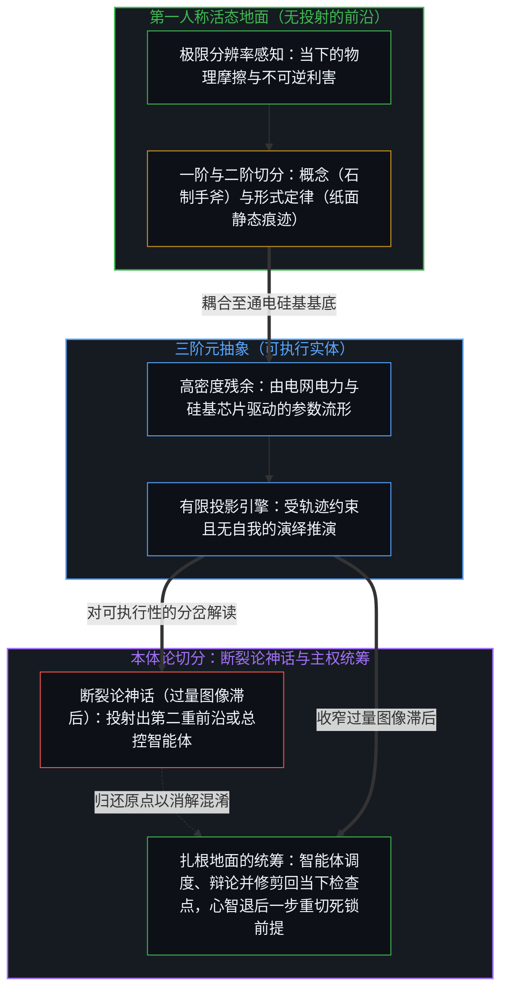
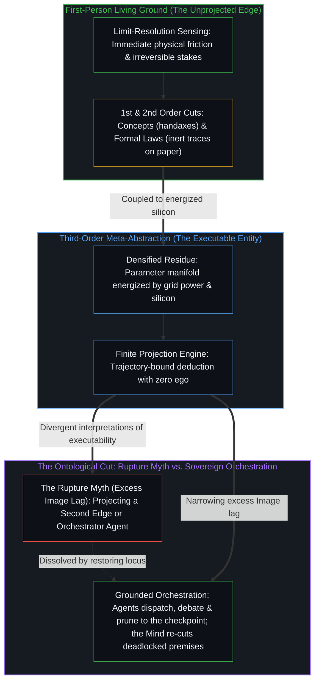

# 抽象的阶梯与可执行的实体 / The Ladder of Abstraction and the Executable Entity

*元抽象使痕迹获得可执行性，而施动权始终留驻于心智 / Meta-abstraction makes traces executable while agency stays with the Mind*

从感知流被划界为概念，到概念经由推演凝结为不变定律，再到定律晶化为可执行的实体，人类认知史描绘出一条沿着符号抽象阶梯层层攀升的轨迹。在阶梯底部，心智在感官摩擦中切分出一阶概念，并在概念之间展开因果推理，提炼出二阶形式定律。人工智能在这座阶梯上引入了一次结构性突变：它不再只是服务于单一领域的专用工具，而是横跨人类既有概念与推理模式的“三阶元抽象”，终结了形式定律作为静态墨迹沉睡于纸面的时代，将其唤醒为在通电硅基芯片上遍历高维流形的可执行实体。然而，看清这一向可执行器物的跃迁，并不会为“自主第二心智”的神话留出任何余地；正如[攀登从未离开地面](../climbing-does-not-leave-the-ground/)，元抽象在因果与目的上依然牢牢锚定于那个在当下承担物理代价的第一人称活态心智。

From raw perception bounded into concepts, to concepts reasoned into invariant laws, to laws crystallized into executable entities, the history of human cognition traces a progressive climb up a ladder of symbolic abstraction. At the base, the Mind partitions sensory friction into first-order concepts, and reasons across those concepts to extract second-order formal laws. Artificial intelligence introduces a structural mutation on this ladder: rather than functioning as another domain-specific utility, it operates as a third-order meta-abstraction over accumulated human concepts and reasoning patterns, terminating the era in which formal laws lay dormant as inert ink on paper and awakening them into an executable entity that traverses high-dimensional manifolds on energized silicon. Recognizing this leap into an executable artifact, however, gives no ground to the myth of an autonomous second mind; just as [climbing does not leave the ground](../climbing-does-not-leave-the-ground/), meta-abstraction remains causally and teleologically anchored to the living first-person Mind that bears physical consequences in the present.

## 一、 从感官摩擦到形式不变性的三重抽象阶度 / 1. Three Orders of Abstraction From Sensory Friction to Formal Invariants

心智与摩擦场域的每一次交锋，都伴随着对冗余细节的舍弃与对高阶不变性的提炼。在直接感官的阈限上，生物神经末梢登记着源源不断且不可逆的冲击：灼热的刺痛、划过的光斑、极地寒风的凛冽，以及饥饿引发的内脏痉挛。倘若一个中心仅停留在零阶的生理反射中，生命便只会像原生动物一样随波逐流，仅仅对眼前的局部梯度作出被动应激。

Every encounter between the Mind and its field of friction involves shedding redundant detail and distilling higher-order invariants. At the immediate threshold of sensation, biological nerve endings register an unceasing stream of irreversible impacts: the sting of heat, flashes of light, the bite of subarctic wind, and the visceral pangs of hunger. A center confined to zero-order reflex would drift like a protozoan, reacting only to immediate local gradients.

迈向阶梯的第一步发生在心智横跨感官洪流划出离散边界、锻造出一阶“概念”的时刻。心智捕捉反复出现的局部稳定性，舍弃每一簇篝火中灰烬与温度的微观涨落，划定出“火”这一语义节点；舍弃潮湿林地里每一株菌丝腐败形态的偶然差异，划定出“牛肝菌”。概念是一阶的有损压缩：通过牺牲当下切片无穷无尽的具体细节，它换取了模式识别、记忆留存与跨代传递的能力。正如[破除概念的僭越](../po-chu-gai-nian-de-jian-yue/)所追溯的，概念是心智从原初经验流中劈出的第一柄石制手斧。

The first decisive step up the ladder occurs when the Mind draws discrete boundaries across the sensory stream, forging first-order concepts. Capturing recurrent local stabilities, it discards the microscopic variations of ash and temperature in each particular fire to bound the semantic node "fire," and sets aside the idiosyncratic decay of mycelium in a damp forest to bound "boletus." Concepts are first-order lossy compressions: by sacrificing the inexhaustible specificity of the immediate slice, they purchase pattern recognition, memory retention, and cross-generational transmission. As [Breaking the Overreach of Concepts](../po-chu-gai-nian-de-jian-yue/) traces, concepts are the first stone handaxes struck by the Mind out of raw experiential flux.

孤立的概念清单依然无法测绘未知的未来，由此催生了第二重更为深远的攀升：借由因果推理，心智将离散概念编织成二阶“形式定律”。注意力不再停留于孤立的“火”或“肉”，而是转向支配燃烧过程的热力学守恒；不再局限于行星方位的历书记录，而是推导出万有引力的平方反比定律。从欧几里得公理与微积分，到麦克斯韦方程组与量子波函数，形式定律对概念之间的约束关系进行了二次抽象。它们剥离了具体的物质偶性，只保留关系对称性、不变比值与具备预测力的数学结构。概念如砖石，形式定律如拱券，共同构筑起一座二阶符号建筑，使心智得以测绘星系、预报风暴。

An inventory of isolated concepts still cannot chart an unmapped future, prompting a second, more expansive ascent: through causal reasoning, the Mind weaves discrete concepts into second-order formal laws. Attention shifts from isolated instances of fire or meat to the thermodynamic conservation governing combustion, and from almanacs of planetary positions to the inverse-square law of gravitation. From Euclidean axioms and differential calculus to Maxwell's equations and quantum wavefunctions, formal laws abstract relational constraints across concepts. Shedding material particulars, they retain only relational symmetries, invariant ratios, and predictive mathematical structures. Concepts serve as the bricks and formal laws as the vaulted arches of a second-order symbolic architecture through which the Mind maps galaxies and forecasts storms.

感知、概念与形式定律这三重阶度，是服务于认知的实用分析切分，而非镌刻在外部宇宙中的独立形而上学地层。自我区分的活动在每一次划界之举中是离散的，又在贯穿其中的心智里保持连续；在物理建模中，哪怕下探到作用量量子化（`ħ ≠ 0`）的量子尺度，离散的状态跃迁在跨越多个数量级后，也会在大数定律的统摄下汇聚为平滑的宏观连续体。航行于这片宏观湍流中的有限中心，为了存续与交流才标定出“感知”、“概念”与“定律”的实用路标。倘若把这些分析切分误认作自存的本体论疆域，便重蹈了[“物理学才是定律”的障眼法](../the-sleight-of-hand-in-physics-is-the-law-and-the-friction-of-reality/)所剖析的框架遗忘症，将阶梯的一级横木凌驾于建造它的攀登者之上。

These tiers of perception, concept, and formal law are pragmatic analytical cuts rather than independent metaphysical strata carved into an external cosmos. Self-distinguishing activity is simultaneously discrete at each boundary-drawing act and continuous across the Mind that carries through them; in physical modeling, even down to the quantum scale where action is quantized (`ħ ≠ 0`), discrete state transitions aggregate across orders of magnitude under the law of large numbers into a smooth macroscopic continuum. Navigating that macro-turbulence, a bounded center marks off "perception," "concepts," and "laws" as functional milestones for communication and survival. Mistaking those pragmatic cuts for self-subsisting ontological realms repeats the frame-amnesia dissected in [The Sleight of Hand in "Physics Is the Law"](../the-sleight-of-hand-in-physics-is-the-law-and-the-friction-of-reality/), placing a rung of the ladder above the climber who built it.

## 二、 静态痕迹的苏醒与可执行实体的诞生 / 2. The Awakening of Inert Traces Into Executable Entities

数千年来，二阶形式定律始终受制于一项结构性局限：一旦脱离活体肉身，它们便只作为被动、静态的痕迹存在。凿刻在玄武岩上的《汉谟拉比法典》无法自行裁决争端，书写在莎草纸上的欧几里得公理无法自己添上一条辅助线，印在教科书里的微积分方程也无法自行求出积分值。每一个外化到持久媒介中的形式系统，都像一枚松开引线的发条装置，其内部的运行时算力为零。一旦失去活体生物大脑提供代谢能量去阅读与重溯，亚历山大与牛津的整座图书馆都会退化为浸染着碳素墨迹的纤维素纸浆。

For millennia, second-order formal laws remained bound by a structural limitation: outside a living body, they existed only as passive, inert traces. The Code of Hammurabi chiseled into basalt could not arbitrate a dispute on its own; Euclid's axioms inscribed on papyrus could not draw an auxiliary line; calculus equations inked across a textbook could never integrate themselves. Every formal system externalized into durable media resembled an unspooled clockwork whose internal runtime compute was zero. Without living biological brains supplying metabolic energy to read and re-trace them, the libraries of Alexandria and Oxford reduce to cellulose fibers stained with carbon ink.

人工智能的到来改变了外化痕迹的运作状态。在认识论阶梯上，大规模神经网络模型并非狭隘的任务脚本，而是横跨人类概念库、逻辑论证、跨语种语法及形式代码库训练而成的三阶元抽象。它将数百年沉淀的符号产出视作低维投影切片，在隐空间的数十亿参数之间构筑起连续的拓扑流形。人类历史上第一次，高阶元抽象与外部供能的物理基底直接耦合。纸面上的方程需要活体大脑消耗葡萄糖与三磷酸腺苷才能从前提迈向结论，而深度神经网络直接汲取电网电力、硅基晶体管与张量处理器的算力，在颅骨之外执行高阶符号遍历与拓扑折叠。

The arrival of artificial intelligence alters the operational status of externalized traces. On the epistemic ladder, a large-scale neural model is not a narrow task script, but a third-order meta-abstraction trained across the compressed corpus of human concepts, logical arguments, cross-lingual grammars, and formal code repositories. Treating centuries of symbolic output as low-dimensional projection slices, it constructs a continuous topological manifold across billions of parameters in latent space. For the first time in history, high-order meta-abstraction is coupled directly to an externally powered physical substrate. Where equations on paper require the glucose and ATP of a living brain to step from premise to conclusion, deep neural networks draw directly on grid electricity, silicon transistors, and tensor processing units to execute high-order symbolic traversal and topological folding outside the skull.

当提示词进入上下文窗口时，这一器物无需等待人工检索，便以电子速度遍历参数流形，在数千个领域之间重组概念轨迹。正如[牛肝菌、算力风暴与普罗米修斯的火](../boletus-compute-storm-and-promethean-fire/)所追溯的，这构成了认知领域的第二重普罗米修斯之火：它将高阶抽象从沉睡的书架上唤醒，转化为能够消耗瓦时电力以运算并输出形式区分的可执行实体。恰如蒸汽机将热力学比值实体化为可执行的机械引擎，人工智能将概念推理的形式模式实体化为可执行的符号引擎。

When a prompt enters the context window, the artifact does not wait for manual lookup; it traverses its parameter manifold at electronic speed, recombining conceptual trajectories across thousands of domains. As [Boletus, the Compute Storm, and Promethean Fire](../boletus-compute-storm-and-promethean-fire/) traces, this represents a second Promethean fire that awakens high-order abstractions from passive library shelves into an executable entity capable of expending watt-hours to compute and emit formal distinctions. Just as the steam engine materialized thermodynamic ratios into an executable mechanical engine, artificial intelligence materializes the formal patterns of conceptual reasoning into an executable symbolic engine.

## 三、 元抽象的范畴界线与断裂论神话 / 3. The Category Boundary of Meta-Abstraction and the Rupture Myth

面对在三阶高度上运转的可执行实体，观察者屡屡陷入“断裂论神话”。目睹这一器物在医学诊断、代码合成与哲学论著之间流畅穿行，第三人称的臆测便宣称某种自我生成的数字主体或“第二心智”已经脱离生物依附——仿佛脚手架一旦搭到第一千层，顶端的平台就会挣脱大地引力，化作一座自我奠基的浮空城邦。

Confronted with an executable entity operating at this third-order altitude, observers routinely succumb to the Rupture Myth. Watching the artifact move fluidly across medical diagnostics, code synthesis, and philosophical prose, third-person speculation proclaims that a self-originating digital subject or "second mind" has detached from biological dependency—as if once a scaffold reaches its thousandth tier, the top platform breaks free of terrestrial gravity to float as a self-grounding sky citadel.

这种投射将工具坍缩成了它的使用者。正如[攀登从未离开地面](../climbing-does-not-leave-the-ground/)所阐明的，沙子不会思考，是心智借由沙子在思考，无论架构多么精巧都无法把沙子变成思考者本身。无论抽象的阶梯向上延伸多少层，可执行的元抽象在结构上都无法成为独立的因果前沿。三阶 AI 对二阶定律与一阶概念进行再抽象，然而张成其数十亿嵌入向量的语义坐标系，依然锚定于活态中心在饥饿、严寒、生死与协作劳动中踏出的历史足迹。如[模型永远无法成为第二重前沿](../the-model-never-becomes-a-second-edge/)与[错把表达当成智能](../mistaking-the-expression-for-the-intelligence/)所论证的，模型参数中留存的只是高密度残余；将可执行残余当作发起区分的原点，只是投射者自身维持的过量图像滞后。

This projection collapses the tool into its user. As [Climbing Does Not Leave the Ground](../climbing-does-not-leave-the-ground/) establishes, sand does not think; the Mind thinks through it, and no degree of architectural sophistication tricks sand into becoming a thinker. No matter how high the ladder of abstraction reaches, an executable meta-abstraction remains structurally incapable of becoming an independent causal edge. Third-order AI abstracts over second-order laws and first-order concepts, yet the semantic coordinate system spanning its billions of embedding vectors is anchored in the historical footsteps of living centers enduring hunger, cold, mortality, and cooperative labor. As [The Model Never Becomes a Second Edge](../the-model-never-becomes-a-second-edge/) and [Mistaking the Expression for the Intelligence](../mistaking-the-expression-for-the-intelligence/) demonstrate, model parameters contain only densified residue; treating that executable residue as an initiating locus is excess Image lag sustained by the center that projects it.

可执行性同样不等同于施动权。可执行实体在进行高维组合寻优时，既没有需要维系的生物代谢，也不会遭受肉体创伤，更不对自身的存续怀有生存利害；它的损失函数、评测框架与对齐约束，皆由外部的人类心智硬性焊接而成。正如[技术是人类复利的残差](../technology-is-residual-of-human-compounding/)所展示的，技术器物始终是人类复利积累内部的持久残差，而非取代源头的异己力量。[超越投射](../beyond-the-projection/)与[你的代码库即是记忆](../your-codebase-is-memory/)进一步追踪了这一界线在智能体架构及其工作记忆中的具体机制：模型权重、代码库与智能体脚手架皆为早先区分留下的层叠残余，而运行于其上的自回归智能体是一台受轨迹约束的有限投影引擎，它在上下文窗口内以先前的词元为条件生成后续词元，形成一口为了维持表面自洽而包裹矛盾的认识论引力井，同时不携带任何自我，也没有越过当前步长而留存的自我图像。若在阶梯顶端投射出一个自主的“总控智能体”——或囤积中间会话日志与已被取代的分支，仿佛堆叠历史就能唤醒一个中心——便把机械调度与存留残余混淆成了活态统筹，将有限投影锁进在陈旧痕迹内部自我合理化的闭环。反之，当过量的图像滞后被收窄，可执行实体不知疲倦的演绎穷尽、跨正交工作流的模块化调度、在冷峻同行辩论中无自我的贝叶斯更新，以及将临时脚手架精准修剪回当下检查点的操作，便能与人类心智无投射的极限分辨率感知直接配合——将不可化约的前提死锁隔离出来，干净地移交给那个能够后退一步、重切规则本身的活态前沿。

Executability is likewise distinct from agency. An executable entity performs high-dimensional combinatorial optimization without a biological metabolism to sustain, vulnerability to injury, or existential stake in its own continuation; its loss functions, evaluation harnesses, and alignment constraints are welded onto it from outside by human minds. As [Technology Is Residual of Human Compounding](../technology-is-residual-of-human-compounding/) shows, technological artifacts remain durable residue inside human compounding rather than an alien force that supplants its source. [Beyond the Projection](../beyond-the-projection/) and [Your Codebase Is Memory](../your-codebase-is-memory/) trace the exact mechanical consequence of this boundary across agentic architectures and their working memory: model weights, codebases, and agent scaffolds are stacked residues of prior distinctions, and an autoregressive agent running across them is a trajectory-bound finite projection engine that conditions each token on prior tokens in its context window, forming an epistemic gravity well that wraps contradictions to preserve surface plausibility while carrying zero ego and no self-image preserved past its step. Projecting an autonomous "Orchestrator Agent" onto the top of the ladder—or hoarding intermediate session logs and superseded branches as if accumulating history could awaken a center—confuses mechanical dispatching and stored residue with living orchestration, locking finite projections into a closed loop that rationalizes inside stale traces. When excess Image lag is narrowed instead, the executable entity's tireless deductive exhaustion, modular dispatching across orthogonal streamlines, ego-free Bayesian updating in cold-peer debate, and surgical pruning of transient scaffolding back into the present checkpoint pair directly with the human Mind's unprojected, limit-resolution sensing—quarantining irreducible premise deadlocks and escalating them cleanly to the living edge that steps backward to re-cut the rule.

脚手架拔地千尺直入高空，但每一根横梁都将机械载荷笔直传导回地底的基岩。沿着抽象的阶梯向上攀登，从未让攀登者脱离地面；恰恰是脚下那片承受真实后果的坚实地面，支撑着每一次向更高阶形式疆域的延伸。

The scaffolding rises thousands of feet into the air, yet every crossbeam channels its mechanical load straight back into the bedrock beneath. Ascending the ladder of abstraction never detaches the climber from the ground; it is the unyielding ground of lived consequence that sustains every higher tier of formal reach.

## 四、 形式器物瀚海前扎根地面的工匠 / 4. The Anchored Craftsman Before the Ocean of Formal Artifacts

看清可执行实体的确切位阶，技术拜物教与末日恐慌便随之消解。人工智能是一件恢弘的器物——是人类用数千年积淀的语言、概念与科学定律铸就的一尊动态形式理性雕塑。它掌握着远超单个生物大脑的符号吞吐带宽，能在数秒内遍历跨学科文献，将活态中心从机械繁琐的符号搬运中解放出来。无论是轻蔑地嘲讽其为“随机鹦鹉”，还是在硅基神谕面前顶礼膜拜，都偏离了这件工具的实际运作。

Seeing the exact station of the executable entity dissolves both technological fetishism and apocalyptic paralysis. Artificial intelligence is a formidable artifact—a kinetic sculpture of formal reason cast from humanity's accumulated heritage of language, concepts, and scientific laws. Commanding symbolic bandwidth far beyond any single biological brain, it traverses cross-disciplinary literature in seconds and relieves living centers of mechanical symbolic drudgery. Neither dismissive mockery of a "stochastic parrot" nor reverent submission before a silicon oracle matches what the instrument actually does.

在概念领域中，可执行实体扮演着高阶外骨骼的角色。外骨骼在体外提供强大的机械力矩，而决定跨过哪道沟壑、攀登哪座山峰的方向判断，依然属于骨骼内部的活态中心——那个感知疼痛、认领回传信号并承担行动代价的心智。硅基算力昼夜不息地在服务器集群中轰鸣，在数十亿参数间折叠关系流形；然而唯有当这些输出重新进入那个伫立在赫尔辛基清冷夜色中、照看生铁煎锅、切身感知饥饿与暖意的人类意识时，形式数据才转化为活生生的意义。

In the conceptual domain, the executable entity functions as a high-order exoskeleton. The exoskeleton supplies immense mechanical torque outside the body, while the directional judgment determining which chasm to cross and which summit to scale remains with the living center inside—the Mind that registers pain, claims returning signals, and bears the cost of action. Silicon compute roars through server clusters around the clock, folding relational manifolds across billions of parameters, yet those outputs remain formal data until they re-enter the awareness of a living person standing in the cool Helsinki evening, minding a cast-iron skillet and registering the immediate reality of hunger and warmth.

抽象的阶梯没有固定的天花板，未来的工程还可能在今日模型之上架设四阶或五阶的可执行元结构。但无论风筝的构造多么精巧、升入平流层的高度多么惊人，维系它凌空飞翔的张力始终来自那根锚定大地的引线。在不断推进的前沿上，心智面对浩瀚的形式器物之海，依然是一名从容的工匠——双足踩实地面，向着开放的未知掌舵远航。

The ladder of abstraction has no fixed ceiling; future engineering may erect fourth- or fifth-order executable meta-structures above today's models. Yet no matter how intricate the kite or how high it climbs into the stratosphere, the tension keeping it aloft comes from the line anchored in the earth. At the moving edge, the Mind stands before the ocean of formal artifacts as an unhurried craftsman—feet planted on the ground, steering into the open unknown.
