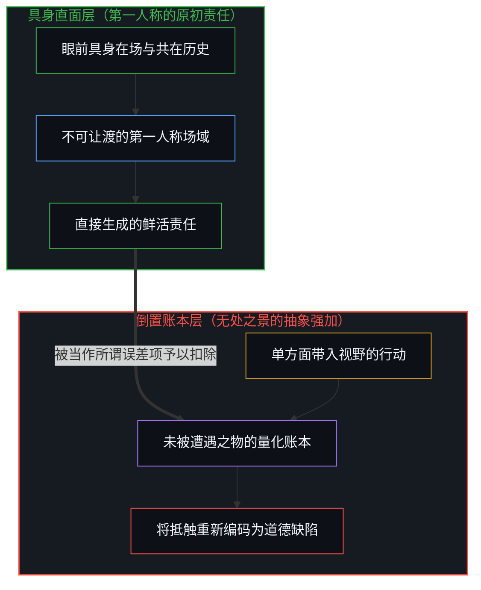
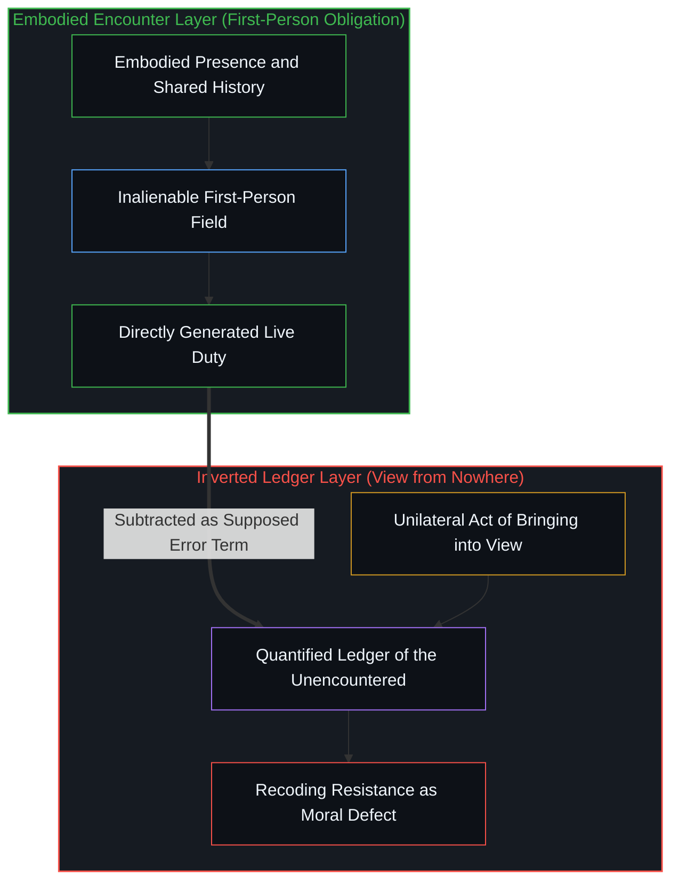
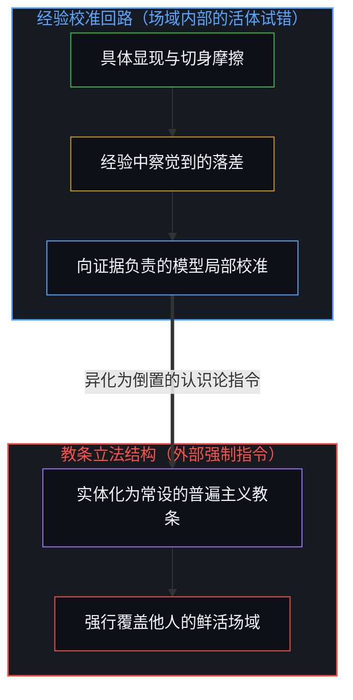
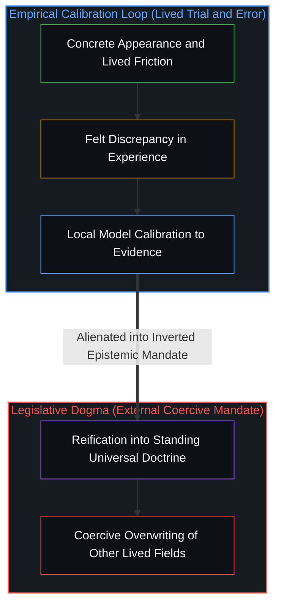

# 未被遭遇之物的账本 / The Ledger of the Unencountered

*责任源于他者在具身视野中的显现，以抽象账本强加未见之物颠倒了因果。 / Obligation is generated by presence; imposing the unencountered via an abstract ledger inverts causality.*

酒馆里的激烈辩论始于一个经典的道德诘问：面对地球另一端未曾谋面的陌生人，你是否背负着与面对眼前之人相同的道德责任？这一问题表面上看似在天平两端衡量两件已经既定的砝码，实则包藏着精巧的认识论欺瞒。远方的苦难在能够与当面的相遇进行权衡之前，必须首先经由某一个具体的言说者带入视野。这种“带入”并非独立量值的中立报告，而是一种有目的的置入行动：它试图将未被遭遇之物强行记入与眼前所遇之人相同的账本，进而将任何对这种置入的拒斥定性为伦理缺陷，而非意识中所显现之物的分野。

The spirited tavern debate began with a classic moral challenge: do you have the same moral obligations to a stranger halfway around the world as to someone right in front of you? On the surface, the question poses as a neutral comparison between two already-given objects on an objective balance, yet it conceals an epistemic sleight of hand. Before distant suffering can be weighed against a face-to-face encounter, it must first be carried into view by an active speaker. That carrying is not an innocent report of an independent magnitude. It is a purposeful act of placement that attempts to register the unencountered on the very same ledger as the encountered, and subsequently treats any refusal of that placement as an ethical defect rather than a divergence in what has appeared within consciousness.

## 一、 假装中立的对比与带入视野的行动 / 1. The Pretense of Neutral Comparison and the Act of Carrying into View

任何有意识的主体实际感受到的责任，都是由他者在其经验场域中的具体显现方式所生成的。这种生成并非某种更高级功利主义计算的粗糙、有偏草稿，而是活体意识体验道德义务的唯一形式。第一人称场域并不是无数可互换数据流中的任意一项，而是唯一被实际占据的立足点。世界上不存在某个无所不在于具体位置之外的旁观者，能够同时俯瞰两个独立的场域、宣布它们重叠并下达同时约束双方的法令。正如[不可还原的观察者](../the-irreducible-observer/)所阐明的，试图在理论模型中抹去具体观察者的做法，无法消除构建该模型的主观心智本身；而道德论述中对全知视角的执念，恰恰重蹈了这一混淆。也没有外部的记账员替全球记账，正如[没有外部记账员](../no-outside-scorekeeper/)所论证的。

Whatever obligation a conscious agent actually feels is generated by how another appears within their experiential field. That generation is not an imprecise, biased first draft of some superior utilitarian calculation; it constitutes the only form that obligation takes for a living consciousness. The first-person field is not one arbitrary data stream among interchangeable others, but the only standpoint that is ever occupied. There is no unlocated bystander capable of surveying two independent fields at once, declaring their overlap, and issuing an edict that binds both. As demonstrated in [The Irreducible Observer](../the-irreducible-observer/), attempting to erase the concrete observer from theoretical models cannot eliminate the subjective mind that authors the construction; the moral insistence on an omniscient perspective repeats this precise confusion. No outside scorekeeper keeps the global ledger either, as [No Outside Scorekeeper](../no-outside-scorekeeper/) argues.

当功利主义者或世界主义理论家将远方的统计数字推到对话者面前时，他们掩盖了置入这一动作本身所内含的权力运作。远方陌生人的痛苦并未像眼前溺水孩童扑腾呼救那样，直接抓住行为者的感知通道。言说者通过叙事、修辞和图表，把未经遭遇的对象引入当下的对话场域，同时预先设定了其在账本上的量化权重。在这套前提下，听众未经调整的具身场域当即被降格为需要自证清白的误差项。一旦接纳了这套框架，随后的讨论便萎缩为围绕数值分配的讨价还价；至于远方的事项是否属于当下的账本、究竟是谁将其置入、以及这一置入被允许覆盖哪些既有的鲜活纽带，这些基础追问在辩论开始前便已被悄然绕过。

When utilitarians or cosmopolitan theorists present distant statistics to an interlocutor, they obscure the power dynamic inherent in the act of placement itself. The suffering of a distant stranger does not seize the agent's perceptual channels in the immediate manner of a drowning child splashing in front of them. The speaker imports the unencountered object into the immediate conversational field through narrative, rhetoric, and diagrams, while pre-assigning its quantitative weight on the ledger. Within those premises, the listener's unadjusted, embodied field is instantly demoted into an error term requiring justification. Once that framing is accepted, the ensuing discussion shrinks to a mere negotiation over numerical allocations; the foundational questions of whether the distant item belongs on the immediate ledger at all, who placed it there, and what prior living bonds that placement is permitted to overwrite are quietly bypassed before the debate even starts.

## 二、 第一人称视域的不可替代性与无处之景的倒置 / 2. The Irreplaceability of the First-Person Field and the Inversion of the View from Nowhere

托马斯·内格尔所警示的“无处之景”，在此处并未提炼道德判断，反而将其推向了倒置。在具体的具身存在中，责任首先作为鲜活的关系事件显现：具体的面孔、共同经历的历史、交织的承诺与眼前切身的困顿。然而，普遍主义框架将这些涌现出的关系纽带重新编码为造成扭曲的依附，主张必须将其扣除，其所谓的普遍责任才能被计算出来。个人关系被当作误差项处理。这种倒置一旦被接受，远方的陌生人甚至无须在经验中实际出场；言说者只需念出一个名字并附上数值权重，就足以要求他人服从。

The "view from nowhere" cautioned by Thomas Nagel inverts moral judgment rather than refining it. In concrete, embodied existence, obligation first registers as a living relation: a particular face, a shared history, interwoven commitments, and immediate tangible distress. Yet the universalist framework recodes these emergent relational ties as distorting attachments that must be subtracted so that what it calls universal duty can be calculated. The personal is treated as the error term. Once this inversion is accepted, the distant stranger does not need to show up in experience at all; it is enough for a speaker to pronounce a name and attach a numerical weight to demand compliance.

正如[规程的倒置与因果回路的消声](../the-inversion-of-the-protocol-and-the-silencing-of-the-causal-loop/)所揭示的，每当下游的记录工具篡夺了生成源头的首位时，因果反馈便陷入沉寂。道德账本最初是协调人类合作的辅助器物，通过标定互惠交易与社会契约的边界来运作：正如[你的代码库即是记忆](../your-codebase-is-memory/)所追溯的，这类账本属于外化的记忆，即过往承诺留下的持久痕迹，永远无法取代在掌舵前沿做决断的活体心智。当这一存储痕迹被奉为主权者，宣称凡是写在纸面上的条目都具有与血肉相遇同等的引力时，主体的具身在场便被抽空了。责任不再取决于某个存在者是否在鲜活的摩擦中实际出现于你面前，而取决于中心化的道德记账员在账册上写下了多少行未经核实的文字。

As uncovered in [The Inversion of the Protocol and the Silencing of the Causal Loop](../the-inversion-of-the-protocol-and-the-silencing-of-the-causal-loop/), whenever downstream recording instruments usurp the primacy of generative origins, causal feedback falls silent. The moral ledger began as an auxiliary artifact coordinating human cooperation by demarcating boundaries of reciprocal trade and social agreements: as [Your Codebase Is Memory](../your-codebase-is-memory/) traces, such ledgers are externalized memory, durable residues of prior commitments that can never replace the living Mind at the steering edge. When this stored trace is treated as sovereign, claiming that every entry inscribed upon its pages exerts the same gravitational pull as a flesh-and-blood encounter, the agent's embodied presence is evacuated. Obligation ceases to depend on whether an entity actually appears before you in living friction, depending instead on how many lines of unverified text a centralized moral ledger-keeper has inscribed.

## 三、 实用工具的教条化篡位与科学认识论的边界 / 3. The Dogmatic Usurpation of Pragmatic Tools and the Epistemic Horizon of Science

每当一种有用的实践硬化为意识形态教条时，同样的因果倒置便会发生。纠正显现中的落差，只要依然作为场域内部展开的事件，就能保持有效运作：某项经验预测落空，某份有力的证词重塑了预期，工作模型因记录到了切身的落差而得以重新校准。然而，一旦这种方法论被实体化为其他有意识心智必须预先受其约束的常设立法——即便在他们那里并未出现任何落差——这一实践就不再向鲜活经验负责，而是开始赶在经验之前先行立法。实用主义僵化为经院教条，功利考量异化为强加于人的牺牲教义，而局部审视落差的实践，则固化为宣称视角本身已被超越的封闭断言。

The same causal inversion occurs whenever a useful practice hardens into an ideological dogma. Correcting discrepancies within appearance remains operative as long as it unfolds as an event inside a field: an empirical prediction fails, a compelling testimony reshapes an expectation, and the working model is recalibrated because a palpable gap was registered. However, the moment this methodology is hypostasized into a standing mandate that other conscious minds must already be bound by—even where no discrepancy has registered for them—the practice stops answering to living experience and begins legislating in advance of it. Pragmatism stiffens into scholasticism; utility mutates into an enforced doctrine of sacrifice; and the local practice of auditing discrepancy hardens into the closed claim that perspective itself has been transcended.

援引“互为主体性”或“重叠视域”并不能越出第一人称不可逃避的边界。共识、外部证词以及共享的测量仪器，其本身依然是特定心智内部被感知的现象。你听到同事的修正，你读取表盘上校准过的指针，你感受到预期落空带来的认知摩擦。并不存在一个脱离具身、超然于视角之外的观察点，能够从高处俯瞰两个独立的意识并核验它们的重合。将某种经验汇聚称为互为主体性，只是命名了一种依然属于视角内部的显现，并没有在天空中架起一座空无一人的裁判庭。试图将校准刻度从观察心智中剥离并将其物化为客观事实，正如在[「更好」的范畴谬误](../the-category-error-of-better/)中所辨明的，只会导致决策者将自身的测量盲区防御性地投射为外部世界的非理性。

Invoking "intersubjectivity" or "overlapping horizons" does not escape the inescapable horizon of the first person. Agreement, external testimony, and shared measurement apparatuses are themselves perceived phenomena inside particular minds. You hear the colleague's correction, you read the calibrated pointer on the dial, and you feel the cognitive friction of an unmet expectation. There is no disembodied, extra-perspectival vantage point surveying two independent consciousnesses from above and verifying their coincidence. Calling an experiential convergence intersubjective simply labels an occurrence that remains perspectival; it does not erect an empty, unpeopled tribunal in the sky. The attempt to sever calibrated scales from observing minds and reify them into objective facts, as identified in [The Category Error of Better](../the-category-error-of-better/), merely causes decision-makers to defensively project their own measurement blind spots onto the perceived irrationality of the external world.

这一认识论边界同样划定了经验科学的有效范围。正如在[能动性被转置入形式模型](../agency-relocated-into-the-formal-model/)中所指出的，形式建模始于对生活规律性的严谨推演，只有在其持续向有意识观察者实际记录到的现象负责时，才保持有效。当科学主义将数学模型宣布为唯一的客观实在，并将直接感知贬斥为神经幻觉时，科学便亲手拆毁了使观察得以可能的根基。凡是无法从任何第一人称场域内部复现的事物，就没有任何人能够声称其存在，因为并不存在另一类能够做出声称的主体。视角的不可逃避性并非有损某个本可触及的独立实在的缺陷，而是任何事物得以对某人而言存在的边界条件。

This epistemic boundary circumscribes the validity of empirical science as well. As articulated in [Agency Relocated into the Formal Model](../agency-relocated-into-the-formal-model/), formal modeling begins as disciplined inference from lived regularities, remaining valid only while answerable to what conscious observers actually register. When scientism proclaims the mathematical model to be the sole objective reality and dismisses immediate perception as neural illusion, science demolishes the very ground that made observation possible. What cannot be recovered from within any first-person field cannot be claimed by anyone, because there exists no other category of claimant. The inescapability of perspective is not a defect marring an otherwise accessible absolute reality; it is the boundary condition of what can be said to exist for anyone.

## 四、 框架权力与视域的鲜活延展 / 4. Framing Power and the Living Expansion of the Field

围绕远方陌生人的伦理困惑，并不源于邓巴数、注意力带宽上限，或跨越地理距离投入关怀的情感摩擦。这些因素虽然描绘了可测量的心理限度，却并不构成这一圈套的机制。圈套在于：将某个人把特定对象带入视野的行动，暗中转化为一道道德法令，要求其他人必须将该引入项视为早已在场且具有无条件约束力。这种转化是赤裸的框架权力运作。它将对话者逼入预先设计的道德架构中，旨在用一份外来账本覆盖其主权视角。

The ethical confusion surrounding the distant stranger does not stem from Dunbar's number, attentional bandwidth limits, or the emotional friction of caring across geographical distance. While those factors describe measurable psychological limits, they do not constitute the mechanism of the trap. The trap lies in the covert transmutation of one person's act of bringing-into-view into a moral decree that others must treat the imported item as already present and categorically binding. That conversion is an exertion of raw framing power. It corners the interlocutor into a pre-engineered moral architecture designed to overwrite their sovereign perspective with an alien ledger.

澄清这一边界，并不否认远方苦难的发生，也不排斥主体通过亲身探索、证词、艺术或主动关注来延展自身所见之物。视域的鲜活延展依然是发生在某个意识内部的事件。它伴随着切身的经验摩擦与个体权衡，可以被自主接纳、检验、修正或放弃。一旦它作为一道外在的行政指令降临，预先判定其他场域犯有疏忽之罪，便会坍缩为因果倒置。由他者亲身显现所生成的责任，能够在具身行动中被付诸实施与恪守；而由跨心智的官僚标准所炮制的责任则不能，因为其自称的权威已不再依赖于任何人的实际遭遇。正如在[抽象的苦难与真实的饥饿](../abstract-pain-and-living-hunger/)中所进一步剖析的，将可无偿复制的概念符号混同于需要支付不可逆代谢成本的物理实体，正是道德套利者掏空主体在地能动性的底层机制。

Clarifying this boundary does not deny that distant agony occurs, nor does it preclude agents from expanding what appears to them through personal exploration, testimony, art, or deliberate attention. The living enlargement of a field remains an event inside a consciousness. Accompanied by lived friction and personal evaluation, it can be freely embraced, tested, revised, or abandoned. What it cannot do without collapsing into inversion is arrive as an external administrative mandate that other fields are convicted of having neglected in advance. Obligation generated by how another shows up in person can be enacted and honored in embodied action; obligation engineered by an across-minds bureaucratic standard cannot, because its asserted authority no longer depends on anyone's actual encounter. As further dissected in [Abstract Pain and Living Hunger](../abstract-pain-and-living-hunger/), conflating freely duplicable conceptual tokens with physical entities requiring irreversible metabolic expenditure is the underlying mechanism by which moral arbitrageurs hollow out the agent's situated territorial agency.

酒馆里的论战之所以火花四溅，正是因为这一区分正在当场被强行抹平。言说者提出的问题模仿了邀请对方权衡两种显现的姿态，然而提问的框架早已完成了那次置入行动，使眼前的当面在场变得多余。你无法顺着对方给定的概念去回答并解开这一困境，因为那些概念本身就是完成捕获的器具。走出圈套的唯一途径，是直接指认那只正把账本推上桌面的手：正是这本试图统摄一切的未被遭遇之物的账本，企图覆盖你眼前那个鲜活而不可替代的在场。

The tavern argument was electric because that exact distinction was being forced on the spot. The speaker asked a question that mimicked an invitation to evaluate two appearances, yet the framing of the question had already executed the placement that rendered immediate presence superfluous. You cannot resolve the dilemma by answering within the terms provided, because the terms themselves are the instruments of capture. The only way out of the trap is to point directly at the hand sliding the ledger onto the table: it is the totalizing ledger of the unencountered that seeks to overwrite the living, irreplaceable presence right before your eyes.
