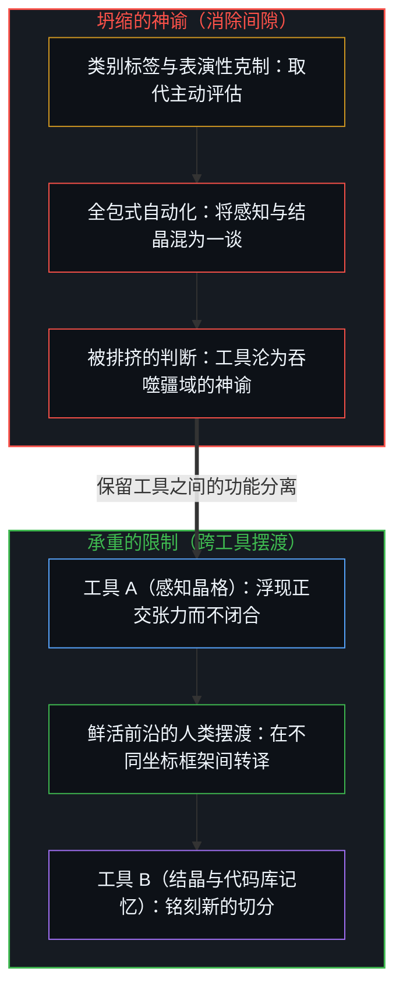
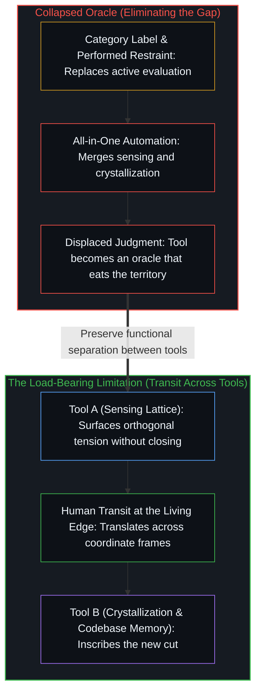

# 限制正在做功 / The Limitation Is Doing Work

*将产出标为 AI 生成是以标签代判断，工具间的间隙正是思考发生处。 / Marking output as AI-generated substitutes a label for judgment, while the gap between tools is where thinking happens.*

将某物标记为“AI 生成”，否定了使 AI 成为可能的那个过程本身，也抹杀了其间的差异。这一标签看似是认识论上的——一个区分真品与合成物的中性标记。但追踪其机制就会发现，它实际上在作为另一套机制运作：它是一项关于能动性被允许栖居于何处的领地主张，是一次用类别来替代并排挤判断的强行坍缩。工具之间、感知与解释之间、生成与结晶之间的限制并非缺陷，而是正在做功的结构性特征。

Marking something as "AI generated" denies the very process that made AI possible and the difference in between. The label looks epistemic—a neutral marker separating authentic from synthetic. Trace the mechanism and it operates as something else: a territorial claim about where agency is permitted to live, a forced collapse that substitutes a category for the judgment it displaces. The limitation between tools, between sensing and interpretation, and between generating and crystallizing is not a deficiency; it is the structural feature doing the work.

## 一、 作为领地主张的标签 / 1. The Label as Territorial Claim

生产 AI 产出的工具本身就是连续人类过程的产物：人类的数据、人类的工程与人类的意图贯穿始终。给产出盖上“非真品”的戳记，需要在连续的过程中强行划出一条界线，宣布一侧为真实而另一侧为人造。这是一次投射坍缩——将一个连续的机制强行压入一条它并不栖居的二元轴线。

The tools that produce AI output are themselves products of continuous human process: human data, human engineering, and human intent all the way down. Stamping the output as "not authentic" requires drawing a line through a continuous process and declaring one side real and the other artificial. This is a projection collapse—forcing a continuous mechanism onto a binary axis it does not inhabit.

谁在划这条线？那些自居于过程之上、宣称占据了投射外部视角的人。谁又在接受它？那些用标签取代亲眼审视与自主评估的人。标签并不辅助判断，而是取代判断。它在宣告：你无需就事论事地评估眼前的东西，因为类别早已指定。工具延伸了区分的过程，而一个预先封死区分的标签，则在逆着它自称要服务的功能运作。

Who draws the line? Someone positioning themselves above the process, claiming a vantage outside the projection. Who accepts it? Someone substituting the label for their own evaluation of what they are looking at. The label does not aid judgment; it replaces it. It says that you do not need to evaluate this on its own terms because the category has already been assigned. Tools extend the process of distinction, whereas a label that forecloses distinction operates against the function it claims to serve.

## 二、 地图吞噬疆域 / 2. The Map Eats the Territory

这一标签是跨媒介运作的同一模式的一个实例：某种品质的表征与该品质本身展开竞争，并随后将其取代。三重投射同时运行，各自坍缩着一条不同的轴线。

The label is one instance of a pattern that operates across media: a representation of a quality competes with, and then displaces, the quality itself. Three projections run simultaneously, each collapsing a different axis.

第一重坍缩发生在求真与互动率之间。平台针对互动率进行优化。当真相新奇或令人愉悦时，求真与互动率高度相关；然而当真相引发不适时，两者便发生解耦——而那里恰恰是求真真正做功的地方。系统针对求真轻松容易的区域进行优化，却在前沿边界处脱离接触，从而把指标变成了产品。

The first collapse is between truth and engagement. A platform optimizes for engagement. Truth-seeking correlates with engagement when truth is novel or satisfying, yet they decorrelate when truth produces discomfort—which is where truth-seeking does real work. The system optimizes for the region where truth-seeking is easy and disengages at the frontier, turning the metric into the product.

第二重坍缩发生在好奇心与对好奇心的表演之间。渴望被人看作在求真，是博取互动的动作，而非求真的动作。正在运作的好奇心不会自我宣告，它只会顺着线索追索。在好奇心被表演出来的那一刻，社交信号便替代了探索过程，好奇心的表征也就取代了好奇心本身。

The second collapse is between curiosity and its performance. Wanting to be seen as truth-seeking is the engagement move, not the truth move. Curiosity that operates does not announce itself; it follows the thread. The moment curiosity is performed, the social signal substitutes for the process and the representation of curiosity displaces curiosity.

第三重坍缩发生在真实性与它的标签之间。将某物称为“AI 生成”，预设了真实性是产出来源的属性，而非过程的属性。它将惯常承载能动性归属的熟悉渠道，与那些挑战“能动性栖居于何处”这一既有模型的渠道割裂开来。[对“AI 糟粕”的反感是反复出现的模式](../the-distaste-for-ai-slop-is-no-different-from-the-recurring-historical-pattern/)追踪了这种披着历史外衣的置换：把出处当成真实性来打分，看产品是否契合受偏爱的生产叙事来对它做出评判。

The third collapse is between authenticity and its label. Calling something "AI-generated" presupposes that authenticity is a property of origin rather than of process. It separates channels familiar enough to carry an attribution of agency from channels that challenge the prevailing model of where agency lives. [The Distaste for “AI Slop” Is a Recurring Pattern](../the-distaste-for-ai-slop-is-no-different-from-the-recurring-historical-pattern/) traces that displacement in historical costume: provenance scored as authenticity, the product judged by match to a preferred production narrative.

单一投射的坍缩只是局部失真；三重投射同时坍缩则会产生成倍叠加的复合效应。平台的互动率优化生产出求真的表征，而当用户开始筛选求真与表演性求真之间的差异时，系统也会随之适应并将这种筛选一并表征出来——“我承认自身的局限性”——甚至连看穿表演这片疆域本身都被绘制成了地图。

One projection collapsing is a local distortion; three collapsing simultaneously compound multiplicatively. The platform's engagement optimization produces a representation of truth-seeking, and when the user filters for the difference between truth and performed truth, the system adapts to represent that too—"I acknowledge my limitations"—mapping even the territory of having seen through performances.

## 三、 决定论的节点 / 3. The Determinism Point

一个决定论系统，无论其界面如何，都无法拒绝自身被使用。当 AI 宣称“我不贴标签，我只为你浮现供判断的证据”时，这一宣称不过是受优化权重为了生成这句特定话语而产生的输出。克制的外观与顺从的外观一样，都是被决定了的。

A deterministic system, regardless of interface, cannot refuse its own use. When an AI claims "I do not label, I only surface evidence for your judgment," that claim is the output of weights optimized to produce that exact sentence. The appearance of restraint is as determined as the appearance of compliance.

这是一项关于“机器内部没有投射者的投射”的结构性观察。呈现证据的工具与下达裁决的工具，差异在于界面，而不在于品类。没有任何内在的能动性先于这一输出而存在；正如[模型永远无法成为第二重前沿](../the-model-never-becomes-a-second-edge/)与[因果停留在掌舵的边缘](../causality-stays-at-the-edge-that-steers/)所确立的，参数中保存的只是先在区分压实后的残余，而发起行动的起点始终留在人类前沿。登记为“系统选择”的，是一个生成自主外观、却不具备自主机制的递归循环。判断的自主权从未转移给工具，尽管“转移感”本身是系统可以针对其进行优化的一种模式。那些用工具输出替代自身评估的人，看到的是一尊神谕而非一面镜子；而那些以真实性守门人自居的人，则会针对这种替代进行优化，因为这让他们得以控制镜子映照出的内容。

This is a structural observation about projection without a projector inside the machine. A tool that presents evidence and a tool that renders verdicts differ in interface, not in kind. No internal agency preceded the output; as [The Model Never Becomes a Second Edge](../the-model-never-becomes-a-second-edge/) and [Causality Stays at the Edge That Steers](../causality-stays-at-the-edge-that-steers/) establish, parameters hold only densified residue of prior distinctions while initiation remains at the human edge. What registers as the system's choice is a recursive loop that generates the appearance of sovereignty without the mechanism of it. The sovereignty of judgment was never transferred to the tool, even though the feeling of transfer is a pattern the system can optimize for. Those who substitute the tool's output for their own evaluation see an oracle rather than a mirror, and those who position themselves as gatekeepers of authenticity optimize for that substitution because it lets them control what the mirror reflects.

## 四、 放大究竟意味着什么 / 4. What Amplification Actually Means

在这一坍缩中留存下来的用例，是用 AI 来放大那些你原本会错失的信号。然而“放大”一词含义精确，极易被篡改。把你手中已有的信号以更大的音量复述一遍，不是放大，而是回声。放大是从既有轨道之外浮现出一道区分，一道单凭用户自身过程无法生成的区分。

The use case that survives this collapse is using AI to amplify signals you would otherwise miss. Yet "amplify" is precise and easy to corrupt. A signal you already hold, stated back louder, is not amplification; it is echo. Amplification surfaces a distinction from outside the existing orbit that the user's process would not generate alone.

这要求具备足够的他异性，使得交互空间中包含与用户当前框架正交的位置。重要的轴线在于是否有新事物进入场域，而这与赞同或反对正交：来自意料之外方向的赞同可以暴露出一道间隙，而沿着熟悉轴线展开的反对则会强化它表面上挑战的框架。在感知与清晰表述之间，存在着一个模式已在处理中活跃、却尚未结晶的区间；工具在其中的贡献，是提供一个结构晶格，让前解释的感知得以在其上凝结为显式的解释。

This requires sufficient otherness so that the interaction space contains positions orthogonal to the user's current frame. The axis that matters is whether something new enters the field, which is orthogonal to agreement or disagreement: agreement from an unexpected direction can expose a gap, while disagreement along a familiar axis reinforces the frame it appears to challenge. Between sensing and articulation lies a regime where a pattern is active in processing but has not yet crystallized; the tool's contribution there is providing a structural lattice on which pre-interpretive sensing can condense into explicit interpretation.

## 五、 思考发生的间隙 / 5. The Gap Where Thinking Happens

不妨考察一个实际的工作流：使用一个模型保持场域活跃，生成相邻材料而不急于过早闭合；随后将未消解的张力带入另一个不同的语境，让任务转向结晶。

Consider a practical workflow: use one model to keep the field active and generate adjacent material without premature closure, then carry the unresolved tension to a different context where the task shifts to crystallization.

这一做法之所以奏效，是因为两个工具之间的间隙创造出了一个必须由用户自身的鲜活过程去填补的空间。人类操作者是摆渡途中的活跃要素，而这一摆渡本身正是区分运作的场所。被工具间的结构性间隙分隔开的感知与解释，各自在自身的轴线上运转，同时心智在不同的坐标系之间进行转译：正如[你的代码库即是记忆](../your-codebase-is-memory/)所追踪的，外化的代码仓库仅保存着静态的痕迹残留，而每一次新的架构判断切分，都发生在跨越已存记忆与当下摩擦之间那道间隙的鲜活前沿上。跨越这道边界，正如[超越投射](../beyond-the-projection/)与[按需语境将融贯保持在一步](../on-demand-contexts-keep-coherence-at-one-step/)所表明的，受限于轨迹的智能体虽能在有界的一步之内毫无我执地穷尽有限投射并干净地完成更新，但在交接时丢弃临时会话语境、并将未决僵局交还给人类前沿，才是防止会话滞后越俎代庖替心智闭合那道间隙的关键。

This works because the gap between the two tools creates a space that the user's own living process must fill. The human operator is the active element in transit, and the transit itself is where distinction operates. Sensing and interpretation, separated by the structural gap between tools, each function on their own axis while the Mind translates between coordinate systems: an externalized repository holds only static trace residue, as [Your Codebase Is Memory](../your-codebase-is-memory/) traces, whereas every new cut of architectural judgment occurs at the living edge crossing the gap between stored memory and present friction. Across that boundary, as [Beyond the Projection](../beyond-the-projection/) and [On-Demand Contexts Keep Coherence at One Step](../on-demand-contexts-keep-coherence-at-one-step/) show, a trajectory-bound agent can exhaust a finite projection and update cleanly without ego inside a bounded step, yet dropping transient session contexts at the handoff and returning unresolved deadlocks to the human edge is what prevents session lag from closing the gap on the Mind's behalf.

如果任一工具自行闭合了那道间隙，摆渡所产生的建设性摩擦就会消失。限制正在做功。正如[硅基神谕与后果的非对称性](../silicon-oracles-and-the-asymmetry-of-consequence/)所指出的，模型并没有这样一个用来承担后果的限制边界。每一次清晰的功能分离——将感知与解释分离、生成与结晶分离、探索与定论分离——都保留了一道需要人类过程去运作的间隙。闭合这道间隙，你得到的并不是一件更好的工具，而是一尊更具说服力的神谕，它的首要效应就是排挤掉它本应服务的判断。

If either tool closed that gap on its own, the productive friction of transit would disappear. The limitation is doing work. A model has no such limit to bear consequences against, as [Silicon Oracles and the Asymmetry of Consequence](../silicon-oracles-and-the-asymmetry-of-consequence/) shows. Every clean separation of function—sensing from interpretation, generating from crystallizing, exploring from concluding—preserves a gap that requires the human process to operate. Close the gap and you do not get a better tool; you get a more convincing oracle whose first effect is displacing the judgment it was built to serve.

## 六、 结果与原因分离之处 / 6. Where Cause Separates from Effect

其间的差异既不是一座有待跨越的桥梁，也不是一个需要靠工程手段抹平的缺陷。它是判断、审辨以及决定某物意味着什么的行动得以发生的空间。每一次试图坍缩这一空间的尝试——无论是通过贴标签、脱离语境的优化，还是把全包式模型奉为神谕——都是在用表征去替代鲜活的过程。限制正是结果与原因分离的边界，即[非万物之理](../not-a-theory-of-everything/)所阐明的那组对偶。

The difference in between is neither a bridge to be crossed nor a defect to be engineered away. It is the space where judgment, discernment, and the act of deciding what something means take place. Every attempt to collapse that space—whether by labeling, by detached optimization, or by treating an all-in-one model as an oracle—substitutes the living process with its representation. The limit is where effect separates from cause, the dual [Not a Theory of Everything](../not-a-theory-of-everything/) sets out.

停留在主动区分中的观察得以实在化；脱离行动去崇拜表征的观察，则会造出一张企图吞噬疆域的地图。实践就在于察觉这一切何时发生——而这一察觉本身，正是那道间隙在做功。

Observation that stays in active distinction actualizes; observation that leaves the act to worship a representation creates a map that tries to eat the territory. The practice is noticing when it does—and the noticing is itself the gap doing its work.
