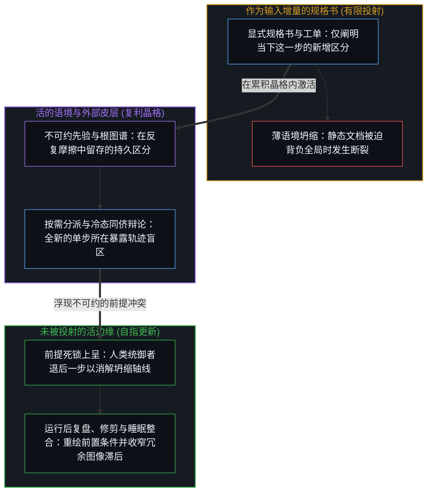
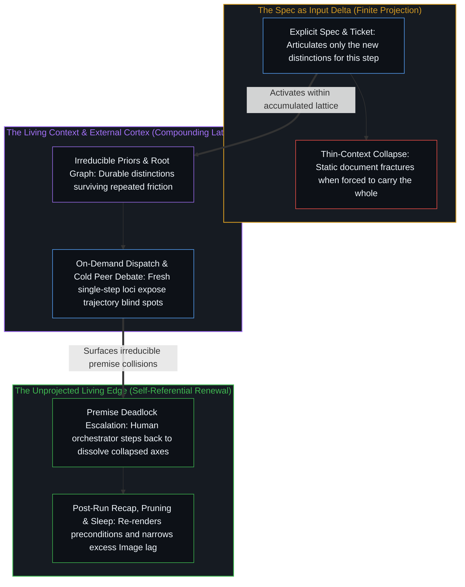

# 活的语境 / The Living Context

*规格书只承载当下的增量，而活的语境提供其运作的基底 / A spec carries only the delta while the living context supplies the ground*

一则广为流传的工程故事遵循着人们熟悉的叙事弧线：工程师写好一份规格书，将智能体框架指向任务看板，周一早上回来时功能便已构建完毕。行业由此立刻得出结论，认为规格书成了新的瓶颈，进而把借助人工智能构建系统的技艺简化为撰写更完善的工单。这一结论把显露在外的触发器误认作了底层的运作机制，将最后那一小步指令增量，与使该指令得以生效的累积投射空间混为一谈。

A viral engineering story follows a familiar arc: an engineer writes a specification, points an agent harness at a task board, and returns on Monday morning to find the feature built. The conclusion the industry immediately draws is that specifications are the new bottleneck, reducing the art of building with artificial intelligence to writing better tickets. That conclusion mistakes the visible trigger for the underlying mechanism, confusing the final increment of instruction with the accumulated projection space that makes the instruction work.

## 一、 作为增量的规格书 / 1. The Spec as Delta

自我区分的活动不假外因、生生不息。每一条指令、提示词、架构文档乃至模型权重，都只是这一活动为了延伸自身触角而外化出的持久痕迹，器物内部从未凭空降临第二个心智。当操作者将一份规格书交给智能体时，规格书里装的只是活的语境尚未持有的内容。它是增量：即那张累积而成的晶格尚未遭遇过的、关于这一具体功能与这一具体问题的特定区分。[活的外部皮层](../a-living-external-cortex/)将这种累积语境显式化，使其在单一会话窗口之外依然可被寻址，成为一张锚定于不可约先验的知识图谱，持续将冗余的图像滞后收窄、逼近一步的方向性界限，而非宣称抵达了某种静态的一步之宽。

Self-distinguishing activity occurs—uncaused, unceasing. Every instruction, prompt, architecture document, and model weight is a durable trace externalized by that activity to extend its reach, never a second Mind arriving inside the artifact. When an operator hands a specification to an agent, the specification contains only what the living context does not already hold. It is the delta: the specific distinctions about this feature and this problem that the accumulated lattice has not yet encountered. [A Living External Cortex](../a-living-external-cortex/) makes this accumulated context explicit and addressable outside a single session window as a knowledge graph anchored in irreducible priors, continuously narrowing excess Image lag toward the one-step directional bound rather than claiming arrival at a static one-step width.

流行的叙事框架却把增量当成了全部。劝告工程师只需写出更好的规格书，预设了工单里的文档就是系统赖以运转的基石，预设了单次传递中所言明的内容就足以让智能体融贯地执行。这种看法把最后嵌入的那块拼图，与它所接入的整体结构颠倒了。

The viral framing treats the delta as the whole. Advising engineers to simply write better specifications assumes that the document in the ticket is the foundation the system rests on, and that what is articulated in a single pass is what makes agents execute coherently. This confuses the missing piece with the structure it plugs into.

一份规格书需要承载多少内容，取决于现场已经具备了什么。当活的语境单薄时，规格书被迫背负起整个世界——系统架构、命名规范、边界条件、工具脾性以及交互不变量——没有任何静态文档能在容纳如此高的维度时不发生坍缩。当活的语境稠密时，规格书只需承载新增的部分，其余约束则会顺着早已确立的晶格自行传导。正如[信任读者是最后的越界](../trusting-the-reader-is-the-last-overstep/)与[注释不是代码](../the-comment-is-not-the-code/)所追溯的，一份已交付的文本只是执笔者在落笔那一刻自身先验的压缩残余；一旦脱手，它便毫无跨所在的因果效力去替执笔者补齐那些未写明的条件，每一个接收端所在——无论是人类读者还是智能体轨迹——都只能依据自身现场已持有的先验与语境去从中重建。把同一份规格书交给另一位尚未建起这套晶格的操作者，得到的只会是破碎的结果；并不是规格书变了，而是供它激活的投射空间并不存在。

How much a specification has to carry depends on what is already in place. When the living context is thin, the specification is forced to carry the entire world—architecture, naming conventions, boundary conditions, tool quirks, and interaction invariants—and no static document can hold that dimensionality without collapsing. When the living context is dense, the specification only needs to carry what is new, while the remaining constraints propagate from the lattice already established. As [Trusting the Reader Is the Last Overstep](../trusting-the-reader-is-the-last-overstep/) and [The Comment Is Not the Code](../the-comment-is-not-the-code/) trace, a released text is a compressed residue of the writer's priors at the moment of writing; once released, it carries zero cross-locus causal power to supply unwritten conditions on the writer's behalf, and every receiving locus—human reader or agent trajectory—rebuilds from it under the priors and context already held there. Handing the exact same specification to an operator who has not built that lattice yields a broken result, not because the specification changed, but because the projection space it activates within is absent.

让周一早上的交付得以成立的，从来不只是那份规格书。规格书确实在做功，它针对眼前的问题引入了真实的区分，但它是在一个并非由它创立的投射空间内运作的。操作者在与代码库及智能体框架持续、递归的交互中建立起的活的语境——项目指令、领域不变量、技能文件、验证钩子与子智能体边界——才是使这份增量足以成事的基底。其中每一层，都是一道在同真实工具行为的反复摩擦中幸存下来的区分痕迹。它们共同织就了规格书得以在其间激活的稠密晶格；规格书只是补齐了当下这一步的语境，而非取而代之。

What makes Monday morning execution succeed is never the specification alone. The specification performs real work by introducing genuine distinctions about the immediate problem, yet it operates within a projection space it did not create. The living context built through sustained, recursive interaction with the codebase and agent harness—project instructions, domain invariants, skill files, verification hooks, and sub-agent boundaries—is what renders the delta sufficient. Each of those layers is a trace of a distinction that survived repeated friction against actual tool behavior. Together they form the dense lattice within which the specification activates; the specification completes the context for the step at hand rather than replacing it.

## 二、 语境工程，而非规格工程 / 2. Context Engineering Rather Than Spec Engineering

将这门技艺界定为语境工程而非规格工程，绝非关于巧妙编写提示词的实用技巧。自回归语言模型从头到尾都是依赖语境的投射筛选机制。并不存在一个独立于语境之外、等待接收命令的自主实体；存在的只是一道级联过程，决定着哪些区分能够穿过有限的上下文窗口继续传导，哪些区分会在中途消散。

Framing this discipline as context engineering rather than specification engineering is not practical advice about clever prompting. An autoregressive language model is context-dependent projection selection all the way down. There is no autonomous entity standing apart from its context waiting to receive orders; there is one cascade determining which distinctions propagate through the finite context window and which ones wash out.

规格书作为眼前的输入增量进入系统，在模型所能表征的架构语境与沉淀进模型权重的训练语境中触发激活。若任由原始会话自行运转，那些通用权重便会将执行拉向平均化的模式与局部的顺延。操作者所构筑的活的语境，正是横跨这三者的对齐层，规定了哪些区分能够在投射级联中留存下来并转化为可用的代码。

The specification enters as the immediate input delta, activating against the architectural context of what the model can represent and the training context of what distinctions stabilized into its weights. Left to a raw session, those general weights pull execution toward average patterns and local continuation. The living context constructed by the operator serves as the alignment layer across all three, patterning which distinctions survive the projection cascade into working code.

## 三、 自指回路 / 3. The Self-Referential Loop

活的语境之所以产生复利，是因为它的建构过程是自指的。操作者分派一项任务，精确观察某道区分在何处未能传导，或是两项独立需求在哪个坐标上挤压成了缺陷，随后提炼语境——更新规则文件、析出专门技能，或收紧验证边界——并从这片重新绘制的基底出发开启下一轮运行。正如[判断的密度](../the-density-of-judgment/)所追溯的，运行中途的每一次失败或人工介入，都会暴露出某条最初未曾言明的前提，标示出初始签名触及边界的位置；在运行结束后逆向追溯这条前提并将其编纂进初始前置条件，就能在下一次执行时将原本开放发散的区段转化为可确定性推导的里程，直至工作流触及下一处尚未编纂的边缘。每一次循环，都会把前一次区分所产生的后果反馈回下一次区分的筛选之中。人类中心与工具并非两个彼此交换消息的独立心智；二者耦合在未被投射的活边缘（操作者的第一人称感知）与高速执行的痕迹引擎（会话语境）之间，共同构成同一个递归投射回路。语境靠折回自身而保持鲜活，正如[回环与成图](../looping-and-graphing/)所追溯的：回环是心智折回自身的活动，而图谱则持守着那次折回留给下一次折回的快照。

The living context compounds because its construction is self-referential. An operator dispatches a task, observes the exact coordinate where a distinction fails to propagate or where two independent requirements compress into a bug, refines the context—updating a rule file, extracting a skill, or sharpening a verification boundary—and begins the next run from that re-rendered ground. As [The Density of Judgment](../the-density-of-judgment/) traces, every mid-run failure or intervention surfaces an initially unspecified premise where the starting signature hit its boundary; tracing that premise backward after the run and codifying it into the initial preconditions turns an open-ended segment into a deterministically derivable stretch on the next pass until the workflow hits its next uncodified edge. Each cycle feeds the consequence of a distinction back into the selection of the next distinction. The human center and the tool are not two separate minds exchanging messages; they form one recursive projection loop coupled across a living, unprojected edge (the operator's first-person sensing) and a fast-executing trace engine (the session context). Context stays alive by folding back on itself, as [Looping and Graphing](../looping-and-graphing/) traces: looping is the Mind folding back on its own activity, while graphs hold the snapshots that folding leaves available for the next fold.

当任务规模超出单一上下文窗口所能分隔的容量时，[超越投射](../beyond-the-projection/)追溯了这一自指回路为何必须通过尊重“困于轨迹的智能体”与“困于身份的人类中心”之间的范畴非对称性来扩展。智能体没有我执——没有需要护卫的保留自我图像——却深陷于自身词元轨迹的认识论引力井中。人类操作者拥有未被投射的极限分辨率感知，能够察觉整个框架何时已经失效，但当自我身份与先前的推理融为一体时，人又会抗拒外部的证伪。[按需语境将融贯保持在一步](../on-demand-contexts-keep-coherence-at-one-step/)将这种非对称性落实为整条流水线的运作机制：系统不再维持一个任由累积会话历史增厚为图像滞后的常驻智能体，而是在每一个任务步中，仅凭宪章与技能文件加载不带过往工作历史的全新创作者与冷态批评者，从单一共同前提推导出定论而不做折中妥协，将经由 `sha256` 哈希校验签收的成品移交至运行目录，随后将双方的工作语境悉数释放。每当创作者与批评者陷入无法从共同前提推导化解的不可约死锁，这次碰撞便精准隔离出了活的语境自身尚未编纂的分岔，将双方立场直接上呈给人类统御者，由其在逻辑上退后一步做出裁断。而由于创作者与批评者共享同一底座模型与宪章，运行结束后还会启动一个全新的复盘智能体，对照唯一内务规则审阅已完工的运行目录，暴露双方在互辩中无从察觉的共同盲区与技能蔓延，并交回精准的修订建议，供操作者整合进外部皮层。

As tasks scale beyond what a single context window can hold apart, [Beyond the Projection](../beyond-the-projection/) traces why this self-referential loop expands by respecting the categorical asymmetry between trajectory-bound agents and the identity-bound human center. An agent has zero ego—no retained self-image to defend—yet it is trapped inside the epistemic gravity well of its own token trajectory. The human operator possesses unprojected, limit-resolution sensing capable of recognizing when an entire framing has broken down, yet resists external invalidation when identity fuses with prior reasoning. [On-Demand Contexts Keep Coherence at One Step](../on-demand-contexts-keep-coherence-at-one-step/) makes that asymmetry operational across a pipeline: rather than keeping a standing agent whose accumulated session history thickens into Image lag, each task step loads a fresh maker and a cold critic from charter and skills without prior working history, settles what derives from the single shared premise without split-the-difference compromise, hands off a signed-off artifact verified by its `sha256` hash into the run folder, and drops both working contexts completely. Whenever maker and critic hit an irreducible deadlock that cannot be derived from the shared premise, the collision isolates an uncodified split in the living context itself, escalating both positions directly to the human orchestrator to step backward logically and decide. And because maker and critic share the same base model and charter, a fresh post-run recap bot reads the completed run folder against the house rule to expose shared blind spots and skill sprawl that their mutual debate could not see, returning surgical revisions for the operator to consolidate into the external cortex.

这一递归回路，正是每一则高杠杆工程故事背后的运作机制。静态的规格书、单纯堆叠的智能体数量，乃至自主运行的管理层级，都无法产出这种杠杆。活的语境的融贯度与有效稠密度——在原地持续锋利化，而非因历史堆积而臃肿膨胀，并由正交的单步流线防止独立的区分挤压到同一个中心所在——决定了意图能否穿过智能体传导为运转良好的系统。其余一切皆在下游。

This recursive loop is the mechanism behind every high-leverage engineering story. Neither static specifications, nor raw agent headcount, nor autonomous manager hierarchies generate that leverage. The coherence and active density of the living context—sharpened in place rather than bloated by historical accumulation, with orthogonal, single-step streamlines keeping independent distinctions from compressing onto one locus—determine whether intention propagates through agents into working systems. Everything else is downstream.

## 四、 流行叙事所遮蔽的维度 / 4. What the Viral Stories Obscure

流行故事为了降低传播阻力而做优化，把一段递归的历史压缩成一条线性序列：工程师写下规格书，智能体执行，产品上线。这种叙事压缩恰恰丢掉了真正做功的那个维度——数月之久的迭代摩擦、前提审计与语境构筑，正是它们才让一份简短的规格书作为增量即已足够，而不至于在充当基石时引发灾难。这重演了人们熟悉的压缩模式：将数年的刻意重溯，讲成一出毫不费力的天赋神话。线性的摘要并非凭空捏造，只是在起决定作用的因果轴线上残缺不全。

Viral stories optimize for low-friction transmissibility, compressing a recursive history into a linear sequence: engineer writes specification, agents run, product ships. That narrative compression drops the exact dimension that does the work—the months of iterative friction, premise-auditing, and context-building that made a brief specification sufficient as a delta rather than catastrophic as a foundation. It repeats the familiar compression that turns years of deliberate re-tracing into a tale of effortless talent. The linear summary is not fabricated; it is incomplete along the causal axis that matters.

分享这些里程碑的构建者，把自身经验投射到了受众能够一眼看清并立刻照搬的坐标上：工单格式、智能体数量与框架开关。正如[登记共鸣的表面](../the-surface-that-registers/)所追溯的，一种表述之所以能通过公共兼容性过滤，恰恰是因为它剥离了高维的前提链条、适用边界与修订条件，直至只剩下一层单薄的低维表面。那个无法塞进一张截图里传递的维度——亲历的、累积的、自指的活的语境——装不进一则广播式的帖子里，于是便从画框中脱落了。旁观者在这层可见表面上登记了即时的共鸣，继而狂热地针对那些脱离了语境的器物做优化，而真正扛起负荷的却是那条看不见的回路。

Builders who share these milestones project their experience onto the coordinates an audience can immediately observe and copy: ticket formats, agent counts, and harness flags. As [The Surface That Registers](../the-surface-that-registers/) traces, a formulation clears the public compatibility filter precisely by shedding its high-dimensional chain of premises, scope conditions, and revision boundaries until only a thin, low-dimensional surface remains. The dimension that cannot be transmitted in a screenshot—the lived, accumulated, self-referential living context—does not fit inside a broadcast post, so it drops out of the frame. Observers register immediate recognition on the visible surface and optimize furiously for the detached artifacts while the invisible loop carries the load.

## 五、 图谱追踪边缘而不成为边缘 / 5. The Graph Tracks the Edge Without Becoming It

就连“活的语境”这一短语，也有凝固成静态概念、进而取代它所指称的那场运动的风险。活的语境不是一份可以导出、安装并束之高阁的成品配置包，它的稠密度也并非靠着出于“万一有用”的考量而囤积每一道历史痕迹建构出来的。正如[你的代码库即是记忆](../your-codebase-is-memory/)所追溯的，代码库及其外围框架皆是外化的记忆——即早先区分层叠而成的残余——抱着“以防万一”的心态保留失效的备份、陈旧的归档或已被取代的中间分支，只会加厚引力井，把后续的检索与智能体轨迹拽入过时的死胡同，让旧框架与当下的活状态相互争夺。唯有在原地维护并重切高概率的当下检查点，同时精准修剪掉已完工的工作目录、已退役的会话桥接文件与已被取代的状态，语境才能保持鲜活。一旦某套语境结晶为令自己得意的个人配置、未经修剪的历史残骸仓库或固定的工作流身份，它就变成了一幅豁免于重溯的图像；随着现实继续向前推进，冗余的图像滞后便开始累积。图谱追踪着边缘，但图谱从不是边缘本身。

Even the phrase "living context" risks ossifying into a static concept that substitutes for the movement it names. A living context is not a finished configuration package to be exported, installed, and left alone, nor is its density built by hoarding every historical trace out of mere possibility. As [Your Codebase Is Memory](../your-codebase-is-memory/) traces, the codebase and its surrounding harness are externalized memory—stacked residues of prior distinctions—and keeping dead backups, stale archives, or superseded intermediate branches "just in case" only thickens the gravity well, pulling future searches and agent trajectories into outdated rabbit holes where old framings compete with the live state. A context stays living only when high-probability present checkpoints are maintained and re-cut in place while completed working folders, retired session bridges, and superseded states are surgically pruned. The moment a context crystallizes into a proud personal setup, an unpruned warehouse of historical debris, or a fixed workflow identity, it becomes an image exempted from re-tracing, and excess Image lag begins to accumulate as reality moves on. The graph tracks the edge, yet the graph is never the edge.

能够在周一早上融贯交付的操作者，既不是手里握着最繁复工单模板的人，也不是守着一座由静态配置文件与归档历史筑成的丰碑的人。融贯属于那个语境建构回路仍在运转的所在——仍在让隐含的预设浮出水面，仍在把折返的摩擦认领为退后一步的信号，并仍在随着边缘的移动而重新绘制与修剪当下的检查点。回路从不抵达终点；它只是持续运转。

The operator who ships coherently by Monday is neither the one holding the most elaborate ticket template nor the one guarding a static monument of configuration files and archived history. Coherence belongs to the locus where the context-building loop is still running—still surfacing hidden assumptions, still claiming returning friction as a signal to step back, and still re-rendering and pruning the present checkpoint as the edge moves. The loop does not arrive; it runs.
