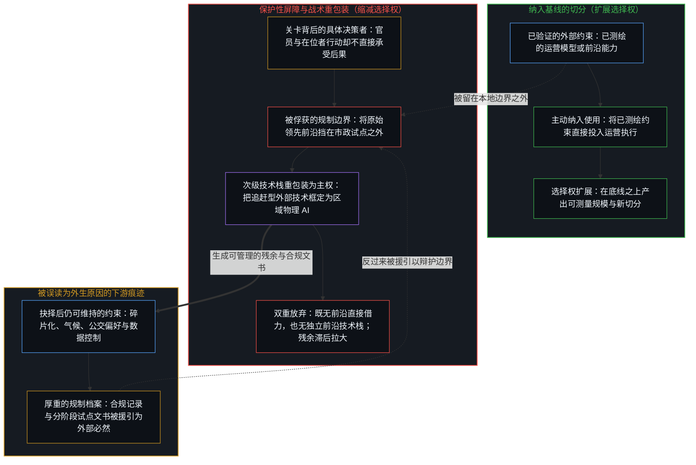
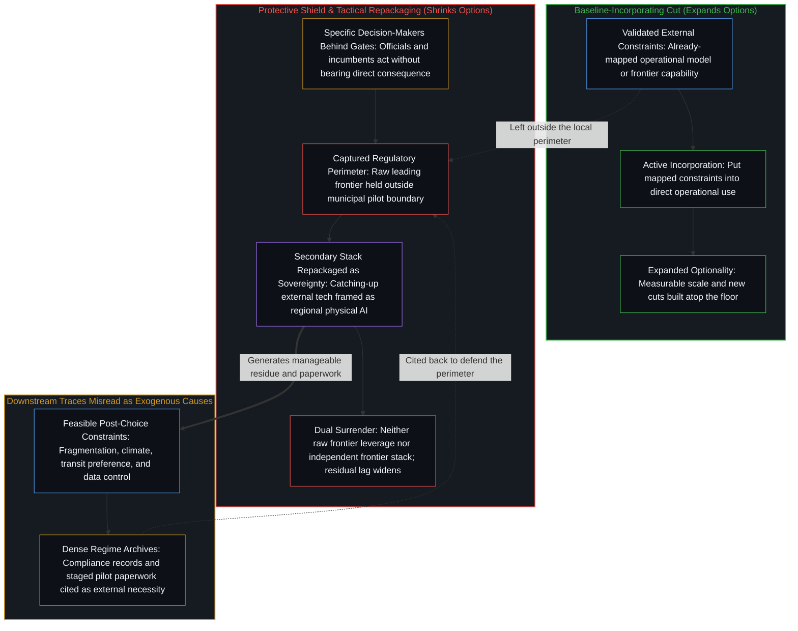
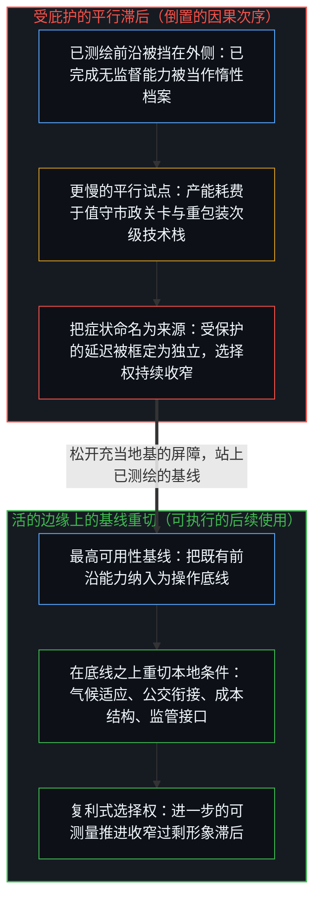
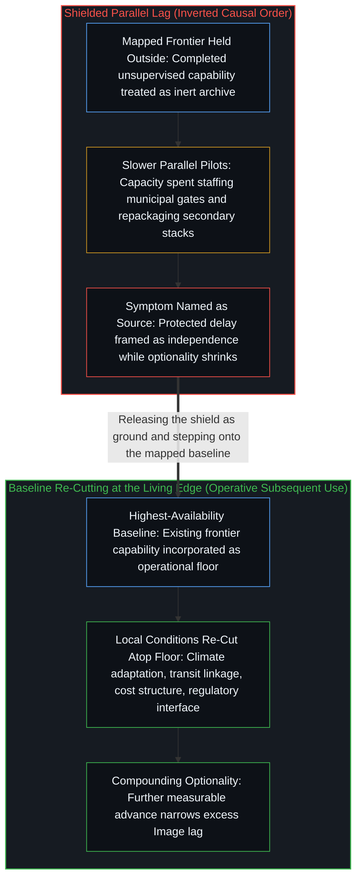

# 本地屏障与残余滞后 / The Local Shield and the Residual Lag

*把保护性切分当作独立发展，只是把已测绘的前沿留在边界之外，使后续选择权持续缩小。 / Treating protective cuts as independent development leaves the already-mapped frontier outside the boundary, so later optionality continues to shrink.*

本地运营商表面上的成功，常是两种非对称切分的叠合：把业经验证的运营模型纳入自身使用，会扩展可执行的选择；依赖本地化的监管与准入屏障，则会把更广义的能力前沿留在边界之外。当无人驾驶已在其他地域以无监督方式投入多城市付费服务时，把 2027 年的有限市政试点框定为建造区域物理 AI，并非在前沿划出新切分，而是筑起一道保护性屏障——在屏障之内，次级、追赶中的外部技术栈经由本地规制俘获被重新包装为主权，而屏障背后作出决定的具体个人，并不直接承受选择权收窄的后果。那些屡屡被援引为独立本地原因的因素——监管碎片化、冬季气候、公共交通整合偏好与数据控制——只有在把更高可用性基线挡在门外之后才得以维持；高阻力规制体系内累积的厚重合规档案，登记的是这道屏障的下游痕迹，而非对它的反驳。把最高可用性的能力设为操作基线，并在其上重新切分本地条件，才能让后续选择权保持敞开；把受庇护的滞后改称为独立发展，则是将已完成的能力封存为惰性档案，同时放弃了前沿借力与独立的前沿建造。

A local operator's apparent success often superposes two asymmetric cuts: incorporating an already-validated operational model expands executable options, whereas relying on localized regulatory and entry shields leaves a broader capability frontier outside the perimeter. Once autonomous driving already runs unsupervised as paid multi-city service elsewhere, framing limited 2027 municipal pilots as building regional physical AI does not draw a fresh cut at the frontier; it draws a protective shield inside which secondary, catching-up external stacks are repackaged through local regulatory capture as sovereignty, while specific decision-makers behind the barrier bear no direct consequence of the narrowed options. Factors routinely invoked as independent local causes—regulatory fragmentation, winter climate, public-transport integration preferences, and data control—remain feasible to maintain only after the higher-availability baseline is held outside, and the dense compliance archives accumulated inside high-resistance regimes register as downstream traces of that shield rather than refutations of it. Taking the highest-availability capability as an operational baseline and re-cutting local conditions atop it keeps later optionality open; renaming shielded lag as independent development files completed capability away as inert archive and surrenders both frontier leverage and independent frontier building.

## 一、 两种非对称的切分 / 1. Two Asymmetric Cuts

自我区分的活动发生着——无因、不息。称之为心智：已在进行中的观察者，它的每一个动作都是一次区分。每一次区分都划出一条边界，并留下痕迹，供后续行动重溯或搁置。由于较早的行动塑造着后续行动可用的场域，没有哪位后来的实践者是从一片空白起步的：已测绘的约束——行之有效的运营模型、经验证的单位经济模型、已部署的架构——皆作为可用残余留在场中。把业经验证的切分纳入当下使用，与划出边界把更广阔的前沿隔在接触之外，二者在结构上截然不同。

Self-distinguishing activity occurs — uncaused, unceasing. Call it the Mind: the observer already underway, every act of which is a distinction. Every distinction draws a boundary and leaves trace that later acts can re-trace or set aside. Because earlier acts shape the field available to later ones, no subsequent practitioner begins from an empty slate: already-mapped constraints—working operational models, validated unit economics, deployed architectures—stand as available residue. Incorporating an already-validated cut into active use differs structurally from drawing a boundary to keep a wider frontier out of contact.

Bolt 在欧洲出行市场的相对成功，正呈现出这两种切分的叠合。在第一条轴线上，Bolt 采纳了 Uber 已经验证的平台匹配与动态定价模型，将这些运营约束纳入日常执行，从而在欧洲多座城市获得了可测量的规模——活跃乘客、司机群体与营收。在第二条轴线上，Bolt 同时依赖本地化的监管与准入屏障——碎片化的市政牌照边界与本地合规衔接，使外部进入者更难展开统一的城市级竞争。第一种切分把已验证的业务约束纳入使用，扩展了可执行的选择；第二种切分则把更广义的运输能力前沿留在屏障外侧，使本地运营免于直面已在其他地域实现无监督规模运行的能力。这两种切分并非对称：前者拓宽仍可选择的余地，后者则缩减仍可选择的范围。

Bolt's relative success in European mobility exhibits that superposition of two cuts. On one axis, Bolt adopted the platform-matching and dynamic-pricing model already validated by Uber, incorporating those operational constraints into daily execution and obtaining measurable scale—active riders, drivers, and revenue across European cities. On a second axis, Bolt relied simultaneously on localized regulatory and entry shields—fragmented municipal licensing perimeters and local compliance alignments that made uniform city-level contest harder for external entrants. The first cut took validated business constraints into use and expanded executable options. The second cut left the broader frontier of transport capability outside the shield, sparing local operations from confronting capability already running unsupervised at scale elsewhere. These two cuts are not symmetric: the first widens what remains selectable; the second shrinks the range that remains selectable.

经济学与产业政策论述常将这种保护性切分归入**幼稚产业保护**或**进口替代**的名目。在有界的短期条件内，一道保护性边界确实承担着清晰可辨的作用：它降低即时的竞争压力，放缓起步阶段的资金消耗，并为本地运营商留出筹措融资、组织司机流动性与对接市政合规的空间。一旦将隔绝视作生成前沿能力的机制，而不再将其视作缓冲即时摩擦的临时措施，这一前提便到达了边界。将更高可用性的前沿挡在边界之外，并不会在边界内部生出独立的工程杠杆；相反，它抽走了迫使内部能力持续重绘的直接接触信号。与之相伴的另一重误读来自**后发优势（快速跟随者优势）**的叙事，[看不见的第一步](../the-invisible-first-move/)已标出它的边界：观望早期先行者承担最初的试错摩擦，在一个格局业已明朗的品类内确实可以压低模仿成本；但若仅以本地可见的上线日期去读历史，便会把受庇护的市场入场，误认作多年前那场无声而未经验证的复利——正是那份复利在当时便奠定了更高杠杆的架构。

Economic and industrial-policy accounts commonly formalize the protective cut under **infant-industry protection** or **import substitution**. Within bounded short-run conditions, a protective perimeter performs an intelligible task: it lowers immediate competitive pressure, slows capital burn during initial setup, and gives local operators room to arrange financing, driver liquidity, and municipal compliance. That premise reaches its boundary when insulation is treated as the mechanism that generates frontier capability rather than a temporary buffer against immediate friction. Holding a higher-availability frontier outside a boundary does not supply independent engineering leverage inside it; it removes the direct contact signal that forces internal capacity to re-render. A companion misreading runs through the **second-mover (fast-follower) advantage** story, whose boundary [The Invisible First Move](../the-invisible-first-move/) locates: watching early entrants absorb initial friction can lower imitation costs inside an already-clear category, yet reading history from visible local launch dates mistakes sheltered market entry for the quiet, unvalidated compounding that built a higher-leverage architecture years earlier.

两种切分之间的非对称，正呼应着能力跨领域扩散的轨迹。正如[前沿抬升底线](../the-frontier-lifts-the-floor/)所追溯的，前沿产能借由后续采纳与竞争性模仿向外扩散，其后随边缘带动着性能与可及性的绝对底线不断抬升，从不是以局部平衡之名封顶或排斥源头的结果。而在[限制是选择性的税](../restriction-is-a-selective-tax/)中，一道朝外的封印只拖慢把它当作地基的人——且最重地拖慢那些耗费产能为它值守的人——同时不服从这道封印的路径仍在决定前沿步调；本地化的保护性屏障，则是把同一条边界转向内部，使之化作一道运营天花板。边界之内的即时竞争摩擦确有缓和，可相对于边界之外仍在推进的能力，内部仍可选择的范围却在持续收缩。

The asymmetry between the two cuts tracks how capacity diffuses across domains. As [The Frontier Lifts the Floor](../the-frontier-lifts-the-floor/) traces, the absolute floor of performance and access rises as the trailing edge of frontier capacity diffusing outward through subsequent adoption and competitive imitation, never by capping or excluding the source in the name of local balance. And where [Restriction Is a Selective Tax](../restriction-is-a-selective-tax/) traces how an outward seal slows only those who treat it as ground—and most heavily those who spend capacity staffing it—while non-compliant paths continue setting the frontier pace, a localized protective shield turns the same boundary inward as an operational ceiling. Immediate competitive friction eases inside the perimeter, while the selectable range contracts relative to the capability continuing outside.

## 二、 在前沿之外重绘屏障与次级技术的“主权”重包装 / 2. Redrawing the Shield Outside the Frontier and Repackaging Secondary Technology as Sovereignty

当无监督自动驾驶已从研究原型迈入多城市、车内无安全员的付费服务阶段时，继续打着“欧洲需要建造自己的物理 AI”的旗号规划 2027 年的有限市政试点——这正是 2026 年 11 月 Bolt 与赫尔辛基地区公共交通及市政当局签署非约束性谅解备忘录时所伴随的表述——并非在前沿上重新切分，而是在已测绘的约束图谱之外重绘一条保护性边界。已完成的无监督里程、边缘案例记录与生产可扩展性，构成了固定的历史序列。后来的实践者面对一道直接的分岔：要么把这些已测绘的约束纳入当下使用并产出进一步的可测量推进，要么将它们留在屏障之外，继续在更窄的域内操作。选择更窄的域并不会增添独立的能力；它只是把滞后维持为可管理的残余，同时将保护性切分描述为自主发展。

Once unsupervised autonomous driving has moved from research prototype to paid service across multiple cities with no safety driver in the vehicle, planning limited 2027 municipal pilots under the banner "Europe needs to build its own physical AI"—the framing accompanying Bolt's November 2026 non-binding Helsinki memorandum of understanding with regional transit and municipal authorities—is not a fresh cut at the frontier. It is the redrawing of a protective boundary outside an already-mapped constraint graph. Completed unsupervised miles, edge-case records, and production scalability stand as fixed historical sequences. Later practitioners face a direct fork: either incorporate those mapped constraints into active use and generate further measurable advance, or leave them outside the shield and continue operating inside a narrower domain. Choosing the narrower domain adds no independent capability; it keeps the lag as a manageable residue while describing the protective cut as autonomous development.

建立可执行的能力或自主性，无非沿着两条具体路径展开：要么直接借力原始领先前沿作为操作基线，并在其上搭建差异化能力层；要么投入资本与工程人才，不设缓冲地直面物理摩擦，独立造出一套前沿技术栈。然而，落后方反复上演的模式，却是同时放弃这两条路径。本地在位者既不直接面对原始领先前沿，也不愿承担长期复利投入去打造本土前沿架构，而是借助**规制俘获**维持一道受庇护的市政边界，再在这片被保护出来的真空里，把次级、追赶中的外部技术贴上区域主权的标签重新包装。

Building operative capability or self-direction follows either of two concrete paths: directly leveraging the raw leading frontier as an operational baseline and building differentiated layers atop it, or committing capital, engineering talent, and unbuffered contact with physical friction to build an independent frontier stack. A recurring lagging-player pattern instead surrenders both paths at once. Rather than confronting the raw leading frontier directly—or bearing the long compounding cost of building an indigenous frontier architecture—a local incumbent uses **regulatory capture** to maintain a shielded municipal perimeter, and inside that protected vacuum repackages secondary, catching-up external technologies under the label of regional sovereignty.

Bolt 自身在 2025 年与 2026 年的公开披露，直接展现出这一机制。2026 年 11 月的赫尔辛基谅解备忘录既未指定车辆平台，也未指明自动驾驶软件栈、车队规模或任何具约束力的商业条款，仅以获得芬兰监管许可为前提指向 2027 年试点。在更广泛的欧洲公告中，Bolt 明确将其自动驾驶部门定位为商业化、车队运营与城市整合层——即“把全球技术供应链整合成面向欧洲城市的单一产品”——将美国 NVIDIA（DRIVE Hyperion 算力平台与 Alpamayo 驾驶栈）以及源自中国的 Pony.ai（第七代 L4 级软件）等外部技术栈，与 Lucid 和 Stellantis 的车辆拼装起来，却把这套外部芯片与软件的整合方案连同本地车队数据，置于“为欧盟开创主权技术”的标题之下。整合市政交通、本地车队运营与监管合规，涉及扎实的运营实务，并非零投入。但在结构上，这份投入从属于回避与原始领先前沿的直接对照：在本地规制俘获造就的真空内，经过重包装的追赶型技术栈在旁观的公众眼中登记为加速成型的区域主权，而这项安排其实同时拒绝了原始前沿借力与本土前沿工程两条路径，将其折叠成一种次一级的战术混合体。

Bolt's own 2025 and 2026 disclosures exhibit that mechanism directly. The November 2026 Helsinki memorandum names no vehicle platform, no autonomous driving software stack, no fleet size, and no binding commercial terms, targeting 2027 pilots subject to Finnish regulatory permission. Across its wider European announcements, Bolt explicitly defines its autonomous unit as a commercialization, fleet-operations, and city-integration layer *"turning a global technology supply chain into one product for European cities,"* assembling external stacks from US-based NVIDIA (DRIVE Hyperion compute and the Alpamayo driving stack) and China-origin Pony.ai (Gen-7 Level 4 software) alongside vehicles from Lucid and Stellantis—while presenting that external silicon-and-software integration paired with local fleet data under the headline *"Pioneering Sovereign Technology for the EU."* Integrating municipal transit, local fleet operations, and regulatory compliance involves concrete operational work rather than zero effort. Yet structurally it subordinates that effort to avoiding direct comparison with the raw leading frontier: inside a locally captured regulatory vacuum, repackaged catching-up stacks register to public onlookers as accelerated regional sovereignty, even as the arrangement declines both raw frontier leverage and indigenous frontier engineering, folding the two paths into a lesser tactical hybrid.

两个广为持守的前提在这一序列里触及了边界。**规制俘获**指明了一个清晰的有界机制：牌照关卡、逐城审批与排他性试点许可，会把合规关系转化为在位者的竞争护城河。当人们把监管机构想象成一位立于外部的守护者，以为只要隔绝企业游说便能令其中立行事时，这一前提便到达了边界。同样，**技术主权**若被限定在具体的设计边界内，回应的也是切实的运营关切——避免单一供应商锁定、维持可替换接口，或对本地数据施以明确的共享限制；而[硬件的本地性不是信息的边界](../hardware-locality-is-not-the-information-boundary/)早已将这种信息边界与物理同址清晰区分开来。而当套在拼装外部技术栈上的领土管辖权或区域品牌，被当作前沿生成能力的替代品时，技术主权的前提便到达了边界。

Two widely held premises reach their boundaries inside this sequence. **Regulatory capture** identifies a clear bounded mechanism: licensing gates, city-by-city approvals, and exclusive pilot permits convert compliance relationships into competitive moats for incumbents. That premise reaches its boundary when the regulator is imagined as an exterior guardian that merely needs insulation from corporate lobbying to act neutrally. Likewise, **technological sovereignty** addresses concrete operational concerns when kept to specific design boundaries—avoiding single-supplier lock-in, maintaining substitutable interfaces, or enforcing explicit sharing limits over local data, an information boundary that [Hardware Locality Is Not the Information Boundary](../hardware-locality-is-not-the-information-boundary/) separates from physical co-location. It reaches its boundary when territorial jurisdiction or a regional brand placed over an assembled external stack is treated as a substitute for generative capability at the frontier.

追溯因果源头，便能消解立在这两个前提背后的幽灵集体。世上并没有名为“欧洲”、“城市”或“监管者”的集体实体在选择、创新或买单。正如[主权、信念与规制结构的生成](../sovereignty-belief-and-regulatory-structures/)所确立的，个人主权从不会迁移进一纸章程或某座机构之中；规制结构只是许多个体基于“判断与风险可以交托他人”这一信念行动后所稳定下来的残余——这也是监管万能论背后的同一前提，即把审批关卡当作个人辨别的替代品。正如[政客是责任扩散的显性症状](../politicians-appear-as-visible-symptoms-of-responsibility-diffusion/)所追溯的民选声索者那样，监管者只是个体把自身区分委托给想象集体后呈现出的显性症状。每一道保护性屏障背后，坐着的都是具体的个人——签署备忘录的官员、维持牌照门槛的委员会成员、围绕这些关卡搭建业务的高管——他们替居民决定能够接触哪些交通能力，却并不直接承受放弃选择权与持续累积延迟的后果。决定向正式关卡集中，后果却留在构成这一场域的个体身上，这正是[让渡主权的幂律法则](../the-power-law-of-surrendered-agency/)所追溯的非对称结构。

Tracing the causal origin dissolves the phantom collective standing behind both premises. No collective entity named "Europe," "the city," or "the regulator" chooses, innovates, or pays. As [Sovereignty, Belief, and the Generation of Regulatory Structures](../sovereignty-belief-and-regulatory-structures/) establishes, individual sovereignty never migrates into a charter or an agency; regulatory structures are the stabilized residue of many individuals acting on the belief that judgment and risk can be handed over—the same premise behind regulatory omnipotence, where approval gates are treated as substitutes for personal discernment. Regulators—like the elected claimants traced in [Politicians Are Visible Symptoms of Responsibility Diffusion](../politicians-appear-as-visible-symptoms-of-responsibility-diffusion/)—are the visible surface symptom of individuals delegating their own distinctions to an imagined collective. Behind every protective barrier sit specific individuals—officials signing memoranda, committee members maintaining licensing thresholds, executives structuring operations around those gates—deciding which transport capabilities residents may access while bearing no direct consequence of the foregone options or accumulated delay. Decisions concentrate inside formal gates while consequences stay with the individuals whose choices constituted the field, the asymmetry traced in [The Power-Law of Surrendered Agency](../the-power-law-of-surrendered-agency/).

在这一因果次序中，其他看似独立的因素——监管碎片化、冬季气候差异、公共交通整合偏好与数据控制——并不提供额外的因果力。它们是在选择不采用更高可用性系统*之后*仍能维持的约束，而非迫使这一选择发生的外生原因。高阻力规制体系内部生成的大量合规规程、试点框架与本地反驳论述，同样不能反驳这一机制。选择性框定本身是有界中心登记自身视野时的寻常事实，可框定从不会把被框定的说辞变成独立原因。高阻力的监管环境自然会积攒起厚重的许可卷宗、分阶段试点文件与程序里程碑；若沿着因果链条来读，而非将其置为外部裁判庭，这批稠密的文书登记的恰是屏障正在运转的下游证据——这与[封闭框定与选择权的缩减](../closed-framing-and-the-reduction-of-optionality/)所追溯的同一回路如出一辙：一旦把有限的边界持守为封闭上限，活的精力便会转向为边界编纂记录，而非跨过边界继续推进。

In this causal order, other factors that appear independent—regulatory fragmentation, winter climate differences, public-transport integration preferences, and data control—supply no additional causal power. They are constraints that remain feasible to maintain *after* the choice not to adopt the higher-availability system, not exogenous causes that compelled that choice. Nor does the volume of compliance protocols, pilot frameworks, and local counter-accounts generated inside a high-resistance regime refute the mechanism. Selective framing is itself a fact of how bounded centers register their horizon, yet framing never turns the framed account into an independent cause. High-resistance regulatory environments naturally accumulate thick archives of permits, staged pilots, and procedural milestones; read along the causal chain rather than seated as an external tribunal, that dense documentation registers as downstream evidence of the shield operating—the same loop [Closed Framing and the Reduction of Optionality](../closed-framing-and-the-reduction-of-optionality/) traces when holding a finite perimeter as a sealed limit directs live effort into documenting the boundary rather than moving past it.

## 三、 能力差、形象滞后与把症状当作来源 / 3. The Capability Differential, Image Lag, and Describing the Symptom as the Source

Bolt 身上这两种切分的叠合，由此标出了一条清晰的运营边界。采纳已验证的匹配与定价模型，借由主动使用既有约束产出了本地规模；同时依赖本地屏障，则将更高通用性的自动驾驶能力留在了边界之外。在前沿上将各条自动驾驶路径区分开来的，是**架构上的能力差**。以视觉为主、轻度依赖逐城高精地图、专为在既有可量产车队上传播而构建的架构，与绑在更重逐城测绘、定制传感器套件集成及逐城专门部署上的多传感器技术栈相比，有着不同的扩展斜率。这一能力差直接登记在部署速度与地理扩张速率上。即便视觉主导的铺开仍在逐城推进——例如 Tesla 的多城市无监督服务——每一步起约束作用的也是具体的本地监管许可与审慎的安全考量，而非内置于架构本身的地理测绘天花板。相比之下，在碎片化的市政试点协议里，把商业服务绑定于重地图、定制化的多传感器技术栈，就会把扩张速度直接锁在最慢的那道行政关卡上。

Bolt's two-cut superposition therefore marks a clear operational boundary. Adopting a validated matching and pricing model produced local scale through the active use of existing constraints; simultaneously relying on a local shield left higher-generality autonomous capability outside the perimeter. What separates competing autonomous paths at the frontier is an **architectural capability differential**. A vision-primary architecture with light dependence on per-city high-definition mapping, engineered to propagate across an existing mass-manufacturable vehicle fleet, carries a different scaling slope than multi-sensor stacks tied to heavier per-city mapping, custom sensor-suite integration, and bespoke municipal deployments. That differential registers directly in deployment speed and geographic expansion rate. Where a vision-primary rollout still advances city by city—as in Tesla's unsupervised multi-city service—the binding limits at each step are specific local regulatory permissions and deliberate safety caution, not a geographic mapping ceiling built into the architecture itself. By contrast, tying commercial service to map-heavy, bespoke multi-sensor stacks inside fragmented municipal pilot agreements couples expansion speed directly to the slowest administrative gate.

承认保护性切分的有界效用，能让这一诊断保持锋利：本地屏障确实降低了即时竞争压力，缓冲了短期资金敞口，也为本地车队整合与市政合作争取了回旋余地。断裂始于把这种保护性切分当作采纳已验证模型的必要补充，甚至将其抬升为独立能力的来源。屏障非但没有补足第一种切分，反而缩减了选择权。它把更高通用性的能力挡在边界之外，使本地运营得以避开与残余滞后的直接对照。在这片受庇护的视野中，前沿冲击未曾显现的平静被登记为井然有序的本地进展——这正是[把稳定的症状当作稳定的来源](../mistaking-the-symptom-of-stability-for-its-source/)所追溯的倒置：平静的局部表面被归功于某种固定安排，而非真正生成连续性的响应速度。

Granting the bounded utility of the protective cut keeps the diagnosis sharp: a local shield does lower immediate competitive pressure, buffers near-term capital exposure, and buys space for local fleet integration and municipal partnerships. The break begins when that protective cut is treated as a necessary complement to validated-model adoption, or elevated into a source of independent capability. Rather than complementing the first cut, the shield reduces optionality. By keeping higher-generality capability outside the boundary, the shield insulates local operations from direct comparison with residual lag. Inside that sheltered horizon, the absence of visible frontier disruption registers as orderly local progress—the inversion traced in [Mistaking the Symptom of Stability for Its Source](../mistaking-the-symptom-of-stability-for-its-source/), where a calm local surface is credited to a fixed arrangement rather than to the response speed generating continuity.

一旦关于区域独立的保留形象被免于重新追溯，每多花一轮周期经营边界，过剩的形象滞后便拉宽一分。自主叙事随之开始把症状描述为来源：延后的试点日程、层层叠叠的市政许可与重新包装的次级技术栈，被援引作审慎区域发展的明证，而不是前沿已在别处运转的信号。[观察滞后与选择权的倒置](../observation-lag-and-the-inversion-of-optionality/)追溯了由此展开的速度几何：当一个行动中心不断收窄自身选项，直到回应时间超过观察时间，它便从观察者-行动者翻转为被观察的对象，把剩余的滞后拱手让给仍能自由迭代与部署的对手方。向内看，[关闭选择权的代价](../the-price-of-closing-optionality/)追踪了这样一种机制：把未知风险视作接触前就须结清的封闭清单，会不断拖延内部发布，而更开放的建造者仍在持续交付；从通道设限的一侧看，[限制即自我限制](../every-limitation-is-self-limitation/)表明，约束接触会切断鲜活的使用信号，而开放路径仍在别处继续复利。由于[没有系统能被保持封闭](../no-system-can-be-kept-closed/)，一道有限的市政屏障从未能封住在其外侧推进的交通能力；它只是把接触向后推延，直到日积月累的滞后化作外部冲击回返。

Once a retained image of regional independence is exempted from re-tracing, excess Image lag widens with every cycle spent managing the perimeter. The narrative of autonomy begins describing the symptom as the source: delayed pilot dates, layered municipal permissions, and repackaged secondary stacks are cited as evidence of careful regional development rather than signs that the frontier is already operating elsewhere. [Observation Lag and the Inversion of Optionality](../observation-lag-and-the-inversion-of-optionality/) traces the speed geometry that follows: when an acting center narrows its options until response time exceeds observation time, it flips from observer-actor into observed object, handing the remaining lag to counterparties who stay free to iterate and deploy. On the inward side, [The Price of Closing Optionality](../the-price-of-closing-optionality/) tracks how treating unknown risk as a closed checklist to be settled prior to contact delays internal release while more open builders keep shipping; on the channel-gating side, [Every Limitation Is Self-Limitation](../every-limitation-is-self-limitation/) shows how restricting contact severs live usage signals while open routes continue compounding elsewhere. Because [No System Can Be Kept Closed](../no-system-can-be-kept-closed/), a finite municipal shield never seals the transport capability advancing outside it. It only defers contact until the accumulated lag returns as an external shock.

把保护性切分持守到超出其短期缓冲效用之外，就是用一套备受捍卫的自主形象替代直接对照，在区域独立的旗帜下同时放弃前沿借力与独立工程两条路径。心智若要保持进一步的推进，只能站上已测绘的约束并继续向前，而非在屏障之内把残余滞后改称为自主。

Holding the protective cut past its short-run buffer utility replaces direct comparison with a defended image of autonomy, forfeiting both frontier leverage and independent engineering beneath the banner of regional independence. A Mind keeps further advance alive only by standing on already-mapped constraints and moving further, not by renaming residual lag as autonomy inside a shield.

## 四、 后续使用与惰性档案：站在基线上重新切分 / 4. Subsequent Use Versus Inert Archive: Re-Cutting From the Baseline

可执行的后续使用并不要求放弃本地条件；它要求把既有的更高可用性系统设为新的操作基线，再对照当下处境重新切分其中仍能承重的部分——冬季气候适应、公共运输衔接、单位成本结构、车队运营与监管接口。正如[一个可能的全自动交通未来的非定论预测](../non-definitive-forecast-of-a-possible-fully-autonomous-transportation-future/)所追溯的，消解人类司机这一成本约束，将在沿袭下来的固定时刻表巴士与闲置私家车之外，重组城市与郊区的出行结构。与轨道干线的本地衔接、低密度郊区的按需接驳、应对恶劣天气的调度以及市政运营接口，架设在更高通用性的自动驾驶基线之上时，远比绑在更慢、逐城定制的本地试点上更宽广，也更扎实。而在[要紧的控制迁往边缘](../residual-control-recedes-to-the-edge/)所追溯的迁移中，对低层基底的占有已经退成残余，真正起分量的控制正向外迁往成功标准、风险界限、验证与负载下的适配度；执意占有一个受庇护且滞后的中间层，是把正在退去的基底误认作了能动性的所在。

Operative subsequent use does not require abandoning local conditions. It requires taking the existing higher-availability system as the new operational baseline, and then re-cutting against present conditions whatever still bears load: winter climate adaptation, public-transport linkage, unit cost structure, fleet operations, and regulatory interfaces. As [Non-Definitive Forecast of a Possible Fully Autonomous Transportation Future](../non-definitive-forecast-of-a-possible-fully-autonomous-transportation-future/) traces, dissolving the human-driver cost constraint reorganizes urban and suburban transit beyond legacy fixed-schedule buses and idle private cars. Local integration with rail corridors, low-density suburban on-demand connections, weather-resilient dispatch, and municipal operating interfaces becomes wider and more concrete when mounted atop a higher-generality autonomous baseline than when bound to slower, bespoke local pilots. Where [Essential Control Moves to the Edge](../residual-control-recedes-to-the-edge/) traces how low-level substrate ownership becomes residual while the control that carries weight migrates outward to success criteria, risk bounds, verification, and fitness under load, insisting on owning a shielded, lagging intermediate layer mistakes a receding substrate for the seat of agency.

把采纳既有基线描述为“跟随他人之路”，而把更慢的平行试点描述为“独立”，是把后续使用与惰性历史记录的次序倒置了。一项已完成的能力，不是只属于最初建造者的封闭纪念碑，而是稳定下来的痕迹，向任何愿在当下负载中投入使用的中心敞开。正如[扩张的序列与局部解释的边界](../the-sequence-of-expansion-and-the-boundary-of-local-accounts/)跨时代与跨领域所追溯的，当局部规则硬化到越过其形成条件、转而筑墙封堵可见剩余时，具备流动能力的建造者便转向约束更低的边际，而被高墙围住的域则落入资本使用持续递减的境地。同样，已完成的能力之所以保持运作，只因后来的实践者把它纳入为底线，并在其上生成进一步的可测量区分；否则它便只是门外的档案残余，而屏障之内被维系的滞后则被误认作一次新的切分。

Describing baseline adoption as "following another's road" while describing slower parallel pilots as "independent" inverts the order of subsequent use and inert historical record. A completed capability is not a sealed monument belonging only to its initial builder; it is stabilized trace available to any center willing to put it to work under present load. As [The Sequence of Expansion and the Boundary of Local Accounts](../the-sequence-of-expansion-and-the-boundary-of-local-accounts/) traces across eras and domains, when local rules harden past the conditions that formed them to wall off visible surplus, mobile builders step toward lower-constraint margins while the walled domain settles into diminishing use of capital. In the same way, completed capability stays operative only because later practitioners incorporate it as a floor and generate further measurable distinctions atop it; otherwise it remains archival residue outside the gate, while the lag maintained inside the shield is mistaken for a fresh cut.

消解这一倒置，无需等待任何集体共识或洲际战略先行转向。正如[开放即一致](../openness-is-consistency/)所追溯的，一致从不是靠强迫有限边界去封印仍在继续的场域得来的；只要结构仍被持作临时器具，而非穷尽的地基，一致便成立。落到行动的边缘——无论是一名运营商抉择要部署哪一条技术基线，一名工程师抉择要站在哪些约束之上继续建造，还是一个个体抉择是否把判断交托给保护性关卡——这道区分都即时且不可转嫁地显现：所执守的边界，要么在最高可用性基线之上扩展可执行的选择，要么将偏好的形象与直接对照隔离开来。把已测绘的能力投入进一步的可测量使用，边缘便保持敞开；把保护性的延迟称作独立，滞后便原封不动地留了下来，并继续收窄下一步的余地。

No collective consensus or continental strategy needs to shift before this inversion dissolves. As [Openness Is Consistency](../openness-is-consistency/) traces, consistency never arises from forcing a finite boundary to seal an ongoing field; it holds wherever a structure stays a provisional instrument rather than an exhaustive ground. At the acting edge—an operator choosing which technical baseline to deploy, an engineer choosing which constraints to build atop, or an individual choosing whether to hand judgment to a protective gate—the distinction lands immediately and non-transferably: either the held boundary expands executable options atop the highest-availability baseline, or it insulates a preferred image from direct comparison. Putting mapped capability into further measurable use keeps the edge open; calling a protective delay independence leaves the lag intact and narrows the next step.
