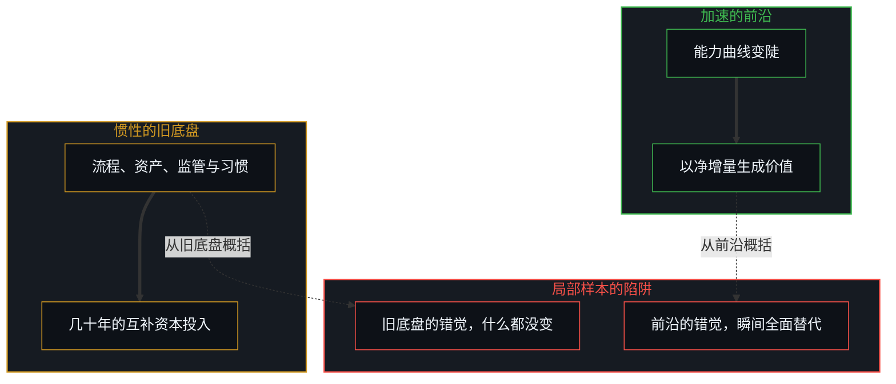
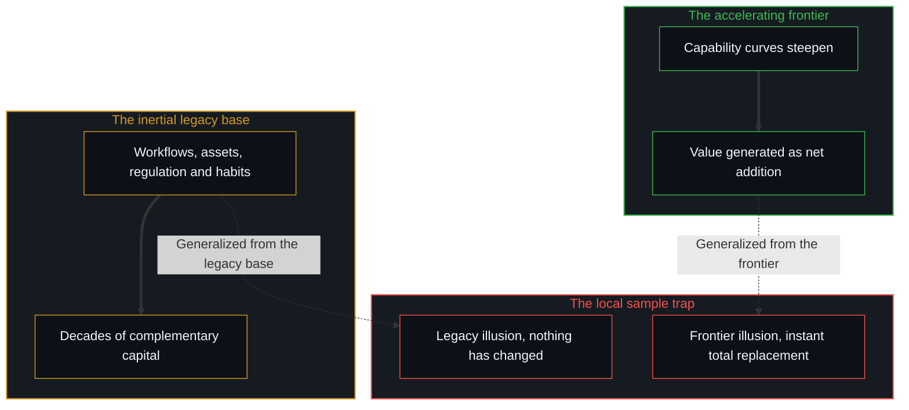

# 技术变革的局部陷阱 / The Local Trap of Technological Change

*前沿以净增量复利，扩散在互补资本间滞后，局部的观察者便困在炒作与恐慌里 / Frontier compounding adds value; diffusion lags across complementary capital, trapping local observers in hype and panic.*

技术革命从不以流行叙事所预言的那种平滑、均质的转变到来。它们一再造成一种结构上的分岔：一边是加速的前沿，以净增量的方式生成新的经济价值；一边是庞大而惯性的旧运营底盘，缓慢地适应，要跨越几代人的时间才逐步退出。观察者一再落进局部的陷阱：要么把前沿的快速外推成瞬间全面替代的预测，要么把旧底盘的迟缓错当成什么都没变的证据。两种错误，都把一个局部的切片误认作技术传播的完整几何。

Technological revolutions do not arrive as the smooth, homogeneous transformations popular narratives predict. Again and again they produce a structural bifurcation: an accelerating frontier that generates new economic value as net addition, and a vast inertial base of legacy operations that adapts slowly and is phased out only across generations. Observers keep falling into the local trap: extrapolating the frontier's speed into forecasts of instant total replacement, or taking the slowness of the legacy base as proof that nothing has changed. Both errors take a local slice for the whole geometry of technological propagation.

## 一、 分岔，前沿的增量与旧底盘的惯性 / 1. The Bifurcation, Frontier Addition Against Legacy Inertia

在前沿，在专门的实验室、前沿的实践者与早期采用的企业之间，能力曲线迅速变陡。

At the frontier, among specialized labs, frontier practitioners and early-adopting firms, capability curves steepen fast.

新的工具越过能力的门槛，让迭代速度复利增长，解锁此前无法存在的生产领域。这条边缘上新增的经济价值，主要以净增量的方式被创造出来：新的可能、新的市场、更高阶的区分，而不是对旧劳动简单的一对一替换。

New instruments cross capability thresholds, compounding the speed of iteration and unlocking domains of production that could not exist before. The incremental economic value at this edge is created mainly as net addition: new possibilities, new markets and higher-order distinctions, rather than the simple one-for-one substitution of old labour.

与此同时，更广的经济带着深厚的物质、组织与认知惯性运转。组织的工作流程、企业的风险姿态、已有的资产承诺、监管审批，以及根深蒂固的习惯，变化得比技术能力本身慢得多。旧底盘从不在一次颠覆的浪潮里一夜蒸发；新的前沿在它周围扩张的同时，它被逐步摊销、逐步退出。[平均值是残余，不是引擎](../the-average-is-residue-not-the-engine/)守着的正是这个区别：宏观经济指数记录的是群体延迟的、被平滑过的构成，而决定性的差异在薄薄的边缘上复利。

Meanwhile the broader economy runs with deep physical, organizational and cognitive inertia. Organizational workflows, corporate risk postures, existing asset commitments, regulatory approvals and ingrained habits change far more slowly than the technological capability itself. The legacy base is never vaporized overnight in one disruptive wave; it is gradually amortized and phased out while the new frontier expands around it. [The Average Is Residue, Not the Engine](../the-average-is-residue-not-the-engine/) holds this distinction: macroeconomic indices record the delayed, smoothed composition of the mass, while the decisive variance compounds at the thin edge.

## 二、 互补摩擦在历史上的不变 / 2. The Historical Invariance of Complementary Friction

这种双重的节奏，是工业史上通用技术一再呈现的签名。

This double tempo is the signature general-purpose technologies have shown again and again through industrial history.

十九世纪八十年代电动发电机出现时，工厂并没有立刻现代化。大部分制造业在四十年里仍锚定在蒸汽动力上，因为用上电需要把工厂的布局从多层的竖向传动轴，彻头彻尾地重新设计成单层的水平装配线。二十世纪五十年代数字计算机出现后，过了几十年，总量的生产率统计才登记到它的影响，也就是著名的索洛悖论，因为业务流程必须围绕数字数据库重建。蒸汽动力、内燃机与电信，走的是同一条曲线。

When electric dynamos were introduced in the 1880s, factories did not modernize at once. Most manufacturing stayed anchored to steam power for four decades, because using electricity meant re-architecting factory layouts from vertical multi-storey shafts to horizontal single-storey assembly lines. When digital computers emerged in the 1950s, decades passed before aggregate productivity statistics registered their effect, the well-known Solow paradox, because business processes had to be rebuilt around digital databases. Steam power, the internal combustion engine and telecommunications followed the same curve.

在每一个历史实例里，前沿都迅速拉开，而旧底盘需要几十年的互补资本投入来重新配置。人类制度在物质与社会上的摩擦，并不会因为底层的数学或软件加速了就自动消失。[技术是人类复利的残差](../technology-is-residual-of-human-compounding/)追踪的正是这条规律：工具是人类先前迭代外化的沉积，而正如[你的代码库即是记忆](../your-codebase-is-memory/)所追溯的，组织规程与软件代码库都是过往切分凝结而成的记忆痕迹，而非能够自我更新的行动体，因此将新工具扩散至旧底盘的过程，始终受制于鲜活心智在运作边缘重新渲染那份累积记忆的容量。

In each historical instance the frontier pulled ahead fast, while the legacy base needed decades of complementary capital investment to reconfigure. The physical and social friction of human institutions does not vanish automatically because the underlying mathematics or software has sped up. [Technology Is Residual of Human Compounding](../technology-is-residual-of-human-compounding/) tracks this regularity: tools are the externalized sediment of earlier human iteration, and because organizational procedures and software repositories are crystallized memory traces of past cuts rather than self-updating agents, as [Your Codebase Is Memory](../your-codebase-is-memory/) traces, diffusing a new tool across the legacy base stays bounded by the capacity of living minds to re-render that accumulated memory at the operating edge.

## 三、 局部样本的陷阱，过度乐观与过度悲观 / 3. The Local Sample Trap, Over-Optimism and Over-Pessimism

让这个可以预期的分岔变得模糊的，是一种反复出现的认知失误：局部样本的陷阱。

What obscures this predictable bifurcation is a recurring cognitive slip: the local sample trap.

人类观察者自然地从自己身边的局部环境去概括，于是出现两种相互对照的错觉。在前沿的错觉中，沉浸在工具快速突破里的技术人员或早期采用者，每天都体验到指数式的速度，并把这份局部的步调投射到整个文明上，预言立刻发生的、全经济范围的剧变与突然的全面替代。在旧底盘的错觉中，在受严格监管或变化缓慢的行业里工作的员工或管理者，看到自己的日常运营没有变化，便断定新技术是被炒作的空头产品，低估了前沿上安静的复利积累。

Human observers naturally generalize from their immediate local environment, which produces two contrasting illusions. In the frontier illusion, the technologist or early adopter immersed in rapid tool breakthroughs experiences exponential speed every day and projects that local pace onto the whole civilization, forecasting immediate, economy-wide upheaval and sudden total replacement. In the legacy illusion, the worker or manager in a heavily regulated or slow-moving sector sees daily operations unchanged and concludes that the new technology is overhyped vapourware, underestimating the quiet, compounding accumulation at the frontier.

媒体报道在令人屏息的能力演示与企业推广停滞的故事之间来回切换，加剧了这种两极分化。因为工具的能力曲线很陡，人们心里的时间尺度被压缩了；历史上需要三十年的滞后，被不切实际地期待在三年里了结。由此而来的讨论在膨胀的炒作与末日的恐惧之间剧烈摇摆。[免费智能的幻觉](../the-illusion-of-free-intelligence/)描述了这种感知上的不对称：轻易拿到完成了的技术残余，造出一种无摩擦、普遍转变的错觉，而前沿整合的艰苦劳作仍然看不见。

Media coverage deepens this polarization by alternating between breathtaking capability demos and stories of stalled enterprise rollouts. Because the tool's capability curve is steep, mental timeframes compress; lags that historically took thirty years are unrealistically expected to resolve in three. The resulting discourse swings wildly between inflated hype and apocalyptic dread. [The Illusion of Free Intelligence](../the-illusion-of-free-intelligence/) describes this perceptual asymmetry: easy access to finished technological residue creates the illusion of frictionless universal transformation, while the hard labour of frontier integration stays invisible.

## 四、 边缘上的增量，核心处的消解 / 4. Addition at the Edge, Dissolution at the Core

看清楚这一点，既不必陷入全面颠覆的恐慌，也不必退回守旧的自满。

Seeing this clearly calls for neither panic at total disruption nor reactionary complacency.

技术力量的传播，作为一种持续的结构性分裂在三个相连的维度上运作。首先，前沿的价值是增量：前沿创造新的领域，扩大社会总容量的速度，远快于它减去现有岗位的速度。其次，扩散受制于互补资本：重新训练人的习惯、重新设计组织、更新法律框架，以生物与社会的速度推进，而不是以算力的速度。最后，减速是诊断性的阻力：快速变化的技术所遇到的制度犹豫与迟缓，不是恶意的破坏，而是高惯性介质自然的流体阻力。[减速是加速时感受到的阻力](../deceleration-is-the-drag-felt-when-accelerating/)描绘了这份物理：阻力随速度的平方增长，它是诊断性的传感数据，指出哪里仍需要互补的脚手架。

The propagation of technological power works as a persistent structural split across three linked dimensions. First, frontier value is additive: the frontier creates new domains, expanding total social capacity far faster than it subtracts existing jobs. Second, diffusion is bound to complementary capital: retraining human habits, redesigning organizations and updating legal frameworks move at biological and social speeds, not at the speed of compute. Third, deceleration is diagnostic drag: the institutional hesitation and slowness that fast-moving technologies meet are not malicious sabotage but the natural hydrodynamic resistance of a high-inertia medium. [Deceleration Is the Drag Felt When Accelerating](../deceleration-is-the-drag-felt-when-accelerating/) maps this physics: drag grows with the square of speed, serving as diagnostic sensor data for where complementary scaffolding is still needed.

认出局部的陷阱，视角就恢复了。前沿会继续它陡峭的上升，在边缘生成大量新的财富与能力，而旧底盘通过耐心的、跨越几十年的过渡去适应。[一个可能的全自动交通未来的非定论预测](../non-definitive-forecast-of-a-possible-fully-autonomous-transportation-future/)说明了这种非线性的扩张：用旧汽车的销量单位去量自动驾驶车队，会错过新被激活的出行需求那一个数量级的扩张。避开局部陷阱的心智，既不害怕瞬间的过时，也不否认前沿；它只是把注意力放在复利真正发生的活的边缘上。

Recognizing the local trap restores perspective. The frontier will go on with its steep climb, generating great new wealth and capability at the edge, while the legacy base adapts through a patient transition over decades. [Non-Definitive Forecast of a Possible Fully Autonomous Transportation Future](../non-definitive-forecast-of-a-possible-fully-autonomous-transportation-future/) shows this non-linear expansion: measuring autonomous fleets in units of legacy car sales misses the order-of-magnitude expansion of newly activated travel demand. The Mind that avoids the local trap neither fears instant obsolescence nor denies the frontier; it simply puts its attention on the living edge where compounding takes place.
