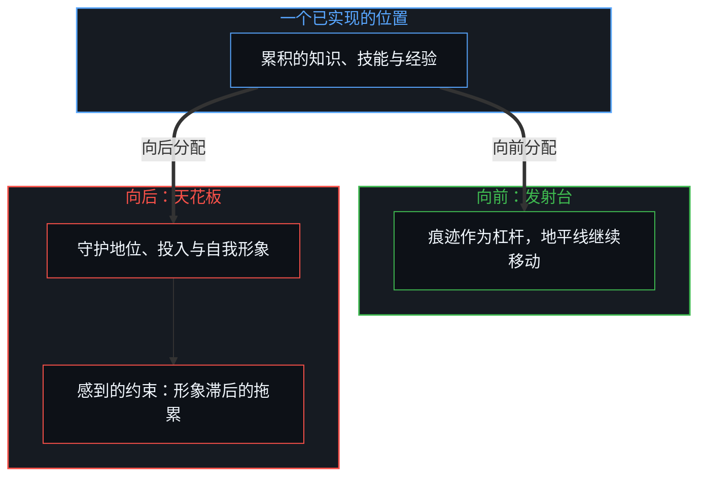
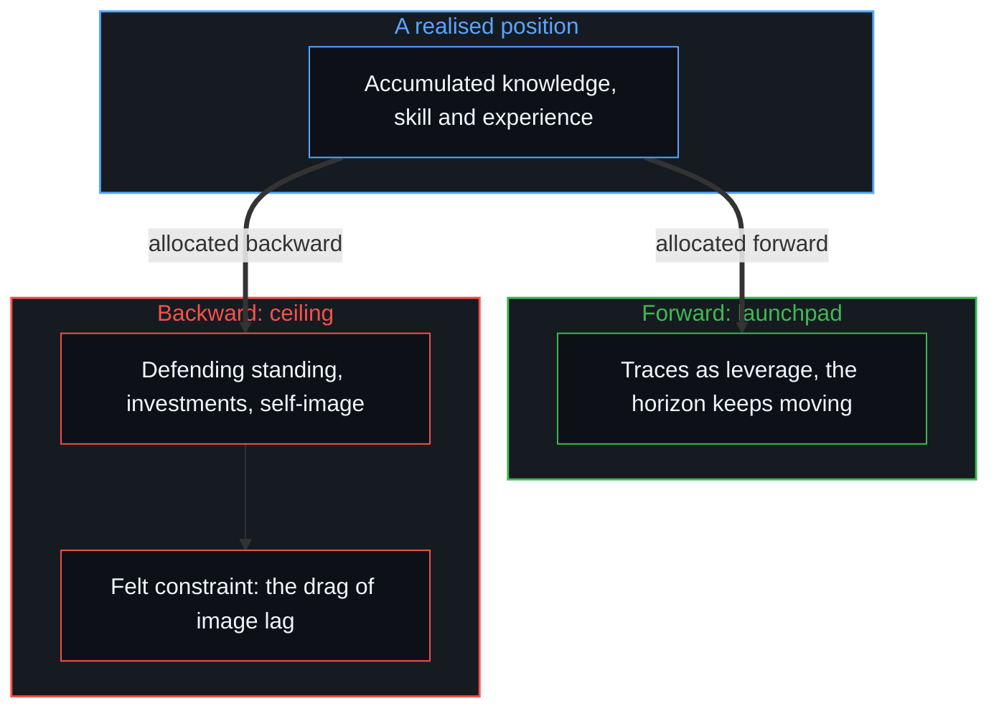

# 约束的样子不是自由的失去 / The Look of Constraint Is Not the Loss of Freedom

*看上去的约束，是能动性向后守护过往痕迹，而非向前延展地平线 / Apparent constraint is agency pointed backward at defending past traces rather than forward at widening the horizon.*

孩子看上去自由，成年人看上去受约束。作为经验的表面，这个对照是真的；关于它的常见说法，却把因果倒了过来。当代文化里有一句流行的格言，把这个可见的表面当作必然的机制：孩子从无边、纯净的自由开始，撞上世界，学到现实有界限，于是把那个打了折扣的样子叫作成年人。在这幅浪漫化的图里，自由被安放在起点，作为与生俱来的形而上盈余；对约束的认识被说成它消失的原因；变老成了这份丧失的悲剧名称。

Children look free; adults look constrained. As an empirical surface the contrast is real; the common account of it turns causality around. A popular saying in contemporary culture treats that visible surface as an inevitable mechanism: a child begins in boundless, pristine freedom, collides with the world, learns that reality has limits, and the reduced figure that results is called an adult. In this romanticised picture, freedom is installed at the origin as an innate metaphysical surplus, the knowledge of constraint is named as the cause of its disappearance, and ageing becomes the tragic name of the loss.

在这句格言底下，运行着一个不同的控制论序列。

Beneath the saying, a different causal sequence is running.

## 一、 敞开的开端 / 1. The Open Start

一个人生命的开端，起始的展开相对于后来展开的东西是小的。童年那段敞开的时期，既不是一座无限自由的神秘水库，也不是一个等着被装满的、容量固定的封闭容器，而是一个活的区分之所，以很少的累积痕迹去遇到环境。幼儿的行为显得自发、好奇、不受约束，恰恰是因为几乎还没有自相关的痕迹结晶成僵硬的习惯或内部模型。看上去很高的自由，是稀疏的历史条件直接撞上未经中介的物理反馈，而不是一份后来被现实没收的形而上盈余。

At the start of a life, the opening spread is small relative to what unfolds later. The open stretch of childhood is neither a mystical reservoir of infinite freedom nor a closed container of fixed capacity waiting to be filled; it is a living locus of distinction meeting an environment with little accumulated trace. Small children's behaviour looks spontaneous, curious and unconstrained precisely because almost no auto-correlated traces have yet crystallised into rigid habits or inner models. The high apparent freedom is sparse historical conditioning colliding directly with unmediated physical feedback, not a metaphysical surplus that reality later confiscates.

与环境的每一次接触，都往系统里写下一步。下一个探索的区分，从上一步到达的已实现坐标出发；这就是路径依赖最基本的样子：不是出生时装好的命运，也不是“知道界限”装上的外部天花板，而是一个已实现的状态成为下一次更新的起点坐标这件平常的事。开端处很小的差异，随时间以指数复利；环境不同，写下的步子就不同，个人的轨迹在一个高维的空间里散开。

Every contact with the environment writes a step into the system. The next exploratory distinction starts from the realised coordinate the previous step reached; this is path dependence in its most elementary form: not a fate installed at birth, nor an outside ceiling installed by "knowing limits", but the ordinary fact that a realised state becomes the starting coordinate for the next update. Differences that are small at the start compound exponentially over time; environments differ, so the written steps differ, and individual trajectories fan out across a high-dimensional space.

## 二、 中段为何变硬 / 2. Why the Middle Hardens

多数人的生活不会一直散在高维的外围。成长的过程里，人穿过大规模的、共享的制度训练：标准化的语言、学校、职场的层级、地位的竞赛、货币体系、社会声誉的游戏与当地的法律框架。这些制度像强大的公共梯度，持续地牵引，规定哪些区分在中心之间被强化、容易取得，把散开分布的一大部分拉进几个很深、很稳定的统计盆地。

Most lives do not stay fanned out across the high-dimensional periphery. Growing up, people pass through large shared institutional training: standardised language, schooling, workplace hierarchies, status tournaments, monetary systems, games of social reputation and local legal frameworks. These regimes act as powerful common gradients, pulling continuously, patterning which distinctions are reinforced and easily available across centres, and drawing a large part of the fanned distribution into a few deep, very stable statistical basins.

在这种持续的回收之下，成年人口宽阔的中段看上去相当一致：规范、谨慎、可预测、受约束；分布的两尾仍是两尾，保留各自独特的轨迹；童年与成年之间的视觉对照，就很容易被读错。童年只是公共盆地还没积累足够痕迹去抓住人的那个阶段，成年是盆地已经抓住大多数轨迹的阶段。这种统计上的聚集是共享梯度平常的因果后果，用不着一个神话式的“从原初恩典中的堕落”。成年看上去像没收，只是因为中间的选择被遮住了，就是[翻袋球与魔术戏法](../the-bank-shot-and-the-magic-trick/)所描述的那一杆翻袋。

Under this continuous recapture the broad middle of the adult population looks quite uniform: normalised, cautious, predictable, constrained; the tails of the distribution remain tails and keep their own trajectories; and the visual contrast between childhood and adulthood becomes easy to misread. Childhood is only the stage before the common basins have gathered enough trace to take hold; adulthood is the stage at which the basins have taken hold of most trajectories. This statistical clustering is an ordinary causal consequence of shared gradients and needs no mythical "fall from an original state of grace". Adulthood looks like confiscation only because the intermediate choices are hidden, the bank shot described in [The Bank Shot and the Magic Trick](../the-bank-shot-and-the-magic-trick/).

## 三、 能动性指向哪里 / 3. Where Agency Is Pointed

被回收进一个公共盆地，并不毁掉、耗尽或减少心智区分的能力。人生中一个已实现的位置，可以用作两种不同的东西：一种是发射台，当下的坐标只是下一次新区分投向敞开地平线的平台；另一种是被保存的参照与天花板，当下的坐标被抬成一条规定什么可以被区分的边界。这是同一份能力的两个方向。

Recapture into a common basin does not destroy, exhaust or diminish the Mind's capacity to distinguish. A realised position in life can serve as one of two things: a launchpad, where the present coordinate is only the platform from which the next fresh distinction is cast into the open horizon; or a preserved reference and ceiling, where the present coordinate is raised into a boundary that dictates what may be distinguished. These are two directions of the same capacity.

第一种分配里，认识的地平线一直在移动，先前的知识、学到的技能与过去的经验被认作滞后的痕迹，是杠杆，从不是天花板；让孩子看上去自由的那个活的运作仍在，只是现在有了高维能力的支撑。第二种分配里，能动性向后，去守护、维持已经写下的沉积：社会地位、过去的投入、自我形象，以及被当作宇宙不变几何的当地文化规则。人在唯一要紧的意义上受了约束：不是年龄剥夺了选择的能力，而是注意、精力与努力被耗在保护一次过去的实现上，而不是延展生成它的那条地平线。

In the first allocation the horizon of knowing keeps moving, and prior knowledge, acquired skill and past experience are recognised as lagging trace, leverage and never ceiling; the living operation that made the child look free is still active, now backed by high-dimensional capability. In the second allocation agency points backward, at defending and maintaining the sediment already written: social standing, past investments, self-image, and local cultural rules taken as the unchanging geometry of the cosmos. A person is then constrained in the only sense that matters: not because age stripped away the capacity to choose, but because attention, energy and effort are spent protecting a past realisation instead of widening the horizon that produced it.

感到的约束，是形象滞后的内部拖累，是把能动性指向痕迹时的摩擦。它在被回收的中段很普遍，却不是变老固有的属性。成年人并不比孩子更不自由；被观察到的，多是处在向后的、停下的分配里的时刻，而同一个心智在不同的事情上、不同的年岁里，两种分配都会经过。把对总体平均的观察误认为成年的普遍结构，就是[平均值是残余，不是引擎](../the-average-is-residue-not-the-engine/)与[成功之后的育儿谬误](../the-fallacy-of-post-success-parenting/)推出的那种错误。

The felt sense of constraint is the inner drag of image lag, the friction of pointing agency at trace. It is widespread in the recaptured middle, yet it is no inherent property of ageing. Adults are not less free than children; what gets observed is mostly moments spent in the backward, paused allocation, and one Mind passes through both allocations on different matters and at different ages. Taking an observation of the aggregate average for the universal structure of adulthood is the error derived in [The Average Is Residue, Not the Engine](../the-average-is-residue-not-the-engine/) and [The Fallacy of Post-Success Parenting](../the-fallacy-of-post-success-parenting/).

## 四、 下一个尺度上的同一个谬误 / 4. The Same Fallacy at the Next Scale

感叹童年自由丧失的那句格言，本身就做了它声称要诊断的那次停顿。它看到变硬了的社会中段，拿这个中段的表面，大量成年人在自我施加、学来的界限之内运作，把这个总体的样子实体化成一条不变的人性规律：对约束的认识被宣布为元凶，失去的自由被宣布为成年的实质；一道滞后的统计痕迹被抬成本体的天花板，再以哲学的庄重说出来。把自由系在结果上的说法，会否定它自己，[约束基底与自由自否](../the-substrate-of-constraint-and-the-self-denial-of-freedom/)展示了这一点。

The saying that laments the loss of childhood freedom itself performs the pause it claims to diagnose. It sees the hardened social middle, takes that middle's surface, many adults operating within self-imposed, learned limits, and reifies the aggregate look into an unchanging law of human nature: the knowledge of constraint is declared the culprit, lost freedom is declared what adulthood is; a lagging statistical trace is raised into an ontological ceiling and then said with philosophical gravity. A freedom made conditional on outcomes denies itself, as [The Substrate of Constraint and the Self-Denial of Freedom](../the-substrate-of-constraint-and-the-self-denial-of-freedom/) shows.

这正是格言归给它所观察的成年人的那同一个倒置。受约束的成年人，把一个已实现的局部界限当作世界的固定边界；说出格言的人，把一张已实现的社会快照当作人类心灵必然的轨迹。两处都是能动性交给了痕迹：一个人生停在过去的习惯上，一个哲学解释停在一个静态的总体样子上。说出的与被说的是同一个错误，落在两个不同的尺度上。

This is the very inversion the saying attributes to the adults it observes. The constrained adult takes a realised local limit for the fixed boundary of the world; the one who voices the saying takes a realised social snapshot for the inevitable trajectory of the human soul. In both, agency is handed to trace: a life parked on its past habits, a philosophical explanation parked on a static aggregate look. The saying and what it names are one error at two scales.

## 五、 活的前沿这一不变量 / 5. The Invariant of the Living Edge

在诗意的说法底下，发生的事要精确得多：一个小的起始展开，一个活的区分之所，写下状态转换并随时间复利的环境，把中段回收进共享盆地的公共梯度，一种把能动性指向已写下之物、而不是投向下一次扩展的普遍习惯，以及一个照搬这种习惯、把由此产生的症状误认为生成引擎的描述。这个现象是能动性的一次主动错配；传统的解释，是在语言里重演的同一次错配。

Beneath the poetic phrasing, what happens is more exact: a small opening spread, a living locus of distinction, environments that write state transitions and compound over time, common gradients that recapture the middle into shared basins, a widespread habit of pointing agency at what is already written rather than into the next expansion, and a description that copies that habit by taking the resulting symptom for the generating engine. The phenomenon is an active misallocation of agency; the traditional explanation is the same misallocation re-enacted in language.

长大不是自由被没收，而是因果杠杆的累积。孩子有一块空着的寄存器，杠杆很小；成年人有大量累积的机器。这套机器成为自我施加的牢笼，还是一台创造的引擎，不由年龄、社会或时间的流逝决定，而由心智在当下的移动前沿上把能动性指向哪里决定。正因为[你的代码库即是记忆](../your-codebase-is-memory/)，这套累积的机器只是过往承诺的外化存放处，不是劫持主权的看守，下一次提交一直向活的前沿敞开。

Growing up is not the confiscation of freedom; it is the accumulation of causal leverage. A child has an empty register with little leverage; an adult has a great deal of accumulated machinery—like the externalized repository of prior cuts traced in [Your Codebase Is Memory](../your-codebase-is-memory/), where past commitments sit as callable structure rather than a sovereign captor. Whether that machinery becomes a self-imposed prison or an engine of creation is decided not by age, society or the passing of time, but by where the Mind points its agency at the moving edge of the present.
