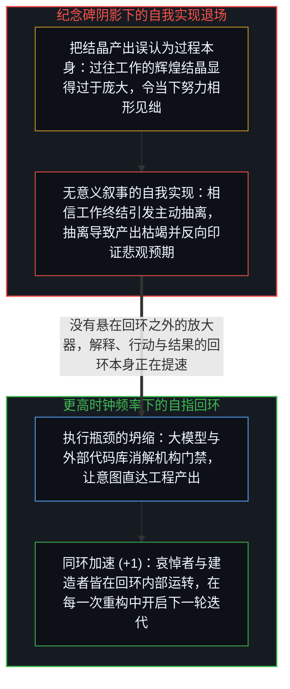
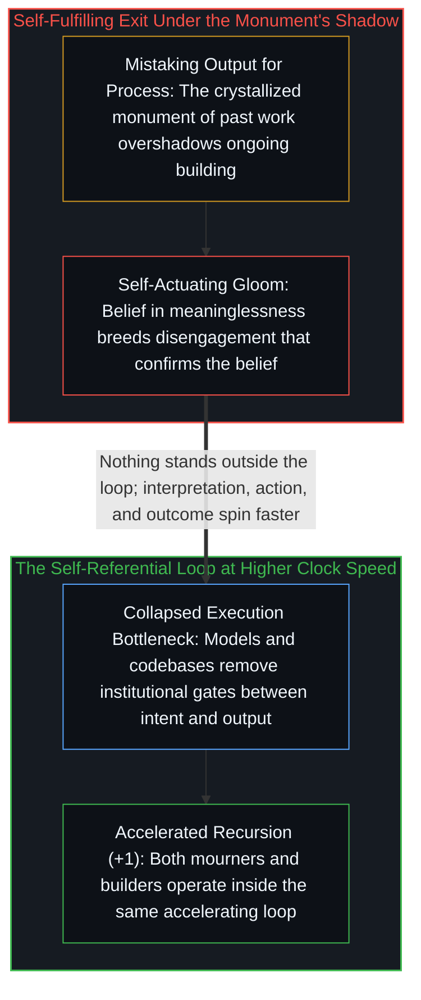

# 加速的自指回环与自我实现的终结叙事 / The Loop Accelerates

*AI并非终结工作的外部异物而是人类工作结晶的加速器，消解执行瓶颈正收紧自指回环 / AI is the latest crystal of meaningful human work, dissolving execution bottlenecks to accelerate the loop*

人工智能并不是为了终结“有意义的工作”而从天外降临的异物；恰恰相反，人工智能正是人类有意义的工作所结出的最新果实——是认识与创造的递归回环正在通过它自己的最新产出审视自身。公共讨论分裂为“为工作意义的消逝而哀悼”与“为个体创造力的解放而欢呼”两大阵营，然而双方描述的其实是同一个正以更高时钟频率运转的自指回环。人们所恐惧的“意义终结”，作为客观诊断是虚假的，但作为一种让信以为真者主动退场的自我实现机制却是真实的。

Artificial intelligence did not arrive from outside to end meaningful work; it is what meaningful work produced—the recursion of human creation examining itself through its own latest output. While public discourse splits into mourning and liberation, both camps describe the exact same self-referential loop running at a higher clock speed, and the ending people fear operates not as an accurate diagnosis of reality, but as a self-actuating perception that generates the disengagement it describes.

## 一、 执行瓶颈是真实的，但“纯执行者”身份是投射 / 1. The Execution Bottleneck Was Real, the Executor Identity Was a Projection

当有人在社交网络上感叹“祝大家享受有意义工作的最后一年”时，悲观者哀叹人类将无所事事，乐观者则欢呼个体终于可以跨过机构门禁去迭代自己的构想。这两种反应看似对立，实则指向同一场结构变迁：人工智能正在抹平“意图”与“产出”之间的执行瓶颈。双方真正的分歧，在于他们此前一直如何解释这道执行瓶颈。

When commentators declare that we are entering the final year of meaningful work, mourners and optimists alike are reacting to the same structural shift: artificial intelligence collapsing the execution bottleneck between intention and output. Where the two camps diverge is in how they interpreted that bottleneck all along.

在过去，把一个想法变成现实需要穿越繁琐的机构、团队与资本门槛——这道摩擦既是真实的过滤器，也是稀释器。然而，把这道外部摩擦内化为“我没有创造力，我只是一个执行者，离了机构我就寸步难行”的身份认同，却自始便是投射伪影。构想的冲动内生于每一个鲜活的意识之中；学校教育、公司科层制与文凭主义之所以长期稳固，是因为它们不断强化同一个解释层：“你的本分就是执行他人的蓝图。”人工智能并没有给原本缺乏能动性的人凭空注入能动性，它只是击穿了那个说服人们相信自己“没有能动性”的制度强化回环（参见[人工智能为何正在暴露现代学校教育的致命缺陷](../school_essay_final/)与[不断收紧的回环](../the-tightening-loop/)）。

Realizing an idea previously required navigating institutions, specialist teams, and capital gates—frictions that were genuinely high. Interpreting that external friction as a personal identity—believing oneself to be merely an executor who lacks original ideas—was always a projection reinforced by schooling, corporate hierarchy, and credentialism. Ideation is native to living consciousness; artificial intelligence does not manufacture agency in those who lacked it, it disrupts the institutional reinforcement loop that convinced them they had none (see [Why AI Is Exposing the Fatal Flaw in Modern Schooling](../school_essay_final/) and [The Tightening Loop](../the-tightening-loop/)).

## 二、 纪念碑遮蔽建造过程与哀悼本身的自指性 / 2. When the Monument Overshadows the Building

人们常说人工智能“放大”了个体原有的能动性取向，但更准确地说，并不存在一个游离于回环之外的独立物体在被放大——“解释、行动、结果、再强化解释”这一自指回环本身就是全部结构，而人工智能与如[你的代码库即是记忆](../your-codebase-is-memory/)所剖析的外部化记忆正在让这只飞轮以更高的转速旋转。无论你原先朝哪个方向旋转，如今都会转得更快：将工具视为外部威胁的人在加速退缩，将工具视为延伸基底的人在加速建造。

It is common to say that artificial intelligence amplifies one's prior relationship to agency, yet there is no separate object standing outside the loop waiting to be amplified: the cycle of interpretation, action, outcome, and reinforced interpretation is the entire structure. Coupled with externalized cognitive repositories as traced in [Your Codebase Is Memory](../your-codebase-is-memory/), the loop simply spins at a higher clock speed, accelerating whatever directional vector a mind is already running.

所谓“有意义工作的终结”，源于把过往工作的结晶产物（模型输出这座高耸的纪念碑）与正在发生的鲜活建造过程混为一谈，以至于纪念碑的阴影遮蔽了脚下的施工。一旦有人相信意义已经终结，这种信念就会驱动他放弃投入，而放弃投入所导致的空虚又会反过来“证实”他的悲观预言。最耐人寻味的是：那些在公共场域中苦苦哀悼“有意义工作即将消亡”的人，在撰写长文、剖析处境、重构解释框架的过程中，恰恰正在从事他们宣称已经终结的那项有意义的工作。没有任何人站在回环之外；飞轮正在加速，沿途同时甩出它的哀悼者与建造者。

The perceived end of meaningful work arises when the crystallized monument of past work overshadows the living process of building, inducing a self-fulfilling disengagement that confirms its own gloom. Most ironically, those mourning the death of meaningful work are—in processing, reframing, and articulating their grief—performing the very meaning-making activity they claim is ending. No one stands outside the recursion; the loop accelerates, generating both its mourners and its builders along the way.
