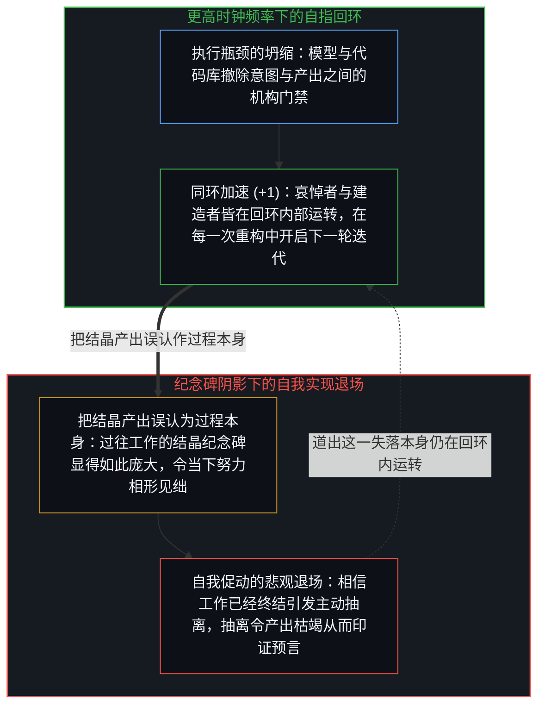
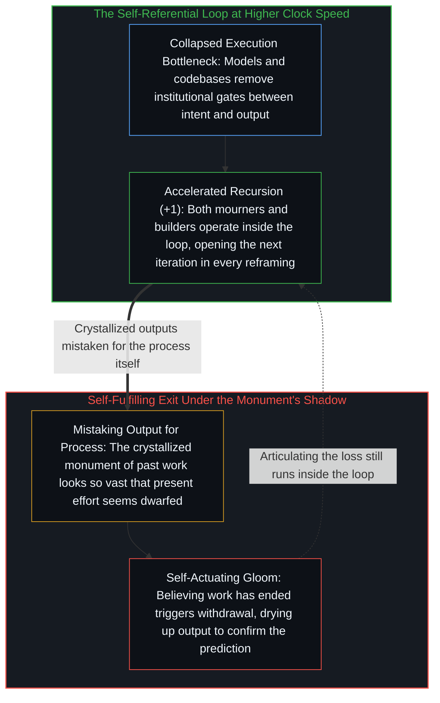

# 加速的自指回环与自我实现的终结叙事 / The Loop Accelerates

*AI是人类有意义工作的最新结晶，消解执行瓶颈以加速回环 / AI is the latest crystal of meaningful human work, dissolving execution bottlenecks to accelerate the loop*

人工智能并非从外部降临以终结有意义的工作；它正是有意义的工作所结出的成果——人类创造的递归正借由自身的最新产出审视自身。公共讨论分裂为“为工作意义的消逝而哀悼”与“为个体创造力的解放而欢呼”两大阵营，然而双方描述的正是同一个以更高时钟频率运转的自指回环。人们所恐惧的终结，并非从外部强加于创造之上的终止，而是一种会自我实现的感知——它生成了自己所描述的退场。

Artificial intelligence did not arrive from outside to end meaningful work; it is what meaningful work produced—the recursion of human creation examining itself through its own latest output. While public discourse splits into mourning the disappearance of work's meaning and cheering the liberation of individual creativity, both camps describe the exact same self-referential loop running at a higher clock speed. The ending people fear is not a termination imposed on creation from outside, but a self-actuating perception that generates the disengagement it describes.

## 一、 执行瓶颈是真实的，但“纯执行者”身份是投射 / 1. The Execution Bottleneck Was Real, the Executor Identity Was a Projection

当有人在网上感叹我们正步入有意义工作的最后一年时，悲观者哀叹人类将无所事事，乐观者则欢呼个体终于可以跨过机构门禁去迭代自己的构想。这两种反应看似对立，实则都在回应同一场结构变迁：人工智能正在抹平“意图”与“产出”之间的执行瓶颈。双方分歧所在，在于他们此前一直如何解释这道执行瓶颈。

When someone remarks online that we are entering the final year of meaningful work, pessimists lament that humans will have nothing left to do while optimists cheer that individuals can finally cross institutional gates to iterate on their own ideas. Opposite as those reactions appear, both respond to the same structural shift: artificial intelligence collapsing the execution bottleneck between intention and output. Where the two camps diverge is in how they interpreted that bottleneck all along.

在过去，把一个想法变成现实需要穿越繁琐的机构、专业团队与资本门槛——这道摩擦在实践中既是过滤器，也是稀释器。把这道外部摩擦解读为个人身份——认定自己没有创造力，只是一个离开机构便寸步难行的执行者——向来就是一种投射。构想内生于鲜活的意识之中；学校教育、公司科层制与文凭主义之所以存续这么久，是因为它们不断强化同一层解释：“你的本分就是执行他人的蓝图。”人工智能并没有在原本缺乏能动性的人身上制造出能动性，它只是打破了那个说服人们相信自己“没有能动性”的制度强化回环（参见[人工智能为何正在暴露现代学校教育的致命缺陷](../school_essay_final/)与[不断收紧的回环](../the-tightening-loop/)）。

Realizing an idea previously required navigating cumbersome institutions, specialist teams, and capital gates—friction that served in practice as both a filter and a diluter. Interpreting that external friction as a personal identity—believing oneself to have no creativity, to be merely an executor who cannot move a step without an institution—was always a projection. Ideation is native to living consciousness; schooling, corporate hierarchy, and credentialism endured so long because they kept reinforcing a single interpretive layer: "your proper role is to execute someone else's blueprint." Artificial intelligence does not manufacture agency in people who lacked it; it disrupts the institutional reinforcement loop that convinced them they had none (see [Why AI Is Exposing the Fatal Flaw in Modern Schooling](../school_essay_final/) and [The Tightening Loop](../the-tightening-loop/)).

## 二、 纪念碑遮蔽建造过程与哀悼本身的自指性 / 2. When the Monument Overshadows the Building and Mourning Stays Self-Referential

人们常说人工智能“放大”了人原本与能动性之间的关系，然而并没有一个站在回环之外等待被放大的独立对象：“解释、行动、结果、再强化解释”这一循环正是结构本身。与[你的代码库即是记忆](../your-codebase-is-memory/)所追溯的外化认知库耦合之后，这只飞轮便以更高的时钟频率转动。无论原先朝哪个方向转动，如今都会转得更快：将工具视为外部威胁的人加速退缩，将工具视为延伸基底的人加速建造。

It is common to say that artificial intelligence amplifies one's prior relationship to agency, yet there is no separate object standing outside the loop waiting to be amplified: the cycle of interpretation, action, outcome, and reinforced interpretation is the structure itself. Coupled with externalized cognitive repositories as traced in [Your Codebase Is Memory](../your-codebase-is-memory/), this flywheel spins at a higher clock speed. Whichever direction one was already turning, one now turns faster: those who treat the tool as an external threat accelerate their withdrawal, while those who treat it as an extended substrate accelerate their building.

人们所感知到的“有意义工作的终结”，源于把过往工作的结晶产物——如高耸纪念碑般矗立的模型输出——与正在发生的鲜活建造过程混为一谈，以至于纪念碑的阴影遮蔽了脚下的施工。一旦有人相信意义已经终结，这种信念就会驱动他放弃投入，而放弃投入所造成的空虚又会反过来印证他的悲观预言。最能说明问题的是，那些公开哀悼“有意义工作即将消亡”的人，在撰写长文、剖析处境与重构解释框架的过程中，恰恰是在从事他们宣称正在终结的意义创造活动。没有任何人站在递归之外；随着飞轮加速，哀悼者与建造者皆在同一个回环内部行动——有人面对结晶产出退步抽身，有人则借由这些产出继续建造。

The perceived end of meaningful work arises when the crystallized output of past work—model output standing like a towering monument—is confused with the living process of building, so that the monument's shadow obscures the construction underfoot. Once someone believes meaning has ended, that belief drives them to withdraw effort, and the emptiness caused by withdrawal confirms their gloomy prediction in return. Most tellingly, those publicly mourning the imminent death of meaningful work are—in writing long essays, dissecting the situation, and reframing their interpretation—performing the very meaning-making activity they claim is ending. No one stands outside the recursion; as the flywheel accelerates, both mourners and builders act inside the same loop—some stepping back before crystallized outputs, others building through them.
