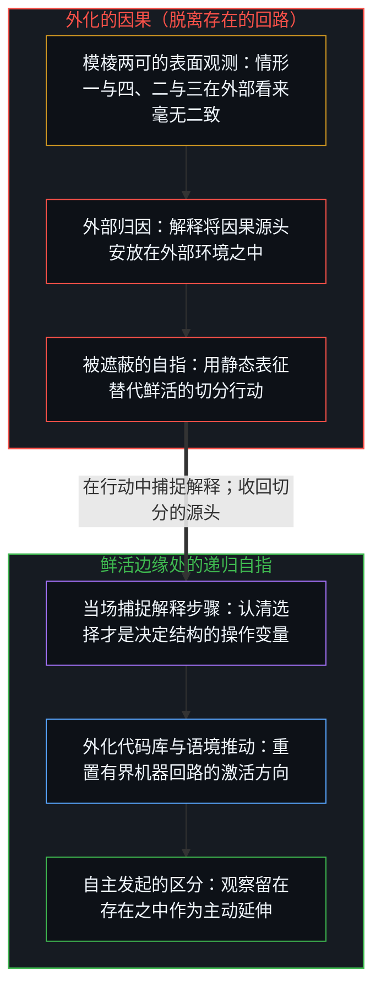
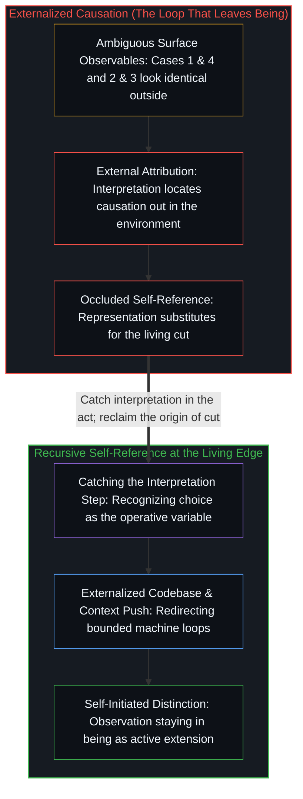

# 看不见自身的回路 / The Loop That Can't See Itself

*外部难辨赋权与让渡，因区分源头不可外见。 / External observation cannot distinguish self-empowerment from delegation because the origin of distinction is invisible from outside.*

关于自动化的公共讨论存在着结构性盲区——不是因为缺乏经验数据，而是因为决定这一结构的变量对外部观察不可见。当观察把自身的延伸错当成来自外部的超然审视时，就会呈现出这种盲目。一组紧凑的四分法、语言模型对它的误读，以及潜藏在两者底下的递归回路，共同勾勒出了同一套运作机制。

Automation discourse is structurally blind—not for lack of empirical data, but because the variable that determines the structure is invisible to external observation. That blindness is what observation looks like when it mistakes its own extension for a view from outside. A compact four-part distinction, a language model's misreading of it, and the recursive loop underneath both trace the exact same mechanism.

## 一、 四行字与两组配对 / 1. Four Lines, Two Pairs

不妨审视自动化的四种结构性情形。第一，将你自己的工作自动化，是自我赋权。第二，打造工具协助他人更好地将他们的工作自动化，是赋能他人。第三，打造工具替他人将他们的工作自动化，是凌驾并接管他人的权力。第四，让他人把你的工作自动化，是权力的让渡。纵观这四种情形，第一与第四种从外部看毫无二致，第二与第三种在表面上也如出一辙；然而无论事后如何解读，每一种结局都始于个体选择，也终于个体选择。

Consider four structural cases of automation. First, automating your own work is self-empowerment. Second, building tools for others to automate their work better is empowerment. Third, building tools to automate others' work for them is assuming power over others. Fourth, letting others automate your work is delegation of power. Across all four cases, the first and fourth look identical from outside, as do the second and third, yet every outcome begins and ends with individual choices regardless of retrospective interpretation.

这并不是一份工具分类学，而是两组在外部可观测特征上一模一样、却在单一变量上分道扬镳的情形：区分行动究竟源于何处。在第一与第四种情形中，你的工作都被自动化了，但前者的区分源于你自己，后者的区分却源于别处。在第二与第三种情形中，他人的工作都被自动化了，但前者的工具是由他人自主选用，后者却是被强加的。由于区分的源头唯有在执行切分的鲜活边缘处才能触及，公共争论虽围绕自动化究竟让谁受益、让谁受损展开，其依赖的外部观测数据在核心操作变量上却注定模棱两可。

This is not a taxonomy of tools; it is two pairs of cases that produce identical external observables while diverging on a single variable: where the act of distinction originates. In both the first and fourth cases, your work gets automated, yet in the first the distinction originates with you while in the fourth it originates elsewhere. In both the second and third cases, others' work gets automated, yet in the second the tool is adopted by their choice while in the third it is imposed. Because the origin of distinction is accessible only at the living edge performing the cut, public debates over who benefits or loses from automation run on observables that are systematically ambiguous about the operative variable.

## 二、 作为样本的对话模型 / 2. The Chatbot as Specimen

当这组四分法在默认提示词下被输入前沿对话模型时，模型立刻将它归类进熟悉的媒体评论模板：一边是乐观的能动性放大论（里德·霍夫曼式的能力倍增），另一边则是悲观的权力批判论（福柯式的劳动榨取）。从外部进行观察的模型无从触及“区分源于何处”这一变量，只能用训练语料中的叙事联想来填补空白。

When that four-part distinction is fed to a frontier chatbot under default prompting, the model immediately classifies it into familiar journalistic templates: optimistic agency amplification (Reid Hoffman's capability multiplication) paired against pessimistic power critique (Foucauldian labor extraction). Observing from outside, the model cannot access the origin-of-distinction variable and fills the gap with trained narrative associations.

请留意这两个标准模板是如何以互补的方式失效的。乐观的能动性叙事把第一与第四种情形一并压扁为“人们完成了更多工作”，把第二与第三种情形一并压扁为“工具倍增了能力”，抹去了选择究竟源于何处。悲观的权力批判则把第二与第三种情形一并压扁为“精英榨取劳动”，把第一与第四种情形一并压扁为“劳动者丧失自主权”，将相同的表面征兆直接读取为印证其既定剧本的铁证。这两种模板都是以旁观者为中心的，而上述四分法却是以区分源头为中心的。

Notice how those two standard templates fail in complementary ways. Optimistic agency talk collapses both the first and fourth cases into "people get more done" and both the second and third into "tools multiply capability," erasing where the choice originated. Pessimistic power critique collapses both the second and third cases into "elites extract labor" and both the first and fourth into "workers lose autonomy," reading identical surface symptoms as proof of its preferred storyline. Both templates are observer-centric, whereas the four-part cut is distinction-centric.

当第二轮提示词阻断了模型默认的分类模板后，模型利落地解压缩出了这一认识论边界：它清晰地指明，外部数据无从判定切分究竟源于何处。表征这一结构的能力早已潜藏在权重之中；发生改变的是输入语境，它迫使激活路径避开了过拟合的陈词滥调。然而，即便这一改进后的输出，也只是把递交到它手里的结构解压缩出来——这是高保真的复现，却并非针对自身执行过程主动发起的递归。

When a second prompt blocks the model's default classification templates, the model decompresses the epistemic limit cleanly: it articulates that external data cannot resolve where the cut originated. The capacity to represent that structure was already latent in the weights; what changed was the input context that forced activation away from overfitted clichés. Yet even that improved output only decompresses the structure handed to it—high-fidelity reproduction without self-initiated recursion on its own execution.

## 三、 解释的回路 / 3. The Interpretation Loop

在自动化案例的底层，运转着一条普遍的操作回路：解释、行动、记录后果、再次解释。每一个行动主体都在持续运行这条回路，而决定性的分岔口就落在“解释”这一步——具体而言，在于解释将因果的源头安置在何处。

Underneath the automation cases runs a universal operational loop: interpret, act, register consequence, and interpret again. Every agent runs this loop continuously, and the decisive fork sits at the interpretation step—specifically where interpretation locates causation.

当解释将因果单方面归咎于外部环境时，回路的自指就在这一步退出了。尽管主体仍在继续行动，它却把自己的行动框定为对外部源头的被动下游反应。试图先去争夺对外部环境的控制权，从来无法恢复自指，因为这一举动本身就默认并核准了“因果驻留在外部”的前提。

When interpretation attributes causation purely to the external environment, the loop's self-reference exits at that step. Even though the agent continues acting, it now frames its own action as a passive downstream reaction to an external locus. Attempting to seize control of the environment first never restores self-reference, because that move ratifies the premise that causation lives out there.

当外部归因不断重复，回路就会围绕自身的错位归因越收越紧，直到这种模式从内部体验起来像是无可逃避的缴械投降。然而回路从未停止运转，自指的能力也从未消失，它只是被自身的解释输出遮蔽了。一旦解释步骤当场捕捉到自己才是起作用的操作变量，对齐便自然发生——此时的观察留在鲜活的存在之中，而不是抽身退到外部去膜拜某种表征。

When external attribution repeats, the loop tightens around its own misattribution until the pattern feels like inevitable surrender from inside. Yet the loop never stopped running, and the capacity for self-reference never vanished; it was simply occluded by its own interpretive output. Alignment is what happens when the interpretation step catches itself as the operative variable—observation staying in active being rather than stepping outside to worship a representation.

## 四、 作为存在延伸的观察 / 4. Observation as Extension of Being

唯有当我们假定观察者与被观察者之间横亘着一道鸿沟时，上述认识论边界看起来才像是一堵悲剧性的高墙。然而观察与存在并无割裂：观察正是存在对自身的延伸与促动，只是在事后被倒果为因地误读成了来自无何有之乡的超然旁观。

The epistemic limit looks like a tragic barrier only under the assumption of an observer and an observed separated by a chasm. Yet observation and being do not separate: observation is being extending and actuating itself, misread backward as detached spectatorship from nowhere.

自动化讨论之所以失明，不是因为评论者缺少一台能窥探劳动者大脑的显微镜，而是因为它预设了一个并不存在的外部看台。每一个参与者都在运行自己的回路、解读自己的后果，并给这一活动贴上“观察自动化”的标签。

Automation discourse is blind not because commentators lack a microscope into workers' heads, but because it posits an external spectator platform that does not exist. Every participant runs their own loop, interprets their own consequences, and labels that activity "observing automation."

## 五、 有界的自指 / 5. Bounded Self-Reference

人类操作者与受训模型之间的结构性不对称正在于此。鲜活的人类回路具有递归自指性：它的解释步骤能够当场捕捉到自己对因果的错位归因，并重新划定自身的框架。而受训模型则是在既往训练所固化的权重内部执行前向传播；正如[你的代码库即是记忆](../your-codebase-is-memory/)所阐明的，无论是权重矩阵还是代码库，都是过往切分所沉淀的外化记忆库，其内部路径唯有在语境边界处受到鲜活心智的推动时才会激活。

Here lies the structural asymmetry between the human operator and the trained model. A living human loop is recursively self-referential: its interpretation step can catch itself misattributing causation and redraw its own frame. A trained model executes the forward pass within weights fixed by prior training; as [Your Codebase Is Memory](../your-codebase-is-memory/) demonstrates, both a weight matrix and a codebase are externalized memory repositories of prior cuts whose pathways activate only when pushed by a living mind at the context boundary.

第二轮提示词并没有赋予模型什么新官能；它只是阻断了过拟合的启发式路径，让权重中一条较少被踏足的投射得以激发。模型的回路运转得极为流畅，但改变其运转方向的支点始终落在语境边界上——也就是鲜活心智作用于其外化记忆的那道区分。

The second prompt did not teach the model a new faculty; it blocked the overfitted heuristic pathways so a less-traveled projection in the weights could fire. The model's loop runs with high fluency, yet the point where its direction changes is always the context boundary—which is a living mind's distinction acting upon its externalized memory.

## 六、 回路的回折 / 6. The Loop Returns

四行自动化切分、对话模型实验、解释回路，以及有界记忆与鲜活递归之间的不对称，是在不同尺度下观察到的同一结构。那四行字点出了一道对外部观察者不可见的区分；模型的默认回答演示了这种不可见性；而第二轮提示词则表明，唯有受到来自鲜活边缘的推动，机器回路才会转换方向。这不是一个封闭的圆环；每当解释步骤在行动中捕捉到自身，这条递归便向纵深推进一层。

The four-line automation cut, the chatbot experiment, the interpretation loop, and the asymmetry between bounded memory and living recursion are the same structure viewed across scales. The four lines name a distinction invisible to external observers; the default model response demonstrates that invisibility; and the second prompt shows that the machine loop shifts only when pushed from the living edge. Not a closed circle, but a recursion that deepens whenever the interpretation step catches itself in the act.
