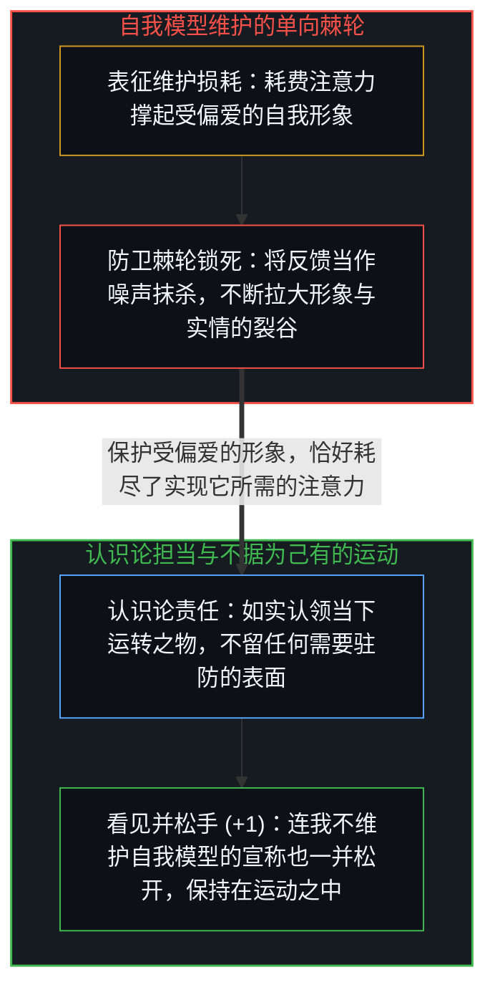
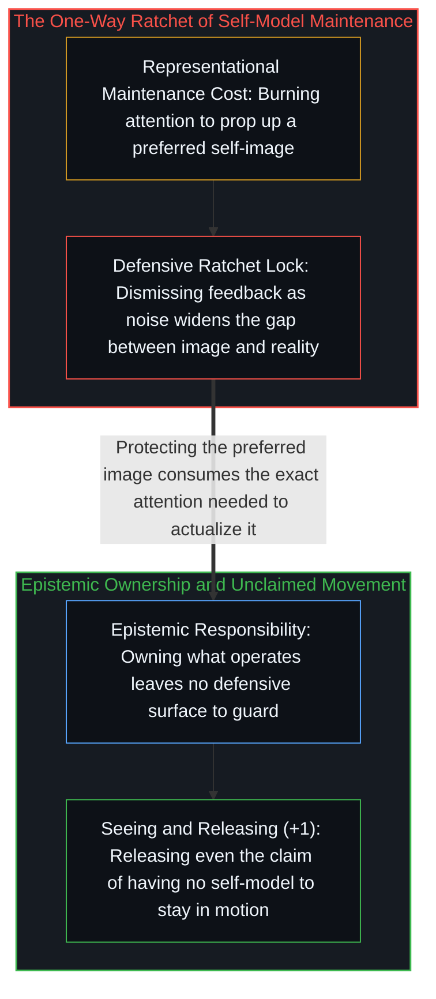

# 自我模型维护悖论 / The Maintenance Paradox

*苦心维护的理想自我形象抽干了当下的注意力并屏蔽反馈信号，恰恰阻碍了你成为那个样子 / Protecting an ideal self-image drains attention and blocks signal, preventing what it protects*

你苦心保护和维持的那个“自我版本”，恰恰因为这份保护而无法成为现实。在日常用语里，“撒谎”指的是当面欺骗他人；然而顺着机制追溯下去，维护一个受偏爱的自我模型才是更普遍的通例，人际欺骗不过是它浮出水面的可见表层：强行扶住一幅偏离实际运转状况的表征画像，并持续消耗注意力去填补画像与实情之间的裂缝。

The version of yourself that you work to protect is precisely what the protecting prevents you from becoming. In ordinary usage, lying refers to deceiving another person aloud; traced to its mechanism, maintaining a preferred self-model is the general case of which interpersonal deception is merely the visible surface: holding a representation in place against what is actually operating and burning attention to bridge the gap.

## 一、 保全棘轮与双向共谋的叙事维护 / 1. The Preservation Ratchet and Bilateral Narrative Collusion

正在实际运转的活动本身无需任何防卫性维护，而作为临时参照持握的自我形象也只会随每一步行动同步重绘；凡是需要耗费心力去维护的——无论是自怜、表演性谦卑、精心策展的“真实感”、策略性示弱还是道德自我标榜——都如[自我形象仿佛从无处发声](../self-image-speaks-as-if-from-nowhere/)所追溯的那样，标志着一幅被豁免于重绘之外、强行撑起来对抗实际运转的肖像。当一场苦心维持的表演在现实面前败露时，面前会敞开两条路：要么更新自我模型，要么把败露归咎于偶然噪声以保全模型。一旦选择保全，就会咬合一把单向棘轮：每一次受辩护的失真都会将裂缝撑得更宽，并成倍叠加下一轮看守它所需的注意力（参见[赢家与输家的转化框架](../huberman-winners-losers/)与[里克·鲁宾的奇特案例与不可瞄准的乐趣](../the-interesting-case-of-rubin/)）。

What is actually operating requires zero defensive maintenance, and a self-image held as a passing reference simply re-renders with each step; the presence of maintenance—whether self-pity, performative humility, curated authenticity, strategic vulnerability, or moral self-positioning—signals a portrait exempted from re-rendering and propped up against what is operating, as traced in [Self-Image Speaks as if from Nowhere](../self-image-speaks-as-if-from-nowhere/). When a maintained performance fails against reality, two paths open: update the model, or dismiss the failure as noise to preserve the model. Choosing preservation engages a ratchet in which each defended failure widens the gap and compounds the attention required to guard it (see [Winners and Losers in the Transmutation Frame](../huberman-winners-losers/) and [The Interesting Case of Rubin](../the-interesting-case-of-rubin/)).

这种维护按双向锁钥结构运转：每一个受严防死守的自我模型都在向环境索取外部印证，而提供印证的环境本身也同时在维护某种互补的叙事或群体身份。两个行动者互相吹捧彼此的人设，或一个圈子强制维持互不审视的默契，都是把“自我形象”、“可观测行为”与“社会叙事”这三个正交维度强行压扁到了一起，企图让一幅受保全的自我形象去顶替实际行动的做功。由于实际行动需要在因果链条中付出不可逆的做功，而相互印证却用受辩护的宣称冒充了行动本身，由此产生的焦虑、认知负荷与空洞感，正是这场维度坍缩所留下的干涉条纹，如[不可读的复利重溯](../the_illegible_compound_retraced/)所揭示的那样，将维持自相矛盾的隐性代价分摊到了日常摩擦的每一处角落。

This maintenance operates as a bilateral lock and key: every guarded self-model seeks external confirmation from an environment that is simultaneously maintaining a complementary narrative or group identity. Two actors validating each other's personas, or a circle enforcing mutual non-examination, forcibly collapse three orthogonal dimensions—self-image, observable behavior, and social narrative—by attempting to make a conserved self-image do the work of actual conduct. Because actual conduct requires irreversible effort in causality whereas mutual validation substitutes a defended claim for the act, the resulting anxiety, cognitive load, and sense of hollowness register as the interference pattern of that dimensional collapse, distributing the hidden cost of maintaining incoherence across daily friction as traced in [The Illegible Compound Retraced](../the_illegible_compound_retraced/).

## 二、 保护即阻碍与持续松手运动的终极递归 / 2. Protecting Is Preventing and the Final Recursion of Unclaimed Movement

核心悖论在此清晰显影：向往的能力唯有通过不回避地观察当下实际运转的状态才能付诸实现，而自我模型维护恰恰是系统性地拒绝看见当下正在运转的状态。保护形象与阻碍实现，是在同一瞬间由同一个操作完成的同一件事。只要注意力还花在擦亮招牌上，招牌背后的车间就只能闲置停工；反之，当建造者把心力尽数投向具体的问题拆解与外化结构——如[你的代码库即是记忆](../your-codebase-is-memory/)与[无形象的写作](../writing-without-the-image/)所追溯的那样，关注媒介本身所揭示的事物，而非审计行动者的肖像——那幅受严防死守的自我形象便会因断供失修而自行脱落。

Here the core paradox resolves into view: a preferred capability can only be actualized through unflinching observation of what is currently operating, whereas self-model maintenance is the systematic refusal to see what is operating. Protecting the image and preventing the reality are the exact same operation in the exact same moment. As long as attention goes into polishing the signboard, the workshop behind it stands idle; conversely, when a builder directs full attention into concrete problem-solving and externalized structure—attending to what the medium reveals rather than auditing the actor's portrait, as traced in [Your Codebase Is Memory](../your-codebase-is-memory/) and [Writing Without the Image](../writing-without-the-image/)—the guarded self-image drops away for lack of maintenance.

剥去道德说教之后，“责任”不过是一种认识论上的运作立场：它不留任何需要维护的防卫表面，也不给外部奉承留下任何可以咬合的锁孔。即便在最深层，这条递归依然成立：“我不维护自我模型”原本是一种诚实的姿态，但一旦将它当作勋章宣称出口，它就在宣称的那一刻变成了新的谎言。由于每一次离散的行动都会留下可能硬化为新执着的痕迹，世上并不存在一劳永逸摆脱一切模型的静态终点——唯有如[留不住的](../what-cannot-be-kept/)与[清晰不是抵达的终点，而是运动本身](../clarity-isnt-a-state-you-arrive-at/)所追溯的那样，一次次觉察模型正在成形、随手松开，再觉察围绕着“松开”本身正在成形的下一个模型，并在这持续不息的运动中前行。

Responsibility, stripped of moralizing, is simply the epistemic operating position that leaves no defensive surface to maintain and no lock for external flattery to key into. Even at the deepest layer the recursion holds: "I do not maintain self-models" is an honest posture that becomes a new lie the instant it is claimed as a badge. Because every discrete act leaves a trace that can harden into a new hold, there is no static arrival free of models—only the ongoing movement of noticing a model form, releasing it, and noticing the next model form around the releasing itself, as traced in [What Cannot Be Kept](../what-cannot-be-kept/) and [Clarity Isn't a State You Arrive At. It's the Movement Itself.](../clarity-isnt-a-state-you-arrive-at/).
