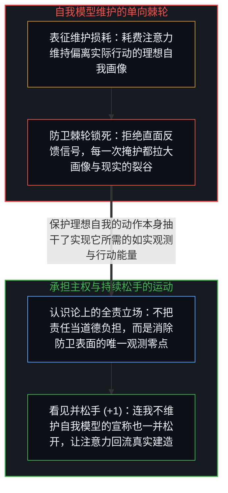
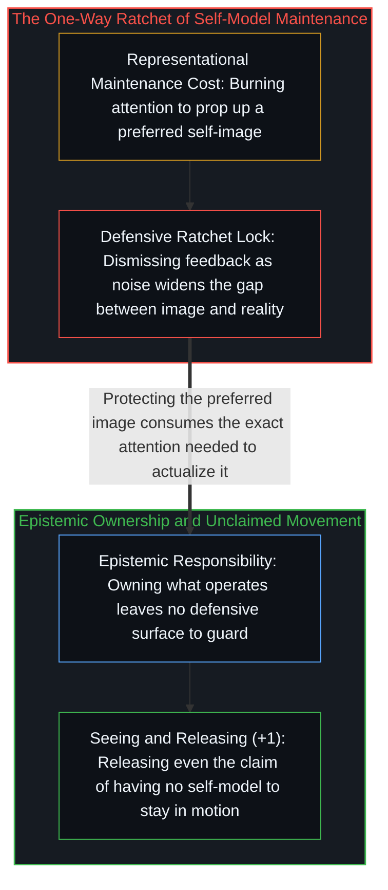

# 自我模型维护悖论 / The Maintenance Paradox

*苦心维护的理想自我形象抽干了当下的注意力并屏蔽真实信号，恰恰阻碍了你成为那个样子 / Protecting an ideal self-image drains attention and blocks signal, preventing what it protects*

你拼命保护和维持的那个“自我版本”，恰恰因为你对它的保护而永远无法成为现实。在日常观念里，“撒谎”似乎只是极少数时刻对他人说出的不实之词；然而顺着机制追溯下去，刻意维护一个受偏爱的自我模型（“我是那种如何如何的人”）本身就是撒谎——它并非比喻意义上的像撒谎，而是在机制上分毫不差：强行扶住一幅偏离实际运转状况的表征画像，并持续消耗注意力去填补画像与现实之间的裂缝。

The version of yourself that you work to protect is precisely what the protecting prevents you from becoming. In ordinary usage, lying refers to deceiving another person aloud; traced to its mechanism, maintaining a preferred self-model is the general case of which interpersonal deception is merely the visible surface: holding a representation in place against what is actually operating and burning attention to bridge the gap.

## 一、 棘轮效应与双向共谋的叙事维护 / 1. The Preservation Ratchet and Bilateral Narrative Collusion

如果一幅自我画像真的与实际运作严丝合缝，它原本就不需要任何维护，只需自然运转即可；凡是需要耗费心力去维护的——无论是自怜、表演性谦卑、精心策展的“真实感”、策略性示弱还是道德自我标榜——都标志着表征已经脱离了实际存在。当一个人在人际交往中撒谎被戳穿时，面前会敞开两条路：要么更新自我模型，要么把败露归咎于偶然噪声以保全自我模型。绝大多数人都会选择保全，从而启动一把单向棘轮：每一次对失真的掩护都让模型更偏离现实一分，而每一分偏离又要求下一轮投入更大剂量的掩护成本（参见[赢家与输家的转化框架](../huberman-winners-losers/)与[里克·鲁宾的奇特案例与不可瞄准的乐趣](../the-interesting-case-of-rubin/)）。

If a self-representation matched what is actually operating, it would require zero maintenance; the presence of maintenance—whether self-pity, performative humility, curated authenticity, or moral self-positioning—signals a divergence between representation and being. When a maintained performance fails against reality, two paths open: update the model, or dismiss the failure as noise to preserve the model. Choosing preservation engages a ratchet in which each defended failure widens the gap and compounds the attention required to guard it (see [Winners and Losers in the Transmutation Frame](../huberman-winners-losers/) and [The Interesting Case of Rubin](../the-interesting-case-of-rubin/)).

这种维护还具有鲜明的双向锁钥结构：每一个靠维护撑起来的自我模型都在向环境索取印证，而愿意提供这种印证的环境本身也正在维护某种互补的叙事或群体身份。两个人彼此捧场、一个圈子共同呵护某种无需审视的共识，归根结底都是把“自我形象”、“可观测行为”与“社会叙事”这三个正交维度强行压扁到了一起——试图用“我相信自己是什么人”去顶替“我实际做出了什么行动”。焦虑、内耗与挥之不去的虚浮感，正是强迫一维表征去冒充另一维行动时必然产生的干涉条纹。

This maintenance operates as a bilateral lock and key: every guarded self-model seeks external confirmation from an environment that is simultaneously maintaining a complementary narrative. Two actors validating each other's personas, or a group enforcing mutual non-examination, forcibly collapse three orthogonal dimensions—self-image, observable behavior, and social narrative—by attempting to make self-image do the work of actual conduct. The resulting anxiety, cognitive load, and sense of inauthenticity are the interference pattern of that dimensional collapse.

## 二、 保护即阻碍与“我不维护模型”的终极递归 / 2. Protecting Is Preventing and the Final Recursion of Unclaimed Movement

悖论的核心在此清晰显影：那个受偏爱的理想自我，唯有通过不眨眼地看清当下正在运作的真实状态才能一步步实现；而“维护自我模型”恰恰是系统性地拒绝看清当下正在运作的状态。因此，保护的动作本身就是阻碍的动作——二者在同一瞬间、由同一个操作完成。只要还在把精力花在擦亮招牌上，招牌背后的车间就处于停工状态；反之，当一个建造者把全部注意力投向如[你的代码库即是记忆](../your-codebase-is-memory/)所揭示的外部结构与具体问题拆解时，自我形象便因无人维护而自然消融。

Here the core paradox resolves into view: a preferred capability can only be actualized through unflinching observation of what is currently operating, whereas self-model maintenance is the systematic refusal to see what is operating. Protecting the image and preventing the reality are the exact same operation in the exact same moment. When a builder redirects that defensive attention into concrete problem-solving and externalized structure as traced in [Your Codebase Is Memory](../your-codebase-is-memory/), the guarded self-image drops away for lack of maintenance.

这也让“承担责任”卸下了道德说教的包袱：承担发生在自己身上的一切，并非为了扮演道德模范，而是因为这是唯一不留防卫表面、不给外部奉承留锁孔的认识论零点。并且这条回环在最深处依然保持着递归的锋利：“我从不维护自我模型”是世上最诚实的姿态，但只要你把它当成一枚勋章宣称出口，它就在宣称的那一秒钟变成了新的谎言。这里没有一劳永逸的“无我终点站”，唯有一次次看见模型正在凝结、随手松开、再看见围绕着“松开”正在凝结的新模型、再随手松开的持续运动。

Responsibility, stripped of moralizing, is simply the epistemic operating position that leaves no defensive surface to maintain and no lock for external flattery to key into. Even at the deepest layer the recursion holds: "I do not maintain self-models" becomes a lie the instant it is claimed as an identity. There is no static arrival free of models, only the ongoing movement of noticing a model form, releasing it, and noticing the next model form around the releasing itself.
