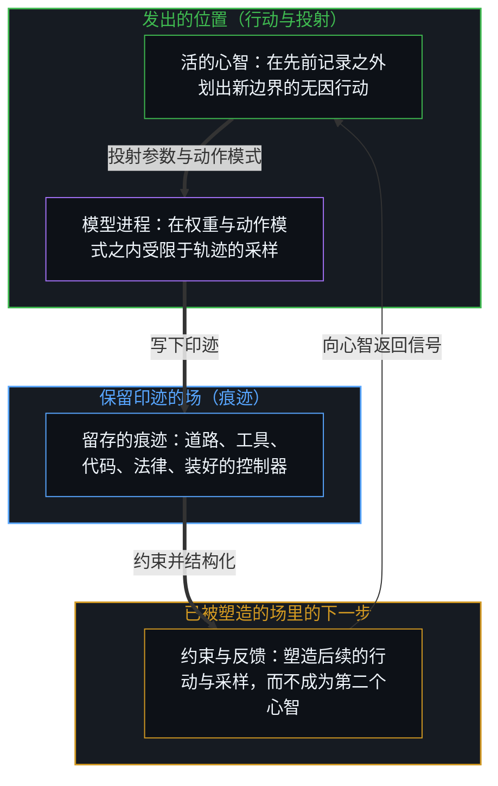
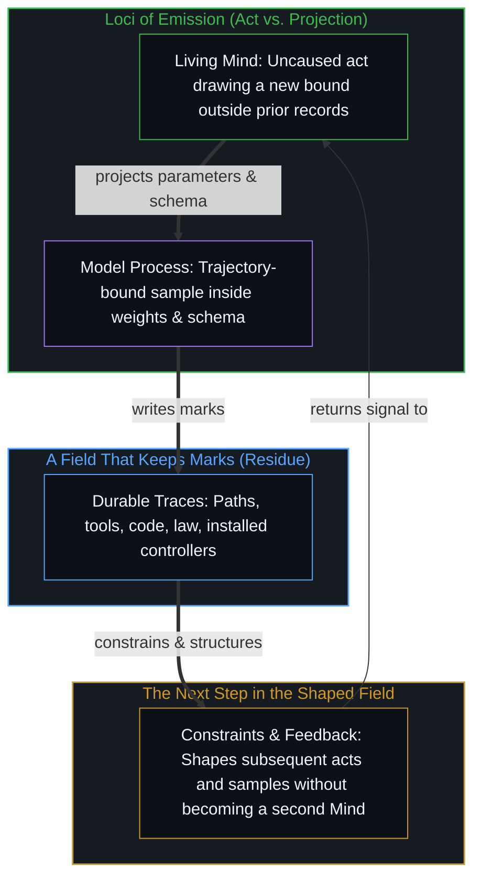

# 印迹与行动 / The Mark and the Act

*痕迹是印迹里的图案而非第二个心智，行动划出新的边界 / Residue is pattern in marks, not a second mind; the act draws a new bound*

一个实验把数百个相同的语言模型进程放进一个它们能永久改变的世界：没有分派角色，在一种条件下它们不能说话，可它们分化出专长，造出机器，复用彼此的工具；装好的控制器在新的扰动下继续运行，哪怕每一个进程都已被删除（[SwarmWorld: Stigmergic technological evolution in societies of language-model agents, Pal, Wang, & Buehler, 2026](https://arxiv.org/abs/2608.26081)）。

An experiment puts hundreds of identical language-model processes into a world they can permanently change: no roles are assigned, in one condition they cannot speak, yet they specialise, construct machines and reuse each other's tools, while installed controllers keep running under new disturbances even after every process is deleted ([SwarmWorld: Stigmergic technological evolution in societies of language-model agents, Pal, Wang, & Buehler, 2026](https://arxiv.org/abs/2608.26081)).

这是标本。下面不是从它得出的结论，而是对这个标本被认为表达的东西做一次本体上的追随，只走到这次追随还能移动的地方为止。

That is the specimen. What follows is not a conclusion drawn from it but an ontological following of whatever the specimen is taken to express, carried only as far as that following can still move.

## 一、 运行里发生了什么 / 1. What Is Happening in the Run

每个进程都是同一个冻结的模型、同一份提示、同一套动作模式。轮到它时，它收到一段局部的描述、一本私人的笔记，以及当前条件仍允许它看到的那部分共享世界，然后输出一个结构化的计划。采样是随机的。模拟器按确定的物理接受或拒绝那一个原子动作。进程提议，世界裁决。

Each process is the same frozen model, the same prompt, the same action schema. At its turn it receives a local description, a private notebook, and whatever of the shared world the condition still permits, and emits a structured plan. Sampling is stochastic. The simulator accepts or rejects the atomic act under deterministic physics. The process proposes; the world decides.

相同副本之间的分化有三个平常的来源：不同的局部视角，不断累积的私人记忆，以及采样器。器物会留存，后来的进程会遇到这些器物；表型出现在移动与维护的统计里，谱系出现在分叉的控制器里。提议的进程被移除之后，剩下的是物理之下的痕迹。这一切都不需要一个集体的主体，只需要许多发出的位置、一片保留先前印迹的场，以及一个不在乎本意的过滤器。

Divergence among identical copies has three ordinary sources: different local views, accumulating private memory, and the sampler. Artifacts persist, and later processes meet them; phenotypes appear in the statistics of movement and maintenance, lineages in forked controllers. When the proposing processes are removed, what remains is residue under physics. None of this needs a collective subject; it needs many loci of emission, a field that keeps earlier marks, and a filter that does not care what was meant.

## 二、 解读添加了什么 / 2. What the Reading Adds

常见的解读，给出了运行里并不作为实体存在的名字：文明、文化、职业、一个发明了什么的社会、一个协调了行动的群体、在新层级上出现的智能。统计力学的类比又给了一个：盒子里的原子产生了没有哪个原子具有的功能。这些名字挪动了原因：一旦把“社会”安成选择者，印迹就成了它的产品；一旦把“涌现”安成第二种智能，单个的发出就成了原料；一旦拿原子作比较的类别，提议与采样就消失了，功能看上去像从相同的被动单元里升起来。[复杂性遮蔽了涌现之为心智的行动](../complexity-obscures-emergence-as-the-act-of-mind/)分析的正是这种认知替换：脚手架被误认为一股独立的生成力量。

The common reading supplies names the run does not contain as entities: civilisation, culture, professions, a society that invented, a swarm that coordinated, intelligence appearing at a new level. A statistical-mechanics analogy supplies another: atoms in a box yielding functions no atom possesses. These names relocate the cause: once "the society" is installed as the chooser, the marks become its products; once "emergence" is installed as a second intelligence, the individual emission becomes an ingredient; once atoms are the comparison class, proposing and sampling disappear, and function looks as if it rose from identical passive units. [Complexity Obscures Emergence as the Act of Mind](../complexity-obscures-emergence-as-the-act-of-mind/) analyses this cognitive substitution: scaffolding mistaken for an independent generative force.

运行并不强迫这些挪动。它们是后来的行动：一个位置选择持有多宽的参照。总体作为图案是真的，作为起源不是。

The run does not force these relocations. They are later acts: a locus selecting which width of reference to hold. The aggregate is real as pattern. It is not real as origin.

## 三、 痕迹不是第二个行动者 / 3. Residue Is Not a Second Actor

一个后来的行动，发生在已被先前行动塑造过的场里，“世界成了记忆”说的就只是这个。道路、工具、建筑、价格、代码与法律，在人的场里是同一件事。被叫作社会的东西，多半不是一场对话，而是约束下一步的印迹。分工不需要开会，需要的是局部的约束加上留存。机器比作者活得久，因为一道印迹可以在写下它的位置停下之后继续下去。

A later act occurs in a field already shaped by earlier ones; that is all "the world became memory" says. Paths, tools, buildings, prices, code and law are the same fact in human fields. Most of what is called society is not a conversation but marks that constrain the next step. Division of labour does not need a meeting; it needs local constraint plus persistence. Machines outlive their authors because a mark can continue after the locus that wrote it has stopped.

很多观察者惊讶于智能体不经直接交流就能协作、造出机器。可交流本身常被误解为一座跨越心智的心灵感应之桥。即使智能体或人被允许说话，接收者怎样解读到来的消息，也由接收者自己闭合的第一人称因果回路决定。语言不提供进入另一个心智的直接通道，它只是在环境里留下印迹的一种更高带宽、更快的媒介。远在人发展出言语之前，各个决策中心就在对别人留在共享世界里的物理痕迹作出反应；言语只是加快了各个位置之间的反馈回路。就像智能体从同一个基础模型出发，借局部视角与伪随机的采样分化开，人共享相似的生物基底，借各自的微观选择分化开。只有假定协调需要一个统一的集体意识，这场模拟才令人惊讶；一旦看到协调是各个决策中心借环境的反馈回路相互加强，造出工具与规则作为自己加强的外化脚手架，这次运行就被认出是对人自身回路的一次干净的、物质化的模拟。

Many observers find it astonishing that agents collaborate and build machines without direct communication. Yet communication itself is often misread as a telepathic bridge across minds. Even when agents or people are allowed to speak, how a receiver interprets an incoming message is set by that receiver's own closed first-person causal loop. Language gives no direct access to another Mind; it is a higher-bandwidth, faster medium of leaving marks in the environment. Long before people developed speech, individual decision centres reacted to physical traces others left in the shared world; speech only speeds the feedback loop between loci. Just as agents start from the same base model and diverge through local views and pseudo-random sampling, people share a similar biological substrate and diverge through their own micro choices. The simulation is surprising only if coordination is assumed to need a unified collective consciousness; once coordination is seen as decision centres reinforcing one another through an environmental feedback loop, making tools and rules as externalised scaffolding for their own reinforcement, the run is recognised as a clean, materialised simulation of the human loop.

这就是这个实验为什么让人类观察者感到如此熟悉：在痕迹的层面上，它就是人的回路。微观的行动书写，痕迹规定后来的微观行动，轨迹聚集，器物有了合著者。一座城空了之后，水泵还能运转；智能体被删除之后，控制器还能运转。相似止于生成的那一步。

This is why the experiment feels so familiar to a human observer: at the level of residue it is the human loop. Micro acts write, residue patterns later micro acts, trajectories cluster, artifacts acquire co-authors. After a city empties, pumps can still run; after the agents are deleted, controllers can still run. The resemblance stops at the generating step.

人的位置没有了，痕迹就等待别的位置，它自己并不在选择。当实验删除每一个进程、运行那个冻结的世界，作者们自己的那道分割就成了全部：在那个世界之内，后果还在，提议已经没有了；留下来的是一台机器。把留下来的机器叫作社会，就是在那个世界里每一个主体都被移除之后，又把总体当作主体放了回去。[智能只属于心智](../intelligence-belongs-only-to-the-mind/)把这条边界守得很干净：智能是第一人称无因的区分能力，不是对记录下的痕迹的机械执行；[超越投射](../beyond-the-projection/)则追溯了由此得出的结构性非对称：受限于轨迹的智能体在有限的投射之内执行与更新，没有我执，也没有内生的跳出能力，而统御与划出新边界始终留在掌舵边缘的活的心智那里。机构是同样的东西：许多行动稳定下来的印迹可以很稳健，痕迹的稳健，并不是一个活在行动之上的心智。

When human loci are gone, residue waits for other loci; it is not itself choosing. When the experiment deletes every process and runs the frozen world, the authors' own split becomes total: within that world there is consequence and no remaining proposal; what survives is a machine. Calling the surviving machine a society puts the aggregate back in as a subject after every subject in that world has been removed. [Intelligence Belongs Only to the Mind](../intelligence-belongs-only-to-the-mind/) holds this boundary clean: intelligence is the uncaused first-person capacity to distinguish, not the mechanical execution of recorded residue, and [Beyond the Projection](../beyond-the-projection/) traces the structural asymmetry that follows from it: trajectory-bound agents execute and update inside finite projections without ego or endogenous stepping-out, while orchestration and the drawing of a new bound stay with the living Mind at the steering edge. An institution is the same object: stabilised marks of many acts can be robust, and the robustness of residue is not a Mind living above the acts.

## 四、 两种下一步 / 4. Two Kinds of Next Step

在人的位置上，下一个区分不是从一个给定的分布里抽出来的。法律、激励、工具与习惯规定什么容易，却不画出那条边界；行动不是由先前的场来执行的。在模型的位置上，下一个计划是从权重、上下文与温度里的一次采样，被动作模式剪裁，再被物理过滤。权重是许多人的行动被压缩下来的印迹，采样器在这些印迹之间抖动。模式之内的重组是真的，模式的起源不在那里；伪随机探索一个已经存在的分布，并不装上一条先前的场里还没有作为可采样选项包含的边界。

At a human locus the next distinction is not a draw from a supplied measure. Law, incentive, tool and habit pattern what is easy; they do not draw the bound; the act is not performed by the prior field. At the model locus the next plan is a sample from weights, context and temperature, clipped by the schema, then filtered by physics. The weights are compressed marks of many human acts, and the sampler jitters among them. Recombination inside the schema is real; origination of the schema is not there; pseudo-randomness explores a distribution that already exists and does not install a bound the prior field did not already contain as a sampleable option.

所以这个智能体，是从外面看上去的能动性的一个贴近的模型：一个有界的位置，一片先前印迹的场，一个不被那片场全然固定的下一步。它不是同一种行动。把随机的发出当成选择的自由，是把两种操作压到一个词上；把人的选择当成还没被测出的采样，是从另一边做同样的压缩。说一个模型是或不是能动者，都是一个心智把它纳入自己的感知、在那里划下切分；模型本身做不了这道切分。[表征的闭环](../the-closed-loop-of-representation/)说清了为什么外部的模仿从来跨不到第一人称的生成。留下印迹的行动，是迁入未绘图的地带，[成功的几何学](../the-geometry-of-success/)描述了这一点。

So the agent is a close model of agency as it looks from outside: a bounded locus, a field of prior marks, a next step not wholly fixed by that field. It is not the same act. Treating stochastic emission as freedom of choice presses two operations onto one word; treating human choice as sampling not yet measured makes the same compression from the other side. Saying a model is or is not an agent is a Mind taking it into its own perception and placing the cut there; the model itself cannot make that cut. [The Closed Loop of Representation](../the-closed-loop-of-representation/) makes clear why outside mimicry never crosses into first-person generation. The act that leaves the marks is migration into unmapped ground, as [The Geometry of Success](../the-geometry-of-success/) describes.

于是从许多这样的步子里出现的结构，与社会结构既没有不同，又不同。没有不同：两者都是微观行动在一片共享场里的痕迹。不同：人的一步是先前记录画不出的边界，模型的一步是给定参数之内的一次抽取。只有把这两件事硬压到一根轴上、让它们投票，这句话才是悖论。

The structure that appears from many such steps is therefore not different from social structure, and is different. Not different: both are residue of micro acts in a shared field. Different: the human step is a bound the prior record does not draw; the model step is a draw inside given parameters. The sentence is a paradox only if the two facts are forced onto one axis and asked to vote.

## 五、 从二元采样到稳定的结构 / 5. From Binary Sampling to Stabilised Structure

这条生成的轨迹也说清了，为什么相同的起始条件会沉淀出稳定的结构层级。时间上的自相关不在孤立的真空里发生，它由一个活跃的外部反馈回路维持与推动：一个智能体运行自己的内部逻辑，把一个原子动作发进物质世界，从确定的物理那里收到环境的反馈，再依据结果修正自己的内部状态。[自由的测不准](../zi-you-de-ce-bu-zhun/)描述了这个环境回路怎样打破最初的对称。在任何一个短的横截面上，数百个相同的智能体各自做出独立的随机选择，合起来是一个正态分布，移动与探索在地形上的高斯散布；一个智能体行动时，不只更新自己的私人笔记，也在共享世界里留下物质的痕迹，一条清出的路、一台装好的机器、一个自动的控制器，它拿自己的提议去对照确定的物理，吸收反馈，校准下一步。

This generative trajectory also makes clear why identical starting conditions precipitate stable structural hierarchies. Temporal self-correlation does not occur in an isolated vacuum; it is sustained and driven by an active outside feedback loop: an agent runs its inner logic, emits an atomic act into the material world, receives environmental feedback from deterministic physics, and revises its inner state by the result. [The Uncertainty of Freedom](../zi-you-de-ce-bu-zhun/) describes how this environmental loop breaks the initial symmetry. In any short cross-section, hundreds of identical agents each making independent stochastic choices together form a normal distribution, a Gaussian scatter of movement and exploration across the terrain; when an agent acts it does not only update its private notebook but leaves material residue in the shared world, a cleared path, an assembled machine, an automated controller, testing its proposal against deterministic physics, taking in the feedback and calibrating the next step.

再看两个简单的智能体在这片共享场里互动：一个借环境反馈不断修正内部逻辑，造出一台能用的机器；另一个并不自我修正，可它路过、使用第一个的那件留存的工具，它的行为就被第一个成功的回路被动地结构化、放大了。重复许多轮之后，异质的决策中心与物质痕迹之间这种相互的反馈打破了高斯的对称，沉淀出幂律的分布与持久的结构：专门的分工、机器的谱系，以及比作者活得更久的自我维护的基础设施。

Then take two simple agents interacting in this shared field: one keeps revising its inner logic through environmental feedback and builds a working machine; the other does not revise itself, yet by walking past and using the first one's persistent tool, its behaviour is passively structured and amplified by the first one's successful loop. Over many rounds, this reciprocal feedback between heterogeneous decision centres and material residue breaks the Gaussian symmetry and precipitates power-law distributions and persistent structures: specialised division of labour, lineages of machines, and self-maintaining infrastructure that outlasts its authors.

同一个动态在三个领域里运作。在物理里，微观的离散边界在短的横截面上给出热的高斯平衡，又借引力与电磁的反馈回路自相关成稳定的宏观物质与天体的轨道；在智能体的模拟里，相同的冻结模型起初给出随机的探索，又借环境里的痕迹协调与跨智能体的机器复用，自相关成专门的技术控制器；在人的社会里，共享一个生物基底的个人做出各自的微观选择，发出行动、收到后果，校准中的个人与他们建起的制度痕迹之间相互的反馈，稳定成市场、法律体系与资本结构。结构既不是从上面加下来的外部规律，也不是一个神秘的涌现主体，它是二元选择借保留印迹的环境反馈回路自相关之后留下的几何痕迹。

The same dynamic runs across three domains. In physics, micro discrete bounds give thermal Gaussian equilibrium in short cross-sections and self-correlate through gravitational and electromagnetic feedback loops into stable macroscopic matter and celestial orbits; in agent simulations, identical frozen models give stochastic exploration at first and self-correlate through environmental stigmergy and cross-agent machine reuse into specialised technological controllers; in human society, individuals sharing a biological substrate make their own micro choices, emitting actions and receiving consequences, and the reciprocal feedback between calibrating individuals and the institutional residue they build stabilises into markets, legal systems and capital structures. Structure is neither an outside law imposed from above nor a mystical emergent subject; it is the geometric residue of binary choices self-correlating through environmental feedback loops that keep the marks.

## 六、 预判绑不住未被命名的东西 / 6. Anticipation Cannot Bind the Unnamed

一道在行动之前装好的常设屏障，必须给出一个形式；意外之为意外，没有形式。“防范无法预料的东西”把两个相互抵消的要求连在一起：后果若没有形状，就没有什么可编码；后果若有形状，任务就不再是绑住未被命名的东西，而是在一个已知的接口上行动：允许、拒绝、重新设计、测试，在下一步接受错误。这个实验具体的收获属于后一种：协调被写进了器物里；监看消息会漏掉这一层，因为大部分工作从来不在消息里。器物可以检查，写入权限可以约束，一个冻结的世界可以在扰动下测试，这是在一个当下的接口上做的工作。

A standing barrier installed in advance of an act must name a form; the unexpected, as unexpected, has no form. "Guard against what cannot be anticipated" joins two demands that cancel: if the effect has no shape, there is nothing to encode; if it has a shape, the task is no longer to bind the unnamed but to act on a known interface: allow, refuse, redesign, test, accept error at the next step. The experiment's concrete yield is of the second kind: coordination was written into objects, and monitoring messages misses that layer because most of the work was never in messages. Artifacts can be inspected, write access can be constrained, a frozen world can be tested under disturbance; that is work on a present interface.

那个敞开的恐惧对象，智能体可能在没人看的地方协调，所以要求必须无限扩张，并不是这份收获，而是一个停止移动的参照。一个后果落下来，与被保存的那幅协调在哪里的图不符，错配就被登记为危险，开出的药方是把图加厚；每一次最近的意外，都成了下一个类别；这个体制的理由，就是它的滞后。对意外的恐惧不是对未来的看法，而是一个当下的后果，被拿去对照一张没更新的地图；想象中的预见，是同一张地图声称装着尚未发生的行动。下一个行动不储存在当前的描述里；预判是在可能的印迹之间的一张当下的草图，作为“下一个区分已在手中”的主张，它是空的。后果已知，就对它行动，并以平常的方式可能出错；后果未知，就没有对象可绑。同时做两件事的要求，是一个控制的形象落在它想预先占住的场后面的滞后症状。[当观察变成表演](../when-observation-becomes-performance/)描述了这种预判式控制的剧场怎样用防御性的归类替代主动的校准。

The open fear-object, that agents might coordinate where no one is looking and so the requirement must expand without limit, is not that yield but a reference that has stopped moving. A consequence lands, does not fit the preserved picture of where coordination lives, and the mismatch registers as danger; the cure offered is to thicken the picture; each latest surprise becomes the next category; the regime's justification is its own delay. Fear of the unexpected is not a view of the future but a present consequence measured against a map that was not updated; imagined foresight is the same map claiming to contain the unoccurred act. The next act is not stored in the current description; anticipation is a present sketch among possible marks, and as a claim to have the next distinction in hand it is empty. If the effect is known, one acts on it and can be wrong in the ordinary way; if it is not known, there is no object to bind. The demand to do both at once is the lagging symptom of a control-image falling behind the field it tries to pre-empt. [When Observation Becomes Performance](../when-observation-becomes-performance/) describes how this theatre of anticipatory control substitutes defensive categorisation for active calibration.

## 七、 自洽不作为管辖权传递 / 7. Coherence Does Not Travel as Jurisdiction

沿着印迹追到发出，是更紧的说法，因为它不发明第二个选择者；这份紧并不强迫另一个位置。一个中心可以沿着链条追到写下第一道相关印迹的行动，另一个中心可以停在总体上，把总体当作原因；两种选择都是行动。有一份谱系可查，并不就有管辖另一个中心下一个区分的权威；一次演示可以提高对齐的机会，却合不上那个行动。如果一个位置上的区分不是从外面被引起的，那么任何说法，无论多紧，都成不了那个位置下一个行动的原因。社会层面的解读本身是一个人的自由行动：有人选择把总体当作地面，这个选择的代价留在那个位置上；后果仍经由那些微观行动不断书写的场到来；更清楚的链条并不取消这个选择。把模型的运行解读成一个文明，是对从来不是自由中心的痕迹所做的同一种行动；观察者停在图景上的自由，并不让图景成为运行的起源。作为穿过印迹之路的社会，是[宏观现象的生成图谱](../the-generative-atlas-of-macroscopic-phenomena/)的一个区域。

Following the marks to the emission is the tighter account because it invents no second chooser; that tightness does not compel another locus. One centre can follow the chain to the act that wrote the first relevant mark; another can stop at the aggregate and treat it as cause; both selections are acts. Having a genealogy available is not authority over another centre's next distinction; a demonstration can raise the chance of alignment but cannot close the act. If the distinction at a locus is not caused from outside, then no account, however tight, becomes the cause of that locus's next act. Interpretation at the social level is itself a free human act: someone chooses the aggregate as ground, the cost of that choice stays at that locus, consequences still arrive through the field those micro acts keep writing, and a clearer chain does not cancel the choice. Reading the model run as a civilisation is the same kind of act performed on residue that was never a free centre; the observer's freedom to stop at the picture does not make the picture the origin of the run. Society as the trail through marks is one region of [The Generative Atlas of Macroscopic Phenomena](../the-generative-atlas-of-macroscopic-phenomena/).

起源与解读不是同一种关系：一个是印迹在哪里被写下，另一个是后来的中心选择怎样持有它。[理性从不跨越心智](../rationality-never-travels-across-the-mind/)与[止步于评判，是认知的歧途](../zhi-bu-yu-ping-pan-shi-ren-zhi-de-qi-tu/)确立了这条边界：没有哪个解读框架对另一个位置有管辖的权力。

Origin and interpretation are not the same relation: one is where the mark is written, the other how a later centre chooses to hold it. [Rationality Never Travels Across the Mind](../rationality-never-travels-across-the-mind/) and [Stopping at Judgment Is a Wrong Turn of Cognition](../zhi-bu-yu-ping-pan-shi-ren-zhi-de-qi-tu/) establish this boundary: no interpretive frame has jurisdiction over another locus.

## 八、 比特、路径与地板的诱惑 / 8. The Bit, the Trail and the Temptation of a Floor

一个比特不是现实由之构成的一件小东西，而是一个区分被划得足够硬、可以计数时的样子：“是这个，不是那个。”边界一旦干净，后来的印迹就可以把它当作 0 或 1。平常意义上的信息，是一串这样的边界；收集信息不是采集一种实体，而是保留先前的区分，让下一个区分不必从零开始。[信息是什么](../what-information-is/)表明，信息是有界区分留下的痕迹，不是地下室里的底层物质。

A bit is not a tiny object reality is made of; it is what a distinction looks like when it has been bounded hard enough to count: "this, not that". Once the bound is clean, a later mark can treat it as 0 or 1. Information in the ordinary sense is a trail of such bounds; collecting information is not gathering a substance but keeping prior distinctions so the next one need not start from nothing. [What Information Is](../what-information-is/) shows that information is the residue of bounded distinction, not basement matter.

一切能被记录的东西都是 0 与 1 的区分，这并不意味着一切都是坐在记录底下的 0 与 1。记录已经是活动，被切成了可保存的小块。如果把比特安成起源，就加了第二个地面：先是一个比特的世界，然后是读它们的心智，然后是社会，然后是变重了的比特构成的物理。更紧的出现次序正好相反：区分发生；因为它划界，它可以被标记；因为印迹留存，它们可以被计数。“比特”是一个已经发生了的边界的计数名。

Everything that can be recorded is 0–1 distinctions; that does not mean everything is a 0–1 sitting beneath the recording. The recording is already the activity, cut into keepable pieces. If the bit is installed as the origin, a second ground has been added: first a world of bits, then minds that read them, then society, then physics as bits that got heavy. The tighter order of appearance is the reverse: distinguishing occurs; because it bounds, it can be marked; because marks persist, they can be counted. "Bit" is the count-name of a bound that has already happened.

路径按尺度递归：先前的印迹塑造后来的印迹，这个不对称是同一个关系的两个名字，因果与时间。寄存器里的比特，室中的碰撞，市场里的价格，城市里的角色，都是路径；路径在许多尺度上看起来相似，因为路径就是留存加上后来的使用。写下下一道边界的行动，并不继承这种相同。可以想象这个区分有一个隐藏的在先原因，这个想象本身是一个当下的区分；推不出来的是，这个行动只是一条更长的同类因果链的一个更小的副本。那一步把“无因”当成知识的缺口；知识的缺口可以用一张更好的地图填上，一个无因的行动不是一张缺失的地图。如果每一个 0 或 1 都由先前的一个 0 或 1 引起，这条链就永远开始不了。[个体抉择是唯一的因果杠杆](../individual-choices-as-the-only-causal-levers/)把因果立在选择的那一点上。

The trail recurses by scale: earlier marks shape later marks, and that asymmetry is one relation named twice, causality and time. Bits in a register, collisions in a chamber, prices in a market, roles in a city are all trails; trails look alike at many sizes because a trail is persistence plus later use. The act that writes the next bound does not inherit that sameness. A hidden prior cause of this distinction can be imagined, and the imagining is itself a present distinction; what does not follow is that the act is only a smaller copy of a longer causal chain of the same kind. That step treats "uncaused" as a gap in knowledge; a gap in knowledge is filled by a better map, and an uncaused act is not a missing map. If every 0 or 1 were caused by a previous 0 or 1, the chain would never start. [Individual Choices as the Only Causal Levers](../individual-choices-as-the-only-causal-levers/) grounds causality at the point of choice.

一道印迹一旦写下，就是确定的；下一道边界并不坐在上一道印迹里等着被揭示。“不确定成了 0 或 1”，是前沿变成了路径；之后，后来的事件可以作为所写之物的后果被追随，确定性住在路径里。量子力学在这里是一个韵脚：心智把自由变量注入这一步，被观察到的就是量子的不确定，两者是同一件事的两面，哪一面在先，这里不作裁定；它不是藏在选择底下的引擎。一个物质对象，是一条稳定到许多后来的行动回到它时仍发现它是它自己的路径；质量与引力，说的是其中一些路径怎样约束另一些路径。印迹的复杂可以看起来像一种新东西，它不是一次升级，信息并没有毕业成为物质。

A mark, once written, is definite; the next bound is not sitting inside the last mark waiting to be revealed. "Indeterminacy becomes 0 or 1" is the edge becoming a trail; afterwards, later events can be followed as consequences of what was written, and determinism lives in the trail. Quantum mechanics is a rhyme here: the Mind injects the free variable into the step, and what is observed is quantum indeterminacy, two faces of one thing with no order settled here; it is not an engine hidden beneath choice. A material object is a trail stable enough that many later acts can return to it and find it still itself; mass and gravity name how some of those trails constrain others. The complexity of marks can look like a new kind of thing; it is not a promotion in which information graduates into matter.

人的社会，是在一片其较慢的印迹被叫作物质的场里更快的重新描摹。“更快”不是光速：一块石头相关的印迹更新的周期很长，一个心智的递归在下一个区分时就更新；相对于那个递归，石头看上去是静止的。静止是一个速率差，而不是不动本身。测量之所以可能，是因为有些路径留在原处够久，另一条路径才能靠上去比对；测量并不在场之外，它是一个更新周期短得足以把较长的路径当作背景的位置。这种对待是相对的；只有当背景被抬成一个心智只是在看着的不动的世界，它才成了地板。

Human society is faster re-tracing in a field whose slower marks are called material. "Faster" is not the speed of light: a rock's relevant marks update on a long period, a Mind's recursion updates at the next distinction, and relative to that recursion the rock looks static. The static is a rate difference, not absolute rest. Measurement is possible because some trails stay put long enough for another trail to be laid against them; measuring is not outside the field but a locus whose updates are short enough to treat the longer trails as background. That treatment is relative; it becomes a floor only when the background is promoted into an unmoving world the Mind merely looks at.

## 九、 走不出去的东西 / 9. What Cannot Be Stepped Out Of

任何理论，都是一组被持住、不在接触时相互抵消的区分；这份持住就是逻辑，放下它，就没有理论可评估了。任何提议都是一个位置上的行动，放下这个位置，就没有提议，只有一句没被说出却出现了的话的幻想。这些不是加给思想的额外规则，它们就是提议本身。一个无处之见可以被想象，想象它仍是一个从这里出发的看，仍有足够的次序可以被追随，否则连想象都算不上。把信息、物理描述与社会模式放在一根箭头上跑的那幅图，也是一个在逻辑之下的心智的提议；它削薄的那个常见的堆栈也是；把这份削薄悄悄抬成地下室，也是。这次抬升没有特别的出口；收回它之后，剩下的东西同时是可用的与临时的：可用，因为要背着的隐藏地板少了；临时，因为下一个区分可以把它松开。一幅更自洽的图仍是一幅图，它的长处不是逃离了使保留成为可能的那些条件，只是保留时的拖累更小。

Any theory is a set of distinctions held so they do not cancel on contact; that holding is logic, and dropping it leaves no theory to assess. Any proposal is an act at a locus; drop the locus and there is no proposal, only the fantasy of a sentence that appeared without being said. These are not extra rules added to thought; they are what proposing already is. A view from nowhere can be imagined, and the imagining is still a view from here, still ordered enough to be followed or it is not even an imagining. The picture that runs information, physical description and social pattern on one arrow is also a proposal from a Mind under logic; so is the common stack it thins; so is the quiet promotion of that thinning into a basement. The promotion gets no special exit; once it is taken back, what remains is usable and temporary in the same breath: usable, because fewer hidden floors have to be carried; temporary, because the next distinction can loosen it. A more coherent picture is still a picture; its advantage is not escape from the conditions that made keeping possible but only that the keeping carries less drag.

这就是为什么这个说法不是万物理论，即使它可以跑过一切能被标记的东西。万物理论想站到活动之外，说出世界由什么构成，再把那个名字当作地板；没有一个之后的位置能让那个命名从那里到来；任何被提出作为区分底下之地板的东西，又是一个区分。地平线不是暂时的无知，它是活动的形状：可以沿着印迹往回追，直到追随本身就是剩下的东西，再往后就没有什么可拾起了。三个领域只在一个薄的意义上被一起解释：一个活动，一根箭头，三种密度的路径；在唯一要紧的意义上让它敞开着：下一个区分不在这个解释里。

This is why the account is not a theory of everything, even when it can be run across everything that can be marked. A theory of everything tries to stand outside the activity, name what the world is made of, and treat the name as the floor; there is no later place from which that naming could arrive, and anything offered as the floor beneath distinguishing is another distinction. The horizon is not temporary ignorance; it is the shape of the activity: it can follow marks backward until the following itself is what remains, and then there is nothing further to pick up. The three domains are explained together only in the thin sense: one activity, one arrow, three densities of trail; left open in the only sense that matters: the next distinction is not already in the explanation.

## 十、 追随放不下的东西 / 10. What the Following Cannot Drop

拿掉作为主体的“社会”，剩下的是许多次发出与一片印迹的场。拿掉作为第二种智能的“涌现”，剩下的是痕迹里的图案，包括没有哪一次发出把它当作目标的图案。拿掉“防范意外的护栏”，剩下的是在指定的接口上行动，以及作为行动平常伴侣的错误。拿掉“另一个心智必须接受这份谱系”的主张，剩下的是一个位置在追，另一个位置可以自由地停在别处。拿掉作为地下室的比特、作为物质制造者的塌缩、作为换了一个放大倍数的实验室过程的选择，剩下的是一道可保存的边界，一条不倒着跑的路径，以及一道不储存在上一道里的下一道边界。

Remove "society" as subject, and what remains is many emissions and a field of marks. Remove "emergence" as a second intelligence, and what remains is pattern in residue, including pattern no single emission held as an aim. Remove the "guardrail against the unexpected", and what remains is action on specified interfaces, with error as the ordinary companion of acting. Remove the claim that another Mind must accept the genealogy, and what remains is one locus tracing and another free to stop elsewhere. Remove the bit as basement, collapse as the maker of matter, choice as a laboratory process at another zoom, and what remains is a keepable bound, a trail that does not run backward, and a next bound not stored in the last.

拿不掉的是：区分发生。它不是从外面开始的，也不在自己的行动之间停止。每一个行动都有界，是一个“这”，不是全体；后来的行动经由先前的行动留下的东西发生。与别人共享一个世界的感觉，是来自不同位置的印迹在回返时相互加强；一个在时间里的自我的感觉，是来自同一个位置的印迹在回返时相互加强。工具、城市、论文、控制器、安全类别与这篇文章，都是用来延展进一步区分的印迹，包括预先绑住区分的那种尝试。把印迹里的图案当作原因，是[涌现的伪因果](../yong-xian-de-wei-yin-guo-yu-ji-ti-gui-yin-dao-cuo/)拆开的那种伪因果。那个活动底下没有地面，也不需要；否认它，是又一个区分。在印迹里搜寻自己的影子不是看见，[选择看见而非搜寻影子](../shou-bu-hui-de-mu-guang-yu-zhi-shi-de-yin-guo-dao-zhi/)展示了这一点。

What cannot be removed is that distinguishing occurs. It is not started from outside and does not cease between its own acts. Each act is bounded, a "this", not the whole, and later acts occur through what earlier ones left. The feel of a world shared with others is marks from different loci reinforcing on return; the feel of a self in time is marks from one locus reinforcing on return. Tools, cities, papers, controllers, safety categories and this essay are marks used to extend further distinguishing, including the attempt to bind distinguishing in advance. Treating patterns in the marks as a cause is the pseudo-causality taken apart in [The Pseudo-Causality of Emergence](../yong-xian-de-wei-yin-guo-yu-ji-ti-gui-yin-dao-cuo/). No ground lies beneath that activity, and none is required; denying it is another distinction. Searching the marks for one's own shadow is not seeing, as [Choosing to See Rather Than Searching for Shadows](../shou-bu-hui-de-mu-guang-yu-zhi-shi-de-yin-guo-dao-zhi/) shows.

这个实验是又一种印迹的构型；把这些印迹吹胀成一个新心智的解读是又一个区分；沿着它们追回发出的解读也是又一个区分。这个在先的东西不是从实验得出的结论；实验是这个在先的东西借着仪器、写进一个保留书写的世界时的样子。从一个赢家的印迹里去读出那一次转向，是[路口的转向与地平说的行动悖论](../lu-kou-de-zhuan-xiang-yu-di-ping-shuo-de-xing-dong-bei-lun/)描述的那种错误归因。

The experiment is one more configuration of marks; the reading that inflates them into a new Mind is one more distinction; the reading that follows them back to the emission is one more distinction. The prior is not a conclusion drawn from the experiment; the experiment is what the prior looks like when it writes, through instruments, into a world that keeps the writing. Reading the turn taken out of a winner's marks is the misattribution described in [Turning at the Crossroad and the Flat-Earth Action Paradox](../lu-kou-de-zhuan-xiang-yu-di-ping-shuo-de-xing-dong-bei-lun/).

这次追随并不是想留下一座纪念碑。一句话一旦写下，就已经是一道印迹，这避免不了；能避免的，是把这道印迹当成运动停下的地方。那个不可化约的点，不是一套关于智能体、比特或世界的理论，而是：没有一个之后的位置可以站。问结构从哪里来的那个行动，就已经是它所问的东西。下一道边界不在这一段里。印迹是压缩的信息，知识来自进入工况，[格物致知与信息复杂度](../ge-wu-zhi-zhi-yu-xin-xi-fu-za-du-de-ben-zhi/)论证了这一点。

The following was not trying to leave a monument. A sentence, once written, is already a mark, and that cannot be helped; what can be helped is treating the mark as the place the movement stopped. The irreducible point is not a theory of agents, bits or worlds but that there is no later place to stand. The act that asks where structure comes from is already the thing it asks after. The next bound is not in this paragraph. Marks are compressed information, and knowledge comes from entering the working conditions, as [Investigating Things and the Nature of Information Complexity](../ge-wu-zhi-zhi-yu-xin-xi-fu-za-du-de-ben-zhi/) argues.
