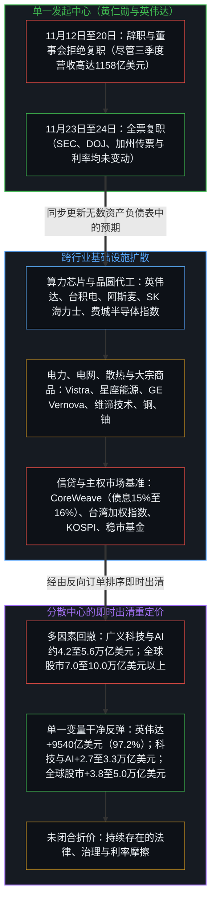
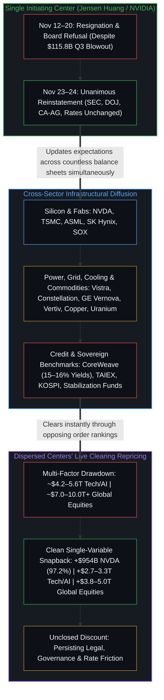
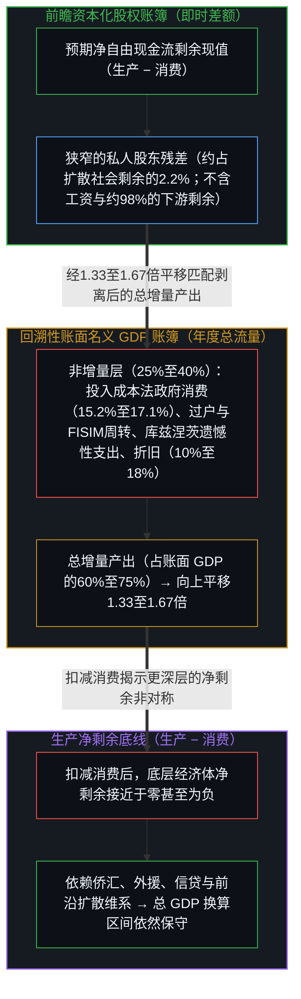
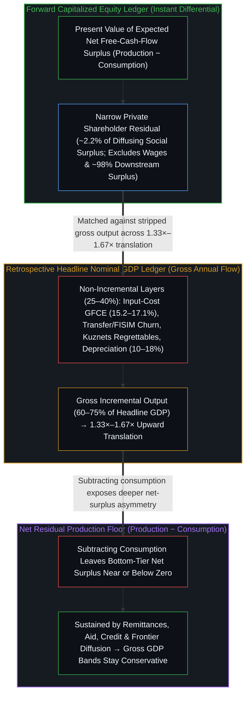

# 生产性基础的市场重定价 / The Market Repricing of Productive Base

*单一中心的离场与回归牵动跨行业股市重定价，剥离名义 GDP 非增量残余后显露出微观杠杆。 / One center's exit and return reprices equities across sectors, exposing microscopic leverage once non-incremental GDP is stripped.*

2026 年 11 月，英伟达首席执行官黄仁勋的离职与迅速复职，触发了一场波及全球的系统性重定价，其冲击远超半导体板块，直抵电力公用事业、工业设备、杠杆信贷、大宗商品及东亚主权股指。按广义全球科技与人工智能生态计，11 月 12 日至 20 日的回撤抹除了约 4.2 至 5.6 万亿美元市值，随后在 11 月 23 日至 24 日的全球交易周期内即时反弹 2.7 至 3.3 万亿美元；若扩展至全球股票市场整体，该轮抛售规模达 7.0 至 10.0 万亿美元以上，而在监管调查与利率压力均未改动的条件下，复职这一单一变量即触发了 3.8 至 5.0 万亿美元的干净回补。股市重定价所登记的，是预期净自由现金流剩余现值的即时差额——且仅仅定价了上市股东所占的狭窄私人切片；与之相对，账面名义 GDP 统计的是年度支出总流量，其中既掺杂着 25% 至 40% 的非增量支出，又未扣减消费。将这层非增量残余剥离后，上述股市重定价区间需向上平移 1.33 至 1.67 倍，对应国际货币基金组织（IMF）排序底部 131 至 160 个经济体合计 5.6 至 9.3 万亿美元及 9.3 至 16.7 万亿美元的年度名义 GDP——涵盖全球约五分之一至五分之二的人口；而这一基准仍偏保守，因为这一层级经济体的生产净剩余（生产减去消费）接近于零甚至为负。

In November 2026, the departure and rapid reinstatement of NVIDIA chief executive Jensen Huang triggered a systemic global repricing that crossed far beyond semiconductor tickers into power utilities, industrial equipment, leveraged credit, raw commodities, and East Asian sovereign benchmarks. Measured across the broad global technology and artificial-intelligence ecosystem, the November 12 to November 20 drawdown erased roughly $4.2–5.6 trillion, followed by an immediate $2.7–3.3 trillion rebound across the November 23–24 global trading cycle; expanded to total global equities, the selloff reached $7.0–10.0 trillion and above, with a clean single-variable reinstatement snapback of $3.8–5.0 trillion while regulatory investigations and interest-rate pressures stayed unchanged. Equity repricing registers an instant differential in the present value of expected net free-cash-flow surplus—and prices solely listed shareholders' narrow private slice—whereas headline nominal GDP tallies a gross annual expenditure flow padded with 25–40 percent non-incremental outlays and leaves consumption unsubtracted. Stripping that non-incremental residue translates those equity bands upward by 1.33×–1.67× to $5.6–9.3 trillion and $9.3–16.7 trillion in annual headline GDP across the bottom 131–160 IMF economies—roughly a fifth to two-fifths of humanity—a conservative benchmark since net residual production (production minus consumption) across that tier sits near or below zero.

## 一、 跨行业重定价作为单一中心扩散的即时投影 / 1. Cross-Sector Repricing as a Live Projection of Single-Center Diffusion

股市资本化是对预期未来净现金流的资本化存量，直接系于持续运作的生产性能力；一旦某个发起中心的连续性骤然生变，变化便会即刻登记在价格之上。在 2026 年 10 月 6 日的市值高点至 11 月 12 日英伟达宣布黄仁勋即刻辞职之间，受离职前行为报道、出口管制审查趋严及美债收益率高企影响，该公司市值已由 5.78 万亿美元回落至 4.01 万亿美元。11 月 12 日至 20 日谷底期间，英伟达股价再跌 24.5% 至 3.03 万亿美元——市值又抹去 9820 亿美元，较 10 月高点累计蒸发 2.75 万亿美元。最具决定性的诊断节点出现在 11 月 17 日：英伟达公布大超预期的第三季度财报，营收达 1158 亿美元、同比增长 103%，其中数据中心贡献 1076 亿美元，新架构爬坡速度创下公司历史之最；但就在同一场财报电话会上，董事会明确表示无意让黄仁勋复职。抛售非但未止，反而进一步加速，这表明分散各处的投资者正在重定价单一发起中心未来的连续性，而非已经入账的季度营收。

Equity capitalization is a capitalized stock of expected future net cash flows tied to ongoing productive capacity, and any sudden shift in the continuity of an initiating center registers immediately in price. Between the October 6, 2026 equity peak and November 12, when NVIDIA announced Huang's immediate resignation, the company's market value had already retreated from $5.78 trillion to $4.01 trillion amid pre-resignation conduct reports, tighter export-control scrutiny, and elevated Treasury yields. From November 12 to the November 20 trough, NVIDIA fell another 24.5 percent to $3.03 trillion—an additional $982 billion erased, totaling $2.75 trillion off its October peak. The decisive diagnostic arrived on November 17: NVIDIA reported blowout third-quarter revenue of $115.8 billion, up 103 percent year over year with $107.6 billion from data centers and the fastest architecture ramp in its history, yet on the same earnings call the board stated it had no intention of reinstating Huang. Liquidation accelerated anyway, demonstrating that dispersed investors were repricing the future continuity of one initiating center rather than quarterly revenue already booked.

当算力芯片与软件架构凝结为通用基础设施，单一中心的震荡便不再局限于某一只股票代码或单一行业分类。若仅将度量口径限定在狭义信息技术板块，便会低估这一冲击的覆盖范围，因为前沿算力早已将横跨通信与消费平台的超大规模云厂商、亚洲晶圆代工与存储生态、电力供应、电网工程、散热硬件乃至杠杆云融资紧密绑为一体。按广义全球科技与 AI 生态计，11 月 12 日至 20 日的回撤落在 4.2 至 5.6 万亿美元区间，其中纳斯达克综合指数下跌 10.83%、纳斯达克 100 指数下挫 11.52%、费城半导体指数重挫 19.97%。将视界放宽至全球股市整体，标普 500 指数六个交易日累计下跌 8.98%——市值蒸发约 6.1 万亿美元，自 10 月高点跌入回调区间；道琼斯工业平均指数同步下跌 7.93%，将全球股市累计损失拉升至 7.0 至 10.0 万亿美元以上。

When compute silicon and software architectures densify into general-purpose infrastructure, a single center's disruption ceases to stay confined to one equity ticker or sector classification. Restricting measurement strictly to narrow information-technology classifications understates the footprint because frontier compute now binds together hyperscalers across communication and consumer platforms, Asian foundry and memory ecosystems, power generation, grid engineering, thermal hardware, and leveraged cloud financing. Across the broad global technology and AI ecosystem, the November 12–20 drawdown fell in the range of $4.2–5.6 trillion, led by a 10.83 percent decline in the Nasdaq Composite, an 11.52 percent drop in the Nasdaq-100, and a 19.97 percent plunge in the Philadelphia Semiconductor Index. Widening the lens to total global equities, the S&P 500 shed 8.98 percent—roughly $6.1 trillion in six sessions, entering correction territory from its October high—while the Dow Jones Industrial Average fell 7.93 percent, pulling global equity losses to $7.0–10.0 trillion and above.

跨行业传导精准沿着英伟达技术路线图向外延伸的物理与金融动脉展开。与数据中心电力负荷挂钩的发电与核电企业剧烈重定价：11 月 12 日至 20 日窗口内，Vistra 下跌 14.3%，星座能源下挫 15.9%。电网燃气轮机与数据中心散热供应商步调一致，GE Vernova 跌去 14.6%，维谛技术重挫 20.7%。在杠杆私募信贷领域，以 GPU 资产作抵押的新兴云厂商 CoreWeave 暴跌 30.2%，其债券收益率飙升至 15% 至 16%，因贷款机构开始密集审视临时管理层之下算力兜底协议与硬件残值承诺能否继续兑现。实物大宗商品同样映照出这轮去杠杆：铜价跌至数月低位，随后在 11 月 23 日单日反弹逾 5%；铀矿股亦随核电预期回暖大涨逾 6%。上升至主权市场尺度，台湾加权指数在窗口期内重挫 16.4%，促使台湾金融安定基金启动历史上第十次护盘干预并配合限空措施；韩国综合股价指数（KOSPI）下跌 8.9%，触发跨部门紧急稳市会议；而在 11 月 24 日，伴随三星电子与 SK 海力士同步走强，韩国综合股价指数大涨 6.98%，台湾加权指数飙升 8.99%，台积电更是触及 10% 的单日涨停上限。

The cross-sector transmission traced the exact physical and financial arteries running outward from NVIDIA's roadmap. Power and nuclear generators tied to data-center load repriced sharply, with Vistra falling 14.3 percent and Constellation Energy dropping 15.9 percent across the November 12–20 window. Grid-turbine and data-center cooling suppliers followed in lockstep, with GE Vernova down 14.6 percent and Vertiv down 20.7 percent. In leveraged private credit, GPU-backed neocloud CoreWeave plunged 30.2 percent as its debt yields surged to 15–16 percent amid lender scrutiny over whether capacity backstops and hardware-value commitments would hold under interim leadership. Physical commodities mirrored the same unwind: copper slid to multi-month lows before snapping back more than 5 percent on November 23, while uranium miners jumped more than 6 percent alongside nuclear power expectations. At the sovereign scale, Taiwan's TAIEX dropped 16.4 percent over the window, prompting Taiwan's National Financial Stabilization Fund to activate its tenth historical market intervention alongside short-sale curbs, while South Korea's KOSPI fell 8.9 percent and triggered emergency inter-agency stabilization meetings before surging 6.98 percent on November 24 alongside Samsung Electronics and SK Hynix, as Taiwan's TAIEX jumped 8.99 percent with TSMC hitting its 10 percent daily upper limit.

厘清因果归因，必须将多因素交织的 11 月 12 日至 20 日抛售，与单一变量干净反转的 11 月 23 日至 24 日反弹区分开来。在抛售周内，黄仁勋离职与董事会 11 月 17 日的拒绝表态，与多项并发拖累同时发生：美国证券交易委员会（SEC）的民事信息披露问询、美国司法部（DOJ）与商务部针对新加坡云端买家 Megaspeed 的出口管制调查、加州总检察长于 11 月 19 日发出的调查传票、已排期的国会约谈、徘徊在 5% 上方的美债收益率叠加美联储鹰派表态，以及新兴云厂商的信贷紧绷。将全部 7.0 至 10.0 万亿美元的回撤尽数归因于领导权变动，会高估单一变量的解释力。形成鲜明对照的是 11 月 23 日至 24 日：上述所有悬而未决的压力悉数仍在——加州总检察长确认传票继续有效，SEC 与联邦出口管制调查照常推进，国会监督进一步收紧并敲定听证日程，利率水平与资产负债表杠杆亦纹丝未动。发生翻转的关联变量只有一个：在美国政府高层完成国家安全审批后，英伟达董事会全票通过恢复黄仁勋总裁、首席执行官及董事职务。仅凭这一开关翻转，英伟达单日暴涨 31.48%——市值激增 9540 亿美元，收于 3.99 万亿美元，一天之内收复了 11 月 12 日至 20 日跌幅的 97.2%。广义科技与 AI 生态随之回补 2.7 至 3.3 万亿美元（纳斯达克综合指数涨 6.51%，费城半导体指数涨 13.69%，阿斯麦涨 8.92%），全球股市整体收复 3.8 至 5.0 万亿美元（其中标普 500 指数单日增加约 2.9 至 3.0 万亿美元）。纵观美国科技股指、亚洲晶圆代工基准、Vistra、GE Vernova、维谛技术与 CoreWeave，仅凭一位领导者的回归，便在瞬间收复了前期多因素抛售的约 45% 至 58%，而尚未闭合的缺口，则如实登记了持续存在的法律、治理与利率摩擦。

Evaluating causal attribution requires separating the multi-factor November 12–20 selloff from the clean single-variable November 23–24 snapback. During the selloff week, Huang's departure and the board's November 17 refusal operated alongside active concurrent drags: an SEC civil disclosure inquiry, DOJ and Commerce export-control probes into Singapore cloud buyer Megaspeed, a November 19 investigative subpoena from the California Attorney General, scheduled Congressional interviews, Treasury yields hovering above 5 percent with hawkish Federal Reserve commentary, and neocloud credit strain. Assigning the entire $7.0–10.0 trillion drawdown to leadership loss alone overstates single-variable attribution. Across November 23–24, by contrast, every one of those overhangs stayed open: the California Attorney General confirmed its subpoena remained active, the SEC and federal export probes stayed open, Congressional oversight intensified with hearings locked in, and interest rates and balance-sheet leverage did not budge. Only one linked variable flipped: NVIDIA's board unanimously reinstated Huang as president, chief executive, and director following senior U.S. government national-security clearance. On that single switch, NVIDIA surged 31.48 percent in one session—adding $954 billion to close at $3.99 trillion and recovering 97.2 percent of its November 12–20 loss in a day. The broad tech and AI ecosystem clawed back $2.7–3.3 trillion (with the Nasdaq Composite up 6.51 percent, the semiconductor index up 13.69 percent, and ASML up 8.92 percent), while total global equities recovered $3.8–5.0 trillion (with the S&P 500 adding roughly $2.9–3.0 trillion). Across U.S. tech indices, Asian foundry benchmarks, Vistra, GE Vernova, Vertiv, and CoreWeave, one leader's return instantly recovered roughly 45–58 percent of the prior multi-factor selloff, while the unclosed gap registered the persisting legal, governance, and rate friction.

这场剧烈摆动并非源于凌驾于经济行动者之上的单一超级心智“市场”。正如[价格是言说，理解是交易](../price-as-utterance-understanding-as-trade/)所追溯的，市场成交价不过是一道出清残余：分散各处的鲜活中心对现金与资产持相反排序，订单交叠之处便留下价格。在单一全球交易周期内撬动 3.8 至 5.0 万亿美元的，正是数十万名投资组合经理、信贷承销商、电力开发商、晶圆厂排产规划者与财政官员，在同一时刻将这一恢复后的运营变量重新追溯进各自的资产负债表。

That swing does not arise from "the market" acting as a singular super-mind above economic actors. As traced in [Price as Utterance, Understanding as Trade](../price-as-utterance-understanding-as-trade/), a market print is the clearing residue left wherever dispersed living centers cross orders under opposing rankings of cash and assets. What moved $3.8–5.0 trillion in a single global cycle was hundreds of thousands of portfolio managers, credit underwriters, power developers, foundry planners, and treasury officials simultaneously re-tracing one restored operational variable into their own balance sheets.

## 二、 名义 GDP 中的非增量残余与净剩余 / 2. Non-Incremental Residue Inside Nominal GDP and Net Residual Surplus

将股市重定价与账面名义 GDP 并置比较，依托着清晰的尺度机制。正如[价值、货币与财富的生成机制](../the-generative-mechanics-of-value-money-and-wealth/)所追溯的，股市资本化是一份面向未来的金融索取权，从不是一座静态的实物金库；财富只存在于活生生的生产性能力之中，股价登记的则是对这份能力未来产出的预期。由于股权估值将预期净增量自由现金流折算为现值，某个发起中心的连续性一旦中断或恢复，便会即刻登记为数万亿美元的现值差额。将这一即时现值差额置于年度名义 GDP 之旁，所衡量的正是单一中心在连续运作下承载的现值增量产能，与全球约五分之一至五分之二人口整年产出之间的对照。

Comparing an equity-market repricing against headline nominal GDP rests on clear scale mechanics. Equity capitalization is a forward-looking financial claim, never a static physical vault; wealth resides strictly in living productive capability, while equity prices register expectations over what that capability will yield, as traced in [The Generative Mechanics of Value, Money, and Wealth](../the-generative-mechanics-of-value-money-and-wealth/). Because equity valuation capitalizes the present value of expected net incremental free cash flows, any break or restoration in an initiating center's continuity registers instantly as a multi-trillion-dollar differential. Placing that instant present-value differential beside annual nominal GDP measures how much present-value incremental capacity one center's continuity carries against what roughly a fifth to two-fifths of humanity produces in an entire year.

即便按这一直接口径衡量，公开上市股权也仅捕获了它所定价的生产力浪潮中微小的后随份额。上市股票估值只对扣除工资、利息与税费后归属普通股股东的自由现金流残差进行资本化，并未计入员工薪酬、供应商营收、偿债支出、非上市企业，以及向下游采纳者广泛扩散的消费者剩余。在威廉·诺德豪斯对战后技术变革的实证核算中——正如[私人残差与社会剩余的因果次序](../the-causal-order-of-private-residuals-and-social-surplus/)所追溯的——创新者与股权持有人仅留存技术进步所生社会总剩余的约 2.2%，其余约 98% 则经由更低廉、更迅捷的能力向外耗散；如[百万亿地平线之外](../beyond-the-hundred-trillion-horizon/)所考察的，这使企业股权始终只是不断扩张的经济分母中一道狭窄的后随切片。因此，数万亿美元的市值摆动所定价的，仅仅是一场宏大得多的生产力跃迁中属于股东的狭窄尖端。

Even on that direct footing, publicly traded equity already captures only a tiny trailing fraction of the productive wave it prices. Listed stock valuation capitalizes solely the after-wage, after-interest, after-tax free-cash-flow residual accruing to common shareholders, leaving out employee compensation, supplier revenues, debt service, unlisted businesses, and the consumer surplus diffusing across downstream adopters. In William Nordhaus's empirical accounting of postwar technological change, traced in [The Causal Order of Private Residuals and Social Surplus](../the-causal-order-of-private-residuals-and-social-surplus/), innovators and equity holders retain roughly 2.2 percent of the total social surplus generated by technological progress, while roughly 98 percent dissipates outward through cheaper, faster capabilities—keeping corporate equity a narrow trailing slice of an expanding economic denominator, as examined in [Beyond the Hundred-Trillion Horizon](../beyond-the-hundred-trillion-horizon/). A multi-trillion-dollar equity swing therefore prices only the narrow shareholder tip of a far larger productive shift.

现在转向另一本账簿：账面名义 GDP。按照 2008 年国民账户体系（SNA 2008）的增加值核算准则，GDP 已排除养老金、津贴、侨汇等无偿现金转移，也不计入存量房屋、土地或股票本身的转手成交价。然而，仍有四层体量庞大的支出直接躺在账面总额之中，却不产生任何净增量生产性能力。第一层是一般政府最终消费支出——涵盖行政、国防、警务、司法以及缺乏市场出清价格的免费公共服务——SNA 2008 严格按投入成本之和将其入账，即雇员薪资、中间投入采购与固定资本折旧。不论服务实效如何，将官僚机构薪资翻倍就会令名义 GDP 等额抬升；正如[公共支出不创造资本](../public-spending-does-not-create-capital/)所确立的，每一笔公共支出都必先从私人生产性中心提取再作分配，并不生成净资本。在 IMF 2026 年 10 月口径下排名最末的 131 至 160 个经济体中，按 GDP 加权的一般政府最终消费支出占账面 GDP 的 15.2% 至 17.1%（中位数为 15.9% 至 16.2%；在依赖外援的微型国家与战乱承压经济体中飙升至 35% 至 60% 以上，而低税率非正规经济体虽账面占比偏低，却伴随着沉重的行政与榨取摩擦）。

Turn now to the other ledger: headline nominal GDP. Measured by the value-added conventions of the 2008 System of National Accounts (SNA), GDP excludes unrequited cash transfers such as pensions, stipends, and remittances, and excludes the raw resale price of existing houses, land, or shares. Yet four substantial layers of expenditure that create zero net incremental productive capacity sit directly inside the headline total. First, General Government Final Consumption Expenditure—administration, defense, policing, courts, and free public services that lack market-clearing prices—is booked under SNA 2008 strictly by the sum of input costs: payroll, intermediate purchases, and capital depreciation. Doubling bureaucratic payroll raises nominal GDP dollar for dollar regardless of service outcome, even though every public dollar was first extracted from private productive centers and reallocated without creating net capital, as established in [Public Spending Does Not Create Capital](../public-spending-does-not-create-capital/). Across the IMF October 2026 bottom 131–160 economies, GDP-weighted government final consumption runs 15.2–17.1 percent of headline GDP (with medians of 15.9–16.2 percent, surging above 35–60 percent in aid-dependent microstates and war-strained economies, while lower-tax informal states carry smaller formal ratios alongside heavy administrative and extractive friction).

第二层是交易周转费用：尽管存量资产的直接转手不计入 GDP，SNA 2008 却将围绕转手发生的各类费用直接计入产出，包括所有权转移成本（律师费、中介佣金、房产过户税）、反复倒手产生的批发与零售贸易加价，以及券商佣金和由存贷利差推算的间接测算金融中介服务（FISIM）等金融中介收费。第三层是防御性与合规性开销：国民账户将诉讼、私人安保、监管行政与事后补救等支出直接并入最终消费或吸收进最终商品价格。现代国民收入核算体系的奠基人西蒙·库兹涅茨早在 1934 年便向美国参议院警示，国民福祉无法由国民收入推知；他在 1941 年进一步论证，行政、军事与城市摩擦支出实为维系社会组织运转的中间维护成本，而非净最终产品——这一边界后来由威廉·诺德豪斯与詹姆斯·托宾在 1972 年正式命名为“遗憾性支出”。第四层是固定资本折旧：账面 GDP 并未扣除折旧，而产出中大致有 10% 至 18% 仅仅用于重置磨损的道路、建筑与机器设备，以维持既有资本存量不致萎缩。正如[度量时滞与智能成本通缩](../intelligence-crisis-response/)揭示了名义 GDP 的一侧盲区——AI 价格急速通缩会在名义仪表盘上显影为停滞——这四条通道则标出了它的另一侧盲区：由非增量活动推高的账面膨胀。

Second, while direct resale of existing assets stays outside GDP, SNA 2008 books the surrounding transaction churn directly into output: ownership-transfer fees (legal costs, brokerage commissions, property-transfer taxes), wholesale and retail trade margins on repeated turnover, and financial intermediation charges including brokerage fees and FISIM spreads imputed from lending and deposit interest margins. Third, national accounts fold defensive and compliance overhead—litigation, private security, regulatory administration, and remediation—directly into final consumption or absorbed final prices. Simon Kuznets, architect of modern national income accounting, warned the U.S. Senate in 1934 that national welfare cannot be inferred from national income, and argued in 1941 that administrative, military, and urban-friction outlays represent intermediate overhead for keeping social organization intact rather than net final product—a boundary William Nordhaus and James Tobin later formalized in 1972 as "regrettables." Fourth, headline GDP is gross of fixed-capital depreciation, typically 10–18 percent of output spent replacing worn-out roads, structures, and machinery to keep existing stock flat. Just as [The Measurement Lag](../intelligence-crisis-response/) locates nominal GDP's blind spot when rapid AI price deflation registers as stagnation on nominal dials, these four channels locate its opposite blind spot: upward padding from non-incremental activity.

将这几层合并后的非增量部分置于 25% 至 40% 区间，则总增量生产性产出仅占账面名义 GDP 的 60% 至 75%。因此，要匹配股市所登记的增量生产性基础，账面名义 GDP 需按 1.33 至 1.67 倍向上平移。在此换算之下，广义全球科技与 AI 板块 4.2 至 5.6 万亿美元的回撤，对应 5.6 至 9.3 万亿美元的账面名义 GDP；11 月 23 日至 24 日科技板块 2.7 至 3.3 万亿美元的干净反弹，对应 3.6 至 5.5 万亿美元。扩展至全球股市整体，7.0 至 10.0 万亿美元的回撤对应 9.3 至 16.7 万亿美元的账面名义 GDP，而 11 月 23 日至 24 日单一变量触发的 3.8 至 5.0 万亿美元干净反弹，则对应 5.1 至 8.3 万亿美元。

Placing this combined non-incremental layer inside a 25–40 percent band leaves gross incremental productive output at 60–75 percent of headline nominal GDP. Matching an incremental productive base registered by equities therefore translates headline nominal GDP upward by a factor of 1.33×–1.67×. Under that translation, the $4.2–5.6 trillion global tech and AI drawdown maps to $5.6–9.3 trillion in headline nominal GDP, and the clean November 23–24 tech rebound of $2.7–3.3 trillion maps to $3.6–5.5 trillion. Expanded to total global equities, the $7.0–10.0 trillion drawdown maps to $9.3–16.7 trillion in headline nominal GDP, and the clean single-variable November 23–24 rebound of $3.8–5.0 trillion maps to $5.1–8.3 trillion.

将这一对比再向下推进一层便会发现，即便经过向上平移的年度总 GDP 基准，依然严格偏于保守。股市重定价所定价的是预期净自由现金流剩余，即扣除全部运营投入、工资、能源账单、税费与资本重置成本后留存的剩余产出。账面名义 GDP 即便剥离了 25% 至 40% 的非增量支出，依旧是扣减消费之前计算的总产出数字。一旦减去消费以计量生产净剩余（生产减去消费），全球经济分布最末层级的净剩余便接近于零甚至深陷负值；这些经济体在持续的储蓄与对外赤字下得以维系，靠的是侨汇、外援、外部信贷，以及正如[前沿抬升底线](../the-frontier-lifts-the-floor/)所追溯的，前沿能力以不断走低的成本向下游普及、进而抬高后随底线。正如[生产、消费与心智的区分](../production-consumption-and-the-minds-distinction/)所考察的，生产在开放边界下拓宽区分的场域，而消费则对照既往剩余登记扣减。一侧是已经压缩为上市股东狭窄私人切片的即时净剩余现值差额，另一侧是自身净剩余徘徊在零上下乃至为负的年度总产出——将两者并置，便确立了向上平移后的 GDP 区间仅是保守的定性底线。

Driving the comparison one layer deeper confirms that even this upward-translated gross GDP benchmark stays strictly conservative. Equity repricing prices expected net free-cash-flow surplus: residual production remaining after all operating inputs, wages, energy bills, taxes, and capital-replacement costs are paid. Headline nominal GDP—even after stripping 25–40 percent of non-incremental outlays—remains a gross production figure counted before subtracting consumption. Once consumption is subtracted to measure net residual production (production minus consumption), the net surplus across the bottom tier of world economies sits near zero or well below zero, sustained across persistent savings and external deficits by migrant remittances, foreign aid, external credit, and the downstream arrival of frontier capabilities whose falling costs raise the trailing floor, as traced in [The Frontier Lifts the Floor](../the-frontier-lifts-the-floor/). Production expands the field of distinctions under an open boundary while consumption registers against prior surplus, as examined in [Production, Consumption, and the Mind's Distinction](../production-consumption-and-the-minds-distinction/). Setting an instantaneous net-surplus present-value differential—already compressed to listed shareholders' narrow private slice—against an annual gross output figure whose own net residual hovers around or below zero establishes the upward-translated GDP bands as a conservative qualitative baseline.

## 三、 较小 GDP 经济体与人口的等价阶梯 / 3. The Equivalence Ladder Across Smaller-GDP Economies and Populations

将 IMF 2026 年 10 月《世界经济展望》官方名义 GDP 数据由最小经济体起自下而上累加，可在两个事件窗口与两种股市口径之间划出一道精确的等价阶梯。在公布 2026 年预测数据的 191 个经济体中——合计名义 GDP 达 127.91 万亿美元、覆盖 80.25 亿人口，在全球 128.00 万亿美元总产出中几占全数，另有四个受战乱中断、缺失 2026 年预测的经济体仅占 0.11 万亿美元与约 7400 万人口——逐级累加的总量与向上平移后的股市重定价区间严密对应。

Summing official IMF October 2026 World Economic Outlook nominal GDP from the smallest economy upward traces an exact ladder across both event windows and both equity scopes. Across the 191 economies reporting 2026 projections—totaling $127.91 trillion and 8.025 billion people out of $128.00 trillion in world GDP, with four conflict-disrupted economies without 2026 forecasts contributing only $0.11 trillion and roughly 74 million people—the cumulative totals map cleanly against the upward-translated equity repricing bands.

按全球科技与人工智能下界口径，对应向上平移后的 5.6 至 9.3 万亿美元回撤区间，需囊括排序最末的 131 至 144 个经济体，涵盖 14.5 至 20.3 亿人口，约占世界总人口的 18% 至 25%。这一累加序列依次跨过埃塞俄比亚、肯尼亚与伊朗，在排序第 144 位的尼日利亚（名义 GDP 3867 亿美元，人口 2.426 亿）处恰好触及 9.30 万亿美元边界。即便将比较严格收窄至 11 月 23 日至 24 日单一变量触发的科技板块干净反弹（2.7 至 3.3 万亿美元，向上平移至 3.6 至 5.5 万亿美元），其等价体量仍覆盖最末 117 至 130 个经济体、10.0 至 14.5 亿人口——仅凭一位领导者复职后一个 24 小时交易周期的重定价，即匹敌全球八分之一至近五分之一人口的年度名义产出。

Under the global technology and artificial-intelligence lower bound, matching the $5.6–9.3 trillion upward-translated drawdown covers the bottom 131–144 economies, encompassing 1.45–2.03 billion people, or roughly 18–25 percent of global population. Ascending through Ethiopia, Kenya, and Iran, that cumulative sum reaches Nigeria ($386.7 billion, 242.6 million people) directly on the $9.30 trillion boundary at rank 144. Restricting the comparison strictly to the clean single-variable November 23–24 tech rebound ($2.7–3.3 trillion, translating upward to $3.6–5.5 trillion) still covers the bottom 117–130 economies and 1.00–1.45 billion people—an eighth to nearly a fifth of humanity matched by one twenty-four-hour trading cycle upon a single leader's return.

扩展至全球股市的系统性口径，等价阶梯还会沿着分布大幅上移。向上平移后的 9.3 至 16.7 万亿美元回撤区间，横跨排序最末的 144 至 160 个经济体，涵盖 20.3 至 31.2 亿人口——约占全人类的 25% 至 39%，即四分之一至五分之二。越过第 144 位的尼日利亚后，该区间依次跨过埃及、巴基斯坦（第 150 位，2.451 亿人口）、菲律宾（第 155 位，1.151 亿人口）、孟加拉国（第 156 位，1.754 亿人口）与越南（第 157 位，1.031 亿人口），直抵第 160 位的泰国（名义 GDP 5991 亿美元，累加总额 17.01 万亿美元）；而印度尼西亚（第 175 位，1.48 万亿美元）与印度（第 186 位，4.06 万亿美元）等万亿美元级人口大国仍高居该区间之上。即便单独切出 11 月 23 日至 24 日单一变量驱动的全球股市干净回补（3.8 至 5.0 万亿美元，向上平移至 5.1 至 8.3 万亿美元），其规模仍跨越最末 127 至 142 个经济体、覆盖 13.8 至 18.0 亿人口——在监管调查与美债收益率纹丝未动的单个全球交易轮次内，重定价体量即相当于全球约六分之一至近四分之一人口的年度名义产出。

Expanding to the systemic global equity scope pushes the ladder substantially further up the distribution. The $9.3–16.7 trillion upward-translated drawdown spans the bottom 144–160 economies, encompassing 2.03–3.12 billion people—roughly 25–39 percent, or a quarter to two-fifths, of humanity. Moving past Nigeria at rank 144, that band crosses Egypt, Pakistan (245.1 million people at rank 150), the Philippines (115.1 million at rank 155), Bangladesh (175.4 million at rank 156), and Vietnam (103.1 million at rank 157), reaching Thailand ($599.1 billion at rank 160, cumulative $17.01 trillion), while trillion-dollar populous economies such as Indonesia (rank 175 at $1.48 trillion) and India (rank 186 at $4.06 trillion) remain well above the band. Isolating strictly the clean single-variable November 23–24 global equity snapback ($3.8–5.0 trillion, translating upward to $5.1–8.3 trillion) spans the bottom 127–142 economies and 1.38–1.80 billion people—roughly a sixth to nearly a quarter of the human population repriced in one global session while regulatory probes and bond yields stayed frozen.

辨明构成细节，方能看清这一自下而上排序究竟刻画了什么。由于名义 GDP 总量等于人均产出乘以人口，第 131 至 160 位既包含人口众多的发展中经济体，也包含卢森堡、冰岛、新西兰、芬兰、葡萄牙与丹麦等体量紧凑的高收入经济体。尽管如此，这一区段的人口主体仍压倒性地集中在低收入经济体之中，这些经济体的年度产出几近全数消耗于消费，其生产净剩余接近于零甚至为负。与此同时，各大宽基指数的局部反弹——在英伟达自身收复 97.2% 失地之际，外围板块仅回补了前期回撤的约 45% 至 58%——显示分散中心同时为两股可剥离的压力定了价：其一是单一发起运营中心的即时复位，其二则是尚未落地的传票、出口调查、公司治理摩擦与高利率所留下的持续折价。即便只切出干净的复职行情并套用经核验的 IMF 2026 年 10 月基准，汇聚于单一发起中心的现值杠杆，其体量仍横跨逾百个国家、十亿以上人口的年度账面核算。

Precision on composition clarifies what this bottom-up ranking captures. Because total nominal GDP equals output per person multiplied by population, ranks 131–160 combine populous developing economies with compact high-income jurisdictions such as Luxembourg, Iceland, New Zealand, Finland, Portugal, and Denmark. Population mass inside those ranks nonetheless concentrates overwhelmingly in lower-income economies whose annual output is consumed nearly in full and whose net residual production sits near or below zero. Meanwhile, the partial rebound across broader indices—recovering roughly 45–58 percent of the prior drawdown even as NVIDIA itself recovered 97.2 percent—shows how dispersed centers priced two separable pressures at once: immediate restoration of one initiating operational center, and a lingering discount for unresolved subpoenas, export probes, governance friction, and high yields. Even after isolating only the clean reinstatement move and applying verified IMF October 2026 baselines, the present-value leverage concentrated in one initiating center scales across the annual headline accounting of over one hundred nations and more than a billion lives.

## 四、 单一区分中心与回归第一人称原点 / 4. One Center of Distinction and Returning to the First-Person Origin

自我区分的活动发生着——无因、不息。称之为心智：早已在途的观察者，其每一个动作都是一次区分。先前的动作留下持久痕迹，且只沿单一方向塑形后续动作可得的场域。在经济生活中，生产性能力从不生发于按人头摊平的集体均值，也不生发于回溯性的宏观账簿；它诞生于离散的鲜活中心直面不可逆物理摩擦（+1）、检验新构型之时——这些中心外化出芯片架构、编译器、晶圆制造编排与散热系统等持久痕迹，进而为无数其他中心拓宽了可行选择的场域。

Self-distinguishing activity occurs — uncaused, unceasing. Call it the Mind: the observer already underway, every act of which is a distinction. Earlier acts leave durable traces that pattern what is available to later acts in one direction only. In economic life, productive capacity never originates in collective headcount averages or retrospective macroeconomic ledgers; it originates where discrete living centers test new configurations against irreversible physical friction (+1) and externalize durable traces—chip architectures, compilers, fabrication choreography, thermal systems—that widen the field of viable choices for countless other centers.

在公司金融文献所记录的一条广泛经验规律中，黄仁勋 2026 年 11 月的离职与复职正处于全经济尺度的极端位置。2020 年，莫滕·本内德森、弗朗西斯科·佩雷斯-冈萨雷斯与丹尼尔·沃尔芬宗利用丹麦全量行政医疗住院记录证明，即便首席执行官仅因病暂时缺席十天，企业相对于样本均值的经营资产回报率便会下滑 5.8%，投资与营收增速亦随之出现可观测的回落——这登记下经营绩效在因果上系于鲜活中心的在场运作，而非短暂的盘面情绪。2023 年，德克·延特、叶戈尔·马特维耶夫与卢卡斯·罗斯研究了 449 起美国首席执行官突发离世事件，发现表面温和的 −2.32% 三日平均异常收益背后，隐藏着按前瞻战略能力剧烈分化的异质性：较年轻创始人兼首席执行官的突发离世平均引发 −8.82% 的市值损失，而年迈且固守权位的创始人突发离世则平均带来 +5.26% 的正收益。分散投资者重定价的，是难以替代的前瞻区分能力，从不是一张抽象的企业头衔。

Huang's November 2026 departure and reinstatement stands at the economy-wide extreme of a broader empirical regularity documented across corporate finance. Using comprehensive Danish administrative records of executive hospitalizations, Morten Bennedsen, Francisco Pérez-González, and Daniel Wolfenzon (2020) showed that even a temporary ten-day CEO medical absence cuts firm operating return on assets by 5.8 percent relative to the sample mean alongside measurable drops in investment and sales growth, registering that operational performance depends causally on a living center's active presence rather than passing ticker sentiment. Across 449 sudden U.S. CEO deaths studied by Dirk Jenter, Egor Matveyev, and Lukas Roth (2023), a modest –2.32 percent average three-day abnormal return conceals stark heterogeneity by forward strategic capacity: sudden deaths of younger founder-CEOs trigger an average –8.82 percent loss, whereas sudden deaths of older, entrenched founders trigger an average +5.26 percent gain. Dispersed investors reprice irreplaceable forward distinguishing capacity, never an abstract corporate title.

当代科技史清晰勾勒出这一关键人重定价半径的拓宽轨迹：随着单一中心的外化痕迹从单家企业的产品线转向全经济基础设施，其重定价波及范围不断外扩。2009 年 1 月史蒂夫·乔布斯宣布休病假、2011 年 8 月辞任苹果首席执行官时，盘后股价重定价（分别约 10% 与 5%）仍大抵局限于苹果自身及直接零部件供应商。2023 年 11 月 OpenAI 董事会罢免萨姆·奥尔特曼，又在微软着手直接聘用他之后于七十二小时内令其复职；这场震荡瞬间冻结了规模达 860 亿美元的一级市场要约收购，并令微软市值摆动 540 亿美元，显明关键人能力随鲜活的人类中心及其关系网络而迁移，从不依附于法律意义上的公司外壳。到了 2026 年 11 月，英伟达的算力技术栈已居于全球晶圆代工、电力电网、散热工程、杠杆云债与主权股市稳定的上游源头；这一单一中心的中断与复位，由此同步撼动了全球各大类资产。

Recent technology history traces how that key-person repricing radius widens as one center's externalized traces shift from a single firm's product line to economy-wide infrastructure. When Steve Jobs took medical leave from Apple in January 2009 and stepped down as chief executive in August 2011, equity repricing (roughly 10 percent and 5 percent after hours) remained largely contained within Apple and immediate component suppliers. When OpenAI's board ousted Sam Altman in November 2023 and reinstated him seventy-two hours later after Microsoft moved to hire him directly, the shock froze an $86 billion private tender and swung Microsoft's market value by $54 billion, showing that key-person capacity travels with a living human center and relational network rather than adhering to a legal corporate shell. In November 2026, NVIDIA's compute stack sat upstream of global foundries, power grids, thermal engineering, leveraged cloud debt, and sovereign equity stability; interrupting and restoring that one center moved global asset classes simultaneously.

看清这份连续性，便一并消解了两重彼此相连的因果倒置。第一重是代表性行为人宏观经济学将按人头摊平的均值当作整齐划一的引擎，抹去了凭借相继抉择开辟前沿的右尾中心——这正是[平均值是残余，不是引擎](../the-average-is-residue-not-the-engine/)与[个体抉择是唯一的因果杠杆](../individual-choices-as-the-only-causal-levers/)所剖析的统计残余。第二重是国民收入核算将回溯性的货币总额摆在前台，仿佛宏观数字自上而下统御着微观生产力，重演了[宏观参数、微观抉择与利率的命令](../the-summary-first-reversal-and-the-command-of-yields/)所解剖的汇总优先倒置。剥离非增量支出并扣减消费，并不逆转因果方向；它只是让账簿重新对齐能力生成的单向之箭——从离散的微观区分向外扩散为共享基础设施，唯有在此之后，才显影为股市成交价与国民账户数字。

Seeing that continuity dissolves two linked inversions at once. First, representative-agent macroeconomics averages headcount into a uniform engine, erasing the right-tail centers whose successive choices generate the frontier—the exact statistical residue examined in [The Average Is Residue, Not the Engine](../the-average-is-residue-not-the-engine/) and [Individual Choices as the Only Causal Levers](../individual-choices-as-the-only-causal-levers/). Second, national-income accounting presents a retrospective dollar total as if macroscopic figures commanded microscopic productivity from above, repeating the summary-first reversal dissected in [Macro Parameters, Micro Choices, and the Command of Yields](../the-summary-first-reversal-and-the-command-of-yields/). Stripping non-incremental outlays and subtracting consumption does not reverse causal direction; it aligns the ledgers with the one-way arrow along which capacity forms, from discrete microscopic distinctions outward into shared infrastructure, and only afterward into equity prints and national accounts.

一切投影终将归回第一人称边缘。股市市值与国民收入统计始终是有限的记账器具——用来读出生产性能力在何处复利累积、非增量开销在何处淤积、跨行业依赖又在何处汇集，皆有其用。行情报价与统计账簿本身，既不生成哪怕一个单位的剩余，也不执行任何下一步动作。在当下这一切片上，主权无可代理：读懂记分牌以收窄解读滞后，只会把因果发起留回它向来启程之处——鲜活心智在摩擦中亲手检验的下一次具体区分。

Every projection returns at last to the first-person edge. Equity capitalizations and national-income tallies remain finite accounting instruments—useful for reading where productive capacity compounds, where non-incremental overhead accumulates, and where cross-sector reliance concentrates. Neither ticker tape nor statistical ledger generates a single unit of surplus or executes a single next step. At this present slice, sovereignty stays unproxyable: reading the scoreboard to narrow interpretive lag leaves causal initiation where it always begins, in the next concrete distinction tested against friction by a living Mind.
