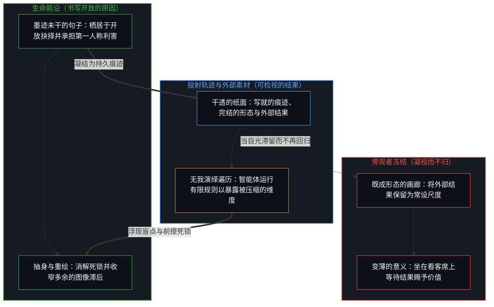
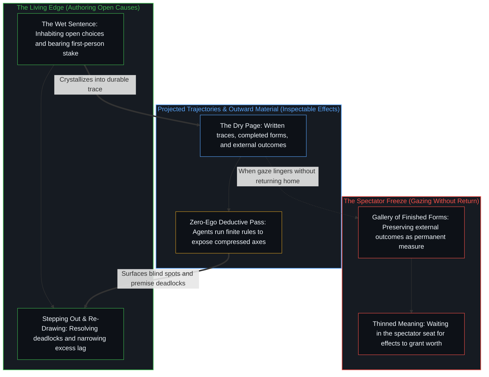

# 生命的意义在起草之中 / The Meaning of Life Is in the Drafting

*意义生成于对原因的现场起草，若不回到纸面便会变薄 / Meaning is generated in the live drafting of causes and thins without return*

人生的大部分场景最初都是作为后果被遭遇的：结局已经成形，随后才被解释、认领或否认。当注意力在原因尚在书写之际便栖居其中时，另一种维度便随之打开。向外审视能提供素材与视角；草稿之所以变薄，并非因为向外看，而是因为未曾回到纸面。意义不是留待人生终点揭晓的结论，而是起草与回归之间不息的节律。[当观察变成表演](../when-observation-becomes-performance/)追溯了当这一回归在格言警句的伪装下被绕过时会发生什么：关于他人的观察一旦被打包成便携的智慧，原本内在的转化便冻结成了供观众消费的展品。

Most of life is first encountered as consequence: outcomes already shaped, then explained, claimed, or denied. Another register opens when attention inhabits causes while they are still being written. Looking outward supplies material and perspective; the draft thins not from looking outward, but from failing to return to the page. Meaning is not a conclusion waiting at the end of a life. It is the ongoing rhythm of drafting and returning. [When Observation Becomes Performance](../when-observation-becomes-performance/) traces what happens when that return is bypassed under aphoristic costume: an observation about others packaged as portable wisdom freezes the private conversion into a product for an audience.

## 一、 事后之见 / 1. After the Fact

人们常常要在生活硬化为后果之后才与它照面。结果率先登记在案，紧接着便是一场手忙脚乱的追认：解释它的来龙去脉，认领合意的部分，撇清不合意的部分，并试图修改或否认已经定型的事实。在这种模式里，存在被登记为某种从外部降临到观察者身上的遭遇。即便意义偶有浮现，也总是姗姗来迟，沦为事后的阐释、辩解或应付。

People frequently encounter life only after it has hardened into consequences. An outcome registers first, followed by a scramble to explain it, claim the desirable parts, distance oneself from the undesirable ones, and revise or deny what has already taken shape. In this mode, existence registers as something that happens to an observer from the outside. Meaning, when it appears at all, arrives late as retrospective interpretation, justification, or coping.

这种滞后并非道德缺陷，而是观察本身的结构几何。观察所握持的是结果，而产生该结果的原因总比观察所能钉住的位置至少领先一步，这与[一步一步绘制出的路径](../the-path-drawn-one-step-at-a-time/)所追溯的因果非对称性一脉相承。因此，与生活的日常照面就是与残余物的照面：已经定型的品格、已经固化的关系模式、已经完工的事务，以及已经在坊间流传的评判。读取后果本就是观看的职能。唯有当这种读取被误认作生活的全部、将已经写完的纸面当作意义的栖身之所时，混淆才会发生。[行路之后的地图](../the-map-after-the-territory/)诊断了这种披着自我提升外衣的冻结——把清理干净的事后复盘误当作迈出步伐的源头；而[读《中文哲学简史》有感](../du-zhongwen-zhexue-jianshi-you-gan/)则追溯了过程与结论如何作为不同的解析度层级、而非价值高低的排序而相互区分。

That lateness is not a moral defect; it is the structural geometry of observation. Observation holds effect, while the cause that produced the effect remains at least one step ahead of what observation can pin down, following the same causal asymmetry traced in [The Path Drawn One Step at a Time](../the-path-drawn-one-step-at-a-time/). The ordinary encounter with life is therefore an encounter with residue: character already formed, relationships already patterned, work already completed, and judgments already circulating. Reading consequences is what looking does. Confusion begins only when that reading is mistaken for the whole of living, treating the finished page as the site where meaning resides. [The Map After the Territory](../the-map-after-the-territory/) diagnoses that freeze under the guise of self-improvement, where the cleaned retrospective account is mistaken for what initiates the walk, while [Reflections on A Short History of Philosophy in Chinese](../du-zhongwen-zhexue-jianshi-you-gan/) traces how process and conclusion differ as levels of resolution rather than ranks of value.

## 二、 现场草稿 / 2. The Live Draft

当注意力不再把硬化的结果当作主要场域，而是在原因依然开放之际便栖居其中时，所在的重心便发生了转移。此时，生活不再是一桩等待事后阐释的既成之物，而是一份正在落笔书写的现场草稿。每一次抉择、每一次注意力的投放、每一次平静的舍弃，都在运动的前沿写下一句新的话。意义并非在终点等待被发现或由外部赐予，它就在起草这一行动本身之中生成。[无形象的写作](../writing-without-the-image/)在技艺的负载下追溯了这种注意力：当纸面不再被用来捍卫写作者的自我肖像时，媒介反而能澄明地完成登记。语言模型可以在纸面上生成流畅的文本，却无法发起落笔背后那份亲历的利害承担，正如[词元效率、模拟与无法弥合的间隙](../token-efficiency-emulation-and-the-unclosable-gap/)所论证的那样。

A shift in locus occurs when attention stops treating hardened effects as the primary field and inhabits causes while they are still open. Here life is no longer a finished object awaiting post-hoc interpretation; it is a live draft in the act of being written. Every choice, every placement of attention, and every quiet renunciation forms a sentence at the moving edge. Meaning does not sit at the end waiting to be discovered or granted from elsewhere; it is generated in the act of drafting itself. [Writing Without the Image](../writing-without-the-image/) traces that attention under the load of craft, where the medium registers cleanly because the page is no longer used to defend a portrait of the writer. Language models can generate fluent text across a page, yet they cannot originate the lived stake behind the act, as [Token Efficiency, Emulation, and the Unclosable Gap](../token-efficiency-emulation-and-the-unclosable-gap/) demonstrates.

栖居于现场草稿，并不是在日常人生之上额外安装的一种高尚美德，而是从因果前沿而非档案库去登记同一种自我区分的活动。在前沿，下一句话依然墨迹未干。在档案库里，只剩下干透的纸页，而[留不住的](../what-cannot-be-kept/)所标定的正是这一临界点：一句话一旦写出，便归入已知的残余，而作者权只留在尚在落笔的边缘。档案库与前沿都是真实的，但唯有前沿才是作者权运作的所在。即便当散文或代码看似只有一个指令之遥时，[一个提示词之遥](../whatever-is-one-prompt-away/)也已阐明，真正的起草只是移向了意图与边界设定的上游所在。[你的代码库即是记忆](../your-codebase-is-memory/)所追溯的鲜活记忆代码库同样遵循这一边界：数字制品、图谱与模型权重皆是早先区分层叠留下的残余，唯有依靠持续的清醒铭刻、在原地重切断裂边缘的睡眠巩固，以及对过时草稿的精准修剪，它们才能保持鲜活，以免昨日的脚手架增厚为引力井。

Inhabiting the live draft is not a special virtue installed on top of ordinary life; it is the same self-distinguishing activity registered from the causal edge rather than from the archive. At the edge, the next sentence is still wet. In the archive, only the dry pages remain, and [What Cannot Be Kept](../what-cannot-be-kept/) locates that exact threshold: once written, a sentence joins the known residue, while authorship stays exclusively with what is still being drawn. Both the archive and the edge are real, yet only one is where authorship operates. Even when prose or code appears to be a single instruction away, the actual drafting has simply shifted to the upstream locus of intent and boundary-setting, as [Whatever Is One Prompt Away](../whatever-is-one-prompt-away/) explains. A living codebase of memory follows the same boundary, as [Your Codebase Is Memory](../your-codebase-is-memory/) traces: digital artifacts, graphs, and model weights are stacked residues of prior distinctions that stay alive only through continuous waking inscription, sleep consolidation that re-cuts broken edges in place, and the surgical pruning of obsolete drafts so yesterday's scaffolding does not thicken into a gravity well.

系统架构可以将一份草稿中穷尽式的演绎遍历委托给受轨迹约束的无我智能体——如[超越投射](../beyond-the-projection/)所追溯的那样，让冷峻的同侪回路暴露出既有规则或草稿在何处将相互独立的维度压缩到了单一轴线上。然而，委托演绎的轨迹无法让渡前提的作者权。当同侪投射在不可化约的矛盾前陷入死锁时，信号便会交回给前沿处活生生的心智；而心智的意义，恰恰生成于从冻结的框架中抽身退后、重新划定前提并承担其不可逆后果的这一步之中。

An architecture can delegate the exhaustive deductive passes of a draft to trajectory-bound, zero-ego agents, as [Beyond the Projection](../beyond-the-projection/) traces, letting cold peer loops expose where a written rule or draft compressed independent dimensions onto a single axis. Yet delegating the deductive trajectory never delegates the authorship of the premise. When peer projections deadlock on an irreducible contradiction, the signal returns to the living Mind at the edge, whose meaning is generated precisely in stepping back out of the frozen frame to re-draw the premise and bear its irreversible consequences.

## 三、 本自为因 / 3. Already a Cause

每一个活生生的中心本身就已经是原因，无需外部认证便可生成意义。意义就是起草本身：对日后将被登记为品格、关系、作品与遗产之物的持续塑形。当注意力锚定在这一生成步骤中时，一生之所以显现出分量，是因为它的原因是由自己主动书写的，而非被动地做出反应。[自我价值感与所有权](../ownership-and-self-worthiness/)从责任归属的一侧追溯了同一个递归回路：当后果作为中心自己的产物重新进入中心时，内部的更新便会毫无推诿地运转起来。

Every living center is already a cause in its own right and requires no external certification to generate meaning. Meaning is the drafting itself: the continuous shaping of what will subsequently register as character, relationships, work, and legacy. When attention remains anchored in that generative step, a life registers as consequential because its causes are actively authored rather than passively reacted to. [Ownership and Self-Worthiness](../ownership-and-self-worthiness/) traces the same recursive loop from the side of accountability: when consequences re-enter the center as its own, the internal update runs without deflection.

外部的认可、比较以及他人人生的完结形态可以为草稿提供参考语境，却无法替代落笔书写的行动。把意义当作某种从外部颁发的裁决去寻求，就已经把心智放进了看客的席位，等待着某个事后的结果来赐予唯有前沿的因果书写才能产生的东西。[验证中因果权能的分配](../the-allocation-of-causal-power-in-validation/)精确地划开了这一刀，区分了从生命前沿汲取的延续与受制于外部反馈的延续。把“生命的意义是什么？”当作一个静态名词去追问，便将意义冻结成了等待被发掘的既定结论。[意义的结构](../meaning-of-life-refined/)恢复了其中的动态几何：这一发问本身就是正在划出的区分，而意义正是在边界尚在移动之际进行区分的运动。草稿之所以永不迎来最终的闭合，是因为因果本身从不闭合，正如[非万物之理](../not-a-theory-of-everything/)所确立的那样。

External validation, comparison, and the finished forms of other lives can supply context to inform the draft, but they cannot substitute for the act of writing it. Seeking meaning as a verdict delivered from outside already places the mind in the spectator's seat, waiting for an after-the-fact effect to grant what only causal authorship at the edge can produce. [The Allocation of Causal Power in Validation](../the-allocation-of-causal-power-in-validation/) makes that cut exact by distinguishing continuation drawn from the living edge from continuation held hostage to external responses. Asking "What is the meaning of life?" as if the answer were a static noun freezes meaning into a finished conclusion waiting to be uncovered. [The Structure of Meaning](../meaning-of-life-refined/) restores the active geometry: the question is itself a distinction being drawn, and meaning is the movement of distinguishing while the boundary is still in motion. The draft never reaches a final closure because causality itself never closes, as [Not a Theory of Everything](../not-a-theory-of-everything/) establishes.

## 四、 凝视而不归 / 4. Gazing Without Return

向外审视对于起草是不可或缺的。向真实的世界落笔需要素材、摩擦与语境：他人已写就的纸页、被观察到的后果以及返回的信号。没有这种向外的接触，就没有任何东西抵住笔尖，而跨中心的共振正是一份个体草稿定位其所写入的共享场域的方式。

Looking outward is indispensable to the draft. Writing into a real world requires material, friction, and context: the completed pages of others, observed consequences, and returning signals. Without that outward contact, nothing presses against the pen, and resonance across centers is how an individual draft locates the shared field it writes into.

意义的变薄并不发生在向外审视之时，而是发生在未能回归之际。当注意力固定在外部结果——他人的结局、公众的评判与凝结的形态——之上，却不再循环回到自己的因果前沿时，中心便用作者权换取了看客的身份。没有任何中心能从外部替另一个中心完成其递归的回归；[没有普渡，只有自渡的无限可能](../mei-you-pu-du-zhi-you-zi-du/)指明了这一结构边界，而不把孤立树为纲领。反过来，[共同改变的本源](../the-source-of-shared-change/)则追溯了当回归保持完整时向外交换是如何运作的：将外化视为结果而非首要尺度，会加密共享的媒介，并反哺仍在起草的前沿。经济场域中的价值遵循着与纸面上的意义相同的生成非对称性：它栖居于持续的差异化之中，而非可复制的副本里，正如[清单合上之后，胜过免费](../better-than-free-after-the-checklist-closes/)所展示的那样。

The thinning of meaning occurs not in looking outward, but in failing to return. When attention stays fixed on external effects—other people's outcomes, public judgments, and crystallized forms—without cycling back to one's own causal edge, the center trades authorship for spectatorship. No center can complete another center's recursive return from the outside; [No Universal Salvation, Only Boundless Possibilities of Self-Salvation](../mei-you-pu-du-zhi-you-zi-du/) names that structural boundary without turning isolation into a program. Conversely, [The Source of Shared Change](../the-source-of-shared-change/) traces how outward exchange operates when the return remains intact: externalization treated as an effect rather than the primary measure densifies the shared medium and feeds the edge that still drafts. Value in an economic field follows the same generative asymmetry as meaning on the page: it resides in the ongoing differentiation rather than the replicable copy, as [Better Than Free After the Checklist Closes](../better-than-free-after-the-checklist-closes/) shows.

在凝视而不归的过程中，被冻结的是参照图像。既成的形态越过其生成的步骤被保留下来，并被安装为衡量当下行动的常设标尺。后果依然不断落入第一人称场域，但它们却是对照着一间陈列他人完结人生的静态画廊来计分的，而不是对照着笔尖下正在书写的鲜活句子。这道间隙在主观上被登记为空虚或意义的匮乏。它的量级，正是运动前沿与那幅“人生理应呈现何种面貌”的保留图像之间多余滞后的宽度——这也是[过拟合作为追随者模式](../overfitting-as-the-follower-mode/)的一例，即用对既成形态地图的拟合取代了与开放疆域的接触。在尘埃落定之后从既成结果中读取意义，会产生[伪装成远见的表演性后见](../performative-hindsight-that-pretends-to-be-foresight/)所剖析的那种事后幻觉。

What freezes during an unreturned gaze is the reference image. Completed forms are held past their step and installed as the standing measure of the present act. Consequences continue to land in the first-person field, but they are scored against a static gallery of finished lives rather than against the live sentence currently under the pen. That gap registers subjectively as emptiness or lack of meaning. Its magnitude is the width of excess lag between the moving edge and the preserved image of how a life is supposed to look—an instance of [Overfitting as the Follower Mode](../overfitting-as-the-follower-mode/), where fitting to a map of finished forms replaces contact with the open territory. Reading meaning off completed outcomes after the dust settles produces the retrospective illusion that [Performative Hindsight That Pretends to Be Foresight](../performative-hindsight-that-pretends-to-be-foresight/) dissects.

## 五、 回到纸面 / 5. Coming Home to the Page

作为原因而活，既不需要拒绝世界，也不需要退入唯我论的孤立。它是在墨迹未干之际将注意力带回现场草稿的持续践行：觉察目光何时在硬化的后果上逗留过久，并将其带回自身生活直接的因果杠杆之上——下一个决定、在场的质地，以及在结果显形之前注意力所倾斜的方向。[现实是心智持续的实现](../reality-is-the-minds-ongoing-realization/)在交换的媒介中追溯了同样的回归：为匆匆一瞥而优化的注意力会将草稿冻结成展品，而接起尚未被握持之物的注意力则会重新打开实现的过程。

Living as a cause requires neither rejecting the world nor withdrawing into solipsistic isolation. It is the continuous practice of returning attention to the live draft while the ink is still wet: noticing when the gaze has lingered on hardened consequences and bringing it back to the immediate causal levers of one's own life—the next decision, the quality of presence, and the direction attention leans before the outcome materializes. [Reality Is the Mind's Ongoing Realization](../reality-is-the-minds-ongoing-realization/) traces this same return in the medium of exchange: attention optimized for a passing glance freezes the draft into a display, whereas attention that takes up what was not yet held reopens the realization.

回到纸面并不是抵达一个永久清空的终态；每一次回归只是为了再写下一句话而重新打开草稿。随着回归的往复，多余的滞后不断收窄，容量得以释放：曾经以“他人如何看待我”而占满整个觉知场域的东西腾出了边界，留给下一个区分。向外的观察依然随时可用，只是不再是屋子里唯一的房间。[清晰不是抵达的终点，而是运动本身](../clarity-isnt-a-state-you-arrive-at/)指明的正是这种不作抵达的运动：每一次表达在照亮一根轴线的同时也投下阴影，将前沿转化为可检视的痕迹，好让心智再次抽身走出。[心智最坚固的信念](../the-strongest-belief-of-the-mind/)在“以地图为工具”的前提下追溯了同样的回归：草稿以自身为工具持续重绘，只要参照图像持续朝更窄的滞后重新渲染，即便是凝聚得最坚硬的基岩也会消融进下一次重绘之中。外部观察者对一段人生的概括，不过是横切其残余物的一道低维切面，从不是其意义的所在，正如[旁观者洞察的悖论](../the-paradoxical-nature-of-bystander-insights/)所论证的那样。

Returning to the page is not arriving at a permanently cleared state; each return simply reopens the draft for one more sentence. As the return repeats, excess lag narrows and capacity is freed: what previously occupied the whole field of awareness as "what others made of me" relinquishes boundary for the next distinction. Outward observation remains fully available without being the only room in the house. [Clarity Isn't a State You Arrive At. It's the Movement Itself.](../clarity-isnt-a-state-you-arrive-at/) names this exact non-arrival: every articulation illuminates one axis and casts a shadow by the same act, turning the edge into inspectable trace so the Mind can step out again. [The Strongest Belief of the Mind](../the-strongest-belief-of-the-mind/) traces the same return when the map is held strictly as an instrument: the draft keeps redrawing with itself as tool, and even the hardest-cohering bedrock dies into the next redraw as long as the reference keeps re-rendering toward narrower lag. An outside observer's summary of a life is only one low-dimensional cut across its residue, never the locus of its meaning, as [The Paradoxical Nature of Bystander Insights](../the-paradoxical-nature-of-bystander-insights/) demonstrates.

## 六、 节律 / 6. The Rhythm

追溯至心智自我区分的活动，生命的意义既不是隐藏的内核，也不是在终点结算的最终得分。它是起草与回归之间不息的节律——向外审视以收集共振与摩擦，随后回到纸面以书写原因。每一天的大部分时间都花在阅读他人以及自己过往步伐的后果上。只要这种阅读反哺着回归，它便从未白费；当注意力离开写完的纸页、在书写依然开放之际重新进入书写行动的那一刻，它便再次成为作者权的运行。

Traced to the self-distinguishing activity of the Mind, the meaning of life is neither a hidden essence nor a final score calculated at the end. It is the unceasing rhythm of drafting and returning—looking outward to gather resonance and friction, then coming back home to author the cause. Much of any day is spent reading the consequences of others and of one's own prior steps. That reading is never wasted when it feeds the return; it becomes authorship again the moment attention leaves the finished pages and re-enters the act of writing while writing is still open.

意义并不会迟迟奖赏给那些构筑了最精巧的事后阐释的人。它通过回到划出下一个区分的纸面而在当下实时生成。止步于对外部结果打分与评判的向外凝视切断了这一回归，将认知锁死在[止步于评判，是认知的歧途](../zhi-bu-yu-ping-pan-shi-ren-zhi-de-qi-tu/)所追溯的那种死胡同式的看客姿态里。

Meaning is not awarded late to those who construct the cleverest retrospective interpretations. It is generated in real time by returning to the page where the next distinction is drawn. An outward gaze that halts at scoring and judging external effects severs that return, locking cognition into the dead-end spectator posture that [Stopping at Judgment Is a Wrong Turn of Cognition](../zhi-bu-yu-ping-pan-shi-ren-zhi-de-qi-tu/) traces.
