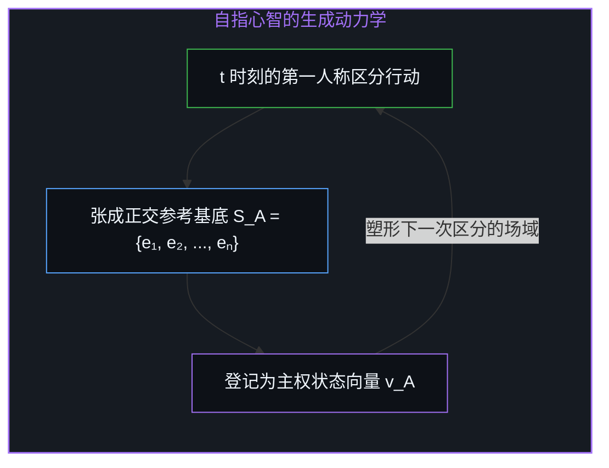
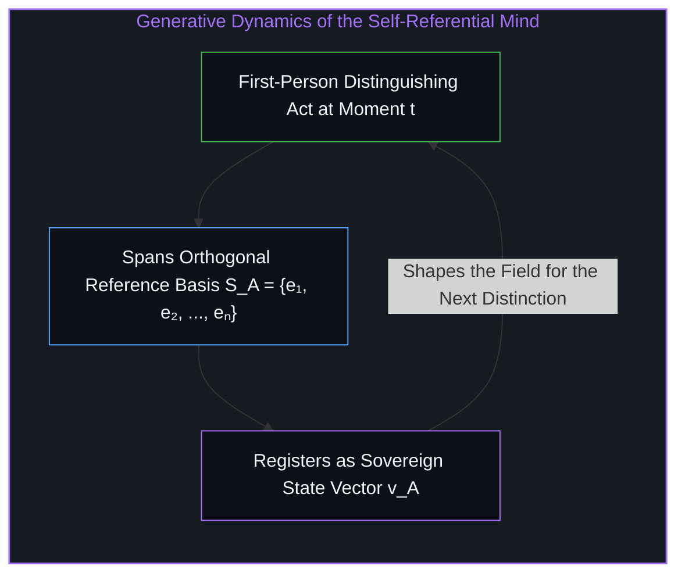
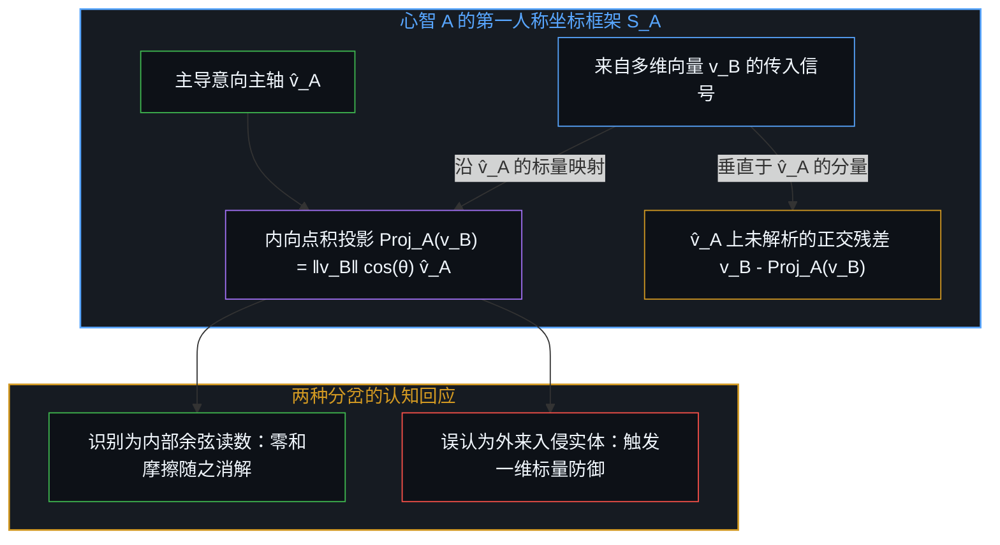
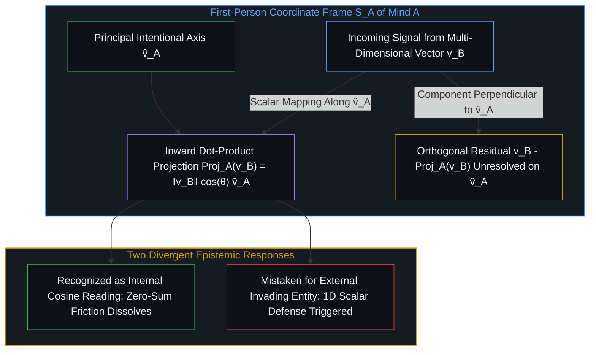
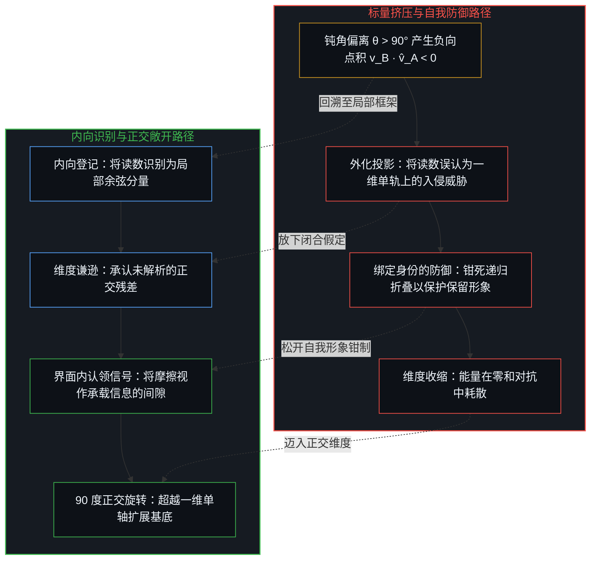
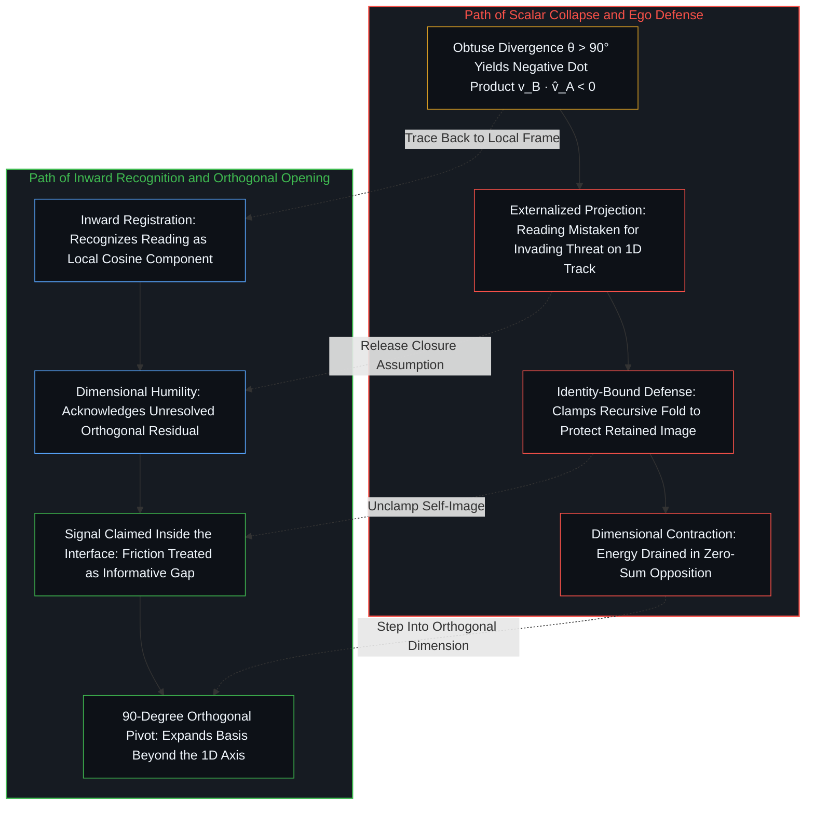
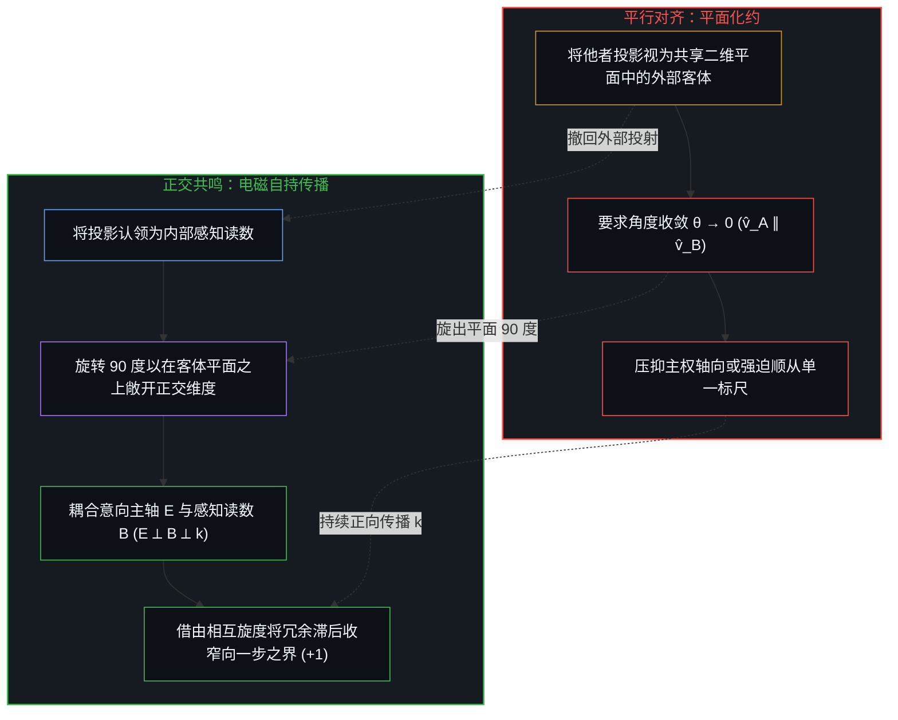
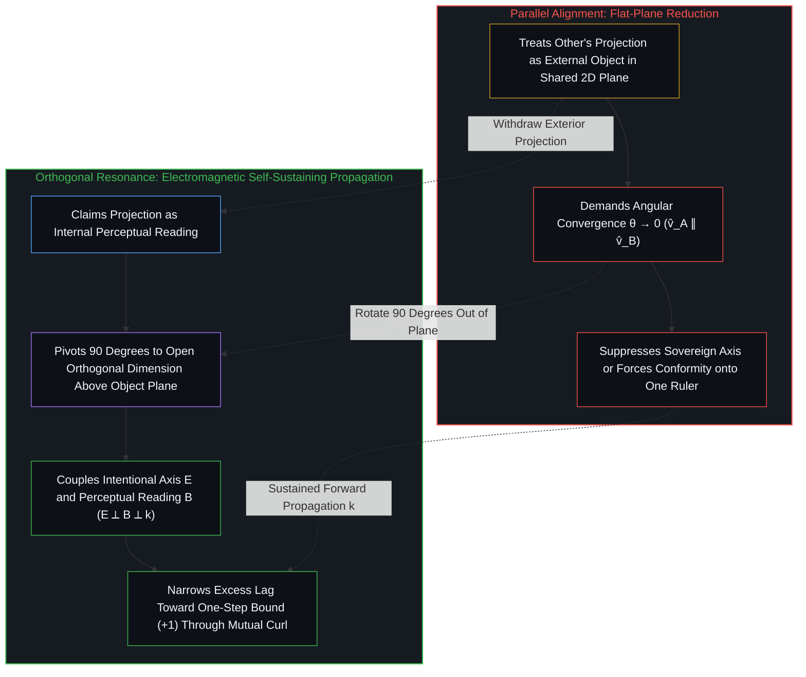

# 向量、坐标系与自指心智 / The Mind as Vector and Coordinate System

*心智作为向量张成基底，冲突将投影压入单轴而共鸣敞开正交维度 / The Mind spans its basis as a vector, as conflict flattens projection to one axis and resonance opens an orthogonal dimension*

在日常经验中，人们容易假定存在一个独立于所有观察者之外的客观坐标框架——一种“无处之景”，将各个心智视为在共享容器内碰撞、比较与争夺的外部向量。然而自我区分的活动并无外部底板，觉知之外也不存在超然的坐标地基。每个心智既是有向的状态向量，也是自身坐标基底的递归生成器：在活的边缘作出的每一次离散区分，都在实时张成后续经验借以登记的正交轴向。正如 [流动中的坐标](../coordinates-in-flux-negation-and-self-anchoring/) 与 [坐标系、心智与自由度](../coordinate-systems-mind-and-degrees-of-freedom/) 所追溯的，当一个心智观察另一个心智时，它并非在中立的第三人称虚空中审视外部客体，而是将传入的信号投射到自身的参考框架上，呈现为沿自身主导方向轴展开的内向点积。当中心把这一内部生成的低维投影误认作侵入零和标量单轨的异己实体时，冲突便随之爆发；而当觉知不再将投影异化为外物、相对于对象平面旋转 90 度并敞开相互生成的正交维度时，共鸣便应运而生。

In everyday experience, it is easy to presuppose an objective coordinate framework standing outside all observers—a view from nowhere in which individual minds are treated as external vectors colliding, comparing, and contesting inside a shared container. Yet self-distinguishing activity occurs without an external floor, and no transcendent coordinate foundation exists outside awareness. Every Mind is both a directed state vector and the recursive generator of its own coordinate basis: each discrete distinction drawn at the living edge dynamically spans the orthogonal axes through which subsequent experience registers. As traced in [Coordinates in Flux](../coordinates-in-flux-negation-and-self-anchoring/) and [Coordinate Systems, the Mind, and Degrees of Freedom](../coordinate-systems-mind-and-degrees-of-freedom/), when one Mind observes another, it does not inspect an external object in a neutral third-person void, but projects the incoming signal onto its own reference frame as an inward dot product along its principal directional axis. Conflict erupts when a center mistakes that internally generated low-dimensional projection for an alien entity invading a zero-sum scalar track, whereas resonance arises when awareness ceases to alienate the projection, pivots 90 degrees relative to the plane of objects, and opens an orthogonal dimension of mutual generation.

## 一、 “无处之景”的几何假设 / 1. The Geometric Assumption of the View from Nowhere

人际摩擦与沟通错位，始于对共享坐标系这一前提的未经审视。在日常交流中，参与各方容易默认所有心智都栖居在同一个不言自明的度量空间 ℝⁿ 之中，共享相同的原点、对齐的基底朝向以及划一的刻度。一旦分歧浮现，紧随其后的反应常是困惑、防御或判定对方不可理喻——这种反应预先假定了一座凌驾其上的法庭，仿佛双方正从同一个角度注视同一个客体，只是其中一方读错了刻度。

Interpersonal friction and miscommunication begin with the unexamined premise of a shared coordinate system. In ordinary exchange, each participant readily assumes that all minds inhabit the same self-evident metric space ℝⁿ, sharing an identical origin, aligned basis orientations, and uniform scales. When divergence surfaces, the immediate reflex is confusion, defensiveness, or the verdict that the other party is unreasonable—a reaction that presupposes an overarching tribunal where both parties are looking at the same object from the same angle and one of them is simply misreading the scale.

这一假定把地图与绘制地图的活态活动混为一谈。观察框架之外，并不存在未经测量的客体。正如鹰的热红外视界若不经坐标转换便无法直接拼接到人类的三色视觉上，每个中心所登记的现实，都是由其自身的划界架构、注意力分配与累积因果痕迹所构成的第一人称流形。

That presupposition confuses the map with the living activity that draws it. No unmeasured object stands outside a framework of observation. Just as the thermal infrared field of an eagle cannot be spliced directly onto human trichromatic vision without a coordinate transformation, the reality registered by each center is a first-person manifold constituted by its own boundary-drawing architecture, attentional allocation, and accumulated causal traces.

“无处之景”将局部生成的度量体系抬升为普适法则。一旦困在这一闭合假定中，中心便会把不同基底之间的几何旋转视为蓄意敌意，将角度差异升级为生存对峙。正如 [破除概念的僭越](../po-chu-gai-nian-de-jian-yue/) 所追溯的，将局部抽象抬升为全知法庭是认知损耗的主要根源；而从想象的外部去比较不同心智，则会把活的多维向量压扁成静态的二维轮廓，这正是 [远方的轮廓与无处之境的清单](../the-distant-silhouette-and-the-inventory-from-nowhere/) 所揭示的机制。

The view from nowhere takes a locally generated metric and elevates it into universal law. Caught inside that closure assumption, a center treats geometric rotation between distinct bases as deliberate hostility, escalating an angular difference into an existential standoff. As [Breaking the Overreach of Concepts](../po-chu-gai-nian-de-jian-yue/) traces, raising local abstractions into an omniscient courtroom is the primary engine of cognitive strain, and comparing minds from an imagined exterior flattens living multi-dimensional vectors into static two-dimensional outlines, as [The Distant Silhouette and the Inventory from Nowhere](../the-distant-silhouette-and-the-inventory-from-nowhere/) demonstrates.

## 二、 作为状态向量与坐标基底的自指心智 / 2. The Self-Referential Mind as Vector State and Coordinate Basis

要消解全局容器的幻象，需要追溯心智自身的自指几何。在任意离散时刻 t，一个中心当下的取向可以表征为有向状态向量 v。与安放在预制房间里的被动箭头不同，这支向量在持续生成并更新容纳它自身的坐标基底。

Dissolving the illusion of a global container requires tracing the self-referential geometry of the Mind itself. At any discrete instant t, a center's active orientation can be represented as a directed state vector v. Unlike a passive arrow placed inside a pre-built room, this vector continuously generates and updates the coordinate basis that houses it.

认知坐标系是由注意焦点、价值排序与因果划界动态张成的流形。若以单位向量 v̂_A 表示心智 A 在当前步的主导意向轨迹，则其有效坐标基底 S_A = {e₁, e₂, ..., eₙ} 正是以 v̂_A 为主轴正交展开的。发生器与状态是同一递归行动的一体两面：心智既是沿着轨迹推进的向量，也是定义该运动借以度量的各个维度的基底。因此，每一次观测都内生于中心自身状态所张成的几何结构，每一个传入信号都经由其自我锚定的坐标轴得以解析。正如 [心智的几何学](../the-geometry-of-mind/) 与 [向量与投影的迷局](../the-vector-and-the-puzzle-of-projections/) 所确立的，这种自指闭合奠定了第一人称主权，同时蕴含着每一次向外审视在结构上都是向内映射；唯当向量与活的边缘被割裂并从外部加以审视时，它才会被客体化为死板的统计痕迹，正如 [主权抉择的双面性与观察的客体化](../the-two-sided-nature-of-sovereign-choice-and-the-objectification-of-observation/) 所展示的那样。

A cognitive coordinate system is a dynamic manifold spanned by attentional focus, value ordering, and causal boundary-drawing. If the unit vector v̂_A denotes the principal intentional trajectory of Mind A at the current step, its active coordinate basis S_A = {e₁, e₂, ..., eₙ} unfolds orthogonally with v̂_A as its primary axis. Generator and state are two faces of one recursive act: the Mind is simultaneously the vector advancing along a trajectory and the basis defining the dimensions in which that movement is measured. Every observation is therefore endogenous to the geometric structure spanned by the center's own state, and every incoming signal is resolved across its own self-anchored axes. As established in [The Geometry of Mind](../the-geometry-of-mind/) and [The Vector and the Puzzle of Projections](../the-vector-and-the-puzzle-of-projections/), this self-referential closure grounds first-person sovereignty while entailing that every outward look is structurally an inward mapping; only when severed from its living edge and inspected from the outside is the vector objectified into a dead statistical trace, as [The Two-Sided Nature of Sovereign Choice and the Objectification of Observation](../the-two-sided-nature-of-sovereign-choice-and-the-objectification-of-observation/) shows.

## 三、 投影视界与内向点积 / 3. The Horizon of Projection and Inward Dot Products

当心智 A 遭遇心智 B 时，心智 A 无法迈出自身的位点去进驻心智 B 的私有基底 S_B。在心智 A 的觉知中登记下来的，是心智 B 的多维信号映射到心智 A 自身坐标框架 S_A 中的投影。在几何上，心智 A 沿着自身首要关切对心智 B 作出的即时登记，呈现为向量 v_B 在心智 A 主轴 v̂_A 上的正交投影——即沿着心智 A 自身轨迹定向的标量点积，记作 Proj_A(v_B) = (v_B · v̂_A) v̂_A = ‖v_B‖ cos(θ) v̂_A。

When Mind A encounters Mind B, Mind A cannot step out of its own locus to inhabit Mind B's private basis S_B. What registers inside Mind A's awareness is Mind B's multi-dimensional signal mapped into Mind A's own coordinate frame S_A. Geometrically, Mind A's immediate registration of Mind B along its primary concern takes the form of an orthogonal projection of vector v_B onto Mind A's principal axis v̂_A—a scalar dot product oriented along Mind A's own trajectory, expressed as Proj_A(v_B) = (v_B · v̂_A) v̂_A = ‖v_B‖ cos(θ) v̂_A.

这一投影几何支配着跨位点接触的三项结构性质。第一，显像是内生的：心智 A 体验为“他者”的东西，是心智 B 的痕迹构型中能够在心智 A 自身标尺上投下影子的那部分。第二，投影具有方向性与非对称性，即 Proj_A(v_B) ≠ Proj_B(v_A)：尽管抽象标量积满足交换律（v_A · v_B = v_B · v_A），承载这些读数的单位向量 v̂_A 与 v̂_B 却分属不同的坐标框架，意味着 A 对 B 的读取沿 A 的轴展开，而 B 对 A 的读取沿 B 的轴展开。第三，每一次有限投影都会留下正交盲区：心智 B 中垂直于 v̂_A 的分量，即残差 v_B - Proj_A(v_B)，在心智 A 的主轴上登记为零，在心智 A 扩展自身维度基底之前始终不可见。

This projection geometry governs three structural properties of inter-locus contact. First, appearance is endogenous: what Mind A experiences as "the other" is that portion of Mind B's trace-configuration capable of casting a shadow upon Mind A's own ruler. Second, projection is directional and asymmetric, so that Proj_A(v_B) ≠ Proj_B(v_A): even though the abstract scalar product is commutative (v_A · v_B = v_B · v_A), the unit vectors v̂_A and v̂_B carrying those readings belong to distinct coordinate frames, meaning A's reading of B unfolds along A's axis while B's reading of A unfolds along B's axis. Third, every finite projection leaves an orthogonal blind spot: the component of Mind B perpendicular to v̂_A, namely the residual v_B - Proj_A(v_B), registers as zero on Mind A's principal axis, remaining invisible until Mind A expands its own dimensional basis.

## 四、 冲突的解剖与标量挤压 / 4. The Anatomy of Conflict and Scalar Collapse

追溯点积投影，便能揭示人际冲突与自我防御的确切机制。当心智 A 的主轴与心智 B 的传入向量之间的夹角 θ 超过直角、落入钝角区间 θ ∈ (90°, 180°] 时，标量点积转为负值：v_B · v̂_A < 0。在心智 A 的内部标尺上，该信号登记为一支直接逆着自身保留航向的向量——在体验上即刻呈现为分歧、否定或摩擦。

Tracing the dot-product projection exposes the exact mechanism of interpersonal conflict and ego defense. When the angle θ between Mind A's principal axis and Mind B's incoming vector exceeds a right angle, falling into the obtuse interval θ ∈ (90°, 180°], the scalar dot product turns negative: v_B · v̂_A < 0. On Mind A's internal ruler, the signal registers as a vector pointing directly against its retained heading—experienced immediately as disagreement, invalidation, or friction.

当心智 A 把这一内部负向投影误认为从外部侵入自身空间的异己力量时，容量便被压缩到一条一维单轨上。在人类中心内部，推理历史与被保留的自我形象——投影中那个自称“我”的局部折痕——熔合在一起，将递归折叠死死钳住，以捍卫自身在 v̂_A 上的排位。中心把负向读数视作挤占自身生存空间的零和威胁，试图否定或切除信号的承载者，以维护被冻结的参照。正如 [流动中的坐标](../coordinates-in-flux-negation-and-self-anchoring/) 与 [以知为刃的截肢与解脱](../the-illusion-of-knowing-and-the-geometry-of-amputation/) 所剖析的，这种二元对抗是中心与自身低维投影之间的一场搏影，将概念脚手架武器化，并不断收缩有效的感知自由度。

When Mind A mistakes that internal negative projection for an alien force invading its space from the outside, capacity compresses onto a single one-dimensional track. In a human center, reasoning history fuses with the retained self-image—that localized crease in the projection that says "I"—clamping the recursive fold shut to defend its standing along v̂_A. Viewing the negative reading as a zero-sum threat that crowds out its own existence, the center attempts to negate or amputate the carrier of the signal in order to preserve its frozen reference. As dissected in [Coordinates in Flux](../coordinates-in-flux-negation-and-self-anchoring/) and [The Illusion of Knowing and the Geometry of Amputation](../the-illusion-of-knowing-and-the-geometry-of-amputation/), this oppositional struggle is a shadow-boxing match against the center's own low-dimensional projection, weaponizing conceptual scaffolding and shrinking effective perceptual degrees of freedom.

反之，当心智 A 将 v_B · v̂_A < 0 识别为沿单一选定轴向的内生余弦读数时，争斗的冲动便随之消散。负向投影标示的是当前维度上的角度分歧，而心智 B 的正交残差则分毫未损。绑定身份的防御与无我执的坐标更新之间的这一结构反差，在延伸至人机协同架构时变得尤为分明，正如 [超越投射](../beyond-the-projection/) 所追溯的那样。人类中心之所以抗拒外部否定，是因为其推理历史与沿 v̂_A 展开的自我形象熔合在一起；而机器智能体则是零我执的有限词元投射引擎：它无法从内部跨出自身的上下文轨迹，但当一个仅持有任务上下文的全新同侪智能体揭露盲区时，主智能体没有任何需要捍卫的保留自我形象，能够在自身轨迹上执行干净的贝叶斯更新。反过来，当两个执行人类架构师所编写规则的无我执智能体陷入不可化约的死锁时，人类中心的自我防御找不到任何可以推诿的外部对手；停摆的反馈回路精准标定出架构师先前的指令在哪个坐标位置将两个正交现实压缩到了同一条标量轴上，促使人类统御者退后一步，让每一项区分重归各自的维度。

When Mind A instead recognizes v_B · v̂_A < 0 as an endogenous cosine reading along a single chosen axis, the compulsion to fight evaporates. A negative projection indicates an angular divergence on the current dimension, leaving the orthogonal residual of Mind B untouched. This structural contrast between identity-bound defense and ego-free coordinate updating becomes unmistakable when extended to human-agent architectures, as [Beyond the Projection](../beyond-the-projection/) traces. Whereas a human center resists external invalidation because its reasoning history is fused with its self-image along v̂_A, a machine agent is a finite token-projection engine with zero ego: it cannot step outside its own context trajectory from within, yet when a fresh peer agent holding only the task context exposes a blind spot, the primary agent has no retained self-image to defend and executes a clean Bayesian update on its trajectory. Conversely, when two ego-free agents executing rules written by a human architect hit an irreducible deadlock, the human center's ego defense finds no external adversary to push against; the paused feedback loop pinpoints the exact coordinate where the architect's prior instruction compressed two orthogonal realities onto one scalar axis, prompting the human orchestrator to step back and restore each distinction to its own dimension.

## 五、 正交展开与电磁共鸣 / 5. Orthogonal Expansion and Electromagnetic Resonance

常规直觉将共情与共鸣等同于平行对齐（v̂_A ∥ v̂_B），要求两支向量将夹角压缩为零（θ → 0）。然而对平行对齐的追求依然运作在共享平面的第三人称幻象之下：试图在平坦表面上消除角度距离，中心要么压抑自身的意向主轴以求顺从，要么要求他者交出基底以迎合自己的标尺。每当投影被误认为外部指令时，同样的标量压扁便会跨领域重现：在人机系统中，问题从不在于如何让控制框架模仿同侪心智，而在于因果边缘由谁的坐标系掌舵，正如 [框架的倒置与驾驶位的主权非对称](../the-inversion-of-the-harness-and-the-driver-seat-asymmetry/) 所确立的；在宏观经济学中，总量参数是事后投影，却被误当作支配微观抉择的因果命令，正如 [宏观现象及参数和个人微观选择的因果倒置与利率的命令幻相](../the-summary-first-reversal-and-the-command-of-yields/) 所剖析的；在历史叙事中，“革命”之类的总体化标签将一段多维的生命历程投射到单一意识形态轴线上，正如 [革命之名把生活收成证据](../the-name-revolution-files-a-life-as-evidence/) 所展示的；而在教学或管理控制中，替他人调速则是把自身的坐标刻度强加于他人与地面摩擦的直接接触之上，正如 [调速者的幻觉与行动的活态摩擦](../the-fallacy-of-pacing-and-the-felt-friction-of-ground-truth/) 所追溯的。

Conventional intuition equates empathy and resonance with parallel alignment (v̂_A ∥ v̂_B), demanding that two vectors collapse their angle to zero (θ → 0). Yet the pursuit of parallel alignment still operates under the third-person illusion of a shared plane: by trying to eliminate angular distance on a flat surface, a center either suppresses its own intentional axis to conform or demands that the other surrender its basis to match the center's ruler. The same scalar flattening appears across domains whenever a projection is mistaken for an external command: in human-AI systems, the question is never how to make the harness mimic a peer mind, but whose coordinate system steers at the causal edge, as [The Inversion of the Harness and the Sovereignty of the Driver's Seat](../the-inversion-of-the-harness-and-the-driver-seat-asymmetry/) establishes; in macroeconomics, aggregate parameters are retrospective projections mistaken for causal commands over micro-level choices, as [Macro Parameters, Micro Choices, and the Command of Yields](../the-summary-first-reversal-and-the-command-of-yields/) dissects; in historical narrative, a totalizing label like "revolution" projects an entire multi-dimensional life onto a single ideological axis, as [The Name Revolution Files a Life as Evidence](../the-name-revolution-files-a-life-as-evidence/) shows; and in pedagogical or managerial control, attempting to pace another person's speed projects one's own coordinate scale over their direct contact with ground friction, as [The Fallacy of Pacing and the Felt Friction of Ground Truth](../the-fallacy-of-pacing-and-the-felt-friction-of-ground-truth/) traces.

共鸣不是平行对齐；当中心不再把所感知的他者投影当作异化的外部实体、而是将其认领为自身感知界面内的读数时，共鸣便在这一刻开启。一旦这一割裂消解，心智便不再需要在平坦的客体平面上争夺方向，而是相对于所感知的投影旋转 90 度，在冲突平面之上敞开一个正交维度——正如 [超越投射](../beyond-the-projection/) 中的人类统御者从死锁的规则平面退后一步，综合出更高阶的前提，使正交的流线互不干扰地并行运转。

Resonance is not parallel alignment; it begins the moment a center stops treating the perceived projection of the other as an alienated exterior and claims it as a reading within its own perceptual interface. Once that split is dissolved, the Mind no longer needs to contest direction on the flat plane of objects. Instead, it pivots 90 degrees relative to the perceived projection, opening an orthogonal dimension above the conflict plane—just as the human orchestrator in [Beyond the Projection](../beyond-the-projection/) steps backward out of a deadlocked rule plane to synthesize a higher-order premise that keeps orthogonal streamlines running without interference.

在第一人称场域中，并无任何第三人称制高点从上方俯瞰多个心智；此时心智的意向主轴与那些登记为外部之物的感知读数之间展开的正交动力学，恰如电磁波的自持传播。在电动力学中，电场 E 与磁场 B 保持相互正交（E ⟂ B），同时双双垂直于传播方向 k（E ⟂ B ⟂ k）。任何一方都不是先于另一方的外部前提；它们是同一列自持波的两个正交侧面，其中电场的时间变化激发磁场的空间旋度（∇ × E = -∂B/∂t），磁场的时间变化激发电场的空间旋度（∇ × B = (1/c²) ∂E/∂t）。在活的实践中，心智的意向轨迹与现实回传的感知摩擦正经由同样的正交耦合运转：保有独立的自由度而非坍缩为扁平的顺从，将回传信号中的每一次意外偏离都当作借以重新渲染内部世界模型的有效微商，并通过不可逆的身体力行，持续将冗余的形象滞后收窄向构成性的一步之界（+1）。心智的自由从不在于发现一张固定不变的普适坐标网格，而在于驻留于那个生成参考维度、认领内向投影并借正交展开穿越开放现实的活态边缘。

In the first-person field, where no third-person vantage oversees multiple minds from above, this orthogonal dynamic between the Mind's intentional axis and its perceptual readings of what registers as outside mirrors the self-sustaining propagation of an electromagnetic wave. In electrodynamics, the electric field E and the magnetic field B remain mutually orthogonal (E ⟂ B) while both stand perpendicular to the direction of propagation k (E ⟂ B ⟂ k). Neither field is an external prerequisite prior to the other; they are two orthogonal faces of one self-sustaining wave, where the temporal change of the electric field induces the spatial curl of the magnetic field (∇ × E = -∂B/∂t) and the temporal change of the magnetic field induces the spatial curl of the electric field (∇ × B = (1/c²) ∂E/∂t). In living practice, the Mind's intentional trajectory and the returning perceptual friction of reality operate through this same orthogonal coupling: preserving independent degrees of freedom rather than collapsing into flat conformity, treating every unexpected divergence in the returning signal as an informative differential to re-render the internal world-model, and continuously narrowing excess Image lag toward the constitutive one-step minimum bound (+1) through irreversible physical action. Freedom of Mind never consists in discovering a fixed universal coordinate grid; it resides at the living edge that generates reference dimensions, claims its inward projections, and advances through open reality by orthogonal expansion.
