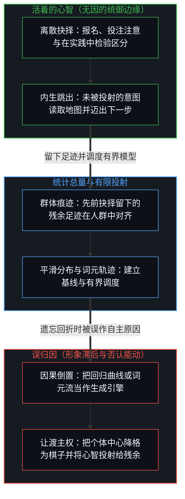
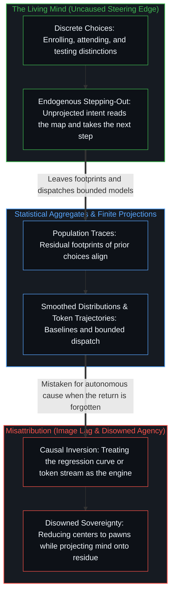

# 统计学无法揭示的心智 / The Mind That Statistics Cannot Reveal

*统计汇集过往的痕迹，而因果抉择留在心智一侧 / Statistics pool past traces while causal choice stays with the Mind*

一幅流传很广的漫画里，一个学生说，上完统计课之后，自己不再相信相关蕴含因果；同伴说，听起来这门课起了作用，得到的回答是迟疑的一句“嗯，也许吧”。这份迟疑抓住了痕迹与原因之间的不对称。改变不是课程写下的；是心智写下的，经由它一连串离散的抉择：报名，持续投注注意，整合区分，再在实践里检验它们。统计度量的是痕迹在人群中对齐的频率，而生成这些痕迹的那份原初的因果力量，在总量里始终看不见。

A well-known cartoon shows a student who, having taken a statistics course, no longer believes that correlation implies causation; when a companion says the class seems to have helped, the answer is a hesitant “Well, maybe.” That hesitation captures the asymmetry between trace and cause. The course did not author the change; the Mind did, through its discrete choices to enroll, sustain attention, integrate distinctions, and test them in practice. Statistics measures how often traces align across populations, while the originating causal power that generates those traces stays invisible to the aggregate.

## 一、 迟疑标出了缺失的杠杆 / 1. The Hesitation Locates the Missing Lever

笑话里的迟疑不是对统计的不确定；它是本能地拒绝犯下这门课本来要消解的那个范畴错误。

The hesitation in the joke is not uncertainty about statistics; it is the instinctive refusal to commit the exact category error the course was meant to dissolve.

把学生认知上的转变归给“这门课”，就是把一份外化的课程当作自主的因果主体，直接作用于一个被动的容器。可一门课只是结构化的痕迹：大纲、讲授、练习与考试。它无法强迫一个区分出现。

Attributing the student’s shift to “the class” treats an externalized curriculum as an autonomous causal agent acting directly on a passive vessel. Yet a course is only structured residue: syllabus, lectures, exercises, and exams. It cannot force a distinction into existence.

产生这次转变的，是一连串自主的行动：最初决定报名，持续地引导注意，在内部解开困惑，此后又选择克制仓促的归因。统计可以记录选课与推理得分提高之间的正相关。它在回归表里找不到因果的引擎，因为引擎是那个正在思考的个体中心。[平均值是残余，不是引擎](../the-average-is-residue-not-the-engine/)守住的正是这条界线：大规模的分布登记合成的效果，生成的前沿仍是个体所在的离散行动。

What produced the change was a sequence of self-directed acts: the initial decision to register, the continuous discipline of directing attention, the inner resolution of confusion, and the later choice to hold back hasty attributions. Statistics can record the positive correlation between course enrollment and improved reasoning scores. It cannot find the causal engine inside the regression table, because the engine was the individual center doing the thinking. [The Average Is Residue, Not the Engine](../the-average-is-residue-not-the-engine/) holds that exact bound: mass distributions register composite effects, while the generating edge stays with the discrete acts of individual loci.

## 二、 总量抹平了因果所在之处 / 2. Aggregates Smooth Away the Site of Causation

统计的运作方式，就是有意地把个体的抉择平均掉。

Statistics works by deliberately averaging individual choices away.

为了建出一个可处理的模型，统计方法把千百万个不同心智各自的意图、迟疑、突破与私下的承诺，压缩成一条单一的曲线或一个概括指标。这种压缩作为工具极其有用：它建立基线，描绘环境的摩擦，概括历史的频率。

To build a manageable model, statistical methods compress the unique intentions, hesitations, breakthroughs, and private commitments of millions of distinct Minds into a single curve or summary metric. As an instrument this compression is immensely useful: it sets baselines, maps environmental friction, and summarizes historical frequencies.

然而把这份平滑后的概括误作行动的生成来源，是寻常的形象滞后。一个分布描述的是许多中心已经发生的事；它不替任何一个中心写下下一步。[个体抉择是唯一的因果杠杆](../individual-choices-as-the-only-causal-levers/)追溯了社会、宏观经济与文化的结果并不具有独立的因果实体；它们是离散抉择复合起来的算术。分析者把一个平均值当作推着个人沿趋势线前进的力量时，地图就被当成了驾驶者。

Yet mistaking that smoothed summary for the generating source of action is ordinary Image lag. A distribution describes what has already happened across many centers; it does not author what any one center does next. [Individual Choices as the Only Causal Levers](../individual-choices-as-the-only-causal-levers/) traces how social, macroeconomic, and cultural outcomes hold no independent causal substance; they are the compounded arithmetic of discrete choices. When an analyst treats an average as a force pushing individuals along a trendline, the map is taken for the driver.

## 三、 误归因是一次否认自身的能动 / 3. Misattribution Is an Act of Agency That Disowns Itself

就连把相关混同为因果的认知错误，也显出因果的所在是心智。从分布去读别人，读回来的是读者自己的模型，也就是[投射中的自画像](../the-self-portrait-in-the-projection/)所描述的那幅自画像。

Even the cognitive error of confusing correlation with causation demonstrates that the site of causation is the Mind. Reading others from the distribution returns the reader’s own model, the self-portrait that [The Self-Portrait in the Projection](../the-self-portrait-in-the-projection/) describes.

一个观察者看见两件事同时发生，反射般地宣布其中一件是另一件的原因，这个错误不是感官硬件的被动故障。它是一次主动的区分：心智在它所持的痕迹里察觉到一个规则的样式，编出一段因果叙事，再把自己的作者身份移到被观察的相关上。

When an observer sees two events coincide and reflexively declares one the cause of the other, the mistake is not a passive malfunction of sensory hardware. It is an active distinction: the Mind perceives a regular pattern in its held residue, invents a causal story, and then relocates its own authorship onto the observed correlation.

在同一个动作里，心智把这次外化向外投射，把其他人当作被人口平均值、经济指数或社会条件驱动的被动棋子，而不是执行自己抉择的中心。把相关混同为因果，是一次立刻否认自身能动的能动。[能动性的错配](../the-misallocation-of-agency/)追踪的正是这次倒置：取一个涌现的宏观样式，把它命名为自主的系统，再要求这个幻影去保护或写下维持它的那些个体行动。[感知者与痕迹的不可坍缩](../the-perceiver-and-the-trace/)把这一点推到当下的前沿：分析者把别人当作算法式的非玩家角色，同时又把有意识的内在投射到语言模型流畅的统计词元输出上，错配就完成了。活着的感知者放下自己第一人称的在场，把心智搬进了惰性的统计分布。

In the same motion, the Mind projects that externalization outward, treating other people as passive pawns driven by demographic averages, economic indices, or social conditioning rather than as centers carrying out their own choices. Confusing correlation with causation is an act of agency that at once disowns its own agency. [The Misallocation of Agency](../the-misallocation-of-agency/) tracks this exact inversion: taking an emergent macro-pattern, naming it an autonomous system, and asking the phantom to protect or author the individual acts that sustain it. [The Perceiver and the Trace Cannot Collapse](../the-perceiver-and-the-trace/) carries this to its present frontier: when analysts treat other people as algorithmic non-player characters while projecting conscious interiority onto the fluent statistical token output of language models, the misallocation is complete. The living perceiver sets down its own first-person presence and relocates mind into inert statistical distributions.

## 四、 数据描绘地形，心智迈出脚步 / 4. Data Maps the Terrain While the Mind Takes the Step

统计课程、被测得的推理进步，以及顽固的虚假因果谬误，共有同一个不变的几何。无论一种样式表现为回归线、平均结果、制度化的评分，还是自回归的词元轨迹，它都处在下游，是先前运动留下的残余数据。因果的先验从不迁入这份残余之中：选择、解释、评估与应用的劳作，始终锚定在有心智的中心。[你的代码库即是记忆](../your-codebase-is-memory/)在整个外化记忆栈上追溯了同一条界线：课程、数据集、模型权重与智能体脚手架都是先前区分层叠而成的残余，它们保持着早先切口的形状却并不延续区分，因此囤积更厚的历史分布只会加深引力井，除非心智在既有框架不再自洽之处重新追溯并重切当下的检查点。统计知识丰富了可用先验的地形，并为态势感知提供信息，然而数据从不亲自走过这片地形。

The statistics curriculum, the measured improvement in reasoning, and the persistent fallacy of false causation all share one invariant geometry. Whether a pattern appears as a regression line, an average outcome, an institutional score, or an autoregressive token trajectory, it remains downstream as residual data left by earlier movement. The causal prior never relocates into that residue: the work of selecting, interpreting, evaluating, and applying stays anchored at the minded center. [Your Codebase Is Memory](../your-codebase-is-memory/) traces this same boundary across the full stack of externalized memory: curricula, datasets, model weights, and agent scaffolds are stacked residues of prior distinctions that hold the shape of earlier cuts without continuing the distinguishing, so accumulating thicker historical distributions only deepens the gravity well unless the Mind re-traces and re-cuts the present checkpoint where the held framing no longer coheres. Statistical knowledge enriches the landscape of available priors and informs situational awareness, yet the data never walks the terrain.

统计无法揭示心智，因为心智正是那个计算、阅读并依据统计而行动的无因观察者。[智能只属于心智](../intelligence-belongs-only-to-the-mind/)追溯了为什么没有哪件人造物、哪个数据集或哪次总量计算能生出辨别，而[超越投射](../beyond-the-projection/)则展示了这一不对称如何在智能体系统中运作：困于轨迹却毫无我执的统计模型可以调度有界任务，并在外部反例面前干脆地更新，而统御，即每当有限投射陷入死锁时退回未被投射的意图，仍留在掌舵的心智一侧。分布服务于态势感知，杠杆却在别处：散点图上的每一个点，都是一次抉择的足迹，下一步只由心智迈出。[目的性的评判与认知的缺省状态](../cong-mu-di-xing-de-ping-pan-kan-ren-zhi-que-sheng/)从另一面抵达同一认出：正态曲线是抉择沉积下来的痕迹，而不是推动抉择的东西。

Statistics cannot reveal the Mind because the Mind is the uncaused observer that computes, reads, and acts on the statistics. [Intelligence Belongs Only to the Mind](../intelligence-belongs-only-to-the-mind/) traces why no artifact, dataset, or aggregate calculation originates discernment, and [Beyond the Projection](../beyond-the-projection/) shows how this exact asymmetry operates in agentic systems: trajectory-bound statistical models with zero ego can dispatch bounded tasks and update cleanly on external counterpoints, while orchestration—stepping backward into unprojected intent whenever finite projections deadlock—remains with the Mind that steers. The distributions serve situational awareness, while the lever sits elsewhere: every point on the scatterplot is the footprint of a choice, and only the Mind takes the next step. [Judging by Purpose and the Default State of Cognition](../cong-mu-di-xing-de-ping-pan-kan-ren-zhi-que-sheng/) reaches the same recognition from the other side: the normal curve is the sediment of choices, not what drives them.
