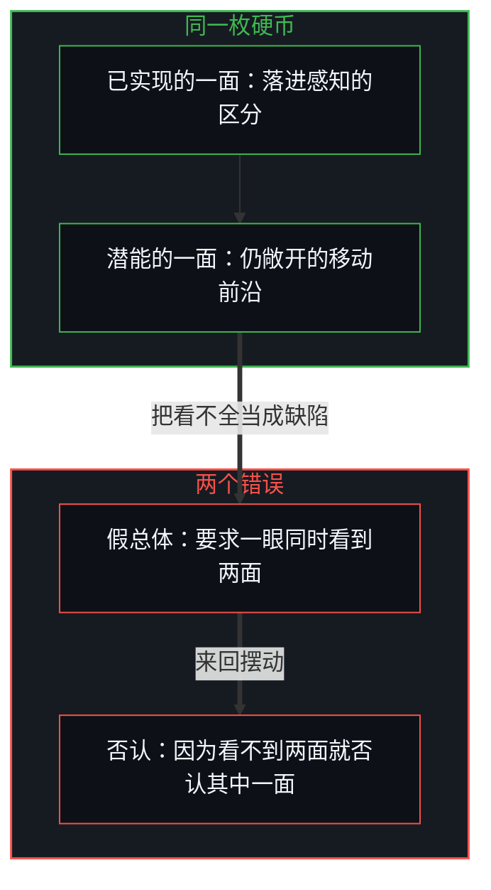
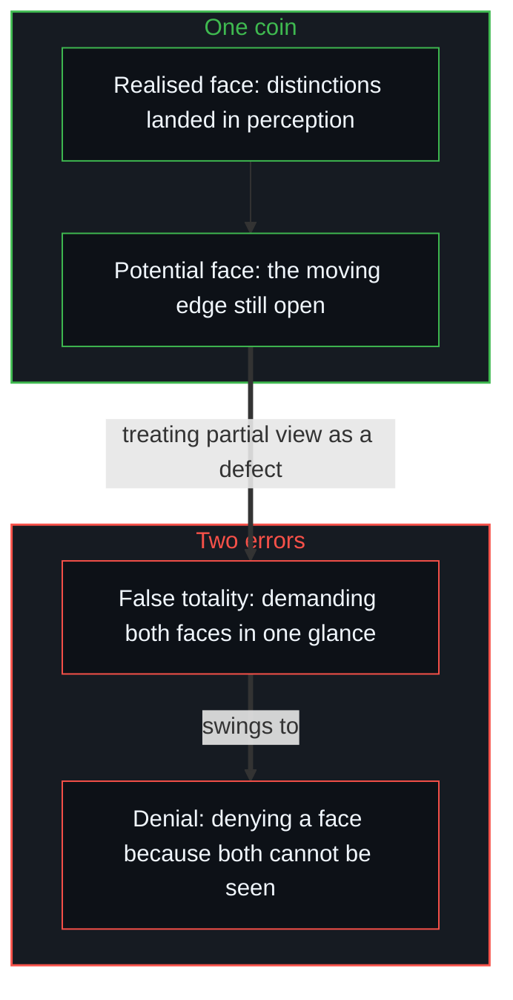

# 无穷总体的海市蜃楼 / The Mirage of the Infinite Totality

*无穷是感知延展其地平线的无穷尽潜能，而非一件摆在经验之外的完成物。 / Infinity is the inexhaustible potential of perception to widen its horizon, not a finished object set outside experience.*

在数学的形式体系里，无穷常被当作一个已经完成的总体。从超穷集合论到积分学，把一个无穷序列当作已经给定的、封闭的集合，是实现代数封闭少不了的工具。把这种数学上的方便投到现实的结构上，就生出一个混淆：形式模型靠把过程冻结成完成的集合来获得完备，而从第一人称登记到的，是已经实现的潜能。

In mathematical formalisms infinity is often treated as a completed totality. From transfinite set theory to integral calculus, treating an infinite sequence as an already given, closed collection is an indispensable tool for algebraic closure. Projecting this mathematical convenience onto the structure of reality produces a confusion: formal models reach completeness by freezing processes into completed sets, while what registers from the first person is potential already realised.

在任何一刻，登记到的现实都是潜能中已经结晶为可观察区分的那一片离散的切片。无穷就是这潜能本身：总能被继续下去的、不可穷尽的余量，而不是宇宙清单里多出来的一件已完成的东西。

At any moment, the reality that registers is the discrete slice of potential that has already crystallised into observable distinction. Infinity is that potential itself: the inexhaustible remainder that can always be continued, not one more completed item in a cosmic inventory.

## 一、 硬币的两面 / 1. The Two Faces of the Coin

已实现的现实与敞开的潜能，像一枚硬币的两面。一面是已实现的那一面：累积下来的已实现区分，即那些已经落入感知的后果所留下的历史记录。另一面是潜能的那一面：仍然敞开的移动前沿，可供之后的区分与下一步。延展地平线的几何，正是[心智的几何学](../the-geometry-of-mind/)所描述的。

Realised reality and open potential are like the two faces of one coin. One is the realised face: the accumulated inventory of actualised distinctions, the historical record of consequences that have already landed in perception. The other is the potential face: the moving edge that stays open, available for later distinction and the next step. The geometry of widening the horizon is the one [The Geometry of Mind](../the-geometry-of-mind/) describes.

认识上的混淆在两个错误之间来回摆动。一个是假总体的错误：要求把概念化了的潜能当作一个完成的总体来观察，等于要求一眼同时拍下硬币的两面；它要潜能先以一件已经完成的东西出场，才承认它。另一个是否认的错误：既然结构上不能同时看到两面，就否认其中一面，或者说潜能既然不能当作一件不变的东西展示出来，就是幻觉，或者反过来，说潜能既然无边，已实现的那些具体沉积就不真实。

Confusion in knowing swings between two errors. One is the error of false totality: demanding to observe conceptualised potential as a completed totality, which is like demanding a single photograph of both faces of a coin at once; it requires potential to appear first as an already finished thing before it is recognised. The other is the error of denial: since both faces cannot be seen at once, one of them is denied, either by saying that potential, since it cannot be displayed as an invariant object, is an illusion, or the reverse, that since potential is boundless the concrete sediment of what has been realised is unreal.

站得住的认识是这样的：知道两面都在，也知道不能一眼同时看到两面。观察者察看一面上已实现的刻痕，或者把硬币翻过来，去碰那条敞开的前沿；两个朝向属于同一个动态。不能把两种立场压成一个视图，恰恰显示了硬币有厚度，而不是否认任何一面的理由。如[另一种相干](../the-other-coherence/)所示，经验世界的自洽并不是一个静态总体，而是一场持续不断的维系。

The knowing that holds up is this: knowing both faces are there, and knowing they cannot be seen in one glance. An observer inspects the realised marks on one face, or turns the coin over to meet the open edge; both orientations belong to one dynamic. That the two stances cannot be pressed into a single view shows the coin has thickness; it is no reason to deny either face. The coherence of an experienced world is not a totality but an ongoing holding together, as [The Other Coherence](../the-other-coherence/) shows.

## 二、 希尔伯特与亚里士多德 / 2. Hilbert and Aristotle

希尔伯特在 1925 年的演讲《论无穷》里说出了同一条界线：无穷在数学中作为一个理念起作用，在思想里有其正当的位置，可它“在现实中无处可寻”。这句话常被读成对无穷的否认，放回语境里，它做的是一个精确的操作区分。完成的实无穷不出现在自然里，因为能遇到的只有已经发生的具体事件；在数学里，无穷是一个调节性的理念，[为公理系统提供形式上的一致](../why-mathematics-can-never-be-solved/)；在物理经验里，已登记的清单在任何一刻都有限，而继续接续的能力没有边界。

Hilbert, in his 1925 lecture "On the Infinite", drew the same line: infinity works in mathematics as an idea and has its rightful place in thought, yet "the infinite is nowhere to be found in reality". The sentence is often read as a denial of infinity; put back in its context, it makes a precise operating distinction. Completed actual infinity does not appear in nature, because what can be met are only concrete events that have already occurred; in mathematics infinity is a regulative idea that [gives axiomatic systems formal consistency](../why-mathematics-can-never-be-solved/); in physical experience the registered inventory is finite at any moment, while the capacity for further succession has no bound.

两千多年前，亚里士多德在《物理学》里立下了同一条原则：无限像一天或奥林匹克赛会那样存在，靠连续的、一个接一个的生成，一件事在另一件之后到来；它从不作为一个已经组装好的、同时在场的集合存在。潜能转为离散的现实，是一场不终止的推进；正因为这转化从不终止，[完成的无穷从来不会作为一件对象被遇到](../potential-infinity-and-the-temporary-closures-of-mathematical-thought/)。

More than two thousand years earlier, Aristotle set down the same principle in the Physics: the infinite exists the way a day or the Olympic games exists, through continuous generation, one event arriving after another; it never exists as an already assembled collection present all at once. The conversion of potential into discrete actuality is a progression without end; precisely because the conversion never ends, [a completed infinity is never met as an object](../potential-infinity-and-the-temporary-closures-of-mathematical-thought/).

## 三、 因果与第一人称的地平线 / 3. Causality and the First-Person Horizon

说因果是一张从无穷延伸到无穷的不断开的织物，容易唤起一个外部容器的图像：一条庞大且独立于心智的时空长廊，感知栖居其中。直接追溯生成的那一下，这个表面上的二元就消解了。无穷不作为外部的宇宙风景摆在感知之外；无穷说的是感知自身延展其移动地平线的无边潜能。因果的连续体，是把当下的区分连到后续后果的那条不变的接续规则；第一人称的地平线，是这场生成的接续实际发生的那个活的光圈。

Describing causality as an unbroken fabric running from infinity to infinity easily calls up the image of an outside container: a vast corridor of space and time, independent of mind, within which perception lives. Tracing the generative act directly dissolves this apparent dualism. Infinity does not lie outside perception as an external cosmic landscape; infinity names the boundless potential of perception itself to widen its moving horizon. The causal continuum is the invariant rule of succession that links present distinctions to later consequences; the first-person horizon is the living aperture where this generative succession actually takes place.

这样立足，因果的织物与第一人称的立场就合到了一处。不必在有意识的经验之外再发明一个观察不到的形而上领域。无穷是活体中心持续划出区分、检验后果、穿越摩擦前行，却永远不会撞上一道最终封闭边界的能力。正如[翻袋球与魔术戏法](../the-bank-shot-and-the-magic-trick/)所示，所谓完成的无穷，不过是一记隐去了中间步骤的翻袋球。

Standing on this ground, the causal fabric and the first-person stance come together. There is no need to invent an unobservable metaphysical realm beyond conscious experience. Infinity is the capacity of the living centre to go on drawing distinctions, testing consequences and moving through friction without ever meeting a final, closed boundary. A finished infinity is a bank shot with its intermediate steps hidden, as [The Bank Shot and the Magic Trick](../the-bank-shot-and-the-magic-trick/) shows.

## 四、 活着的前沿 / 4. The Living Edge

从第一人称看，前沿始终敞开。要说它封闭，这个说法本身就又划出了一次区分，又往前走了一步。在每一步上，已实现的清单是有界的、可测的、依赖路径的，而产生这份清单的生成能力不受限定。正如[框架的边界](../the-boundary-of-the-frame/)所揭示的，每一个总体都是一个带有边界的框架。

From the first person, the edge stays open. Saying it is closed draws one more distinction and takes one more step forward. At every step the inventory of what has been realised is bounded, measurable and path-dependent, while the generating capacity that produces that inventory is not confined. Every totality is a frame with a boundary, as [The Boundary of the Frame](../the-boundary-of-the-frame/) shows.

把无穷误认为完成的总体，就是把地图与活着的地形、把历史的痕迹与正在进行的行为混为一谈——这与[你的代码库即是记忆](../your-codebase-is-memory/)所剖析的把外化记忆档案误认为掌舵边缘处的活体心智，属于同一种范畴错置。理论模型需要封闭，才能计算静态的不变量；活着的感知需要敞开，才能在一个未完成的世界里导航；移动的前沿，是尚未计算的潜能不断越过、成为已实现事实的地方。因果没有边界地延伸，因为区分的潜能不可穷尽。现实不是一座供人从超然位置去勘察的落成纪念碑，而是潜能不断化为世界的那道鲜活切分。

Mistaking infinity for a completed totality confuses the map with the living terrain and the historical trace with the act still going on. As [Your Codebase Is Memory](../your-codebase-is-memory/) traces, every recorded inventory is externalized memory, a finite residue of prior distinctions that remains inert without the self-distinguishing Mind at the steering edge. Theoretical models need closure to compute static invariants; living perception needs openness to navigate an unfinished world; the moving edge is where uncomputed potential keeps crossing over into realised fact. Causality extends without bound because the potential for distinction is inexhaustible. Reality is not a finished monument surveyed from a detached vantage; it is the living cut where potential keeps becoming the world.
