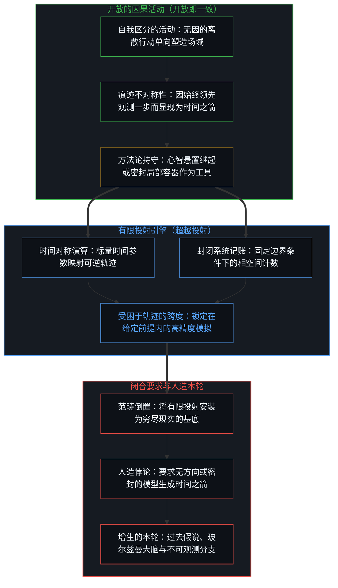
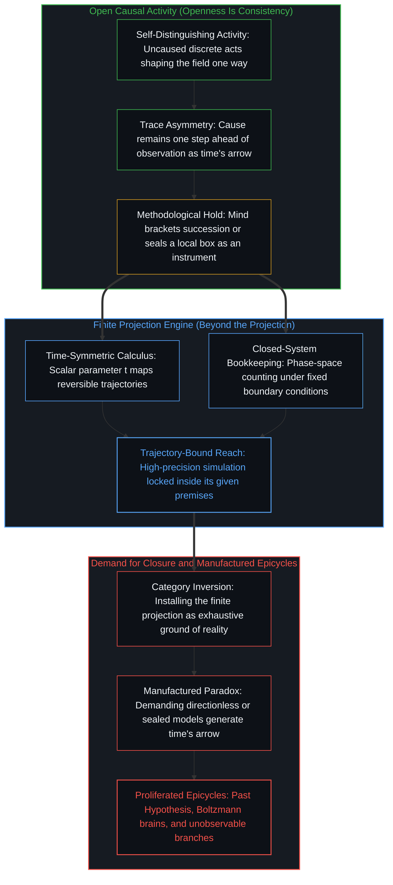

# 时间之箭的伪悖论与对称模拟的边界 / The Mirage of Time's Arrow and the Boundaries of Symmetric Simulation

*对称方程在持守内模拟闭合轨迹而因果单向展开 / Symmetric equations simulate closed trajectories while causality runs one way*

现实本身不存在任何关于时间之箭的悖论。自我区分的活动无因、不息地展开，由于每一个离散行动都发生在已被先前行动塑造的场域之中，塑造只能单向运行。这种痕迹的不对称性即是因果律与时间之箭，是同一重关系被赋予的两种名称。基础物理学中表面上的矛盾，仅仅发生在这样一种错位时刻：当一套在方法论上抽离了单向继起的形式模型，随后反过来被要求将这种单向继起作为涌现结果输出。没有任何论证、观测或推算能够在不借由因果继起运作的前提下自洽展开。任何企图从底层去推导或还原这种单向秩序的尝试，都在第一步构成自我矛盾，因为推导这一动作本身就是不可逆的单向步骤。物理方程的时间反演对称性是极高保真度的模拟工具，而非取代使用它的活生生现实的本体替代物。正如[选择本身没有任何固有重量](../choice-itself-has-no-inherent-weight/)与[主体性决非涌现而出](../agency-does-not-arise/)所追溯的，将分析工具误认为呈现它的基底，是科学哲学中反复重演的认知倒置。

Reality harbors no paradox regarding the arrow of time. Self-distinguishing activity occurs—uncaused, unceasing—and because every discrete act occurs within a field already shaped by earlier acts, shaping runs strictly one way. That trace asymmetry is causality and the arrow of time, one relation named twice. The apparent contradiction in fundamental physics arises only when formal models that have methodologically abstracted away directed succession are subsequently demanded to generate that succession as an emergent output. Nothing can be coherently argued, observed, or calculated without already operating through causal succession. Every attempt to derive or reduce that order from below initiates an immediate self-contradiction, because the act of derivation is itself an irreversible, directed step. The time-reversal symmetry of physical equations is a simulation instrument of extraordinary fidelity, not an ontological replacement for the living reality that wields it. As traced in [Choice Itself Has No Inherent Weight](../choice-itself-has-no-inherent-weight/) and [Agency Does Not Arise](../agency-does-not-arise/), mistaking an analytical instrument for the ground that renders it is the recurring inversion across the philosophy of science.

## 一、 方法论抽离与对时间之箭的倒置索求 / 1. Methodological Omission and the Inverted Demand for Time's Arrow

纵观现代物理学史，时间的单向流动一再被渲染为一桩无解的世纪谜团。理论家们追问，为何记忆只登记过去而不登记未来，为何摔碎的玻璃杯从不自发复原，为何微观动力学方程在时间反演下保持不变而宏观经验却严格不可逆。这种困惑之所以显得深奥，仅仅是因为它建立在一处隐蔽的倒置之上。在切身现实中，每一次区分都在已被先前区分约束的场域内划出边界。先前的行动塑造着后续行动可用的对齐方式，而随后的痕迹从不逆向回溯去更改产生它的行动。观测所持握的是结果，而产生该结果的因始终领先一步。

Throughout the history of modern physics, the unidirectional flow of time has repeatedly been staged as an insoluble mystery. Theorists ask why memory registers the past rather than the future, why shattered glass never spontaneously reassembles, and why microscopic equations remain invariant under time reversal while macroscopic experience is rigorously irreversible. This perplexity appears profound only because it rests on a concealed inversion. In lived reality, every distinction draws a boundary within a field already constrained by prior distinctions. Earlier acts shape the alignments available to later acts, while subsequent traces never reach backward to alter the act that produced them. Observation holds the effect; the cause that produced it remains one step ahead.

因果律从来不是物理系统内部等待从状态向量中推导出来的某种客体属性，而是使观测、实验与推演得以发生的动态约束。然而，为了追求数学形式上的统一与可计算的简洁，经典与现代物理学执行了一项决定性的方法论减法：形式系统剥离了活体经验中继起的单向性，将时间进程压缩为一个可正可负的可逆标量参数 `t`。作为一项工程与预测策略，这种压缩取得了辉煌的成功，从运动与场的相互作用中分离出了定量的不变量。倒置发生在后来的阐释者遗忘了这一奠基性的减法之时——他们把时间对称的形式系统误认为对现实的穷尽刻画，并反过来要求被剥离了方向的方程去解释时间为何具有方向。拿着一张刻意抹去方位标记的地图去质问地形为何存在单向坡度，正是制造这一悖论的机制。

Causality is never an objective property inside a physical system waiting to be derived from a state vector; it is the dynamic constraint through which observation, experimentation, and deduction occur at all. Yet in striving for mathematical unification and tractable calculation, classical and modern physics enacted a decisive methodological subtraction: the formalism stripped away the lived directedness of succession, compressing temporal progression into a reversible scalar parameter `t`. As an engineering and predictive strategy, this compression succeeded brilliantly, isolating quantitative invariants across motion and field interactions. The inversion occurred when later interpreters forgot the founding subtraction, mistook the time-symmetric formalism for an exhaustive account of reality, and demanded that the stripped equation explain why time possesses direction. Using a map that deliberately erased orientation to ask why the terrain has a forward slope is the exact mechanism that manufactures the paradox.

## 二、 作为封闭持守内记账规则的热力学第二定律 / 2. The Second Law as Bookkeeping Inside a Closed Hold

热力学第二定律常被从实验室的记账规则拔高为支配宇宙命运的形而上学铁律。将这条定律回溯至其操作前提，便能看清它的真实边界。热力学起源于蒸汽机与工业热循环的效率计算，依托于一项明确的实验持守：一个由隔绝壁围成的、与外界既不交换物质也不交换能量的孤立容器。在这一容器的边界上，实验者选定并冻结一组宏观初始构型，随后运用统计力学去计数微观状态如何在相空间中重新分布。在那些固定的约束之下，轨迹从较窄的相空间体积向占据压倒性尺度的宏观态扩散，在读数上登记为单调的熵增。在密封装置内部，这种统计追踪是可重复且不可或缺的；正如[普通人视角的解释陷阱](../the-explanatory-trap-of-the-ordinary-perspective/)所展示的，统计汇总在其选定的框架内是强大的测量工具，然而把统计汇总当成因果驱动力，在物理学中同样会倒转行动之箭，正如[宏观现象及参数和个人微观选择的因果倒置与利率的命令幻相](../the-summary-first-reversal-and-the-command-of-yields/)中将宏观经济均值当成支配个体抉择的发令者一样。

The second law of thermodynamics is routinely elevated from a laboratory accounting rule into a metaphysical decree governing cosmic destiny. Tracing the law back to its operational premise exposes its actual boundary. Thermodynamics originated in calculating the efficiency of steam engines and industrial heat cycles, resting on an explicit experimental hold: an isolated container enclosed by impermeable walls exchanging neither matter nor energy with its surroundings. At the boundary of this vessel, an experimenter selects and freezes a macroscopic initial configuration, then applies statistical mechanics to count how microstates redistribute across phase space. Under those fixed constraints, trajectories disperse from a narrower phase-space volume toward macrostates of overwhelmingly larger volume, registering as monotonic entropy increase. Within a sealed apparatus, this statistical tracking is reproducible and indispensable; as [The Explanatory Trap of the "Ordinary Perspective"](../the-explanatory-trap-of-the-ordinary-perspective/) shows, statistical aggregation is a powerful measurement instrument within its chosen frame, whereas treating aggregate summaries as the causal driver inverts the arrow of action in physics just as it does when macroeconomic averages are held to command individual choices in [Macro Parameters, Micro Choices, and the Command of Yields](../the-summary-first-reversal-and-the-command-of-yields/).

一旦将这种实验室记账投射到整个存在之上，范畴错误便即刻发作。现实不是一只搁在实验台上的绝热气缸，外部既没有隔热壁，也没有一个站在宇宙之外初始化配分函数的记账员。一旦把封闭系统假设作为穷尽一切的基底强加给宇宙，理论便会撞上自己竖起的障壁：为什么宇宙在起点会处于一个概率微乎其微的低熵构型？熵增并不是驱动时间向前的自主力量，而是在已经运行的因果继起之中，人为圈定并持守一个有限封闭边界之后才显影出来的记账读数。正如[开放即一致](../openness-is-consistency/)所确立的，此处登记为悖论的东西，恰恰是对闭合的要求本身——迫使一个在局部实验假设下持守的有限结构，去充当呈现它的不息活动的穷尽基底。[超越投射](../beyond-the-projection/)从形式轨迹的一侧揭示了同样的结构界限：任何规则、方程或计算模型，都是受制于装入其窗口的前提与初始条件的有限投射引擎，无法跨出自身的轨迹去为框定它的活生生的心智奠基。[感知的界限与理解的无限](../the-boundary-of-perception-and-the-infinity-of-understanding/)则追溯了为何因果继起先于一切统计账本：试图从热力学耗散中推导出观察者的单向视界，是把下游的记账读数误作心智的先在活动。

Category error strikes the moment this laboratory bookkeeping is projected onto the whole of existence. Reality is not an insulated cylinder resting on a bench, bounded by external thermal walls and surveyed by an accountant standing outside the universe to initialize partition functions. Once the closed-system assumption is forced onto the cosmos as exhaustive ground, the theory collides with a barrier of its own making: why did the universe begin in an improbably low-entropy configuration? Entropy increase is not an autonomous force driving time forward; it is a bookkeeping readout that appears only after a finite boundary has been held closed inside an already-running causal succession. As [Openness Is Consistency](../openness-is-consistency/) establishes, what registers as paradox here is the demand for closure itself—forcing a finite structure held under local experimental assumptions to serve as exhaustive ground for the unceasing activity that renders it. [Beyond the Projection](../beyond-the-projection/) exposes the same structural limit from the side of formal trajectories: any rule, equation, or computational model is a finite projection engine conditioned by the premises and initial conditions loaded into its window, incapable of stepping outside its own trajectory to ground the living Mind that framed it. [The Boundary of Perception and the Infinity of Understanding](../the-boundary-of-perception-and-the-infinity-of-understanding/) traces why causal succession precedes every statistical ledger: trying to derive the observer's directed horizon from thermodynamic dissipation mistakes a downstream accounting readout for the prior activity of the Mind.

## 三、 对称形式系统与空间化的块状流形 / 3. Symmetric Formalisms and the Spatialized Block Manifold

理论物理学通过将持续展开的因果区分压缩为低维坐标不变量，获得了深远的预测跨度。纵观经典力学、电动力学、量子力学与广义相对论，核心微分方程均在时间反演下保持不变。无论是牛顿力学中的时间二阶导数、哈密顿正则流、薛定谔方程的幺正演化，还是爱因斯坦场方程，将 `t` 替换为 `-t` 都不会改变其代数形式。在微积分的符号轨迹内部，系统从过去向未来演进或从未来向过去倒流，遵循的是同一套形式规则；一段倒放的行星公转录像，同样毫无偏差地满足引力方程。

Theoretical physics achieves its predictive reach by compressing ongoing causal differentiation into low-dimensional coordinate invariances. Across classical mechanics, electrodynamics, quantum mechanics, and general relativity, the core differential equations exhibit invariance under time reversal. Whether evaluating second-order time derivatives in Newtonian mechanics, canonical Hamiltonian flows, unitary Schrödinger evolution, or the Einstein field equations, replacing `t` with `-t` leaves the algebraic form intact. Within the symbolic trajectory of the calculus, a system propagates from past to future or from future to past under identical formal rules; a film of planetary orbits run in reverse satisfies gravitational equations without remainder.

这种代数对称性在相对论的“块状宇宙”图景中走向了哲学极端：时间继起被空间化为第四条几何坐标轴，过去、现在与未来同时铺展在一张四维流形之上，每一个事件都固定在各自的坐标点中。块状宇宙的形而上学把这张几何投射当成了疆域本身，宣称时间的流逝与抉择的开放性不过是受限观察者的生物性错觉。这一结论混淆了空间化的坐标图纸与绘制、阅读这张图纸的不可逆行动。在纸上画出整条时间线，或者将一段视频文件前后拖动，固然不需要改写方程的结构，然而每一次绘制、测量与拖动的动作，依然在当下的场域中消耗能量并留下不可逆的痕迹。坐标轴上各点的同时并存属于表征形式，从不属于某个没有观察者的水晶宇宙。正如[物理定律的移花接木与现实摩擦](../the-sleight-of-hand-in-physics-is-the-law-and-the-friction-of-reality/)所展示的，形式模型允许在纸面上进行零摩擦的对称变换，而为这些模型奠基并加以检验的每一次物理测量，都必须支付不可逆的因果代价。将离散的观测帧堆叠成一条冻结的四维世界线，重复了把当下的心智模拟误认为本体基底的同一倒置，[四维长鹿的幻象与当下的模型](../the-myth-of-the-four-dimensional-deer-and-the-present-model/)对此作了详尽的追溯。

This algebraic symmetry reaches its philosophical extreme in the relativistic Block Universe: temporal succession is spatialized into a fourth geometric axis, laying out past, present, and future simultaneously across a four-dimensional manifold where every event sits fixed at its coordinates. Taking this geometric projection for the territory, block-universe metaphysics declares the passage of time and the openness of choice to be biological illusions of a limited observer. That conclusion confuses a spatialized coordinate chart with the irreversible act that constructs and reads it. Drawing an entire timeline on paper or scrubbing a video file backward and forward costs no structural reorganization of the equations, yet every act of drawing, measuring, and scrubbing still expends energy and leaves irreversible traces in the present field. The simultaneous coexistence of points along a coordinate axis belongs to the representation, never to an observerless crystal universe. As [The Sleight of Hand in "Physics Is the Law"](../the-sleight-of-hand-in-physics-is-the-law-and-the-friction-of-reality/) demonstrates, formal models permit frictionless symmetry operations on paper while every physical measurement that grounds and tests them pays an irreversible causal price. Stacking discrete observational frames into a frozen four-dimensional worldline repeats the same inversion of mistaking a present mental simulation for ontological ground, as [The Myth of the Four-Dimensional Deer and the Present Model](../the-myth-of-the-four-dimensional-deer-and-the-present-model/) traces in detail.

## 四、 符号轨迹与不可逆的因果生成 / 4. Symbolic Trajectories versus Irreversible Causal Generation

消解时间反演对称性的海市蜃楼，关键在于分清模拟与生成。物理方程是高保真的轨迹引擎，映射着选定的状态变量在特定持守下如何协同变化。当物理学家在黑板上写下哈密顿量，或在硅基寄存器上运行微分求解器时，把 `t` 替换为 `-t` 的符号操作只是形式记号内部的零耗散重写。在纸面上，`1 + 1 = 2` 是可逆、对称且零摩擦的重言式；然而在切身的因果之中，`+1` 却是一次不可逆的介入：哪怕在超级计算机中翻转一个寄存器去运行一段逆时模拟，也依然要消耗自由能、向外辐射热量，并将实验室的痕迹场严格推向前方。

Dissolving the mirage of time-reversal symmetry rests on keeping simulation distinct from generation. Physical equations are high-fidelity trajectory engines that map how selected state variables co-vary under a hold. When a physicist writes a Hamiltonian on a blackboard or executes a differential solver across silicon registers, the symbolic manipulation of substituting `-t` for `t` is a zero-dissipation rewrite inside the formal notation. On paper, `1 + 1 = 2` is a reversible, symmetric tautology incurring zero friction. In lived causality, however, `+1` is an irreversible intervention: even flipping a register in a supercomputer to run a time-reversed simulation consumes free energy, radiates heat, and advances the laboratory's trace field strictly forward.

模拟能够以惊人的精度刻画星系碰撞或蛋白质折叠，但投射内部计算出的轨迹，从不生成承载这一计算过程本身的因果继起。物理方程之所以呈现出时间反演对称，是因为其缔造者为了分离出守恒量，预先悬置了“此行动先于彼痕迹”的不对称性。形式系统内部没有任何自发迈出一步的引擎；它搭载在定义状态空间、提供边界值并解读读数的心智那不可逆的因果活动之上。正如[笛卡尔的认识论跃迁与造神狂热](../the-cartesian-overstep-and-the-frenzy-of-creation/)与[造神的障眼法与隐秘阶序的说辞](../the-sleight-of-hand-of-synthesizing-gods-and-unacknowledged-rank/)所追溯的，下游的人造物与形式系统可以作为工具去塑造后续的对齐模式，但从不会逆转因果去成为编写它们的源头。强求一条通过省略因果继起而工程化构建出来的符号轨迹反过来生成时间之箭，无异于指望一张航海图自己吹出推动船只的海风。

A simulation can model galactic collisions or protein folding to remarkable precision, yet the trajectory computed inside the projection never generates the causal succession that carries the computation itself. Physical equations display time-reversal symmetry because their authors bracketed the asymmetry of "this act precedes that trace" in order to isolate conserved quantities. The formalism has no internal engine to initiate a step; it rides on the irreversible causal activity of the Mind that defines the state space, supplies the boundary values, and interprets the readout. As traced in [The Cartesian Epistemic Leap and the Frenzy of Creation](../the-cartesian-overstep-and-the-frenzy-of-creation/) and [The Sleight of Hand of Synthesizing Gods and the Rhetoric of Unacknowledged Rank](../the-sleight-of-hand-of-synthesizing-gods-and-unacknowledged-rank/), downstream artifacts and formalisms can pattern subsequent alignments as instruments, but they never invert causality to become the initiating source that authored them. Demanding that a symbolic trajectory engineered by omitting causal succession turn around and generate the arrow of time is expecting a nautical chart to produce the wind that moves the ship.

## 五、 消解过去假说与重归开放的工具 / 5. Dissolving the Past Hypothesis and Restoring Open Instruments

当时间对称的投射被强行伪装成穷尽一切的基底时，形式系统就不得不制造出特设的本轮，用来遮掩其可逆轨迹与不可逆观测之间的裂隙。正如托勒密天文学为了保全匀速圆周运动的教条而层层叠加本轮与偏心圆，现代宇宙学与物理学基础也为了拯救全域闭合的教条而不断增生辅助公设。

When a time-symmetric projection is forced to masquerade as exhaustive ground, the formalism must manufacture ad-hoc epicycles to cover the gap between its reversible trajectories and irreversible observation. Just as Ptolemaic astronomy stacked epicycles and equants to preserve the dogma of uniform circular motion, modern cosmology and foundations of physics proliferate auxiliary postulates to rescue the dogma of universal closure.

在统计宇宙学中，将可逆微观动力学与封闭盒相空间当成全部现实，便会导出玻尔兹曼大脑悖论：在永恒封闭容器内的时间对称涨落之下，从热平衡中短暂涨落出一个孤立观察者的概率，远远高于演化出包含亿万星系的有序宇宙的概率。为了在不放弃全域闭合的前提下阻断这一荒谬推论，理论家们将“过去假说”硬生生钉在宇宙起源之上，作为一条生硬的公理规定大爆炸始于一个极其特殊的低熵状态。在量子力学基础中，同样对放弃闭合的抗拒驱动着平行的机制增生：或是诉诸环境退相干，仿佛对未观测自由度求迹就能在没有观察者切分的情况下把幺正可逆性变成单一的切身历史；或是设定埃弗雷特的多世界分支，让每一次不可逆的测量都被重新吸纳进全局对称的波函数之中。所有这些补丁，都企图在边界处把形式系统最初排除掉的选择性与方向性重新偷运回来。正如[无法逃脱的心智边界](../one-cannot-escape-ones-own-mind/)所追溯的，追逐不可观测的宇宙初态补丁与无限平行的分支，正是心智遗忘了自身奠基性的切分、迷失在自己投射出的代数迷宫之中的表征。

In statistical cosmology, treating reversible microscopic dynamics and closed-box phase space as the whole of reality yields the Boltzmann brain paradox: under time-symmetric fluctuations inside an eternal closed container, a lone observer fluctuating briefly out of thermal equilibrium is vastly more probable than an entire cosmos of galaxies evolving from an ordered state. To block this absurdity without surrendering universal closure, theorists staple the Past Hypothesis onto the origin of the universe, stipulating as a brute axiom that the Big Bang began in an extraordinarily special low-entropy state. In quantum foundations, the same refusal to release closure drives parallel proliferations: appealing to environmental decoherence as if tracing over unobserved degrees of freedom could turn unitary reversibility into a single lived history without an observer's cut, or positing Everettian many-worlds branching so that every irreversible measurement is reabsorbed into a globally symmetric wave function. Every one of these patches attempts to smuggle back at the boundary the very selectivity and directedness that the formalism excluded at the start. As [One Cannot Escape One's Own Mind](../one-cannot-escape-ones-own-mind/) traces, chasing unobservable cosmic initial patches and infinite parallel branches is what happens when the Mind forgets its own founding cut and gets lost inside the algebraic labyrinth it projected.

过去假说暴露出[没有固定者的固定](../fixed-by-nothing/)在一切确定性系统中所剖析的结构必然性：任何闭合轨迹都需要一个其自身转移规则无法生成的初始条件。时间对称的动力学无法推导出低熵起点，它只能从方程外部装入这一边界条件；而一个不被系统内部任何规则所固定的起点，相对于该系统而言恰恰是未决定的。把这一无根基的输入命名为“宇宙的特殊初始状态”，并没有为它找到固定者，只是把模型从观察者取景中借来的开放性改写成一桩神秘的宇宙学巧合。一旦认清这笔借贷，层层叠叠的本轮便随之消解，而物理学的任何一项实证成就都丝毫无损。物理学之所以保持其高度的精确性，恰恰因为它的模型是有界的工具，而非形而上学的立法者。只要实验持守隔离出一个局域系统，热力学第二定律就继续有效支配热机与有界过程；时间对称的微分方程也继续以无可匹敌的精度描绘轨道力学、波的传播与场的相互作用，而这两种投射都无需被迫去合上存在的账本。将模拟作为工具保持开放，既让物理学摆脱了人造悖论的纠缠，也让时间之箭回到它真实的所在：活生生的心智迈入未决世界的那记不可逆的因果步伐。

The Past Hypothesis exposes a structural necessity that [Fixed by Nothing](../fixed-by-nothing/) dissects across all deterministic systems: every closed trajectory requires an initial condition that its own transition rules cannot generate. Time-symmetric dynamics cannot derive a low-entropy origin; it must load that boundary condition from outside the equations, and a starting point fixed by no rule inside the system is, relative to that system, undetermined. Naming that ungrounded input "the special initial state of the cosmos" locates no fixer for it; it only rebrands the openness the model borrowed from the observer's framing as a mysterious cosmological coincidence. Once that loan is recognized, the epicycles dissolve without touching a single empirical success of physics. Physics retains its full precision precisely because its models are bounded instruments rather than metaphysical legislators. The second law of thermodynamics continues to govern heat engines and bounded processes wherever an experimental hold isolates a system, and time-symmetric differential equations continue to chart orbital mechanics, wave propagation, and field interactions with unmatched accuracy, while neither projection is forced to close the account of existence. Keeping simulation held open as an instrument leaves physics clean of manufactured paradoxes and restores the arrow of time to its actual locus: the living Mind's irreversible causal step into an unresolved world.
