# 权力的镜像握手 / The Mirror Handshake of Power

*没有直接的支配，只有两个互补的抉择 / No direct force, only two complementary choices*

权力常被想成一根从掌控者伸进被支配者意识里的锁链。从第一人称的原点看，找不到这样的缆绳：别人能改变面前的代价，掂量代价并作出下一步的仍在原点。被称为权力的，是让渡的抉择与认领的抉择彼此互补、咬合在一起，这种咬合在不同的维度上各不相同，并在心智离开原点、以旁观者自居时开始。认出自己伸出的那只手，便可以在每个维度上把它收回。

Power is commonly pictured as a chain running from the one in control into the consciousness of the one controlled. From the first-person origin no such cable is found: another can change the costs at hand, but weighing them and taking the next step stays at the origin. What gets called power is a choice to hand over meeting its complement, a choice to claim, a fit that differs from one dimension to the next and that begins when a mind leaves the origin and takes itself for a bystander. Once the hand one has extended is recognized, it can be withdrawn on each dimension.

## 一、 没有缆绳，只有握手 / 1. No Cable, Only a Handshake

把权力看作由外向内施加的实体力量，是流传最广的图景之一：统治者发号施令，臣民服从，强者控制，弱者受支配。权力在这里像一根无形的锁链，一端握在掌控者手中，另一端穿进被统治者的意识。这个图景在宏观上好用，它能预测人群的行为，法律与社会学都借它运转。

Seeing power as a solid force applied from outside inward is one of the most widespread pictures: the ruler commands and the subject obeys, the strong control and the weak are dominated. Power here resembles an invisible chain, one end in the controller's hand and the other threaded into the mind of the ruled. The picture works well at the macroscopic scale; it predicts how crowds behave, and law and sociology run on it.

它的边界在单次抉择上。从第一人称的原点出发，找不到一条让别人的指令代为执行抉择的缆绳。君主、官僚体系、神权或算法，都只能改变面前的代价，掂量代价并作出下一步（+1）的仍在原点。被称为“外在权力”的，是两个各自作出的互补抉择彼此咬合：一方选择让渡并服从，一方选择认领并发令。这就是镜像握手。如[隐性自由变量与权力的事后幻相](../the-free-variable-and-the-retrospective-illusion-of-power/)所剖析的，事后从交椅上倒推出来的权力，恰恰藏起了当时那个活的自由变量。

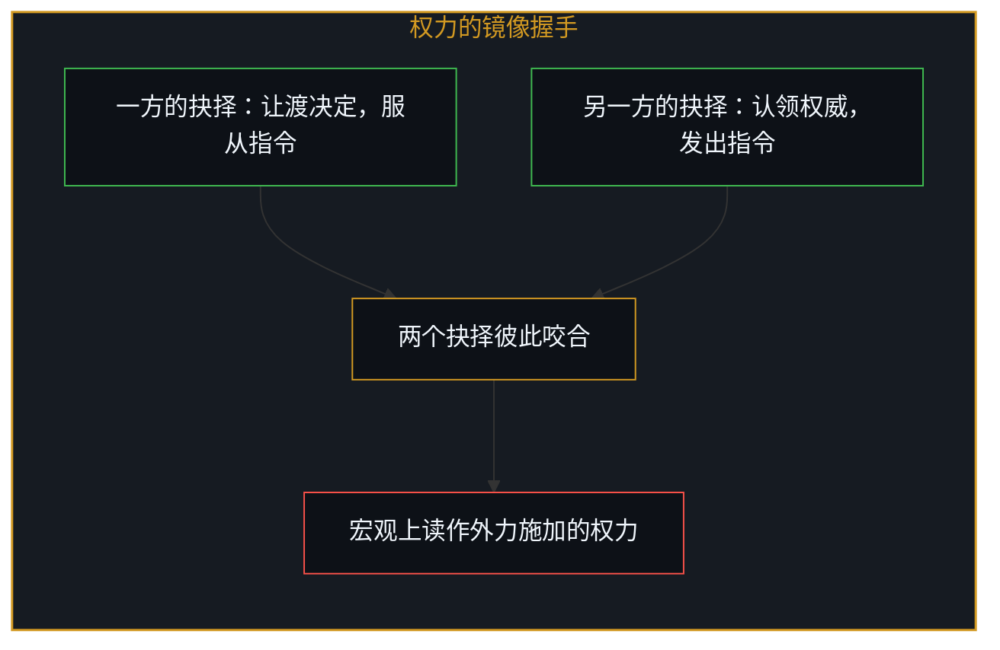

Its boundary lies at the single choice. Starting from the first-person origin, no cable is found by which another's command carries out a choice on one's behalf. A monarch, a bureaucracy, a church or an algorithm can only change the costs at hand; weighing them and taking the next step (+1) stays at the origin. What is called "external power" is two separately made, complementary choices fitting each other: one side chooses to hand over and obey, the other chooses to claim and command. This is the mirror handshake. Power read from seats after the fact hides the free variable, as [The Invisible Free Variable and the Retrospective Illusion of Power](../the-free-variable-and-the-retrospective-illusion-of-power/) shows.

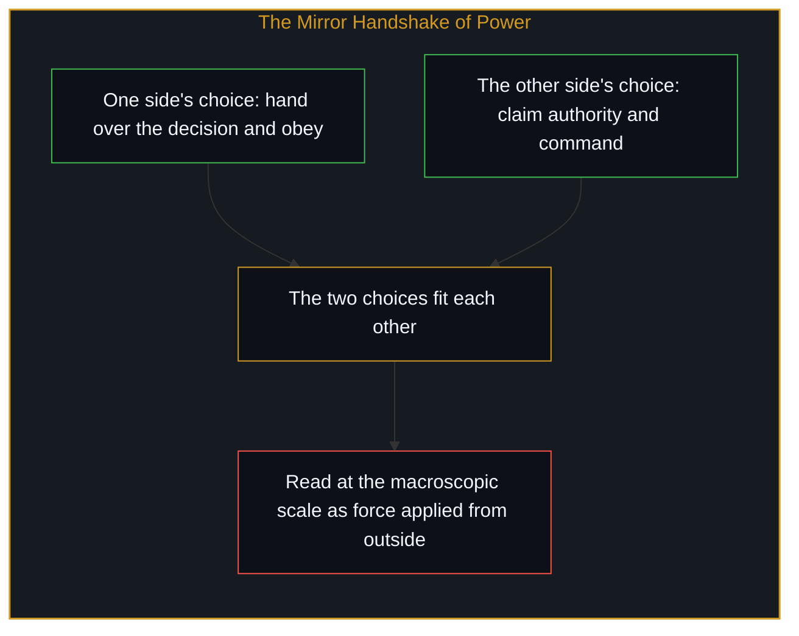

指令传来时，是接到指令的心智在自己的原点上估量违抗的代价、独自承担的沉重与未知的风险，然后作出“交出决定、退为执行”的判定。代价可以极重，这份重量是登记到的摩擦，不因这里的分析而减轻，分析指出的只是判定发生的位置。没有这一步让渡，指令是一串在空气中震颤的声波。

When a command arrives, it is the mind receiving it that, at its own origin, estimates the cost of defiance, the weight of carrying things alone and the unknown risk, and then makes the call to hand over the decision and fall back to carrying it out. The cost can be extremely heavy; that weight is friction registered at the origin, and this analysis does not lighten it. The analysis only points to where the call is made. Without that step of handing over, a command is a string of sound waves trembling in the air.

由此也能读懂中枢的引力。位于金字塔顶端的人只有一具身体和一天二十四小时，无法亲手维持亿万人的秩序。从中枢那里感到的巨大引力，是无数人持续让渡的向量累加出的借来质量，握手撤回多少，这份质量便减少多少。

The pull of a center can be read the same way. Whoever sits at the top of a pyramid has one body and twenty-four hours in a day, and cannot personally keep order among millions. The enormous pull felt from the center is borrowed mass, summed from the vectors that countless people keep handing over, and it shrinks by exactly as much as the handshakes are withdrawn.

## 二、 握手在各个维度上并不相同 / 2. The Handshake Differs by Dimension

把自主看作一个非此即彼的开关，在只问“这一件事由谁决定”时是够用的。它的边界在于，抉择并不在所有方向上取同一种姿态。借向量的语言作脚手架，心智落在一个多维的状态空间里，在每条彼此正交的轴上有各自的投影。

Treating autonomy as an either-or switch is adequate when the only question is who decides this one thing. Its boundary is that choices do not take the same stance in every direction. Borrowing the language of vectors as scaffolding, a mind sits in a many-dimensional state space and has its own projection on each mutually orthogonal axis.

驱动一段生命的始终是抉择，而这些抉择在心智内部未必彼此一致。用一个耦合系数 c 来记：c = 0 是自己行动、自己承受后果；c > 0 是把别人的后果揽到自己身上；c < 0 是把自己的判断交给别处。同一个心智可以在一条轴上取 c = 0，同时在另一条轴上把权能交出。

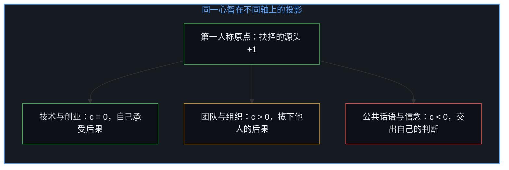

What drives a life is always choice, yet these choices need not agree with one another inside a mind. Let a coupling coefficient c keep the record: c = 0 is acting and bearing the consequences oneself; c > 0 is taking another's consequences onto oneself; c < 0 is handing one's own judgment elsewhere. The same mind can hold c = 0 on one axis while giving its capacity away on another.

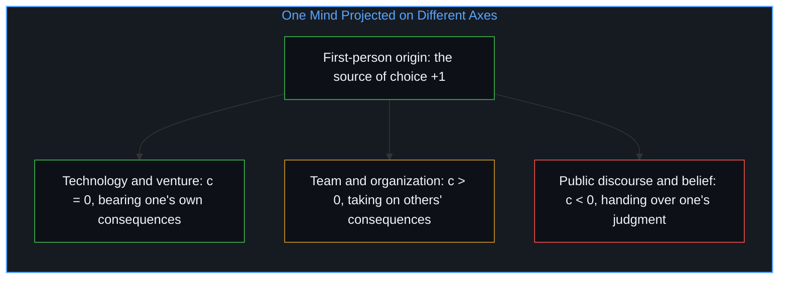

设想一位创业者。在技术研发与商业决策上，这个人不找借口，直面市场的摩擦与代码的报错，学得很快。在组织管理中，同一个人出于保护或控制的愿望，揽下团队成员的决策后果，成为这条轴上的小中枢。在政治信念上，同一个人又可能把判断交给某个党派的标语。三种姿态并存于一身，向自身看去，也是同样的不一致。如[能动性、复利与 AI 封建之争](../agency-compounding-and-the-argument-over-ai-feudalism/)所追溯的，人工智能之类的高带宽工具继而会把人在特定轴上所持的姿态成倍放大——在自己承受后果之处（c = 0）加速复利，在交出判断之处（c < 0）加深依附。

Picture a founder. In engineering and business decisions this person makes no excuses, meets the friction of the market and the errors in the code head-on, and learns fast. In managing the organization, the same person, out of a wish to protect or to control, takes on the consequences of the team's decisions and becomes a small center on that axis. In political belief, the same person may hand judgment to a party slogan. Three stances live in one person, and a look at oneself turns up the same inconsistency. High-bandwidth tools such as artificial intelligence then multiply whichever stance is held on a given axis—accelerating compounding where consequences are borne directly (c = 0) and deepening dependence where judgment is handed over (c < 0), as [Agency, Compounding, and the Argument Over AI Feudalism](../agency-compounding-and-the-argument-over-ai-feudalism/) traces.

这也说明了为什么社会读起来不像一座单一的金字塔。它更像许多层叠在一起的网络：在生产这一层，甲吸收乙与丙的决定；在文化叙事这一层，甲反过来依附于乙；在宏观治理这一层，三人又一同把向量交给更远的中枢。同一个心智在某一处是引力的中心，在另一处是依附的一环，在第三处独自探索。

This also shows why society does not read as a single pyramid. It is closer to many networks layered on one another: in the layer of production, A absorbs the decisions of B and C; in the layer of cultural narrative, A in turn leans on B; in the layer of large-scale governance, all three hand their vectors to a more distant center. The same mind is a center of pull in one place, a dependent link in another, and explores alone in a third.

## 三、 握手始于离开原点 / 3. The Handshake Begins Where the Origin Is Left

让渡与揽取从哪里开始？从心智离开自己的第一人称原点、站到第三人称的旁观位置开始。旁观的视角有它的用处，规划、协调、辨认模式都要靠它。它的边界出现在这个位置被当成自己所在之处的时候：行动与后果直接相接的地方只有原点，一旦以俯瞰全局的局外人自居，对因果的认知便分成两种构型。

Where do handing over and taking on begin? They begin when a mind leaves its own first-person origin and stands in the third-person position of a bystander. The bystander's view has its uses; planning, coordination and the recognition of patterns all depend on it. Its boundary appears when that position is taken for the place where one is: action and consequence meet directly only at the origin, and once a mind regards itself as an outsider surveying the whole, its sense of causality divides into two configurations.

第一种是向下看时出现的揽取。从高处望去，别人的试错与迟缓一览无余，于是以为自己有责任介入，替对方修正轨迹——这正是[良知、委托与管辖权错位](../conscience-power-delegation/)所追溯的越界：把局部的确信或发起权当成了对另一中心的常设管辖权。这样做时忘了，对方也处在一个无人可以替代的原点上，被拿走的试错机会正是对方建立自己误差信号的途径。第二种是从外部看自己时出现的推出。当自己对低代价路径的持续选择从账面上略去，回绝某项局部代价带来的限制便被登记为外部强加的不自由，这一约束和解除它的权力也一并移置到了外部，正如[能动性、矛盾与权力的移置](../agency-contradiction-and-the-relocation-of-power/)所追溯的那样。人继而把自己看成沙盘上被推动的一枚棋子，把当下的痛苦与停滞归于历史、阶层、家庭或对手，如[涌现的伪因果](../yong-xian-de-wei-yin-guo-yu-ji-ti-gui-yin-dao-cuo/)所剖析的那样把宏观统计残余误作驱动的原因，却忘了冲击再剧烈，如何解读它、下一步怎么走，仍是在自己的原点上作出的。

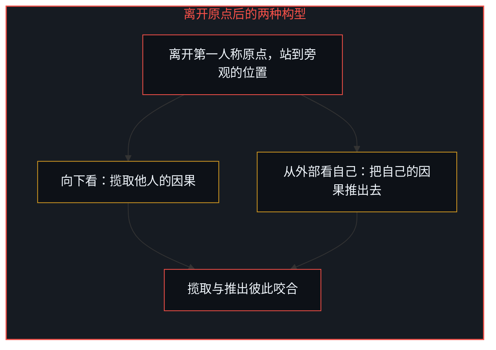

The first is the taking on that appears when looking down. From a height, other people's trial and error and their slowness are in plain view, and it comes to seem a duty to step in and correct their course—the same escalation [Conscience, Delegation, and the Jurisdiction Error](../conscience-power-delegation/) traces when local conviction or origination is mistaken for standing jurisdiction over another center. What is forgotten is that the other also stands at an origin no one can occupy for them, and that the chance to err which is taken away is the very means by which they build their own error signal. The second is the pushing away that appears when looking at oneself from outside. When one's ongoing choice of the lower-cost path is left out of the account, the limitation that followed from declining a local cost registers as an externally imposed lack of freedom, and both the constraint and the power to lift it are relocated outward, as [Agency, Contradiction, and the Relocation of Power](../agency-contradiction-and-the-relocation-of-power/) traces. One then sees oneself as a piece being moved on a board and assigns present pain and stagnation to history, class, family or an opponent, mistaking macroscopic statistical residue for a driving cause in the way [The Pseudo-Causality of Emergence](../yong-xian-de-wei-yin-guo-yu-ji-ti-gui-yin-dao-cuo/) dissects, while forgetting that however violent the impact, how to read it and what step to take next are still decided at one's own origin.

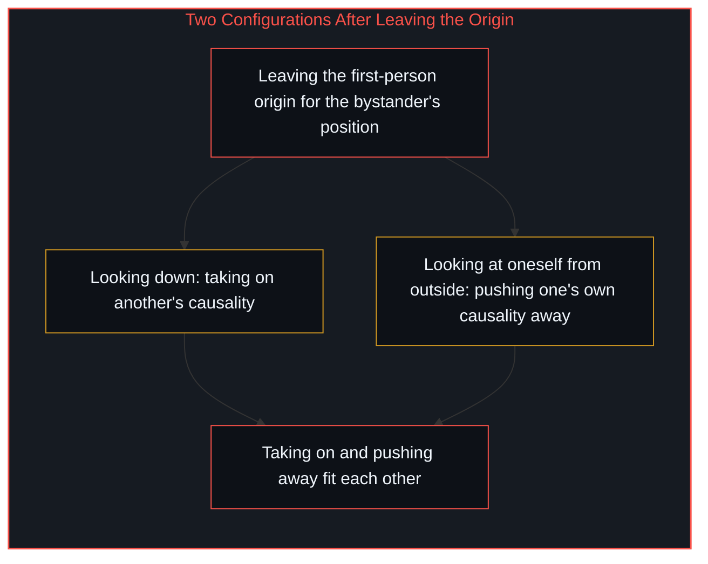

两种构型出自同一处：视线没有校准回自身。前者想接管不属于自己的坐标，后者想离开自己所在的坐标，一个伸手去拿，一个伸手去给，握手就此成立。

Both configurations come from one place: the line of sight has not been brought back to oneself. The first tries to take over coordinates that are not one's own, the second tries to leave the coordinates one occupies; one hand reaches to take, the other reaches to give, and the handshake is made.

## 四、 看台上的评论 / 4. Commentary From the Stand

旁观的位置上还有第三种形态：退到看台上，只做评论。当一个心智既不下场做事，也不承担决定的后果，只编织概念、分类与定性时，它不承受试错的风险，也收不到环境的反冲。理论本身是有用的地图，每一种在它的范围内都帮助人看清一片地形。边界出现在地图被拿去做别的用途的时候。

The bystander's position has a third form: withdrawing to the stand and only commenting. When a mind neither goes down to do the work nor bears the consequences of decisions, and only weaves concepts, classifications and verdicts, it carries none of the risk of trial and receives none of the recoil from the surroundings. A theory is in itself a useful map, and each one helps people see a stretch of terrain within its range. The boundary appears when the map is put to other uses.

人们因为回避不确定而采纳一套抽象体系时，它便为前面两种构型各提供了一套说辞。对揽取的一方，它是介入的执照，“规律表明集中调配优于自发演进”“模型要求规范大众的行为”。对推出的一方，它是卸责的托词，“你的焦虑由社会结构所生”“你是话语的受害者”。当事情在实处落败，看台上的位置毫发无损，还可以宣布问题在于执行未能领会理论。此时众人让渡出的回音被当成了自己的因果力量，而手里摆弄的是没有摩擦的文字——这与[政客是责任扩散的显性症状](../politicians-appear-as-visible-symptoms-of-responsibility-diffusion/)所追溯的机制如出一辙：扩散的控制权与共担的推诿，最终凝结成一个显眼的认领者。

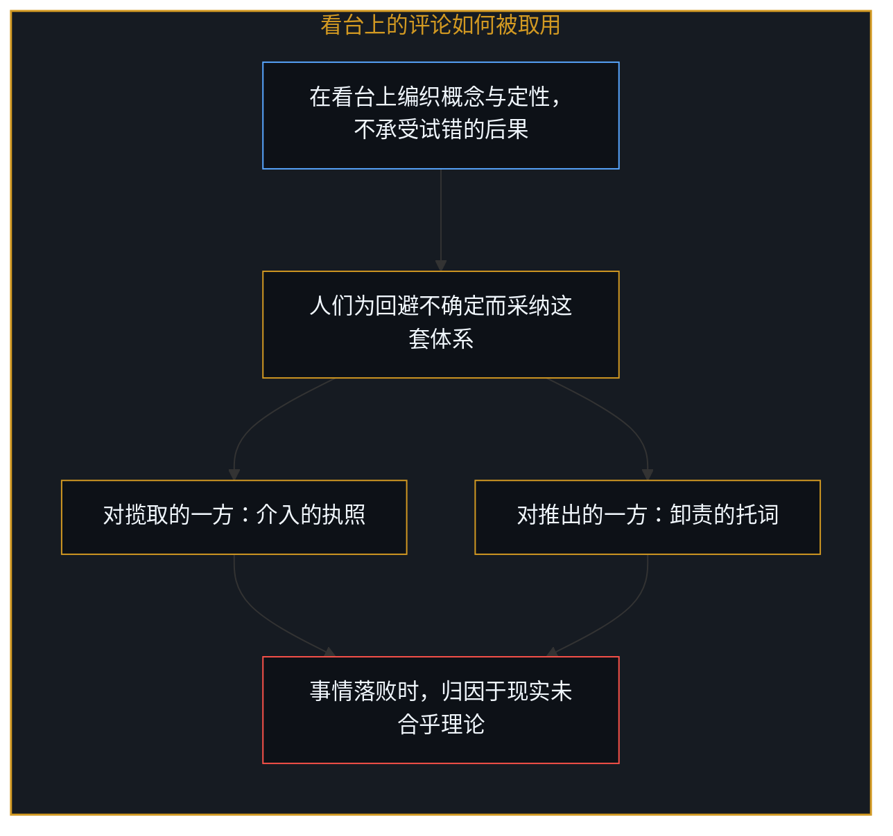

When people adopt an abstract system in order to avoid uncertainty, it supplies each of the two earlier configurations with its wording. To the side that takes on, it is a license to intervene: "the laws show that central allocation beats spontaneous development," "the model requires that public behavior be regulated." To the side that pushes away, it is an alibi: "your anxiety is produced by the social structure," "you are a victim of discourse." When things fail on the ground, the seat in the stand is untouched, and it can still be announced that the execution failed to grasp the theory. At that point the echo of what many people handed over is being taken for one's own causal force, while what is being handled is words that meet no friction—the same mechanism [Politicians Are Visible Symptoms of Responsibility Diffusion](../politicians-appear-as-visible-symptoms-of-responsibility-diffusion/) traces when diffused control and shared blame materialize into a conspicuous claimant.

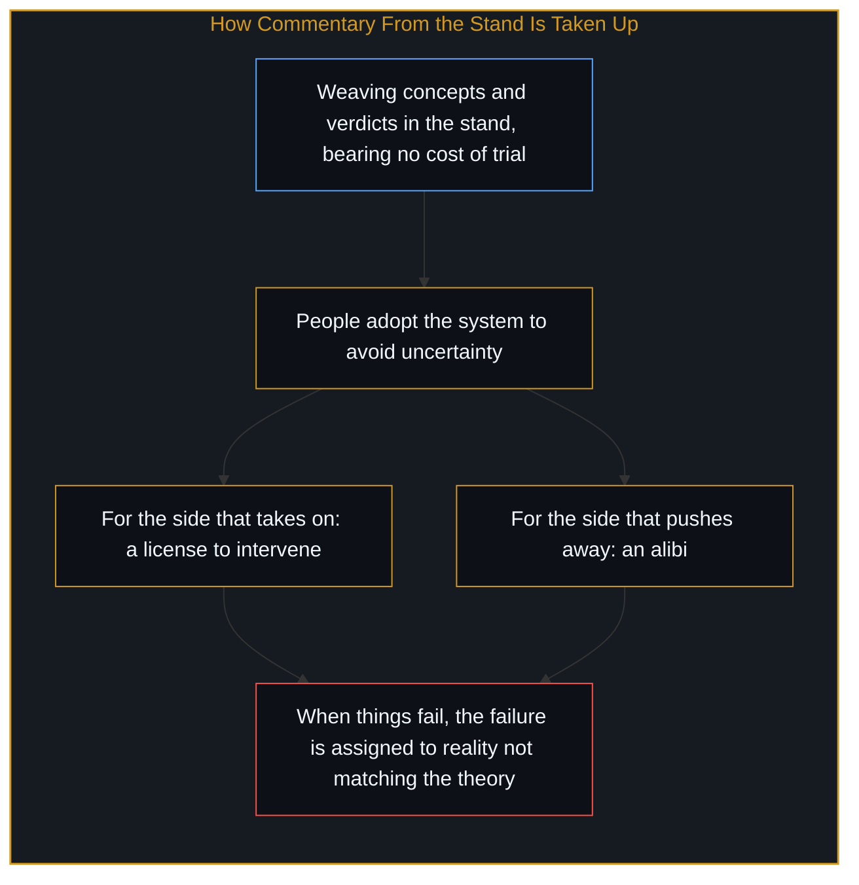

评论与实做的分别不在于谁更高明，而在于回路是否闭合。实做的一步（+1）撞上摩擦，反冲立刻回来校准判断。评论建立在实做留下的痕迹之上，它的精巧由语言来衡量，不由后果来衡量。

What separates commentary from doing is not which is the wiser, but whether the loop closes. A step of doing (+1) strikes friction, and the recoil comes straight back to calibrate judgment. Commentary is built on the traces that doing leaves behind, and its refinement is measured by language, not by consequences.

## 五、 同一种动力学 / 5. One Dynamics

指出这些机制，不是为了评判利他、集权或市场的好坏。评判会把分析带回它正在拆解的那条线上。只看因果的走向，牺牲式的利他、政治上的集权、市场的锁定与人际的僵持，呈现的是同一种耦合动力学。

Pointing out these mechanisms is not for judging altruism, centralization or markets as good or bad. Judging would carry the analysis back onto the very line it is taking apart. Looking only at the direction of causality, sacrificial altruism, political centralization, market lock-in and interpersonal deadlock show one and the same coupling dynamics.

牺牲式的利他单向吸收对方的误差信号，被帮助的一方因此停止调整。政治上的集权经由偏好依附汇聚让渡的向量，如[让渡主权的幂律法则](../the-power-law-of-surrendered-agency/)在各个尺度上所推导的，连接数的分布呈幂律 P(k) ~ k⁻ᵞ。市场的锁定由网络效应抬高转移的成本，周边的路径随之收窄。人际的僵持是两个强耦合的振子，各自把状态的变化系在对方身上。四者的共同之处，是行动与反馈之间插进了一段外部的路由。

Sacrificial altruism absorbs the other's error signal in one direction, and the one being helped stops adjusting. Political centralization gathers handed-over vectors through preferential attachment, and the distribution of connections follows a power law, P(k) ~ k⁻ᵞ, as [The Power-Law of Surrendered Agency](../the-power-law-of-surrendered-agency/) derives across scales. Market lock-in raises the cost of switching through network effects, and the surrounding paths narrow. Interpersonal deadlock is two strongly coupled oscillators, each tying the change of its state to the other. What the four share is an external routing inserted between action and feedback.

于是这些结构的差别归结为反馈回路的形状。在直接闭合的回路里，行动撞上摩擦，后果不经中介衰减地回到原点，判断得以校准，学习保持陡峭。在经由代理的回路里，行动的后果被国家、施救者、党派或平台过滤、吸收或转移。代理让一个人做到独自做不到的事，分工与委托都靠它；它的边界在于误差信号不再回到作出抉择的地方，调整停下，整个系统的拖累增加。如[共情的能力倒错与边界的排序之争](../the-capability-reversal-of-empathy-and-the-contest-of-boundaries/)所揭示的，放弃自卫的共情正是把这场握手一路延续了下去。

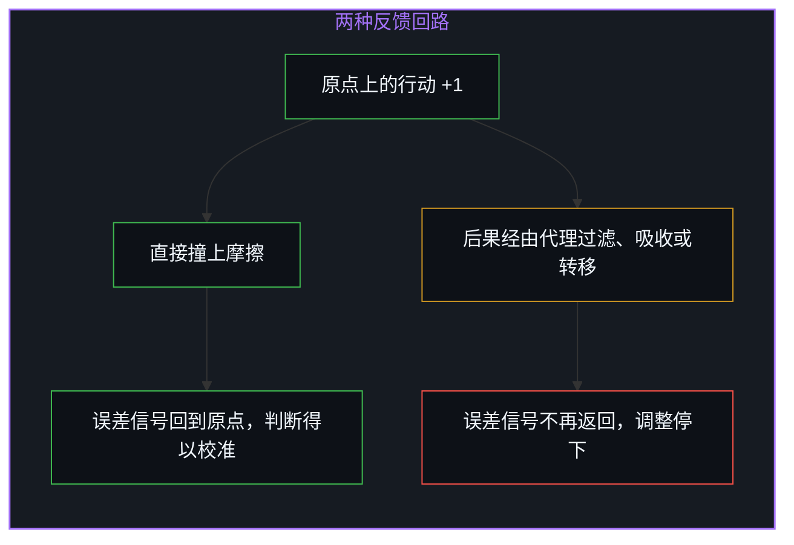

The difference among these structures thus comes down to the shape of the feedback loop. In a directly closed loop, action strikes friction, the consequence returns to the origin without being attenuated by an intermediary, judgment is calibrated, and learning stays steep. In a loop routed through a proxy, the consequences of action are filtered, absorbed or shifted by a state, a rescuer, a party or a platform. A proxy lets a person do what could not be done alone, and division of labor and delegation depend on it; its boundary is that the error signal no longer returns to where the choice was made, adjustment stops, and the drag on the whole system grows. Empathy that gives up self-defense extends the handshake, as [The Capability Reversal of Empathy and the Contest of Boundaries](../the-capability-reversal-of-empathy-and-the-contest-of-boundaries/) shows.

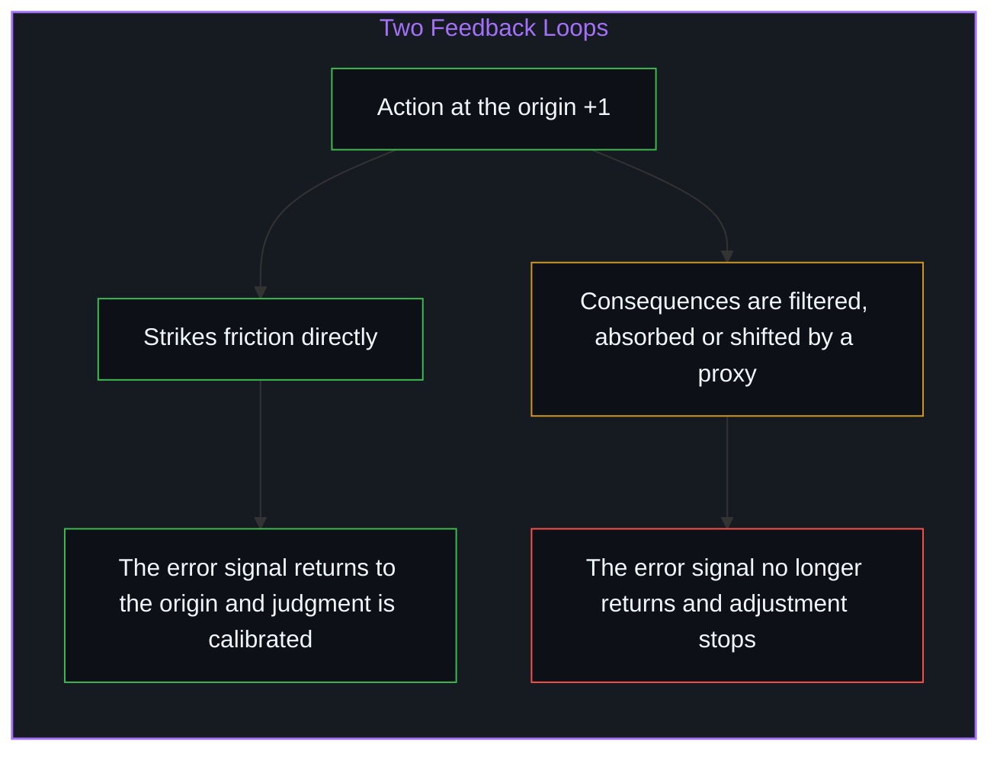

## 六、 收回握手 / 6. Withdrawing the Handshake

上面的推演收束于一处：所登记的一切，始于心智，留于心智，终于心智。因此不需要发起一场推翻外部中枢的运动，中枢的质量本就是包括自己在内的许多人让渡出来的。不需要说服揽取的人放手，不需要改造推出的人，也不需要退到看台上发表评论。

The reasoning above gathers at one place: everything registered begins with Mind, stays with Mind and ends with Mind. So there is no need to launch a movement to overthrow an external center, since the center's mass is what many people, oneself included, have handed over. There is no need to persuade those who take on to let go, to remake those who push away, or to retreat to the stand to comment.

支点是在自己的第一人称原点上作出的单方面抉择：把各个维度上不曾留意就伸出的那只手收回来，既不把怨恨推出去，也不替别人揽下因果，耦合系数回到零（c = 0）。这里的零不是让渡与揽取之间的中点，也不是耦合之内的第三种姿态；它是耦合项本身的缺席，即自己行动、自己承受后果。因此，如[正交的拒绝](../the-orthogonal-refusal/)所追溯的，这里并不向另一方要求什么：每一方继续设定各自推进的条件。

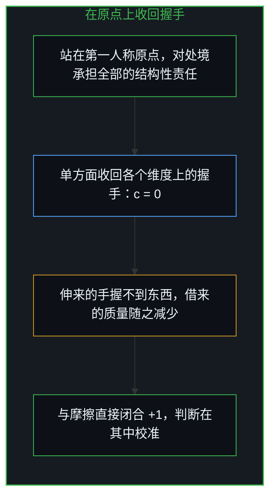

The fulcrum is a unilateral choice made at one's own first-person origin: to take back the hand extended on each dimension without noticing, neither pushing resentment outward nor taking on another's causality, with the coupling coefficient back at zero (c = 0). Zero here is not a midpoint between handing over and taking on, a third stance inside the coupling; it is the absence of the coupled term itself, acting and bearing the consequences oneself. So, as [The Orthogonal Refusal](../the-orthogonal-refusal/) traces, nothing is asked of the other side: each goes on setting the conditions under which it will proceed.

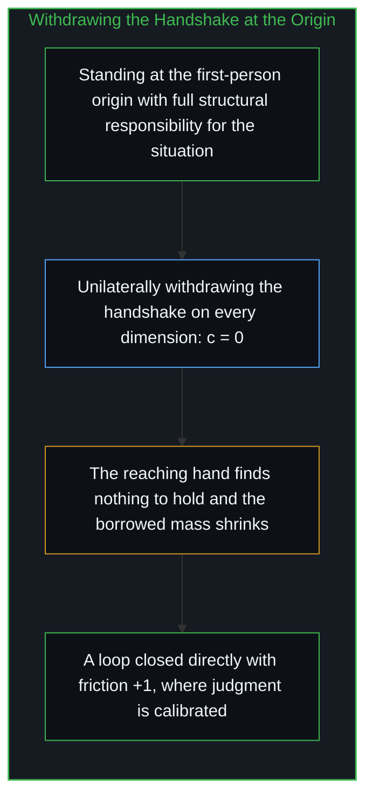

在技术的维度上，直面报错与规律。在团队的维度上，把承担后果的位置还给对方。在价值的维度上，收回自己的思考与评判。在个人的维度上，把遇到的一切认作自己因果的起点。

On the technical dimension this means facing the errors and the regularities directly; on the dimension of the team, returning to the other the place of bearing their consequences; on the dimension of values, taking back one's own thinking and judging; on the personal dimension, taking whatever is met as the starting point of one's own causality.

当耦合系数回到零，不再向外投出期待，也不认领外来的绑定，伸来的那只手便握不到东西。代价并不因此消失；它们从无法另作他选的理由，重新变为附着在可见替代选项上的标价，摩擦也直接回到原点，成为校准的来源。行动者由此重新作为一个自由变量出手，以摩擦为师，走出自己的轨迹（+1）。正如[你的代码库即是记忆](../your-codebase-is-memory/)所追溯的，期待与绑定的旧脚本只是存留的记忆痕迹；一旦第一人称的活态前沿停止重新执行它们，它们对下一步便再无抓手。

When the coupling coefficient is back at zero, with no expectations cast outward and no bindings accepted from outside, the reaching hand finds nothing to hold. The costs do not vanish for that; they shift from reasons one could not choose otherwise back into prices attached to visible alternatives, and the friction returns directly to the origin as the source of calibration. The actor thereby steps forth again as a free variable, with friction as teacher, on a trajectory of its own (+1). As [Your Codebase Is Memory](../your-codebase-is-memory/) traces, entrenched scripts of expectation and obligation are only retained memory traces; once the living first-person edge stops re-executing them, they lose all purchase on the next step.
