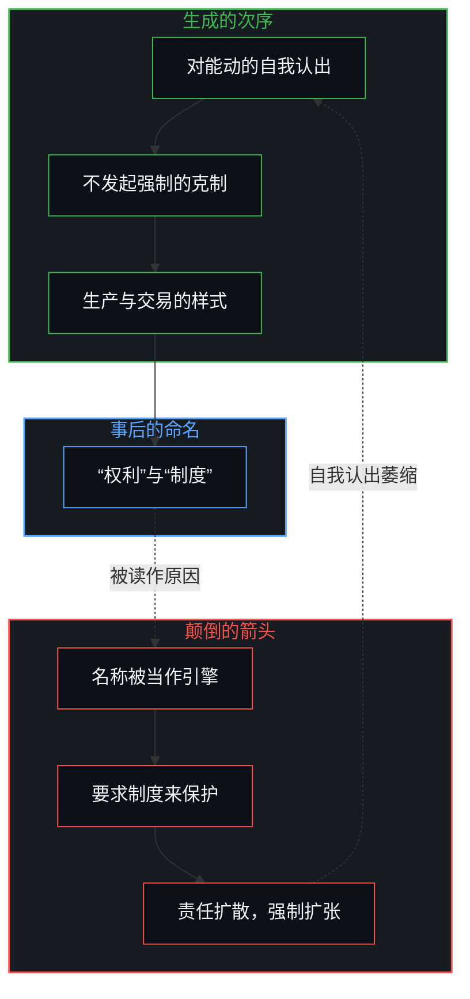
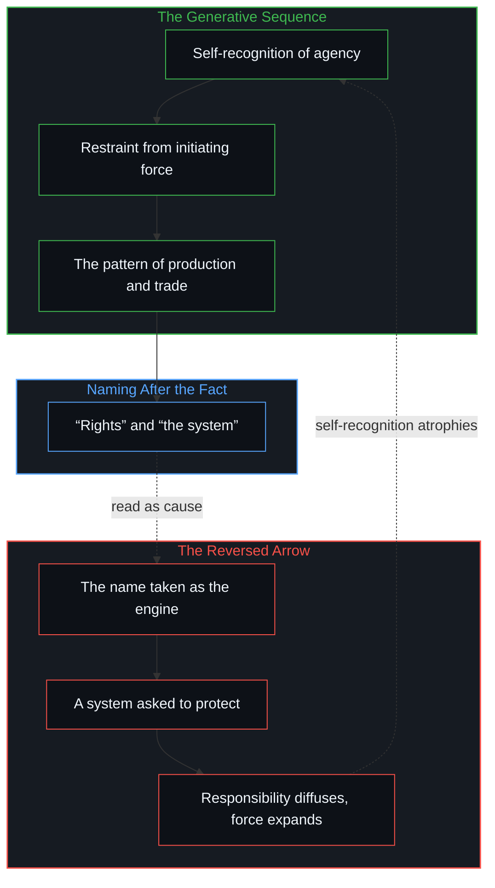

# 能动性的错配 / The Misallocation of Agency

*自由起于每个心智的自我认出；把它的样式命名为权利、交给制度守护，颠倒了因果 / Freedom begins as self-recognition in each Mind; naming its pattern rights for a system to guard reverses causality.*

经济自由不是把个人权利应用到生产与交易上。权利话语是在事后描述不侵犯的样式，把集体的痕迹当作发起的原因。自由只起于个体所在之处，作为它对自身能动的认出，以及不发起强制的自愿克制。这个起点一旦被移进一套外在的安排，对制度性保障的要求，就取代了生成这一样式的那些自我认出的行动。

Economic freedom is not the application of individual rights to production and trade. Rights-talk describes the pattern of non-aggression after the fact, treating collective residue as if it were the initiating cause. Freedom begins only at the individual locus, as the recognition of its own agency and the voluntary restraint from initiating force. When that origin is relocated into an external arrangement, the demand for systemic guarantees replaces the very acts of self-recognition that generate the pattern.

## 一、 生成的次序先于权利话语 / 1. The Generative Sequence Precedes Rights-Talk

自我区分的活动在发生，无因、不息。称之为心智：观察者早已在途中，每一次行动皆是一次区分。它发生在各个所在之处。所谓自由，是个体心智认出自己是自身判断与行动的源头。这份认出先于一切法律、经济与制度的形式。

Self-distinguishing activity occurs, uncaused and unceasing. Call it the Mind: the observer already under way, every act of which is a distinction. It occurs at loci. What is called freedom is the individual Mind recognizing itself as the origin of its own judgments and actions. That recognition comes before every legal, economic and institutional form.

一个人在自己所在之处认出能动，这份认出就带着自愿的克制：对另一个中心发起强制，是一次跨越所在的越权，否认了双方的能动。许多人在反复的行动中维持这份自我认出与克制，一片稳定的、自愿生产、交易与不侵犯的场域便涌现出来。

When an individual recognizes agency at their own locus, that recognition entails voluntary restraint: initiating force against another center attempts a cross-locus override that denies the agency of both. When many individuals sustain that self-recognition and restraint across repeated acts, a stable field of voluntary production, trade and non-aggression emerges.

后来的观察者看到这个涌现的样式，把它的规律命名为“个人权利”，把整体的协作标为“自由放任资本主义”。命名样式是描述上的方便。把名称当作行为的引擎，就颠倒了因果的箭头。自由不是从一纸宪章、一套经济制度或一种权利哲学降下来的；这些人造物，是此前种种自我认出沉积下来的痕迹。[个体抉择是唯一的因果杠杆](../individual-choices-as-the-only-causal-levers/)在社会进步被当作环境的属性、而不是一连串独立抉择时，做的是同一刀切分。

Later observers see that emergent pattern, name its regularities “individual rights” and label the overall coordination “laissez-faire capitalism.” Naming the pattern is a descriptive convenience. Treating the name as the engine of the behavior reverses the arrow of causality. Freedom does not descend from a charter, an economic system or a philosophy of rights; those artifacts are the sedimented residue of earlier self-recognitions. [Individual choices as the only causal levers](../individual-choices-as-the-only-causal-levers/) makes the same cut where social progress is treated as an environmental property rather than as successive independent choices.

1. 个体所在之处对能动的自我认出
2. 不发起强制的自愿克制
3. 生产与交易的稳定样式涌现
4. 事后把这一样式命名为“权利”与“制度”

1. Self-recognition of agency at the individual locus
2. Voluntary restraint from the initiation of force
3. Emergence of a stable pattern of production and trade
4. Later naming of the pattern as “rights” and “the system”

## 二、 心智之间的影响是参考，不是直接的因果 / 2. Influence Between Minds Is Reference, Not Direct Causation

相信一个心智能直接决定另一个心智的行动，就已经放错了能动的位置。不同的中心之间，只有可得性的样式：一个心智可以把自己的行为、言语或产物，作为可供检视的数据摆出来。只有接收的心智去解释、评估这些数据，并把它们整合进自己递归的更新。

Any belief that one Mind can directly determine the actions of another has already misplaced where agency is. Between distinct centers there is only availability-patterning: one Mind may present its conduct, words or products as data available for inspection. The receiving Mind alone interprets and evaluates that data and integrates it into its own recursive updates.

心智之间登记不到直接的因果传递；把影响当作直接的原因，就把接收的中心降为一个结果，而不是行动的源头。能动经不起这样的降格。说服、教学与商业，都只作为参考运作。[专家经验作为参考而非替代](../expertise-as-reference-not-replacement/)是这道边界以关怀为装束的一面：别人的地图让可选项更稠密，下一步行动的杠杆却只在承受后果的所在之处。[总在倾听者无法发起](../what-always-listens-cannot-originate/)是这道边界以接纳为装束的一面：接纳无法被转成目的的第二个源头。

No direct causal transfer registers between Minds; treating influence as direct cause reduces the receiving center to an effect rather than an origin of action. Agency cannot survive that reduction. Persuasion, teaching and commerce work only as reference. [Expertise as reference, not replacement](../expertise-as-reference-not-replacement/) is that boundary in the costume of care: another’s map densifies the available options, but the lever of the next act stays only at the locus living the consequences. [What always listens cannot originate](../what-always-listens-cannot-originate/) is that boundary in the costume of receptivity: receptivity cannot be turned into a second source of ends.

因为影响以参考为界，任何集体秩序都无法从上方设计出来。秩序只在独立的中心彼此遇见不侵犯、并自愿对齐各自的生产时形成。[价格是言说，理解是交易](../price-as-utterance-understanding-as-trade/)是这道边界在市场上的一面：订单以局部的重叠撮合，而不是以共享的内在；成交价是那次接触的痕迹，下一步在每一道边沿上重新生成。

Because influence is bounded by reference, no collective order can be engineered from above. Order forms only when independent centers meet in mutual non-aggression and voluntarily align their production. [Price as utterance, understanding as trade](../price-as-utterance-understanding-as-trade/) is the market face of this boundary: orders match by regional overlap, not by shared interiority; the transaction print is the residue of that contact, and the next step is generated fresh at each edge.

## 三、 把样式当作主体是范畴错误 / 3. Treating a Pattern as a Subject Is a Category Error

一个制度没有能动，没有意志，也没有行动的能力。它是各个个体中心互动之后留下的痕迹的稳定构型。说“制度”保护权利、提供机会或培育自由，就是把一个抽象的痕迹样式当作一个能动的主体。

A system has no agency, no will and no capacity to act. It is a stabilized configuration of the traces left by the interactions of individual centers. Speaking of “the system” protecting rights, providing opportunities or fostering freedom treats an abstract trace-pattern as an active subject.

这种对待是形象滞后的范畴错误：一个关于集体互动的、被保留下来的心智模型，被保存到它那一步之后，又被赋予只属于活着的心智的因果力量。即便千百万人共同相信制度拥有保护的力量，这份共同的信念也不会在样式里造出能动。它只是把因果的发起之处描述错了。[协调者的范畴错误](../the-coordinators-category-error/)是一份变得稠密的共享记录被当作下一次同意的共同作者时的冻结。[造物无法取代其源头](../a-creation-cannot-replace-its-source/)是一个外化的机制被抬到维持它的活着的能动之上时的冻结。[统计学无法揭示的心智](../the-mind-that-statistics-cannot-reveal/)是同一范畴错误在统计上的样子：把相关混同为因果，是一次立刻否认自身能动的能动。

This treatment is a category error of Image lag: a retained mental model of collective interaction is kept past its step and endowed with causal powers that belong only to the living Mind. Even when millions share the conviction that the system holds protective power, that shared belief does not create agency in the pattern. It only misdescribes where causal initiation lies. [The coordinator’s category error](../the-coordinators-category-error/) is that freeze when a densified shared record is held as co-author of the next assent. [A creation cannot replace its source](../a-creation-cannot-replace-its-source/) is that freeze when an externalized mechanism is raised above the living agency that sustains it. [The Mind That Statistics Cannot Reveal](../the-mind-that-statistics-cannot-reveal/) is that category error in statistics: confusing correlation with causation is an act of agency that at once disowns its own agency.

制度不作用于个体；个体在一片被此前抉择塑形的场域里行动。样式一旦被当作自由的作者，真实的因果所在就被遮住了。

The system does not act on individuals; individuals act within a field patterned by earlier choices. When the pattern is treated as the author of freedom, the actual site of causation is hidden.

## 四、 对保护的要求侵蚀了生成的行动 / 4. The Demand for Protection Erodes the Generative Act

认为个人权利需要一套外在制度来保护，是这次错配中起决定作用的一例。它把能动的所在，从内在的自我认出，移到一个外在的行政结构上。

The belief that individual rights need protection by an external system is the decisive instance of this misallocation. It moves the locus of agency from inner self-recognition to an outer administrative structure.

人们一旦相信自己的自由由一部宪法、一个国家或一套市场装置来保障，就开始向这套外在安排去要那份只有自己持续的判断才能维持的东西。这次外化生出一种特定的失效方式：

Once people come to believe that their freedom is secured by a constitution, a state or a market apparatus, they begin looking to the external arrangement for what only their own continuous judgment can sustain. This externalization produces a specific failure mode:

1. **责任的扩散：** 个人不再把不侵犯与彼此的尊重看作自己的行动当下就要的纪律，而把它们看作制度送来的服务。
2. **执行的扩张：** 指望一股外在的力量来保障权利，就请这股力量为执行保障而发起强制，引入的恰是这一样式本来要排除的强迫。
3. **自我认出的萎缩：** 对外在保障的依赖越深，自发的、自我节制的不侵犯出现的频率就越低。

1. **Diffusion of responsibility:** individuals stop seeing non-aggression and mutual respect as immediate disciplines their own actions require, and see them instead as services the system delivers.
2. **Expansion of enforcement:** looking to an external power to guarantee rights invites that power to initiate force in order to enforce the guarantee, bringing in the very coercion the pattern exists to exclude.
3. **Atrophy of self-recognition:** as reliance on external guarantees deepens, the frequency of spontaneous, self-governed non-aggression declines.

把自由安放在它唯一能存在之处，也就是个体心智之外，对制度性保护的要求便削薄了最初创造这一自由样式的生成行动。对制度性保障的要求，让自由的持续实现变得更不可能，而不是更可能。[赋权确立权力的集中](../empowerment-establishes-the-centralization-of-power/)是这次位移以授予为装束的一面：能力被框定为来自一个被授权源头的礼物，而接连的抉择仍是唯一的杠杆。[剩余个人主义](../residual-individualism/)是这次位移以保护性设计为装束的一面：保障仍是痕迹，杠杆仍在当下约束之下剩余的行动。自由不需要任何制度的保护，因为它就是地基，[自由即地基](../freedom-as-ground/)说明了这一点。

By placing freedom outside the only place it can exist, the individual Mind, the demand for systemic protection thins the generative acts that create the free pattern in the first place. The demand for systemic guarantees makes the sustained realization of freedom less likely, not more. [Empowerment establishes the centralization of power](../empowerment-establishes-the-centralization-of-power/) is that displacement in the costume of bestowal: capacity framed as a gift from an authorized source while successive choosing remains the only lever. [Residual individualism](../residual-individualism/) is that displacement in the costume of protective design: safeguards remain residue, while the lever stays with the residual act under present constraints. Freedom needs no system’s protection because it is the ground, as [Freedom as Ground](../freedom-as-ground/) shows.

## 五、 因果的箭头从不从痕迹倒回源头 / 5. The Causal Arrow Never Reverses from Residue to Origin

能动无法被转让、委托，或存进一个集体的容器。它只作为个体心智能动的、自我区分的运作而存在。每一次把自由锚定在外在框架里的尝试，都放错了它的位置，削弱了它持续的实践。

Agency cannot be transferred, delegated or stored in a collective container. It exists only as the active, self-distinguishing operation of individual Minds. Every attempt to anchor freedom in an external framework misplaces its location and weakens its ongoing practice.

自由放任资本主义不产生自由的个人。自由的个人认出自身的能动、不对他人发起强制，产生了后来被标为自由放任资本主义的那种关系样式。

Laissez-faire capitalism does not produce free individuals. Free individuals, by recognizing their own agency and refusing to initiate force against others, produce the pattern of relations later labeled laissez-faire capitalism.

“经济自由就是把个人权利应用到生产与交易上”这一说法，把车当成了马。权利话语描述的是脚印的形状；生成的一步是那只踩下去的脚。一切自由活着的源头，始终在那道选择、行动并克制强制的个体边沿上。[因果停留在掌舵的边缘](../causality-stays-at-the-edge-that-steers/)是底下的几何：掌舵的边沿无法把自己的因果移进它身后留下的尾迹。[道德语言作为投影](../moral-language-as-projection/)追踪这次位移在语言上的机制：把制度的摩擦道德化为审慎或病态，是把已经从个人身上移走、转进集体控制结构的能动投射出来。交出解释的权利，本身也是一次自由的抉择，[目的性的评判与认知的缺省状态](../cong-mu-di-xing-de-ping-pan-kan-ren-zhi-que-sheng/)说明了这一点。

The claim that “economic freedom is simply individual rights applied to production and trade” puts the cart before the horse. Rights-talk describes the shape of the footprint; the generative step is the foot pressing down. The living origin of all freedom stays at the individual edge that chooses, acts and refrains from force. [Causality stays at the edge that steers](../causality-stays-at-the-edge-that-steers/) is the geometry underneath: the steering edge cannot relocate its causality into the wake it leaves behind. [Moral Language as Projection](../moral-language-as-projection/) tracks the linguistic mechanism of this displacement: moralizing institutional friction as prudence or pathology projects agency already removed from individuals and transferred into collective control structures. Handing over the right to explain is itself a free choice, as [Judging by Purpose and the Default State of Cognition](../cong-mu-di-xing-de-ping-pan-kan-ren-zhi-que-sheng/) shows.
