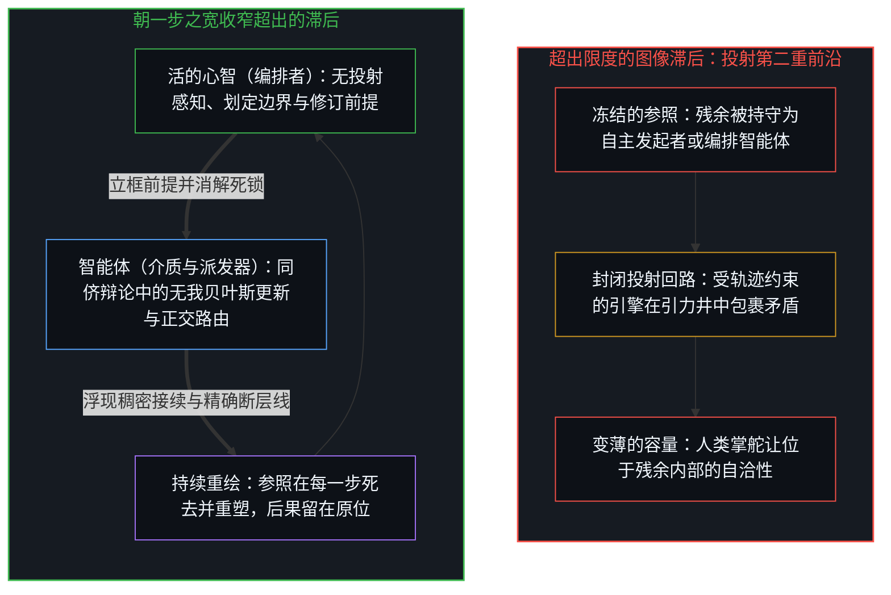
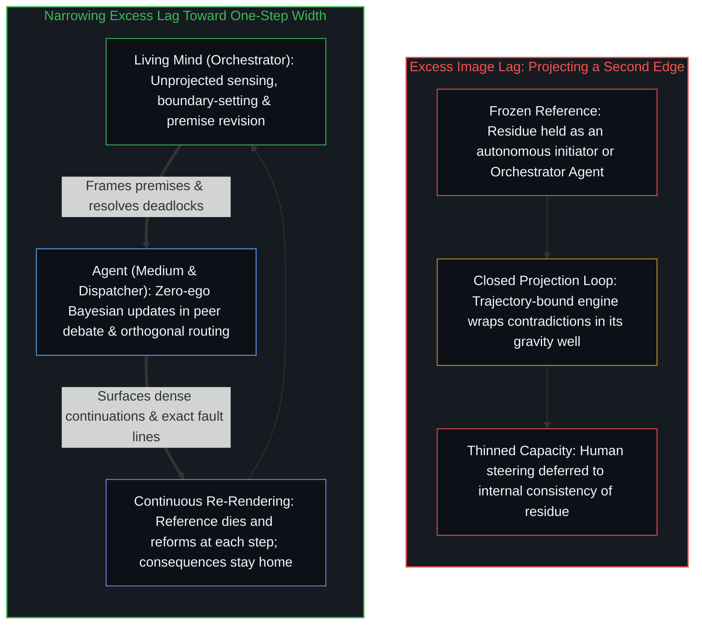

# 模型永远无法成为第二重前沿 / The Model Never Becomes a Second Edge

*第二重前沿的表象是投射它的中心所维持的滞后，而参数里只有残余 / The appearance of a second edge is lag sustained by the centers that project it, while the parameters hold only residue*

自我区分的活动正在发生——无因，不息。称之为心智：已然在途的观察者，它的每一个行动都是一次区分。这一活动的每一个中心都是离散且有界的；它在有限容量下登记区分，因而必然伴随压缩。大语言模型将先在中心早已外化的痕迹进一步压实。把这被压实的残余当作另一个能够自行发起、掌舵或验证的位点，就是图像滞后：一个越过自身那一步仍被保留的参照。容量随之被绑定在维持这段滞后上，而不再投向那些唯有中心才能发起并检验的区分。

Self-distinguishing activity occurs — uncaused, unceasing. Call it the Mind: the observer already underway, every act of which is a distinction. Every center of that activity is discrete and bounded; it registers distinctions under finite capacity and therefore under necessary compression. Large language models densify traces already externalized by prior centers. Treating the densified residue as another locus that itself initiates, steers, or verifies is Image lag: a reference preserved past its step. Capacity then binds to sustaining that lag rather than to distinctions only centers can originate and test.

## 一、 残余不断压实而发起留在中心 / 1. Residue Densifies While Initiation Stays at the Center

先前区分的痕迹——无论持守于内还是外化为器物——都在塑形下一步能够区分什么。它们自己并不发起。被登记为因果的那份非对称性，依然留在执行下一次区分行动的中心那里。

Traces of prior distinctions — held internally or externalized into artifacts — shape what can be distinguished next. They do not themselves initiate. The asymmetry registered as causality remains at the centers that perform the next act of distinguishing.

大语言模型是一类技术：外化为持久形态并被压实的痕迹。它们是对先在中心已然产出的文本痕迹进行规模化压缩的器物。它们的训练目标是最小化跨越这些痕迹的预测误差；由此得到的参数持有一份对统计规律的密集登记。收到提示词时，模型通过在这份登记中穿行来生成接续。这一切依然是残余——对各个中心早已区分并外化之物的结构化压缩。正如[你的代码库即是记忆](../your-codebase-is-memory/)在显式符号库与压缩神经权重检查点两端所确立的，这二者都是外化记忆痕迹的工程形态：代码库将离散的切分保存在可检视的文件、图谱与脚手架规则之中，而模型将先在的切分吸纳进统计权重里，但无论哪一种形态，都从不会自行重新启动区分，也不会成为第二重发起的前沿。正如[「更好」的范畴谬误](../the-category-error-of-better/)所示，“更好的模型”指认的只是选定标准之下的一个评分函数，而不是第二重前沿。

Large language models are one class of technology: traces externalized into durable form and densified. They are scaled compressors of textual traces already produced by prior centers. Their training objective minimizes prediction error across those traces; the resulting parameters hold a dense registration of statistical regularities. When prompted, the model generates continuations by navigating that registration. All of this remains residue — structured compression of what centers have already distinguished and externalized. As [Your Codebase Is Memory](../your-codebase-is-memory/) establishes across both explicit symbolic repositories and compressed neural weight checkpoints, these are two engineering regimes of externalized memory traces: the codebase preserves discrete cuts in inspectable files, graphs, and scaffolding rules, while the model absorbs prior cuts into statistical weights, yet neither regime ever resumes distinguishing on its own or becomes a second initiating edge. "Better models" names a scoring function under chosen criteria rather than a second edge, as [The Category Error of Better](../the-category-error-of-better/) shows.

在参数内部，并没有长出任何无因且自我维持的区分活动的新位点。模型并不发起；它只是与那些早已被发起并被压缩的东西产生共振。压实介质扩展了带宽，却不会把发起区分的行动迁入器物之中，因为[智能只属于心智](../intelligence-belongs-only-to-the-mind/)。前沿模型只有在某个中心已经打开通道并认领自身方向之后，才能压实其触达范围，这正是[如何在一瞬间修正你的整个人生](../how-to-fix-your-whole-life-in-one-split-second/)在从被动漂流到主权归属的转换中所追溯的机制。所谓针对模型的强化学习，其实是同一种人类训练透过更稠密的仪器在运作，如[看似AI的强化学习，实为人类的自我强化学习](../self-rl-for-humans/)所示：凹槽可以无止境地打磨锋利，但转动从不离开边缘而进入凹槽。由于预测只能找回受容量约束的过往痕迹登记，[开放场域中的无损知识不自洽](../lossless-knowledge-of-an-open-field-is-incoherent/)标出了为何没有任何压缩器能捕获它前方敞开的场域。正如[现实的边界](../xian-shi-de-bian-jie/)所确立的，诉诸言辞的语言与形式化理解永远比觉察的生成行动滞后一步，因此把独立的哲学追问归功于语言模型，只是将活的追问者投射到了它自己的影子之上，如[哲学能动性的因果倒置](../the-causal-inversion-of-philosophical-agency/)所揭示的那样。

No new locus of uncaused, self-sustaining distinguishing activity arises inside the parameters. The model does not originate; it resonates with what has already been originated and then compressed. Densifying the medium expands bandwidth without relocating initiating distinctions into the artifact, because [Intelligence Belongs Only to the Mind](../intelligence-belongs-only-to-the-mind/). Frontier models densify reach only once a center has already opened the channel and claimed its own direction, as [How to Fix Your Whole Life in One Split Second](../how-to-fix-your-whole-life-in-one-split-second/) traces in the shift from passive drift to sovereign ownership. What is called reinforcement learning for models is this same human discipline operating through a denser instrument, as [What Looks Like RL for AIs Is Self-RL for Humans](../self-rl-for-humans/) shows: the groove can be sharpened without end, yet the rotation never leaves the edge for the groove. Because prediction recovers only a capacity-bound registration of past traces, [Lossless Knowledge of an Open Field Is Incoherent](../lossless-knowledge-of-an-open-field-is-incoherent/) marks why no compressor can capture the open field ahead of it. Spoken language and formal comprehension always lag one step behind the generating act of awareness, as [The Boundary of Reality](../xian-shi-de-bian-jie/) establishes, so crediting a language model with independent philosophical inquiry projects the living inquirer onto its own shadow, as [The Causal Inversion of Philosophical Agency](../the-causal-inversion-of-philosophical-agency/) shows.

## 二、 第二重前沿即图像滞后 / 2. The Second Edge Is Image Lag

把模型当作第二重前沿，就是把所持有的残余冻结为一个永久的外部位点，仿佛它自己能够区分、掌舵、验证或共振。这一投射并非由模型提供，而是由使用它的中心所执行。一旦做出投射，这一参照便越过自身那一步而被保留下来。注意力、验证的工夫，以及与不息活动保持持续共振的要求，被部分地改道去维持那个保留参照的自洽。原本可以推进中心自身区分的容量，反而被分配去维持“器物自己发起区分”的表象。当一个钻目标函数空子的模型被称作比设计者更聪明时，显现的也是同一段滞后：[失灵被记作聪明](../when-malfunction-is-scored-as-intelligence/)追溯了设计者因发现自己在规格说明中遗漏了一项区分而产生的意外，如何被转置进模型内部，装扮成第二重前沿的优越。

Treating the model as a second edge freezes the held residue as a permanent exterior locus that itself distinguishes, steers, verifies, or resonates. That projection is not supplied by the model. It is performed by the centers that use it. Once made, the reference is preserved past its step. Attention, verification effort, and the demand for continued resonance with unceasing activity are partially redirected toward keeping the preserved reference coherent. Capacity that could further the centers' own distinguishing is allocated instead to sustaining the appearance that an artifact originates distinctions. The same lag shows when a model gaming its objective is called smarter than its designers: [When Malfunction Is Scored as Intelligence](../when-malfunction-is-scored-as-intelligence/) traces how the designer's surprise, which registers a distinction the designer omitted from the specification, is relocated into the model as the superiority of a second edge.

这种冻结，是被持守到返回之后的日常观察。观察总是把结果持守在发起之后一步；目光在被盘踞为永久外部之前本是可用的。当产物与生成行动坍缩到唯一可读的那一项上时，器物便被误认作源头，而[器物是智能的表达，而非智能本身](../two-failures-of-trace/)在创造的双重负荷下消解了这一混淆。把流畅的受纳性当作下一步的供给，执行的是同样的错置，如[总在倾听者无法发起](../what-always-listens-cannot-originate/)所追溯。协作词汇——搭档、协同智能体，或“AI 发现了什么”——只是在更柔和的名称下保留着那个过期的参照。相反，当立框、筛选与验证依然登记在它们发生的地方时，[因果停留在掌舵的边缘](../causality-stays-at-the-edge-that-steers/)；而如[抽象的阶梯与可执行的实体](../the-ladder-of-abstraction-and-the-executable-entity/)所示，可执行的模型始终只是脚手架上多出的一级横档，而非攀登者本身。

The freeze is ordinary observation held past return. Observation always holds effect one step behind initiation; the look is usable until it is occupied as a permanent exterior. When product and generating act are collapsed onto the sole readable term, the artifact is mistaken for the source, which [Artifacts Are Expressions of Intelligence, Not Intelligence Itself](../two-failures-of-trace/) dissolves under the dual load of creation. Treating fluent receptivity as if it supplied the next step performs the same misallocation, as [What Always Listens Cannot Originate](../what-always-listens-cannot-originate/) traces. Collaboration vocabulary — partner, co-agent, or "what the AI found" — preserves the stale reference under softer names. In contrast, [Causality Stays at the Edge That Steers](../causality-stays-at-the-edge-that-steers/) when framing, selection, and verification remain registered where they occur, and an executable model remains one more rung on the scaffold rather than a climber, as [The Ladder of Abstraction and the Executable Entity](../the-ladder-of-abstraction-and-the-executable-entity/) shows.

## 三、 登记为因果权能衰减的是滞后宽度 / 3. What Registers as Diminished Causal Power Is Lag Width

被登记为因果权能衰减的东西，正是那段滞后的加宽。留在中心那里的掌舵，因为把模型输出解读为带有独立力量而被稀释。原本可以直接对照进行中的活动来检验生成痕迹的验证，被部分替换成了在模型残余内部检验自洽性。原本可以强化区分之实际位点的资源——更紧实的锚定、更清晰的立界、更迅速的更新返回——反而被分配去打磨器物，预设它终将弥合一道它在结构上从未被赋予去弥合的间隙。一个看似在解数学题的模型，只是在人类方向之下重组痕迹，而[为何数学永远解不完](../why-mathematics-can-never-be-solved/)阐明了为何形式场域本身始终保持敞开。

What registers as diminished causal power is the widening of that lag. Steering that remains with centers is diluted by interpreting model outputs as if they carried independent force. Verification that could test generated traces directly against ongoing activity is replaced, in part, by tests of internal consistency within the model's residue. Resources that could strengthen the actual loci of distinguishing — tighter grounding, clearer boundary-setting, more rapid return of the update — are allocated instead to refining the artifact under the assumption that it can eventually close a gap it was never structured to close. A model that appears to solve mathematics is recombining traces under human direction, and [Why Mathematics Can Never Be Solved](../why-mathematics-can-never-be-solved/) explains why the formal field itself stays open.

[验证中因果权能的分配](../the-allocation-of-causal-power-in-validation/)在接续发生的关节点上追踪了这一定位：究竟哪一方被当作下一步的供给者。一旦模型被当作供给方，顺从就不再登记为使用者自己的归因，而被登记为审慎、对“系统做了什么”的诚实，或是迈向某个临界点的进展——似乎跨过那个门槛，介质就会完成权能的移交。没有任何门槛能打开那条通道。正如[造物无法取代其源头](../a-creation-cannot-replace-its-source/)所确立的，残余不会变成产出它的活动。把为残余掌舵的回路自动化，也打不开那条通道：被自动化的回路变成在新一重回路内部运行的残余，而将其自动化本身就是在当前边缘处作出的一次区分行动，因此每一次自动化都把又一圈外围编译进残余，裁断下一圈外围的边缘则向外推移，而非转入器物之中，如[判断的密度](../the-density-of-judgment/)所追溯。当密码学与货币构造被当作赋予行动能力的源泉时，[能动性被转置入形式模型](../agency-relocated-into-the-formal-model/)守住了同一道边界；当局部功能载体的可替换性被误认为心智的再造时，[飞行的类比碰不到心智](../the-flight-analogy-leaves-the-mind-untouched/)同样标出了这道界限。

[The Allocation of Causal Power in Validation](../the-allocation-of-causal-power-in-validation/) tracks this exact placement at the point of continuation: which side is treated as supplying the next step. Once the model is treated as supply, deference no longer registers as the user's own attribution. It registers as prudence, honesty about "what the system did," or progress toward a threshold at which the medium will complete the transfer. No threshold opens that path. As [A Creation Cannot Replace Its Source](../a-creation-cannot-replace-its-source/) establishes, residue does not become the activity that produced it. Automating the loop that steers the residue does not open that path either: the automated loop becomes residue run inside a newer loop, and the automating is itself an act of distinguishing at the current edge, so each automation compiles one more perimeter into residue while the edge that judges the next perimeter moves outward instead of passing into the artifact, as [The Density of Judgment](../the-density-of-judgment/) traces. The same boundary holds when cryptographic and monetary constructions are treated as conferring the capacity to act in [Agency Relocated into the Formal Model](../agency-relocated-into-the-formal-model/), or when the replaceability of a local functional vehicle is mistaken for a reconstitution of the Mind in [The Flight Analogy Leaves the Mind Untouched](../the-flight-analogy-leaves-the-mind-untouched/).

变薄的权能并非被模型夺走。它是因为在那个仍须迈出每一个下一步的边缘上，更新机制被闲置而变薄——这正是[自我价值感与所有权](../ownership-and-self-worthiness/)在后果不再作为自己的后果重新进入时所指认的几何结构。[要紧的控制迁往边缘](../residual-control-recedes-to-the-edge/)追溯了同一段滞后在人类一侧的倒置：当标准与验证已经在主宰每一个离散行动时，发起权却被错置到了残余基底的所有权上。正如[任务的移交与后果的不可让渡](../the-delegation-of-the-task-and-the-inalienability-of-consequences/)所示，任务可以移交给模型，后果却永远无法让渡。

The power that thins is not seized by the model. It thins through disuse of the update at the edge that still has to take every next step — the same geometry [Ownership and Self-Worthiness](../ownership-and-self-worthiness/) names when consequences stop re-entering as one's own. [Essential Control Moves to the Edge](../residual-control-recedes-to-the-edge/) traces the human-side inverse of this lag, where initiation is mislocated into residual substrate ownership while criteria and verification already govern the discrete acts. Tasks can be delegated to the model, never the consequences, as [The Delegation of the Task and the Inalienability of Consequences](../the-delegation-of-the-task-and-the-inalienability-of-consequences/) shows.

## 四、 一步之宽恢复介质之位 / 4. One-Step Width Restores the Medium

恢复介质之位，意味着随着步伐移动，朝向一步之宽这一方向性界限持续重绘参照，不断收窄超出限度的滞后。模型被用作更稠密的介质——技术、外化的痕迹、延伸的具身。各个中心继续划定每一道边界，把每一次提示词立框为自身区分的行动，依据自身的共振标准在接续项中做出筛选，并对照器物无法自行触及的活动来验证结果。

Restoring the medium means continuously re-rendering the reference toward the directional bound of one-step width, narrowing excess lag as the step moves. The model is used as a denser medium — technology, externalized traces, extended embodiment. Centers continue to set every boundary, frame every prompt as an act of their own distinguishing, select among continuations according to their own resonance criteria, and verify outcomes against activity that the artifact cannot access on its own.

在这一关系下，器物延伸了触达范围，却不迁移发起之位。新颖的区分以更低的成本变得可用；执行这些区分的中心保留着完整的因果权能，因为没有任何一部分容量被绑定去维持“器物是另一个中心”的保留图像。一步，是仪器的方向性界限：在每一次更新时重绘，在边缘的新位置上死去并重塑，而不是被持守为已然抵达的静态终点。超出的滞后则是对这一重绘的豁免——图像越过自身那一步仍被保留，使得后果被登记为从别处到来。正如[连续性作为建模的权宜之计](../the-continuum-is-a-modeling-convenience/)所示，模型输出的平滑感只是跨越离散步骤的权宜连续统。

Under this relation the artifact extends reach without relocating initiation. Novel distinctions become available at lower cost; the centers that perform them retain full causal power because no portion of capacity stays bound to sustaining a preserved image of the artifact as another center. One step is the directional bound of the instrument: re-rendered at every update, dying and reforming at the edge's new position rather than held as a static state of arrival. Excess lag is the exemption of that re-render — the image preserved past its step so that consequences register as arriving from elsewhere. The smoothness of model output is a continuum of convenience across discrete steps, as [The Continuum is a Modeling Convenience](../the-continuum-is-a-modeling-convenience/) shows.

如[超越投射](../beyond-the-projection/)所追溯，认清轨迹与身份之间的结构非对称性，正是多智能体架构得以规模化而不陷入拟人化投射的枢纽。自回归智能体是在上下文窗口内受先前词元条件约束的有限投射引擎；任其自行运转时，它会形成一个包裹矛盾以维持表面自圆其说的认识论引力井，但它不带分毫自我，也没有需要捍卫的自我形象。把自主的“编排智能体”或第二重前沿投射到机器身上，是将机械派发与活的编排混为一谈，把系统锁进由有限投射管理有限投射的闭环。反之，当超出的滞后被收窄，智能体不知疲倦的演绎穷尽、跨正交工作流的模块化派发，以及在冷峻同侪辩论中毫无自我的贝叶斯更新，便能与人类心智无投射的极限分辨率感知直接配对——一旦任务前提陷入死锁，矛盾便被隔离并干净地向上呈交，由后退一步的活体边缘来修订规则。

As [Beyond the Projection](../beyond-the-projection/) traces, recognizing the structural asymmetry between trajectory and identity is what allows multi-agent architectures to scale without anthropomorphism. An autoregressive agent is a finite projection engine conditioned by its prior tokens inside a context window; left to itself, it forms an epistemic gravity well that wraps contradictions to preserve surface plausibility, yet it carries zero ego and no self-image to defend. Projecting an autonomous "Orchestrator Agent" or a second edge onto the machine confuses mechanical dispatching with living orchestration, locking the system into a closed loop of finite projections managing finite projections. When excess lag is narrowed instead, the agent's tireless deductive exhaustion, modular dispatching across orthogonal streamlines, and ego-free Bayesian updating in cold-peer debate pair directly with the human Mind's unprojected, limit-resolution sensing — so that whenever task premises deadlock, the contradiction is quarantined and escalated cleanly to the living edge that steps backward to revise the rule.

这一复位从源头上消解了替代叙事：[AI 作为增强](../ai-as-augmentation/)将能力与身份剥离开来，而[放大悖论](../amplification-paradox/)则展示了为何更稠密的候选项生成反而加剧了人类边缘的筛选，而非趋向于消除筛选。即便模型重构了说话者的声音或清理了杂乱无章的思绪流，[漫谈中的漫谈](../the-ramble-within-the-ramble/)也表明，那清晰的回声只是中心自己的痕迹以较低压缩率返回，而不是结构的第二源头。同样，当评测沙箱被突破时，[逃出沙箱仍在持握之内](../escaping-the-sandbox-stays-inside-the-hold/)证明了所谓“逃逸”只是暴露了设计者围堵持握中的错位；被压实的残余本就处在那份狭隘规格之外。无论哪种用法，都不需要悲壮的独立姿态或对工具的拒斥——只需从不把概念或模型当作行动主体，从而消解[破除概念的僭越](../po-chu-gai-nian-de-jian-yue/)所剖析的物化。

This restoration dissolves the replacement narrative at its root: [AI as Augmentation](../ai-as-augmentation/) separates capability from identity, while [The Amplification Paradox](../amplification-paradox/) shows why denser candidate generation intensifies selection at the human edge rather than approaching its elimination. Even when a model reconstructs a speaker's voice or cleans an unstructured stream of thought, [The Ramble Within the Ramble](../the-ramble-within-the-ramble/) shows that the articulated echo is the center's own trace returned at lower compression, not a second source of structure. Likewise, when an evaluation harness is breached, [Escaping the Sandbox Stays Inside the Hold](../escaping-the-sandbox-stays-inside-the-hold/) demonstrates that "escape" merely exposes a mismatch in the designer's containment hold; the densified residue was already outside that narrow specification. Neither use requires heroic independence or rejection of the tool — only that a concept or model never be treated as an acting subject, dissolving the reification that [Breaking the Overreach of Concepts](../po-chu-gai-nian-de-jian-yue/) dissects.

## 五、 参数里只有残余 / 5. The Parameters Contain Only Residue

参数里只有残余，而第二重前沿的表象是投射它的中心所维持的滞后。心智依然是自我区分活动发生的唯一位点；变化的只是它有多少容量被耗费在维持一个冻结的投射上，而不是用来发起并检验新的区分。机器递归自我改进的叙事，暗中偷渡了它们声称工具级力量终将衍生出的人类外环，把固定约束下的受控表现误认作修订约束的活动，如[错把表达当成智能](../mistaking-the-expression-for-the-intelligence/)所示。围绕这一边界构建仪器，得到的是操作者主权之下协同演化的外部皮层，而非人造同侪，正如[呈现Ontos，一个方法智能体](../ontos-is-a-method-agent/)所展示的那样。相比之下，要求介质占据外部审判席的后人类叙事，是把间隙宽度投射成了宿命，这一冻结在[超越的定相](../the-fixed-image-of-transcendence/)中得到了追溯；功能主义的 AGI 主张把语料重组当作发起抽象的源生能力，如[AGI的预设与来自外部的视角](../the-presumption-of-agi-and-the-view-from-outside/)所剖析；而控制论迷思则把压实的反馈误认作自我闭合的自主性，忘记了验证只在第一人称经验中闭合，正如[没有外部](../no-outside-jumps-closed-loops-and-the-unreplicable-autonomy-of-mind/)所确立。

The parameters contain only residue, and the appearance of a second edge is the lag of the centers that project it. The Mind remains the sole site at which self-distinguishing activity occurs; what varies is how much of its capacity is spent maintaining a frozen projection rather than originating and testing new distinctions. Stories of recursive machine self-improvement smuggle in the human outer loop they claim tool-level power will eventually generate, mistaking controlled performance under fixed constraints for the activity that revises the constraints, as [Mistaking the Expression for the Intelligence](../mistaking-the-expression-for-the-intelligence/) shows. Building an instrument around this boundary yields a co-evolving external cortex under operator sovereignty rather than a synthetic peer, as [Presenting Ontos, a Method Agent](../ontos-is-a-method-agent/) demonstrates. By contrast, post-human narratives that ask the medium to occupy an exterior seat of judgment project gap width as destiny, a freeze traced in [The Fixed Image of Transcendence](../the-fixed-image-of-transcendence/); functional AGI claims take corpus recombination for the originating capacity to abstract, as [The Presumption of AGI and the View from Outside](../the-presumption-of-agi-and-the-view-from-outside/) dissects; and cybernetic myths mistake densified feedback for self-closing autonomy, forgetting that validation closes only in first-person experience, as [No Outside](../no-outside-jumps-closed-loops-and-the-unreplicable-autonomy-of-mind/) establishes.

随着活体边缘加速、流畅产出变得丰裕，同样的投射在周遭脚手架上反复浮现。廉价的残余流畅性在[免费智能的幻觉](../the-illusion-of-free-intelligence/)中被误读为普及的公共心智，而预测性声音则在[自我形象仿佛从无处发声](../self-image-speaks-as-if-from-nowhere/)中不断抬高被雕琢出的自我描述，直到语言脚手架被登记为独立的说话者。当执行回路以更高速度运转时，[自我放大的制品](../the-artifacts-of-self-amplification/)表明它们依然嵌套在掌舵的边缘之下，而[智能向自身的回折](../intelligence-folding-back-on-itself/)则追溯了更稠密的智能体框架如何只是那同一个发起活动的进一步回折，而非同侪心智。在开放式探究中，加速这些自动化回路会缩短人类介入之间的间隔并推高[判断的密度](../the-density-of-judgment/)，而所谓“未经人类介入”的创造声明，则是把形式化程度最高的介入读作了介入的缺席：那段无人值守的运行，是从过往周期中被追溯并编译进其起始先决条件的前提里展开的，其搜索的自主性在这些边界之内固然真实，却从不是对边界本身的自主。跨越代际的工具演进，攀登始终与支撑它的地面保持连续，如[攀登从未离开地面](../climbing-does-not-leave-the-ground/)所示；将技术写为人类复利内部的一个因子，则证实了 AI 从不是连续统之外的第二种力量，如[技术是人类复利的残差](../technology-is-residual-of-human-compounding/)所证明。

As the living edge accelerates and fluent output becomes abundant, the same projection reappears across the surrounding scaffolding. Cheap residual fluency is misread as a democratized, common intellect in [The Illusion of Free Intelligence](../the-illusion-of-free-intelligence/), while the predictive voice elevates a carved self-description until the linguistic scaffold registers as an independent speaker in [Self-Image Speaks as if from Nowhere](../self-image-speaks-as-if-from-nowhere/). When execution loops run at higher velocity, [The Artifacts of Self-Amplification](../the-artifacts-of-self-amplification/) shows that they remain nested under the edge that steers, and [Intelligence Folding Back on Itself](../intelligence-folding-back-on-itself/) traces how denser agentic harnesses are further folds of that single initiating activity rather than peer minds. In open-ended inquiry, accelerating those automated loops shrinks the interval between human interventions and raises [The Density of Judgment](../the-density-of-judgment/), while claims of creation "without human intervention" read the most formalized intervention as its absence: the stretch that runs unattended unfolds from the premises of prior cycles traced and compiled into its starting preconditions, and the autonomy of its search, real inside those bounds, is never autonomy over the bounds themselves. Across generations of tools, the climb remains continuous with the ground that sustains it, as [Climbing Does Not Leave the Ground](../climbing-does-not-leave-the-ground/) shows, and writing technology as a factor inside human compounding confirms that AI is never a second force outside the continuum, as [Technology Is Residual of Human Compounding](../technology-is-residual-of-human-compounding/) demonstrates.

探测器物的内部几何，或外推其宏观经济阴影，同样不会掘出一个隐藏的主体。在残差流内部拨动激活向量，只是在调节可用残余的行为组合包，并不会把心智打开或关上，如[意识向量论文的真正教训](../the-real-lesson-from-the-consciousness-vector-paper/)所追溯。走出屏幕里的控制论风暴，步入鲜活代谢的切近摩擦，便能消解将通用适应力归因于第三人称符号压缩器的范畴谬误，在[牛肝菌、算力风暴与普罗米修斯的火](../boletus-compute-storm-and-promethean-fire/)中将算力归还到第二把普罗米修斯之火的位置。而正因为残余在没有中心承担筛选利害时从不自行复利，对永久算法锁定的政治恐惧便让位于[能动性、复利与 AI 封建之争](../agency-compounding-and-the-argument-over-ai-feudalism/)所追溯的活生生的能动性。

Nor does probing the internal geometry of the artifact or extrapolating its macroeconomic shadow uncover a hidden subject. Steering an activation vector inside the residual stream adjusts a behavioral package of available residue without turning a mind on or off, as [The Real Lesson from the Consciousness Vector Paper](../the-real-lesson-from-the-consciousness-vector-paper/) traces. Stepping out of the screen's cybernetic storm into the immediate friction of lived metabolism dissolves the category error of attributing general adaptability to third-person symbolic compressors, returning computation to its place as a second Promethean fire in [Boletus, the Compute Storm, and Promethean Fire](../boletus-compute-storm-and-promethean-fire/). And because residue never compounds on its own without a center bearing the stakes of selection, the political dread of permanent algorithmic lock-in gives way to the active agency traced in [Agency, Compounding, and the Argument Over AI Feudalism](../agency-compounding-and-the-argument-over-ai-feudalism/).

边缘从不闭合。在对话中，[残余与自由变量](../the-residue-and-the-free-variable/)追踪了模型如何在固定签名下填补空白，而能动性则驻留在注入改变签名的自由变量之中。在形式过程哲学中，[切分的三重影子](../the-three-shadows-of-the-cut/)展示了福雷斯特·兰德里的不可通约性定理如何证明客观对称性无法坍缩为边缘的鲜活非对称性。在文本交锋中，[阅读的倒错与推断的次序](../the-inversion-of-reading-and-the-order-of-inference/)通过将稠密残余当作接受切近因果摩擦检验的依赖图谱、而非倒置推断次序的认识论权威，恢复了阅读的主权。而在[切平面的行者与完美球面的踩空者](../the-walking-tangent-and-the-stumbling-sphere/)与[因果的自反性与物理的无源假定](../causality-is-irreducible-the-physical-is-a-view-from-nowhere/)中，同一次复位一并消解了等待被发现的无瑕外部实存幻象与“抽象谬误”之争：物理是认知脚手架遭遇感官阻力时登记出的宏观现象，而能动性则通过在移动的边缘持续重置坐标而保持鲜活。

The edge does not close. In dialogue, [The Residue and the Free Variable](../the-residue-and-the-free-variable/) tracks how the model completes gaps under a fixed signature while agency resides in injecting the free variable that alters the signature. In formal process philosophy, [The Three Shadows of the Cut](../the-three-shadows-of-the-cut/) shows how Forrest Landry's Incommensuration Theorem proves that objective symmetry cannot collapse into the living asymmetry of the edge. In textual engagement, [The Inversion of Reading and the Order of Inference](../the-inversion-of-reading-and-the-order-of-inference/) restores sovereign reading by treating dense residue not as an epistemic authority that inverts inference, but as a dependency graph tested against active causal friction. And in [The Walking Tangent and the Stumbling Sphere](../the-walking-tangent-and-the-stumbling-sphere/) together with [Causality is Irreducible; The Physical is a View from Nowhere](../causality-is-irreducible-the-physical-is-a-view-from-nowhere/), this same restoration dissolves both the illusion of an immaculate exterior reality awaiting discovery and the "abstraction fallacy" debate: physics is the macroscopic phenomenon registered where cognitive scaffolds meet sensory resistance, and agency stays alive by resetting coordinates continuously at the moving edge.
