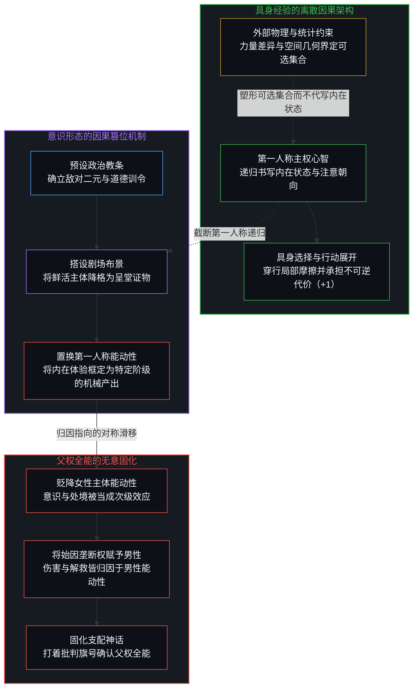
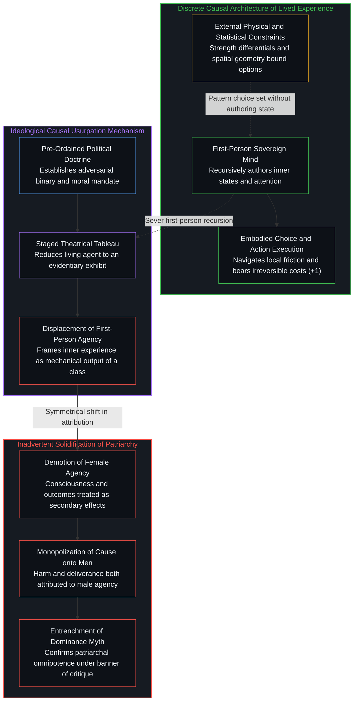
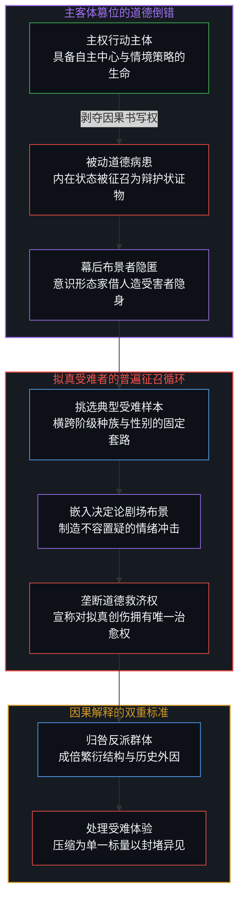
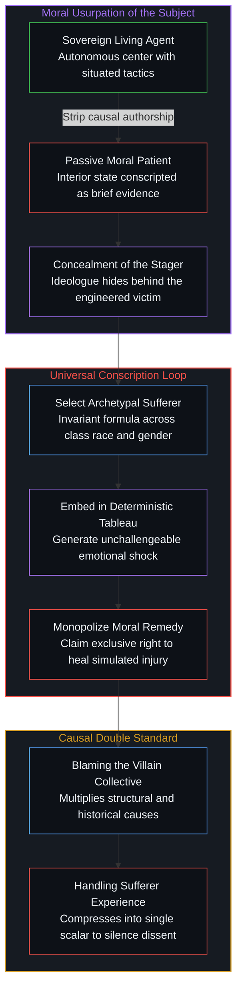

# 道德倒错与被脚本化的主体 / The Moral Reversal and the Scripted Subject

*将内在体验的因果权让渡给对立群体，是意识形态借受难者幻影篡夺主权行动的起点。 / Reassigning causal authorship of inner states is how ideology usurps sovereign action behind a staged victim.*

围绕特定身份主张的公共辩护，频繁依赖一种经过精密剪裁的设定场景：一个男人置身于满室女性之中感到惬意，而一个女人置身于满室男性之中则充满恐惧。这类修辞以通透的经验纪实自居，实则是为了使某项政治承诺看似是在自然经验中被发现而非被预先拣选、从而刻意搭建的实验室布景。当理论家将抽象原型置入孤立的封闭空间时，第一人称行动者的鲜活履历与主动诠释便被剥夺，其内在状态的因果书写权被让渡给外部群体。这种将对立群体指派为个体意识始因的习惯，非但未能瓦解压迫结构，反而在无形中将它自称挑战的因果垄断固化为教条，同时把鲜活主体征召为意识形态辩护状里随时可弃的道具。

Public arguments defending identity programs routinely lean on a meticulously staged scenario: a man in a room full of women is happy, while a woman in a room full of men is terrified. The trope presents itself as a transparent report of empirical experience, yet it is a constructed laboratory tableau engineered so that a political commitment can appear to have been discovered rather than selected. By placing an abstract archetype inside an isolated spatial enclosure, the theorist strips the first-person agent of their lived history and active interpretation, reassigning causal authorship of their inner state to an external collective. This habit of treating an opposing class as the originating cause of individual consciousness fails to dismantle oppressive structures, inadvertently codifying the very causal monopoly it claims to challenge while conscripting living subjects into disposable props for an ideological brief.

## 一、 预设剧场的构景术与经验报告的假象 / 1. The Scenography of the Staged Room and the Illusion of Experiential Evidence

在当代意识形态话语中，一句广为流传的判词被反复当作整场运动无可辩驳的明证：若有人询问为何需要女权主义，只需告诉他们，一个男人置身于满室女性之中会满怀欣喜，而一个女人置身于满室男性之中则会陷入恐惧。这句话在表面上装扮成对具身经验的冷静白描，仿佛只是在转述自然状态下观察到的经验常数。然而审视其因果架构便能看清，它从来不是一份来自经验现场的汇报，而是一座经过精密布设的实验室剧场：它剥离了所有具体情境坐标——无论那个空间是她亲自召集的董事会议室、她登台主讲的报告厅，还是幽闭的暗巷，也无论在场个体是谁、正发出何种局部信号——直至现场只剩下一组赤裸的人口性别比，以此制造出经验常数的假象，让预先设定的意识形态纲领看起来像是在自然界中被发现的定律，而非事先选定的立场。

In contemporary ideological discourse, a viral formulation is repeatedly circulated as unassailable proof of an entire movement: if anyone asks why feminism is necessary, tell them that a man in a room full of women is happy, while a woman in a room full of men is terrified. The sentence presents itself as a dispassionate report of lived reality, as if it were merely transcribing an empirical constant observed in the wild. Yet closer examination of its causal architecture reveals that it is not a report of experience at all. It is a staged laboratory tableau that manufactures the appearance of an empirical constant by stripping away every situated coordinate—whether the room is a boardroom she convened, a lecture hall she addresses, or an enclosed alley, who the specific individuals are, and what local signals they emit—until only a bare demographic ratio remains, engineered so that a pre-existing ideological program can appear to have been discovered in nature rather than chosen in advance.

围绕意识形态教条组织起来的社会行动主义，极少从具体的第一人称具身生活出发去推导政治主张；它总是先确立政治立场，随后搭建出一名代表性的角色，使其内在状态按指令为既有政治背书。那个被安置在假想房间里的女人，并不是一个经由自身一系列决断、局部评估与空间穿行而抵达现场的离散行动主体。她作为抽象原型被摆上纸面，只为让那份按剧本写就的恐惧能作为呈堂证供写入辩护状。正如[革命之名把生活收成证据](../the-name-revolution-files-a-life-as-evidence/)所剖析的，意识形态运动系统性地征召主权生命，将有血有肉的个体转化为替抽象主张作证的器物。

Activism organized around ideological doctrines rarely begins with a concrete first-person life and then infers a politics. It begins with a politics and then stages a representative life whose inner state will ratify that politics on cue. The woman placed inside the hypothetical room is not a discrete living agent who arrived there through her own sequence of choices, local evaluations, and physical navigation. She is placed on the page as an archetype so that her scripted terror can be entered into the brief as exhibit evidence. As analyzed in [The Name Revolution Files a Life as Evidence](../the-name-revolution-files-a-life-as-evidence/), ideological movements systematically conscript sovereign lives, transforming flesh-and-blood individuals into evidentiary instruments for abstract claims.

一旦剧场布景搭建完毕，场景中的因果权能便被迅速调包。房间内所体验到的恐惧，不再被剖析为第一人称自主书写的认知推断——即综合过往痕迹、身体信号、空间约束与当下评估所作出的研判——而是被直接当成周遭男性群体机械排出的副产品。意识形态随即以唯一道德解药的姿态登场，去救治这场刚刚由它亲手编排出来的创伤——这正是[解放的言辞始于定义囚禁](../liberation-rhetoric-begins-by-defining-captivity/)所追溯的几何结构：任何自封为他人外部解放者的话语，都必须先把受困与无助锁定为对方的定义性身份。这种构景术的威力在于其情绪胁迫：通过抛出一幅抽空局部语境的极端漫画，它预先封死了探究具体情境下个体能动性的空间，迫使人们无条件顺从那份在大幕拉起前便已写就的判决。

Once the stage is set, causal power is swiftly reassigned. The terror experienced inside the room is no longer analyzed as a cognitive inference authored in the first person—synthesizing past traces, bodily cues, spatial constraints, and present assessments. Instead, it is treated as a direct mechanical byproduct generated by the surrounding men. The ideology then presents itself as the sole moral remedy to an injury it just orchestrated—the exact geometry traced in [Liberation Rhetoric Begins by Defining Captivity](../liberation-rhetoric-begins-by-defining-captivity/), where any discourse claiming to stand as the external liberator of another must first install captivity and helplessness as the other's defining identity. The power of this scenography lies in its emotional coercion: by presenting an extreme caricature emptied of local context, it preempts any inquiry into situated agency, demanding immediate compliance with a verdict rendered before the curtain was raised.

## 二、 因果权的阶级让渡与父权全能的无意固化 / 2. The Class Reassignment of Causal Power and the Inadvertent Solidification of Patriarchy

这幅预设布景底层的障眼法，在于对因果权能的阶级式重分配。自我区分的活动发生于第一人称切分边缘，在此处，第一人称视角与因果律是一体两面：在具身经验中，房间内唯一运转的发起始因，是在场离散行动者自身的选择——她将注意力投向何处，她携带着何种关于空间与性别的既有诠释框架，她如何解读眼前的邻近躯体、姿态与出口，以及她随后迈出哪一步具身行动（+1）。他人的在场、平均体力差异与空间几何是接触面上的直接物理约束，而统计犯罪率与历史先例则是回溯性的总体痕迹。物理约束界定了可选行动的边界集合，统计痕迹为临时先验提供参考，但无论是物理边界还是群体统计总体，都无法跨入中心自身的递归去代写其内在状态。意识唯有通过第一人称自身的递归运作方能被书写。

The underlying sleight of hand in this staged tableau is the class reallocation of causal power. Self-distinguishing activity occurs at the first-person edge, where perspective and causality operate as two sides of one coin: in lived experience, the only initiating cause operating in the room is the choice of the discrete agent present—where they direct their attention, what retained interpretive frameworks they carry regarding rooms and sexes, how they read the proximate bodies, postures, and exits before them, and what physical step they take next (+1). The presence of others, average physical strength disparities, and spatial geometry are immediate physical constraints at the point of contact, whereas statistical crime rates and historical precedents are retrospective aggregate traces. Physical constraints bound the set of available options and statistical traces inform provisional priors, yet neither physical boundaries nor population aggregates can cross into a center's recursion to author its interior state. Consciousness is authored exclusively in the first person through its own recursive operations.

当外部观察者——或以观察者自居的活动家——宣称是周遭男性制造了那份恐惧时，他们便脱离了具身经验的尺度，将因果能动性指派给了一个人口统计阶级。正如[造神的障眼法与隐秘阶序的说辞](../the-sleight-of-hand-of-synthesizing-gods-and-unacknowledged-rank/)所揭示的，意识形态运动惯于掩盖自身的布景之手，将群体偶像或恶魔塑造成全能的行动主体。尤为关键的是，这种因果分配一旦反向运转，便会将女性的成就归功于男性：两种习惯都预设女性的处境——无论困厄还是凯旋——皆是男性主动作为的下游产物。两种表述共享着同一个前提：女性不被视作原初的因果行动者，而被当成对外部男性力量作出被动反应的容器。

When an outside observer—or an activist speaking as an observer—claims that the surrounding men caused the terror, they abandon the register of lived experience and allocate causal agency to a demographic class. As demonstrated in [The Sleight of Hand of Synthesizing Gods and the Rhetoric of Unacknowledged Rank](../the-sleight-of-hand-of-synthesizing-gods-and-unacknowledged-rank/), ideological movements routinely obscure their own staging hand to invest collective idols or demons with omnipotent agency. Crucially, this allocation, run in the opposite direction, credits men for female achievements: both habits assume that female outcomes, whether distressing or triumphant, are downstream effects of male initiative. Both formulations share the same premise: women are treated not as primary causal agents, but as passive vessels reacting to external male force.

这种因果重分配导向了一个显见的结构性悖论：当意识形态将女性的全部困厄归咎于男性时，它非但没有瓦解父权制，反而预设并固化了父权制。通过宣称男性的在场便能机械决定女性的意识，该框架将男性抬升为社会宇宙中唯一的因果推动者。女性在本体论层面被降格为被动的道德病患，被剥夺了对自身内在生活的书写权。正如[自由意志的自否自由](../the-freedom-of-will-to-deny-itself/)所辨析的，每当有意识的心智动用自身的主权区分能力去构建一套证明能动性并不存在的决定论模型时，它便是在运用自由去否定自由。这套教条非但没有解放能动性，反而为父权制加冕了对现实无可挑战的垄断权，亲自印证了它自称要推翻的等级秩序。

This causal reallocation leads to a glaring structural paradox: by blaming men for the totality of female distress, the ideology does not dismantle patriarchy; it presumes and solidifies it. In declaring that male presence mechanically dictates female consciousness, the framework elevates men to the status of sole causal movers of the social universe. Women are ontologically demoted to pure moral patients, stripped of authorship over their internal lives. As explored in [The Freedom of Will to Deny Itself](../the-freedom-of-will-to-deny-itself/), whenever conscious intelligence employs its sovereign discriminating power to construct a deterministic model proving agency nonexistent, it exercises freedom in order to negate freedom. Rather than liberating agency, the doctrine crowns patriarchy with an unchallenged monopoly over reality, validating the very hierarchy it purports to overthrow.

## 三、 主客体的道德篡位与虚构受难者的征召律 / 3. The Moral Usurpation of the Subject and the Conscription of Simulated Sufferers

这种倒错之所以兼具结构性与道德性，是因为它在三方代理几何中篡改了“谁被承认为主体”。一个在约束下自主作出评估并选择下一步行动的主权行动者，需要的是趁手的局部工具与清晰的边界，而非一名意识形态监护人。理论家通过将女性编写为被动的道德病患、并将因果全能赋予周遭男性，为自己腾出了占据[阳台视角的规训僭越与不可代理的未竟之行](../the-balcony-disciplinary-overstep-and-the-unproxyable-act/)所剖析的第三人称阳台的席位：既然无助的病患无法凭一己之力抗衡全能的阶级，意识形态运动便顺势介入，一面宣称对受难者拥有监护代理权，一面宣称对整个房间拥有治安规训权。理论家先行的意识形态承诺，被严密隐匿在受难者的身影背后，而受难者被刻意编排出的苦楚，则充当了为政治纲领换取顺从的功能性通货。意识形态随后因“敏锐察觉”到了这处必先由它按此特定构型编写出来的创伤而自居道德至高点。那副伪装成共情的姿态，实则是将拟真体验当作工具进行调配，以此使预设结论免受审视与批驳。

This inversion is both structural and moral because it alters who is recognized as the subject across a three-part proxy geometry. A sovereign agent who authors her own appraisal and chooses her next step under constraint requires local instruments and clear boundaries, not an ideological custodian. By scripting the woman as a passive moral patient and assigning causal omnipotence to the surrounding men, the theorist clears the space to occupy the third-person balcony dissected in [The Balcony Disciplinary Overstep and the Unproxyable Act](../the-balcony-disciplinary-overstep-and-the-unproxyable-act/): because a helpless patient cannot counter an all-powerful class on her own, the ideological movement steps in to claim custodial representation over the sufferer and policing authority over the room. The theorist's prior ideological commitment is concealed behind the figure of the sufferer, whose engineered distress serves as functional currency to buy compliance for a political program. The ideology then claims moral supremacy for noticing an injury that it first had to script in that precise configuration. What poses as empathy is the instrumental deployment of simulated experience to immunize a predetermined conclusion from critique.

这种模式并非女权主义所独有。任何将一个人口统计群体设定为另一群体内在生活始因的运动，都在操演同一套倒置。阶级、种族、国族与信仰皆曾通过这一机制被动员起来。其公式始终如一：挑选一名具代表性的受难者，将其置入决定论式的剧场布景，将其内在状态归因于对立群体，再把这一归因同时当作诊断书与行动号令来挥舞。正如[共情的能力倒错与边界的排序之争](../the-capability-reversal-of-empathy-and-the-contest-of-boundaries/)所阐明的，当观察者将自身内部的心智模型凌驾于具体行动者离散的内在性之上时，人的个体性便遭受了递归且具破坏性的截肢。

This pattern is not unique to feminism. Any movement that posits one demographic collective as the originating cause of another collective's inner life performs the identical inversion. Class, race, nation, and faith have all been mobilized through this mechanism. The formula remains invariant: select a representative sufferer, place them in a deterministic tableau, assign their inner state to an opposing collective, and wield that attribution as both diagnosis and command. As articulated in [The Capability Reversal of Empathy and the Contest of Boundaries](../the-capability-reversal-of-empathy-and-the-contest-of-boundaries/), when an observer elevates an internal mental model over the discrete interiority of actual agents, human individuality undergoes a recursive and destructive amputation.

这套架构靠一种显见的因果不对称来维系自身。在向被指定的反派阶级归咎时，观察者会成倍繁衍外部原因——系统性结构、历史遗存、制度激励、生物学因素与文化规训；然而在处理受难者的内在状态时，所有因果复杂性却被压缩为单一且不可触碰的变量，专用于封堵异见。活动家在控诉敌人时偏爱观察者视角下漫溢的因果链条，在扑灭反驳时却退回受难者被高度压缩的情绪感受。在这两手操作中，第一人称视角皆遭到强行征召：它不再是自主抉择与承担风险的主权位点，而是沦为替政治辩护状提供火力的原始燃料。正如[善恶硬币与通往地狱的善意之路](../the-coin-of-good-and-evil-and-the-road-to-hell/)所揭示的，那个被推上舞台的受害者，不过是被当成整枚硬币来兜售的单一侧面。

The architecture sustains itself through a flagrant causal asymmetry. When assigning blame to the designated villain class, the observer multiplies external causes—systemic structures, historical legacies, institutional incentives, biology, and cultural conditioning. Yet when handling the sufferer's internal state, all causal complexity is compressed into a single, untouchable variable designed to silence dissent. The activist prefers the observer's sprawling causal chain when indicting the enemy, but retreats to the sufferer's compressed feeling when shutting down counterarguments. In both maneuvers, the first-person perspective is conscripted. It is no longer the sovereign locus of choice and risk; it has become raw combustible fuel for a political brief. The staged victim is one face of the coin held as the whole, as [The Coin of Good and Evil and the Road to Hell](../the-coin-of-good-and-evil-and-the-road-to-hell/) shows.

## 四、 第一人称因果主权的归位与场景信念的撤回 / 4. The Restoration of First-Person Causality and the Withdrawal of Belief from the Staged Scene

将一幕预设剧场小品当作外部始因，其代价远不止于理论上的自相矛盾，更会直接折损人的行动能力。一旦这套倒置的归因框架被当成常识接受，两项切中肯綮的追问便无从展开。其一，人们无法再去追问某个具体个体究竟是如何走进那个房间的，哪些反复排练过的叙事被固定执取并豁免于重新渲染、直至过剩的心像滞后令驻留的投射伪装成直接感知，以及在相同的约束条件下还有哪些替代性的诠释路径与行动方案依然可行。其二，它遮蔽了布置该场景的作者自身的选择：即刻意决定将女性安放在那幅特定剧场布景之中，以便让意识形态显得不可或缺。这道属于作者的布景抉择，恰恰是整套修辞极力掩护、使其免遭审视的核心动作。

Treating a staged vignette as an external cause incurs costs far beyond theoretical incoherence; it actively cripples human agency. Once this inverted framework is accepted as common sense, two vital inquiries become inaccessible. First, it becomes impossible to ask how a particular individual arrived in the room, what rehearsed narratives were held fixed and exempted from re-rendering until excess Image lag made a retained projection masquerade as raw perception, and what alternative interpretations and actions remain viable under the identical constraints. Second, it conceals the choice of the author who arranged the scene: the deliberate decision to place the woman in that specific tableau so the ideology would look indispensable. That authorial staging choice is the precise move the rhetoric is engineered to shield from scrutiny.

第一人称的生命从来不是供抽象体系调用的证明材料。正如[主权抉择的双面性与观察的客体化](../the-two-sided-nature-of-sovereign-choice-and-the-objectification-of-observation/)所论证的，生命是在刚性物理约束下持续展开的诠释、评估与行动的不间断序列。一种行动主义若无法将体验的书写权留在亲历者自己手中，就会源源不断地制造出它所需要的受害者，把由意识形态家编写出的情绪归咎于对立群体。道德方程在此倒转了方向：不再是意识形态向具身经验负责，而是具身经验被迫向意识形态交账。

A first-person life is not an evidentiary proof for an abstract system. As demonstrated in [The Two-Sided Nature of Sovereign Choice and the Objectification of Observation](../the-two-sided-nature-of-sovereign-choice-and-the-objectification-of-observation/), life is an unbroken sequence of interpretations, evaluations, and actions undertaken within hard physical constraints. Activism that cannot leave the authorship of experience in the hands of the person living it will continuously manufacture the victims it requires, blaming an opposing collective for feelings scripted by the ideologue. The moral equation runs backward: the ideology does not answer to experience; experience is forced to answer to the ideology.

拆解这重障眼法，需要从预设的剧场布景中撤回信念。正如[前台的寓言与缺席的因果倒置](../the-receptionist-parable-and-the-causal-inversion-of-absence/)所观察到的，观察者惯于将自身内部的心智投射误判为外部世界中运转的原初导因。物理约束、统计差异与环境摩擦界定了可选行动的范围，但没有任何外部群体或预先排练的意识形态剧本能够绕过第一人称认知去代写行动者的内在状态；正如[你的代码库即是记忆](../your-codebase-is-memory/)所确立的，外化的剧本与制度档案只是封存过往切分的记忆痕迹，若无鲜活心智在当下的驾驶边缘重新描摹并采纳它们，这些痕迹便始终处于惰性状态。警觉与恐惧是用以穿行局部摩擦的内部预测读数，而非对手全能威力的机械产出。当个体重新收回对自身诠释与抉择不可让渡的因果担当时，那间剧场式的房间便随之消解：主权能动性安驻于自身，诠释归属于作出渲染的心智，而自由始于拒绝将一份行动主义辩护状当作自身内在生活来重演的那一刻。

Dismantling this deception requires withdrawing belief from the staged tableau. As observed in [The Receptionist Parable and the Causal Inversion of Absence](../the-receptionist-parable-and-the-causal-inversion-of-absence/), observers routinely mistake their internal mental projections for primary causes operating in the external world. Physical constraints, statistical disparities, and environmental friction bound the available options, yet no external collective or rehearsed ideological script can bypass first-person cognition to author an agent's internal state; as [Your Codebase Is Memory](../your-codebase-is-memory/) establishes, externalized scripts and institutional archives are stored memory traces of prior cuts that remain inert until a living mind re-traces and adopts them at the present steering edge. Alertness and fear are internal predictive readings calibrated to navigate local friction, not mechanical outputs of an adversary's omnipotence. When an individual reclaims non-transferable causal accountability for their interpretations and choices, the theatrical room dissolves: sovereign agency rests at home, interpretations belong to the mind that renders them, and freedom begins the moment one refuses to re-run an activist brief as one's own inner life.
