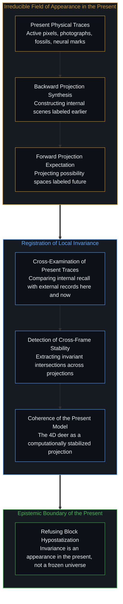

# 四维长鹿的幻象与当下的模型 / The Myth of the Four-Dimensional Deer and the Present Model

*叠合画帧为长虫并未窥见高维，不过是将当下投影误认为了永恒。 / Stacking frames into a worldline reveals no higher dimension, merely mistaking a present projection for an eternal object.*

一段在网络上引发广泛惊叹的计算机图形学视频，将一只小鹿穿过草地的动态过程拆解为连续画帧，并将每一帧的三维高斯分布留在其发生的空间位置上。随着时间推移，数十个在不同时刻显现的躯体残影被并置在同一片三维空间内，凝固成一条宛如千足多节巨虫般绵延的世界线。围观的人群随即陷入形而上学的敬畏，惊呼这是否就是高维智慧俯瞰凡人生命的形态。然而，这一感叹恰恰暴露出深刻的维度倒错与范畴错乱。所谓四维长鹿，甚至都谈不上是四维，它不过是心智在脑海中完成的双重压缩与重构过程：先将二维平面图像解码为三维场景，再将画帧在空间中的堆砌幻觉为第四维。这一切都是在我们自身的内部认知机制中展开的。我们自己才是真正的高维实体，感知本身就是超高维的、向着可能性无限延伸的二进制超空间；三维空间与想象出的时间轴，只是意识为了在世界中穿行而构建的低维映射。然而旁观者却颠倒了这一秩序，将自己内部的低维映射异化为独立存在的“身外之物”，匍匐在并不存在的外部高维凝视面前，却忽略了在第一人称当下注视着屏幕的意识，本身才是那片不可穷尽的高维源头。

A computer graphics demonstration recently swept through digital networks, capturing collective imagination: algorithms convert the passage of a running deer across a field into successive three-dimensional Gaussian splats, leaving each temporal cluster frozen precisely at the spatial coordinates where it occurred. As the timeline accumulates, dozens of deer bodies from disparate moments are simultaneously rendered inside a unified spatial volume, solidifying into an elongated, millipede-like worldline that appears to exist all at once. Observers quickly succumbed to metaphysical reverence, asking in awe whether this is how higher-dimensional beings gaze upon mortal lives. Yet this reaction exposes a profound dimensional inversion and category error. What is called a four-dimensional deer cannot even legitimately be termed four-dimensional; it merely represents a double compression and mental reconstruction within cognition: first decoding flat two-dimensional screen images into three-dimensional scenes, and then hallucinating their spatial stacking into a fourth dimension. All of this unfolds strictly within our own internal cognitive machinery. We ourselves are the true higher-dimensional entities, whose perception operates as an ultra-high-dimensional binary hyperspace infinitely extendable across possibilities. Three-dimensional space and an imagined timeline are merely low-dimensional mappings through which consciousness navigates. Yet spectators invert this order by alienating their own internal mappings into independent "things outside themselves," kneeling before an imaginary external gaze while overlooking that consciousness looking at the screen in the first-person present is itself the inexhaustible high-dimensional ground.

## 一、 画帧堆叠的视觉奇观与维度倒错的消解 / 1. The Visual Spectacle of Frame Stacking and the Dissolution of Dimensional Inversion

当计算技术将按先后序列播放的视频画帧依次铺展在空间坐标网格中时，人类认知极易落入一种直觉陷阱：将分析脚手架的空间化便利当成了现实本身的结构。在三维高斯泼溅重建的画面中，奔跑小鹿的每一个过往姿态都被定格在合成草地内，制造出一条由数百条重叠四肢与复制脊椎串联而成的静止奇美拉。网络评论区之所以产生“高维视角”的敬畏，是因为未经审视的直觉假设：只要把时间投影到空间上，心智就能脱离肉身的具身限制，抵达一个超越时间的观测支点。这种反应与二十世纪初人们对四维时空流形的迷恋如出一辙：把整盘胶片平铺在桌面上，便以为自己把握了生命的永恒几何。

When computational techniques unspool sequential video frames across a spatial coordinate grid, human cognition easily succumbs to an intuitive trap: mistaking the spatial convenience of an analytical scaffold for the architecture of reality itself. In 3D Gaussian reconstructions, every past posture of the running deer remains etched inside the synthetic meadow, manufacturing a motionless chimera of hundreds of overlapping legs and duplicated spines. The online awe regarding "higher-dimensional perspectives" emerges because unexamined intuition assumes that projecting time onto space liberates the mind from physical embodiment, granting access to a timeless vantage point. This mirrors early twentieth-century fascination with four-dimensional spacetime manifolds: laying an entire reel of film flat upon a table and imagining that one has grasped the eternal geometry of life.

然而，将动态的因果接续摊平为惰性的空间几何，既未带来丝毫信息增量，也未揭开任何奇异的更高维度。正如在[时间之箭的伪悖论与对称模拟的边界](../the-mirage-of-times-arrow-and-the-boundaries-of-simulation/)与[双生子佯谬与隐秘观察者](../the-twin-paradox-and-the-hidden-observer/)中所论证的，理论物理学中的块状宇宙范式正是通过这种偷梁换柱的手法搭建起来的。在坐标纸上画出一条静态的世界线，或者在显卡内存中保留先前各帧的历史点云，仅仅是人类为了局部计算方便而发明的外部记账手段。账本上的每一条记录可以并存于同一张纸上，胶卷上的所有画格可以并列于同一张桌案，但这并不意味着宇宙本身是一块冻结的晶体。注视着那只合成的多足长虫时，观察者并没有蜕变为高维生物；观察者依然坐在此时此刻的屏幕前，看着一台计算机将历史测量数据渲染在当前的显示屏上。

Yet flattening dynamic causal succession into inert spatial geometry yields zero informational surplus, nor does it unveil an exotic higher dimension. As demonstrated in [The Mirage of Time's Arrow and the Boundaries of Symmetric Simulation](../the-mirage-of-times-arrow-and-the-boundaries-of-simulation/) and [The Twin Paradox and the Hidden Observer](../the-twin-paradox-and-the-hidden-observer/), the Block Universe paradigm in theoretical physics was constructed through this identical sleight of hand. Drawing a static worldline across graph paper, or maintaining point clouds across previous frames in graphic card memory, is an external bookkeeping convenience invented for localized calculation. That ledger entries coexist across a single sheet of paper or film cells rest side-by-side upon a desk does not indicate that the universe is a frozen crystal. When gazing upon that composite millipede, one has not metamorphosed into a higher-dimensional being; one remains seated before a screen in the present moment, watching a computer render historical measurements onto an active display.

拆解这一海市蜃楼的钥匙，在于认清维度是如何生成的，并审视大脑内部的认知运作。这件技术造物甚至都谈不上是四维：它不过是将二维图像误认为三维现实，继而把这些图像在第三空间维度的拉伸误认为第四维的时间。这构成了一场双重压缩与心智重构：在第一层，心智面对显示屏上在物理上仅是二维平面的画帧，依靠感知先验在脑海中将其重构为具有深度的三维场景；在第二层，心智又把这些二维画帧在空间中的堆叠，进一步在脑海中幻觉为一条四维时空世界线。从二维到三维，再从空间堆叠到四维，这一整条解码与重构链条，全都在大脑内部的认知机制中展开。这恰恰暴露了倒置的坐标：我们自己才是真正的高维实体。正如[维度即投影](../dimensions-are-projections/)所追溯的，我们的感知本身就是一片超高维的、可以无限延伸的二进制超空间，正因如此，意识才能轻而易举地构想出超越三维的几何空间。

The key to dismantling this mirage lies in recognizing how dimensions are generated and examining the brain's internal cognitive operations. This technological artifact cannot even legitimately be termed four-dimensional. It merely mistakes two-dimensional images for three-dimensional reality, and then mistakes the extrusion of those images across a third spatial dimension for a fourth dimension of time. This constitutes a double compression and mental reconstruction: at the first layer, the mind takes what are physically flat, two-dimensional frames on a display and, relying on perceptual priors, reconstructs them into three-dimensional scenes possessing depth; at the second layer, the mind takes the spatial stacking of these two-dimensional frames and mentally hallucinates them into a four-dimensional spacetime worldline. From two dimensions to three, and from spatial stacking to four, this entire chain of decoding and reconstruction unfolds strictly within the internal cognitive machinery of the brain. This exposes the inverted locus: we ourselves are the genuine higher-dimensional entities. As traced in [Dimensions Are Projections](../dimensions-are-projections/), our perception is an ultra-high-dimensional, infinitely extendable binary hyperspace, which is precisely why consciousness can effortlessly formulate geometric spaces beyond three dimensions.

必须厘清的是，这里所援引的“无穷”，是可能性的无穷——即正如在[潜无限与数学思维的暂时闭合](../potential-infinity-and-the-temporary-closures-of-mathematical-thought/)中所阐明的“潜无穷”，而非已经闭合清点的实无穷。在任何一个离散、具体的时刻，有意识的心智能够主动感知的自由度在数量上是有限的；但这一边界并非僵硬、固定的围栏，而是一道随着每一次注意力移动与递归区分而持续移动、不断敞开的动态边缘。其维度在任何特定瞬间虽然有限，但在一切实际可理解与可体验的意义上都逼近无限。这构成了[阴影与无限](../the-shadow-and-the-infinite/)所剖析的“三重无限”之一——即专属于信息与共享感知基底的那一重褶皱。正因为它居于由离散区分步长所支配的信息范畴，它在任何单一切片上的状态必然是有限的；但也正因它属于信息，意识才能在这片可能性的超空间中自由部署任意高维的网络，以穿行于鲜活的境遇之中。

It is vital to clarify that the infinity invoked here is an infinity of possibilities—a potential infinity, rather than a completed actual infinity, precisely as articulated in [Potential Infinity and the Temporary Closures of Mathematical Thought](../potential-infinity-and-the-temporary-closures-of-mathematical-thought/). At any discrete, individual moment, the degrees of freedom the conscious mind can actively perceive are strictly finite; yet this boundary is never a rigid, fixed enclosure. Instead, it is a dynamic moving edge that shifts and opens continuously with every movement of attention and recursive distinction. Although its dimensionality is finite at any given instant, it approaches infinity in every practically intelligible and experiential sense. This constitutes one of the three infinities unpacked in [The Shadow and the Infinite](../the-shadow-and-the-infinite/)—specifically the fold belonging to information and the shared perceptual substrate. Because it resides within the informational domain, governed by discrete distinction steps, its state at any single slice is necessarily finite; but precisely because it belongs to information, consciousness can freely deploy arbitrary high-dimensional networks across this hyperspace of possibilities to navigate its living territory.

当旁观者将自己内部的低维映射误认为独立存在的“身外之物”，把自身的神经投影实体化为从超空间俯视凡尘的外部神明时，维度倒错便发生了。这在存在论上无异于用炭笔画出了一幅素描，随后忘却了自己的手，反而战战兢兢地跪倒在画纸面前，仿佛有外星主宰降临。低维投影从未超越当下，它始终只是在鲜活觉知的高维土壤中绽放的一件形式造物。

Dimensional inversion sets in when spectators mistake their own internal low-dimensional mappings for an independent "thing outside themselves," reifying their own neural projection into an external deity peering down from hyperspace. It is the existential equivalent of drawing a sketch with charcoal, forgetting one's own hand, and trembling before the drawing as if an alien sovereign had landed. A low-dimensional projection never transcends the present; it remains a sterile formal artifact blooming within the high-dimensional soil of living awareness.

```mermaid
flowchart TD
    subgraph S_ErrorTrack["Double Compression and Alienation Trajectory"]
        direction TB
        E1["2D Frame Input<br/>Flat pixel distributions on a screen surface"] --> E2["First Reconstruction: 2D to 3D<br/>Perceptual priors decode spatial depth in the brain"]
        E2 --> E3["Second Reconstruction: Spatial Stacking to 4D<br/>Extruded frames hallucinated as a spacetime worldline"]
        E3 --> E4["Alienation into an External Idol<br/>Mistaking internal mental mappings for external higher beings"]
    end
    S_ErrorTrack ===> S_RealityTrack
    subgraph S_RealityTrack["The First-Person Higher-Dimensional Ground"]
        direction TB
        R1["Genuine High-Dimensional Ground<br/>Perception as an open potential-infinite binary hyperspace"] --> R2["Momentary Bound and Unfixed Edge<br/>Instant degrees of freedom are finite but open continuously"]
        R2 --> R3["Autonomous Low-Dimensional Mapping<br/>Deploying down-projections to navigate the world"]
        R3 --> R4["Dismantling the Reified Idol<br/>Recognizing geometric models as tools within cognition"]
        R4 --> R5["Grounding in the Unproxyable Present<br/>Exercising causal choice in the living immediate scene"]
    end
    style S_ErrorTrack fill:#161b22,stroke:#f85149,stroke-width:1.5px,color:#f85149
    style S_RealityTrack fill:#161b22,stroke:#3fb950,stroke-width:1.5px,color:#3fb950
    style E1 fill:#0d1117,stroke:#f85149,stroke-width:1px,color:#f0f6fc
    style E2 fill:#0d1117,stroke:#f85149,stroke-width:1px,color:#f0f6fc
    style E3 fill:#0d1117,stroke:#f85149,stroke-width:1px,color:#f0f6fc
    style E4 fill:#0d1117,stroke:#f85149,stroke-width:1px,color:#f0f6fc
    style R1 fill:#0d1117,stroke:#58a6ff,stroke-width:1px,color:#f0f6fc
    style R2 fill:#0d1117,stroke:#58a6ff,stroke-width:1px,color:#f0f6fc
    style R3 fill:#0d1117,stroke:#3fb950,stroke-width:1px,color:#f0f6fc
    style R4 fill:#0d1117,stroke:#3fb950,stroke-width:1px,color:#f0f6fc
    style R5 fill:#0d1117,stroke:#3fb950,stroke-width:1px,color:#f0f6fc
```

## 二、 记忆作为当下的逆向投影与过去的不可复核性 / 2. Memory as Present Backward Projection and the Unverifiability of the Past

拆解这场空间化神话所需的第一道修正，是认清我们自身的存在坐标。我们并不占据一条延展的世界线，也从未漂流在一条同时储存着过去、现在与未来的时间长河里。我们唯独占据切近当下那不可化约的切片。在鲜活的体验中，这一当下切片在一切实际意义上都拥有逼近无限的自由度——那是属于信息的、向着可能性敞开的潜无穷；而三维空间与空间化的时间，不过是认知为了穿行其间而生成的低维下投映射。在意识觉知的每一个节点上，那条视觉轨迹上的其他任何一个点，都不是静候造访的客观哨所，而是此时此刻在神经回路或硅基芯片内部实时制造出的模拟。

The first correction required to dismantle this spatialized myth is acknowledging our existential coordinates. We do not occupy an extended worldline, nor do we drift through a temporal river containing past, present, and future in simultaneous storage. We occupy solely the irreducible slice of the immediate present. In lived experience, this present slice approaches near-infinite degrees of freedom in every practical sense—an open potential infinity of possibilities belonging to information—while three-dimensional space and spatialized time are merely low-dimensional down-projections through which cognition navigates. At every juncture of conscious awareness, every other point along that visual trajectory is not an objective outpost awaiting visitation, but a simulation manufactured here and now within neural circuitry or silicon chips.

记忆不过是这种投影的逆向版本。大脑并无通往先前状态的隐秘传送门，而是收集切近当下存留的物理残迹、生物修饰与感知线索，合成出一幅打着“更早”语义标签的内部图景。因为区分活动单向运行，且每一次观察都发生在当下行动的活生生边缘上——正如[时间是因果的不可逆方向与离散步长](../time-is-causality-not-a-dimension/)所追溯的，时间轴是从当下残余向后投射出的坐标，而非可供穿行的走廊——没有任何通道能将观察者送回先前的状态；这一当下的合成物，无法与它声称描绘的那个时刻进行当面核对。没有任何观察者能够跨出当前的边界去审计回忆的保真度。正是这种结构上的不可复核性，制造出了记忆极具说服力的感受：正因为无法直接比对，心智便将内部重构误认为对历史的无中介访问，却忘了整场演出都是在当下这一活跃舞台上生成的。

Memory is simply the backward variant of that projection. The brain possesses no hidden portal to prior states; rather, it gathers physical remnants, biological modifications, and perceptual cues surviving in the immediate present, synthesizing an internal tableau tagged with the semantic marker "earlier." Because distinguishing activity runs one way and every observation occurs at the living edge of the present act—where [Time Is the Irreversible Direction and Discrete Step of Causality](../time-is-causality-not-a-dimension/) traces how the temporal axis is cast backward from present residue rather than traversed as a corridor—no channel exists to transport an observer back into an antecedent state; this present synthesis cannot be verified against the moment it claims to depict. No observer can step outside the current boundary to audit the fidelity of recall. This structural unverifiability manufactures the persuasive sensation of memory: precisely because direct comparison is impossible, the mind mistakes an internal construction for unmediated access to history, forgetting that the entire performance is generated on the active stage of the present.

试图通过外部记录来核实或校准回忆，同样会撞上同一道边界。无论是检视一张泛黄的老照片、交叉质询一位独立目击者、发掘一块地质化石，还是审计一个外化的代码仓库——正如[你的代码库即是记忆](../your-codebase-is-memory/)所揭示的，提交的文件保存的仅是过往切分留在当下的残迹，必须在此时此刻的活生生边缘上被重新读取——每一件造物都只作为当代的物体存在于当下的场域中。照片是当前承载着卤化银分布或液晶像素的一页纸片；证词是当前空气中传播的活跃声波；化石是嵌入当前岩层中的硅酸盐分子排列。当记录出现分歧——例如旧日记与照片上的铭文相抵触——这种摩擦全部发生在当下并存的痕迹之间，从未重新打开过去。

Attempts to verify or recalibrate recall via external records encounter the same boundary. Whether inspecting an aged photograph, cross-examining an independent witness, unearthing a geological fossil, or auditing an externalized repository where [Your Codebase Is Memory](../your-codebase-is-memory/) shows that committed files hold only present residues of prior cuts that must be re-read at the living edge now, every artifact exists strictly as a contemporary object within the present field. A photograph is a current sheet of paper carrying silver halide distributions or liquid crystal pixels; testimony is an active vibration propagating through immediate air; a fossil is an arrangement of silicate molecules embedded in present strata. When records diverge—when an old diary contradicts a photographic inscription—the friction unfolds entirely between coexisting traces in the present. It never reopens the past.

因此，在切近场域之外，并不存在一个独立的基准可以用来衡量逆向投影的准确度。坚信存在着一个客观、单一的历史事件序列，是一种当下时态的信念，是从当下痕迹的内聚性中推演出来的。这一历史基底从未作为静态档案封存在宇宙之中；它是观察者在此时此刻为了调和各异的感知造物而搭建的解释模型。

Consequently, there is no independent benchmark outside the immediate field against which backward projections can be measured. The conviction that an objective, singular sequence of historical events exists is a present-tense belief, inferred from the cohesion of present traces. This historical ground is never preserved as a static archive in the cosmos; it is an interpretive model erected by an observer at this exact moment to reconcile disparate perceptual artifacts.

## 三、 历史作为当下的局部模型与不变性的显现 / 3. History as a Present Local Model and the Appearance of Invariance

认清过去并非一座可随时提取的静态仓库，便暴露出进一步的推论：历史叙事从未在心智之间达成普世的统一。不同的观察者依据各自手头可用的不同证据，搭建出彼此分殊的模型。即便是同一个个体，在随后的时刻面对新浮现的线索或经历记忆衰退时，也会配置出改变后的重构版本。历史不是铭刻在时空中的单一宇宙脊柱，而是在特定当下内部生成的解释模型，随着不同行动者以及同一生命的不同时刻而变动。

Recognizing that the past is not an accessible warehouse exposes a further consequence: historical narratives are never universally unified across minds. Observers construct divergent models from the disparate evidence available to them. The same individual, facing newly surfaced clues or suffering memory decay at a subsequent moment, configures an altered reconstruction. History is not a singular cosmic spine etched into spacetime; it is an interpretive model generated within specific presents, varying across agents and across moments of a single life.

即便断定某一种重构比另一种“更加自洽”，这一评估本身也发生在一个单一意识的某一瞬间之内。当心智宣称某一叙事具有更优的解释力时，它并未请教任何超视角的仲裁者，而是在当前呈现于眼前的诸多现象之间登记到了**不变性**。它在个人回忆、文本档案与同伴证词之间识别出了数学、几何或叙事上的一致性。这种不变性作为显现而言确有其实，但它依然是隶属于该心智在那一刻的显现。视角之外并不存在一个中立的平台，能够将这种不变性认证为形而上学的真理。

Even when determining that one reconstruction "coheres better" than another, that evaluation unfolds inside a single consciousness at one instant. When declaring one narrative superior in explanatory power, the mind consults no extra-perspectival arbiter; it registers invariance among the phenomena currently before it. It identifies mathematical, geometric, or narrative consistency across personal recollections, textual documents, and testimonies from companions. This invariance is genuine as an appearance, yet it remains an appearance belonging to that mind at that moment. No neutral platform exists outside perspective to certify that invariance as metaphysical truth.

剥离计算视觉的浪漫迷思之后，留下的地基简朴而清晰：一个不可化约的当下显现场域，在其中合成的投影，以及跨越这些投影所观察到的不变性。正如[遗忘的脚手架](../the-scaffolding-we-forget/)所论证的，形式化的科学模型是功能性的脚手架，而非本体论的基石。

Stripping away computational romance leaves an austere foundation: an irreducible present field of appearance, projections synthesized within it, and invariances observed across those projections. As argued in [The Scaffolding We Forget](../the-scaffolding-we-forget/), formal scientific models are functional scaffolding, not ontological foundations.

那段广为流传的四维长鹿可视化，恰恰就是这样一种当下合成物。不同个体之所以能对其含义达成共识——共同将其视为动物运动的客观轨迹——源于连续画帧与视觉处理系统之间维持的高度不变性。算法迭代之间的平滑过渡与解剖学上的一致性，让独立的观察者得以组装出近乎一致的心智投影。这种共振产生了极具说服力的感知稳定性——这与[对象是被稳定化的关系](../objects-are-stabilized-relationships/)中跨观察者的不变关系模式被登记为坚固实体的机制如出一辙——但它并未证明有一头石化的四维巨兽潜伏在超空间里。它是一座由高度不变性所结构化的形式投影，在切近的当下跨心智地达成自洽。

The viral visualization of the four-dimensional deer is precisely such a present synthesis. That disparate individuals concur on its meaning—treating it as an objective trajectory of animal locomotion—stems from the high invariance maintained across successive frames and visual processing systems. Smooth transitions between algorithmic iterations and anatomical consistency allow independent observers to assemble nearly identical mental projections. This resonance yields convincing perceptual stability—the same mechanism by which [Objects Are Stabilized Relationships](../objects-are-stabilized-relationships/) registers invariant relational patterns across observers as solid entities—yet it provides no demonstration that a petrified four-dimensional beast lurks in hyperspace. It stands as a formal projection structured by high invariance, cohering across minds in the immediate present.

## 四、 走下旁观者的看台与第一人称的当下在场 / 4. Stepping Down from the Spectator Platform and First-Person Presence

当环绕四维长鹿的计算迷雾散去，首要的领悟不是几何学如何把时间折叠进空间，而是行动主体性如何在因果织体中锚定自身。那些在堆叠的视频画帧前喃喃惊叹高维的人，依然在寻找一座脱离生存摩擦的庇护所。他们渴望端坐在天界的阳台上，手里把玩着整盘已经完工的宇宙胶卷，冷眼旁观自己的人生像发条玩具般展开。这种对实体化维度的迷恋，是试图逃避切近行动重量的无意识退缩。

When the computational mist surrounding the four-dimensional deer disperses, the primary realization is not how geometry folds time into space, but how agency anchors itself within the causal tapestry. Those murmuring about higher dimensions before stacked video frames remain in search of a sanctuary detached from the friction of existence. They yearn to sit upon celestial balconies, holding a completed cosmic film reel while observing their own lives unspool like clockwork toys. This fascination with hypostatized dimensions is an unconscious attempt to evade the weight of immediate agency.

我并不占据一条被空间化的多足巨虫。我既没有平摊在昨日尘埃留下的脚印里，也没有驻扎在明日的坐标中。昨日已经消融，只留下纸上的墨迹与正在衰减的神经共振；明日尚未抵达，只作为由切近预期所塑造的前向投影而存在。所赋予我的一切，悉数汇聚于这一切近切片之中：指尖下按键的阻力、窗玻璃外渐拢的暮色，以及点亮这片屏幕表面的像素。

I do not occupy a spatialized millipede. I am not spread across footsteps left in yesterday's dust, nor am I stationed within the coordinates of tomorrow. Yesterday has dissolved, leaving only ink upon paper and decaying neural resonances; tomorrow has not arrived, existing only as forward projections shaped by immediate expectations. Everything granted to me gathers within this immediate slice: the resistance of keys beneath my fingers, gathering shadows beyond the windowpane, and pixels illuminating this surface.

重回第一人称视角，既不是在兜售个人顿悟，也不是在提供一套社会蓝图。一旦将这一领悟转化为规劝他人的处方建议，便立刻重新爬上了另一座高耸的看台，重蹈了它所拆解的越界覆辙。第一人称立场拥有不可代理的边界：我无法替同行的旅人呼吸，任何外部实体也无法替我扛起书桌上未竟的责任。

Reclaiming the first-person vantage is not an exercise in marketing personal enlightenment, nor does it offer a societal blueprint. Converting this realization into prescriptive counsel for others climbs right back onto an elevated balcony, repeating the disciplinary overstep it dismantled. The first-person stance possesses an unproxyable boundary: I cannot breathe on behalf of a fellow traveler, nor can any external entity shoulder the unfinished obligations resting upon my desk.

这不是一份普世宣言，而是一名观察者对切近在场坐标的辨认。小鹿穿过草地的优雅，不在于被计算保存为一具四维化石，而在于鲜活的肌肉蹬踏大地、草叶向两侧分开的那一个个独一而易逝的瞬间。同样，人类存在的重量，从来不在于将自己想象成织入预印挂毯中的一根静态丝线，而在于直面敞开的地平线，在切近的当下投下那张不可撤回的因果选票。

This is no universal manifesto; it is an observer discerning the coordinates of immediate presence. The grace of the deer traversing the meadow resides not in its computational preservation as a four-dimensional fossil, but in the singular, fleeting moments when living muscle strained against the earth and blades of grass parted. Similarly, human existence derives its weight not from imagining oneself as a static thread woven into a pre-printed tapestry, but from casting an irreversible causal vote in the immediate present, directly confronting the open horizon.
