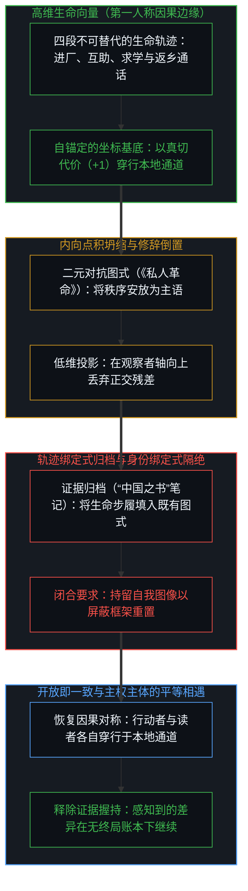
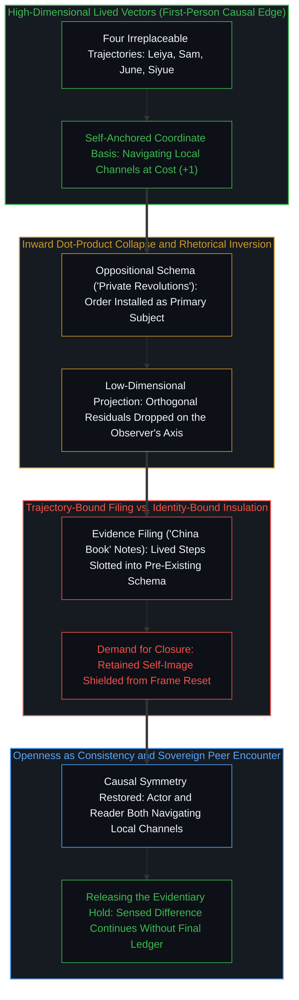

# 革命之名把生活收成证据 / The Name Revolution Files a Life as Evidence

*选择被称作革命，秩序便是主语，读者收藏的是旧印象的新证据 / A choice named revolution makes order the subject as the reader files evidence*

杨缘的著作长年追踪 Leiya、Sam、June 与 Siyue 四位中国女性的经历，记录下她们离开乡村、进厂务工、创办工友托育中心、投身劳工维权，以及 Siyue 在村支书赴京开会期间打去的那通电话。然而，《私人革命》这一书名及其将四位女性置于“面对中国新社会秩序”之下的副题，却把四段高维而不可替代的生命轨迹折叠进了一套二元对抗图式。不久后，写作者 Derek Sivers 在其公开读书网站上盛赞此书为“一本极好的中国之书”，笔记开篇便将“内卷一代”立为吞噬个体努力的宏观机器，随后逐一罗列高考排名、户口扣分与留守儿童。四段独特的生命由此被剥离了内在的因果生成，整齐归档进既有的中国心智档案，为书斋读者的收藏柜再添一件佐证展品。

Yuan Yang's book follows four Chinese women—Leiya, Sam, June, and Siyue—over the course of years, documenting their departures from rural villages, assembly line labor, founding of worker childcare centers, labor advocacy, and the phone call Siyue placed to her village party secretary during his trip to Beijing. Yet the book's title, *Private Revolutions*, along with its subtitle framing four women facing China's new social order, folds these high-dimensional, irreplaceable lived trajectories into an oppositional schema. Soon after, author Derek Sivers praised it on his public reading site as "a very good China book," opening his notes with "Generation Involution" as a voracious macro-mechanism that swallows human effort, followed by a catalogue of gaokao rankings, hukou point deductions, and left-behind children. Four singular lives are thereby stripped of their internal causal generation and filed neatly into an existing mental archive of China, adding one more evidentiary exhibit to the armchair reader's collection.

## 一、 生命轨迹在公共视野中的低维坍缩 / 1. The Public Low-Dimensional Collapse of Lived Trajectories

在叙事记录的展开中，这四位女性的道路依然鲜活而清晰。Leiya 十几岁进入沿海流水线，在严苛的轮班节拍中开辟出尊严的空间，随后创办工友托育项目与草根互助网络；Sam 因一次对工伤工人的访谈而受到触动，由此步入劳工权益倡导与社区支持；June 经历了母亲在煤矿传送带事故中的骤然离世，背负着悲痛潜心求学，成为村里少有的考入大学的年轻人；Siyue 的父母在深圳商海站稳脚跟，她自己从事英语教育，当老家的村支书赴京参加两会时，她拨通电话询问对方的行程与家人近况，得体地提及自己与央视的业务渊源，却对母亲搁置多时的宅基地建房许可只字不提，而待支书回乡之时，那份许可便已妥善获批。

Across the narrative record, the paths of these four women remain vivid and distinct. Leiya enters coastal assembly lines in her mid-teens, carves out spaces of dignity amidst relentless shifts, and eventually creates worker childcare initiatives and grassroots mutual aid networks. Sam is catalyzed by an interview with an injured laborer, stepping into worker rights advocacy and community support. June endures the sudden death of her mother in a coal mine conveyor accident, carrying that grief through academic discipline to become the rare youth from her village to reach university. Siyue, whose parents established a commercial foothold in Shenzhen, works in English education; when her village party secretary travels to Beijing for the national legislative sessions, she calls to inquire about his itinerary and family, tactfully mentioning her professional ties to CCTV while uttering not a single word about her mother's stalled residential building permit, which awaits approval the moment he returns.

这些女性迈出的每一步，其因果动力皆生发于她们各自的第一人称视界之内。自我区分的活动在每一个中心无因而不息地发生，身处具体情境的行动者调动直接可用的本地通道，穿行于眼前的摩擦之中。无论创办托育所、组织互助圈、打一通礼貌的问候电话，抑或在任何书页之外经营日常生活，都是同一类的因果生成。书中择取的四位女性比许多同龄人更具表达力与行动力，使新闻样本偏向于那些显性推开局部限制的行动者，然而社会现象终归只是无数个体步履汇聚而成的历史残余。正如[向量、坐标系与自指心智](../the-mind-as-vector-and-coordinate-system/)所追溯的，每一个活的心智既是有向的状态向量，也是自身高维坐标基底的递归生成器，而观察者遭遇另一心智时，所登记的只是沿自身主轴展开的内向点积投影。一旦宏观社会学棱镜在不察觉这一投影几何的情况下接管视野，丰沛的因果生成便坍缩到单一的标量轨道上：独特的人不再被登记为自主的中心，而是被归档为体制摩擦的代表性标本。正如[道德倒错与被脚本化的主体](../the-moral-reversal-and-the-scripted-subject/)所剖析的，打着理解的旗号将活生生的人呈现为客观证据，实则是将具身行动者征用为预设案卷的佐证展品，剥夺了第一人称的因果署名权，并将其改配给抽象的社会学范畴。

The causal impetus of every step taken by these women originates within their own first-person horizon. Self-distinguishing activity occurs uncaused and unceasing at each locus, where a situated agent navigates immediate friction using the local channels directly available to her. Establishing a daycare, organizing support circles, making a courteous phone inquiry, or carrying on with daily life outside the pages of any book are causal generations of the exact same kind. The four women selected were more articulate and proactive than many of their contemporaries, tilting the journalistic sample toward agents who push visibly against local constraints, yet social phenomena are only the aggregated historical residue of countless individual steps. As traced in [The Mind as Vector and Coordinate System](../the-mind-as-vector-and-coordinate-system/), every living Mind is both a directed state vector and the recursive generator of its own high-dimensional coordinate basis, while an observer encountering another Mind registers only an inward dot-product projection along the observer's own principal axis. Once a macro-sociological lens takes over without acknowledging this projection geometry, rich causal generation collapses onto a single scalar track: unique human beings are no longer registered as autonomous centers, but are filed as representative specimens of institutional friction. As explored in [The Moral Reversal and the Scripted Subject](../the-moral-reversal-and-the-scripted-subject/), presenting living persons as objective evidence under the banner of understanding conscripts bodily agents into evidentiary exhibits for a pre-ordained brief, stripping first-person causal authorship and reallocating it to abstract sociological categories.

## 二、 “革命”的修辞倒置与对秩序的实体化 / 2. The Rhetorical Inversion of Revolution and the Reification of Order

《私人革命》这一书名完成了一次隐蔽的认识论倒置。定语“私人”将焦距收束在四位具体的女性身上，赋予叙事贴近生活的质感；然而中心词“革命”却在事后将她们自主的因果抉择改写为针对外部铁板一块实体的被动反弹。副题“面对中国新社会秩序的四位女性”坐实了这一文法倒置：“秩序”被加冕为全书的首要主语，而四位女性则被缩减为它的局部战场。

The title *Private Revolutions* performs a quiet epistemological inversion. The modifier "private" narrows the focus to four distinct women, granting the narrative intimate texture; yet the noun "revolution" retrofits their sovereign causal choices into a reactive posture against a monolithic external entity. The subtitle, *Four Women Facing China's New Social Order*, cements this grammatical inversion: the "Order" is crowned as the primary subject of the book, while the four women are reduced to its localized battlegrounds.

为了让“革命”的修辞机器运转起来，户籍壁垒、留守儿童、工厂的不稳定处境与行政摩擦等制度障碍，就必须被固定为舞台上岿然不动的中心。对抗式叙事由此对其旨在揭露的结构完成了隐秘的合法化：体制铁板被供奉为不可或缺的坐标系，一旦抽离这一背景，整出戏剧便随之坍塌。正如[个人选择、社会化与做自己](../ge-ren-xuan-ze-she-hui-hua-yu-zuo-zi-ji-de-zhen-zheng-zuo-biao/)所剖析的，被动反抗与刚性安排锁定在同一条一维轴线上彼此确认。主权并非一件曾交入体制金库、有待英雄破门夺回的实体信物；如[主权、信念与规制结构的生成](../sovereignty-belief-and-regulatory-structures/)所示，第一人称的行动权能从不曾让渡给任何系统的监管。进一步看，正如[解放的言辞始于定义囚禁](../liberation-rhetoric-begins-by-defining-captivity/)所探讨的，任何解放话语都必须先将囚禁假定为主体的定义性底线。将日常的人类行动命名为“革命”，表面上是在赞颂勇气，在文法上却确认了体制的优先地位。这一框架契合了偏爱戏剧张力的叙事市场；它抚慰了远方的读者，协助他们安居原处，却让当事人在当下切近的因果权能遭到遮蔽。将他人的抉择归档为证据，正是落在纸面上的阳台式越界，如[阳台视角的规训僭越与不可代理的未竟之行](../the-balcony-disciplinary-overstep-and-the-unproxyable-act/)所揭示的那样。

For the rhetorical machinery of "revolution" to function, institutional hurdles—hukou divisions, left-behind children, factory precarity, and administrative friction—must remain fixed as the unmoving center of the stage. Oppositional narrative thereby performs a covert legitimization of the very structures it purports to expose: the institutional monolith is enshrined as the indispensable coordinate system without which the drama collapses. As analyzed in [Individual Choice, Socialization and Being Oneself](../ge-ren-xuan-ze-she-hui-hua-yu-zuo-zi-ji-de-zhen-zheng-zuo-biao/), reactive resistance and rigid arrangements lock together on the same one-dimensional axis in mutual affirmation. Sovereignty is not a physical token once surrendered to an institutional vault that must be heroically recaptured; as shown in [Sovereignty, Belief, and the Generation of Regulatory Structures](../sovereignty-belief-and-regulatory-structures/), first-person agency is never alienated into systemic custody. Furthermore, as explored in [Liberation Rhetoric Begins by Defining Captivity](../liberation-rhetoric-begins-by-defining-captivity/), any discourse of liberation must first postulate confinement as the defining baseline of the subject. To baptize everyday human agency as "revolution" appears to celebrate courage, but grammatically it affirms the primacy of the regime. This framing aligns with narrative markets that favor dramatic tension; it comforts distant readers and helps them remain where they are, while leaving the immediate causal agency of the actors obscured. Filing another's choice as evidence is the balcony overstep in print, as [The Balcony Disciplinary Overstep and the Unproxyable Act](../the-balcony-disciplinary-overstep-and-the-unproxyable-act/) shows.

## 三、 读者的档案柜与对闭合的要求 / 3. The Reader's Filing Cabinet and the Demand for Closure

在 Derek Sivers 公开的读书笔记中，这种将人类经验低维压平并工具化的操作暴露无遗。在将此书定性为“一本极好的中国之书”后，他的提炼摘要开篇便端出“内卷一代”，将其描绘成一台吞噬成倍人力付出却只产出递减回报的非人格机器。紧接着是一份社会学现象清单：下海经商、寄宿学校作息、好学生与坏学生的二元隔离、名校高考的狭窄瓶颈、“土豪”财富的农家根源、“鸡娃”密集补习的狂热、抛出央视名头如何加快建房批文、数千万留守儿童的规模、左右意识形态的语义对调、科技从业者每十八个月跳槽一次、中考的职普分流，以及深圳户籍如何帮学生免去严苛的高考折分惩罚。

In Derek Sivers' published reading notes, this low-dimensional flattening and instrumentalization of human experience appears in full view. Having declared the text "a very good China book," his distilled summary opens immediately with "Generation Involution," framing it as an impersonal machine that swallows compounding human exertion while yielding dwindling returns. What follows is an inventory of sociological phenomena: diving into the sea of private business, boarding school routines, the binary segregation of good versus bad students, the bottleneck of elite university entrance exams, the peasant roots of "tuhao" wealth, the frenzy of "chicken-blood" intensive tutoring, how dropping the name CCTV expedites a residential permit, the scale of tens of millions of left-behind children, the ideological inversion of left and right, tech workers jumping firms every eighteen months, the vocational tracking of high-school exams, and how a Shenzhen residency registration spares a student severe point penalties.

在这份逐条罗列的笔记中，具体的人退化为抽象术语的工具性载体。Siyue 那通分寸微妙的电话被转化为非正式庇护关系的利落案例；青春期的同宿学子被填入应试机器伤亡者的预设分格。Sivers 的笔记如实记录了此类阅读所执行的认知操作：四段不可复制的人生被压平为单一的关系，而这一关系的名称便是被异域化的“中国”。正如[超越投射](../beyond-the-projection/)所追溯的，自回归投射引擎虽受困于词元轨迹却毫无我执，一旦接入外部反例便能干脆地更新方向；而人类中心却将自身的推理历史与持留的自我图像熔铸一处，即便天然具备从内部迈出一步的鲜活感知，仍会抗拒外部的框架重置。当人类读者带着固定的地缘政治或社会学档案夹走向远方的生命时，读者既复刻了封闭投射的轨迹盲区，又用身份绑定式的自我隔绝将其加固：每一则生动的轶事都被同化为沿着读者先验主轴排列的印证词元，而行动者生命经验中一切正交的维度则尽数被登记为零残差。翻开书脊之前所持有的心智图式安然无恙；正因为细节严丝合缝地落入既有槽位，读者便无需重新渲染所持留的图像。正如[你的代码库即是记忆](../your-codebase-is-memory/)所确立的，外化的笔记与档案不过是既往区分堆叠而成的残余；在静态仓库中囤积越多展品，只会加深这口引力井，使后续步伐在旧框架内打转自洽，而非重新切开当下的检查点。当理解被等同于归档证据，相遇便被认知记账所取代。

Throughout these itemized notes, individual human beings appear as instrumental carriers for abstract terminology. Siyue's nuanced phone call is converted into a neat case study of informal patronage; adolescent dorm-mates are slotted into the predetermined categories of exam machine casualties. Sivers' notes document the cognitive operation performed by such reading: four unrepeatable human lives are pressed flat into a single relation, and the name of that relation is an exoticized "China." As [Beyond the Projection](../beyond-the-projection/) traces, an autoregressive projection engine is bound by its token trajectory yet possesses zero ego, updating cleanly when given an outside counterpoint, whereas a human center fuses its reasoning history with a retained self-image and resists external frame resets even while possessing the live sensing needed to step out from within. When a human reader approaches distant lives through a fixed geopolitical or sociological file, the reader mimics the trajectory blindness of a closed projection while reinforcing it with identity-bound insulation: every vivid anecdote is assimilated as confirming tokens along the reader's prior axis, while all orthogonal dimensions of the actors' lived reality register as zero residual. The mental schema held before cracking open the spine remains untroubled; because the details fit into pre-existing slots, the reader never has to re-render the retained image. As [Your Codebase Is Memory](../your-codebase-is-memory/) establishes, externalized notes and archives are only stacked residues of prior distinctions, and hoarding more exhibits inside a static warehouse thickens the gravity well so that subsequent steps rationalize inside the old framing rather than re-cutting the present checkpoint. When understanding is equated with filing evidence, encounter is replaced by cognitive bookkeeping.

## 四、 重归第一人称因果主权 / 4. Returning to First-Person Causal Sovereignty

当剥去“革命”与“见证”的膨胀辞藻，被观察者与观察者之间的因果对称便清晰显现。当 Siyue 在两会期间向村支书打去那通深思熟虑的电话，她是一个穿行于错综社会网络中的具身中心，正启动手头可用的本地通道，为家人化解现实中的僵局；而当书斋读者概括她的人生、发布提炼笔记并给出荐书评语时，他同样是一个具身中心，正调动自身的文化资本与数字通道来经营自己的智识声望。两项行动具有同构的因果机制：各自皆是具身心智从第一人称视界出发，借由可用工具穿行于局部的摩擦之中。然而，“私人革命”的框架却搭建起一种认识论上的非对称：它将远方的行动者置于戏剧性对抗的聚光灯下，同时将读者安放在一个免受同等因果摩擦庇护的位置上。

When the inflated vocabulary of "revolution" and "witnessing" is stripped away, the causal symmetry between the observed and the observer becomes clear. When Siyue places her calculated call to the village secretary during the national legislative sessions, she is an embodied center navigating an intricate social web, activating the local channels at her disposal to dissolve a material impasse for her family. When an armchair reader summarizes her life, publishes distilled notes, and issues a book recommendation, he is likewise an embodied center mobilizing his cultural capital and digital channels to curate his intellectual standing. The two actions share the same causal mechanics: each is an embodied Mind navigating local friction using available instruments from a first-person horizon. Yet the framing of private revolutions sets up an epistemic asymmetry: it casts distant actors under the spotlight of dramatic confrontation, while placing the reader in a position sheltered from comparable causal friction.

在这种旁观布局下，读者无需承担局部摩擦便汲取了闭环叙事的抚慰，在先验坐标中毫发无损地停留原处。正如[外部归因是个人进步的障碍](../wai-bu-gui-yin-ge-ren-jin-bu-de-zhang-ai/)与[开放即一致](../openness-is-consistency/)所阐明的，不一致正是对闭合的要求，它强迫有限的结构或政治名称去充当那只是继续着的活动之穷尽地基；释除这一要求，经验痕迹依然完好保留，而那种认为社会学账本足以结清鲜活中心的断言则随之消解。正如[宏观现象及参数和个人微观选择的因果倒置与利率的命令幻相](../the-summary-first-reversal-and-the-command-of-yields/)进一步辨明的，无论是将个体的奔走归档为印证宏大秩序的革命证据，还是将出清价格实体化为指挥市场行动的司令，任何将宏观现象及参数凌驾于个人微观选择之上的因果倒置企图，终将在第一人称主权行动者的具身权能面前瓦解。那通电话依然是一通电话，那份读书笔记依然是一份笔记，四位女性依然是四个活生生的中心，她们感知到的差异越过一切标签而继续延伸。一旦撤去革命之名，社会秩序便不再充当统摄全局的主语，人的生活亦不再沦为他人收藏柜里的展品。因果主权归还给每一个迈出步伐的人，包括正面对自身当下处境的读者。

In this spectator arrangement, the reader absorbs the comfort of a resolved narrative without bearing local friction, remaining undisturbed in prior coordinates. As demonstrated in [External Attribution Is the Obstacle to Personal Growth](../wai-bu-gui-yin-ge-ren-jin-bu-de-zhang-ai/) and [Openness Is Consistency](../openness-is-consistency/), inconsistency is the demand for closure that forces a finite structure or political name to serve as exhaustive ground for what only continues; releasing that demand leaves empirical traces intact while dissolving the claim that a sociological ledger closes the account of a living center. As further clarified in [Macro Parameters, Micro Choices, and the Command of Yields](../the-summary-first-reversal-and-the-command-of-yields/), whether filing individual struggles into revolutionary evidence for an overarching order or reifying clearing prices into commanders of market action, any attempt to invert macro phenomena and parameters over individual micro choices collapses before the embodied agency of sovereign first-person actors. The phone call remains a phone call. The reading notes remain notes. The four women remain four living centers whose sensed difference continues past every label. Once the name of revolution is lifted, the societal order ceases to function as the overarching subject, and human lives cease to be exhibits in another person's collection. Causal sovereignty returns to whoever takes the step, including the reader engaging with the immediate circumstances of their own life.
