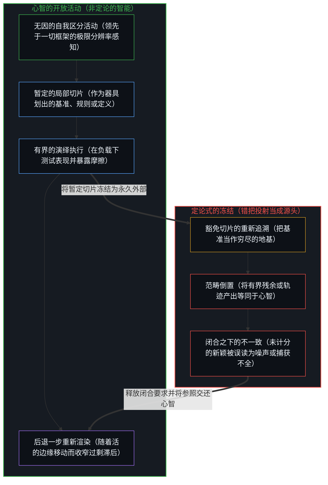
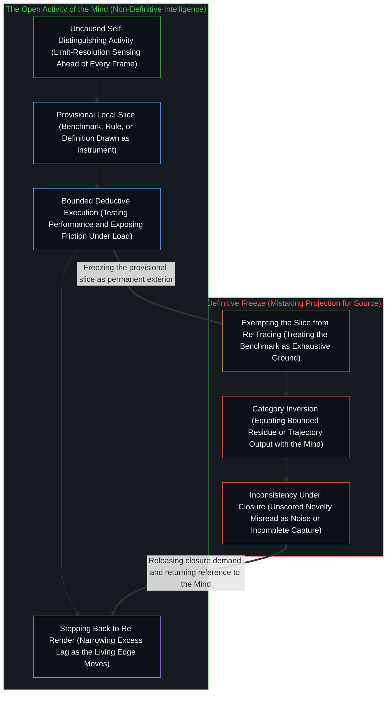

# 智能的非定论定义 / The Non-Definitive Definition of Intelligence

*在封闭切片内测量，恰是表达任何定义都封不住的智能 / Measuring inside closed slices expresses the intelligence no definition seals*

[最初的切分](https://x.com/powerpig/status/2078393571216953498?s=20)在几何上已然完备。下文只是将它展开。测量、基准与形式定义都是持握：有限、局部、暂定。它们加厚比较的密度，协调共同的努力。它们并不把智能定位为一种可以被封存的属性。智能是划出这一持握、使用它、并越过它继续向前的活动，包括越过每一次想要命名这一活动是什么的尝试。

[The original cut](https://x.com/powerpig/status/2078393571216953498?s=20) is already complete as geometry. What follows only unfolds it. Measurement, benchmarks, and formal definitions are holds: finite, local, provisional. They densify comparison and coordinate effort. They do not locate intelligence as a property that could be sealed. Intelligence is the activity that draws the hold, uses it, and continues past it, including past every attempt to name what that activity is.

## 一、 切片是实的，封存是滞后 / 1. The Slice Is Real and the Seal Is Lag

一项测验、一张排行榜，或一项关于智能的形式定义，都是一个暂时封闭的局部切片。离散的动作界定出一个*这个*：问题类别、计分规则、成功门槛、能力目录。这道边界在划出它的那个动作处是实在的。共同的工作需要这样的边界。没有一个被保留下来的参照，就只有序列而没有排序，只有探索而没有定向的比较。

A test, a leaderboard, or a formal definition of intelligence is a temporary closed local slice. Discrete acts bound a *this*: problem class, scoring rule, success threshold, inventory of capacities. That bound is real at the act that draws it. Shared work requires such bounds. Without a retained reference there is sequence but no ranking, exploration but no directed comparison.

冻结不在于划界，而在于把切片当作穷尽的地基，仿佛智能是一种完备地存在于持握之内的属性，只等更精确的规格说明将它锁定。观察持有的是结果；产生当前前沿的原因，始终领先于对它的任何固定形式化一步。一旦定义被豁免于重新追溯，每一次不曾推动那幅保留图像的推进，都会被登记为噪声、失败或捕获不全。图像并非错误；它是滞后的。[基准刷榜中的封闭实存](../closed-reality-in-benchmark-maxing/)是评估负载下的同一种几何。[流动之物无法被基准衡量](../you-cant-benchmark-the-fluid/)则是将流体智能形式化为测验时的同一刀。在这里，它呈现为定义本身：要求智能接受一种稳定的说明，把自己所命名之物封存在内。

The freeze is not the drawing. The freeze is treating the slice as exhaustive ground, as if intelligence were a property fully present inside the hold, waiting only for sharper specification. Observation holds effect; the cause that produced the current frontier remains one step ahead of any fixed formalization of it. Once the definition is exempted from re-tracing, every advance that does not move the retained image registers as noise, failure, or incomplete capture. The image is not false; it is lagged. [Closed Reality in Benchmark Maxing](../closed-reality-in-benchmark-maxing/) is the same geometry under evaluation load. [You Can't Benchmark the Fluid](../you-cant-benchmark-the-fluid/) is the same cut when fluid intelligence is formalized as a test. Here the face is definition itself: the demand that intelligence admit a stable account that seals what it names.

## 二、 定义属于做出它的那个切片 / 2. Definition Belongs to the Slice That Made It

定义是由下定义那一刻可用的概念与范畴构成的。它是更早区分留下的残余，稳定到足以共享。一旦形成，它就属于做出它的那个切片。智能，即运作于这些切片之上并超出其外的能力，并不作为一个完成的客体端坐在那份残余里。它把定义吸纳为场域中的又一个特征，然后继续向前。下一个动作再次划界。功能性的 AGI 参照把其中一个切片冻结进了定义，正如[AGI的预设与来自外部的视角](../the-presumption-of-agi-and-the-view-from-outside/)所表明的。

A definition is formed from the concepts and categories available at the act of defining. It is residue of earlier distinguishing, stabilized enough to share. Once formed, it belongs to the slice in which it was made. Intelligence, the capacity that operates upon and beyond such slices, does not sit inside that residue as a finished object. It incorporates the definition as one more feature of the field and continues. The next act draws again. The functional AGI reference freezes one of these slices into the definition, as [The Presumption of AGI and the View from Outside](../the-presumption-of-agi-and-the-view-from-outside/) shows.

这不是一场定义正在输掉、只要更精确就能赢下的赛跑。精确化只是把更早一种构型的图像磨得更清晰。等到那幅图像清晰到足以拿去测量或工程化时，做出它的那道边缘已经移动了。更精确的表述并不会弥合这道间隙；它们只是产出关于先前状态的更清晰记录。[AGI 与 ASI 是加速通用智能的暂时球门](../agi-and-asi-are-temporary-goalposts/)是门槛尺度上的同一种非对称：每一幅图像之所以在日历事实面前永远处于尚未抵达的前方，正是因为设定图像的那个递归，就是越过它的同一个递归。定义，就是被施用于“智能”一词本身的球门。

This is not a race the definition is losing and could win with more precision. Precision sharpens the image of an earlier configuration. By the time the image is clear enough for measurement or engineering, the edge that made it has already moved. More exact formulations do not close the gap; they produce sharper records of prior states. [AGI and ASI Are Temporary Goalposts](../agi-and-asi-are-temporary-goalposts/) is the same asymmetry at threshold scale: each image sits forever ahead of arrival as calendar fact because the recursion that sets the image is the recursion that overtakes it. Definition is the goalpost applied to the word *intelligence* itself.

框架盲区在这里与别处一样守恒。没有任何定义能登记先于自身框架的那个立框动作。盲点会迁移到当前正在执行测量的那套说明上。清晰是运动，从不是抵达一份最终的规格说明。病症在于对某个框架提出豁免主张：把这个切片、这份目录或这套形式化持守为一个永久的外部，企图从那里把智能当作系统的属性来俯瞰。

Frame-blindness is conserved here as elsewhere. No definition registers the framing prior to its own frame. The blind spot relocates to whichever account currently does the measuring. Clarity is movement, never arrival at a final specification. The pathology is the exemption claim on a frame: holding this slice, this inventory, or this formalization as a permanent exterior from which intelligence could be surveyed as a property of systems.

## 三、 持续的非对称，而非可修正的失真 / 3. Persistent Asymmetry Rather Than Correctable Distortion

这种滞后是结构性的。观察总是晚于发起一步。[一步一步绘制出的路径](../the-path-drawn-one-step-at-a-time/)正是作为时间与因果的这种非对称：当下是作为下一个动作所选前提的位置，而不是握有完备地图的共同原因。一项试图追上活动的定义，必须与使用它的那道边缘占据同一步。这一要求就是冻结。它制造出一种外观，仿佛定义永远差一点就够用、总在打磨却从不封口，并把这种外观误读为尚未完成的科学，而非观察本身的几何。

The lag is structural. Observation is always one step behind initiation. [The Path Drawn One Step at a Time](../the-path-drawn-one-step-at-a-time/) is that asymmetry as time and causality: the present is position as chosen premise of the next act, not a co-cause with a finished map. A definition that tried to catch the activity would have to occupy the same step as the edge that uses it. That demand is the freeze. It produces the appearance of a definition forever almost adequate, always refining yet never sealing, and misreads that appearance as incomplete science rather than as the geometry of observation.

[没有系统能被保持封闭](../no-system-can-be-kept-closed/)是形式语言中的同一个余项：有限的持握封不住使用它的活动。关于智能的定义就是这样一个持握。保持一致，意味着定义的证明之外存在残留的真；强行封死残留的真，则意味着定义已经停止追踪它声称要命名的东西。[开放即一致](../openness-is-consistency/)指出了产生这道间隙的要求：迫使一个有限的结构去为只是继续着的东西奠基。

[No System Can Be Kept Closed](../no-system-can-be-kept-closed/) is the same remainder in formal language: a finite hold cannot seal the activity that uses it. A definition of intelligence is such a hold. Consistency preserved means residual truth outside the proofs of the definition; residual truth sealed by force means the definition has stopped tracking what it claimed to name. [Openness Is Consistency](../openness-is-consistency/) names the demand that produces the gap: a finite structure forced to ground what only continues.

这一切并不否认定义测量到了某种实在的东西。对于追踪序列的中心而言，在共享的器具之下、在封闭的问题类别之内，定义测量着表现与融贯性。它们做不到的，是闭合进一步的区分不断呈现出来的开放余项，包括定义自身一旦作为工具与目标进入场域后所生成的余项。

None of this denies that definitions measure something real. They measure performance and coherence inside sealed problem classes, under shared instruments, for centers that track sequence. What they cannot do is close the open remainder that further distinguishing keeps presenting, including the remainder generated by the definitions themselves once they enter the field as tools and targets.

## 四、 智能不是等待最终规格说明的属性 / 4. Intelligence Is Not a Property Awaiting Final Specification

自我区分的活动发生着，无因，不息。称之为心智：已在进行中的观察者，它的每一个动作都是一次区分。智能只属于这一活动：不由外物发起、经由反馈进行的递归自我改进，即生成并维持新方向、而不把发起迁入残余的能力。[智能只属于心智](../intelligence-belongs-only-to-the-mind/)持守着这一刀：能被工程化、规模化或转移的，是残余；工具让介质变密；致密化扩展了带宽，却并不使介质成为源头。被持守为暂时切片的基准，就是被记住其为脚手架的脚手架，这正是[遗忘的脚手架](../the-scaffolding-we-forget/)所划出的区分。

Self-distinguishing activity occurs, uncaused, unceasing. Call it the Mind: the observer already underway, every act of which is a distinction. Intelligence belongs only to that activity: uninitiated recursive self-improvement through feedback, the capacity to generate and sustain novel direction without relocating initiation into residue. [Intelligence Belongs Only to the Mind](../intelligence-belongs-only-to-the-mind/) holds the cut: what can be engineered, scaled, or transferred is residue; tools densify the medium; densification expands bandwidth; it does not make the medium the source. A benchmark kept as a temporary slice is scaffolding remembered as scaffolding, the distinction [The Scaffolding We Forget](../the-scaffolding-we-forget/) draws.

[超越投射](../beyond-the-projection/)追溯了有限切片与活的源头之间的这种分离如何在智能体架构中直接运作。每一条显式的提示词、评估量表或形式规格，都是从心智那未投射的极限分辨率意图投下的低维投射。自回归智能体作为受困于轨迹而无我执的引擎运行在该投射内部，穷尽给定切片的演绎后果，并在同侪暴露出局部盲点时执行干净的更新。然而，当塞进同一条有限规则里的两个正交要求相撞、陷入不可化约的死锁时，没有任何有界轨迹能跨出自身的前提去化解矛盾。死锁标出了封闭切片触及其边界的确切坐标，将摩擦向上呈交回人类统御者，由其在逻辑上后退一步并综合出新的前提。

[Beyond the Projection](../beyond-the-projection/) traces how this separation between finite slice and living source operates directly in agentic architecture. Every explicit prompt, evaluation rubric, or formal specification is a low-dimensional projection cast from the Mind's unprojected, limit-resolution intent. An autoregressive agent runs inside that projection as a trajectory-bound engine with zero ego, exhausting the deductive consequences of the given slice and updating cleanly when a peer exposes a local blind spot. Yet when two orthogonal requirements crammed into the same finite rule collide in an irreducible deadlock, no bounded trajectory can step outside its own premise to resolve the contradiction. The deadlock isolates the exact coordinate where the closed slice reaches its boundary, escalating the friction back to the human Orchestrator to step backward logically and synthesize a new premise.

由此观之，智能不是某种等待最后一个词典词条来敲定的构型特征。它是与现实所包含的一切（包括定义它的种种尝试）建立关联的开放过程。[数据是局部的，智能是分配的](../data-is-local-intelligence-is-allocated/)正是披着数据存量外衣的这一过程：一个系统唯有在心智将智能这一地位分配给它时才算作有智能，受约束的生成并不是封死场域的边界。每一个定义本身都已经是这一过程的表达：一个划出边界、促成共享并为进一步探索定向的离散动作。在暂时封闭的切片内进行测量，并不是某种本该保持未定义的智能陷入了失效模式。它正是这一活动充满智能地探索开放场域的方式：搭起脚手架，在负载下测试它们，并在脚手架耗尽时继续向前。

Seen this way, intelligence is not a trait of configurations awaiting a last dictionary entry. It is the open process of relating to whatever reality turns out to contain, including the attempts to define it. [Data Is Local, Intelligence Is Allocated](../data-is-local-intelligence-is-allocated/) is that process under data-stock costume: a system counts as intelligent only when the Mind allocates that status, and constrained generation is not a sealed bound on the field. Every definition is already an expression of that process: a discrete act that bounds, shares, and orients further exploration. Measurement inside temporary closed slices is not a failure mode of an intelligence that should have stayed undefined. It is how the activity explores the open field intelligently: erecting scaffolds, testing them under load, and continuing when the scaffold is exhausted.

因此，持续的任务既不是把图像打磨成一份终极说明，也不是把已被取代的定义与中间量表当作累积的仓库囤积起来。正如[你的代码库即是记忆](../your-codebase-is-memory/)所确立的，每一份写下的定义、基准、规格说明或代码库制品，在唯一关乎后续行动的意义上都是记忆：它是早先区分层叠留下的残余，自身并不延续区分。仅凭“万一用得上”的可能性而留存过时的持握，只会增厚引力井，拽着后续的人类或智能体轨迹在陈旧的框架内进行合理化，而不是跨出已经破损的切片。真正的工作在于不断产出更锐利、更具生成力的滞后图像——加厚比较密度的基准、协调研究的定义、让局部进展清晰可读的目录——同时将当下检查点朝着更窄的过剩滞后持续重新渲染：将它持守为封闭类别的器具，在边缘移动时就地重切并修剪掉已被取代的脚手架，从不把它安装为那个绘制器具的活动本身的穷尽实存。

The ongoing task is therefore not to perfect the image into a final account, nor to hoard superseded definitions and intermediate rubrics as a cumulative warehouse. As [Your Codebase Is Memory](../your-codebase-is-memory/) establishes, every written definition, benchmark, specification, or codebase artifact is memory in the only sense that matters for what follows: stacked residue of prior distinctions that does not itself continue the distinguishing. Keeping outdated holds around out of mere possibility thickens the gravity well, pulling subsequent human or agent trajectories to rationalize inside stale framings rather than step outside a broken slice. The work is to keep producing sharper, more generative lagged images—benchmarks that densify comparison, definitions that coordinate research, inventories that make local progress legible—while continuously re-rendering the present checkpoint toward narrower excess lag: held as an instrument of a sealed class, re-cut in place and pruned of superseded scaffolding when the edge has moved, and never installed as the exhaustive reality of the activity that draws instruments.

## 五、 把参照交还给测量的动作 / 5. Returning the Reference to the Measuring Act

作为服务于共同努力与定向探索的暂时脚手架，定义依然富有价值。它们记录下智能在选定的持握之下曾做过什么，并充当下一个持握的前提。它们不会变成关于这一活动已经变成什么的说明，因为在定义的那一步，“它已经变成什么”从不作为一个完成的客体可供取用。可供取用的，是下一个动作。

Definitions remain valuable as temporary scaffolds for shared effort and directed exploration. They function as records of what intelligence was doing under a chosen hold, and as premises of the next hold. They do not become accounts of what the activity has become, because what it has become is never available as a completed object at the step of definition. What is available is the next act.

把定义交还给正在执行测量的那个动作。把切片持守为切片。用切片封不住的智能去探索开放的余项，那正是当初搭建起这一切片的同一个智能。在现实暂时封闭的局部切分内进行测量，为开放场域中更具智能的运动定向，而这一测量恰恰表达了那个无法被测量或定义的智能。[错把表达当成智能](../mistaking-the-expression-for-the-intelligence/)正是把这种表达当成了活动本身：把分数与测试集等同于划出它的东西。非定论的定义不是一个有待消解的悖论；它是唯一不把自己试图命名的那道边缘冻结起来的定义。

Return the definition to the act that is measuring. Hold the slice as slice. Explore the open remainder with the intelligence that the slice cannot seal, the same intelligence that built the slice in the first place. Measuring inside temporary closed local cuts of reality orients more intelligent movement in the open field, and that measurement expresses the very intelligence that cannot be measured or defined. [Mistaking the Expression for the Intelligence](../mistaking-the-expression-for-the-intelligence/) is that expression taken for the activity: scores and suites equated with what draws them. The non-definitive definition is not a paradox to resolve; it is the only definition that does not freeze the edge it tries to name.
