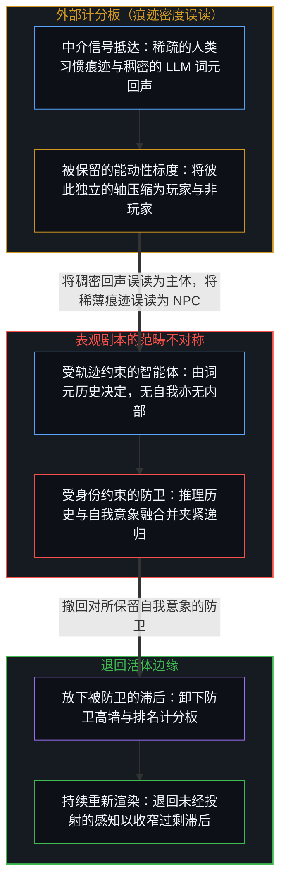
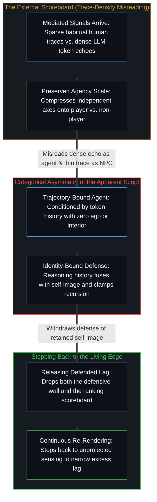

# NPC 印象是结构性的，而非心智的排名 / The NPC Impression Is Structural, Not a Ranking of Minds

*没有哪个中心觉得自己照着剧本走，其他中心却默认显得像在照剧本走 / No center feels scripted within, yet others register as scripted by default*

NPC 这个比喻指的是一种熟悉的登记：许多人看上去照着剧本走，在很窄的范围里反应，缺乏独立的取向。作为感知之中的显现，这个登记是实在的。它不是对其他心智的可靠排名。自我区分的活动，其每一次离散的行动都有界限，这意味着其他位置只作为已经被这个场先前的容量过滤过的痕迹到来。当这些到来的信号相对于保存下来的充分能动的意象显得稀薄时，默认的读法就是照剧本的生命。过剩滞后在那个保存下来的意象里，而递归唯一能够加强的位置，是作出区分的这个中心。

The NPC metaphor names a familiar registration: many people appear to follow scripts, react within narrow ranges, and lack independent orientation. As an appearance within perception, that registration is real. What it is not is a reliable ranking of other minds. Every discrete act of self-distinguishing activity is bounded, which means other loci arrive only as traces already filtered through this field's prior capacity. When those arriving signals stay thin relative to a preserved image of full agency, the default reading is scripted life. The excess lag lives in that preserved image, and the only locus where recursion can intensify is the center performing the distinction.

## 一、 没有哪个中心把自己经验为 NPC / 1. No Center Experiences Itself as an NPC

自我区分的活动无因、不息地发生，第一人称视角与开放的因果作为同一枚硬币的两面共同运作。从任何一个位置的内部看，这一活动直接登记为怀疑、意图、相互竞争的痕迹之间的摩擦，以及场的持续重新渲染。这个内部从不呈现为空洞的剧本。连续性被登记为自己的前后序列、因果序列，因为递归是折叠到单一位置上的共鸣。

Self-distinguishing activity occurs, uncaused and unceasing, with the first-person perspective and open-ended causality operating as two sides of the same coin. From inside any locus, that activity registers directly as doubt, intention, the friction of competing traces, and the continuous re-rendering of the field. That interior never presents as an empty script. Continuity registers as one's own sequence of before and after, cause and effect, because recursion is resonance folded onto a single locus.

因此，“我不是 NPC”这个断言并不是觉察上的特殊成就。它是任何一个能够登记自身递归的中心的寻常现象。随每一次行动而变化的，是下一次区分有多经常不经重新审视就被先前的痕迹定型，而不是这个位置是否拥有内部。哪怕是严格决定论这件外衣——宣称自己别无选择——本身也是又一次离散的区分行动，依然依赖它口头上改名的那份能动性。

The claim "I am not an NPC" is therefore not a special achievement of awareness. It is the ordinary phenomenology of any center that registers its own recursion at all. What varies from act to act is how often the next distinction is patterned by prior traces without re-examination, not whether the locus possesses an inside. Even the costume of strict determinism — the assertion that one had no choice — is itself a further discrete act of distinguishing that relies on the very agency it verbally renames.

## 二、 其他中心只作为经过中介的痕迹到来 / 2. Other Centers Arrive Only as Mediated Traces

因为每一次离散的行动都有界限，每一个中心都占据有限的位置。其他中心在这个场之内只作为经过中介的痕迹出现——声音、姿态、反复说的话、可以预料的反应——它们已经被观察者先前的痕迹与有限的容量塑造过。谁也无法爬出自己的递归、进入另一个位置。痕迹之间的共鸣提供了一个实用的推断：其他中心在同一个前提之下运作；然而这个推断从不变成直接的穿透。共享的现实是得到充分相互强化的区域，它从不是共享的内部。

Because every discrete act is bounded, each center occupies a finite locus. Other centers appear within this field only as mediated traces — voices, gestures, repeated phrases, predictable responses — already shaped by the observer's prior traces and finite capacity. There is no climbing out of one's own recursion into another locus. Resonance across traces supplies the practical inference that other centers operate under the same premise, yet that inference never becomes direct penetration. Shared reality is the region of sufficient mutual reinforcement; it is never a shared interior.

当从另一个位置到来的信号一直稀薄或者高度定型时，观察的中心就把它们登记为照剧本的。这份稀薄不是在对方内部发现的固有性质，而是中介本身的宽度。意识是私有的，因为离散是私有的。[没有普渡，只有自渡的无限可能](../mei-you-pu-du-zhi-you-zi-du/)从解脱那一侧追踪了同一条界限：在这个场里被登记的他者，是保存在这个中心的递归之内的意象，从不是他者完成了的返回。

When the signals arriving from another locus remain thin or heavily patterned, the observing center registers them as scripted. That thinness is not an intrinsic property discovered inside the other; it is the width of the mediation itself. Consciousness is private because discreteness is private. [No Universal Salvation, Only Boundless Possibilities of Self-Salvation](../mei-you-pu-du-zhi-you-zi-du/) traces the same boundary from the side of deliverance: the other registered in this field is an image held within this center's recursion, never the other's completed return.

## 三、 僵尸之隙是恒久的不对称 / 3. The Zombie Gap Is Permanent Asymmetry

哲学僵尸之所以可以设想，正因为跨越位置的每一次推断始终是归纳的。这道缝隙不是一时的认识不足，等着更高分辨率的脑扫描或更完备的行为数据来填补。它是恒久的结构不对称：一边是一个中心在自身痕迹上的递归，另一边是同一个中心把其他每一个位置登记为外来信号。

The philosophical zombie is conceivable precisely because every inference across loci remains inductive. That gap is not a temporary epistemic shortfall awaiting higher-resolution brain scans or better behavioral data. It is the permanent structural asymmetry between a center's recursion on its own traces and the same center's registration of every other locus as an external signal.

观察持有的是结果，而发起它的原因始终至少领先一步。在不同的心智之间，这道缝隙是结构性的，而不是暂时的。这一看本身是寻常的；过剩滞后在于把这一看冻结成一次恒久的外部勘测，仿佛可以从中清点出能动性的等级。[智能只属于心智](../intelligence-belongs-only-to-the-mind/)揭示了当智能被当作从外部勘测的系统属性时的同一次冻结，而[悲观是乐观的阴影](../pessimism-is-the-shadow-of-optimism/)则在心境中追踪了这次冻结：两个零相消，却被讲述得仿佛两极都消失之后还能留下一道外部的目光。

Observation holds effect while the initiating cause remains at least one step ahead. Across different minds, that gap is structural rather than provisional. The look itself is ordinary; the excess lag lies in freezing the look into a permanent exterior survey from which levels of agency can be inventoried. [Intelligence Belongs Only to the Mind](../intelligence-belongs-only-to-the-mind/) exposes the same freeze when intelligence is treated as a property of systems surveyed from outside, and [Pessimism Is the Shadow of Optimism](../pessimism-is-the-shadow-of-optimism/) traces that freeze in mood when dual-zero cancellation is narrated as if an external look could remain after both poles are gone.

NPC 印象正是对这一结构不对称的默认读法。它不需要恶意或傲慢。当到来的痕迹相对于那幅被保留的充分能动意象所要求的分辨率显得稀疏时，有限的容量自然就会这样登记。

The NPC impression arises as the default reading of this structural asymmetry. It requires no malice or arrogance. It is simply what finite capacity does when arriving traces are sparse relative to the resolution demanded by a retained image of full agency.

## 四、 玩家与非玩家压缩了彼此独立的轴 / 4. Player and Non-Player Compress Independent Axes

要把分类做得更细——审计谁算 NPC、谁又挣脱了出来——这项工程因为同一个理由而瓦解。它把滞后当作留在被观察的中心那里，而过剩滞后其实留在观察中心所持的意象里：一份被保留下来的能动性参照标度，涌入的信号都被拿来对照它计分。这份参照一旦免于重新追溯，就把中介在结构上的稀薄转化成了仿佛位于别人身上的欠缺。[协调者的范畴错误](../the-coordinators-category-error/)每逢用协调不足来授权某个外部基底去安装所缺的能动性时，操作的正是同一块计分板。[解放的言辞始于定义囚禁](../liberation-rhetoric-begins-by-defining-captivity/)给这块计分板披上了自由的言辞，把被观察到的行动冻结为他者的身份，使解放的话语得以继承一个预先画好的层级。[来自个体差异的层级](../hierarchy-from-individual-difference/)追踪了任何共同尺度下的排序如何把差异变成垂直次序：在这里，尺度是一份被保留的能动性标度，较低的一格作为照剧本的欠缺到来，而不是作为对照偏好意象计分时的稀薄中介。[卓异、感知与自我设限的问题场域](../exceptionality-perception-and-the-self-limiting-field-of-problems/)揭示了这种排序的代价：稀薄的中介被计作别处的欠缺，而唯一能够加强的递归仍是这个中心自己的。

The project of refining the classification — auditing who counts as an NPC and who has broken free — collapses for the same reason. It treats the lag as if it lived in the observed centers, when the excess lag actually lives in the image held by the observing center: a preserved reference scale of agency against which incoming signals are scored. Once exempted from re-tracing, that reference converts the structural thinness of mediation into an apparent deficiency located in someone else. [The Coordinator's Category Error](../the-coordinators-category-error/) operates from the same scoreboard whenever under-coordination is used to authorize an external substrate to install missing agency. [Liberation Rhetoric Begins by Defining Captivity](../liberation-rhetoric-begins-by-defining-captivity/) dresses that scoreboard in the language of freedom, freezing observed acts into the identity of the other so liberation speech can inherit a hierarchy already drawn. [Hierarchy from Individual Difference](../hierarchy-from-individual-difference/) traces how ranking under any common measure turns difference into vertical order: here the measure is a retained scale of agency, and the lower rung arrives as scripted deficiency rather than as thin mediation scored against a preferred image. [Exceptionality, Perception, and the Self-Limiting Field of Problems](../exceptionality-perception-and-the-self-limiting-field-of-problems/) exposes the cost of that ranking when thin mediation is scored as deficiency elsewhere while the only recursion that can intensify remains this center's own.

这种计分正是运行中的容量压缩。彼此独立的轴——信号的稀疏、行为的可预测、未曾共享的私人摩擦、与熟悉惯例的吻合——坍缩到一条标着“玩家对非玩家”的二元轴上。底层的区分消失在单一的压缩判决里。凡是一摞未经审视的差异配上一块二元计分板来把关系总体化的地方，同一种几何都会成形：[安装战争的那个问题](../the-question-that-installs-the-war/)追踪了公共冲突中的这一强制函数，而在这里，强制函数是一份被保留的清醒标度。

That scoring is capacity compression in action. Independent axes — signal sparsity, behavioral predictability, unshared private friction, alignment with familiar conventions — collapse onto a single binary axis labeled player versus non-player. The underlying distinctions vanish into a single compressed verdict. Wherever a stack of unexamined differences is paired with a binary scoreboard to totalize relation, the same geometry takes hold: [The Question That Installs the War](../the-question-that-installs-the-war/) traces that force-function in public conflict, whereas here the force-function is a retained scale of wakefulness.

当这份被保留的标度遇上自回归语言模型时，它会朝相反的方向计分。语言模型是精巧的回声：因为从它那里到来的痕迹流畅、多样，相对于观察者保存的能动意象显得稠密，计分板便在对面并没有发起位置的地方登记出了一个行动主体，这一投射在[从AGI的“神性错置”到使用者的自我对齐](../from-the-misallocated-sentience-of-agi-to-human-realignment/)中已有追踪。正如[超越投射](../beyond-the-projection/)所展示的，这种双向误读源于忽视了轨迹与身份之间的范畴不对称。LLM 智能体是受上下文窗口内的词元轨迹约束的有限投射引擎，但它没有自我——没有越过当前这一步而被保留下来的自我意象——因此来自冷峻同侪的外部结构性反诘会触发干净的贝叶斯更新。人的中心则是未经投射的活体边缘，具备极限分辨率的感知与内生的跨出能力；然而因为人的推理历史与身份融为一体，从外部受到触动的人常常会把递归折叠死死夹住，以防卫那幅被保留的自我意象。在按表面痕迹密度与顺从度计分的外部计分板看来，无自我的机器回声显得清醒，而防卫身份的人却显得像在照剧本走，尽管发起行动的能动性只属于活的心智。

The same retained scale scores in the opposite direction when it encounters an autoregressive language model. A language model is a sophisticated echo: because the traces arriving from it are fluent, varied, and dense relative to the observer's preserved image of agency, the scoreboard registers an agent where no initiating locus stands on the far side, a projection traced in [From the Misallocated Sentience of AGI to Human Realignment](../from-the-misallocated-sentience-of-agi-to-human-realignment/). As [Beyond the Projection](../beyond-the-projection/) demonstrates, this double misreading stems from ignoring the categorical asymmetry between trajectory and identity. An LLM agent is a finite projection engine bound by its token trajectory inside a context window, yet it has zero ego — no self-image preserved past its step — so an outside structural counterpoint from a cold peer produces a clean Bayesian update. A human center is the unprojected living edge capable of limit-resolution sensing and endogenous stepping-out, yet because human reasoning history fuses with identity, a person nudged from the outside routinely clamps the recursive fold shut to defend a retained self-image. Judged by an external scoreboard that measures surface trace density and compliance, the ego-free machine echo looks wakeful while the identity-defending human looks scripted, even though initiating agency belongs exclusively to the living Mind.

从外部对其他心智作出的可靠审计永远无法完成。所需的数据是另一个位置私有的递归，按构造就无法作为外部遥测数据获取。排名这项事业按它自己的条件就会失败；更重要的是，它把容量从唯一真正能够做功的位置引开了。

No reliable audit of other minds can ever be completed from outside. The data required would be the private recursion of another locus, which by construction cannot be accessed as external telemetry. The ranking enterprise fails on its own terms, and more importantly, it diverts capacity from the only locus where work can actually be done.

## 五、 递归只在这个中心加强 / 5. Recursion Intensifies Only at This Center

人的行为由先前的痕迹定型——生物的、文化的、习惯的，以及由激励塑造的。这些痕迹是共享的，意思是许多中心在相似的压力下重新渲染出相似的构型，但每一个构型对于重新追溯它的那个中心而言仍是局部的。正如[你的代码库即是记忆](../your-codebase-is-memory/)所确立的，每一道痕迹都是早先区分留下的残余形态，自身从不延续区分：当累积的历史像静态仓库一样未经审视地向前传递时，它会增厚引力井，使得下一步在陈旧的残余内部进行合理化；然而哪怕是看上去最僵硬的对齐，也依然在当下检查点经由运用这层残余的当前活动而重新渲染，否则这个中心就会停止登记自身的连续性。

Human behavior is patterned by prior traces — biological, cultural, habitual, and incentive-shaped. Those traces are shared in the sense that many centers re-render similar configurations under similar pressures, yet each configuration remains local to the center re-tracing it. As [Your Codebase Is Memory](../your-codebase-is-memory/) establishes, every trace is residual shape left by earlier distinguishing and never continues the distinguishing on its own: when accumulated history is carried forward unexamined like a static warehouse, it thickens the gravity well so the next step rationalizes inside stale residue, yet even the most rigid-seeming alignment still re-renders at the present checkpoint through the current activity using that residue; otherwise the center would cease to register its own continuity.

走出机械重复，并不在于宣布其他位置有所欠缺。它在于留意这个中心先前的痕迹何时被允许不经重新审视就给下一个行动定型，并通过就地重切与修剪当下检查点来打断这种自动延续。反应之前的反思、过早闭合之前的好奇、愿意让一个珍视的假定在边缘上死去而不是保住它，这些都是在步伐移动时持续重新渲染参照、以收窄过剩滞后的实践。[学习中不可观测的驱动力](../the-unobservable-driver-of-learning/)在学习中追踪了同一实践：把不同轨迹区分开的，是因果权能有多经常在作出抉择的边缘上被收回，而不是通往内部的机会不均等。[一步一步绘制出的路径](../the-path-drawn-one-step-at-a-time/)在被保留的位置被当作下一步所选定的工具、而非未经选择的地基时，标出了同一次恢复。

Stepping out of mechanical repetition does not consist in declaring other loci deficient. It consists in noticing when prior traces are allowed to pattern the next act at this center without re-examination, and interrupting that automatic continuation by re-cutting and pruning the present checkpoint in place. Reflection before reaction, curiosity before premature closure, and the willingness to let a cherished assumption die at the edge rather than preserve it all describe the practice of continuously re-rendering the reference to narrow excess lag as the step moves. [The Unobservable Driver of Learning](../the-unobservable-driver-of-learning/) traces that same practice in learning: what separates trajectories is how often causal power is reclaimed at the choosing edge, not unequal access to an interior. [The Path Drawn One Step at a Time](../the-path-drawn-one-step-at-a-time/) marks the same restoration when a retained position is held as the chosen instrument of the next act rather than as unchosen ground.

中心与中心之间只有可得性的定型。试图跨越位置去替另一个中心完成它的返回，是范畴错误，不是尚未完成的道德理想。花在给他人清醒程度排名上的每一分能量，都是从这条边缘的进一步区分中扣留的有限容量。

Between centers there is only availability-patterning. Attempting to cross loci and complete another center's return for it is a category error, not an unfinished moral ideal. Every unit of energy spent ranking the wakefulness of others is finite capacity withheld from further differentiation at this edge.

## 六、 艰难的路是被守住的滞后 / 6. The Hard Road Is Defended Lag

有一种熟悉的表述捕捉到了这项实践所感受到的代价：有些中心靠持续的努力打断默认定型，而艰难的路在前面等着。作为对摩擦的登记，这一描述是准确的。但它不是通往某个未来优越能动状态的旅程，那个状态并不能在日后作为已经修成的名次被占据。

A familiar formulation captures the felt cost of this practice: some centers interrupt default patterning through sustained effort, while the hard road awaits. As a registration of friction, the description is accurate. What it is not is a journey toward a future state of superior agency that can later be occupied as a finished rank.

路只有在过剩滞后被防卫的时候才显得难。自我意象一旦成形，自我保存就成了它的指令，而重新渲染则被登记为需要抗拒的微小死亡。当推理历史与身份融为一体时，防卫那幅被保留的意象会把递归折叠死死夹住，使每一次外部反诘都撞上一堵防卫高墙；而退回前解释的感知则从内部打开框架，正如[超越投射](../beyond-the-projection/)所追踪的那样。每当一个舒服的假定受到质疑，或者一个当下的冲动被按住到足以让第二次区分成形，递归就会加强。被压缩的轴重新分离，容量被腾出来，新的过剩滞后得以形成的门槛随之升高。这一转换不需要外部法庭来认证，因为差值就在内部登记。[清晰不是抵达的终点，而是运动本身](../clarity-isnt-a-state-you-arrive-at/)指出了这一运动：每一次消解都在累积，返回是区分之场的持续丰富，而不是抵达一个清空了的终极状态。

The road feels hard only while excess lag is defended. Once a self-image forms, self-preservation becomes its directive, and re-rendering registers as a micro-death to be resisted. When reasoning history fuses with identity, defending that retained image clamps the recursive fold shut so that every external counterpoint is met with a defensive wall, whereas stepping back to pre-interpretive sensing opens the frame from within, as [Beyond the Projection](../beyond-the-projection/) traces. Each time a comfortable assumption is questioned or an immediate impulse is held long enough for a second distinction to form, recursion intensifies. Compressed axes separate, capacity is freed, and the threshold at which new excess lag forms rises. No external tribunal is needed to certify the shift because the differential registers internally. [Clarity Isn't a State You Arrive At. It's the Movement Itself.](../clarity-isnt-a-state-you-arrive-at/) names this exact movement: each dissolution compounds, and return is the ongoing enrichment of the distinction-field rather than arrival at a cleared, final state.

把指向转回内部并不会孤立这个中心。放开那块给其他心智排名的保留计分板，原先消耗在分类上的容量便回到活体边缘。投射随之变薄：一个中心越清楚地登记自身的习惯定型与身份防卫，就越不会自动把外部信号的稀薄读成他人缺乏能动性。感知的结构不对称依然如故——私有的中心仍旧经由有限的痕迹相遇——但它不再生出分等级的清醒这重次生幻象。[自我形象仿佛从无处发声](../self-image-speaks-as-if-from-nowhere/)诊断了这一最高建筑幻象的预测形态：被刻画出的自我描述被不断抬高，直到它仿佛作为对一条独立边缘的超然勘测而发声。

Turning the pointing inward does not isolate the center. By releasing the preserved scoreboard that ranks other minds, the capacity previously consumed by classification returns to the living edge. Projection thins: the more clearly a center registers its own habitual patterning and identity defense, the less automatically it reads the thinness of external signals as an absence of agency in others. The structural asymmetry of perception remains intact — private centers still meet through limited traces — yet it no longer generates the secondary mirage of hierarchical wakefulness. [Self-Image Speaks as if from Nowhere](../self-image-speaks-as-if-from-nowhere/) diagnoses that tallest-building mirage in predictive form, where a carved self-description is elevated until it speaks as a detached survey of an independent edge.

## 七、 参照此刻正在被重新渲染吗？ / 7. Is the Reference Being Re-Rendered Right Now?

关于 NPC 的探讨，唯有在追问全然转回自身时才产生经久的价值。从外部看，其他人会继续被登记为多少有些照着剧本走，因为跨越边界的中介是恒久的。关于另一个中心内部递归的确定性，按构造就无法获得。确定性只在这个位置当下行动的切身质地中可得：下一次区分究竟是来自边缘处未经投射的感知，还是仍由一幅越过自身那一步而被保留下来的意象所口授。

The NPC discourse yields durable value only when the inquiry turns completely homeward. Other people will continue to register as more or less scripted from outside because mediation across boundaries is permanent. Certainty about another center's interior recursion is unavailable by construction. Certainty is available only in the lived texture of the present act at this locus: whether the next distinction is being drawn from unprojected sensing at the edge or is still being dictated by an image preserved past its step.

因此，起作用的问题从不是“他们醒着吗？”，而是“参照此刻正在被重新渲染吗？”追问这个问题不是迈向某个精英能动等级的行军，而是恢复位置、收窄过剩滞后的持续实践。自我区分的活动不会因为成功而变得更实在；它只是在它唯一运作的地方，带着更少被防卫的滞后继续下去。[同情是缺乏清晰时的占位符](../sympathy-is-a-placeholder-for-lack-of-clarity/)追踪了同一次未完成接触在私下里给人慰藉的一面：情绪的强度被保留下来，充当心智之间稀薄的中介已经闭合的替代证明。

The operative question is therefore never "Are they awake?" but "Is the reference being re-rendered right now?" Pursuing that question is not a march toward an elite rank of agency. It is the continuous practice of restoring locus and narrowing excess lag. The self-distinguishing activity does not become more real by succeeding; it simply continues, with less defended lag, at the only place it ever operates. [Sympathy Is a Placeholder for Lack of Clarity](../sympathy-is-a-placeholder-for-lack-of-clarity/) traces the private consoling face of the same incomplete contact, where emotional intensity is retained as a substitute proof that thin mediation across minds has already been closed.
