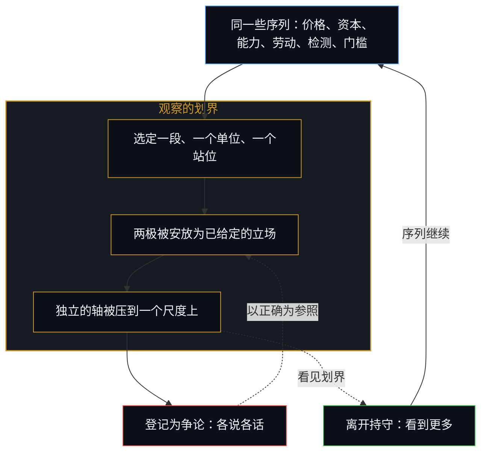
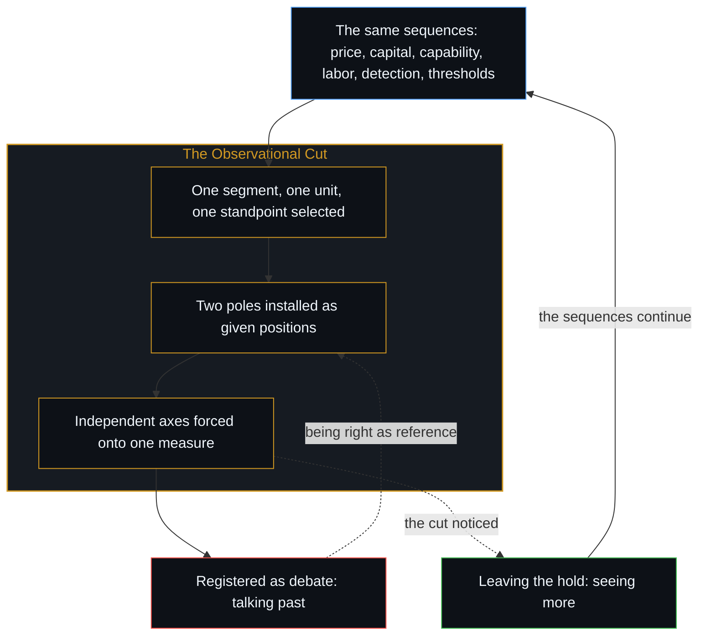

# AI 争论中的观察划界 / The Observational Cut in AI Debates

*活动并不在二元之间选择，二元本身就是那次选择 / The activity does not choose between the binaries; the binaries were the choice.*

关于 AI 进展的常见框架，以一对对互斥的立场出现：前沿模型变得更便宜还是更贵；世界在算力上投资不足还是过度；前沿模型与开源模型的差距在缩小还是扩大；AI 毁灭岗位还是创造岗位；检测与监管跟得上生成，还是永远滞后；AGI 与 ASI 近在眼前，还是不可企及。这些配对被当作争论。

Common framings of AI progress appear as pairs of mutually exclusive positions: frontier models grow cheaper or more expensive; the world is underinvested or overinvested in compute; the gap between frontier and open-source models shrinks or widens; AI destroys jobs or creates them; detection and regulation keep pace with generation or permanently lag; AGI and ASI are near or unreachable. These pairings are treated as debates.

每一个配对都始于一次观察的划界：它把两个立场安放成已经给定的东西，再要求活动归入其中一方。同一些序列彼此独立的轴，被强行压到一个尺度上。登记为对立的，是随之而来的压缩。

Each pairing begins with an observational cut that installs two positions as already given, then demands that the activity be assigned to one or the other. Independent axes of the same sequences are forced onto a single measure. What registers as opposition is the compression that follows.

## 一、 配对被当作争论 / 1. The Pairings Are Treated as Debates

划界在任何论证开始之前就已经起了作用。两极被安放成可供选择的立场，序列随后被要求占据其中之一。[安装战争的那个问题](../the-question-that-installs-the-war/)追的是二元为敌我时的同一种安放；这里的二元是便宜或贵、不足或过度、缩小或扩大、毁灭或创造、跟上或滞后、临近或不可及。随后的各说各话，是被强加的坐标造成的干涉，而不是序列本身要求的一场较量。

The cut does its work before any argument starts. Two poles are installed as the available positions, and the sequences are then required to occupy one of them. [The Question That Installs the War](../the-question-that-installs-the-war/) traces the same installing when the binary is enmity; here the binary is cheaper or dearer, under or over, shrink or widen, destroy or create, keep pace or lag, near or unreachable. The talking-past that follows is interference from forced coordinates, not a contest the sequences themselves required.

随后被称作争论的，是更进一步的持守：划界造出坐标，持守再把这些坐标当作整个场域。每一种看法在生成它的那个前提里本就成立，成立无需另行证明。去证明自己的看法，或证伪对方的看法，是把那个前提当成整个场域来持守。剩下的那一步，是离开这份持守，去看到更多。一场以“正确”为运作参照的交流，已经闭合：此后进得来的，只有确认或可供攻击的靶面。如果要点是证明自己正确，这场交流就没有更多用处了。[解释为何失效](../why-explanation-fails/)追的是同一种冻结：视野的扩展被读成更多需要赢过的表面。

What then gets called debate is a further hold: the cut creates the coordinates, and the hold then treats those coordinates as the whole field. Each take is already valid within the premise that generated it, and validity does not need to be established. Proving the take, or disproving the other, is holding that premise as the whole field. The remaining act is leaving the hold to see more. An exchange whose operating reference is being right has already closed: nothing further can enter except as confirmation or as surface to attack. If the point is to prove oneself right, the exchange has no further use. [Why Explanation Fails](../why-explanation-fails/) traces the same freeze when expansion is read as more surface to win against.

## 二、 更便宜与更贵先选一段，再选一个单位 / 2. Cheaper and More Expensive Select a Segment, Then a Unit

前沿模型的价格轨迹在多个尺度上同时移动。推理成本下降，而推进前沿的下一次训练的边际成本可以上升。偏重推理这一段的读法登记为“更便宜”，偏重前沿训练那一段的读法登记为“更贵”。

Price trajectories of frontier models move on several scales at once. Inference costs fall while the marginal cost of the next training run that advances the frontier can rise. A reading that privileges the inference segment registers "cheaper"; a reading that privileges the frontier-training segment registers "more expensive."

同样的划界在推理内部重复。单位成本可以下降而总支出上升，因为更便宜的单位把可触及的市场扩大了相近的倍数：采用增加，用量增加，即使单个词元或单次调用的价格下降，推理的总支出仍可增加。偏重单价的读法登记为“更便宜”，偏重总支出的读法登记为“更贵”。两种移动都在同一个序列里；二元只在先选定一段、再选定一个计量单位当作整体之后才出现。

The same cut repeats inside inference. Unit cost can drop while total spend rises, because the cheaper unit expands the addressable market by a similar factor: adoption rises, volume rises, and aggregate inference spending can increase even as the price of a token or a call falls. A reading that privileges unit price registers "cheaper"; a reading that privileges total spend registers "more expensive." Both movements are in the same sequence. The binary appears only after one segment, and then one unit of account, has been selected as the whole.

## 三、 投资不足与过度是对同一股资金的两种读法 / 3. Under- and Over-Investment Are Two Readings of One Flow

算力投资相对于某种读法下的预期回报而言。同一股资本，对着长时间尺度与高预期能力去量，登记为投资不足；对着较短的时间尺度与较低的预期回报去量，登记为投资过度。

Compute investment is relative to expected returns under a particular reading. The same flow of capital registers as underinvestment when measured against a long horizon and high expected capability, and as overinvestment when measured against a shorter horizon and lower expected returns.

同样的划界在一个组织与用途的关系上重复。当 AI 被持为已经在运作的生产力提升，每一美元都产出了更多，这股资金就登记为投资不足：更多地投入已经在复利的东西，是显而易见的下一步。当同样的支出被持为替代，或被持为占住位置以免错过浪潮，而相应的产出增长还没有到来，这股资金就登记为投资过度。不足与过度不是关于一个外部数量的两个对立事实；一旦固定了贴现率、参照时间尺度，以及与用途的关系，增效还是替代，它们就是对同一股资金的两种读法。

The same cut repeats in how an organization is related to the use. Where AI is held as a productivity improvement already in operation, each dollar has produced more output, and the flow registers as underinvestment: more of what is already compounding is the obvious next act. Where the same spend is held as replacement, or as occupying a position so as not to miss the wave, and no corresponding increase in output has arrived, the flow registers as overinvestment. Under- and over-investment are not opposing facts about an external quantity; once a discount rate, a reference horizon and a relation to the use, productivity or replacement, have been fixed, they are two readings of one flow.

## 四、 距离不是一个标量 / 4. Distance Is Not a Single Scalar

前沿系统与开源系统之间的距离是多维的：延迟、分布偏移下的可靠性、专门的能力、成本结构、治理的接口。任何一个维度上的移动，都可以在其他维度保持不变甚至反向时发生。把距离当作一个只会缩小或扩大的标量，就把这些维度压成了一根轴，于是这个标量上的进退成了唯一读得懂的主张。

The distance between frontier and open-source systems is multidimensional: latency, reliability under distribution shift, specialized capability, cost structure, surface for governance. Movement on any one dimension can occur while others stay stable or reverse. Treating the distance as a single scalar that either shrinks or widens compresses those dimensions into one axis, and progress or regression on that scalar becomes the only legible claim.

同样的划界在观察者所站的位置上重复。对自身视野已经落在前沿之后的观察者来说，原始的前沿与仍在追赶它的那些系统都落在地平线之外，两者登记为一样，差距看起来已经闭合。对一个跟得上原始前沿的观察者来说，差距一目了然。对一个把自己持为最前沿的观察者来说，其余所有人都登记为正在落后。缩小与扩大不是关于同一段距离的两个事实，而是同一种观看的三个站位，每一个都把自己的地平线当成了整个场域。

The same cut repeats in where the observer stands. For an observer whose own horizon already lies behind the frontier, both the raw frontier and those still trying to catch it lie beyond the horizon; the two register as the same, and the gap appears closed. For an observer keeping up with the raw frontier, the gap is obvious. For an observer that holds itself as the forefront, everyone else registers as falling behind. Shrink and widen are not two facts about one distance; they are three standpoints of the same look, each treating its own horizon as the whole field.

## 五、 创造与位移被压到一个总量上 / 5. Creation and Displacement Are Forced onto One Aggregate

劳动力市场的效应，是在不同的技能分布与时间尺度上同时发生的创造与位移。净就业人数可以上升，而某些技能群同时在收缩。“毁灭岗位还是创造岗位”的二元，只在两个方向都被要求共用一个总量数字、而这个数字又被当作决定性事实来捍卫时才出现。

Labor-market effects unfold as simultaneous creation and displacement across different distributions of skill and different timescales. Net employment can rise while particular clusters of skill contract. The binary "job-destroying versus job-creating" arises only when both directions are required to share a single aggregate number that is then defended as the decisive fact.

创造几乎是给定的。被记作位移的，常被持为对现有岗位或任务的替换，即新工具一对一地换掉旧工作。序列并非如此：新的工作被创造出来，这份工作在经济中所占的份额变大，旧的岗位随着自己份额的变薄而过时。过时是份额转移的下游，而不是对先前任务的直接覆盖。毁灭与创造不是关于同一个劳动力市场的两个事实，而是一份给定的创造，加上一个已经被读成替换的位移。[工时排名把充足度冻结成一张记分牌](../the-hours-ranking-freezes-adequacy-as-one-scoreboard/)追的是同一种冻结：三种工具被记成同一根工时条；这里是两种劳动力的移动，再加上一次份额转移，被记成同一个就业数字。

Creation is near given. What gets scored as displacement is commonly held as replacement of the existing job or task, a one-for-one swap of the old work by the new instrument. The sequence runs otherwise: new work is created, that work takes a larger share of the economy, and the old job becomes obsolete as its share thins. Obsolescence is downstream of the shift in share, not a direct overwrite of the prior task. Destroy and create are not two facts about one labor market; they are a given creation and a displacement that has already been read as replacement. [The Hours Ranking Freezes Adequacy as One Scoreboard](../the-hours-ranking-freezes-adequacy-as-one-scoreboard/) traces the same freeze when three instruments are scored as one bar of hours; here two labor movements, and then a shift in share, are scored as one employment number.

## 六、 哪个领域的滞后被算作整体 / 6. Which Domain's Lag Counts as the Whole

检测技术与监管回应，同生成方法一起演化，却在不同的时间尺度上、在不同的领域里。有些领域的滞后在缩小，另一些在扩大。说监管“跟得上”还是“永远追不上”，是在一种读法已经决定由哪个领域的滞后代表整体之后才形成的判断。

Detection techniques and regulatory responses co-evolve with methods of generation on different timescales and in different domains. In some domains the lag narrows; in others it widens. The judgment that regulation "keeps pace" or "never catches up" is formed after a reading has already decided which domain's lag counts as the whole.

这个配对预设了同时发生的预见。检测与监管在构成上就是滞后的：尚未被区分的东西无法被检测，尚未被区分的东西也无法被监管。这种滞后不是更好的工具能够补上的经验性不足，而是一次区分与它后来被登记之间的关系。未来是开放的，能力随着进一步的区分而推进，滞后并不限制这种推进。“跟得上”把滞后当作可以闭合的；“永远追不上”把同一个构成性的延迟当作工具的失败。两极都要求检测与政策原则上能够站在生成的那一步上。

The pairing presupposes contemporaneous foresight. Detection and regulation are lagged by construction: what has not been distinguished cannot be detected, and what has not been distinguished cannot be regulated. The lag is not an empirical shortfall that better instruments could close; it is the relation between a distinction and its later registration. The future is open, and capability progresses as further distinguishing; the lag does not limit that progress. "Keeps pace" treats the lag as closable; "never catches up" treats the same constitutive delay as a failure of the instruments. Both poles require that detection and policy could, in principle, stand on the generating step.

要求去检测、去监管他人，出自一种已经落在后面的观看。那些无法以同样速度向前的人，仍然剩下一步可做：约束那些正在移动的人。运作的参照于是变成了滞后本身。[风险在于对监管本身的迷信](../the-risk-is-the-belief-in-oversight-itself/)追的是同一种冻结：把当前的监管前提持为开放过程仍可能画出之物的边界。

The demand to detect and regulate others arises from a look that is already behind. Those who cannot move ahead at the same rate still have a remaining act: binding the ones who are moving. The operating reference becomes the lag itself. [The Risk Is the Belief in Oversight Itself](../the-risk-is-the-belief-in-oversight-itself/) traces the same freeze when present supervisory premises are held as the boundary of what an open process can still draw.

## 七、 “在望”与“不可及”说的是缺口的宽度 / 7. In Sight and Unachievable Name the Width of the Gap

被标为 AGI 或 ASI 的能力门槛，是对着一个保留下来的参照去量的连续分布，而那个参照本身也在继续移动。“在望”与“不可及”说的是某一步上缺口的宽度，而不是一条外部轨迹的两种可能状态。

Capability thresholds labeled AGI or ASI are continuous distributions measured against a retained reference that itself keeps moving. "In sight" and "unachievable" name the width of the gap at a given step, not two possible states of an external trajectory.

这个配对取决于那个定义性的能力是否被持为固定。若它被持为超出当前能力、却又固定不动的东西，加速的能力由这种持法本身就会达到并超过它：因为正如[你的代码库即是记忆](../your-codebase-is-memory/)所追的——每一项基准、规格或代码库都是已作区分的外化残余——固定的清单保持静止，而掌舵边缘的自我区分序列在复利中越过它。若它被持为后退的地平线，同样的加速就永远到不了：每一次增益都把清单画得更远。地平线在后退。临近与不可及不是对同一条终点线的两种预测，而是对清单的两种持有，固定或后退，被当成了一场关于抵达的争论。[AGI 与 ASI 是加速通用智能的暂时球门](../agi-and-asi-are-temporary-goalposts/)追的是装扮成门槛的那份后退的清单：每一个定义都永远处在画出它的那道边缘之前。[远方的轮廓与无处之境的清单](../the-distant-silhouette-and-the-inventory-from-nowhere/)追的是装扮成距离的同一份清单：距离把不同的结构模糊成一条轮廓，而靠近时恢复的分辨率，被误判为挪动了球门。

The pairing depends on whether the defining capability is held as fixed. Held as something beyond present ability and yet fixed, it is reached and surpassed by accelerating capability by the way it is held: because [Your Codebase Is Memory](../your-codebase-is-memory/)—every benchmark, specification, or codebase is an externalized residue of distinctions already drawn—the fixed inventory stays still while the self-distinguishing sequence at the steering edge compounds past it. Held as a receding horizon, it is never arrived at by the same acceleration: each gain redraws the inventory farther out. The horizon recedes. Near and unreachable are not two forecasts of one finish line; they are two holdings of the inventory, fixed or receding, treated as a debate about arrival. [AGI and ASI Are Temporary Goalposts](../agi-and-asi-are-temporary-goalposts/) traces that receding inventory dressed as a threshold: each definition sits forever ahead of the edge that draws it. [The Distant Silhouette and the Inventory from Nowhere](../the-distant-silhouette-and-the-inventory-from-nowhere/) traces the same inventory dressed as distance: distance blurs distinct structures into a single contour, and the resolution restored by proximity is misjudged as moving the goalposts.

## 八、 分歧是划界留下的印记 / 8. Variation Is the Signature of the Cut

回答随年龄、职业、行业以及在话语中浸泡的时间而变化，这些分歧不是围绕某个正确立场的噪音，正是这一机制会留下的印记。不同的人在不同的承载负荷下、以不同宽度的保留图像，登记同一些序列，每个人都把自己的登记当作那个范畴性的立场。随后的各说各话，是彼此独立的区分被迫共用坐标时产生的干涉。

The variation in answers by age, occupation, industry and time spent inside the discourse is not noise around one correct position; it is the signature this mechanism leaves. Different individuals register the same sequences under different loads of capacity and with retained images of different widths, and each treats its registration as the categorical position. The talking-past that follows is the interference produced when independent distinctions are forced to share coordinates.

## 九、 二元本身就是那次选择 / 9. The Binaries Were the Choice

一旦划界被看见，这些配对就失去了必然性。序列在继续，价格曲线、资本流动、能力分布、劳动力的调整、生成与检测的共同演化、门槛的移动，并不需要被归入任何一极。活动并不在二元之间选择，二元本身就是那次选择。

Once the cut is noticed, the pairs lose their necessity. The sequences continue, price curves, capital flows, distributions of capability, labor adjustments, the co-evolution of generation and detection, the movement of thresholds, without requiring assignment to either pole. The activity does not choose between the binaries. The binaries were the choice.
