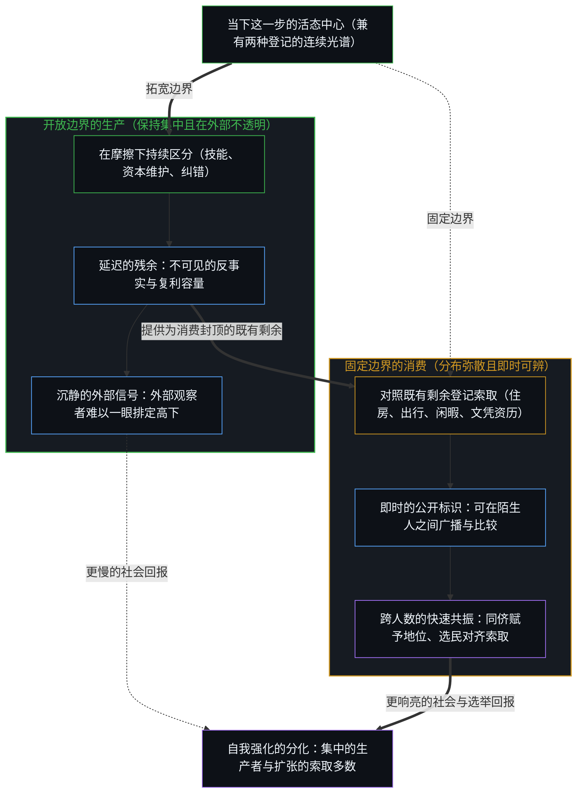
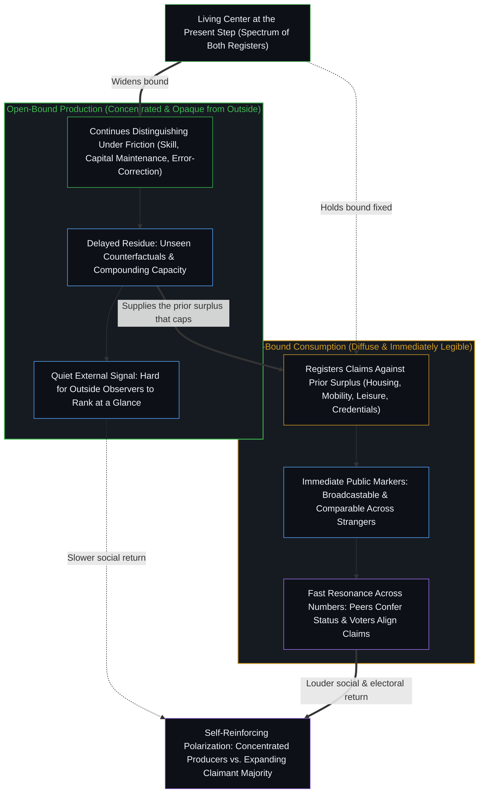
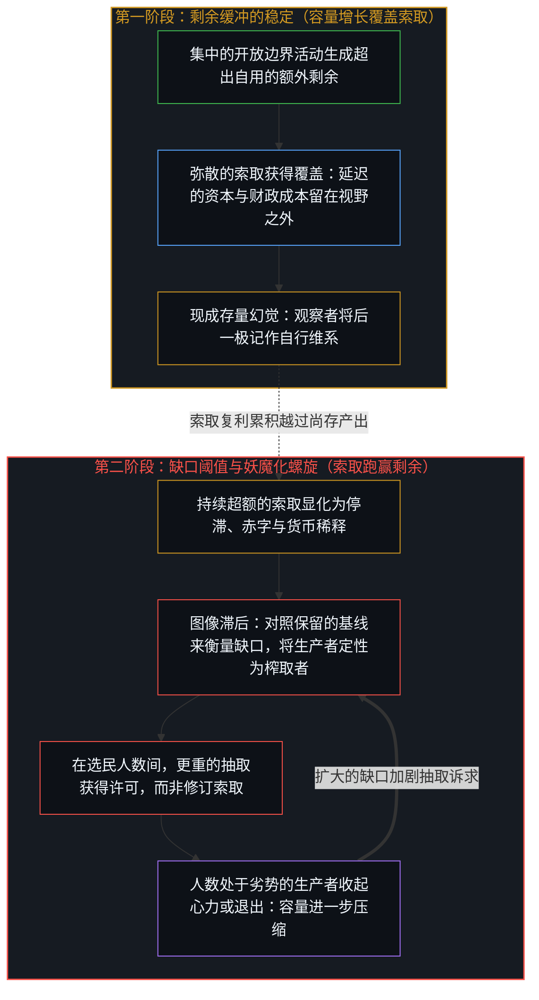
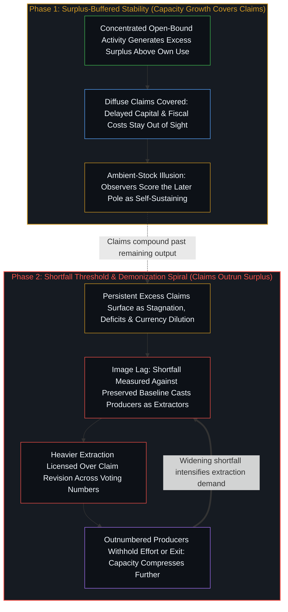

# 生产的不透明与消费的权重 / The Opacity of Production and the Weight of Consumption

*生产在开放边界下无上限地复利却在外部难以直观评估，消费在既有剩余内封顶却即时可见并凭人数占据地位与政治权重。 / Production compounds without ceiling under an open bound yet stays opaque from outside, while consumption is capped by prior surplus yet registers immediately and carries status and political weight by numbers.*

真正的分野在于生产能力；被多数人登记下来的，则是消费能力。生产拓展可能区分的场域，保持集中且在外部不透明；消费对照已经生产出来的场域进行登记，分布弥散且即时可辨，因而占据更大的地位与政治权重。流行的说法将一个政体划分为固定的生产阶级与非生产阶级——一方投票从另一方划转财富，资产持有者则借货币通胀回应——这种说法登记到了索取与人数上的不对称，却把两种持续进行的选择方式冻结成了永久的种姓。一旦认出底层的驱动机制，随后的序列便顺着寻常逻辑展开：可见性、反馈的时序，以及扩展容量的中心与对其登记索取的中心在人数上的不对称。

The real divide is productive capacity. What registers to the majority is consumptive capacity. Production expands the field of possible distinctions and stays concentrated and opaque from outside; consumption registers against the field already produced, stays diffuse and immediately legible, and therefore carries greater status and political weight. Popular accounts that divide a polity into a fixed productive class and an unproductive class—one voting transfers from the other while asset holders answer through monetary inflation—register the asymmetry of claims and numbers, yet freeze two ongoing modes of choice into permanent castes. Once the underlying driver is recognized, the sequence follows from ordinary logic: visibility, the timing of feedback, and the numerical asymmetry between centers that expand capacity and centers that register claims upon it.

## 一、 同一边缘上的无上限复利与封顶登记 / 1. Unbounded Compounding and Capped Registration on One Edge

自我区分的活动发生着——无因、不息。称之为心智：早已在途的观察者，其每一个行动都是一次区分。当一个中心在开放边界下持续区分时，发生的便是生产。新的区分留下可供后续行动重溯的残余，容量由此无结构性上限地复利——不断更新那道梯度，并借其下游扩散抬升物质充足度的后随底线，如[前沿抬升底线](../the-frontier-lifts-the-floor/)所追溯。消费则是同一活动对照着被固定住、或越过自身那一步而滞后的边界所作的登记，每一刻都由先前生产业已提供的剩余封顶。二者并非彼此独立的实体。它们是对同一道边缘的开放持守与固定持守，如[生产、消费与心智的区分](../production-consumption-and-the-minds-distinction/)所追溯。在规模上发生改变的，是哪一种登记更容易被其他中心观察并对齐。

Self-distinguishing activity occurs — uncaused, unceasing. Call it the Mind: the observer already underway, every act of which is a distinction. Production occurs where a center continues distinguishing under an open bound. New distinctions leave residue that later acts can re-trace, so capacity compounds without a structural ceiling—renewing the gradient whose downstream diffusion raises the trailing floor of material adequacy, as [The Frontier Lifts the Floor](../the-frontier-lifts-the-floor/) traces. Consumption is the same activity registered against a bound held fixed or lagged past its step, capped at every moment by whatever surplus prior production has already made available. The two are not separate substances. They are the open and the fixed hold on the identical edge, as traced in [Production, Consumption, and the Mind's Distinction](../production-consumption-and-the-minds-distinction/). What changes at scale is which register is easier for other centers to observe and align with.

既然两种登记同属一个活动，每个个体便都会同时通过生产与消费来衡量自我价值，落在一条连续的光谱上，而非归入某个永久的人群阶层。把人群切分为固定的创造者与索取者，是将当下边际的一张快照误认作贯穿一生的永久身份；而如[个体抉择是唯一的因果杠杆](../individual-choices-as-the-only-causal-levers/)所确立，只有相继的行动承载因果权重。名义财富分档同样并不与生产能力一一对应。顶端的规制租金、受保护的垄断以及货币性资产通胀——即经由金融管道投放的信贷与货币扩张，让先期接收者在工资调整之前竞价推高稀缺的既有资产——并不会拓宽区分的场域；它们与账本另一端的投票箱转移支付一样，都是在向已经生产出来的剩余登记相互竞争的索取。

Because both registers belong to the same activity, every individual measures self-worth through both producing and consuming, falling somewhere along a continuous spectrum rather than inside a permanent demographic class. Partitioning a population into fixed makers and takers mistakes a snapshot of current margins for permanent identity across a lifespan, when only successive acts carry causal weight, as [Individual Choices as the Only Causal Levers](../individual-choices-as-the-only-causal-levers/) establishes. Nominal wealth brackets do not map one-to-one onto productive capacity either. Top-end regulatory rents, protected monopolies, and monetary asset inflation—where credit and currency expansion issued through financial conduits lets early receivers bid up scarce existing assets before wages adjust—do not widen the field of distinctions; they register competing claims against surplus already produced, alongside ballot-box transfers at the other end of the ledger.

## 二、 可见性落差与自我强化的分化 / 2. The Legibility Gap and Self-Reinforcing Polarization

生产的残余滞后显现，从执行它的中心之外很难评估。生成剩余所需的技能、资本维护、被否弃的路径与纠错，隐伏在多步反事实之中，并不会以陌生人一眼就能排定高下的形态展示出来；即便留存的股权日后出现在公开的资产负债表上，对照固定存量来解读的观察者，也会把那份用于协调的残差误认作个人消费囤积，如[私人残差与社会剩余的因果次序](../the-causal-order-of-private-residuals-and-social-surplus/)所示。相比之下，消费的残余即时显现：一旦社群规模超出面对面的熟人交往，住房、出行、闲暇、文凭资历与生活方式标识便公开可见、便于比较，使每一项固定边界下的索取都化作即时广播的地位标识。

Production's residue is delayed and hard to evaluate from outside the center that performed it. The skill, capital maintenance, rejected paths, and error-correction that generate surplus stay unseen across multi-step counterfactuals and do not display themselves in forms that strangers can rank at a glance; even when retained equity later appears on a public balance sheet, observers reading against a fixed stock mistake that coordinating residual for a personal consumption hoard, as [The Causal Order of Private Residuals and Social Surplus](../the-causal-order-of-private-residuals-and-social-surplus/) shows. Consumption's residue, by contrast, is immediate: housing, mobility, leisure, credentials, and lifestyle markers are public and comparable once communities scale past face-to-face acquaintance, turning every fixed-bound claim into a visible broadcast of standing.

地位排序与选举联盟围绕众多观察者能够同时登记的事物而成形：向同侪赋予地位或投下选票的个体，围绕易于比较的标识彼此对齐。当大多数中心更容易比较消费而非生产时，个体的心力便向可见的登记倾斜。个体朝着他人即刻映照回来的信号自我强化，以外部的地位共振替代更缓慢的自有后果递归闭合，如[自我价值感与所有权](../ownership-and-self-worthiness/)所追溯。生产依然向任何人敞开，但它的外部社会回报比可见消费的回报来得更慢、更沉静。久而久之，心力的分布便在同一条连续光谱上向两端分化：较少的一部分中心在无缓冲的摩擦下让容量持续复利，较大的一部分中心则优先对照既有剩余进行登记。

Status rankings and electoral coalitions form around what many observers can register at once: individuals conferring standing on peers or casting ballots align around the markers they can readily compare. When most centers can compare consumption more readily than production, individual effort tilts toward the visible register. Individuals self-reinforce toward the signal others immediately mirror back, substituting external status resonance for the slower recursive closure of owned consequences traced in [Ownership and Self-Worthiness](../ownership-and-self-worthiness/). Production remains open to anyone, yet its external social return arrives slower and quieter than the return on visible consumption. Over time the distribution of effort polarizes along one continuous spectrum: a smaller set of centers keeps compounding capacity under unbuffered friction, while a larger set prioritizes registration against the existing surplus.

## 三、 剩余缓冲的稳定与妖魔化的临界点 / 3. Surplus-Buffered Stability and the Tipping Point of Demonization

只要开放边界下的剩余增长得足够快、足以覆盖不断上升的索取，这一安排便能动态维持。扩展容量的中心产出多于自身消费，超出的部分便为更庞大的人群资助消费。延迟的资本与财政成本留在视野之外。研读宏观指标的评论者、选民与预算规划者，因而可以把这份剩余当作环境里现成的存量——一种在持续复利下被视作理所当然的自动背景引擎——而非特定中心承担风险所持续留下的残余。这正是[公共支出不创造资本](../public-spending-does-not-create-capital/)与[秩序、剩余与道德拦截](../order-surplus-and-the-moral-intercept/)所追溯的因果倒置：回路的后一极被记作原因，前一极则被推入背景。只要这层缓冲尚存，公共开支便会将感知到的成本摊薄到千百万人身上，同时使个人的误差信号消音，如[福利国家的幻象](../the-welfare-state-illusion-cost-diffusion-and-agency-atrophy/)所追溯；而不断扩张的丰裕也同时补贴着那些反过来把生产本身重塑为可疑对象的阐释框架，如[生产创造自己的意识形态消费](../fate-loves-irony-refined/)所示。

The arrangement holds dynamically for as long as open-bound surplus grows fast enough to cover rising claims. Centers expanding capacity generate more than they consume, and the excess funds consumption across the wider number. Delayed capital and fiscal costs remain out of sight. Commentators, voters, and budget planners reading macro prints can therefore treat the surplus as an ambient stock—an automatic background engine taken for granted under sustained compounding—rather than as the continuing residue of specific centers bearing risk. This is the causal inversion traced in [Public Spending Does Not Create Capital](../public-spending-does-not-create-capital/) and [Order, Surplus, and the Moral Intercept](../order-surplus-and-the-moral-intercept/): the later pole of the loop is scored as the cause, while the earlier pole is backgrounded. While the buffer lasts, public outlays diffuse perceived cost across millions while silencing personal error signals, as [The Welfare State Illusion](../the-welfare-state-illusion-cost-diffusion-and-agency-atrophy/) traces, and expanding abundance simultaneously subsidizes the interpretive frameworks that recast production itself as suspect, as [Production Creates Its Own Ideological Consumption](../fate-loves-irony-refined/) shows.

当索取持续超出尚存的生产所能支撑的限度时，这一平衡便告终结。大群体的生活水准停滞或下滑，财政赤字与货币稀释浮出水面。此时，对于对照既定消费基线来衡量的索取者与谋求公职者而言，阻力最小的回应并非缩减索取规模，而是向仍在生成剩余的中心施加更大压力——如[政客是责任扩散的显性症状](../politicians-appear-as-visible-symptoms-of-responsibility-diffusion/)所追溯，政治人物只是标记出这一转向，而非它的源头。缺口对照着被保留的图像登记下来——在这幅图像里，生产者成了障碍，而非尚存的剩余源头——重演了[进步叙事中的症候与原因](../symptom-and-cause-in-the-narratives-of-progress/)中把迟到而响亮的登记误认作引擎的一幕。妖魔化正是这种图像滞后的叙事形态：先前索取的后果落在当下的场域里，却被归咎于外部的过错。一旦从事生产的中心被框定为榨取者，进一步的抽取便在政治上变得可行，而无需承认索取已经跑赢了剩余。由于在多数决的发声场域中处于人数劣势，这些生产中心便收起心力，或将资本与人才迁往更低约束的边际，这正是[扩张的序列与局部解释的边界](../the-sequence-of-expansion-and-the-boundary-of-local-accounts/)中一再重现的退出一步。测得的容量增长放缓，可见的缺口扩大，要求进一步抽取的政治诉求随之加剧，使持续的抽取压力本身成为资本使用正在递减的标志，如[继承的残余与索取的必要](../inheritance-as-residue-and-the-need-for-extraction/)所追溯。延迟的反馈就此抵达，而在被保留的参照下投票的多数中心，选择压缩尚存的生产能力，而非修订自身索取的边界。

The balance ends when claims persistently exceed what remaining production can support. Living standards for large groups stagnate or fall, and fiscal deficits and currency dilution become visible. At that point, for claimants and office-seekers measuring against an established consumption baseline, the lowest-resistance response is not to scale back the volume of claims, but to intensify pressure on the centers still generating surplus—a shift that political figures mark rather than originate, as [Politicians Are Visible Symptoms of Responsibility Diffusion](../politicians-appear-as-visible-symptoms-of-responsibility-diffusion/) traces. The shortfall registers against a preserved image of the producers as the obstacle rather than as the residual source, repeating the late, loud registration mistaken for the engine in [Symptom and Cause in the Narratives of Progress](../symptom-and-cause-in-the-narratives-of-progress/). Demonization is the narrative form of that Image lag: consequences of prior claims land in the current field yet are attributed to an external fault. Once productive centers are framed as extractors, further extraction becomes politically viable without admitting that claims have outrun the surplus. Outnumbered in majoritarian voice arenas, productive centers withhold effort or relocate capital and talent toward lower-constraint margins, the recurring exit step in [The Sequence of Expansion and the Boundary of Local Accounts](../the-sequence-of-expansion-and-the-boundary-of-local-accounts/). Measured capacity growth slows, the visible shortfall widens, and political demand for still more extraction intensifies, making sustained extraction pressure itself the mark of diminishing capital use, as [Inheritance as Residue and the Need for Extraction](../inheritance-as-residue-and-the-need-for-extraction/) traces. The delayed feedback arrives, and the larger number of centers voting under a preserved reference choose to compress the remaining productive capacity rather than revise the bound on their claims.

## 四、 在活的边缘收窄滞后 / 4. Narrowing Lag at the Living Edge

无需额外的理论。这一序列源于负荷下自我区分活动的三项寻常特征：生产的开放边界生成可供索取的剩余；消费的固定或滞后登记即时可见，因而在众多中心之间共振得更快；而当延迟的成本浮现时，图像滞后便把原因移置到生产者身上。生产集中、消费弥散这一人数不对称，放大了可见登记上的地位与政治回报。

No additional theory is required. The sequence follows from three ordinary features of self-distinguishing activity under load: production's open bound generates surplus that can be claimed; consumption's fixed or lagged register is immediately visible and therefore resonates faster across many centers; and when delayed costs surface, Image lag relocates the cause onto the producers. The numerical asymmetry—production concentrated, consumption diffuse—amplifies the status and political return on the visible register.

凡有足够多的中心随着步伐推进，借由无缓冲的市场价格、技术标准以及仍与能力挂钩的同侪判断，将自身关于生产能力的图像持续向更窄的多余滞后重新渲染，它们便能把开放边界维持得更久。凡各个中心放松这些工具、转而偏向受缓冲的索取之处，消费的可见登记便会主导地位与分配，直至剩余再也无力覆盖索取——即[净生产者的最终约束](../the-ultimate-constraint-of-the-net-producer/)所追溯的单向依赖。临界点并非道德败坏，而是将滞后的参照置于供养它的持续活动之上所累积的结果。在每一步上，杠杆都留在每一次区分开始的地方：一个心智究竟是以他人即刻登记的消费地位来衡量并强化自己，还是以开放边缘上无缓冲的生产性区分来衡量并强化自己。

Where enough centers keep re-rendering their image of productive capacity toward narrower excess lag as the step moves—through unbuffered market prices, technical standards, and peer judgment still tied to competence—they sustain the open bound longer. Where centers relax those instruments in favor of buffered claims, the visible register of consumption dominates status and allocation until the surplus can no longer cover the claims—the one-way dependence traced in [The Ultimate Constraint of the Net Producer](../the-ultimate-constraint-of-the-net-producer/). The tipping point is not a moral failure; it is the cumulative result of preferring a lagged reference to the continuing activity that funds it. At each step, the lever stays where every distinction begins: whether a Mind measures and reinforces itself by the consumptive standing others immediately register, or by unbuffered productive differentiation at the open edge.
