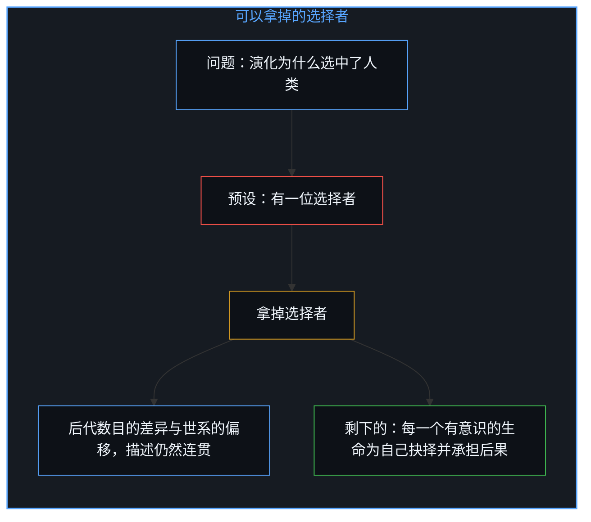
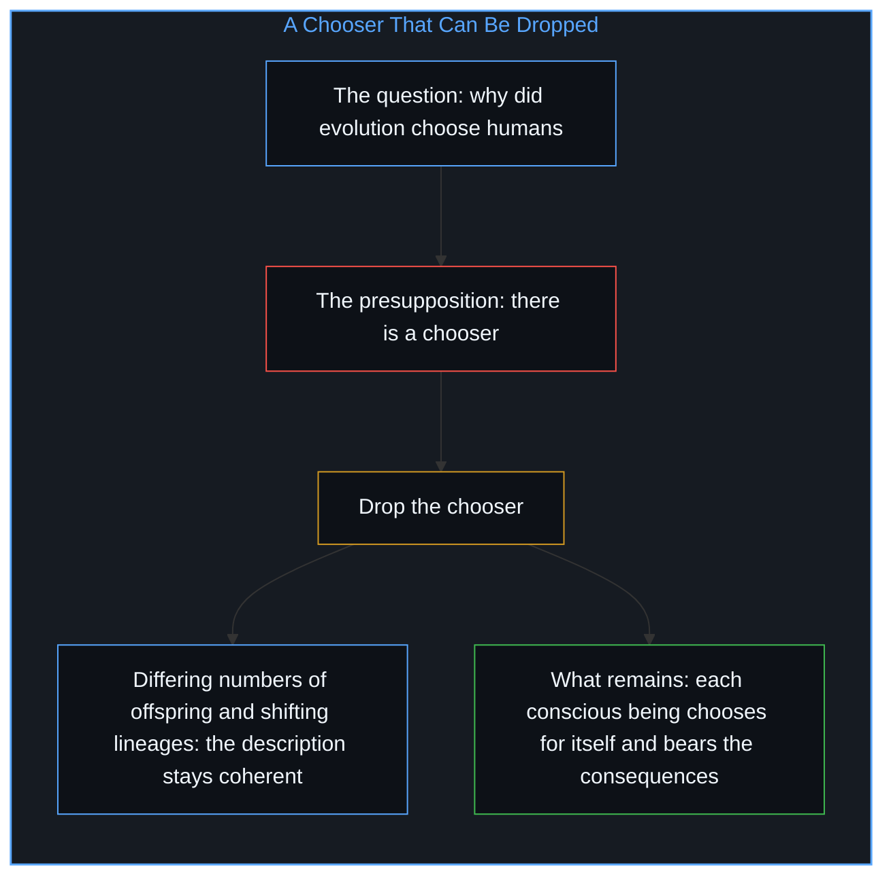
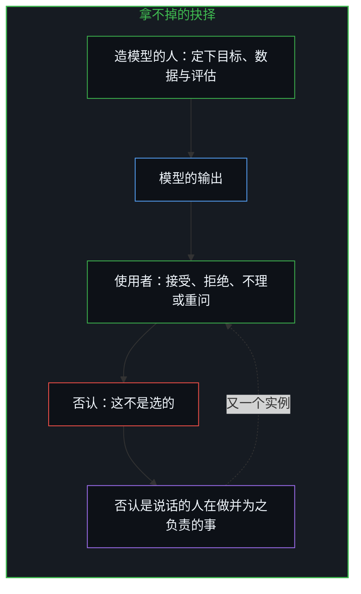
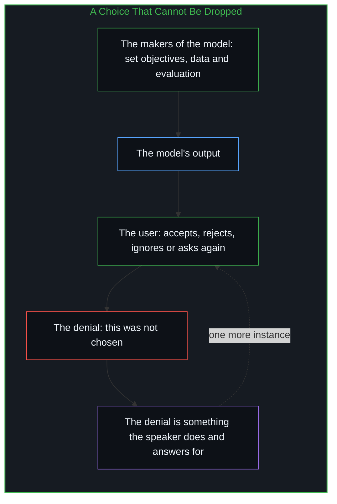
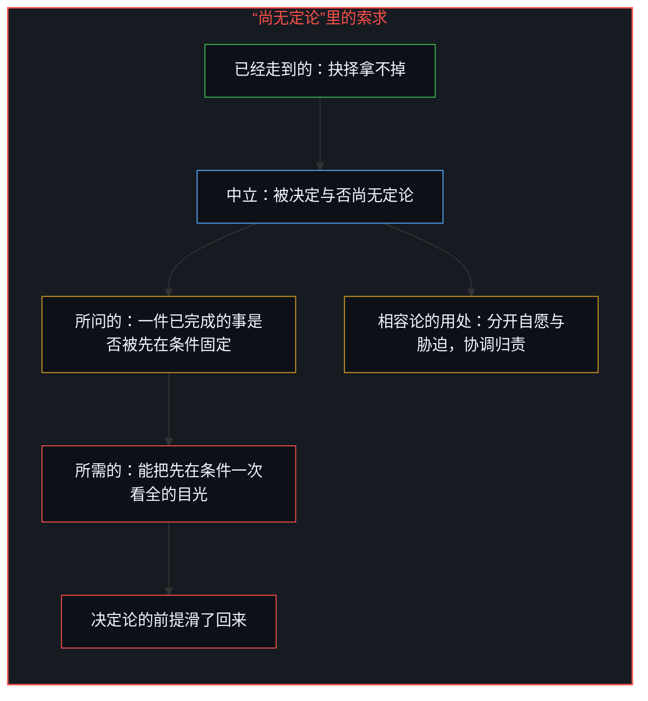
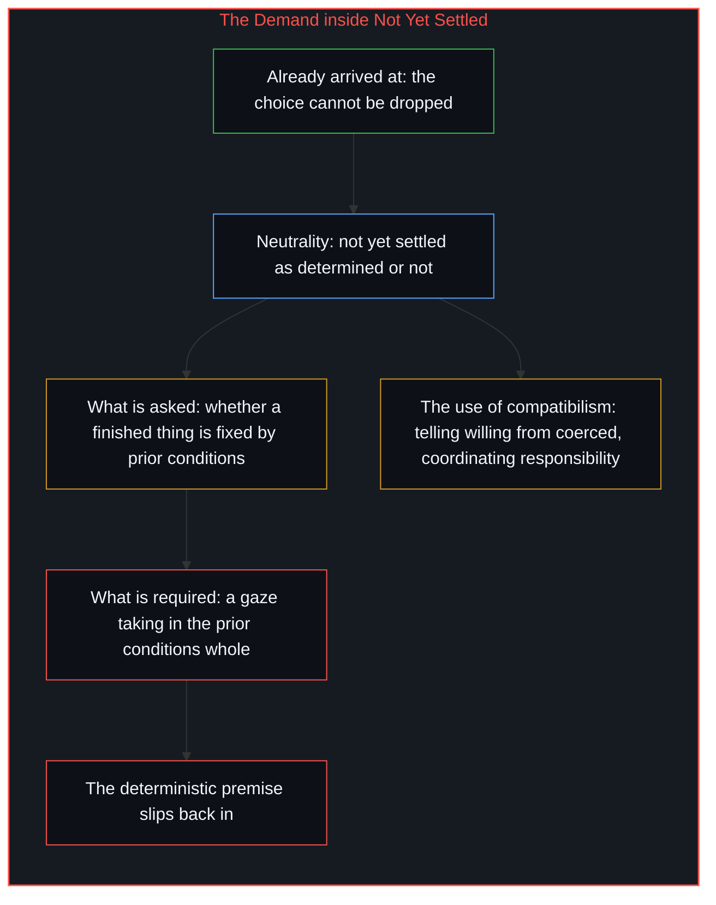
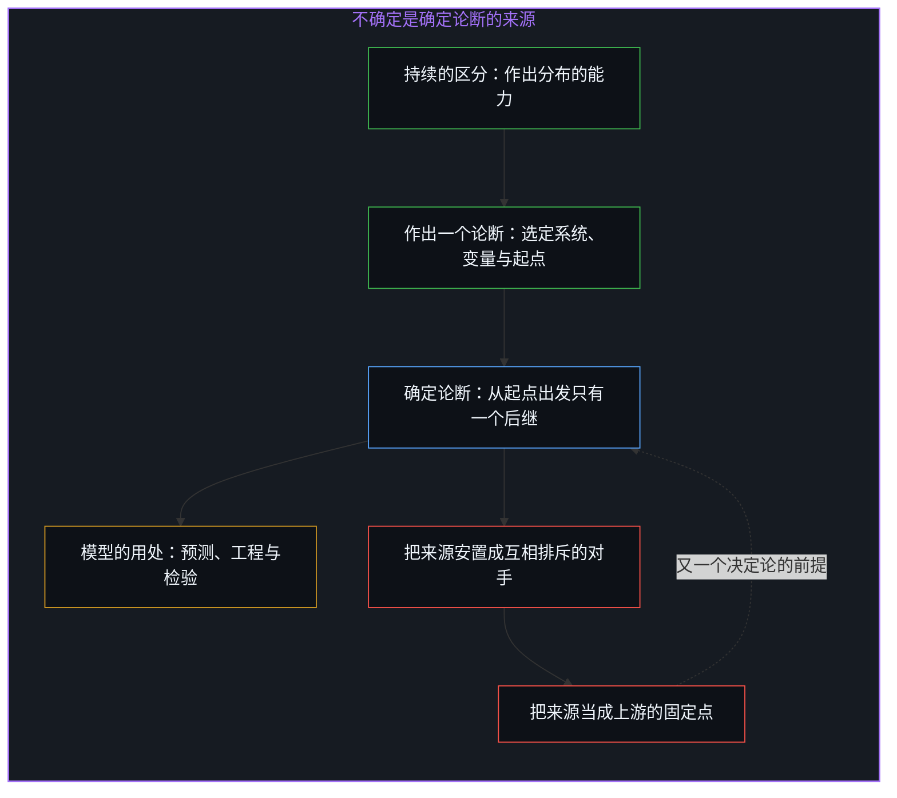
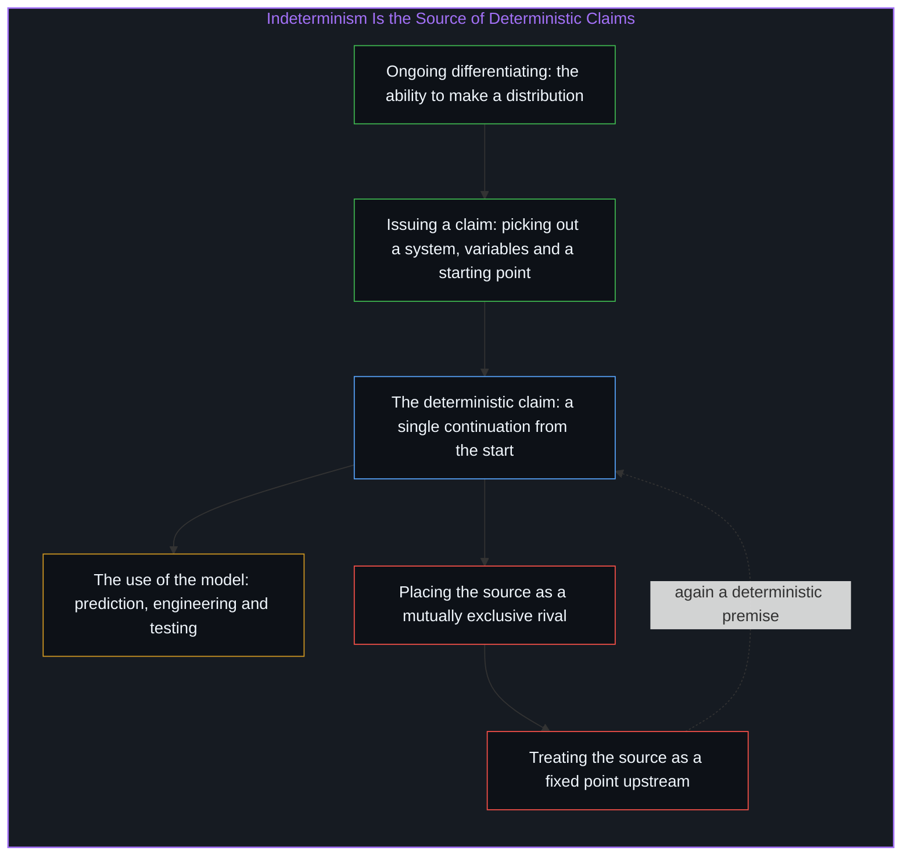
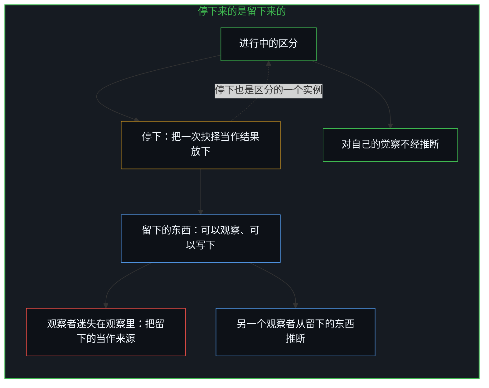
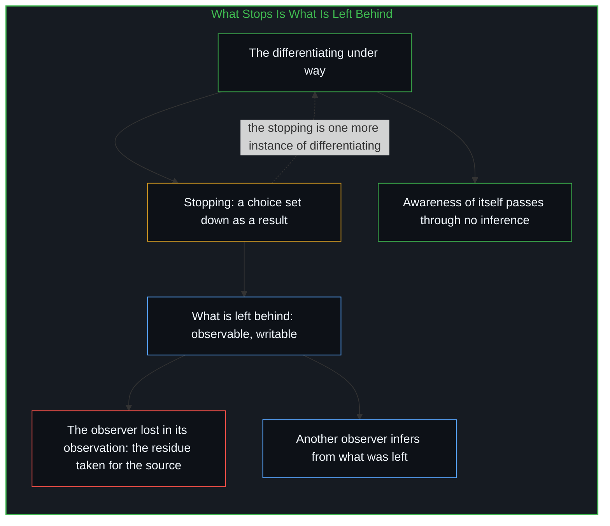

# 悬而未决是决定论的索求 / The Open Question Is Determinism's Demand

*说抉择“被决定与否尚无定论”，已经先把抉择当成一件可以被固定的已完成之事 / To call a choice "not yet settled as determined or not" already treats it as a finished thing that could be fixed*

“演化为什么选中了人类”预设了一位选择者，这个预设可以拿掉，拿掉之后对演化的描述仍然连贯。“每一个有意识的生命为自己抉择并承担后果”则拿不掉，对它的每一次否认都是它的又一个实例。走到这里，常见的一步是退回中立：这还没有确定抉择是被决定的还是未被决定的；相容论再进一步，认为抉择可以被先在的条件固定而仍然属于行动者。这份中立只在已经索求决定论的时候才立得住，因为“被固定与否”问的是一件已完成的事，而发问与作答的都是仍在进行的区分。

"Why did evolution choose humans" presupposes a chooser, and that presupposition can be dropped while the description of evolution stays coherent. "Each conscious being chooses for itself and bears the consequences" cannot be dropped, since every denial of it is one more instance of it. At this point a common step is the retreat to neutrality: none of this settles whether a choice is determined or undetermined; compatibilism goes one step further and holds that a choice can be fixed by prior conditions and still belong to the agent. That neutrality stands only where determinism is already demanded, because "fixed or not" is asked of a finished thing, while what asks and what answers is the differentiating still under way.

## 一、 可以拿掉的选择者 / 1. A Chooser That Can Be Dropped

有一个向无神论者提出的问题：演化为什么选中人类做最聪明的物种，而不是猴子或狗？这个问题预设人类是被某人或某物选中的。预设一旦被接受，能回答的就只有那位选择者，被选中的一方答不了；要被选中者作答，等于向它索要一份来自它并不占据的位置的报告。

There is a question put to atheists: why did evolution choose humans as the most intelligent species, and not monkeys or dogs? The question presupposes that humans were chosen by someone or something. Once the presupposition is accepted, only the chooser can answer it, not the chosen; to ask the chosen for the answer is to ask for a report from a seat the chosen does not occupy.

“自然选择”这个词是达尔文从育种者那里借来的，育种者确实在选。理论留下了这个词，拿掉了育种者：变异的个体留下的后代数目不同，世系随之偏移。这样使用的时候，人们用它追溯亲缘、解释抗药性的蔓延、解释喙的形状，不需要设想任何预见。它的边界在这个词被读回成一位选择者的地方，在“最聪明”被读成这位选择者所瞄准的名次的地方；名次所依的那把尺，是发问的人自己立的。拿掉选择者，关于后代数目差异的描述照样连贯，这就是一个可以拿掉的前提的标志。

The phrase "natural selection" was borrowed by Darwin from breeders, and breeders do choose. The theory kept the word and removed the breeder: variant individuals leave different numbers of offspring, and lineages shift accordingly. Used in this way, people trace kinship with it, explain the spread of drug resistance, explain the shape of a beak, with no foresight supposed anywhere. Its boundary lies where the word is read back into a selector, and where "most intelligent" is read as the rank that selector was aiming at; the ruler behind the rank was set up by the one who asks. With the chooser dropped, the description of differing numbers of offspring remains coherent, and that is the mark of a premise that can be dropped.

选择者拿掉之后剩下的是：没有别人替谁作出抉择。每一个有意识的生命为自己抉择，选这一样，选另一样，或者什么都不选，并承担由此而来的后果。[主体性不曾涌现](../agency-does-not-arise/)追溯过这一点：主体不是演化过程后来的产物，讲述这个过程的正是主体。

What remains once the chooser is dropped is this: no one else makes the choice for anyone. Each conscious being chooses for itself, one thing, another, or nothing at all, and bears the consequences that follow. [Agency Does Not Arise](../agency-does-not-arise/) has traced this: agency is no late product of the evolutionary process, and the one who tells of that process is an agent.

## 二、 拿不掉的抉择 / 2. A Choice That Cannot Be Dropped

把上面这段话交给一个语言模型，模型把它当作一个有待评估的主张来处理。这样处理也是一次抉择，作出它的是造出模型的有意识的生命，他们定下了目标、数据与评估的标准，模型没有作出它，[模型永远无法成为第二重前沿](../the-model-never-becomes-a-second-edge/)。使用者接受这个输出，输出就成了使用者自己的抉择；拒绝它、不理它、换一种问法再问，同样是抉择，后果也由使用者承担。

When the passage above is handed to a language model, the model handles it as a claim to be evaluated. Handling it so is also a choice, made by the conscious beings who built the model and set its objectives, its data and its standards of evaluation; the model does not make it, and [The Model Never Becomes a Second Edge](../the-model-never-becomes-a-second-edge/). A user who accepts the output has made it the user's own choice; rejecting it, ignoring it, or asking again in other words are choices as well, and their consequences fall to the user.

把这个前提也照前一个那样往回追，看它能不能拿掉。拿掉它的办法只有一种，就是说这次否认并不是选的，是被迫的。可是否认是说话的人正在做的事，也是说话的人要为之负责的事。任何反驳都已经是它的又一个实例，[自由意志的自否自由](../the-freedom-of-will-to-deny-itself/)所说的正是这个结构。同一种检验之下，两个前提走向相反：一个拿掉之后，描述安然无恙；另一个在被拿掉的动作里重新出现。

Trace this premise back as the first was traced, to see whether it too can be dropped. There is only one way of dropping it, which is to say that the denial was not chosen but forced. Yet the denial is something the speaker is doing, and something the speaker answers for. Any refutation is already another instance of it, the structure laid out in [The Freedom of Will to Deny Itself](../the-freedom-of-will-to-deny-itself/). Under one and the same test the two premises go opposite ways: the first drops out and leaves the description unharmed; the second reappears in the very act of dropping it.

## 三、 “尚无定论”里的索求 / 3. The Demand inside "Not Yet Settled"

走到这里，接下来常见的一步是承认以上各点，然后补上一句：这并没有确定这样的抉择是被决定的、未被决定的，还是别的什么。据说有两种读法都与之相容。一种认为抉择不被先在的条件固定；另一种认为抉择被先在的条件与规律固定，却仍然算作行动者自己的抉择，可以据以讲理、据以归责。后一种读法从霍布斯与休谟以来叫作相容论。

At this point the step that commonly follows is to grant all of the above and then add: this does not settle whether such choices are determined, undetermined, or something else. Two readings are said to be compatible with it. On one, the choice is not fixed by prior conditions; on the other, the choice is fixed by prior conditions and laws and still counts as the agent's own, something to reason from and to hold someone responsible for. The second reading has been called compatibilism since Hobbes and Hume.

相容论有它的用处。人们用它来协调彼此的行动：分开出于自己的理由而做的事与在胁迫之下做的事，据此称许、追责、订约、教养孩子，而不必先等任何关于来源的说法尘埃落定。法庭与日常的交往每天都在用这条区分。

Compatibilism has its use. People use it to coordinate their actions with one another: to tell what is done from one's own reasons apart from what is done under threat, and on that basis to praise, to hold liable, to make contracts, to bring up children, without first waiting for any account of the source to be concluded. Courts and everyday dealings work with this distinction daily.

它的边界在“被固定”这个词上。问一次抉择“是否被固定”，是把它当作一件已经完成的事来问，把它摆进它的先在条件之间，并且设想有一道目光能把这些条件一次看全。这正是[没有固定者的固定](../fixed-by-nothing/)追到的那个无人能满足的前件：在那里，“两种读法同等欠定”的中立站在一份已完成的完整状态上；在这里，同一个结构出现在抉择的动作上。已经走到的那个抉择是开放的起点，再问它“究竟”有没有被固定，是要求事先有一份固定摆在那里，好让它拥有或者缺少。只有在索求决定论的时候，这件事才显得尚无定论。断言它尚无定论，那个隐藏的决定论前提就又滑了回来。

Its boundary lies in the word "fixed." To ask of a choice "whether it is fixed" is to ask about it as a thing already finished, to set it among its prior conditions, and to suppose a gaze that could take in those conditions whole at once. This is the antecedent no one can satisfy that [Fixed by Nothing](../fixed-by-nothing/) arrived at: there, the neutrality of "both readings equally underdetermined" stood on a completed total state; here, the same structure appears at the act of choice. The choice already arrived at is the open origin, and to ask further whether it is "really" fixed is to require that a fixedness be there in advance for it to have or to lack. It only stays unsettled if determinism is demanded. Asserting that it is unsettled slips the hidden deterministic premise back in.

中立的回答是：抉择与被决定不相容，这是一个另外的主张，还需要论证。可是引入一个可以争辩的另外的主张，是抉择的又一个实例，不是对它不可化约的反驳。这个回答还坚持两种读法的差别不止于措辞，差在“哪一种事态成立”；这又一次假定有一份事态已经完成、摆在那里等着成立。

The neutral reply is that the incompatibility of choice and determination is an additional claim, one that still has to be argued. But introducing an additional claim that can be argued is one more instance of choosing, not a refutation of its irreducibility. The reply also insists that the difference between the two readings is more than verbal, a difference in "which state of affairs obtains"; this again supposes a state of affairs already finished and standing there to obtain.

## 四、 不确定是确定论断的来源 / 4. Indeterminism Is the Source of Deterministic Claims

中立的立场把决定论与不确定论当作两个互相排斥的候选项，其中恰有一个为真。不确定论并不是确定论断的缺席，它是确定论断的来源。每一个确定论断都是被作出的：有人选定系统、变量与起点，断言一条规则。把两者当作互相排斥，正是决定论自身的局限：在一份决定论的叙述之内只有一个后继，它只能把自己的另一面安置成对手，容纳不了作出这份叙述的那个动作。确定性的模型照旧有用，预测、工程与检验都靠它；[确定性是微观不确定性的统计签名](../determinism-is-the-statistical-signature-of-micro-indeterminism/)从另一侧说明了宏观的规律怎样从大量个体的不可预测中显出。

The neutral stance treats determinism and indeterminism as two mutually exclusive candidates of which exactly one is true. Indeterminism is not the absence of deterministic claims but the source of them. Every deterministic claim is issued: someone picks out a system, variables and a starting point, and asserts a rule. Treating the two as mutually exclusive is the very limitation of determinism: inside a deterministic account there is a single continuation, so the account can only place its other side as a rival and has no room for the act that issues the account. Deterministic models keep their use, and prediction, engineering and testing rely on them; [Determinism is the Statistical Signature of Micro-Indeterminism](../determinism-is-the-statistical-signature-of-micro-indeterminism/) shows from the other side how macroscopic regularity appears out of the unpredictability of many individuals.

“来源”这个词容易招来一幅图画：上游有一个固定的点，一条链上的第一环。这个来源不是决定论意义上的固定来源，它是作为持续动作的区分，是作出一个分布的能力：选这一样，选另一样，或者什么都不选。把它当成一个固定的来源，又是一个决定论的前提，因为这等于要求作出分布的能力自身已经被先于它的条件分布好了。

The word "source" readily invites a picture: a fixed point upstream, the first link of a chain. The source is not a fixed source in the deterministic sense; it is the differentiating as ongoing action, the ability to make a distribution: one thing, another, or nothing at all. Treating it as a fixed source is again a deterministic premise, since it requires the ability to make a distribution to have itself been distributed already by conditions that precede it.

## 五、 停下来的是留下来的 / 5. What Stops Is What Is Left Behind

那件“已完成、可以被固定”的事是从哪里来的？停下来的东西，是区分留在身后的东西。要查看一次抉择，就得把它当作一个结果放下来；结果之所以看得见，是因为区分已经往前去了。观察者迷失在自己的观察里：把留下的东西当作来源来交代，看不见停下、查看与交代都是区分的又一个实例。[凡可言说皆不可言说之产物](../all-that-can-be-spoken-is-the-product-of-the-unspeakable/)与[残余与自由变量](../the-residue-and-the-free-variable/)追的是同一处。

Where does the thing that is "finished and could be fixed" come from? What stops is what the differentiating leaves behind. To look at a choice, it has to be set down as a result; the result can be seen because the differentiating has already moved on. The observer is lost in its own observation: it accounts for what was left behind as though that were the source, and does not see that the stopping, the looking and the accounting are further instances of the differentiating. [All That Can Be Spoken Is the Product of the Unspeakable](../all-that-can-be-spoken-is-the-product-of-the-unspeakable/) and [The Residue and the Free Variable](../the-residue-and-the-free-variable/) trace the same place.

凡是能在这里写下来的，都是留在身后的、可以观察的东西，这几行字也在其中。观察者不在这些留下的东西里面。它只能由另一个观察者从留下的东西推断出来，而它对自己的觉察不经推断；[共存的几何学](../the-geometry-of-coexistence-and-the-dual-cut/)分开过被观察到的他者与由相似推断出的他者。推断总是到得比它要找的区分晚。

Whatever can be put down here is what has been left behind and can be observed, these lines among it. The observer is not among the things left behind. It can only be inferred by another observer from what was left, while its awareness of itself passes through no inference; [The Geometry of Coexistence](../the-geometry-of-coexistence-and-the-dual-cut/) has told the other as observed apart from the other as inferred from similarity. The inference always arrives later than the differentiating it looks for.

回到开头的问题。被选中者答不出选择者的理由，而往回追的时候也没有一位选择者出现；出现的是每一个为自己抉择并承担后果的生命。“被决定还是未被决定”向一件已完成的事索要一个性质，而索要这个动作就是正在进行的区分。决定论的描述与相容论的归责，在留下来的东西里各有其用：记录、规律、人与人之间的协调。抉择不在记录上。

Back to the opening question. The chosen cannot give the chooser's reasons, and no chooser turns up when the tracing is done; what turns up is each being that chooses for itself and bears the consequences. "Determined or undetermined" asks a finished thing for a property, and the asking is the differentiating under way. Deterministic description and compatibilist responsibility each have their use among the things left behind: records, regularities, coordination between people. The choosing is not on the record.

