# 上帝的起源与“我们”的降维 / The Origin of God and the Flattening of "We"

*被遗忘的俯瞰原点成了上帝，也成了“我们” / The forgotten origin of the overview becomes God, and becomes "we"*

心智能在自己的感知场里调转视角，画出一张全景的地图，并把自己的化身放进去。沉浸在这张地图里时，容易忘了它是从自己的原点渲染出来的，这个没有被认领的俯瞰视角便被向外安放：安放为上帝，在世俗的时代安放为教条化的科学与作为统计均值的“人类”，在日常的语言里安放为“我们”。俯瞰是规划与协作不可少的工具，它的边界在于忘了原点的时候，别的心智被当作了可以调配的对象。回到第一人称的原点，对自己的注意与行动承担全部的责任，俯瞰的能力便回到了工具的位置。

A Mind can turn its perspective within its own field of perception, draw a panoramic map and place an avatar of itself inside. Immersed in the map, it easily forgets that the map was rendered from its own origin, and this unclaimed overview is then lodged outside: as God, in a secular age as dogmatic science and as "humanity" taken as a statistical mean, and in everyday language as "we." The overview is an indispensable tool for planning and cooperating, and its boundary lies where the origin is forgotten and other Minds are treated as objects to be arranged. With a return to the first-person origin and full responsibility taken for one's own attention and action, the capacity for overview goes back to the place of a tool.

## 一、 俯瞰的盲区 / 1. The Blind Spot of the Overview

心智能在自身的感知场里自由调转视角，这是认知里很可惊叹的一种能力。一切观测都始于第一人称的原点。生物与物理层面的具身限制，是所有心智共同面对的基底约束，一个共有的约束解释不了不同的心智为何走出不同的轨迹。分化的地方在每一个当下的抉择：所看见的，是所选择去关注的。注意不是受外部条件摆布的被动过滤，它是心智在种种可能里主动锚定因果的那一步。

That a Mind can freely turn its perspective within its own field of perception is one of the more remarkable capacities of cognition. All observation begins at the first-person origin. The embodied limits at the biological and physical level are a baseline constraint faced by all Minds in common, and a shared constraint does not explain why different Minds trace different paths. Where they diverge is the choice in each present: what is seen is what is chosen to attend to. Attention is not a passive filter at the mercy of outside conditions; it is the step by which a Mind actively anchors causality among possibilities.

为了在错综的因果网络里规划行动，心智会作一次空间上的变换：把整个感知场打包成一张全景的地图，并把自身的内在意象放在地图的中央。面对这幅含着山川、星辰与社会关系的画卷，看着中央那个渺小的化身，会同时有宏大的俯瞰感与深沉的无力感。盲区在这里：沉浸于全景时，暂时忘了这整幅图景是由自己在原点一帧一帧渲染出来的，一个从自身视界里算出来的总览模型，被当成了一个不属于任何观测者的“无处之视角”。

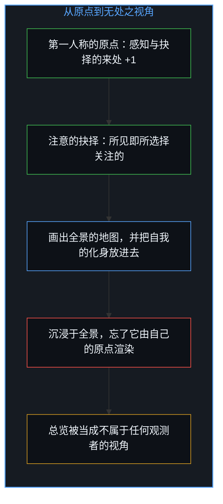

To plan action within a tangled causal network, a Mind makes a spatial transformation: it packs the whole field of perception into a panoramic map and places its own inner image at the center of the map. Facing this scroll of mountains and rivers, stars and social relations, and seeing the tiny avatar at its center, there is at once a grand sense of overview and a deep sense of powerlessness. The blind spot is here: immersed in the panorama, it is forgotten for a while that the whole picture was rendered frame by frame from one's own origin, and an overview model computed from within one's own horizon is taken for a "view from nowhere" that belongs to no observer.

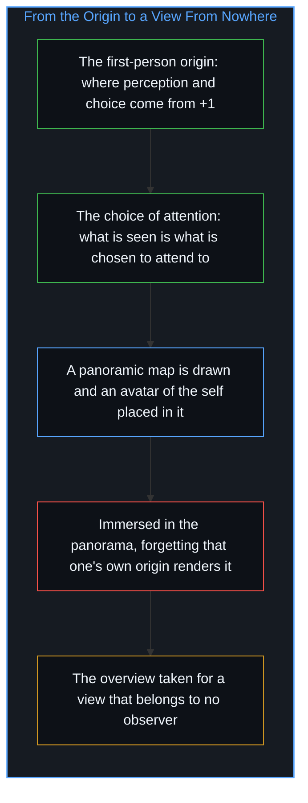

## 二、 上帝的概念与宗教的制度 / 2. The Concept of God and the Institution of Religion

忘了自己在原点上的渲染位置之后，这个脱开了的总览须有一个依托。全景的视野广袤、稳定而有威严，内部的自我化身微小，这个总览的视角便被向外剥离，成为一个独立于自身之外的超验实体。上帝的概念由此可以读作：心智把自身俯瞰的能力向外投射之后，被实体化了的外部最高观测者。

Once one's own rendering position at the origin is forgotten, this detached overview needs something to rest on. The panoramic view is vast, stable and imposing, the avatar of the self inside it is small, and the overview perspective is peeled outward into a transcendent entity independent of oneself. The concept of God can thus be read as the highest outside observer, made into an entity after a Mind has projected its own capacity for overview outward.

这一步在心智的内部把自己的主权放到了外面。当这个结构在人群里被语言符号化、仪式化并广为共享时，它凝成制度化的宗教。宗教把这个最高的观测者立为全域的坐标系，对群体里的每一个心智作自上而下的校准，这对协调个体之间的行动是有用的。它的边界在于，被仰望的那个视角，是千百年来共同投射出去而没有收回的认知总览。

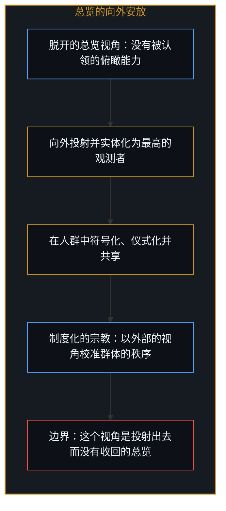

This step, within a Mind, puts its own sovereignty outside. When the structure is symbolized in language, ritualized and widely shared among people, it congeals into institutional religion. Religion sets up this highest observer as a coordinate system for the whole domain and calibrates each Mind in the group from above, which is useful in coordinating actions among individuals. Its boundary is that the perspective looked up to is a cognitive overview projected outward in common over centuries and not taken back.

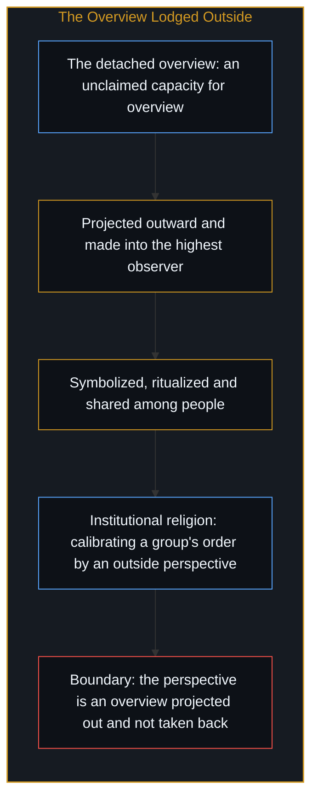

## 三、 教条化的科学与作为均值的“人类” / 3. Dogmatic Science and "Humanity" as a Mean

启蒙与科学理性的兴起，常被看作神学束缚的结束。因果的机制若没有在第一人称的原点上得到校准，同样的结构会在世俗的领域换一身衣服再出现。科学的理论离开了个体心智亲手的验证与因果的反馈回路，成了教科书上不容置疑的结论时，对它的接受与对神谕的敬畏在结构上是同一种：判断被让给了一个离开第一人称原点的抽象权威。

The rise of the Enlightenment and of scientific reason is often seen as the end of theological constraint. Where the causal mechanism has not been calibrated at the first-person origin, the same structure reappears in the secular domain in different clothes. When a scientific theory leaves the individual Mind's own verification and the causal feedback loop and becomes a conclusion in a textbook beyond question, accepting it is structurally the same as revering an oracle: judgment has been handed to an abstract authority detached from the first-person origin.

更深一层的降维发生在谈论“人类整体”或各种集体概念的时候。跳出具体的个体，站在设想的高处俯瞰“人类”时，所做的是在一个很窄的特征维度上，比如物种的基因、经济的产出或政治的派别，对数以十亿计的心智作一维的统计求均值。均值对协调个体之间的行动是有用的。它的边界在于，每一个心智所渲染的那个完整的世界不在这个数里，它成了宏大叙事里无差别的像素点，[共享沙盒的幻象](../the-illusion-of-the-shared-sandbox/)把这个出清价与内心的图景分了开来。

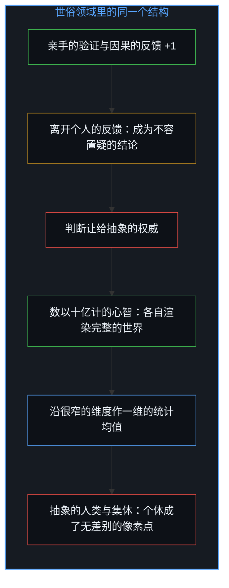

A deeper reduction of dimension happens in talk of "humanity as a whole" or of collective concepts of various kinds. Stepping out of particular individuals and overlooking "humanity" from an imagined height, what is done is taking a one-dimensional statistical mean, along a very narrow dimension of features such as the genes of the species, economic output or political faction, over Minds numbering in the billions. A mean is useful in coordinating actions among individuals. Its boundary is that the complete world each Mind renders is not in that number; it has become an undifferentiated pixel in a grand narrative, and [The Illusion of the Shared Sandbox](../the-illusion-of-the-shared-sandbox/) separates this clearing price from the picture within.

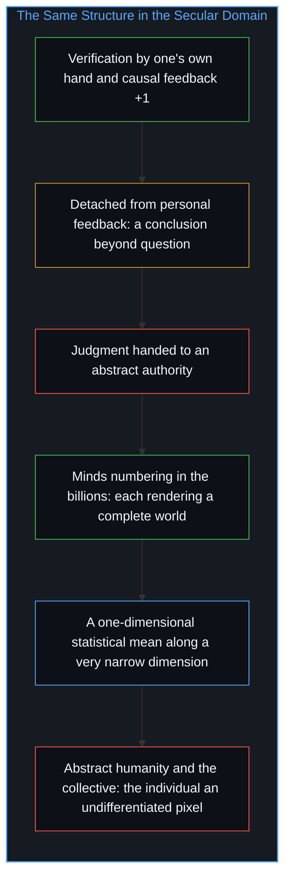

## 四、 “我们”这个代词 / 4. The Pronoun "We"

俯瞰视角的这种安放不只在宏大的理论里，也在日常语言的细缝里，第一人称的复数代词“我们”是最常见的一处。说出“我们应当如何”或“我们须采取行动”时，说话的位置已悄然移到了那个在他人之上的全局座舱里，成了整个集合的代言者。在这一刻，集合里其他心智的第一人称原点不在话里了，他们成了规划中有待调配与影响的对象。

This lodging of the overview is found not only in grand theories but in the fine seams of everyday language, and the first-person plural pronoun "we" is its most common place. In saying "we ought to do such and such" or "we must act," the position of speaking has quietly moved into the global cockpit above others and become the spokesperson of the whole set. At that moment the first-person origins of the other Minds in the set are no longer in the sentence, and they have become objects to be arranged and influenced within a plan.

这不是善恶层面上的蓄意欺骗，而是同一枚硬币的两面。调用俯瞰的视角是理解自身与协作的必要工具。失了对第一人称原点的锚定，总览便滑向对他人的安排，自以为在为集体谋福祉时，已经把别的心智当成了工具。

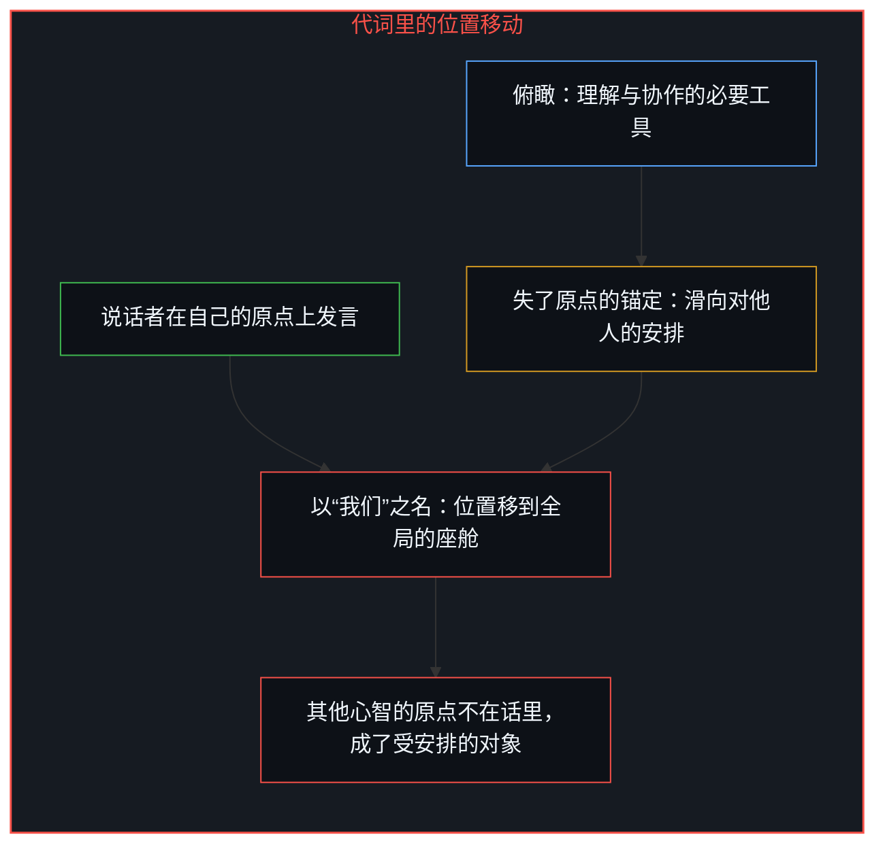

This is not deliberate deception on the level of good and evil; it is two faces of one coin. Calling on the overview perspective is a necessary tool for understanding oneself and for cooperating. With the anchoring in the first-person origin lost, the overview slides toward arranging others, and in supposing oneself to be seeking the good of the collective, other Minds have already been taken as instruments.

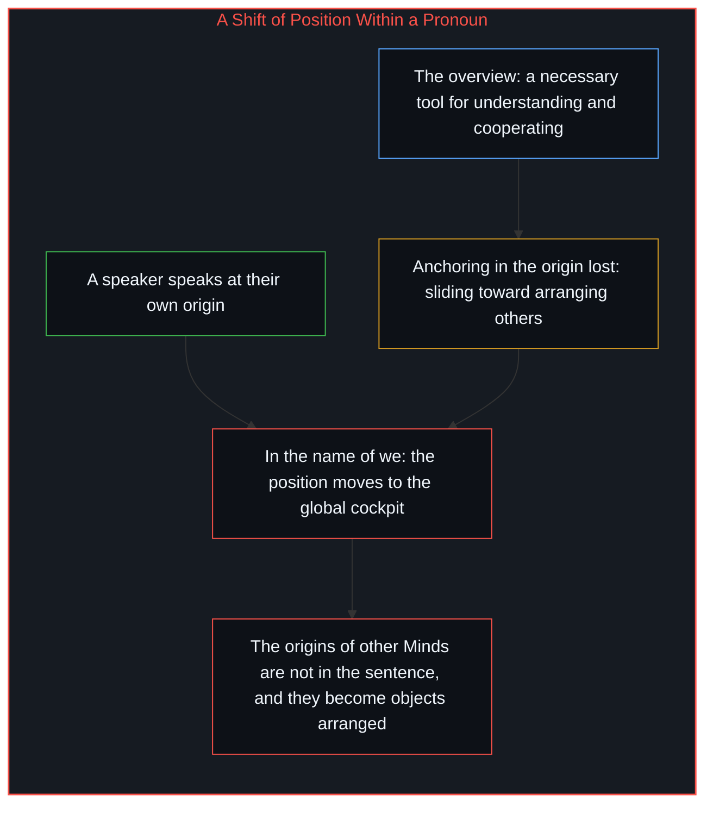

## 五、 客体与心智之间的范畴 / 5. The Category Between Objects and Minds

对待物理的客体与对待另一个心智，属于两个范畴。观测一块岩石、一台机器或一段重力场时，把它当作被动的客体来建模与操控是行之有效的，它们的变化合乎确定的规律。文明积累下来的制度、代码与工具，作为凝固的产物存在时，也可以当作客体去维护与调用。

Dealing with a physical object and dealing with another Mind belong to two categories. In observing a rock, a machine or a stretch of gravitational field, modeling and handling it as a passive object works, and its changes accord with determinate regularities. The institutions, code and tools a civilization has accumulated, existing as congealed products, can likewise be maintained and called on as objects.

把同一种眼光投向另一个活着的人，范畴便错了。以己度之，对方也在自己的第一人称原点上，经自己注意的抉择，一帧一帧地渲染属于自己的那个世界，那里有一个从外部看不见的自由变量。用统计的均值、标签的画像或行为的操纵把对方当作客体，便略过了这个自由变量，随之而来的是因果的反冲：抵触、信任的瓦解与相互博弈的消耗。

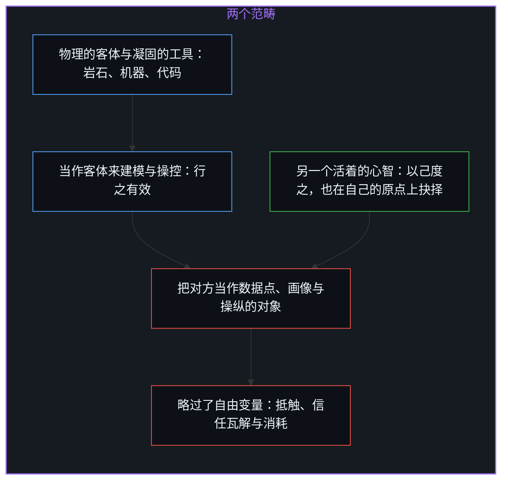

Turn the same eye on another living person and the category is wrong. Taken by analogy from oneself, the other too is at their own first-person origin, rendering frame by frame, through their own choices of attention, the world that is theirs, and there is a free variable there that cannot be seen from outside. Treating the other as an object through a statistical mean, a labeled profile or the manipulation of behavior passes over this free variable, and what follows is causal recoil: resistance, the breakdown of trust and the wearing down of each side against the other.

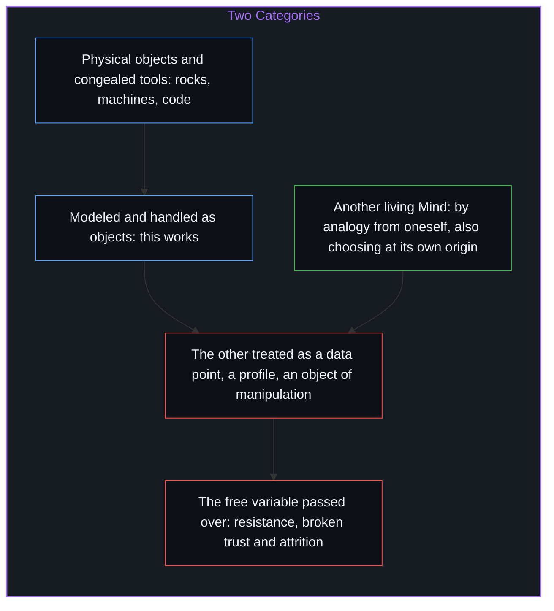

## 六、 回到第一人称的原点 / 6. Back to the First-Person Origin

看清从“上帝视角”到集体代词的这条线，出路是从设想的高处的讲坛上走下来，重新扎在第一人称的原点上。平等不是在统计上把所有人拉平为一个平均数，它是承认每一个人都有完整的主权，各自在平行地演进。在原点上，替不了他人作决断，也无须为一个设想出来的宏大集体背负内耗。

With the line from the "God's-eye view" to the collective pronoun seen clearly, the way out is to step down from the pulpit at an imagined height and take root again at the first-person origin. Equality is not leveling everyone statistically into an average; it is acknowledging that each person has complete sovereignty and is developing, each in parallel. At the origin one cannot decide for others, and there is no need to carry inner strain on behalf of an imagined grand collective.

所见的世界，是经自身注意的抉择画出的地图。对自己的视线负责，对自己的每一次具身的动作（+1）承担全部的结构性责任。不再以“我们”去绑定他人，不再以抽象的“上帝视角”去审判世界时，创造的力量回到来处：立在原点上，以摩擦为砥砺，在每一次未经稀释的行动里，与同样立在各自原点上的他人并肩。AI 时代合成出来的神，重复了这一起源，[造神的障眼法与隐秘阶序的说辞](../the-sleight-of-hand-of-synthesizing-gods-and-unacknowledged-rank/)说明了这一点。

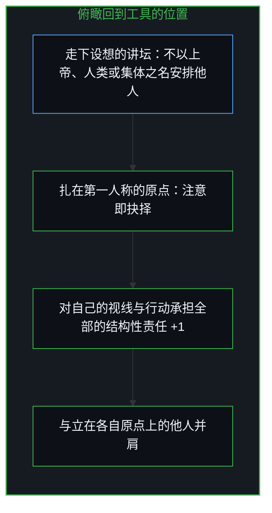

The world that is seen is a map drawn through one's own choices of attention. One answers for one's own line of sight and bears full structural responsibility for each embodied act of one's own (+1). When "we" is no longer used to bind others and an abstract "God's-eye view" no longer used to judge the world, the power to create returns to where it came from: standing at the origin, with friction as the whetstone, in every undiluted action, side by side with others who likewise stand at their own origins. The synthesized god of the age of AI repeats this origin, as [The Sleight of Hand of Synthesizing Gods and the Rhetoric of Unacknowledged Rank](../the-sleight-of-hand-of-synthesizing-gods-and-unacknowledged-rank/) shows.

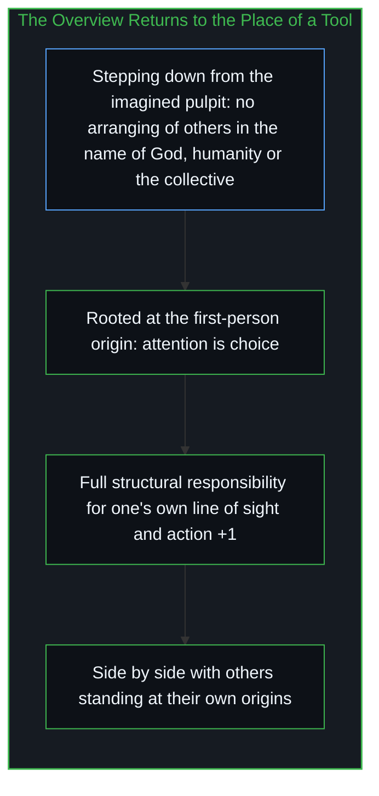
