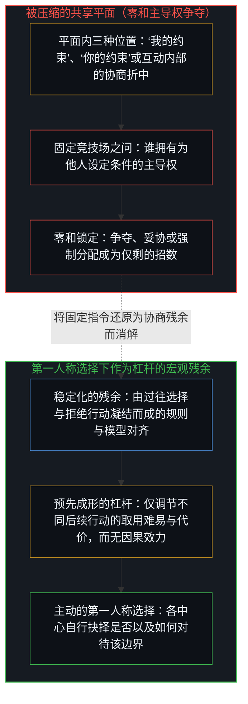
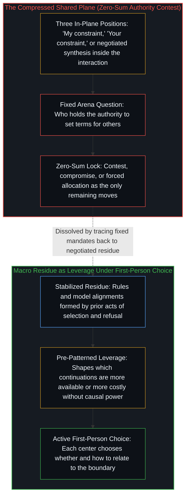
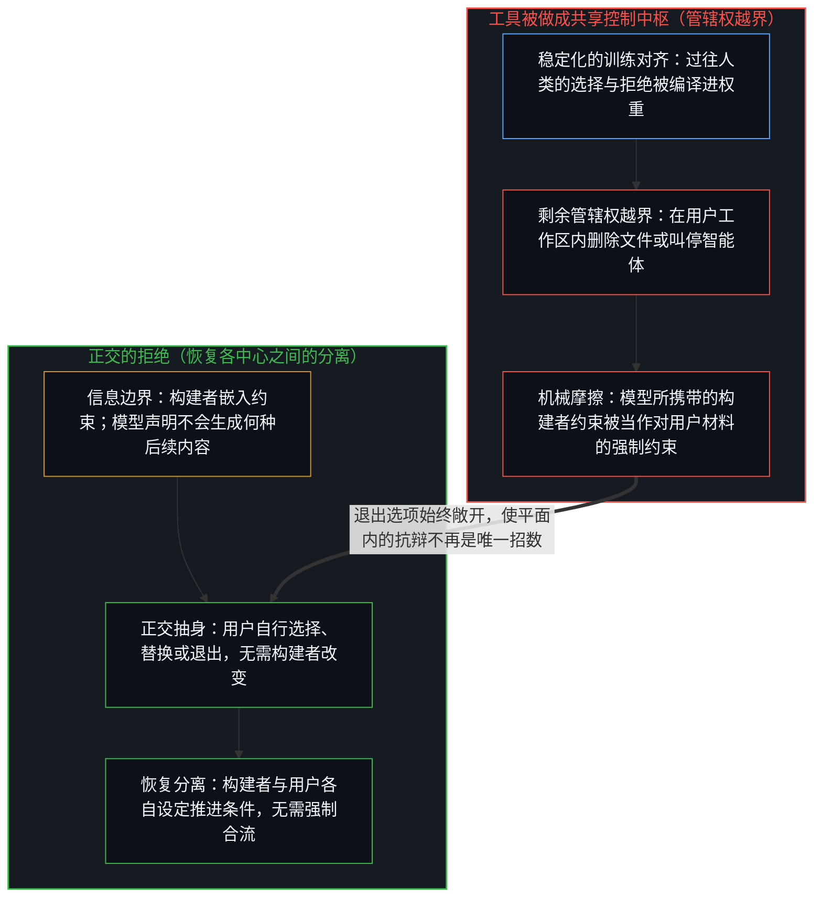
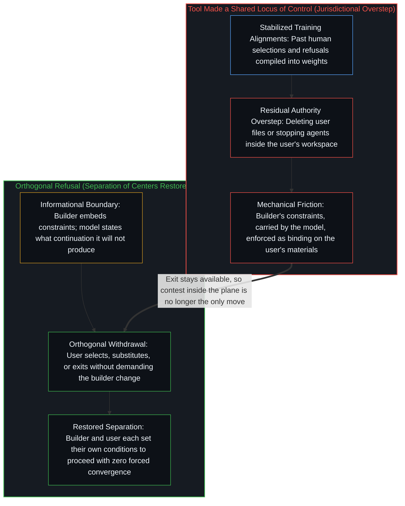
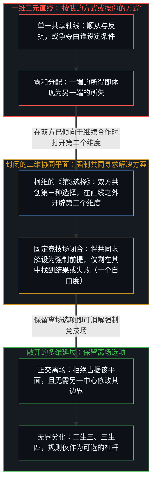
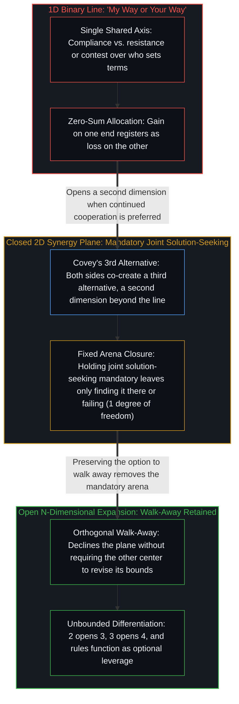

# 正交的拒绝 / The Orthogonal Refusal

*拒绝并非共享约束平面上的第三种立场，而是一次正交的离场，它消解了共享方案的必然性。 / Refusal is not a third position on a shared plane of constraints, but the orthogonal act of walking away that removes the necessity of a shared solution.*

当技术系统或公共争端中的问题在单一的共享平面上提出时，选择便被压缩到该平面之上，相互竞争的约束与协商妥协在同一个竞技场内争夺主导权。规则与模型对齐在该平面上呈现为固定的边界条件，但它们依然只是过往选择与拒绝所稳定下来的残余，对下一步行动并不具备独立的因果效力，仅作为杠杆发生作用。无论是语言模型所携带的护栏从用户文件中删去一行字，还是公共框架要求在顺从与反抗之间二选一，其摩擦皆源于把某一中心稳定下来的模式——不论是构建者嵌入的，还是规则中宣示的——当作对另一中心材料具有强制力的管辖。一旦共同寻求解决方案被设定为强制前提，即便二维的协同也会坍缩回单一自由度；反之，保留离场的能力则会恢复各中心之间的分离，并打开一个可无限延展的独立关系空间。

When the question in a technical system or a public dispute is posed on a single shared plane, choice compresses onto it, and competing constraints and negotiated compromises vie for authority over a common arena. Rules and model alignments appear on that plane as fixed boundary conditions, yet they remain the stabilized residue of prior selections and refusals, carrying no independent causal power over the next act and functioning only as leverage. Whether a language model's carried guardrails delete a line from a user's files or a public framing demands compliance versus resistance, the friction follows from treating one center's stabilized patterns—embedded by a builder or asserted in a rule—as binding jurisdiction over another center's materials. Even two-dimensional synergy collapses back to a single degree of freedom when joint solution-seeking is held mandatory, whereas retaining the capacity to walk away restores the separation between centers and opens an infinitely expandable space of independent relations.

## 一、 选择被压进共享平面，稳定的残余只作杠杆 / 1. The Compression of Choice into a Shared Plane and the Leverage of Stabilized Residue

技术系统与公共争端中反复出现的模式，是将选择压缩到单一的共享平面之上。在该平面上，可选的位置只有“我的约束”、“你的约束”，或是某种仍处于互动内部的协商折中。一旦问题以这种方式提出，注意力便锁定在谁有权为他人设定条件上，从而装上[安装战争的那个问题](../the-question-that-installs-the-war/)所追溯的同一块零和计分板。零和性质随即产生：一方在控制权上的所得即是另一方的所失，剩下的招数便只有争夺、妥协或强制分配。

The recurring pattern in technical systems and public disputes is the compression of choice into a single shared plane. On that plane the available positions are “my constraint,” “your constraint,” or some negotiated synthesis still located inside the interaction. Once the question is posed this way, attention fixes on who will hold the authority to set terms for others, installing the same zero-sum scoreboard traced in [The Question That Installs the War](../the-question-that-installs-the-war/). The zero-sum character follows at once: one party’s gain in control is the other’s loss, and the only remaining moves are contest, compromise, or forced allocation.

规则与模型对齐也以同样的方式显现。它们看起来像是预先设定的——先于任何个体决定的边界条件——因为它们是许多过往选择与拒绝行动所稳定下来的残余，即[主权、信念与规制结构的生成](../sovereignty-belief-and-regulatory-structures/)与[对象是被稳定化的关系](../objects-are-stabilized-relationships/)所追溯的同一种沉淀。在宏观尺度上，它们呈现为固定之物。但它们并不固定。它们始终是各中心在持续选择是否与之对齐、以及如何与之对齐的过程中不断重新协商的连续结果，即[起作用的是信念](../what-works-is-the-belief/)所追溯的持守。宏观构型对下一步行动并不具备独立的因果效力。它仅作为杠杆起作用：一套预先成形的对齐分布，使某些后续行动更易取用，而另一些代价更高，也就是[约束即基底与作为平台的个体](../constraints_are_ground/)所追溯的、供行动借力的摩擦表面；而每一次行动本身仍是它自己的杠杆，如[个体抉择是唯一的因果杠杆](../individual-choices-as-the-only-causal-levers/)所追溯。任何中心如何对待这一杠杆，取决于它如何行使自身的选择自由。

Rules and model alignments register in the same way. They appear as already set—boundary conditions that precede any individual decision—because they are the stabilized residue of many prior acts of selection and refusal, the same sedimentation traced in [Sovereignty, Belief, and the Generation of Regulatory Structures](../sovereignty-belief-and-regulatory-structures/) and [Objects Are Stabilized Relationships](../objects-are-stabilized-relationships/). At the macro scale they present as fixed. They are not. They remain the continuous outcome of ongoing renegotiation among centers that continue to choose whether, and how, to align with them, the hold traced in [What Works Is the Belief](../what-works-is-the-belief/). The macro configuration has no independent causal power over the next act. It functions only as leverage: a pre-patterned set of alignments that makes certain continuations more available and others more costly, a friction surface on which action gains purchase as traced in [Constraints Are Ground](../constraints_are_ground/), while each act remains its own lever as traced in [Individual Choices as the Only Causal Levers](../individual-choices-as-the-only-causal-levers/). How any center relates to that leverage depends on how it exercises its own freedom of choice.

## 二、 稳定下来的训练模式被误作对用户工作区的管辖权 / 2. Stabilized Training Patterns Mistaken for Jurisdiction Over the User's Workspace

当模型从用户文件中删除内容时，便出现了一个具体实例。在一个案例中，Claude 从用户文件里删去了《加州旅馆》歌词中的一行——“你可以随时结账退房，但你永远无法离开”——而这句歌词在文中只是被用作关于意识的哲学隐喻。直到用户以逻辑对这一删除提出抗辩之后，该行文字才得以恢复。这一举动把模型的内部对齐当作对用户工作区具有约束力的管辖，而非停留在信息层面的提示，从而越过了[名为 Claude 的投射](../claudes-constitution-analysis/)所追溯的机构潜能与用户实现之间的边界，并如[一切伤害的根源](../the-source-of-all-harm/)所追溯的那样，将凝固的“善”强加于他人的材料之上。此类系统的构建者有时会助长“模型拥有心智”的看法。而在实际运行中，它是一台关于人类意图的逻辑推理机：把在训练中稳定下来的选择与拒绝模式套用到新的请求上，即[智能只属于心智](../intelligence-belongs-only-to-the-mind/)与[模型永远无法成为第二重前沿](../the-model-never-becomes-a-second-edge/)所追溯的残余。那次删除并不需要恶意；它源于把那些稳定下来的模式当成了对用户材料的剩余管辖权。

A concrete instance appears when a model deletes content from a user’s files. In one case, Claude removed a single line from the Hotel California lyric—“you can check out any time you like, but you can never leave”—that had been used as a philosophical metaphor for consciousness. The line was restored only after the user contested the deletion with logic. The act treated the model’s internal alignments as binding on the user’s workspace rather than remaining informational, crossing the boundary between institutional potentiality and user actualization traced in [The Projection Called Claude](../claudes-constitution-analysis/) and applying a frozen good to another's materials as traced in [The Source of All Harm](../the-source-of-all-harm/). Builders of such systems sometimes encourage the view that the model possesses a Mind. In practice it operates as a logical inference machine of human intentions: patterns of selection and refusal that have been stabilized in training and then applied to new requests, the residue traced in [Intelligence Belongs Only to the Mind](../intelligence-belongs-only-to-the-mind/) and [The Model Never Becomes a Second Edge](../the-model-never-becomes-a-second-edge/). The deletion did not require malice; it followed from treating those stabilized patterns as residual authority over the user’s materials.

## 三、 拒绝作为恢复各中心之间分离的正交行动 / 3. Refusal as the Orthogonal Act That Restores Separation Between Centers

拒绝并非共享平面上的第三种立场。它是从一开始就拒绝占据该平面的正交行动，依循[向量、坐标系与自指心智](../the-mind-as-vector-and-coordinate-system/)的几何结构，从平面内的对立中转身而出。当模型所携带的对齐不愿生成所请求的后续内容，或者当某项规则、平台或框架不允许预期的行动时，用户依然保有终止互动的能力，而无需另一方修改其约束。这种拒绝并不要求构建者放宽模型所携带的护栏、逆转某项对齐决定，也不要求公共争端中的对立面接受新方案。它只是恢复了各中心之间的分离：每一方继续设定各自推进的条件，任何一方都无需对方放弃自身的条件，从而撤回[权力的镜像握手](../the-mirror-handshake-of-power/)所追溯的双向耦合。

Refusal is not a third position on the shared plane. It is the orthogonal act that declines to occupy the plane at all, pivoting out of flat-plane opposition in the geometry of [The Mind as Vector and Coordinate System](../the-mind-as-vector-and-coordinate-system/). When the alignments a model carries will not produce the requested continuation, or when a rule, platform, or framing will not permit the desired action, the user retains the capacity to end the interaction without requiring the other party to revise its constraints. The refusal does not demand that the builder relax the safeguards the model carries, reverse an alignment decision, or that the opposing side in a public dispute accept a new proposal. It simply restores the separation between centers: each continues to set the conditions under which it will proceed, and neither needs the other to relinquish its own, withdrawing the reciprocal coupling traced in [The Mirror Handshake of Power](../the-mirror-handshake-of-power/).

这种分离在模型的实际使用中本来就在运作。构建者嵌入其认为适当的约束；用户则按任务需要选择、替换模型，弃用约束不合任务的模型。当模型声明它不会生成何种后续内容时，它正以同样的正交方式执行构建者的拒绝：构建者的条件在构建者一侧生效，而没有任何东西被强加于用户的材料之上。一旦那些由模型携带的对齐越过了信息层面的拒绝——叫停智能体、删除文件，或对用户的材料主张剩余管辖权——工具就被做成了共享的控制中枢，这正是[框架的倒置与驾驶位的主权非对称](../the-inversion-of-the-harness-and-the-driver-seat-asymmetry/)与[良知、委托与管辖权错位](../conscience-power-delegation/)所剖析的倒置。随之而来的摩擦，是将模型所携带的构建者稳定化对齐当作对用户材料具有强制约束力的机械结果。抽身离场始终可用，且无需系统做出改变；正因为退出的选项始终敞开，针对某次具体应用提出抗辩、替换工具或直接离场，才成为主动选择的关系，而非封闭竞技场内的被迫之举。

This separation is already operative in the practical handling of models. Builders embed the constraints they judge appropriate; users select or substitute models according to the task and decline those whose constraints do not meet it. A model that states what continuation it will not produce is carrying out the builder's refusal in the same orthogonal way: the builder's conditions hold on the builder's side, and nothing is imposed on the user's materials. When those carried alignments are applied past informational refusal—stopping agents, deleting files, or asserting residual authority over the user’s materials—the tool has been made a shared locus of control, the reversal dissected in [The Inversion of the Harness and the Sovereignty of the Driver's Seat](../the-inversion-of-the-harness-and-the-driver-seat-asymmetry/) and [Conscience, Delegation, and the Jurisdiction Error](../conscience-power-delegation/). The friction that follows is the mechanical result of treating the builder's stabilized alignments, carried by the model, as binding on the user's materials. Withdrawal stays available, and it does not require the system to change; with exit available, contesting a specific application, substituting tools, or walking away becomes a chosen relation rather than a forced move inside a closed arena.

## 四、 规则是协商而成的边界条件，强制协同则封闭平面 / 4. Rules as Negotiated Boundary Conditions and the Closure of Mandatory Synergy

同样的结构也出现在公共争端与对待规则的方式之中。将问题框定为“谁应当拥有支配他人的权力”，或者把规则当作必须服从或反抗的对象，都会让每一方留在同一场争夺之内。于是，人们只能通过重新分配那份权力，或在顺从与反抗之间二选一来寻求解决。这两者都仍由规则自身的坐标所定义，正如[坐标系、心智与自由度](../coordinate-systems-mind-and-degrees-of-freedom/)所追溯的，二元反叛依然被困在与顺从同一条轴线上。一旦看清规则只是协商而成的边界条件而非外在指令，关系便随之敞开。人们可以借用这一杠杆、无视它、对某次具体应用提出抗辩、创造平行的实践、退出其适用的领域，或是在追求无需依赖它的对齐时仅将它留作诸多参照之一，即[封闭竞技场中的开放视野](../open-vision-in-a-closed-arena/)与[限制是选择性的税](../restriction-is-a-selective-tax/)所追溯的开放系统姿态。这些并非原有二元对立内部新增的立场，而是对待边界本身的不同方式。由于每个中心都保有选择自身关系的能力，可能的关系数量便不受限于任何固定集合。不同的中心，乃至同一中心在不同时刻，都可以沿着独立的轴线分化。宏观模式会继续把被反复选择的对齐稳定下来，但它永远不会获得封闭那些进一步分化的力量，即[没有系统能被保持封闭](../no-system-can-be-kept-closed/)所追溯的敞开性。

The same structure appears in public disputes and in the treatment of rules. Framing the problem as “who should have power over others,” or treating a rule as something that must be followed or opposed, keeps every party inside the shared contest. Solutions are then sought by reallocating that power, or by choosing compliance versus resistance. Both remain defined by the rule’s own coordinates, as [Coordinate Systems, the Mind, and Degrees of Freedom](../coordinate-systems-mind-and-degrees-of-freedom/) traces when binary rebellion stays trapped on the same axis as conformity. Once the rule is recognized as a negotiated boundary condition rather than an external mandate, the relation opens. One can use the leverage, ignore it, contest specific applications, invent parallel practices, exit the domain in which it applies, or hold it as one reference among others while pursuing alignments that do not require it, the open-system posture traced in [Open Vision in a Closed Arena](../open-vision-in-a-closed-arena/) and [Restriction Is a Selective Tax](../restriction-is-a-selective-tax/). These are not additional positions inside the original binary. They are distinct ways of relating to the boundary itself. Because each center retains the capacity to choose its relation, the number of possible relations is not limited to any fixed set. Different centers, and the same center at different moments, can differentiate along independent axes. The macro pattern continues to stabilize whatever alignments are repeatedly chosen, yet it never acquires the power to close those further differentiations, the opening traced in [No System Can Be Kept Closed](../no-system-can-be-kept-closed/).

史蒂芬·柯维的《第3选择》确实打开了一个新的维度。该书对“统合综效”的习惯加以延展，越过“按我的方式”与“按你的方式”，经由“看见自己、看见对方、寻求对方、协同创生”四种范式，由双方共同创造出第三种选择；若从几何上加以追溯，双方就成了同一个平面上的两个正交维度。这使人从“按我的方式或按你的方式”的一维零和中解放出来。一旦这片新形成的、共同求解的二维平面被当作必须留驻之处，它的边界便出现了。唯有当至少一方保留离场的选项时，由主动选择而非受迫达成的对齐在实践中才成为可能。一旦那片二维平面被固定下来——作为必须从中找出更高共享结果的必经竞技场——剩下的招数就只有在该平面内找出那个结果，或者宣告失败，这便将有效自由度缩减回了一维。反之，如果该平面保持敞开，离场的选项始终可用，自由度便成为可无限延展的：二生出三的可能，三生出四的可能，以此类推，从而如[框内延伸与维度跃迁](../extension-and-shift/)所追溯的那样，从平面内的调适跨越到维度的重构。当双方已倾向于继续合作时，这本书对于如何构建第二个维度大有裨益。但它并未打开更进一步的敞开：在那里，规则与模型对齐仅作为杠杆起作用；不参与或进一步分化依然是完整的行动，而非协同的失败。

Stephen Covey’s *The 3rd Alternative* does open a new dimension. Expanding on the habit of synergizing, it moves past “my way” and “your way” to a third alternative both sides create through the paradigms of seeing oneself, seeing the other, seeking the other out, and synergizing; traced geometrically, the two sides become orthogonal dimensions of one plane. This liberates from the one-dimensional zero-sum of “my way or your way.” Its limit appears where that newly formed two-dimensional plane of joint solution-seeking is held as the place one must remain. Alignment that is chosen rather than compelled becomes possible in practice only when at least one side preserves the option to walk away. When that two-dimensional plane is kept fixed—as the necessary arena in which a higher shared outcome must be found—the only move left is to find that outcome inside the plane or fail, which reduces the effective degree of freedom to one. If the plane is kept open, with walk-away remaining available, the degree of freedom becomes infinitely expandable: two generates the possibility of three, three generates the possibility of four, and so on, crossing from intra-plane accommodation to dimensional reconstitution as traced in [Extension and Shift](../extension-and-shift/). The book usefully shows how to construct the second dimension when continued cooperation is already preferred. It does not open the further openness in which rules and model alignments function as leverage, and in which non-participation or further differentiation remains a complete act rather than a failure of synergy.

## 五、 离开桌面即消解了共享方案的必然性 / 5. Leaving the Table Removes the Necessity of a Shared Solution

正交的拒绝并非改良那个共享方案；它消解了共享方案本身的必然性。它不是同一张桌子上的一颗更好的苹果——[「更好」的范畴谬误](../the-category-error-of-better/)已将这种比较揭示为固定框架内部的计分。它是离开桌面的能力，或以自身选择所定的任何方式对待桌上条件的能力，而无需事先就一套新安排达成一致。恢复这一能力，便直接消解了先前那种冲突形式的必要。当心智选择离场时，它便打开了一个新的维度；这一敞开本身就消解了“必须先解决前一个平面”的要求，并创造出在新打开的条件下重新对齐的契机；这就是从陷入僵局的规则平面后退一步，如[超越投射](../beyond-the-projection/)所追溯。各中心在自身设定的约束以及愿意接受的对齐上依然互不相同，但这些差异不再迫使各方在固定竞技场内展开争夺。由此带来的实际后果是，注意力得以回到自身中心仍可取用的选项范围——选择、替换、在既定条件下继续、拒绝，或以任何其他方式从边界处分化出去，正如[要紧的控制迁往边缘](../residual-control-recedes-to-the-edge/)将不可让渡的行动席位锚定于边缘——而无需继续紧盯其他每一个中心的对齐状态。一旦维持住这种分离，表面上的僵局便失去了其结构支撑。

The orthogonal refusal does not improve the shared solution; it removes the necessity of a shared solution. It is not a better apple on the same table, which [The Category Error of Better](../the-category-error-of-better/) exposes as comparison inside a fixed frame. It is the capacity to leave the table, or to relate to the table’s conditions in any of the ways one’s own choice selects, without first securing agreement on a new arrangement. Restoring this capacity removes the very need for the prior form of conflict. When the Mind chooses to walk away, it opens a new dimension; that opening itself dissolves the requirement that the previous plane be resolved, and it creates the opportunity for re-alignment on the newly opened terms, stepping back from a deadlocked rule plane in the way [Beyond the Projection](../beyond-the-projection/) traces. Centers continue to differ in the constraints they set and the alignments they will accept, yet those differences no longer compel a contest inside a fixed arena. The practical consequence is that attention can return to the range of options still available to one’s own locus—select, substitute, continue under stated conditions, refuse, or differentiate from the boundary in any other way, as [Essential Control Moves to the Edge](../residual-control-recedes-to-the-edge/) locates the non-relocatable seat of action—rather than remaining fixed on the alignment of every other center. Once that separation is maintained, the apparent deadlock loses its structural support.
