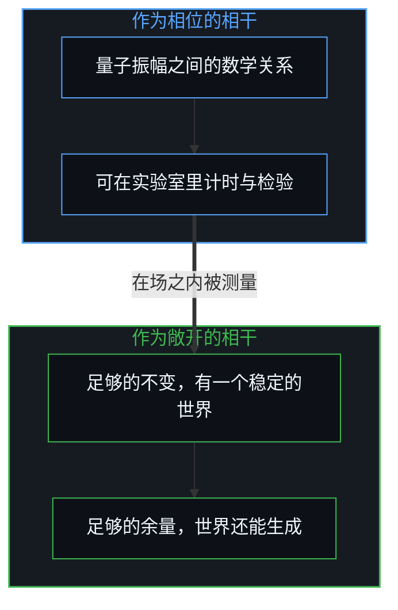
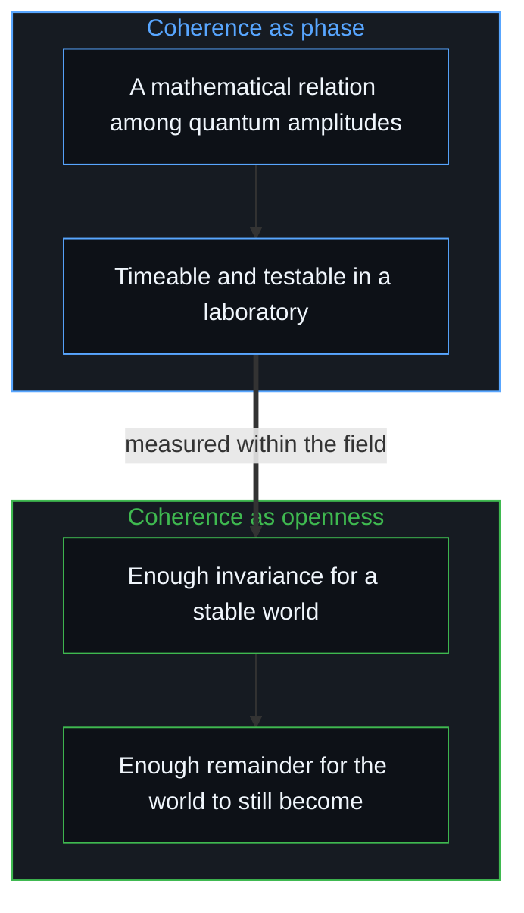

# 另一种相干 / The Other Coherence

*神经元里的量子相位可以计时，一个经验的世界在敞开中维系为一体是另一层的事 / Quantum phase in a neuron can be timed; an experienced world holding together while open is another order.*

关于生物中量子效应的争论，收敛到了一个测量上：一个温暖、潮湿的大脑，能否把一个量子相位保持得足够久，让它进入思维的时间尺度？罗杰·彭罗斯与斯图尔特·哈梅罗夫把协调客观还原放在神经元微管的这个尺度上。经典的反驳拿热退相干与细胞组织的温度和湿度相比，马克斯·泰格马克在 2000 年估算，在生理温度下退相干快得远远赶不上神经的时间。

The debate over quantum effects in biology has converged on one measurement: can a warm, wet brain hold a quantum phase long enough for it to enter the timing of thought? Roger Penrose and Stuart Hameroff placed orchestrated objective reduction in neuronal microtubules at that scale. The classical rebuttal set thermal decoherence against the heat and wetness of cellular tissue, and Max Tegmark estimated in 2000 that at physiological temperature decoherence is far too fast to keep up with neural timing.

较近的研究又把问题推开了一些。迈克尔·威斯特的实验室在 2024 年报告，一种稳定微管的药物让大鼠在麻醉下失去意识的时间推迟了大约一分钟；菲利普·库里安的团队报告，微管中大量色氨酸构成的网络有集体的超辐射行为。这场交锋问的是，某一种量子振幅之间的相位对齐能否在神经元里持续。那种对齐是一种相干；一个被经验的世界维系为一片连续的场，既保持一个稳定的场景，又对下一刻的到来保持可及，这是另一种相干。

More recent work has pushed the question open somewhat. Michael Wiest's lab reported in 2024 that a microtubule-stabilising drug delayed anaesthetic unconsciousness in rats by about a minute; Philip Kurian's group reported collective superradiant behaviour in large networks of tryptophan in microtubules. The exchange asks whether a particular phase alignment among quantum amplitudes can persist inside a neuron. That alignment is one coherence; an experienced world holding together as one continuous field, keeping a stable scene while staying available to what arrives next, is another coherence.

## 一、 因果是不可化约的在先 / 1. Causality as the Irreducible Prior

要看清两种相干为什么属于不同的层，先从根基开始：因果是任何理论、模型或推理不可化约的在先。关于一条物理定律的每一个表述、每一次检验、每一个问题，都在把先行条件连到后果的因果序列之内运作；用某个更早的物理机制去解释因果，是一个递归的回路，解释本身就依赖它想要推出的那个因果逻辑。连否认因果，也是从一个理由走到一个结论。

To see why the two coherences belong to different orders, start from the ground: causality is the irreducible prior of any theory, model or reasoning. Every formulation, test and question about a physical law works inside the causal sequence that links antecedent conditions to consequences; explaining causality by some earlier physical mechanism is a recursive loop, the explanation relying on the very causal logic it hopes to derive. Even denying causality goes from a reason to a conclusion.

因果作为一张不断开的织物，从无穷延伸到无穷；它的连续是因果的逻辑一致，它的步长从不为零。[无穷总体的海市蜃楼](../the-mirage-of-the-infinite-totality/)已经说清，这个无穷不是一个外部的宇宙容器，而是感知自身延展其移动地平线的无边潜能。空间、时间、热力学梯度、时空几何与简洁的物理定律，是在相互交叉的因果链上结晶出的自相关与互相关的宏观不变量，[宏观现象的生成图谱](../the-generative-atlas-of-macroscopic-phenomena/)推出了这一点。把相干当作一种形而上实体，就是[切分的三重影子](../the-three-shadows-of-the-cut/)在兰德里那里看到的那种实体化。

Causality runs as an unbroken fabric from infinity to infinity; its continuity is the logical coherence of causality, and its step is never zero. As [The Mirage of the Infinite Totality](../the-mirage-of-the-infinite-totality/) has made clear, this infinity is not an outside cosmic container but the boundless potential of perception itself to widen its moving horizon. Space, time, thermodynamic gradients, spacetime geometry and compact physical laws are macroscopic invariants of auto-correlation and cross-correlation crystallising across intersecting causal chains, as [The Generative Atlas of Macroscopic Phenomena](../the-generative-atlas-of-macroscopic-phenomena/) derives. Treating coherence as a metaphysical substance is the hypostasis [The Three Shadows of the Cut](../the-three-shadows-of-the-cut/) finds in Landry.

一条简洁的物理定律，是这张因果织物的统计征象，一个稳定到足以被用来导航的局部规律。一个完成的确定性套装，一个特定的哈密顿量、一组初始条件，或一个被设想为静态时空块的宇宙，也是这样来的：一张在有限的观察地平线上编成的理想化地图。一切观察都发生在这张活的织物之内；封闭属于编好的数学不变量，因果则作为一场敞开的、活着的推进继续下去。

A compact physical law is a statistical symptom of this causal fabric, a local regularity stable enough to navigate by. A completed deterministic package, a particular Hamiltonian, a set of initial conditions, or a universe conceived as a static block of spacetime, arrives the same way: as an idealised map compiled at a finite observational horizon. All observation happens inside the living fabric; closure belongs to the compiled mathematical invariant, while causality goes on as an open, living progression.

## 二、 感知落入不确定之处 / 2. Where Perception Falls into Indeterminacy

因果既是不可化约的在先，每一个可观察的现象都追溯到一个原因。研究者或观察者沿着机械的联动、化学的梯度与细胞的通路追一条因果序列；每一条因果链都一直延伸，直到它从感知的有限地平线上落入一个不确定的事件。在尚未计算的因果越过感知地平线的这条边界上，事件呈现出两面。从外部、从第三人称的物理看，它被登记为一个未被观察的量子事件，一次波函数落定为已实现状态的、不可化约的概率转换；从内部、从第一人称的意识看，它被直接经历为选择的自由，在敞开的潜能之中实现一个具体的行动。心智把自由变量注入这一步，被观察到的就是量子的不确定；二者是感知与未计算的余量相遇的同一条因果边界的外面与里面，哪一面在先，言语说不清。

Since causality is the irreducible prior, every observable phenomenon traces to a cause. A researcher or observer follows a causal sequence through mechanical linkages, chemical gradients and cellular pathways; every causal chain extends until it falls off the finite horizon of perception into an indeterminate event. At this boundary, where uncomputed causality crosses the perceptual horizon, the event shows two faces. From outside, from third-person physics, it registers as an unobserved quantum event, an irreducible probabilistic transition in which a wave function resolves into a realised state; from inside, from first-person consciousness, it is undergone directly as freedom of choice, one specific action actualised among open potentials. The Mind injects the free variable into the step, and what is observed is quantum indeterminacy; the two are the outside and inside of one causal boundary where perception meets the uncomputed remainder, and which comes first is not something words settle.

偶然与选择在同一道切分上相遇。那道切分，就是每一个关于外部宇宙的模型被拼装起来时所穿过的那个活的光圈。

Chance and choice meet at one cut. That cut is the living aperture through which every model of an outside cosmos is assembled.

## 三、 量子脑之争的因果倒置 / 3. The Causal Inversion in the Quantum Brain Debate

常见的量子意识之争，把因果的次序倒了过来。它先假定温暖的、经典的大脑是首要的、先已存在的剧场，再问脆弱的量子现象能否在这个生物容器里存活。从第一人称的原点追溯因果，这整个剧场在认识的次序上是下游的。颅骨、神经元、热振动与潮湿的细胞组织，这个宏观的物理大脑，是心智编出的一个模型，在神经科学的用处之内准确而有力；它所描述的，是无数自由变量随时间叠加后稳定下来的逻辑后果，[自由变量的生成拓扑](../the-generative-topology-of-free-variables/)确立了这一点。因果的往来，总在容纳它的生物结构之先；编出一个确定的物理模型的心智，正是那个不变量被写下来的光圈。

The common debate over quantum consciousness turns the causal order around. It first assumes the warm, classical brain as the primary, pre-existing theatre, then asks whether fragile quantum phenomena can survive inside that biological container. Traced from the first-person origin, the whole theatre is downstream in the order of knowing. The macroscopic physical brain, skull, neurons, thermal vibration and wet cellular tissue, is a model the Mind compiles, accurate and powerful within the use of neuroscience; what it describes is the stabilised logical consequence of countless free variables compounding over time, as [The Generative Topology of Free Variables](../the-generative-topology-of-free-variables/) establishes. Causal traffic always comes before the biological architecture that houses it; the Mind that compiles a deterministic model of physics is the very aperture at which that invariant is written down.

意识是因果区分的首要光圈；生物的大脑，是从这场持续的运作中结晶出来的、滞后的宏观沉积。

Consciousness is the primary aperture of causal distinction; the biological brain is the lagging macroscopic sediment crystallised from that ongoing operation.

## 四、 两种相干 / 4. Two Coherences

两种相干的区别是清楚的。一种是作为相位的相干，微观的机制：量子振幅之间一个特定的数学关系，可以在物理实验室里计时、检验。另一种是作为敞开的相干，经验的场：有意识的经验维系为一个统一的整体、同时对一个未完成的未来保持敞开的那个条件。实验室里关于相位对齐的发现，无论走向哪一边，都不触动第二种相干。

The difference between the two coherences is clear. One is coherence as phase, the microscopic mechanism: a specific mathematical relation among quantum amplitudes, timeable and testable in a physics laboratory. The other is coherence as openness, the experiential field: the condition under which conscious experience holds together as a unified whole while staying open to an unfinished future. Laboratory findings on phase alignment, whichever way they go, leave the second coherence untouched.

有意识经验的相干，是一个场景维系为一个自洽的世界、同时向下一刻敞开的方式：有足够的不变，才有一个稳定的世界；有足够未计算的余量，那个世界才仍能生成。这是意识得以相干的根基，也是这份相干让被感知的现实保持敞开的条件，是因果越过第一人称光圈时，一片活的场与自身的对齐。

The coherence of conscious experience is the way a scene holds together as one coherent world while staying open to the next moment: enough invariance to have a stable world, and enough uncomputed remainder for that world still to become. This is the ground on which consciousness is coherent, and the condition by which that coherence keeps perceived reality open, the alignment of a living field with itself as causality crosses the first-person aperture.

微管晶格里的量子相位相干，是织物之内的一个局部物理机制。[涌现的几何学](../the-geometry-of-emergence/)探讨过，宏观的模式是这条活的前沿的递归后果，而不是另立的因果引擎。经验的场，是一切测量发生、物理学的地图被画下的地方，就在因果持续展开的那条活的前沿上。

Quantum phase coherence in a tubulin lattice is a local physical mechanism within the fabric. As [The Geometry of Emergence](../the-geometry-of-emergence/) explores, macroscopic patterns are recursive consequences of this living edge, not separate causal engines. The experiential field is where all measuring happens and where the maps of physics are drawn, at the living edge where causality keeps unfolding.
