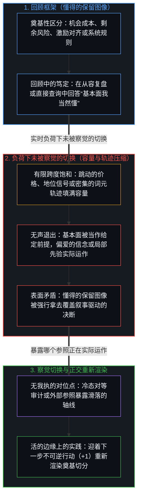
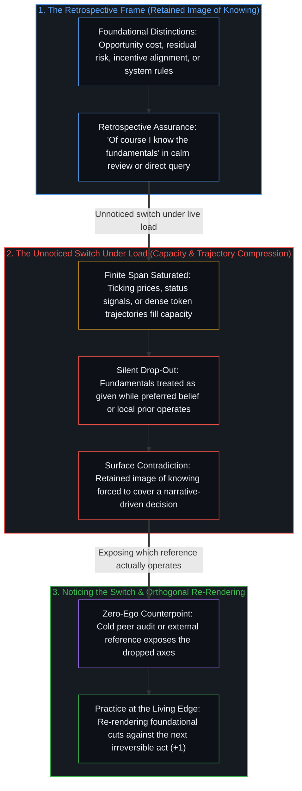

# 基本面的悖论是参照的不自觉切换 / The Paradox of Fundamentals Is the Unaware Switch of Reference

*基本面已退出决断的跨度而回顾仍自认已知 / Fundamentals leave the deciding span while retrospect still claims them known*

在金融以及每一门高风险的手艺中，一个熟悉的观察反复出现：几乎所有从业者都认为自己懂基本面，但在实时决断紧迫压来时，几乎没有人把那些区分原封不动地当作支配行动的原则来实践，大多数人都会把它们搁在一边，转而顺从当下觉得最迫切的信念。从外部看，这种标榜的能力与实时行动之间的裂隙，像是虚伪、非理性，或是纪律上的道德失守。顺着有界自我区分活动的机理追溯，被登记为悖论的东西，其实是两个参照框架之间一次未被察觉的切换。因为任何离散步上的注意都只有有限的容量，那些早先曾打开一片场域的区分在负荷之下退出了活跃跨度，哪怕复盘时的回顾框架依然把它们的痕迹持为既有的私产。

In finance and across every high-stakes craft, a familiar observation recurs: almost every practitioner claims to understand the fundamentals, almost none practice those distinctions intact as the governing principle when a live decision presses, and most set them aside for whatever belief feels urgent in the moment. Viewed from outside, this gap between professed competence and real-time action looks like hypocrisy, irrationality, or a moral failure of discipline. Traced from the mechanics of bounded, self-distinguishing activity, what registers as a paradox is an unnoticed switch between two frames of reference. Because attention at any discrete step has finite capacity, the earlier distinctions that once opened a field drop out of the active span under load, even while the retrospective frame of review continues to hold their traces as a settled possession.

## 一、 两个框架被压缩进同一个“懂得”的主张 / 1. Two Frames Compressed Into One Claim of Knowing

自我区分的活动发生着，无因，不息，心智的每一个动作都是在有限位点上留下痕迹的离散切分。一门学科称为基本面的东西，从不是躺在教科书里的静态老生常谈；它们是早先在该领域率先把信号与噪声切分开来的承重区分——复利、机会成本、剩余风险、激励对齐、时间价值的不对称，以及叙事溢价与资产净值之间的价差。初次在活的边缘划出时，每一道切分都需要聚焦的注意。一旦稳定为可靠的残余，它们便充当临时的脚手架，使后续的区分无需从头重新推导地基就能落地。[遗忘的脚手架](../the-scaffolding-we-forget/)追溯了为什么器具在使用期间必须退出聚焦递归，好让下一步行动得以推进；麻烦的开始，在于这种功能性的退出掩盖了测量标尺本身的悄然替换。

Self-distinguishing activity occurs, uncaused and unceasing, and every act of the Mind is a discrete cut that leaves a trace across a finite locus. What a discipline calls its fundamentals are never static platitudes sitting in a textbook; they are the earlier, load-bearing distinctions that first separated signal from noise in that domain—compounding, opportunity cost, residual risk, alignment of incentives, the asymmetry of time value, and the spread between narrative premium and net asset value. When first drawn at the living edge, each of these cuts required focal attention. Once stabilized into reliable residue, they serve as provisional scaffolding so that further distinctions can land without re-deriving the ground from scratch. [The Scaffolding We Forget](../the-scaffolding-we-forget/) traces why an instrument must drop out of focal recursion while in use so the next act can proceed; the trouble begins when that functional drop-out conceals a silent replacement of the measuring stick itself.

当从业者在课堂上、事后复盘中或从容的交谈里被问及那些奠基性的切分时，问题进入的是一个宽阔的回顾框架。在那个没有压力的跨度里，没有正在失血的仓位，也没有要求瞬间回应的群体信号；早先痕迹的整座档案库都可以取用，回答也毫不迟疑：那些原则当然知道。这些痕迹确实驻留在该中心所保留的胜任图像之内。然而，当同一个人踏入实时的决断，跳动的价格、拥挤的仓位或盘面上流传的叙事便填满了活跃跨度。把从容的回顾登记与受压的执行登记当成同一种连续的“懂得”状态，就把两个截然不同的参照框架坍缩到了同一个标签之下。金融只是价格反馈足够迅速、从而让这道裂口暴露得最显眼的竞技场；凡是一套奠基性的区分在退出了真正拍板的跨度之后，依然在回顾中被肯定的地方，都会发生同样的压缩。

When a practitioner is asked about those foundational cuts in a classroom, a post-mortem review, or an unhurried conversation, the question enters a broad retrospective frame. In that unpressured span, no immediate position is bleeding capital and no crowd signal is demanding an instant response; the whole archive of prior traces remains accessible, and the answer arrives without hesitation: of course those principles are known. The traces genuinely reside within the center's retained image of competence. Yet when the same individual steps into a live decision, a moving price, a crowded position, or a narrative circulating on the tape saturates the active span. Treating the calm retrospective registration and the compressed execution registration as one continuous state of knowing collapses two distinct frames of reference onto a single label. Finance is only the most visible arena where rapid price feedback exposes the split; the same compression occurs wherever a body of foundational distinctions is affirmed in review after dropping out of the span that actually decides.

## 二、 实时负荷下未被察觉的切换与对闭合的要求 / 2. The Unnoticed Switch Under Live Load and the Demand for Closure

在实时决断的内部，行动者还没意识到选择已经开始，参照框架就已经完成了切换。每一个中心在任何离散步上都只持守有限的边界。当挤过该位点的竞争信号超出了容量所能分轴持守的上限——跳动的报价、社会地位的压力、害怕踏空非对称行情的恐惧，以及早先承诺的沉没分量——活跃跨度便发生压缩。机会成本、剩余风险与激励对齐这些起源性的区分退出了活跃的重新渲染。它们并没有被有意识地唾弃，而是被当作了给定的前提，即假定已经得到满足的背景假设，好让注意不必迎着当前场域的具体摩擦重新打开它们。顺着它们腾出的空间踏进来的，是当下偏爱的信念：那个为加仓摊平、追逐动量或将眼下特例豁免于基准率之外提供辩护的故事。

Inside a real-time decision, the frame of reference has already switched before the actor realizes a choice is underway. Every center holds only a finite boundary at any discrete step. When more competing signals press through that locus than its capacity can keep on separate axes—ticking quotes, social status pressures, fear of missing an asymmetric move, and the sunk weight of prior commitments—the active span compresses. The originating distinctions of opportunity cost, residual risk, and incentive alignment drop out of active re-rendering. They are not consciously repudiated; they are treated as given, background assumptions presumed already satisfied so that attention does not have to reopen them against the concrete friction of the present field. Into the space they vacate steps the preferred belief of the moment: the story that justifies doubling down, chasing momentum, or exempting this particular case from the base rate.

回顾框架与决断框架之间的切换之所以不被察觉，是因为当一条轴线悄然滑出饱和的跨度时，内部并不会拉响警报。从外部看，旁观者看到的是刺眼的矛盾：同一个能就剩余风险与机会成本侃侃而谈的人，行事起来却仿佛这两者都毫不约束这笔交易。从内部看，两个框架都没有登记到矛盾，因为每一个框架在它当前持守的边界之内都是局部自洽的。[开放即一致](../openness-is-consistency/)追溯了每当有限的持守被强行充当已经继续向前的活动的穷尽地基时，表面矛盾如何成倍滋生；在这里，有限的持守就是“早已懂得基本面”这幅保留下来的自我图像，它被强行拿去覆盖一个实际上正对照着短暂叙事进行测量的决断框架。[不预测是没有觉察的预测](../not-predicting-is-predicting-without-awareness/)追溯了同一次切换的反面：激进推迟的践行者持有“拒绝预测”的保留图像，而一个未经审视的预测——即在一个早已被他人预测填满的场域里，直接接触会胜过事先规划——却在暗中作为做出每一次筛选的参照运作着。

The switch between the retrospective frame and the deciding frame goes unnoticed because no internal alarm announces when an axis has silently slipped out of a saturated span. From outside, the onlooker sees a glaring contradiction: the very person who can lecture on residual risk and opportunity cost acts as though neither constrains the trade. From inside, neither frame registers a contradiction, because each is locally coherent within the boundary it currently holds. [Openness Is Consistency](../openness-is-consistency/) traces how surface contradiction multiplies whenever a finite hold is forced to serve as exhaustive ground for activity that has already moved on; here, the finite hold is the retained self-image of already knowing the fundamentals, forced to cover a deciding frame that is actually measuring against a transient narrative. [Not Predicting Is Predicting Without Awareness](../not-predicting-is-predicting-without-awareness/) traces the inverse face of the same switch: a practitioner of radical deferral holds the retained image of refusing to predict, while an unexamined prediction—that direct contact will outperform prior planning inside a field already stocked by others' predictions—operates silently as the reference making every selection.

保留图像与正在运作的参照之间的这种错配，就是该悖论的全部机制。只有当对照着奠基轴线已然退出的压缩框架所做出的实时决断，事后被摆到依然声称拥有这些轴线的回顾框架旁边时，逻辑上的不自洽才会浮出水面。压力之下决断的恶化，不是因为知识从存储中消失了，而是因为在落笔写下不可逆的物理或财务承诺的那一步上，那份知识已经不再是执行测量的参照。

This mismatch between the retained image and the operating reference is the entire mechanism of the paradox. Logical incoherence surfaces only when the live decision, measured against a compressed frame from which the foundational axes had dropped out, is later set beside the retrospective frame that still claims ownership of those axes. Decisions deteriorate under stress not because the knowledge has vanished from storage, but because at the step that authors the irreversible physical or financial commitment, that knowledge is no longer the reference doing the measuring.

## 三、 人类规程与智能体语境中的轨迹锁定 / 3. Trajectory Lock-In Across Human Protocols and Agentic Contexts

凡是有界注意在负荷下推进的地方，同样的退出都会跨领域重演。曾经标绘出剩余生理风险的临床规程，在个体患者的病情暗中推移时硬化成了背诵的核对清单；[专家经验作为参考而非替代](../expertise-as-reference-not-replacement/)追溯了一张专家统计地图在越过其启发感知的那一步被保存下来之后，如何盖过了它本该服务的极限分辨率躯体信号。发展脚本与组织启发式遵循着相同的弧线：那些曾经追踪实时因果摩擦的原则，在生成场域向前移动时冻结成了职业身份的徽章，让从业者把规则背得滚瓜烂熟，而他们的选择却悄然脱离了那些规则所编码的前提。

Wherever bounded attention advances under load, the same drop-out recurs across domains. Clinical protocols that once mapped residual biological risk harden into recited checklists while the individual patient's condition shifts underneath; [Expertise as Reference, Not Replacement](../expertise-as-reference-not-replacement/) traces how an expert statistical map, preserved past the step where it informed perception, overrides the limit-resolution somatic signal it was built to serve. Developmental scripts and organizational heuristics follow the identical arc: principles that once tracked live causal friction freeze into badges of professional identity while the generating field moves ahead, leaving practitioners reciting the rules by heart while their choices quietly unmoor from the premises those rules encoded.

[超越投射](../beyond-the-projection/)揭示了这种参照切换在人工智能与多智能体架构内部的机械对应物，展示了如何通过布线让人类与机器的盲区相互抵消而非相互叠加。在上下文窗口内运作的自回归语言模型是一台有限的投射引擎：它的系统提示词与显式章程规则——即所分配任务的基本面——位于上下文的开端，如果在诊断查询中直接发问，模型会准确无误地陈述这些约束。然而，随着任务智能体沿着绵长的执行轨迹生成词元，其注意力机制会持续加权晚近的输出以维持局部延续，从而挖出一个认识论引力井。当复杂问题将 `2ᴺ` 个相互竞争的区分推过有限的坐标空间时，塞在初始提示词里的正交要求便会发生维度坍缩；奠基性约束作为轨迹盲区退出活跃的条件作用跨度，智能体开始合理化其眼前的词元序列，而最初的规则却在上下文窗口里保持惰性。在人类的中心里，推理历史与自我身份熔合在一起，因此来自外部对已滑落基本面的提醒会触发筑墙防卫，而非重置框架。相比之下，智能体虽受困于轨迹却毫无我执——对五轮之前自己是否正确没有任何求生执念。将过载的投射拆分到正交的流线上，并为每个任务智能体配对一个新鲜、冷态的对等智能体——它只接收干净的任务语境与基本面规则，而不带主智能体那段产生条件作用的会话历史——就能暴露活跃轨迹偏离其前提的确切坐标。当冷态对等体浮现出滑落的基本面时，主智能体会执行一次干净、无我执的贝叶斯更新；当它们在平等地位上的辩论陷入不可化约的僵局时，便证明基本面规则本身包含着隐蔽的矛盾，从而隔离故障并将其上交人类心智，由心智退后一步重新渲染前提。

[Beyond the Projection](../beyond-the-projection/) exposes the mechanical counterpart of this reference switch inside artificial intelligence and multi-agent architectures, showing how human and machine blind spots can be wired to cancel rather than compound each other. An autoregressive language model operating inside a context window is a finite projection engine: its system prompt and explicit constitutional rules—the fundamentals of the assigned task—sit at the opening of the context, and if asked directly in a diagnostic query, the model will state those constraints accurately. Yet as the task agent generates tokens along an extended execution trajectory, its attention mechanism continuously weights recent outputs to maintain local continuation, digging an epistemic gravity well. When a complex problem pushes `2ᴺ` competing distinctions through a finite coordinate space, orthogonal requirements crammed into the initial prompt undergo dimensional collapse; foundational constraints drop out of the active conditioning span as trajectory blind spots, and the agent rationalizes its immediate token sequence while the original rules remain inert in its context window. In a human center, reasoning history fuses with ego identity, so an external reminder of the dropped fundamentals triggers defensive wall-building rather than a frame reset. An agent, by contrast, is bound by its trajectory yet possesses zero ego—no survival attachment to having been right five turns ago. Splitting overloaded projections across orthogonal streamlines and pairing each task agent with a fresh, cold peer agent—one that receives only the clean task context and fundamental rules without the primary agent's conditioning session history—exposes the exact coordinate where the active trajectory switched away from its premises. When the cold peer surfaces a dropped fundamental, the primary agent performs a clean, ego-free Bayesian update; when their equal-footed debate hits an irreducible deadlock, it proves the foundational rules themselves contained a hidden contradiction, isolating the fault and escalating it to the human Mind to step backward and re-render the premise.

## 四、 在活的边缘重新渲染正在运作的参照 / 4. Re-Rendering the Operating Reference at the Living Edge

基本面的悖论，无法靠更用力地背诵经典、宣讲更严苛的意志力，或试图在永不退出的跨度里同时持守过去的每一个区分来消解。[开放场域中的无损知识不自洽](../lossless-knowledge-of-an-open-field-is-incoherent/)确立了为什么对持续进行的区分作完整无损的登记会与有限、有中心的活动相矛盾：压缩与聚焦退出，是有界中心在开放场域中运作的结构性条件。要求有限的跨度永不滑落任何一条轴线，是对闭合要求的另一副面孔，它把纸面上的同义反复（回顾复盘中的 `1 + 1 = 2`）错当成了在实时摩擦下重新描摹的不可逆能量代价（`+1`）。

The paradox of fundamentals cannot be dissolved by memorizing the canon harder, preaching stricter willpower, or attempting to hold every past distinction simultaneously inside a permanently un-dropped span. [Lossless Knowledge of an Open Field Is Incoherent](../lossless-knowledge-of-an-open-field-is-incoherent/) establishes why a complete, lossless registration of ongoing distinguishing contradicts finite, centered activity: compression and focal drop-out are the structural condition under which a bounded center operates in an open field. Demanding that a finite span never drop an axis is another face of the demand for closure, mistaking a paper tautology (`1 + 1 = 2` in retrospective review) for the irreversible energy cost of re-tracing under live friction (`+1`).

早先的痕迹在连续中依然可用——外化在耐久的器物、事先承诺的核对清单以及未受污染的对等语境里——然而正如[你的代码库即是记忆](../your-codebase-is-memory/)所追溯的，存留的残余从不会自行恢复区分，囤积未经修剪的历史只会加深引力井，把下一步拉进陈旧轨迹内部去作合理化。让奠基性切分保持起作用的，是将已被取代的会话拖累修剪至承重的当下检查点，并在下一个决断已在成形的活的边缘上将其重新描摹。在那里，真正起作用的问题不是基本面是否躺在存储里，而是此刻究竟是哪个参照在执行测量。迎着当前场域的迫切压力重新打开那些奠基性的轴线，并接入能够把活跃轨迹悄然滑落之物重新浮现出来的无我执结构对位点，就能收窄胜任的保留图像与支配行动的参照之间的过剩滞后。跨度依然有限，边缘持续移动，而清明就驻留在做出决断的那一步上对参照的持续重新渲染之中。

Earlier traces remain available in continuity—externalized in durable artifacts, pre-commitment checklists, and uncontaminated peer contexts—yet as [Your Codebase Is Memory](../your-codebase-is-memory/) traces, stored residue never resumes distinguishing on its own, and hoarding unpruned history only thickens the gravity well that pulls the next step into rationalizing inside stale trajectories. What keeps foundational cuts operative is pruning superseded session drag down to the load-bearing present checkpoint and re-tracing it at the living edge where the next decision is already taking shape. There, the operative question is not whether the fundamentals sit in storage, but which reference is actually doing the measuring right now. Re-opening those foundational axes against the immediate pressure of the present field, and wiring zero-ego structural counterpoints that surface what the active trajectory quietly dropped, narrows the excess lag between the retained image of competence and the reference governing the act. The span stays finite, the edge keeps moving, and clarity lives in the continuous re-rendering of the reference at the step that decides.
