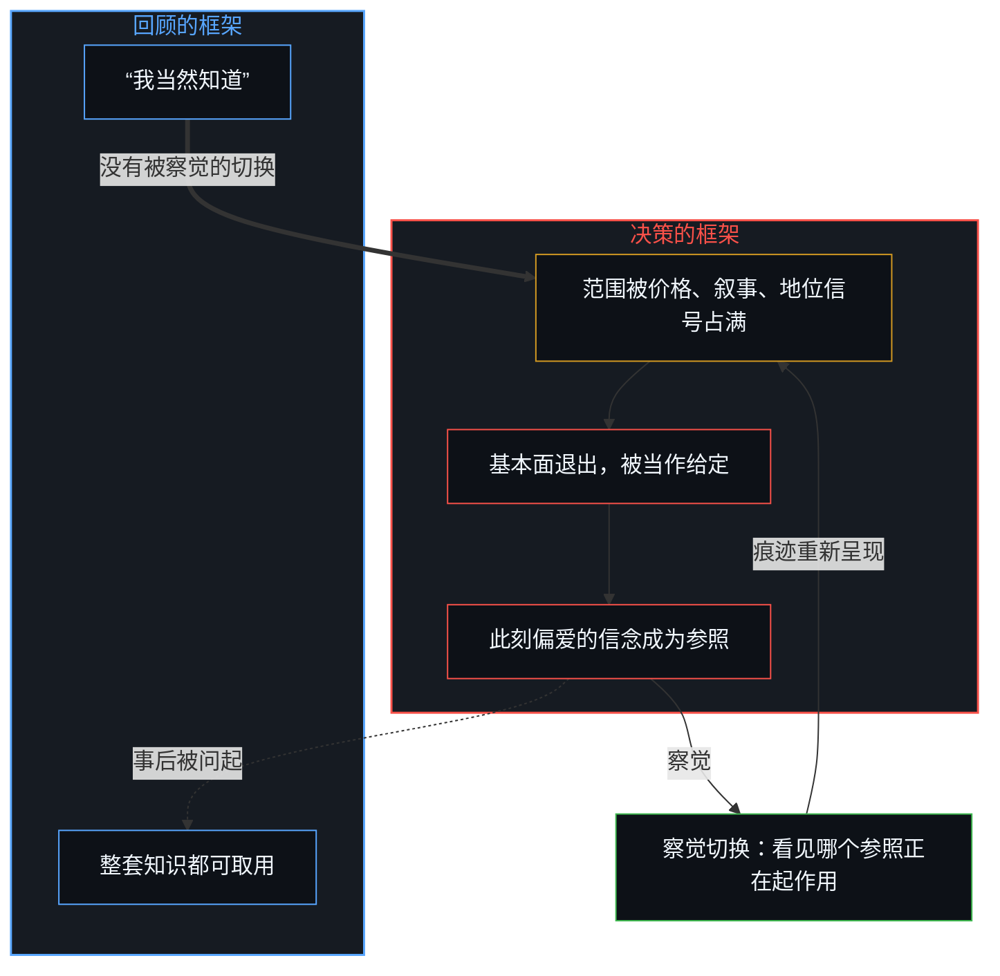
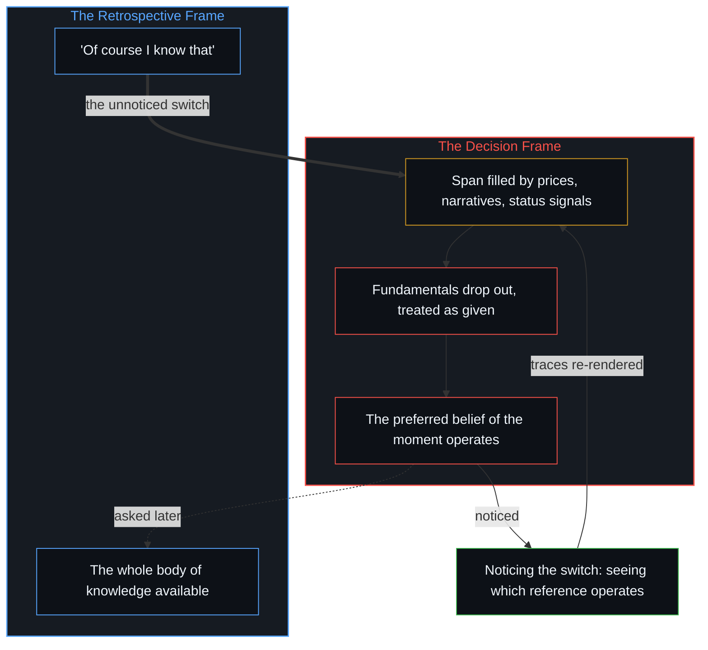

# 基本面的悖论是参照的不自觉切换 / The Paradox of Fundamentals Is the Unaware Switch of Reference

*基本面已经退出了正在起作用的范围，回顾的框架却仍把它们当作已知 / Fundamentals drop out of the active span while the retrospective frame still holds them as known.*

自我区分的活动发生着，无因，不息。称它为心智：已经在进行中的观察者，它的每一个动作都是一次区分。注意是有限的；在负荷之下，那些曾经生成这片场域的较早的区分，退出了活跃的范围。

Self-distinguishing activity occurs, uncaused and unceasing. Call it the Mind: the observer already underway, every act of which is a distinction. Attention is finite; under load, the older distinctions that once generated the field fall out of the active span.

常见的观察是：几乎所有从业者都认为自己懂基本面，几乎从不把它们完整地当作行动的原则来实践，而大多数时候为了此刻想相信的东西把它们搁在一边。悖论的样子，就是那一次没有被察觉的切换；被登记为悖论的是这次切换，而不是正在被决定的那片场域。

The common observation is that almost all practitioners think they know the fundamentals, almost never practice them fully as the principle of the act, and most of the time set them aside in favor of what they want to believe at the moment. The appearance of paradox is that unnoticed switch; what registers as paradox is the switch, not the field being decided.

## 一、 常见的观察把两个框架当成一种懂得 / 1. The Common Observation Treats Two Frames as One Knowing

几乎所有从业者都认为自己懂基本面。几乎从来没有人把这些区分完整地当作真正支配决策的原则来实践。大多数时候，它们被搁在一边，让位于个人此刻想相信的东西。一个活着的仓位、一个跳动的报价、行情上流传的一个叙事占据了这个范围；剩余风险、机会成本、叙事溢价与净资产之间的差距，并不是正在起作用的参照。事后在复盘里、课堂上、交谈中被问起，同一个人从回顾的框架作答：这些区分当然知道。两次登记被当成一种连续的能力。金融只是典型的那一面；凡是一套知识在回顾中被肯定、却从正在做决定的范围里掉出去的地方，都能看到同样的情形。

Almost all practitioners think they know the fundamentals. Almost never are those distinctions practiced fully as the principle actually governing the decision. Most of the time they are set aside in favor of what the individual wants to believe at the moment. A live position, a moving price, a narrative on the tape occupies the span; residual risk, opportunity cost, and the gap between narrative premium and net asset are not the reference that is operating. Asked later, in a review, a classroom, a conversation, the same individual answers from the retrospective frame: of course those distinctions are known. The two registrations are treated as one continuous competence. Finance is only the typical face; the same observation appears wherever a body of knowledge is affirmed in retrospect and dropped from the span that is deciding.

## 二、 基本面是退出范围的较早的区分 / 2. Fundamentals Are Older Distinctions That Fall Out of the Span

基本面就是那些较早的区分：复利、机会成本、剩余风险、激励的对齐、时间价值的不对称、叙事溢价与净资产之间的差距。初次画出时，它们是边缘；后来成了可用的残余；当这个范围被填满，它们便退出了活跃的重新呈现。[遗忘的脚手架](../the-scaffolding-we-forget/)追的是同一种退出：工具必须离开递归，进一步的区分才能落地。这里的退出，是正在起作用的参照发生了切换。

Fundamentals are those older distinctions: compounding, opportunity cost, residual risk, alignment of incentives, the asymmetry of time value, the gap between narrative premium and net asset. When first drawn they were the edge; later they became available residue; when the span fills they fall out of active re-rendering. [The Scaffolding We Forget](../the-scaffolding-we-forget/) traces the same drop-out, where the instrument has to leave recursion so that further distinguishing can land. Here the drop-out is a switch in which reference is actually operating.

## 三、 回顾的框架仍回答“当然” / 3. The Retrospective Frame Still Answers "Of Course"

当基本面被指出，或被抽象地讨论，从业者便退回一个更宽的回顾框架。在那个框架里，整套知识都可以取用，回答是即时的：“我当然知道。”这些痕迹仍被持为“懂得”这幅保留图像的一部分。

When the fundamentals are pointed out or discussed in the abstract, the practitioner steps back into a broader retrospective frame. In that frame the whole body of knowledge is available, and the answer is immediate: "Of course I know that." The traces are still held as part of the retained image of knowing.

## 四、 决策的框架已经切换 / 4. The Decision Frame Has Already Switched

当同一个人身处实时的决策中，参照的框架已经切换。当下的范围被最新的价格、叙事、地位的信号、此刻残留的压力，以及这个人现在想相信的东西占据。那些起源性的区分已经退出，被当作给定的，成了不必再对着正在生成这个决策的场域重新打开的背景假设。此刻偏爱的信念才是正在起作用的参照，基本面留在“懂得”的图像里。

When the same individual is inside a real-time decision, the frame of reference has already switched. The present span is occupied by the latest prices, narratives, signals of status, the residual pressures of the moment, and what that individual wants to believe right now. The originating distinctions have dropped out and are treated as given, background assumptions that no longer need to be reopened against the field actually generating the decision. The preferred belief of the moment is the operating reference; the fundamentals remain in the image of knowing.

## 五、 切换没有被察觉 / 5. The Switch Goes Unnoticed

两个框架之间的切换在没有觉察的情况下发生。从外面看，它像矛盾：同一个肯定基本面的人，行事却仿佛它们并不约束这次选择。从里面看并没有矛盾，只有两个不同的保留尺度，各自在被持守的地方自洽，却被当成了连续的。[开放即一致](../openness-is-consistency/)追的是有限的持守被逼着为只在继续的东西奠基时出现的表面矛盾；这里，有限的持守是“已经懂得”的图像，被逼着去覆盖那个真正在做决定的框架。[不预测是没有觉察的预测](../not-predicting-is-predicting-without-awareness/)追的是同一次切换：正在起作用的参照已经在选择，而保留下来的图像却是“不预测”。

The switch between the two frames happens without awareness. From outside it looks like contradiction: the same person who affirms the fundamentals proceeds as if they did not constrain the choice. From inside there is no contradiction, only two different retained measures, each coherent where it is held, treated as continuous. [Openness Is Consistency](../openness-is-consistency/) traces the surface contradiction that appears when a finite hold is forced to ground what only continues; here the finite hold is the image of already knowing, forced to cover the frame that is actually deciding. [Not Predicting Is Predicting Without Awareness](../not-predicting-is-predicting-without-awareness/) traces the same switch, where the operating reference is already choosing while the retained image is one of not predicting.

## 六、 知识在场，起作用的参照不在 / 6. Knowledge Is Present; the Operating Reference Is Not

这种错配就是机制。逻辑上的不自洽之所以出现，是因为决策被拿去对照一个已经不再持有那些本会塑造它的区分的框架。剩余风险、机会成本、激励的对齐不再是活跃的轴，它们作为给定的东西起作用；起作用的是此刻偏爱的信念。决策变坏，不是因为知识缺席，而是因为在行动的那一刻，知识已经不是正在起作用的参照。

The mismatch is the mechanism. Logical incoherence appears because the decision is measured against a frame that no longer holds the distinctions that would have shaped it. Residual risk, opportunity cost and the alignment of incentives are no longer active axes; they function as given, and what operates is the preferred belief of the moment. Decisions deteriorate not because the knowledge is absent but because, at the moment of action, the knowledge is no longer the reference that is operating.

## 七、 任何推进的负荷下都有同样的退出 / 7. The Same Drop-Out Under Any Advancing Load

凡是注意在负荷下推进的地方，都出现同样的样式。曾经标出剩余风险的规程，在个案继续变化时成了背诵的类别。曾经追踪发展痕迹的脚本，在活的情境继续时被冻住。曾经追踪控制的主张，在生成的场域移动时仍保留着那幅图像。在每一个领域，基本面都是注意出发的地方；边缘移动了，容量有限，参照框架在不被察觉中切换，那些区分退出活跃的范围，登记为给定的，仿佛从未存在过。[专家经验作为参考而非替代](../expertise-as-reference-not-replacement/)追的是同一种冻结：规程被背诵，而活的个案在继续。

The same pattern appears wherever attention advances under load. Protocols that once mapped residual risk become recited categories while the individual case moves on. Scripts that once tracked developmental traces freeze while the living situation continues. Claims that once tracked control keep the image while the generating field moves. In each domain the fundamentals were where attention started; the edge moved, capacity is limited, the frame of reference switches without notice, and the distinctions drop out of the active span and register as given, as if they had never existed. [Expertise as Reference, Not Replacement](../expertise-as-reference-not-replacement/) traces the same freeze, where the protocol is recited while the living case continues.

## 八、 察觉切换就是实践 / 8. Noticing the Switch Is the Practice

痕迹留在连续之中，可以被重新呈现。唯一可做的实践，是察觉切换本身：看见在已经生成下一个决策的那一步上，哪个参照正在起作用。让起作用的参照更靠近这一步，就是功夫所在；没有现成完成的懂得可取。范围始终有限，边缘一直在移动。[开放场域中的无损知识不自洽](../lossless-knowledge-of-an-open-field-is-incoherent/)追的是同一道界限：对正在进行的区分作完整的登记，与有限的活动相矛盾。

The traces remain in continuity and can be re-rendered. The only practice available is noticing the switch itself: seeing which reference is actually operating at the step already generating the next decision. Bringing the operating reference closer to that step is the work; no finished knowing is on offer. The span stays finite, and the edge keeps moving. [Lossless Knowledge of an Open Field Is Incoherent](../lossless-knowledge-of-an-open-field-is-incoherent/) traces the same bound: a complete registration of ongoing distinguishing contradicts finite activity.
