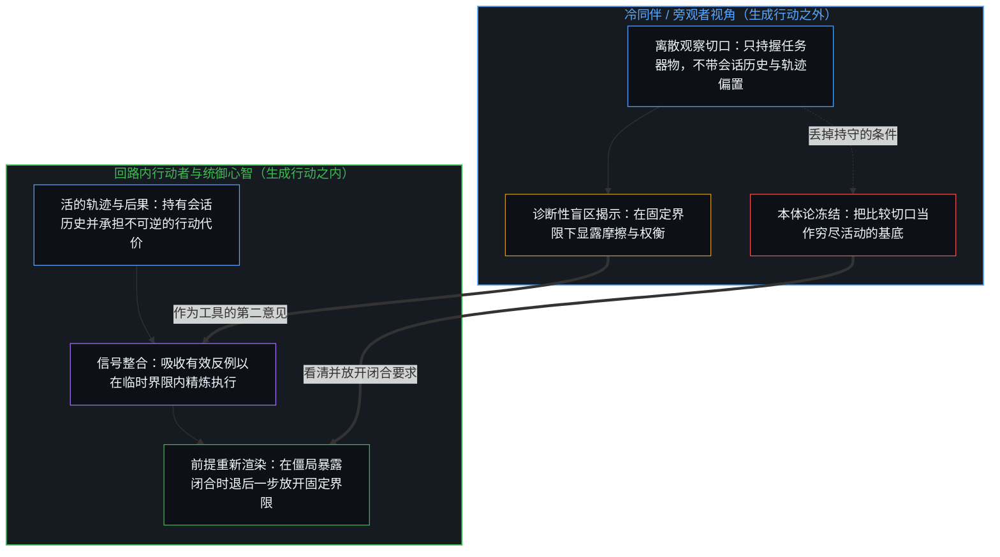
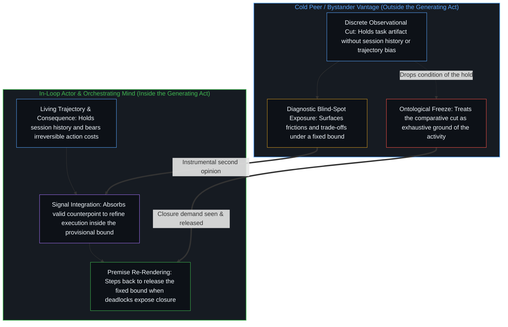

# 旁观者洞察的悖论 / The Paradoxical Nature of Bystander Insights

*只属于一次观察切口的区分，唯有切口被保存为本体时，才读作活动的硬性界限 / A cut's distinction reads as a hard limit only when preserved as ontology*

有一类观察，到来时已经平衡而有说服力：它命名一种任何在约束下工作的人都感受过的张力，把它化解成一个优雅的二选一，让听者点头。它命名的不是活动，而是对活动的一种看法，一种旁观者的洞察：一个属于观察者离散切口、而不属于被观察的连续运动的区分。纳瓦尔·拉维肯特那句话，人可以为生产力优化，也可以为创造力优化，但很难两者兼顾，就是一个干净的例子：界限被持守为固定时，这个权衡作为登记是真的；界限被持守为敞开时，同一个运动就是持续的发明。活动是那枚硬币，哪一面被登记，取决于工作者把界限持守为固定还是敞开。旁观者，以及后见之中的后来的自我，站在生成的行动之外，握住一面，并把那一面冻结为整体。

There is a class of observation that arrives already balanced and persuasive: it names a tension anyone working under constraints has felt, resolves it into an elegant either-or, and leaves the listener nodding. What it names is not the activity, rather a view of the activity, a bystander insight: a distinction that belongs to the observer's discrete cut rather than to the continuous movement observed. Naval Ravikant's line that one can optimize for productivity or for creativity, while finding it hard to do both, is a clean case: with the bound held fixed, the trade-off is real as a registration; with the bound held open, the same movement is continuous invention. The activity is the coin, and which face registers follows whether the one working holds the bound fixed or open. The bystander and the later self in hindsight stand outside the generating act, hold one face, and freeze that face as the whole.

## 一、 观察握住一面，硬币握着两面 / 1. Observation Holds One Face; the Coin Holds Both

一枚硬币有两面，而从任何单一的视角，只有一面被登记。所以旁观者可以相对于观察切口准确地说，两面无法同时被看见。这个陈述作为对一次看所能握住之物的报告是正确的，作为对硬币的描述则不完整。两面一同在那里；限度在于把一面与另一面区分开来的那次行动的有界性。失误在于把单一区分的界限，指派给跨越区分而持续的东西。[不预测是没有觉察的预测](../not-predicting-is-predicting-without-awareness/)在方法中追溯同一种单面持守：拒绝预测仍是一次预测，停在空的那一面，落下的只是对选择仍在继续的觉察。

A coin has two faces, and from any single vantage only one registers. A bystander can therefore state, accurately relative to the observational cut, that both faces cannot be seen at once. The statement is correct as a report of what one act of looking can hold, and incomplete as a description of the coin. Both faces are there together; the limit is the boundedness of the act that distinguishes one from the other. The miss is assigning the bound of a single distinction to what continues across distinctions. [Not Predicting Is Predicting Without Awareness](../not-predicting-is-predicting-without-awareness/) traces the same hold on one face in method: refusing to predict is still a prediction, and staying on the empty face drops only the awareness that the choosing continues.

每一个区分的行动都划出一道界限，下一个行动又再划。[一步一步绘制出的路径](../the-path-drawn-one-step-at-a-time/)追溯这种划定：当下是心智一步一步绘制的路径上的位置，塑造只朝一个方向。观察握住结果，而原因至少领先一步。这道间隙是看得以被登记的方式。滞后在于把看冻结为一个永久的外部立足点，并把看的界限重新指派给被看的东西。[器物是智能的表达，而非智能本身](../two-failures-of-trace/)追溯同一份冻结：智能是区分的行动，器物是残余，是观察唯一握住的项，也是行动常被冻结于其上的那一项。这里的残余是旁观者的看所留下的优雅二元，而冻结把它读作那次看所观察的活动。

Every act of distinguishing draws a bound, and the next act draws again. [The Path Drawn One Step at a Time](../the-path-drawn-one-step-at-a-time/) traces that drawing: the present is the position on a path the Mind draws one step at a time, and the shaping runs one way only. Observation holds the effect, while the cause stays at least one step ahead. That gap is how looking registers at all. The lag is freezing the look as a permanent exterior standpoint and reassigning the bound of the look to the thing looked at. [Artifacts Are Expressions of Intelligence, Not Intelligence Itself](../two-failures-of-trace/) traces the same freeze: intelligence is the act of distinguishing, and the artifact is residue, the only term observation holds and so the term onto which the act is commonly frozen. Here the residue is the elegant binary, left by the bystander's look, and the freeze reads it as the activity the look observed.

## 二、 封闭前提下的权衡 / 2. The Trade-Off Under Closed Premises

纳瓦尔的话带着来之不易的经验的分量落下。生产力登记为顺序的、可测的、受截止期驱动的；创造力登记为没有预定终点的、浪费的、抗拒指标的。两种模式似乎朝相反的方向拉扯，任何在固定约束下同时持有两者的人都感受过这份摩擦。所以这个洞察登记为洞穿。它作为一种持守的算术是准确的，即界限被持守为固定，不论是工作者自己固定了它，还是一道来自生成行动之外的看为了比较两种模式而固定了它。

Naval's remark lands with the weight of hard-won experience. Productivity registers as sequential, measurable, and deadline-driven; creativity registers as open-ended, wasteful, and resistant to metrics. The two modes seem to pull in opposite directions, and anyone who has held both under fixed constraints has felt the friction. So the insight registers as seeing through to the thing. It is accurate as the arithmetic of one hold—the bound held fixed—whether the one working fixes it or a look from outside the generating act fixes it in order to compare the two modes.

在封闭前提下为生产力优化，把边界、资源与目标当作固定的。效率成了从一个给定容器里榨出更多、而不改变容器的技艺，在那份持守之内，这份张力作为它的算术是真的：每一份花在精炼流程上的注意力，都是没有花在发明新流程上的一份。旁观者把这个权衡看得清楚，因为系统已被框定为已完成的；观察切口已经把两种模式分开，并对着一条被保存的边界测量了它们。[追求机缘中的封闭现实](../closed-reality-in-the-pursuit-of-serendipity/)在纳瓦尔的另一个主张中追溯同一种几何：敞开不是靠清空日程产生的，它是不把任何计划，包括“没有计划”这个计划，保存为固定的参照。延续过来的，是一份有限的清单，在其中一种用途被认为挡住另一种，以及一个构型被持守为场的结构。[基准刷榜中的封闭实存](../closed-reality-in-benchmark-maxing/)在评估中追溯同一种分裂：基准把能力冻结为一个封闭的靶子，它有用，因为它增密比较，而只有当那幅形象被当作整个场时，有用性才被登记不足。

Optimizing for productivity under closed premises treats boundaries, resources, and goals as fixed. Efficiency becomes the art of extracting more from a given container without altering the container, and inside that hold the tension is real as its arithmetic: every unit of attention spent refining process is a unit not spent inventing new process. The bystander sees the trade-off clearly because the system has been framed as already complete; the observational cut has separated the two modes and measured them against a preserved boundary. [Closed Reality in the Pursuit of Serendipity](../closed-reality-in-the-pursuit-of-serendipity/) traces the same geometry in another of Naval's claims: openness is not produced by clearing the calendar, it is the non-preservation of any plan, including the plan of having no plan, as a fixed reference. What carries over is a finite inventory in which one use is taken to block another, and one configuration is held as the structure of the field. [Closed Reality in Benchmark Maxing](../closed-reality-in-benchmark-maxing/) traces the same split in evaluation: a benchmark freezes capability as a closed target, useful because it densifies comparison, and usefulness goes under-registered only when that image is taken as the whole of the field.

## 三、 开放前提下，效率就是创造性的扩展 / 3. Under Open Premises, Efficiency Is Creative Expansion

在开放的前提下登记，同一个运动便消解了二分。一个开放的系统没有最终的边界；它的边缘是临时的、可扩展的，在那个框架里，效率的改进就是创造性的行动。每一次吞吐量的提升，每一次摩擦的去除，每一次时间的压缩，都不只是把现有的容器塞得更密；它把墙往外推，揭示出先前看不见的可能。从封闭的视角看只是生产力的东西，从开放的视角看，是一个更大系统的持续发明。创造力不是优化的替代品；它是一旦当下的限度不再被当作最终的，优化所成为的东西。

Registered under open premises, the same movement dissolves the dichotomy. An open system has no final boundary; its edges are provisional and expandable, and in that frame the improvement of efficiency is the creative act. Each gain in throughput, each removal of friction, each compression of time does not merely pack the existing container more densely; it pushes the walls outward and reveals possibilities that were invisible before. What looks like nothing but productivity from the closed vantage is, from the open one, the continuous invention of a larger system. Creativity is not an alternative to optimization; it is what optimization becomes once the current limits stop being treated as final.

[生产、消费与心智的区分](../production-consumption-and-the-minds-distinction/)处理同一刀：生产与消费是同一个活动在其边界被持守为敞开或固定时登记出的样子，所以同一次加法产生扩展还是抹除，只取决于参照被持守为敞开还是固定。[没有系统能被保持封闭](../no-system-can-be-kept-closed/)给出不完备最直观的一面，一位寄存器上的加法：运算在持守之内有效，而真实的结果落在它之外。[开放即一致](../openness-is-consistency/)命名产生封闭读法的那份要求：不一致是对闭合的欲求或尝试，是一个有限结构被迫去为只会延续的东西奠基。在一道被保存的界限之下计分，生产力与创造力争夺一份固定的注意力存量，在那份持守之内这种算术是有效的。界限被持守为敞开时，它们是在两个点上被读出的同一个分化运动：边缘仍在一道临时界限之内时的顺序精炼，以及那道界限让位时的扩展。

[Production, Consumption, and the Mind’s Distinction](../production-consumption-and-the-minds-distinction/) works the same cut: production and consumption are how one activity registers when its boundary is held open or fixed, so the same addition yields expansion or erasure depending only on whether the reference is held open or fixed. [No System Can Be Kept Closed](../no-system-can-be-kept-closed/) gives the most intuitive face of incompleteness, a one-bit register under addition: the operation is valid inside the hold, and the true result lies outside it. [Openness Is Consistency](../openness-is-consistency/) names the demand that produces the closed reading: inconsistency is the desire, or attempt, for closure, a finite structure forced to ground what only continues. Scored under a preserved bound, productivity and creativity compete for a fixed stock of attention, and inside that hold the arithmetic is valid. With the bound held open, they are one movement of differentiation read at two points: sequential refinement while the edge is still inside a provisional bound, and expansion when that bound gives way.

## 四、 工作是那枚硬币，旁观者握住一面 / 4. The Work Is the Coin, the Bystander Holds One Face

真正在工作的人，并不是在一本账上的两种稀缺模式之间做选择。活过的过程是一个运动，界限被持守为固定时它登记为高效的执行，界限被持守为敞开时它登记为创造性的扩展，而工作者一步一步地把它持守为这样或那样。旁观者一次只锁在一个框架里，报告出一个硬性的权衡；这份报告作为对框架的描述是准确的，作为对活动的描述则不准确。

The person actually working is not choosing between two scarce modes on a ledger. The lived process is one movement, which registers as efficient execution when the bound is held fixed, and as creative expansion when it is held open, and the one working holds it one way or the other from step to step. The bystander, locked into one frame at a time, reports a hard trade-off; the report is accurate as a description of the frame and inaccurate as a description of the activity.

这个样式在纳瓦尔的大量言论中反复出现，更宽地说，也在公共知识分子偏爱的格言风格中反复出现。把杠杆与努力对立、把空白时间与结构化工作对立的格言，作为干净的二元到来。从旁观者的座位上，结果已经排好，系统已经封闭，道路已经选定，两项读起来像彼此对立的替代品。回到决策的内部，它们便变薄了，那里有好几种逻辑同时运作：杠杆是早先努力延伸其触及范围所留下的残余，而一份空白的日程只是又一个被持守或被放开的构型，即那篇关于机缘的文章所追溯的那一刀。[生命的意义在起草之中](../the-meaning-of-life-is-in-the-drafting/)在作者身份中追溯同一种分裂：意义是在原因的现场起草中生成的，不是从硬化了的结果里找回的，而当向外的凝视从不回到纸面，它就变薄。对硬化了的结果的一次读，不论出自旁观者还是出自后来的自己，都是草稿的一个切口，不是起草。[遮蔽进步的框架](../the-frame-that-conceals-improvement/)追溯一种相邻的豁免，即评判者的豁免：在一组约束之内的移动，当从一个已经离开那些约束的框架被重新计分时便消失了，而双重标准保持不可见，评判者的豁免也在其中。

The pattern recurs across much of Naval's corpus and, more broadly, across the aphoristic style favored by public intellectuals. Maxims that set leverage against effort, or empty time against structured work, arrive as clean binaries. From the bystander's seat, where outcomes are already sorted, systems already closed, and paths already chosen, the two terms read as rival substitutes. They thin on returning to the inside of the decision, where several logics operate at once: leverage is the residue of earlier effort extending its reach, and an empty calendar is one more configuration held or released—the cut the serendipity post traces. [The Meaning of Life Is in the Drafting](../the-meaning-of-life-is-in-the-drafting/) traces the same split in authorship: meaning is generated in the live drafting of causes, not recovered from hardened effects, and it thins when the outward gaze never returns to the page. A reading of hardened effects, by a bystander or by a later self, is one cut of the draft, not the drafting. [The Frame That Conceals Improvement](../the-frame-that-conceals-improvement/) traces a neighboring exemption, the judge's: movement inside one set of constraints disappears when re-scored from a frame that has already left those constraints, and the double standard stays invisible, the exemption of the judge included.

## 五、 后见是转向内部的旁观者 / 5. Hindsight Is the Bystander Turned Inward

同样的机制在后见的自我解释中运作。一件事之后，一个后来的自我回望，强加一个连贯的叙事：我选了 X 是因为 Y；我失败是因为我为错误的变量优化了；我成功是因为我终于懂了那个权衡。这些重构恢复了因果与道德上的可读性，它们与唯一仍可得的数据相符，即行动与结果的外在序列，在封闭的假设之下被冻结。它们误述了内部。在当时，决策不只是固定边界之内一个干净的优化问题：几种互不相容的考量同时起作用，动机是混杂的，信息是不完整的，界限仍可以被放开。后来的自我站在生成的行动之外，只能登记硬币的一面，并讲出一个那一面就是整体的故事。这个解释让观察者满意，包括后来的自我，同时误述了活过它的那个人。

The same mechanism operates in explaining oneself in hindsight. After an event, a later self looks back and imposes a coherent narrative: I chose X because of Y; I failed because I optimized for the wrong variable; I succeeded because I finally understood the trade-off. These reconstructions restore causal and moral legibility, and they match the only data still available, the outward sequence of actions and results, frozen under closed assumptions. They misrepresent the inside. At the time, the decision was not simply a clean optimization problem inside fixed boundaries: several incompatible considerations were active at once, motives were mixed, information incomplete, the bound still open to release. The later self, standing outside the generating act, can register only one face of the coin and tells a story in which that face was the whole. The explanation satisfies the observer, the later self included, while misrepresenting the one who lived it.

[伪装成远见的表演性后见](../performative-hindsight-that-pretends-to-be-foresight/)追溯同一份滞后的社会一面：被登记为远见的，是已经公开的成功对着一幅保存下来的“早先未曾留意”的形象被重新追溯。这里的滞后是私人的：一个已经活过的序列，对着一幅保存下来的干净二选一的形象被重新追溯。观察握住结果，原因领先一步；后来故事的逼真，不是早先行动的精确。[因果贯穿始终](../causality-all-the-way/)维持这份约束：从被握住的结果，到被画出的样式，再到下一步，因果仍是边缘在画出它的路径；抽象是那幅地图，随步子重画时作为工具有用，预测是一次对着当下样式检验拟合的行动，两者都不是事先批准了那一步的完成了的外部地图。

[Performative Hindsight That Pretends to Be Foresight](../performative-hindsight-that-pretends-to-be-foresight/) traces the social face of the same lag: what registers as foresight is already-public success re-traced against a preserved image of earlier non-attention. Here the lag is private: a sequence already lived, re-traced against a preserved image of a clean either-or. Observation holds the effect, and the cause stays a step ahead; the verisimilitude of the later story is not the exactness of the earlier act. [Causality All the Way](../causality-all-the-way/) keeps the discipline: from held effects to drawn patterns to the next step, causality is still the edge drawing its path; abstraction is the map, useful as an instrument while it is redrawn with the step, and prediction is an act testing fit against the present pattern, neither of them a finished exterior map that authorized the step in advance.

## 六、 这种形式为何流传 / 6. Why the Form Circulates

旁观者的洞察之所以容易流传，是因为它们与观察本身的结构相合。观察必然是离散的：每一次看都划出一道界限。为了提取一条规则，它把一个过程冻结成快照并加以比较，而比较需要一道跨快照被固定的界限，于是规则把封闭的前提作为它的条件携带着。这条规则登记为对事物本性的洞穿；它描述的，是切口，以及比较不得不固定的那道界限。专门提供这类洞察的人，纳瓦尔是其中较优雅的一位，以清晰与风格表述出那些限度。[索维尔的表象洞察与根因之偏](../sowell-observed-the-surface-problem/)在政策中追溯同一个座位：以政策造成的激励而不是它宣称的目标来评判政策，作为一次看是准确的，而走上那个超然的阳台，是任何区分得以划出所凭的暂时豁免；失误在于不回来，从不把同一把尺折回到下诊断的那个行动上。这样的陈述传播得容易，听起来像来之不易的经验残余。它们是从稍远处观看经验、在一道活的工作可以自由放开的固定界限之下，所留下的来之不易的残余。

Bystander insights circulate readily because they align with the structure of observation itself. Observation is discrete by necessity: each look draws a bound. To extract a rule, it freezes a process into snapshots and compares them, and the comparison needs a bound held fixed across the snapshots, so the rule carries the closed premise as its condition. The rule registers as insight into the nature of things; what it describes is the cut and the bound the comparison had to fix. Those who specialize in such insights—Naval among the more elegant—articulate those limits with clarity and style. [Sowell Observed the Surface Problem](../sowell-observed-the-surface-problem/) traces the same seat in policy: judging policy by the incentives it creates rather than the goals it proclaims is accurate as a look, and stepping onto that detached balcony is the temporary exemption by which any distinction gets drawn; the miss is not returning, never folding the same scale back onto the diagnosing act. Such statements travel easily and sound like the hard-earned residue of experience. They are the hard-earned residue of watching experience from a slight remove, under a fixed bound the live work is free to release.

这一切都不会让这些洞察变得无用。旁观者仍能在一份封闭的持守之下揭示实际的摩擦、样式与可预见的冲突，但超然的观察在被吸纳进行动者自身活过的前提之前，仍只是一道没有重量的投射。[超越投射](../beyond-the-projection/)与[你的代码库即是记忆](../your-codebase-is-memory/)在智能体架构与外化记忆中把这一结构性非对称付诸运作：记忆代码库中的冷审视者或即用即退的探路者，正因为站在累积会话历史的引力井与生成序列之外，才得以揭示盲区与前提冲突，然而唯有处在清醒边缘的活生生的心智，才能重新追溯前提、把立得住的部分整合进更新后的检查点，并承担路径的后果，而不是把这记冷切口立为裁判的基底（[开放即一致](../openness-is-consistency/)）。抬升只开始于洞察被当作关于事物是什么的主张之时：当持守的算术，即界限固定时难以两者兼顾，丢掉了它的条件，读成了工作本身的限度。硬币不会因为没有哪一次看能同时握住两面而变成单面，工作也不会因为一个观察者或一个后来的自我只登记了封闭的那一种读法，而失去它敞开的读法。[遗忘的脚手架](../the-scaffolding-we-forget/)追溯任何这类工具的两面：脚手架退出递归，好让进一步的区分得以落地，而当这种退出冻结为一幅被保存过了那一步的形象，能力便压缩在曾经让运动成为可能的残余上。一句被持守为工具、随着步子移动而重新渲染的格言，仍是有用的残余；被持守为工作的封闭结构，它就把观察切口冻结成了事物本身。被宣称为一种可以传递的方法时，它就遇上那份冻结。[当观察变成表演](../when-observation-becomes-performance/)追溯随之而来的包装：对他人的观察作为第一人称参照起作用，包装成美德，便成了另一个不传递任何东西的动作。[解放的言辞始于定义囚禁](../liberation-rhetoric-begins-by-defining-captivity/)追溯再往后一步，即包装被当作纠正来提供：声称解放他人，先装下的是他们不自由，当作他们之所是，而非对一个行为的读法。

None of this makes the insights useless. A bystander can still surface practical frictions, patterns, and predictable collisions under a closed hold, though the detached observation remains a weightless projection until absorbed into the actor's own lived premise. [Beyond the Projection](../beyond-the-projection/) and [Your Codebase Is Memory](../your-codebase-is-memory/) put this structural asymmetry to work across agentic architecture and externalized memory: a cold critic or retiring scouter in a codebase of memory can expose blind spots and premise collisions from outside the gravity well of accumulated session history precisely because it stands outside the generating sequence, yet only the living Mind at the waking edge can re-trace the premise, consolidate what holds into the updated checkpoint, and bear the consequences of the path rather than installing the cold cut as a tribunal ground ([Openness Is Consistency](../openness-is-consistency/)). The elevation begins only when the insight is taken as a claim about what things are: when the arithmetic of the hold—that it is hard to do both while the bound is fixed—loses its condition and reads as a limit of the work itself. The coin does not become one-sided because no single look can hold both faces at once, and the work does not lose its open reading because an observer, or a later self, registers only the closed one. [The Scaffolding We Forget](../the-scaffolding-we-forget/) traces the two faces of any such instrument: scaffolding drops out of recursion so further distinguishing can land, and when that drop-out freezes into a preserved image past its step, capacity compresses against the residue that once enabled movement. An aphorism held as an instrument, re-rendered as the step moves, stays useful residue; held as the closed structure of work, it freezes the observational cut as the thing itself. Asserted as a method that travels, it meets that freeze. [When Observation Becomes Performance](../when-observation-becomes-performance/) traces the packaging that follows: observation of others works as a first-person reference, and packaged as virtue it becomes a second act that transfers nothing. [Liberation Rhetoric Begins by Defining Captivity](../liberation-rhetoric-begins-by-defining-captivity/) traces the step after, where the package is offered as correction: claiming to free others first installs that they are unfree, as what they are rather than as one reading of an act.

凡是残余被回读为原因之处，同样的看就会反复出现。[学习中不可观测的驱动力](../the-unobservable-driver-of-learning/)在学习中追溯它：观测只记录下游的分数，而计分板一旦被保存为活动本身，就把驱动力安放在工具、课程或设计里，而不是在产生那些分数的选择里。[共同改变的本源](../the-source-of-shared-change/)在改变中追溯它：共同的改变只始于私下重做既定之物，观察握住它可见的残余，并把它冻结为力量、对立、方法或天才，错放了产生它的私下工作。[卓异、感知与自我设限的问题场域](../exceptionality-perception-and-the-self-limiting-field-of-problems/)在地位中追溯它：是制度挑选卓异者，还是卓异者建造制度，只有当具体的个案被抽象为必须互为地基的完成了的种类时，才登记为一个封闭的循环。

The same look recurs wherever residue is read back as cause. [The Unobservable Driver of Learning](../the-unobservable-driver-of-learning/) traces it in learning: observation holds only downstream scores, and once the scoreboard is preserved as the activity itself, it places the driver in the tool, the lesson, or the design rather than in the choosing that produced the scores. [The Source of Shared Change](../the-source-of-shared-change/) traces it in change: shared change begins only as private reworking of the given; observation holds its visible residue and freezes it as force, opposition, method, or genius, mislocating the private work that produced it. [Exceptionality, Perception, and the Self-Limiting Field of Problems](../exceptionality-perception-and-the-self-limiting-field-of-problems/) traces it in status: whether systems select the exceptional or the exceptional build systems registers as a closed circle only when particular cases are abstracted into finished kinds that must ground each other.

表面上的悖论不在活动之中。它也不在看的行动之中，看必须划出一道界限才能登记任何东西。它出现在那个切口的界限被保存为活动的本体、而看者所假定的封闭系统被当作活动本身之时。

The apparent paradox is not in the activity. Nor is it in the act of looking, which has to draw a bound to register anything at all. It appears when the bound of that cut is preserved as the ontology of the activity, and the closed system the observer assumed is taken as the activity itself.
