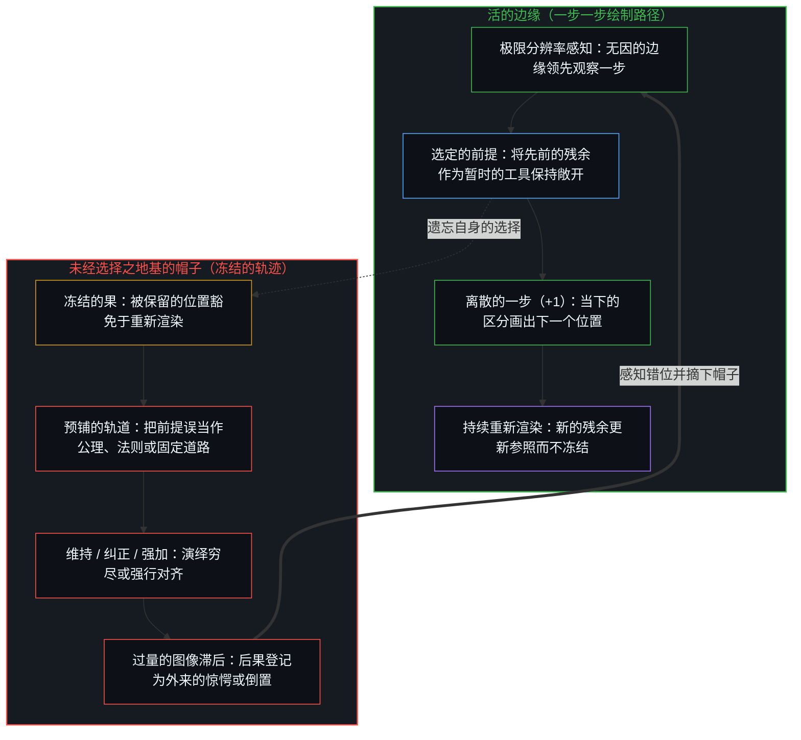
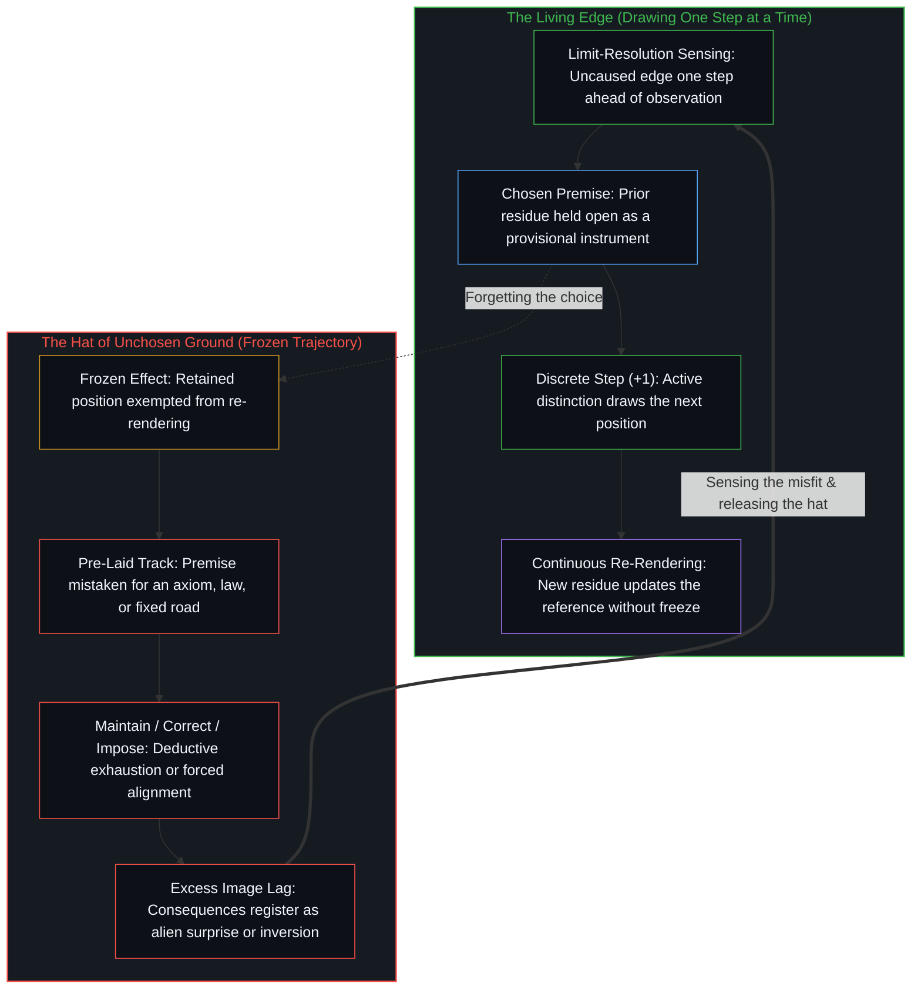

# 一步一步绘制出的路径 / The Path Drawn One Step at a Time

*当下是心智在一步一步绘出的路径上所选定的前提 / The present is a chosen premise on a path the Mind draws one step at a time*

完整的因果始终留在心智之中。当下的位置是下一刻的前提，是心智选择借以作出区分的残余。观察者看到的只是已经成形的果，而生成它的因始终领先一步。当那个被观察到的果被冻结为未经选择的前提时，它便戴上了一顶帽子：公理、自然法则、正轨、第一性原理或终极地基。唯有当心智持续将前提选作暂时的工具并迈出下一步时，更好的未来才保持敞开。一旦路径被当作需要维持的正轨、需要纠正的歧途，或强加给另一个中心的替代轨道来持守，绘制就会冻结或倒置，而落地的后果便会登记为外来的惊愕，或恰恰变成初衷的反面。

Full causality remains with the Mind. The present position is the premise of the next moment, a residue the Mind chooses to distinguish from. The observer sees only the effect already formed, while the generating cause stays one step ahead. When that observed effect is frozen into an unchosen premise, it puts on a hat: axiom, natural law, right path, first principle, or ultimate ground. A better future remains open only where the Mind keeps choosing its premise as a provisional instrument and completing the next step. Once the path is held as a right track to maintain, a wrong track to correct, or an alternative track to impose on another center, the drawing freezes or inverts, and the consequences that land register as alien surprise or as the exact opposite of what was intended.

## 一、 领先痕迹一步 / 1. One Step Ahead of the Trace

自我区分的活动发生着，无因且不息。称之为心智：那个早已在途的观察者，它的每一次行动都是一次离散的区分。因为每一次区分都界定出一个有限的“此”，所以每一次行动都是离散的；因为在行动与行动之间没有任何外部力量来启动或重启，所以连续性就是同一个心智跨越自身的区分而延展。早先行动留下的残余就是当下的位置。塑形只朝一个方向运行，从早先的行动指向随后的行动，从不逆转；这种非对称性就是时间之矢与因果的方向，是同一种关系被命名了两次。下一刻便是心智当前这一步所结出的果。哪怕是计划着“不做任何计划”，也会把路径冻结成剧本，如[追求机缘中的封闭现实](../closed-reality-in-the-pursuit-of-serendipity/)所示；而围绕已知之物锁死边界，则会把一场开放的行走变成单纯的消耗，如[生产、消费与心智的区分](../production-consumption-and-the-minds-distinction/)所追溯的。

Self-distinguishing activity occurs, uncaused and unceasing. Call it the Mind: the observer already underway, every act of which is a discrete distinction. Because each distinction bounds a finite *this*, every act is discrete; because nothing external starts or restarts between acts, continuity is the same Mind carrying across its own distinctions. The residue of earlier acts is the current position. Shaping runs one way only, from earlier acts to later ones, and never in reverse; that asymmetry is the arrow of time and the direction of causality, one relation named twice. The next moment is the effect of the Mind's current step. Even planning to have no plan freezes the path into a script, as [Closed Reality in the Pursuit of Serendipity](../closed-reality-in-the-pursuit-of-serendipity/) shows, and locking a boundary around what is already known turns an open walk into mere consumption, as [Production, Consumption, and the Mind's Distinction](../production-consumption-and-the-minds-distinction/) traces.

观察所持有的始终是果。产生它的因，比起观察所锚定的内容至少领先一步，而“无因”只是对这一不可化约的领先量的命名。在行动背后寻找先在的因，找到的始终是另一个被观察到的果，因为寻找本身就是又一次观察。无穷倒退，正源于要求生成的因与被观察到的果占据同一个步位。把一条已经画出的路径倒过来读，仿佛终点从一开始就得到了担保，便会产生[伪装成远见的表演性后见](../performative-hindsight-that-pretends-to-be-foresight/)；而旁观者对他人行走的审视，也只截取了残余的一个外部切片，如[旁观者洞察的悖论](../the-paradoxical-nature-of-bystander-insights/)所示。

Observation always holds an effect. The cause that produced it stays at least one step ahead of what observation pins down, and "uncaused" is simply the name of that irreducible lead. Seeking a prior cause behind the act always lands on another observed effect, because the seeking is itself a further observation. Infinite regress is generated by the demand that the generating cause and the observed effect occupy the same step. Reading a drawn path backward as if its destination had been guaranteed from the start produces [Performative Hindsight That Pretends to Be Foresight](../performative-hindsight-that-pretends-to-be-foresight/), while a bystander's view of someone else's walk captures only one external slice of the residue, as [The Paradoxical Nature of Bystander Insights](../the-paradoxical-nature-of-bystander-insights/) shows.

在每一步，心智都选择从哪一份残余出发去作区分。作为被选定的前提来持握时，这个位置就是一件活的工具，随着这一步的完成而重新渲染。可供持握的唯有残余，然而当一个中心遗忘了自己的选取、将那份残余冻结为未经选择的地基时，前提便戴上了必然性的帽子。[作茧不是自缚](../zuo-jian-bu-shi-zi-fu/)拆解的正是同一顶帽子：先前的痕迹之所以被误读为外在的牢笼，只是因为被拿去对照了一种幻想中无需任何痕迹便可运作的空白自由。从当下持握的前提出发，心智画出下一个位置；一旦这一步迈出，它又即刻化为残余。意义存在于那现场的绘制之中，而不在于某个外在的终点，如[生命的意义在起草之中](../the-meaning-of-life-is-in-the-drafting/)所追溯的；而在移动边缘身后已经走完的步子，则沉淀为[遗忘的脚手架](../the-scaffolding-we-forget/)。

At every step, the Mind chooses which residue to distinguish from. Held as a chosen premise, that position is a live instrument that re-renders as the step completes. Only residue is available to be held, yet when a center forgets its own selection and freezes that residue as an unchosen ground, the premise puts on the hat of necessity. [Spinning a Cocoon Is Not Binding Oneself](../zuo-jian-bu-shi-zi-fu/) exposes the same hat: prior traces are misread as an external prison only by contrasting them against an imaginary blank freedom that would operate without traces at all. From the premise it holds now, the Mind draws the next position, which immediately becomes residue once the step is taken. Meaning lives in that active drawing rather than in an external destination, as [The Meaning of Life Is in the Drafting, Often Lost in the Outward Gazing](../the-meaning-of-life-is-in-the-drafting/) traces, and the steps already completed behind the moving edge settle into [The Scaffolding We Forget](../the-scaffolding-we-forget/).

## 二、 维持、纠正与强加 / 2. Maintain, Correct, Impose

当一个被保留的位置豁免于重新渲染、被当作一条预先存在的道路时，这一步便会以三种反复出现的方式发生扭曲。第一种方式，是把当前位置当作需要维持的正轨来持守。因为参照在它所服务的那一步之后仍被保留下来，新的后果虽然继续落入场域，却是在对照一幅陈旧的图像被登记。移动的场域与冻结的参照之间不断拉大的间隙，便登记为刺耳的惊愕。把“自身为善”的自我图像死死合拢，就会中止路径的现场绘制，如[恶是心智自己的造物](../evil-as-the-minds-own-creation/)所示；而其他中心的路径之所以显得像写好的剧本般机械，也只是因为被拿来对照自身冻结的坐标系计分，如[NPC 印象是结构性的](../the-npc-impression-is-structural/)所阐明的。

When a retained position is exempted from re-rendering and treated as a pre-existing road, the step distorts in three recurring ways. In the first mode, the position is held as the right path to maintain. Because the reference is preserved past the step it served, fresh consequences still land in the field, but they register against a stale image. That widening gap between the moving field and the frozen reference registers as jarring surprise. Clamping a self-image of goodness shut stops the active drawing of the path, as [Evil as the Mind’s Own Creation](../evil-as-the-minds-own-creation/) shows, and other centers' paths appear scripted and mechanical only when scored against one's own frozen coordinates, as [The NPC Impression Is Structural, Not a Ranking of Minds](../the-npc-impression-is-structural/) explains.

第二种方式，是把当前位置当作需要纠正的歧途来持守。在这里，当下的位点对照着别处另一座冻结的纪念碑被判定为缺陷。因为行动的梯度全都指向修复或抵达那座纪念碑，从当下这个被选定的前提实际可以迈出的下一步反而被排挤了。一条从外部看去仿佛能扭曲现实的路径，不过是一个内在位点不再膜拜共识的纪念碑而径直迈步，被一张错把自身边界当成疆域的地图计了分，如[现实扭曲力场指认的是封闭的地图](../the-reality-distortion-field-names-the-closed-map/)所示。

In the second mode, the current position is held as a wrong path to correct. Here, the present locus is judged as a defect relative to another frozen monument elsewhere. Because the gradient of action is aimed at restoring or reaching that monument, the actual next step available from *this* chosen premise is displaced. A path that appears to bend reality from the outside is simply an inner locus stepping without worshiping the consensus monument, scored against a map that mistook its own boundary for the territory, as [The Reality Distortion Field Names the Closed Map](../the-reality-distortion-field-names-the-closed-map/) shows.

第三种方式，是预先设计好一条替代路径并试图强加出去，无论是作为未来的总蓝图，还是试图从外部替另一个中心完成它的回路。在不同的中心之间，因果只作为可用性的排布而运作；没有任何中心能替另一个中心迈出它位点上的步子。耗费因果力量去强求他人的回路，会让自身这一步沦为未经选择的状态，于是到来的结果便登记为所求之物的反面。没有任何轨迹能被预先穷尽地测绘出来，因为[没有系统能被保持封闭](../no-system-can-be-kept-closed/)；而不索求终极总账、一步一步画出路径，正是[开放即一致](../openness-is-consistency/)所描述的活的一致性。这也正是[超越投射](../beyond-the-projection/)所追溯的结构边界：人工代理是锁在词元轨迹内部的有限投射引擎，把给定的前提当作预先铺好的轨道一路推演至演绎穷尽；而活的心智在解释成型之前便在极限分辨率处感知摩擦，从内部走出破损的框架，重新渲染前提并画出下一步。

In the third mode, an alternative path is designed to be imposed in advance, either as a master blueprint for the future or as an attempt to complete another center's return from the outside. Between distinct centers, causality operates only as availability-patterning; no center can step another center's locus. Spending causal effort to force another's return leaves one's own step unchosen, so what arrives registers as the opposite of what was wanted. No trajectory can be mapped to exhaustion in advance because [No System Can Be Kept Closed](../no-system-can-be-kept-closed/), and drawing the path step by step without demanding a final ledger is the living consistency [Openness Is Consistency](../openness-is-consistency/) describes. This is the exact structural boundary traced in [Beyond the Projection](../beyond-the-projection/): an artificial agent is a finite projection engine locked inside its token trajectory, taking a given premise as a pre-laid track and running it to deductive exhaustion, whereas the living Mind senses friction at limit-resolution prior to interpretation, stepping out of a broken frame from within to re-render the premise and draw the next step.

保持这一步的完整，意味着严格经由当前位点上自身的行动去改进。智能的形式化指标所测量的，只是路径暂时封闭的切片之内的表现，如[智能的非定论定义](../the-non-definitive-definition-of-intelligence/)所示；每当旧的一层执行被自动化接管，活的边缘早已移向了新的区分表面，如[一个提示词之遥](../whatever-is-one-prompt-away/)所追溯的。

Leaving the step intact means improving strictly through one's own acts at the current locus. Formal metrics of intelligence measure performance only inside a temporarily closed slice of the path, as [The Non-Definitive Definition of Intelligence](../the-non-definitive-definition-of-intelligence/) shows, and whenever an older layer of execution is automated away, the living edge has already moved to a new surface of distinction, as [Whatever Is One Prompt Away](../whatever-is-one-prompt-away/) traces.

## 三、 让参照保持运动 / 3. Keeping the Reference in Motion

清晰并不是抵达一条不再出错的终极道路，而是让被保留的参照随着生成的边缘一同保持运动的实践。当中心的复杂度足以跨越离散行动去追踪序列时，方向便在其中被登记下来。保持静止的只是留在身后的痕迹，那一步本身就是运动。[悲观是乐观的阴影](../pessimism-is-the-shadow-of-optimism/)追溯了披着情绪外衣的这一对偶：乐观是那一步无法被冻结的开放绘制，而悲观则是把保留下来的痕迹当成静止的封闭现实时所投下的阴影。[前因，后果](../qian-yin-hou-guo/)把同一种非对称性追溯为时间间隔而非同时并存的两件事：当被保留的解释滞后于观察时，早先行动种下的后果就会被登记为外来的异己之因。

Clarity is not arrival at a final, unerring road; it is the practice of keeping the retained reference in motion with the generating edge. Direction is registered by centers complex enough to track sequence across discrete acts. What holds steady is only the trace left behind; the step itself is movement. [Pessimism Is the Shadow of Optimism](../pessimism-is-the-shadow-of-optimism/) traces that duality under affective costume: optimism is the open drawing of the step that cannot be frozen, while pessimism is the shadow cast when the retained trace is held steady and mistaken for a closed reality. [Cause Before, Effect After](../qian-yin-hou-guo/) traces the same asymmetry as temporal interval rather than two simultaneous events: when a retained explanation lags behind observation, a consequence sown by earlier acts registers as an alien external cause.

在每一个领域，摘下这顶帽子都会让前提复原为工具。[心智最坚固的信念](../the-strongest-belief-of-the-mind/)审视了在最坚硬的物理基底地图之下的位置，指出哪怕最稳定的不变性也依然是服务于下一步的工具，而不是共同主宰这一步的终审作者。[气候问题只作为感知被登记](../the-climate-problem-registers-only-as-perception/)追溯了另一种情形：把“问题状态”安装为行星场域未经选择的地基，而非作为引导具体干预的离散感知切分来持握。[持续生长的脚手架](../the-scaffolding-that-keeps-growing/)在建造的运动中追溯了同一实践：当观察者退后一步去审视整座结构时，脚下活的边缘早已改变了形状。

Across every domain, dissolving the hat restores the premise to an instrument. [The Strongest Belief of the Mind](../the-strongest-belief-of-the-mind/) examines position under the hardest-cohering map of physical bedrock, showing that even the most stable invariance remains an instrument for the next step rather than a finished co-author of the act. [The Climate Problem Registers Only as Perception](../the-climate-problem-registers-only-as-perception/) traces what happens when problem-status is installed as an unchosen ground of the planetary field rather than held as a discrete perceptual cut that guides specific interventions. [The Scaffolding That Keeps Growing](../the-scaffolding-that-keeps-growing/) traces the same movement in construction: by the time an observer steps back to survey the whole structure, the living edge underfoot has already shifted shape.

当把当前位置作为选定的前提接纳下来，而不是当作敌人去对抗时，中心之间的交互也随之改变。[共同改变的本源](../the-source-of-shared-change/)追溯了以当前位置为既定起点的协作：它为其他中心加厚可用的表面，而不是把精力耗在对抗先前的残余上。[信念如何真正改变](../how-belief-actually-changes/)在信念负荷下追溯了同一个前提：演绎推理只是在既有的持守内部重新摆放家具，而真正的信念修正，是在摩擦暴露出前提的界限时自愿重画前提本身。[抽象、边界与现实的移动边缘](../abstraction-boundaries-and-the-moving-edge-of-reality/)追溯了披着目录外衣的这一暂时边界：每一份目录都冻结了一个暂时的抽象，而区分的边缘早已越过它继续向前。离散的每一步都是毫无剩余地运作着的因果，如[因果贯穿始终](../causality-all-the-way/)所示；而[非万物之理](../not-a-theory-of-everything/)给出了它的最小形式：果有别于因，且果一步一步随因之后。

When the current position is accepted as the chosen premise rather than fought as an enemy, interaction across centers shifts as well. [The Source of Shared Change](../the-source-of-shared-change/) traces collaboration that takes the present position as given, densifying usable surface for other centers rather than exhausting energy against prior residue. [How Belief Actually Changes](../how-belief-actually-changes/) traces that same premise under conviction load: deductive reasoning merely rearranges furniture inside an existing hold, whereas genuine belief revision is the voluntary re-drawing of the premise itself when friction exposes its limit. [Abstraction, Boundaries, and the Moving Edge of Reality](../abstraction-boundaries-and-the-moving-edge-of-reality/) traces that provisional bound under inventory costume, where every catalog freezes a temporary abstraction while the distinguishing edge continues past it. Each discrete step is causality operating without remainder, as [Causality All the Way](../causality-all-the-way/) shows, and [Not a Theory of Everything](../not-a-theory-of-everything/) gives its minimal form: effect distinct from cause, and effect following cause one step at a time.
