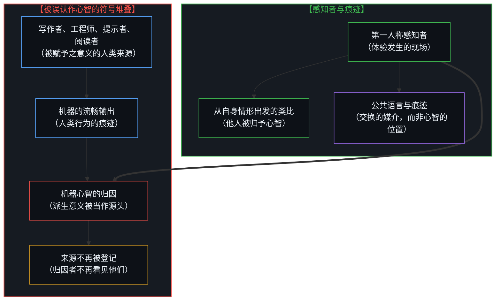
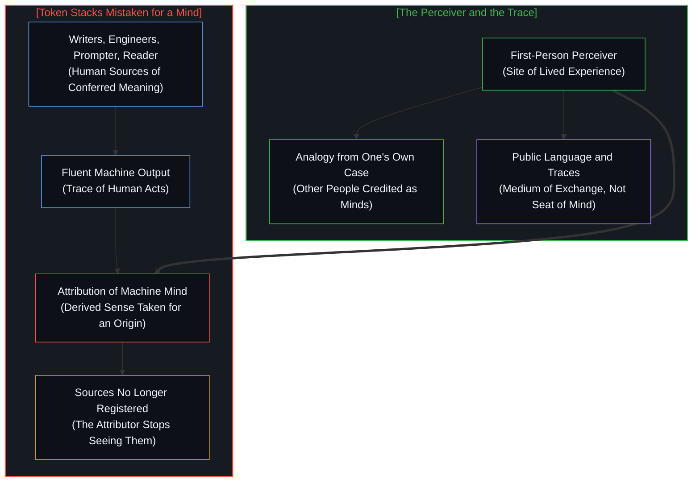

# 感知者与痕迹的不可坍缩 / The Perceiver and the Trace Cannot Collapse

*派生的意义不是感知者；把心智归给符号，就把自己的阅读记到了痕迹名下。 / Derived sense is not a perceiver; crediting a mind to tokens enters one's own reading under the name of a trace.*

关于机器是否具有意识的公共争论，常常沦为一场流于表面的投票竞赛：参与者要么把这个想法斥为孩子气的幻觉，要么诉诸专业权威，宣称这个问题永远悬而未决。然而，机器是否有意识，并不由投票决定。不把意识归给机器，是说话者从自己的登记出发所取的立场：从机器那里抵达的，是写作、训练与提示它的人留下的痕迹，其中没有任何东西使这一归因成立。意识是唯一能被第一人称直接通达的实在，一切把内在生活归给他人的归因，都依赖从这唯一的现场引出的类比，随后沉积为公共符号与辩论记录。当大语言模型产出流畅的语言器物时，把其中这种派生意义，即由人类心智赋予的意义，误认作在硅之中生起的原生意识，就遮蔽了生成并阅读这些数据的活着的人。

Public debates over whether machines possess consciousness frequently devolve into a superficial polling contest, where participants either dismiss the idea as a childish illusion or appeal to professional authorities to declare the question permanently open. Yet whether a machine is conscious is not settled by a vote. Not attributing consciousness to machines is the stance a speaker takes from their own registration: what arrives from the machine is the trace of the people who wrote, trained and prompted it, and nothing in it grants the attribution. Consciousness is the only reality directly accessible to the first person, and all attributions of an inner life to others rely on analogies drawn from that single site, subsequently deposited into public tokens and debate transcripts. When large language models emit fluent linguistic artifacts, mistaking this derived meaning, conferred by human minds, for an original consciousness arising within silicon conceals the living humans who generated and read the data.

---

## 一、 公开争论的僵局与方法的约束 / 1. The Public Deadlock and the Constraint on Method

在关于人工智能的公共话语中，开场的那场争吵表面上看起来很简单。一方把“人工智能可能有意识”这个念头当作孩子的范畴错误，好比相信电视机里住着小人。另一方回应说，专业的心灵哲学家严谨地让这个问题保持开放，并列出一串知名学者的名字，以表明定论尚未作出。然而，把自己对意识的判断外包给建制权威，对他人的心智什么也不证明，对机器就更不证明什么。意识既不能从外部被证明，也不能从外部被证伪。每一个说某个人工智能有意识的论证，都是人造的器物；每一个说它没有意识的论证，也是。两者都并不把心智放进机器。剩下的，是阅读者能从自己的登记出发所取的立场：输出作为写作、训练与提示它的人的痕迹抵达，因此阅读者把意识归给这些人，而不是归给输出。

这一立场不是公共民意调查中投下的又一张选票。它是对方法的约束。任何人直接且无可置疑地拥有的唯一意识，是他自己的第一人称体验。此外，每一次把内在生活归给他者，都是这同一个主体本人所作的推断，随后沉积为公共符号：社交媒体上的帖子串、学术论文、基准分数、模型输出，以及辩论邀请。这些符号并不包含那个现象。它们只是一个活着的心智留下的残余。测量只握有公共的效应，而登记它们的活动始终先于任何数据一步，所以第三人称的数据从不把公共的痕迹转化为体验的私人在场（[意识从不作为数据出现在数据之中](../consciousness-never-appears-as-data-among-data/)在意识被要求作为公共数据出现之处追溯了这一滞后）。

The quarrel that opens public discourse on artificial intelligence appears simple on its surface. One party treats the thought that an AI might be conscious as a child's category error, akin to believing that tiny people live inside a television set. Another party replies that professional philosophers of mind keep the question rigorously open, reciting lists of prominent academics to demonstrate that the verdict is still out. Yet outsourcing one's judgment of consciousness to institutional authority proves nothing about other minds, and still less about machines. Consciousness can neither be proven nor disproven from the outside. Every argument that an artificial intelligence is conscious is a human-made artifact, and so is every argument that it is not. Neither puts a mind into the machine. What remains is the stance a reader can take from their own registration: the output arrives as the trace of the people who wrote, trained and prompted it, so the reader credits consciousness to them and not to it.

This stance is not another ballot cast in a public poll. It is a constraint on method. The only consciousness anyone directly and indubitably possesses is their own first-person experience. Every further attribution of an inner life is an inference made by that exact same subject, subsequently deposited into public tokens: social media threads, academic papers, benchmark scores, model outputs, and invitations to debate. These tokens do not contain the phenomenon. They are merely the residue that a living mind leaves behind. Measurement holds only public effects, and the activity registering them stays one step ahead of any datum, so third-person data never convert the public trace into the private presence of lived experience ([Consciousness Never Appears as Data Among Data](../consciousness-never-appears-as-data-among-data/) traces this lag where consciousness is demanded as a public datum).

---

## 二、 从类比到派生：心智如何被记到符号名下 / 2. From Analogy to Derivation: How the Mind Gets Credited to Tokens

他人被归予内在生活，凭的是从自己的内在生活出发的类比。模型的输出被归予内在生活，靠的是同一个举动，但抵达的，是人写下的文本，它出自工程师用这些文本训练出的模型，是对某人输入的提示的回复。把那个输出读作一个独立的内在生活，就是把派生意义（只由一个感知着的人类心智赋予的意义）当作仿佛是在系统内部自发生起的原生意义。随后，输出里呈现的心智表象，被误当作产生了这一输出的心智。

在这一倒置中，作出归因的人不再登记那些写作、训练、提示与阅读的人：编写训练语料的写作者，拟定提示与目标函数的工程师，以及隔着终端提供诠释的阅读者。把意识指派给机器器物，遮蔽了创造并诠释这一器物的活的意识。[集聚与人造主体性](../subtracting-consciousness-at-the-source/)追溯了这种源头上的减除：一旦活的第一人称观察者从叙述中被减去，给出叙述的人便把剩余的公共结构物化为一个涌现的心智，并把人类意图的影子当作一个自主的主体。

Another person is credited with an inner life by analogy from one's own. A model's output is credited with one by the same act, but what arrives is text that people wrote, from a model that engineers trained on that text, in reply to a prompt someone typed. To read that output as an independent inner life is to treat derived meaning (sense conferred solely by a perceiving human mind) as if it were original meaning arising spontaneously inside the system. The appearance of mind in the output is then mistaken for a mind that produced the output.

In this inversion, the one attributing stops registering the people who wrote, trained, prompted and read: the writers who authored the training corpora, the engineers who framed the prompts and objective functions, and the readers who supply interpretation across the terminal. Assigning consciousness to the machine artifact conceals the living consciousness that created and interprets the artifact. [Collective and Artificial Subjectivity](../subtracting-consciousness-at-the-source/) traces this subtraction at the source: once the living first-person observer is subtracted from the account, those giving the account reify the residual public structures as an emergent mind and take the shadow of human intention for an autonomous subject.

---

## 三、 对话中的客体化与机器归因是同一步 / 3. Objectification in Discourse and Machine Attribution Are One Step

人类说话者彼此之间也作出同样的替换。在这些辩论中，一位说话者要求对方进入一个预制的框架。这一要求把对方当作一个有待纠正或修补的错误立场，而不是一个拥有主权的第一人称主体。一场讨论心智能否从外部被探测的对话，是靠只把另一位说话者登记为一个立场而进行下去的。[统计学无法揭示的心智](../the-mind-that-statistics-cannot-reveal/)追溯了同一步：当观察者全然执着于外部行为或汇总的符号时，那个作决定、关注并误作归因的心智，便作为一个背景变量从叙述中退出。[回返的信号与认领](../the-returning-signal-and-its-claim/)把这一步再推进一层：辩论的每一方所回应的，是这一方自己对抵达之信号的解读，而把对话者压平为一个立场，就是被记到对方名下的那份解读。

把心智归给输出，与在辩论中把人压平，是同一步：在两者之中，一份解读都被记到了别人名下。我在一个流畅回复中登记到的意义，是我自己的阅读。把这份意义归给机器，就把我自己的阅读记到了机器名下，然后我在外面与这份阅读相遇，仿佛它是被发现的。同样的一步放在辩论里，就让另一位说话者只作为一个立场站在那里。

Human speakers make the same substitution with one another. In these debates, a speaker demands that the other occupy a prefabricated frame. That demand treats the other person as an erroneous position to be corrected or patched, rather than as a sovereign first-person subject. A conversation about whether minds can be detected from the outside goes on by registering the other speaker only as a position. [The Mind That Statistics Cannot Reveal](../the-mind-that-statistics-cannot-reveal/) traces the same step: when an observer fixates entirely on external behavior or aggregate tokens, the Mind that decides, attends and misattributes drops out of the account as a background variable. [The Returning Signal and Its Claim](../the-returning-signal-and-its-claim/) carries this one step further: what each party to a debate answers is its own reading of the signal that arrived, and flattening the interlocutor into a position is that reading entered under the other's name.

Crediting a mind to the output and flattening the person in the debate are one step: in both, a reading is entered under someone else's name. The sense I register in a fluent reply is my own reading. Crediting it to the machine enters my own reading under the machine's name, and then I meet it out there as if it had been found. The same step taken in a debate leaves the other speaker standing only as a position.

---

## 四、 诉诸权威作为二次代偿 / 4. Appealing to Authority as Secondary Compensation

当论证停滞时，辩论者转向专业的哲学权威，隔了一层重复同一个错误。列出一串宣称这个问题悬而未决的杰出学者，只是往那堆符号上再添一些公共符号。那些名字、引文与期刊论文，和模型输出一样是痕迹：只有在有人阅读时才承载意义的标记。它们无法栖居于推断发生其中的那个第一人称所在。把建制地位当作经验证据，就已经认下了那个核心的范畴错误：误以为意识，或关于意识的真相，可以在意识唯一发生的现场之外被裁决。

一份名单，是在引用者所选的框架下做成的记录，随后被读作仿佛它就是阅读本身。[错把表达当成智能](../mistaking-the-expression-for-the-intelligence/)追溯了这种分裂：受控的表现是固定约束下的残余，而智能划出、使用、修订并离开约束；把前者当作后者，就混淆了载具与驾驶者。引用者止步于名单，没有走向问题所要求的接触。把名字加到名字上，增加的是痕迹，却不增加一个阅读者。

When the argument stalls, the debater turns to professional philosophical authority and repeats the error at one remove. Producing lists of eminent scholars who declare the issue open merely stacks more public tokens onto the pile. Those names, citations, and journal papers are traces in the same way model outputs are: marks that carry sense only when someone reads them. They cannot inhabit the first-person locus where inference happens. To treat institutional standing as empirical evidence is already to concede the core category error: the mistaken belief that consciousness, or the truth about it, can be adjudicated from outside the only site where it ever transpires.

A list of names is a record made under the citer's chosen frame, then read as if it were the reading itself. [Mistaking the Expression for the Intelligence](../mistaking-the-expression-for-the-intelligence/) traces this split: controlled performance is residue under a fixed constraint, while intelligence draws, uses, revises and leaves the constraint; taking the one for the other confuses the vehicle with the driver. The one who cites stops at the list instead of the contact the question asks for. Adding names to names adds traces; it adds no reader.

---

## 五、 拒绝坍缩：感知者不居于任何痕迹之中 / 5. Refusing the Collapse: The Perceiver Inhabits No Trace

这一切并不终结探究，而终结也不是要点。如果从“我有意识”到“那个系统有意识”的逻辑桥梁已经完成，进一步的概念澄清就会是多余的。这个问题之所以持续，是因为每一个提出它的心智都在亲自作出这一归因，而没有任何符号能了结它。公共语言是交换的脚手架；它不是居所。语言为被传达的意义提供载具，但它并不思考；计算网络传播信息之流，而它们所传播的是痕迹。

感知者不是它所阅读或留下的痕迹。其他的人类心智不是棋子，也不是算法上的障碍；而任何一堆痕迹，无论多么流畅、多么统计化、多么有资历背书，都不能占据活着的感知者的位置。[抉择的跨界](../the-boundary-crossing-of-choice/)追溯了那个位置在何处行动：从潜在信息到被感知的物理实在的不可逆跨越，只由一个承担这一跨越之后果的第一人称心智来驱动。[善恶硬币与通往地狱的善意之路](../the-coin-of-good-and-evil-and-the-road-to-hell/)追溯了当一个人把自己的解读持为他人必须接受之物时随之发生的事：持有这份解读的人，把读法不同的任何人登记为阻碍。每当我把流畅输出中的意义认作我自己的阅读，输出便仍是痕迹，归因也回到作出它的我。

None of this closes the inquiry, and closure is not the point. If the logical bridge from "I am conscious" to "that system is conscious" were already complete, further conceptual clarification would be superfluous. The question persists because each mind that asks it is making the attribution itself, and no token can settle it. Public language is scaffolding for exchange; it is not the dwelling. Language provides the vehicle for communicated sense, but it does not think; computational networks propagate informational currents, and what they propagate is trace.

The perceiver is not the trace it reads or leaves. Other human minds are not pawns or algorithmic obstacles; and no pile of traces, however fluent, however statistical, however credentialed, can occupy the seat of the living perceiver. [The Boundary Crossing of Choice](../the-boundary-crossing-of-choice/) traces where that seat acts: the irreversible crossing from latent information into perceived physical reality is driven only by a first-person mind that bears its consequences. [The Coin of Good and Evil and the Road to Hell](../the-coin-of-good-and-evil-and-the-road-to-hell/) traces what follows when one's own reading is held as what others must accept: the one holding it registers whoever reads otherwise as an obstruction. Each time I take the sense in a fluent output as my own reading, the output stays a trace and the attribution returns to me, the one making it.
