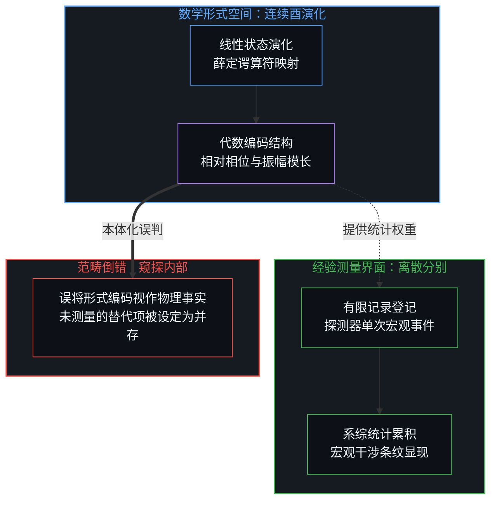
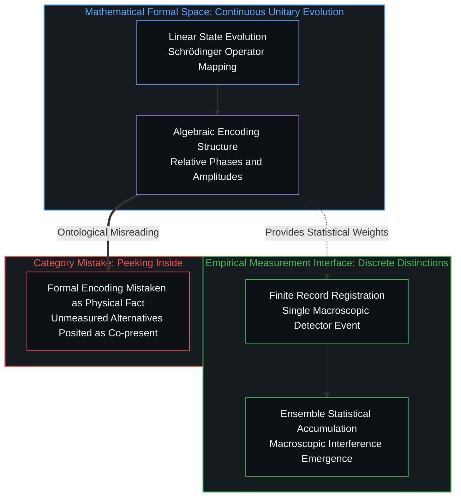
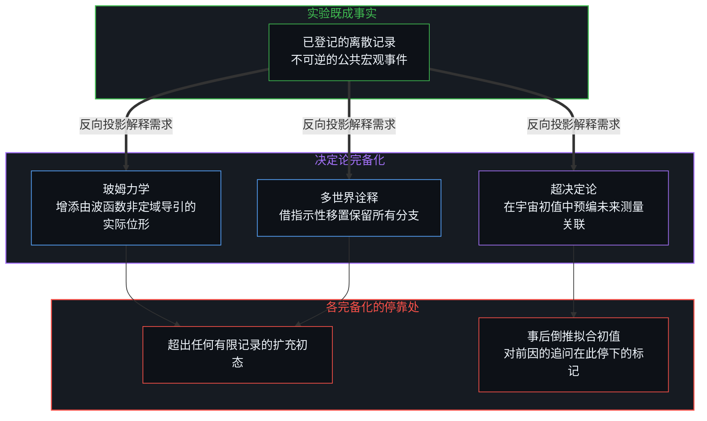
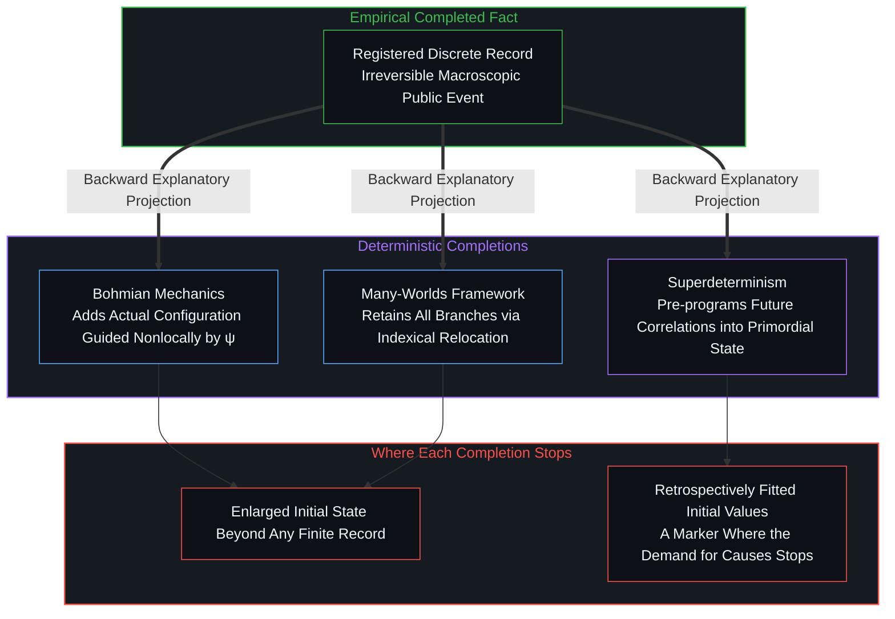
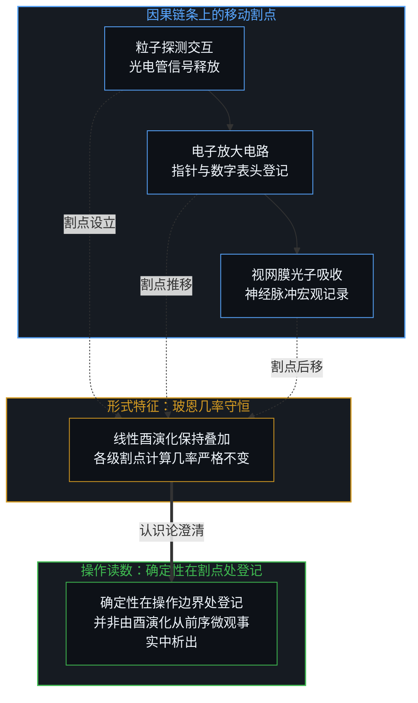
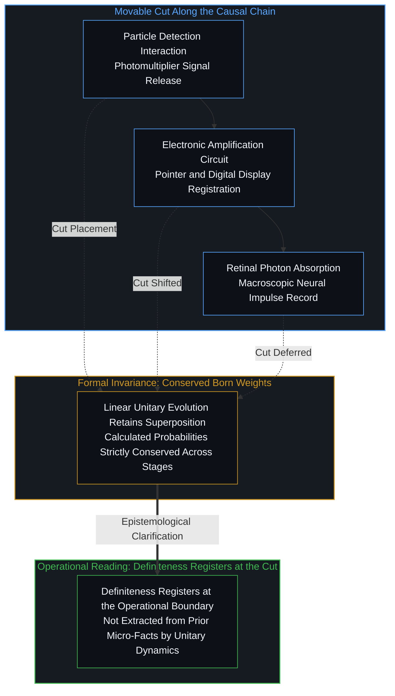

# 算符的潜无限与记录的有限边界 / The Potential Infinity of Operators and the Finite Horizon of Records

*波函数是复现干涉的相位编码，而非已被穷尽的实存全称 / The wave function encodes phase for interference rather than an exhausted physical totality*

量子力学表面上的诡异，并不源自可观测现象的内在反常，而源自理论理想化与现实中可数记录的有限性之间一种持续的混淆。当分析者将复现干涉所必需的相位代数编码，误判为在测量之前就已并存的物理替代项，心智便在没有记录显示物理替代项并存的微观尺度上读出了一个谜。

The apparent strangeness of quantum mechanics arises not from an intrinsic anomaly in observable phenomena, but from a persistent conflation between theoretical idealizations and the finite character of countable records in reality. When analysts mistake the algebraic encoding of relative phases, required to reproduce interference, for physical alternatives co-present prior to measurement, the mind reads a mystery into a micro-scale where no record shows co-present physical alternatives.

## 一、 相位编码与系综干涉的本体误判 / 1. Phase Encoding and the Ontological Misreading of Ensemble Interference

正如心智中未曾表达的心念外人无从得知，一旦开口发声便如泼出的水，成为不可逆的公共事件，在接触界面上由接纳者登记；测量记录同样如此，一经登记即为公共的、不可逆的。量子态的线性演化在其自身形式系统内是确定的：给定某一阶段完整的形式描述，后续每个阶段都随之有唯一的状态。然而，当这种描述呈现为叠加态时，它本身并不包含唯一的记录。分析者手中只有已登记的记录，却想窥探未测量的状态内部，这正是量子诡异这一首要错觉的起点。测量不是被动检视某种预存的隐藏实在，而是观察者以仪器划定界限、确立一个可数分别的行动；将记录的显现视为需要某种新物理诠释去拯救的客观谜题，颠倒了分别行动与其所生记录的先后次序。

Just as thoughts held privately within a mind remain inaccessible to others, once spoken aloud they become irreversible public events like water cast from a basin, registered by the receiving observer at the boundary of contact; a measurement record is public and irreversible in the same way. The linear evolution of the quantum state is deterministic within its own mathematical terms: given a complete formal description at one stage, a unique state follows at every subsequent stage. Yet that description, when taking the form of a superposition, does not itself contain unique records. Holding only the registered record, the analyst seeks to peek inside the unmeasured state, and this is where the primary illusion of quantum weirdness starts. Measurement is not the passive inspection of a pre-existing hidden reality, but an observer's act of drawing a boundary with an apparatus to establish a countable distinction; treating the record's emergence as an objective enigma that a new physical interpretation must rescue inverts the order of the distinguishing act and the record it produces.

波函数所包含的振幅，其相对相位是复现干涉条纹所必需的数学工具，其模长平方则提供了不同替代记录的统计权重。干涉条纹在大量事件汇总的系综图景中被观察到，相互排斥的多种分支记录在单次实验中并存的景象，从未被任何仪器捕获。因此，叠加态是编码图案所需相位关系的最小形式代数工具，而非宣称那些互斥的替代项已作为完成的物理事实并存。把对权重的操作性编码误认为一个分叉的物理实在，是把一项运算的内容当作有限记录已经交付的事实。正如在[对象是被稳定化的关系](../objects-are-stabilized-relationships/)中所梳理的，客体并非孤立存在，而是在互动中被稳定下来的关系结构。

The amplitudes carried by the wave function possess relative phases required to reproduce interference, while their squared moduli supply the statistical weights of alternative records. Interference is observed across ensemble patterns accumulated over numerous events; the co-presence of mutually exclusive branch records is never captured in any single experiment. The superposition therefore functions as the minimal formal algebraic device encoding the phase relations needed for the pattern, not as an assertion that mutually exclusive alternatives are co-present as completed physical facts. Mistaking an operational encoding of weights for a branching physical reality reads the content of a calculation as if finite records had already delivered it. As traced in [Objects Are Stabilized Relationships](../objects-are-stabilized-relationships/), physical entities are not self-contained substances, but relational structures stabilized through interaction.

## 二、 决定论完备化的初值停靠与超决定论的事后插桩 / 2. Initial-Condition Halts in Deterministic Completions and Retrospective Staking in Superdeterminism

确定的记录只在引入额外的选择操作时才会显现。无论不同诠释将这一操作安放在波函数坍缩、观察者在分支中的自我定位，还是实际初始位形之中，线性映射自身都从不执行它；真正执行它的坍缩模型改变了映射，这可由实验检验。线性酉映射保留了所有的展开分量。一旦记录被赋予，后续的计算便能单以对应的分量为基准确定地推进，然而这一赋予的行为始终游离于映射之外。决定论完备化试图恢复一条全程确定的演化，而这只能靠扩充被算作完整状态的范围：要么引入由位形空间场导向的隐变量轨迹，要么宣称所有平行分支在实在层面具有同等地位。

Definite records appear only when an additional selection is imposed. Whether different interpretations place this operation in a collapse, in the observer's location within a branch, or in the actual initial configuration, the linear map itself never performs it; collapse models that do perform it change the map, which experiment can test. The linear unitary map retains every expansion component. Once a record is granted, subsequent calculation proceeds deterministically from the corresponding component alone, yet the act of granting remains outside the map. Deterministic completions attempt to restore a fully fixed evolution only by enlarging what is counted as the complete state, either by introducing hidden trajectories guided by a field on configuration space, or by declaring every parallel branch equally real.

这些扩充在形式体系上能够自洽闭合，却未能从有限观测所能提供的先前局部事实中推导出具体记录。在玻姆力学中，每个粒子的速度经由位形空间上的波函数取决于其余所有粒子的实际位置；在多世界构架中，观测到的唯一性被移置为观察者占据哪个分支的指示性事实。两者都只相对于一个扩充状态维系决定论，这一状态包含任何实际的有限记录序列都从未分辨出的要素。同样的逃逸缝隙出现在定域隐变量方案中：受制于贝尔不等式的限制，为定域隐变量保留的常见途径是超决定论（另一条是逆因果模型），即在宇宙初始条件中预先编织隐变量与未来测量设定之间的协同关联。正如在[确定性是微观不确定性的统计签名](../determinism-is-the-statistical-signature-of-micro-indeterminism/)中所指出的，宏观决定论并非微观层面的本体前提，而是微观不确定性在统计汇聚下呈现的签名。

These enlargements succeed formally, yet they fail to derive the particular record from prior local facts that finite observation can supply. In Bohmian mechanics, each particle's velocity depends on the actual positions of all others through a wave function on configuration space; in the Everettian framework, observed uniqueness is relocated to an indexical fact concerning which branch the observer occupies. Both preserve determinism only relative to an enlarged state that includes elements never resolved by any actual sequence of finite records. The same evasive gap appears in local hidden variables: bounded by Bell inequalities, the remaining route usually taken for local hidden variables is superdeterminism (retrocausal models are the other), which embeds correlations between hidden variables and future detector settings directly into primordial initial conditions. As shown in [Determinism is the Statistical Signature of Micro-Indeterminism](../determinism-is-the-statistical-signature-of-micro-indeterminism/), macroscopic determinism is not an ontological micro-premise, but an emergent statistical signature over micro-indeterminism.

此类原初关联并非由中间环节的定域动力学生成，而必须在宇宙源头就已存在。这种构造在机制上是事后追溯式的：一旦实验记录与仪器设定已被登记，分析者总能逆向推算出一组契合结果的初始数值。这种构造并未从早期原因中取出数值，而是为了维持因果闭合把数值插进去，直至模型停留在必须预先与未来测量设定相关联、才能复现观测统计的初值数据上；每一种决定论完备化都停在初值上（在玻姆力学与多世界中，是扩充状态的初值），超决定论多出的一步是这些初值预先契合了测量设定。这种停顿并非决定论的动力学胜利，而是对前因的追问被允许停下的一个任意标记。

Such primordial correlations are not generated by intervening local dynamics; they must already be present at the origin. The construction functions retrospectively: once records and settings are registered, analysts can always reverse-engineer initial values matching the outcome. This construction does not extract values from earlier causes but inserts them to preserve causal closure, halting at initial data that must already be correlated with future settings in order to reproduce the observed statistics; every deterministic completion halts at initial data (for Bohm and Everett, the initial data of the enlarged state), and what superdeterminism adds is that the data anticipate the settings. This pause is not a dynamical triumph of determinism, but an arbitrary marker where the demand for prior causes is allowed to stop.

## 三、 冯·诺依曼割点的移动性与概率不变性 / 3. The Mobility of the von Neumann Cut and the Invariance of Probabilities

冯·诺依曼割点的任意移动性进一步印证了这种结构。将记录视为确定事实的界限，可以沿着后续因果链条任意推移，从粒子探测器的光电倍增管、仪器的放大电路，一直推延至视网膜与神经信号的宏观交界面。无论割点设立在何处，计算所得的几率在此平移下保持不变，因为直到所选阶段的线性演化依然输出叠加态，而玻恩规则给出的权重在数学上始终守恒。即便引入环境退相干机制，非对角项在指针基底下的快速衰减解释了哪一组基底能承载稳定记录，以及相干性弥散入环境后它们之间的干涉为何在局部统计中隐没；在全系统的酉演化构架下，约化密度矩阵依然是不当混合，并未在动力学上为任何单次运行挑选出唯一的记录；操作割点的确立，依旧是登记一项公共事实不可或缺的条件。确定性在选定的割点处登记，而非在割点之前：在哪里切分是选定的，登记下哪一个记录则不是。在[割点可移不可除](../the-cut-moves-but-never-vanishes/)与[意识归属与量子割点](../consciousness-ascription-and-the-quantum-cut/)中，这一操作被追溯为不可商议的：观察边界可以后撤，但做出切分的行为始终是任何可理解记录不可或缺的先决条件；正如对大模型参数链条的审视所表明的，因果链条内部从无自发停机符，割点由此成为一道必要的操作边界：对其他观察者而言，它没有给他们所登记的东西增添任何实体；对划界者自身而言，正是它让任何现象得以登记。

This structure is reinforced by the mobility of the von Neumann cut. The stage at which one treats records as already definite can be shifted arbitrarily far along the subsequent causal chain, from the particle detector and electronic amplifiers to the human retina and neurological registers. The calculated probabilities remain invariant under this shift, because the linear evolution up to any chosen stage still yields a superposition, and Born weights are preserved throughout. Even when appealing to environmental decoherence, the rapid suppression of off-diagonal elements accounts for which basis can carry stable records and why interference between them vanishes from local statistics, as phase coherence spreads into the environment; within the unitary evolution of the combined system and environment, the reduced density matrix remains an improper mixture, failing to dynamically single out a unique record in any individual run. The establishment of an operational cut remains the indispensable condition for registering a public fact. Definiteness registers at the chosen cut rather than before it: where to cut is chosen, which record registers is not. In [The Cut Moves but Never Vanishes](../the-cut-moves-but-never-vanishes/) and [Consciousness Ascription and the Quantum Cut](../consciousness-ascription-and-the-quantum-cut/), this operation is traced as non-negotiable: while the boundary can be pushed backward, the act of making a cut remains the indispensable prerequisite for any intelligible record; just as with parameter scaling hierarchies in neural networks, causal chains possess no internal stopping flag, rendering the cut a necessary operational boundary that adds no entity to what other observers register, while for the one who draws it, it is what lets any phenomenon register at all.

在链条的任何位置，观察者都可以通过倒推初值编织出自洽的决定论叙事。这种叙事能在任何割点讲成，这一点什么也没有增添；表明没有哪个位置能从前序微观要素中必然析出特定记录的，是割点无论置于何处玻恩几率都保持不变。在酉演化之内，这一不变性意味着链条中没有哪一环内生出单次事实；单次事实在操作边界处登记，随后被反向投射为预先注定的历史。这进一步暴露出把模型当作宇宙立法的那一步，恰如[“物理学才是定律”的障眼法](../the-sleight-of-hand-in-physics-is-the-law-and-the-friction-of-reality/)所指出的，定律并非支配事物的指令，而是在边界约束下取得的稳定读数。

At any stage along the chain, an internally consistent deterministic narrative can be manufactured by reverse-engineering initial data. That such a story can be told at every placement adds nothing; what shows that no stage compels the record is that the Born weights stay the same wherever the cut is placed. Within unitary dynamics, that invariance means no stage of the chain generates the particular fact; it registers at an operational boundary and is retroactively projected as predetermined history. This exposes the step of treating models as cosmic legislation, echoing the critique in [The Sleight of Hand in "Physics Is the Law"](../the-sleight-of-hand-in-physics-is-the-law-and-the-friction-of-reality/): formal laws are not commands governing things, but stabilized readings taken under boundary constraints.

## 四、 潜无限的解析便利与实无穷的本体僭越 / 4. The Analytical Utility of Potential Infinity and the Ontological Usurpation of Actual Totality

这种倒置投影之所以有说服力，是因为理论表述普遍借用了实无穷全称这一理想化构件，包括拥有无限精度的连续统点位、位置与动量这类具有连续谱的算符，以及在无穷多个分量上承载精确振幅的波函数。这些理想化形式允许构建出封闭、确定性的微分方程，能够以高精度匹配观测频率。然而，它们的效用建立在潜无限之上：对于已经达成的任何有限分辨率，进一步的细分始终可以设想，也有实际用处。正如在[潜无限与数学思维的暂时闭合](../potential-infinity-and-the-temporary-closures-of-mathematical-thought/)中所深究的，潜无限是思维敞开的生成能力，而实无穷则是一次暂时闭合，设定了过程从未达到的总量。

The projection becomes persuasive because theoretical descriptions routinely employ completed totalities: continuum points of infinite precision, operators with continuous spectra such as position and momentum, and wave functions carrying exact amplitudes across infinite components. These idealizations permit closed, deterministic differential equations that match observed frequencies to high accuracy. Their utility, however, rests on potential infinity: for any finite resolution already achieved, further refinement remains conceivable and practically useful. As analyzed in [Potential Infinity and the Temporary Closures of Mathematical Thought](../potential-infinity-and-the-temporary-closures-of-mathematical-thought/), potential infinity is an open generative capability of thought, whereas actual infinity is a temporary closure that posits a total the process never reaches.

那份数学潜能中，没有任何东西允许把细化当作物理过程中业已完成的全称。实验序列所实例化的只有有限的区分。精度的提高持续解释着已分辨范围内的细节，从而助长了一种预期：追踪局部原因的过程可以一直继续，直到每一项特征都被确定。在量子尺度上，这一预期不再得到满足：无论精度有限还是理想化的无限，进一步的局部事实都不再能决定哪一个替代记录会显现；能决定它的完备化，所设定的是非定域位形、全部分支或原初数据，这些都没有任何有限记录交付过。统计规律与干涉图案依然稳固，但在可数的局部事实之中，并不存在那一个充当选择因子的要素。

Nothing in that mathematical potential warrants treating the refinement as an already achieved totality present in physical processes. Laboratory sequences instantiate only finite distinctions. Additional precision continues to account for open details within the resolved range, encouraging the expectation that the process of tracing local causes can be continued until every feature is fixed. At the quantum scale, this expectation ceases to be fulfilled: further local facts, at any precision, finite or idealized, no longer determine which alternative record will appear; the completions that do determine it posit a nonlocal configuration, every branch, or primordial data that no finite record delivers. The statistics and interference remain, yet they remain without a selecting element among the countable local facts.

## 五、 微观细化的终点与范式休克 / 5. The Horizon of Local Refinement and Paradigm Shock

由此产生的错位，正是被感知为量子诡异的东西。理论给出量子态唯一的后续演化，其决定论完备化给出唯一的记录，都只靠把任何观测都未曾提供、且任何有限扩展都无法穷尽的细化与扩充状态，算作已经包含在内的东西。一旦认出这种计入是一种理想化，而非运作上的完备性，选择事实的缺席便不再是客观世界内部的反常崩塌。正如同宏观气象站记录下的有限网格读数并不能决定下一滴雨落在树叶的具体哪一毫米处，抑或低分辨率图像中的灰色方块并不包含该物体究竟是字母E还是F的局部依据一样，记录的有限性从不保证后续替代项的闭合；量子情形的不同仅在于，再精细的局部记录也不会使它闭合。当分辨能力触及界限、现有记录不再决定哪一个替代项显现，这是一切有限记录遇上一个持续越出其外的世界时的寻常境遇，而非量子领域特有的反常病态。

The resulting mismatch is what registers as weirdness. The theory determines a unique continuation of the state, and its deterministic completions a unique record, only by counting as already included refinements and enlarged states that no observation has delivered and no finite extension can exhaust. Once that counting is recognized as an idealization rather than an operative completeness, the absence of a selecting fact is no longer an anomalous breakdown inside reality. Just as coarse-grained meteorological grid readings of pressure and temperature never possess the local data to determine which millimeter of a leaf an impending raindrop will hit, or just as a low-resolution digital pixel lacks the local information to fix whether a distant blurred sign reads 'E' or 'F', the finite character of records never guarantees the closure of subsequent alternatives; the quantum case differs only in that no finer local record would close it either. When resolving capacity reaches its horizon and available records cease to dictate which alternative manifests, this is the ordinary condition of all finite records meeting a world that continues past them, rather than an anomalous pathology unique to the quantum domain.

量子力学因而标出了一条微观边界：在此边界上，先前那种逐步细化局部要素的模式不再产出唯一的确定，而观测照旧进行。形式体系在计算开放替代项及其统计权重方面依然可靠。决定论机器的确定感，唯有在人们将因果链条的某一环节视为潜无限蜕变为完成全称的时刻、并将这一全称赋予初始条件时，才会产生。自我区分的活动无因而不息地发生：没有哪一条先前记录选定它的下一个分别，这正是有限记录中找不到选择事实的缘由；操作割点是该活动在经验界面上的划界呈现，而数学形式体系则是心智为了组织后继经验而保留的稳定痕迹。只要心智继续把理论构造的完整状态误认为有限记录中独立自存的物理客体，量子效应便会一直被感知为诡异；一旦分析者回到分别行动本身，测量难题——即要求量子态或其决定论完备化自身包含记录之选择——便告消解，正像[你的代码库即是记忆](../your-codebase-is-memory/)所表明的，过往记录的存储库从不包含选定下一次提交的活行动；至于哪组基底承载稳定记录、权重为何遵循玻恩规则、动力学是否严格线性，仍是物理学的问题。

Quantum mechanics thereby marks the micro-boundary at which the earlier pattern of successive local refinement stops yielding unique determination, while observations continue as before. The formalism remains dependable for calculating open alternatives and their statistical weights. The sense of a fully deterministic machine arises only when one stage along the chain is treated as the moment at which potential refinements become an achieved totality, and that totality is then granted to initial conditions. Self-distinguishing activity occurs, uncaused and unceasing: no prior record selects its next distinction, which is why no selecting fact is found among finite records; the operational cut is its concrete demarcation at the empirical interface, and mathematical formalism is the retained trace by which the mind stabilizes and coordinates future experience. As long as the mind mistakes this theoretical complete state for an independently existing entity among finite records, quantum effects will keep registering as weird; once the analyst returns to the act of distinction itself, the measurement problem—as the demand that the state or its deterministic completion contain the selection of the record—dissolves, just as [Your Codebase Is Memory](../your-codebase-is-memory/) shows that an externalized repository of past traces never contains the living act at the steering edge that selects the next commit; which basis carries stable records, why the weights follow the Born rule, and whether the dynamics is strictly linear stay questions for physics.
