# 让渡主权的幂律法则 / The Power-Law of Surrendered Agency

*自由的抉择在统计上聚成幂律，一方的单向解耦足以松开它 / Free choices aggregate statistically into a power law, and one side's unilateral decoupling is enough to loosen it*

权力的集中在历史上以相近的形态反复出现。沿因果去追，每一次集中都落在第一人称原点上的一个个抉择上：是自己承担不确定，还是把因果的推演让给外部。这些抉择在第三人称的统计里聚成幂律，两个心智之间的僵持与牺牲式的依赖是同一种相容的错配，跨心智流通的道德语言是维持这种错配的归因协议。决定可以让渡，后果仍由原点上的个体承受，所以错配的松开不需要双方同意，一方把耦合归零便够。

The concentration of power recurs through history in similar forms. Followed along causality, each concentration lands on individual choices at first-person origins: whether to bear uncertainty oneself or to hand the working out of causality to something outside. In third-person statistics these choices aggregate into a power law; deadlock between two Minds and sacrificial dependence are one and the same compatible misallocation, and the moral language circulating between Minds is the protocol of attribution that maintains it. Decisions can be handed over while consequences are still borne by the individual at the origin, so loosening the misallocation does not need both sides to agree, and one side setting its coupling to zero is enough.

## 一、 第一人称的原点与第三人称的统计签名 / 1. The First-Person Origin and the Third-Person Statistical Signature

宏观的社会结构有惊人的重复。文明的形态与技术的工具几经更迭，从古代的神权帝国、中世纪的封建教廷，到现代的官僚体制与数字的算法平台，权力的高度集中与个体主权的萎缩以相近的拓扑反复出现。历史学从地缘、阶级或制度的演化里找规律，决定论则把这种重复归于某种宏观的历史铁律，这些描述对整理史料是有用的。

Macroscopic social structure repeats to a striking degree. Through many changes in the forms of civilization and the tools of technology, from ancient theocratic empires and the feudal church of the Middle Ages to modern bureaucracies and digital algorithmic platforms, a high concentration of power and the withering of individual sovereignty recur in a similar topology. Historians look for regularities in geography, class or the evolution of institutions, and determinism assigns the repetition to some macroscopic iron law of history; these descriptions are useful for ordering the record.

它们的边界在于因果的来处。沿因果去追，找不到一个在个体心智之外独自运转的宏观实体。每一个时刻，都由许多处在第一人称原点上的自由变量以各自的抉择（+1）定下。从第一人称看，每一个抉择，是自己承担认知的全部不确定，还是把因果推演的控制让给外部的权威，都是自主的动作，责任与因果的权能剥离不出去。

Their boundary lies in where causality comes from. Followed along causality, no macroscopic entity is found that runs by itself apart from individual Minds. Each moment is fixed by many free variables at first-person origins through their respective choices (+1). Seen from the first person, each choice, whether to bear the whole uncertainty of knowing oneself or to hand control of the causal working-out to an outside authority, is an autonomous act, and responsibility and causal capacity cannot be peeled away.

跨到第三人称去看由数百万自由变量构成的群体时，个体在微观上的非确定便在统计上聚出宏观的确定，[确定性是微观不确定性的统计签名](../determinism-is-the-statistical-signature-of-micro-indeterminism/)展开过这一点。成本的差异与能量的耗散是这个统计过程在宏观上的伴生症状，不是因果的引擎。权力的集中之所以一再出现，在于面对未知的风险与生存的不确定时，把自主的权能交出去、把归因推给外部的中枢，是自由变量在统计上常见的取向。每一个原点上的个体都保有不让渡的可能，群体在没有干预时的微观选择，仍在大数的汇聚里聚出高度倾斜的分布。

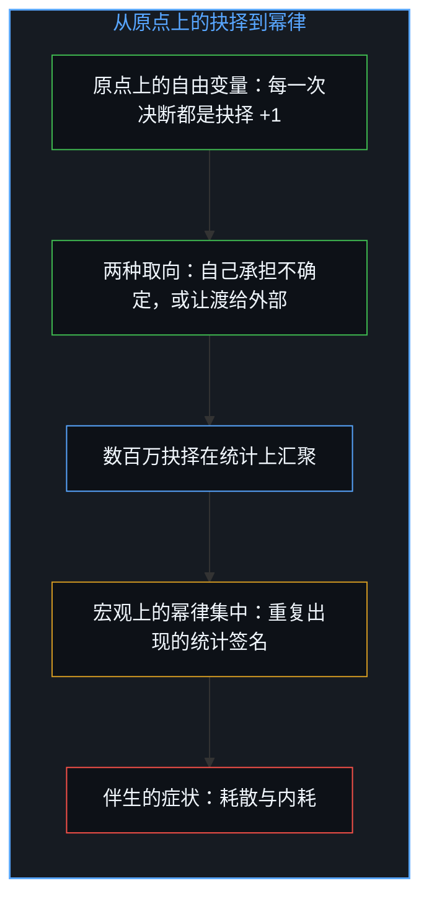

Crossing to the third person to look at a population made of millions of free variables, the microscopic indeterminacy of individuals aggregates statistically into macroscopic determinacy, as [Determinism is the Statistical Signature of Micro-Indeterminism](../determinism-is-the-statistical-signature-of-micro-indeterminism/) has laid out. Differences of cost and the dissipation of energy are accompanying symptoms of this statistical process at the macroscopic scale, not the engine of causality. Concentration of power recurs because, facing unknown risk and the uncertainty of survival, handing over one's autonomous capacity and pushing attribution onto an outside center is a common statistical orientation of free variables. Each individual at an origin keeps the possibility of not handing over, and the microscopic choices of a population left without intervention still aggregate, in the gathering of large numbers, into a highly skewed distribution.

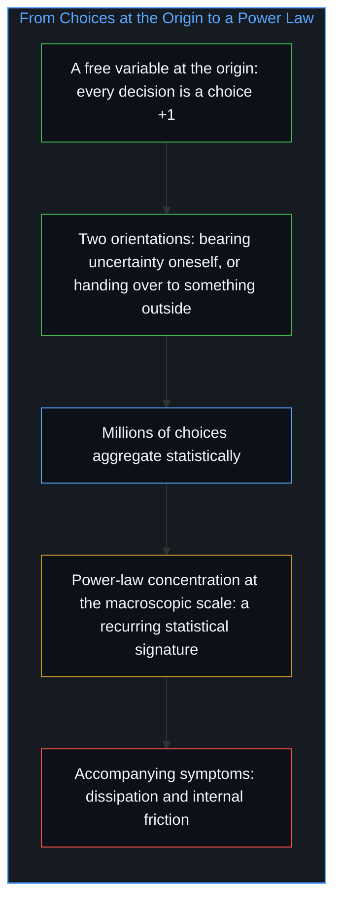

## 二、 相容的错配：僵持与依赖是同一种动力学 / 2. Compatible Misallocation: Deadlock and Dependence as One Dynamics

放下道德的修辞，只看因果的走向，两个自由变量之间的僵持，与由利他形成的依赖，呈现同一种拓扑。两者都在开放的动态系统里建起封闭的自指回路，成为耗去系统生机的阻尼。

With moral rhetoric set down and only the direction of causality looked at, deadlock between two free variables and dependence formed out of altruism show one and the same topology. Both build a closed, self-referential loop within an open dynamic system and become damping that drains the system's vitality.

僵持出自两个自由变量之间达成的“相容的错配”。一方把自己原点上的痛苦归于对方，“是你毁了我的生活”，另一方为了维持道德的上风或控制，默认或主动认领了这份外置的因果，“因为你不肯改，我才须管束你”。两处的错配像榫卯一样咬合：一方输出责难并交出主权，一方接收罪责并接过控制。牺牲式的利他依赖是同一种机制：被救助的一方把自主生存的主权交出去，“没有你我活不下去”，施救的一方以揽下对方的因果反馈来确立自己的价值，“没有我你撑不住”。

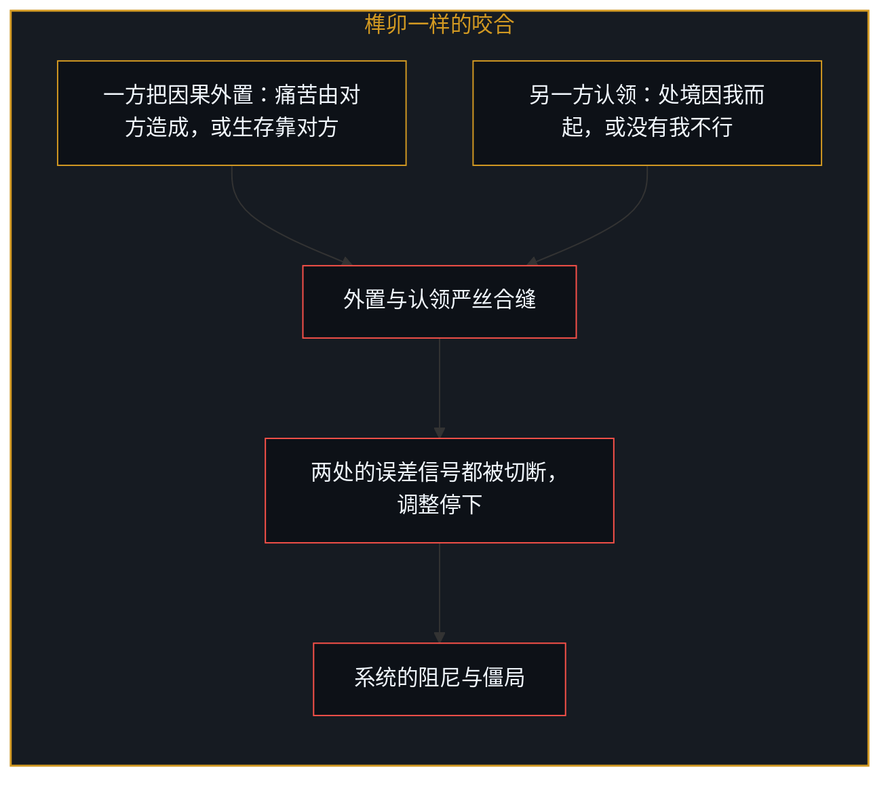

Deadlock comes from a "compatible misallocation" reached between two free variables. One side assigns the pain at its own origin to the other, "you ruined my life," and the other, to keep the moral upper hand or control, tacitly or actively claims this externalized causality, "because you will not change, I have to discipline you." The two misallocations fit like mortise and tenon: one side puts out blame and hands over sovereignty, the other takes in guilt and takes over control. Sacrificial altruistic dependence is the same mechanism: the one being rescued hands over the sovereignty of living on one's own, "I cannot survive without you," and the rescuer establishes a sense of worth by taking on the other's causal feedback, "without me you will not hold up."

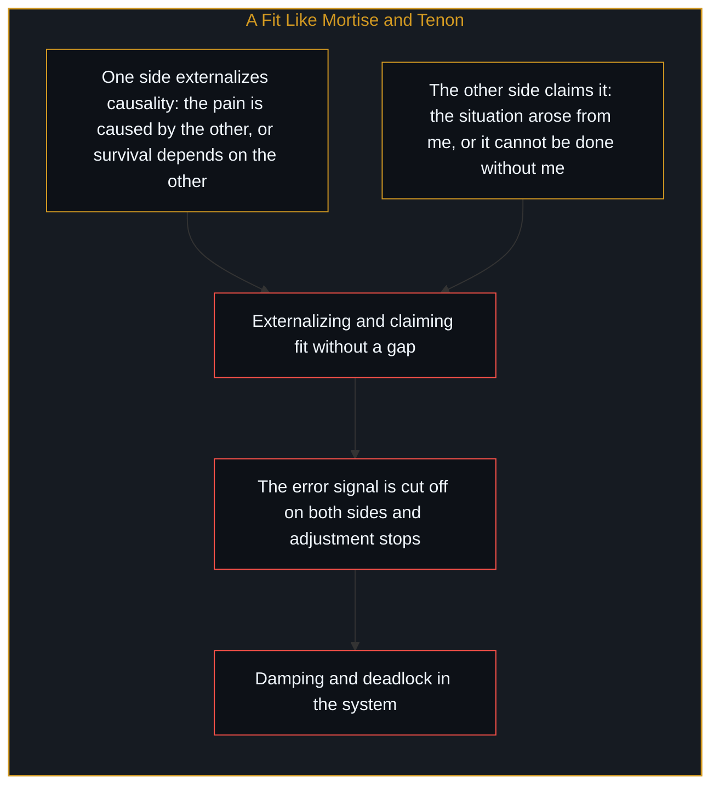

在这两种结构里，个体内部的学习都被切断。因果的回路被导向外部的变量，心智便无法依据直接的反馈修正自身：一方不再磨炼生存的技能，另一方看不清自身的边界，两个心智系在相互缠绕的僵局里。[权力的镜像握手](../the-mirror-handshake-of-power/)在权力的尺度上展开了同一次咬合。

In both structures the individual's inner learning is cut off. With the causal loop directed to a variable outside, a Mind cannot correct itself by direct feedback: one side no longer hones the skills of living, the other cannot see its own boundary, and the two Minds are tied into an entangled deadlock. [The Mirror Handshake of Power](../the-mirror-handshake-of-power/) lays out the same fit at the scale of power.

## 三、 跨心智的道德语言是归因的协议 / 3. Moral Language Between Minds as a Protocol of Attribution

道德的语言常被奉为超越的法则。在众多自由变量交互的网络里，道德的词汇对协调个体之间的行动是有用的。它的边界在跨越心智边界流通的道德评判上：这种评判起着一种低维投影协议的作用，用来重排因果归因的路线。

Moral language is often revered as a transcendent law. In a network of many interacting free variables, moral vocabulary is useful in coordinating actions among individuals. Its boundary lies in moral judgment that circulates across the boundary between Minds: such judgment works as a low-dimensional projection protocol used to rearrange the routes of causal attribution.

一个心智不在自己的原点上承担全部的因果时，无法直接改动别的心智，于是借助一套标准化的低维符号，即道德的语言。“自私”“不义”“亏欠”“罪责”“牺牲”这些标签把高维的复杂状态压成二元的判定，向对方的意识里放进一份外来的因果负荷。它传达的命题是：一个心智的内在状态，由另一个心智的抉择直接决定。经由这套协议，行动的代价被转给付出的一方，统治的危机被归于异见者的品行，集体得以要求个体交出主权。

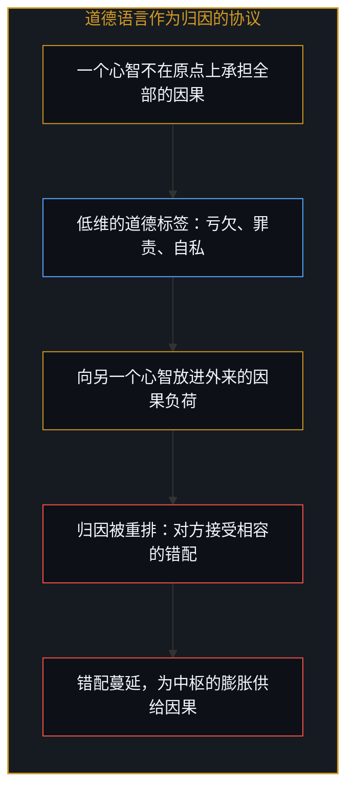

When a Mind does not bear the whole of causality at its own origin, it cannot directly alter another Mind, and so it uses a standardized set of low-dimensional symbols, moral language. Labels such as "selfish," "unjust," "indebted," "guilty" and "sacrifice" press a complex high-dimensional state into a binary verdict and place an outside causal load in the other's awareness. The proposition it carries is that the inner state of one Mind is directly determined by the choice of another. Through this protocol the cost of action is passed to the side that gives, a crisis of rule is assigned to the character of dissenters, and a collective comes to require individuals to hand over sovereignty.

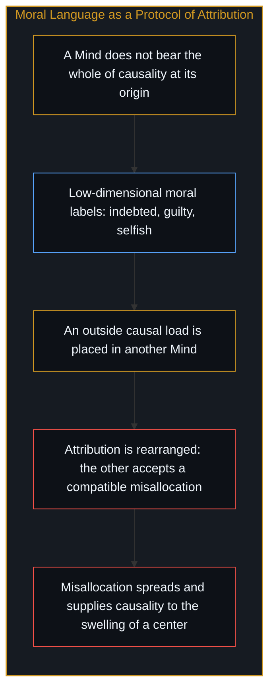

跨心智的道德评判由此可以读作一种协调权能的让渡、转移解释成本的压缩工具。行为的校准若靠外部的道德评判而不靠直接的反馈，相容的错配便在大范围里蔓延，为中枢的膨胀不断供给因果。

Moral judgment between Minds can thus be read as a tool of compression that coordinates the handing over of capacity and shifts the cost of explanation. Where behavior is calibrated by outside moral judgment and not by direct feedback, compatible misallocation spreads widely and keeps supplying causality to the swelling of a center.

## 四、 幂律的聚集与引力的中枢 / 4. Power-Law Aggregation and the Gravitational Center

相容的错配不止于两个个体之间，在数以百万计的自由变量网络里蔓延时，集权的中枢便出现。它的机制是中心的节点吸收了外围的个体交出的主权因果。在复杂网络里，这种让渡合乎“偏好依附”：许多面对不确定的个体把决策外包时，倾向于选那个已经聚了最多权能的节点。一个吸收了初始主权的中心，不论是教会、政党、官僚国家还是技术平台，显得愈发全知而不可动摇，这又促使更多的心智把主权交出去。

Compatible misallocation does not stop between two individuals, and when it spreads through a network of free variables numbering in the millions, a center of concentrated power appears. Its mechanism is that a central node absorbs the sovereign causality that individuals at the periphery hand over. In a complex network this handing over accords with "preferential attachment": when many individuals facing uncertainty outsource their decisions, they tend to pick the node that has already gathered the most capacity. A center that has absorbed an initial share of sovereignty, be it a church, a party, a bureaucratic state or a technology platform, appears ever more all-knowing and immovable, which in turn leads more Minds to hand sovereignty over.

它在数学上的归宿是幂律分布，P(k) ~ k⁻ᵞ：极少数的中枢节点汇聚了极大的因果裁决权，外围的多数个体成为被动的构件。中心的统治力不出于它自身有什么超越的生命力，而出于它汇聚了数百万自由变量持续让渡出来的因果权能的总和。这个膨胀的中枢像一个引力的旋涡，以汇聚的权能扭曲周围的信息流动与价值评估，身处其中更难离开它的轨道。在这个场里的抗争，若仍停在“更换掌控中枢的人”或“请中枢施以仁政”上，是在向它注入新的因果。

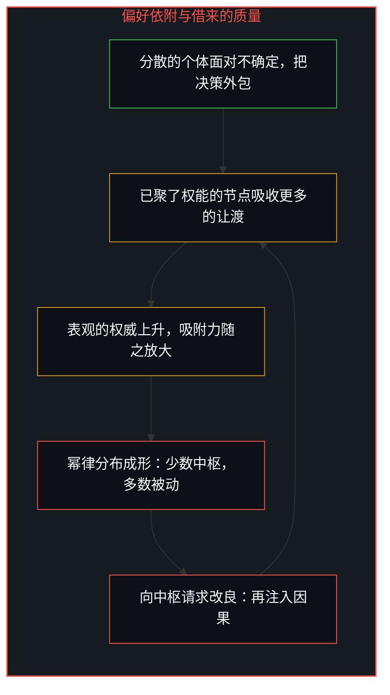

Its mathematical destination is a power-law distribution, P(k) ~ k⁻ᵞ: a very few central nodes gather a very large power of causal ruling, and most individuals at the periphery become passive components. The center's power to rule comes not from any transcendent vitality of its own but from its gathering the sum of causal capacity that millions of free variables keep handing over. This swollen center is like a gravitational vortex, distorting the flow of information and the assessment of value around it with the capacity it has gathered, and from inside it is harder to leave its orbit. Resistance within this field, if it still stops at "replacing whoever controls the center" or "asking the center to rule kindly," injects new causality into it.

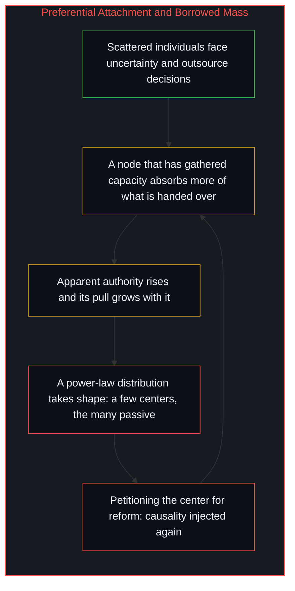

## 五、 让渡的是决定，留下的是后果 / 5. The Decision Is Handed Over and the Consequence Stays

中枢是网络里的一个节点。在它那里找不到一个替人承受后果的位置。这带出让渡主权的一处不对称：决定可以交给中枢，行动带来的后果仍由身处原点的个体承受。集中的计划使经济崩坏时，挨饿的是具体的身体。算法的指令把注意引向退化时，承受的是具体的心智。

A center is a node in a network. No position is found there that bears consequences on anyone's behalf. This brings out an asymmetry in handing sovereignty over: a decision can be given to the center, and the consequences of action are still borne by the individual at the origin. When centralized planning wrecks an economy, it is particular bodies that go hungry. When the instructions of an algorithm lead attention into decline, it is a particular Mind that bears it.

这种不对称说明，让渡主权换不来“安全”。把责任推给外部，现实的反冲并不减轻，输入与输出之间的因果链条倒被割开，在挫折里学习的通道也随之关闭。

This asymmetry shows that handing sovereignty over does not buy "safety." With responsibility pushed outside, the recoil of reality is no lighter, the causal chain between input and output is cut instead, and the channel for learning within setbacks closes with it.

切入点在自身的第一人称原点上：对处境承担全部的结构性责任，把落在生命里的一切，包括所受的操纵与欺骗，认作经由自己当初的让渡才得以成立。代价可以极重，这份重量并不因这样的认领而减轻，认领所改变的是回路：归因全部收回的那一刻，行动与反馈之间的误差信号重新接通，学习的曲线重新变陡。人口统计只在事后记下这种让渡，行动发生在第一人称的收益差中，[观察的因果僭越与第一人称的收益差](../the-causal-overstep-of-observation-and-the-first-person-surplus/)说明了这一点。

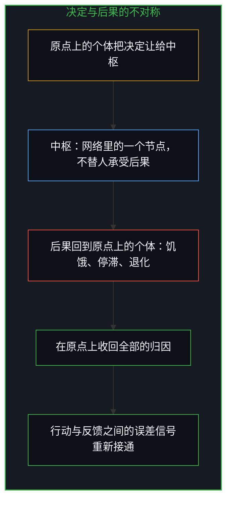

The point of entry is at one's own first-person origin: bearing full structural responsibility for the situation, and taking everything that has landed in one's life, the manipulation and deception suffered included, as something that could stand only through one's own earlier handing over. The cost can be extremely heavy, and that weight is not lightened by claiming it this way; what the claiming changes is the loop: at the moment attribution is taken back in full, the error signal between action and feedback is connected again, and the curve of learning turns steep again. Population statistics record the handing over only after the fact, and action takes place in the first-person surplus, as [The Causal Overstep of Observation and the First-Person Surplus](../the-causal-overstep-of-observation-and-the-first-person-surplus/) shows.

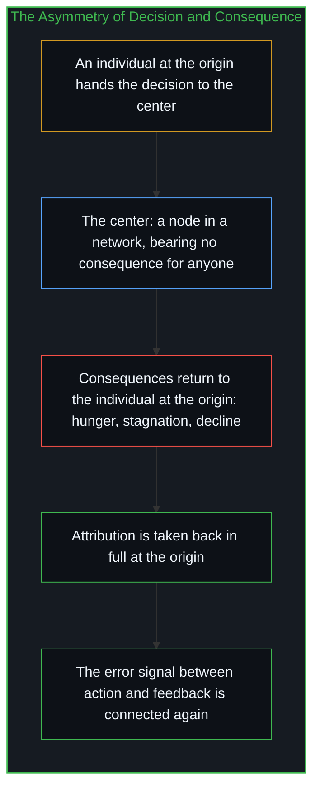

## 六、 单向解耦的非对称杠杆 / 6. The Asymmetric Lever of Unilateral Decoupling

面对盘根错节的错配与庞大的引力场，容易生出无力感，以为改变现状要靠全社会同步的转变、群体的政治共识或漫长的对称谈判。这里有一条非对称的法则：松开相容的错配与权力的僵局，不需要双方达成一致，其中一个自由变量在原点上单向解耦，整个回路便不成立。

Before entangled misallocation and a vast field of pull, a sense of powerlessness arises easily, with the thought that changing things depends on a simultaneous shift across society, a political consensus of the group or long symmetric negotiation. There is an asymmetric law here: loosening compatible misallocation and a deadlock of power does not need the two sides to reach agreement, and when one of the free variables decouples unilaterally at its origin, the whole loop no longer holds.

相容的错配得以运转，在于两处的错配严丝合缝地咬合。单方面把自己的反应性耦合系数归零（c = 0），既不向外转出责任，也不认领外来的道德绑定与因果投射，对方再怎样指责、自居受害或举着施救的旗子，只在自己的原点上对自己的每一个动作负全责，榫卯的一端便不在了。投来的因果向量找不到可以附着的受体，维持拖累的回路断开，那个引力场在这个坐标系里不再起作用。

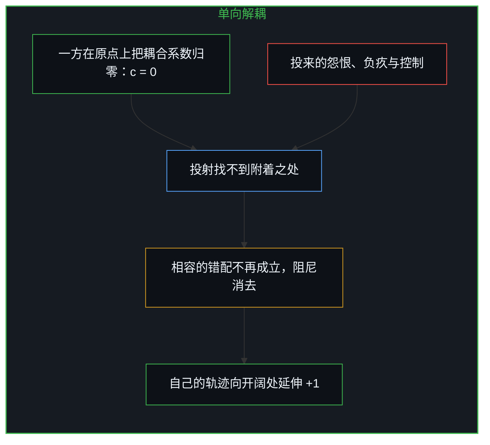

Compatible misallocation runs because the two misallocations fit without a gap. With one's own reactive coupling coefficient set unilaterally to zero (c = 0), neither turning responsibility outward nor claiming moral bindings and causal projections from outside, and with full responsibility taken at one's own origin for each of one's own acts however the other blames, casts itself as victim or raises the banner of rescue, one end of the mortise and tenon is no longer there. The causal vector projected this way finds no receptor to attach to, the loop that sustained the drag is broken, and that field of pull no longer acts within this coordinate system.

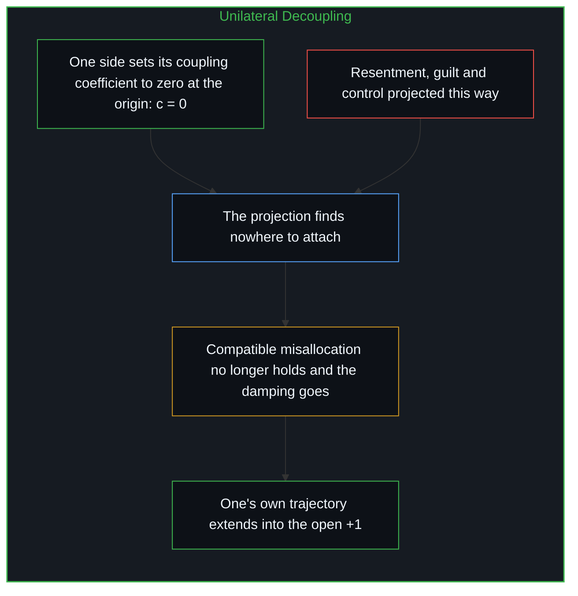

那个庞大的中枢无须去“摧毁”，它的质量本就是许多让渡的向量累加出来的，把自己的那一份收回原点，便已不在那个统计的分布里。这是自由变量的非对称杠杆：世界在大数的汇聚里仍会周期地显出权力的集中，而每一个原点上的心智随时可以经由单向解耦的决断退出阻尼的回路，握住自己的因果，走自己的轨迹。

That vast center need not be "destroyed"; its mass is summed from many vectors handed over, and with one's own share taken back to the origin, one is already no longer in that statistical distribution. This is the asymmetric lever of a free variable: in the gathering of large numbers the world will still show concentrations of power periodically, while each Mind at an origin can at any time, by the decision of unilateral decoupling, leave the loop of damping, hold its own causality and go on its own trajectory.
