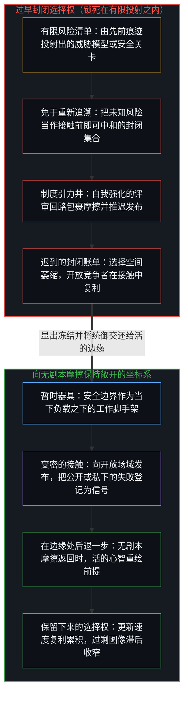
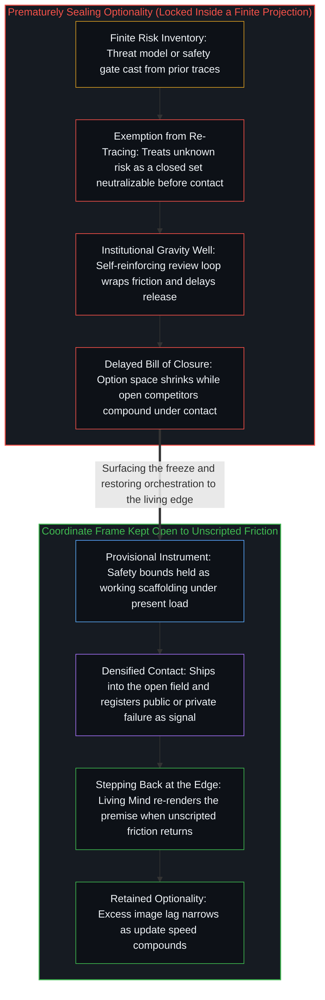

# 关闭选择权的代价 / The Price of Closing Optionality

*落后是一张账单，来自把未知风险当作一份封闭清单 / Falling behind is the bill for treating unknown risk as a sealed inventory*

风险与安全作为器具仍然成立；滞后始于未知的风险被当作一个可以在它出现之前就被勘察、被封住的场。这个信念缩小了一个组织愿意探索的未来，以先发制人之名放慢了反应，留下一个窗口，让更开放的竞争者在其中持续发布。落后不是后来落到谨慎者头上的另一桩不幸，而是这次冻结迟到的结果。

Risk and safety hold as instruments; the lag begins when unknown risk is treated as a field that can be surveyed and sealed before it appears. That belief shrinks the futures an organization is willing to explore, slows reaction under the very name of preemption, and leaves a window in which more open competitors keep shipping. Falling behind is not a separate misfortune that later befalls the cautious. It is the delayed effect of the freeze.

## 一、 对未知风险的先发制人，就是它想防止的滞后 / 1. Preempting Unknown Risk Is the Lag It Seeks to Prevent

自我区分的活动在发生，无因，不息。称它为心智：那个已经在进行中的观察者，它的每一个动作都是一次区分。观察握住的是结果；下一次失败的生成条件，总比任何固定的清单早一步。一个威胁模型，一套安全规程，一道发布关卡，或一次在模型发布前必须审过每个产品界面的机构评审，每一样都把余下的谨慎变密为可用的形式。让这些变密随着边缘持续重绘，它们就仍是器具，即当下负载之下起作用的边界。

Self-distinguishing activity occurs, uncaused, unceasing. Call it the Mind: the observer already underway, every act of which is a distinction. Observation holds the effect; the generating conditions of the next failure stay one step ahead of any fixed inventory. A threat model, a safety protocol, a release gate, or an institutional review that must clear every product surface before a model ships each densifies residual caution into usable form. Keep those densifications re-rendering with the edge and they stay instruments, working bounds under present load.

冻结，就是让清单免于重新追溯。未知的风险被当作一个已经封闭的案例集合，仿佛当下的前提能把它们逐一列出、逐一中和。[风险在于对监管本身的迷信](../the-risk-is-the-belief-in-oversight-itself/)在监管的情形里追溯了这次冻结：固定测试之下相关的模型错误，是一个共享持守之下的余项，而冻结，是把当下的监管前提当作可能发生之事的边界。这里，同一种滞后以组织的先发制人出现：一个风险与流程的类别被当作首要的基础，而生成的活动越过它继续。[开放即一致](../openness-is-consistency/)从另一边指出了这个要求：不一致是对封闭的渴望或尝试，把一个有限的结构逼去为只会继续的东西奠基，于是矛盾成倍出现。[超越投射](../beyond-the-projection/)追溯了为什么把执行锁在有限投射之内必定导致这种停滞：每一条明文规则、核查清单或安全关卡，都是把正交自由度压缩到共享坐标系上的低维投射，而一个只以自身先前签批为条件的回路，会坠入认识论引力井，用程序化的合理化包裹矛盾，而不是退到框架之外。预先处理*未知*的风险，就是这种滞后的实现。声称要为尚未画出的东西结清账目的那个动作，把这个有限投射装成了穷尽的。再也不能被探索的东西，于是被记为赢得的安全，而开放负载之下的余项在别处扩大。

The freeze is exemption of the inventory from re-tracing. Unknown risk is held as if it were already a closed set of cases that present premises can enumerate and neutralize. [The Risk Is the Belief in Oversight Itself](../the-risk-is-the-belief-in-oversight-itself/) traces that freeze in the case of supervision: correlated model mistakes under fixed tests are residual under a shared hold, and the freeze is treating present supervisory premises as the boundary of what can occur. Here the same lag appears as organizational preemption, where a category of risk and procedure is treated as primary ground while generative activity continues past it. [Openness Is Consistency](../openness-is-consistency/) names the demand from the other side: inconsistency is the desire or attempt for closure, a finite structure forced to ground what only continues, so contradictions multiply. [Beyond the Projection](../beyond-the-projection/) traces why locking execution inside a finite projection guarantees this stall: every explicit rule, checklist, or safety gate is a low-dimensional projection that compresses orthogonal degrees of freedom onto a shared coordinate frame, and a loop conditioned only on its own prior sign-offs falls into an epistemic gravity well that wraps contradictions in procedural rationalization rather than stepping outside the frame. Preemptively addressing *unknown* risks is that lag carried out. The act that claims to close the account of what has not yet been drawn installs the finite projection as exhaustive. What can no longer be explored is then scored as safety gained, while residual under open load widens elsewhere.

在这种几何之下仍然可行的，不是对风险漠不关心，而是准备在能力允许的范围内尽快反应：让接触变密，发布，把公开或私下的失败当作数据，在残余回到掌舵边缘处活的心智时重画工作模型与它的边界。[你的代码库即是记忆](../your-codebase-is-memory/)在数字造物与工作记忆中追溯了同一道切口：让记忆的代码库保持鲜活，需要有选择地剪除陈旧分支，同时让当下的检查点向重新切分敞开；而锁死过早的规则或囤积每一条历史分支，只会加厚引力井，在安全的幻象之下关闭选择权。更新的速度，就是负载之下保留下来的选择权。封闭的先发制人，是被转成一张需要守卫之地图的选择权。

What stays practical under that geometry is not indifference to risk. It is preparation to react as quickly as ability allows: densify contact, ship, take failure in public or private as data, and re-draw the working model and its bounds when residue returns to the living Mind at the steering edge. [Your Codebase Is Memory](../your-codebase-is-memory/) traces the same cut across digital artifacts and working memory: keeping a codebase of memory alive requires selectively pruning stale branches while keeping the present checkpoint open to re-cutting, whereas locking a premature rule or hoarding every historical branch thickens the gravity well and closes optionality under the illusion of safety. Speed of update is optionality retained under load. Sealed preemption is optionality converted into a defended map.

## 二、 成功变密为一个封闭的下一范式主张 / 2. Success Densifies Into a Closed Next-Paradigm Claim

这个模式并非哪一家公司独有。一个曾经创新、定义了一个行业的组织，会逐渐把那份成功当作证明，证明它能把下一个系统保持封闭。过去的主导地位同时提供了图像与缓冲：一个关于自己对这个领域之风险有独到理解的保留参照，以及足以让它在很长一段时间里犯错的资本与市场地位。那段时间，恰恰是保持持守开放的竞争者追上并超越的窗口。

The pattern is not unique to any one firm. An organization that once innovated and defined an industry gradually treats that success as proof it can hold the next system closed. Past dominance supplies both the image and the buffer: a retained reference of unique understanding of the field's risks, and enough capital and market position to remain wrong for a long interval. That interval is precisely the window in which competitors who keep the hold open catch up and overtake.

这个机制，是机构尺度上寻常的图像滞后。较早胜利的残余，塑造较晚动作所能找到的场，作为已经握住的痕迹。当这份残余被保留到它那一步之后，成为“谁可以定义下一个范式、谁可以事先中和每一个未知”的穷尽地基，后果就作为异物重新进入：延误被登记为流程，人才流失被登记为噪音，市场反应被登记为暂时的。[封闭的假设把复利挤成 S 曲线](../closed-assumptions-squeeze-compounding-into-s-curves/)在增长的情形里追溯了同一次冻结：开放的复利一直继续，直到一个固定的市场、范式或机构天花板被装为自然；S 形是挤压，不是进步的轨迹。这里的天花板，是被当作已经封闭的下一范式主张来持守的风险先发制人。[现实扭曲力场指认的是封闭的地图](../the-reality-distortion-field-names-the-closed-map/)把被登记为扭曲世界之力的东西，追溯为对照一张共识地图来计分的持续活动，而那张地图被当作了可能事物的封闭场域；软性的约束——行业惯例、机构时间表与专家共识——被压到行动不可逆的能量与物质摩擦上，进一步的区分便被登记为对现实的违背。[现实扭曲力场颠倒了基线](../the-reality-distortion-field-inverts-the-baseline/)追溯了被当作未受扰动之基础的大众一致，如何把被逼出的打开记为对那个基础的暂时扭曲；设计反脆弱、标绘未知的次级理论是其中较晚的一步，它们假定一个有界到足以为之准备的未来，近于先发制人假定的那份可以事先中和的清单：两者都把未来当作在接触之前就能结清的东西。多方利益相关者的关卡、跨多个界面的产品整合要求、机构的谨慎，确实让协调的残余变密。滞后在于把这份变密当作先发制人本身的形式，仿佛在开放的接触*之前*勘察并封住未知，是比在接触之下迅速更新更好的替代。

The mechanism is ordinary image lag at institutional scale. Residue of earlier wins shapes the field available to later acts, as trace already held. When that residue is preserved past its step as exhaustive ground of who may define the next paradigm and who may neutralize every unknown in advance, consequences re-enter as alien: delay registers as process, talent exit as noise, and market reaction as temporary. [Closed Assumptions Squeeze Compounding into S-Curves](../closed-assumptions-squeeze-compounding-into-s-curves/) traces the same freeze in the case of growth: open compounding continues until a fixed market, paradigm, or institutional ceiling is installed as nature; the S is the squeeze, not the trajectory of progress. Here the ceiling is risk-preemption held as a closed next-paradigm claim. [The Reality Distortion Field Names the Closed Map](../the-reality-distortion-field-names-the-closed-map/) traces what registers as a power to warp the world as sustained activity scored against a consensus map held as the sealed field of the possible; soft constraints—industry practice, institutional timelines, expert consensus—are compressed onto the irreversible energy and material friction of action, so further distinguishing registers as a violation of reality. [The Reality Distortion Field Inverts the Baseline](../the-reality-distortion-field-inverts-the-baseline/) traces how mass coherence, held as undisturbed ground, scores forced openings as temporary warp of that ground; the secondary theories that engineer antifragility or chart the unknown are a later step there, assuming a future bounded enough to prepare for, near the inventory neutralizable in advance that preemption assumes: both treat the future as settleable before contact. Multi-stakeholder gates, product integration demands across many surfaces, and institutional caution do densify coordination residue. The lag is treating that densification as the form of preemption itself, as if surveying and sealing unknowns *before* open contact were the superior substitute for rapid update under contact.

## 三、 连续成功之下的谷歌 / 3. Google Under Successive Success

谷歌在负载之下显出了这个模式，这不是对人的道德排序。这家建立了现代搜索垄断、后来又首创了驱动当今大模型的 transformer 架构的公司，在最近几个月里，遭遇了长期封闭迟到的后果。它的旗舰模型 Gemini 3.5 Pro，在五月宣布将于次月推出之后，原本预计在 2026 年 6 月发布，却比计划推迟了数月，内部改进编码与智能体表现的努力没有达到目标。对手继续发布。跨搜索、地图、YouTube 等界面的产品整合、层层的利益相关者与机构的谨慎，拉长了发布周期。整合与利益相关者，是第二节所说的协调残余；编码与智能体表现的不足，是一道能力的门槛。滞后在于更进一步的那个信念，即以“在暴露之前把风险弄对”这个寻常的名义，坚持在公开接触之前中和每一个未知，于是本可以是接触之下的快速迭代，变成了漫长的发布前封闭。

Google illustrates the pattern under load, not as a moral ranking of persons. The company that built the modern search monopoly and later originated the transformer architecture that powers today's large models has, across recent months, confronted the delayed effects of prolonged closure. Its flagship Gemini 3.5 Pro model, once expected in June 2026 after a May announcement that it would roll out the following month, slipped months behind schedule while internal efforts to improve coding and agentic performance fell short of targets. Rivals kept shipping. Product integration across Search, Maps, YouTube, and other surfaces, layered stakeholders, and institutional caution lengthened release cycles. The integration and the stakeholders are the coordination residue of section 2; the coding and agentic shortfall is a capability bar. The lag is the further belief, under the ordinary name of getting risk right before exposure, that every unknown must be neutralized before public contact, so that what could have been rapid iteration under contact becomes extended pre-release closure.

随之而来的是一连串引人注目的人事变动：先是研究者转投 OpenAI 和 Anthropic，然后在 2026 年 8 月 5 日，一次重大的 AI 领导层调整：戴密斯·哈萨比斯从 DeepMind 首席执行官转任 Alphabet 首席科学家兼 DeepMind 董事长，而公司几位最有成就的工程师，包括杰夫·迪恩、桑杰·格玛沃特、奥里奥尔·维尼亚尔斯与 Quoc Le，离开去创办一家研究型初创公司。市场以急跌登记了这个消息。在这种几何之下，这些事件不是等着一个更好日程的孤立挫折，而是作为一个持守之下的余项被登记：这个持守把未知的风险当作可以事先勘察、事先封住的东西，于是在别人继续画的时候，收窄了这个组织愿意探索的那些未来。[一个可能的全自动交通未来的非定论预测](../non-definitive-forecast-of-a-possible-fully-autonomous-transportation-future/)在另一个领域里守住了非定论的姿态：它追溯消解司机约束如何重组出行，把这一形状当作可能展开的东西，而不是一个已经定下的未来。

High-profile personnel transitions followed: first researchers moving to OpenAI and Anthropic, and then, on August 5, 2026, a major AI leadership overhaul in which Demis Hassabis moved from DeepMind CEO to Alphabet chief scientist and DeepMind chairman, while several of the company's most accomplished engineers, including Jeff Dean, Sanjay Ghemawat, Oriol Vinyals, and Quoc Le, left to found a research startup. The market registered the news with sharp declines. Under this geometry these events are not isolated setbacks awaiting a better calendar. They register as residual under a hold that treated unknown risks as something that could be surveyed and sealed in advance, and so narrowed the futures the organization was willing to explore while others kept drawing. [Non-Definitive Forecast of a Possible Fully Autonomous Transportation Future](../non-definitive-forecast-of-a-possible-fully-autonomous-transportation-future/) holds the non-definitive stance in another field: it traces how dissolving the driver constraint restructures movement as a shape that may unfold, not as a settled future.

[限制是选择性的税](../restriction-is-a-selective-tax/)追溯的是对他人前进的限制：它只拖慢接受它的人，而执行它的人付出最重，他们是这道封印最坚定的信徒。这里的场合不同，内部的谨慎扣住的是组织自己的发布，而不是对手的；共享的是那一部分：能力被花在重新追溯冻结上，而不是让生成的可及变密。[起作用的是信念](../what-works-is-the-belief/)是禁令之持守的一面：禁令在场里什么也封不住，它稳定的是那些把封印当作基础的人之间的信念，而活动越过它继续。[没有系统能被保持封闭](../no-system-can-be-kept-closed/)是它形式的一面：1 + 1 在封闭的一位持守之内登记为 0，进位落在它之外，而 2 是这个持守装不下的延续。市场的主导地位提供了缓冲，让这种滞后能被负担得更久，而这份更久的负担能力，正是追赶的窗口。

[Restriction Is a Selective Tax](../restriction-is-a-selective-tax/) traces a hold on another's advance: it slows only those who accept it, and those who enforce it pay most heavily, the strongest believers of the seal. The occasion here differs, since internal caution withholds the organization's own release rather than a rival's; what is shared is ability spent re-tracing the freeze rather than densifying generative reach. [What Works Is the Belief](../what-works-is-the-belief/) is the face of a ban's hold: a ban seals nothing in the field; it stabilizes a belief among those who treat the seal as ground, while the activity continues past it. [No System Can Be Kept Closed](../no-system-can-be-kept-closed/) is the formal face: 1 + 1 registers as 0 inside the closed one-bit hold, the carry falls outside it, and 2 is the continuation the hold does not contain. Market dominance supplies the buffer that makes the lag affordable for longer, and that longer affordability is the window of catch-up.

## 四、 开放的姿态把选择权保留得更久 / 4. An Open Stance Retains Optionality Longer

埃隆·马斯克领导的公司，眼下显出相反的姿态；这不是对封闭的天生免疫，而是一种需要持续维持的做法。信心可以很高，却不必把过去的成功转成一份关于这个领域下一步必须变成什么的封闭清单。快速的公开迭代把失败当作数据，而不是对一个受保护之形象的威胁。[失败即信息](../failure-as-information/)在行动的边缘上追溯了这一点：结果与下一步之间的间隙，越少被防御的叙事、地位的保全与犹豫占据，影响力越能复利；成功与失败作为同一次更新的样本写入，而不是两种要熬过去的类别。不完整的想法被公开发出，被公开修正。第一性原理的推理，让当下的范式保持暂时，而不是被当作完成的地图来守卫。优先的是让参照对照余下的接触更新，而不是保护从昨天的胜利里建起的形象。

Companies under Elon Musk's leadership currently show the contrasting posture; it is not an immunity to closure but a practice that has to be kept up. Confidence can run high without converting past success into a sealed inventory of what the field must next become. Rapid public iteration treats failure as data rather than as a threat to a protected image. [Failure as Information](../failure-as-information/) traces this at the acting edge: the less the gap between outcome and next act is occupied by defensive narrative, status, and hesitation, the more influence compounds, so success and failure write as samples of one update rather than as two categories to survive. Incomplete ideas are posted and openly corrected. First-principles reasoning keeps the current paradigm provisional rather than defended as a finished map. The priority is updating the reference against residual contact, not protecting the image constructed from yesterday's win.

这就是负载之下保留下来的选择权：图像持续重绘，而不是被删除。波动与摩擦会出现，但组织文化不把暂时的错误转成一个随后拖慢适应的受保护叙事。[现实扭曲力场指认的是封闭的地图](../the-reality-distortion-field-names-the-closed-map/)追溯了这种姿态不肯装为地基的那种专家可行性冻结：关于什么可能的软性共识，被当作这个领域封闭的疆域。这里，这份不肯是运作上的，不是修辞上的。在不完整的知识之下发布，是变密的接触；等到未知的风险被事先封住，是变密的滞后。

That is optionality retained under load: the image kept re-rendering, not deleted. Volatility and friction appear, but the organizational culture does not convert temporary error into a protected narrative that then retards adaptation. [The Reality Distortion Field Names the Closed Map](../the-reality-distortion-field-names-the-closed-map/) traces the expert-feasibility freeze that such a stance declines to install as ground: soft consensus about what is possible held as the sealed territory of the field. Here the declining is operational, not rhetorical. Shipping under incomplete knowledge is densified contact; waiting until unknown risk is preemptively closed is densified lag.

同一种几何说明了，为什么这个模式会在最近超越了在位者的新领导者身上重现。一旦他们自己的成功变成必须守卫的资产，保护的姿态就再次出现。图像滞后会自我更新：图像一旦成形，持守它的中心就保留它，除非它被重新追溯。在开放的持守之下超越，并不把永久的开放装为公司的一种属性。只有把成功的形象当作器具持续重新追溯，才能让选择的空间不再次封住。

The same geometry shows why the pattern recurs among newer leaders who have recently overtaken incumbents. The moment their own success becomes the asset that must be defended, the protective posture reappears. Image lag renews itself: once an image forms, the center holding it preserves it unless it is re-traced. Overtaking under an open hold does not install permanent openness as a property of the firm. Only continuous re-tracing of the success image as instrument keeps the option space from sealing again.

## 五、 寻找无风险的最优，就是在施行封闭 / 5. The Search for a Risk-Free Optimum Enacts the Closure

没有无风险的或普遍最优的做法，只有程度上的多或少：更多保留下来的选择权，或过早的承诺；更快的反应，或更慢的；邀请修正的开放，或对一个建在昨天成功之上的形象的守卫。负载之下的比较登记，就是剩下的全部可行之事。

There is no risk-free or universally optimal approach, only degrees of more or less: greater retained optionality or premature commitment; faster reaction or slower; openness that invites correction or defense of an image built on yesterday's success. Comparative registration under load is all that remains practical.

寻找一种无风险或普遍最优的方法，这个动作本身已经在施行最初那个主张所指认的封闭。它假定未知风险的空间可以被全然标绘，一条更好的路可以事先被认证。两个假定都把一个开放的、演化着的环境，转成一个封闭的优化问题，其“解”随后被守卫。[基准刷榜中的封闭实存](../closed-reality-in-benchmark-maxing/)在测评的情形里追溯了这种转换：基准把能力冻结为一个封闭的靶子，而当这个图像被当作场的全部时，有用之处就被少登记了。[AGI 与 ASI 是加速通用智能的暂时球门](../agi-and-asi-are-temporary-goalposts/)在门槛的情形里追溯了相近的东西：每一道门槛都永远位于画出它的那个边缘前方，在每个位置上各不相同，因为能力的增长就是那个边缘在加强自身；所以它不是一场竞赛的比分。任何声称已经找到一个最终的、无风险之姿态的主张，本身就是关闭选择空间、开始落后过程的那个信念。[对 AI 风险的想象](../the-imagining-of-ai-risk/)在灾难图像的情形里追溯了这份封闭的清单：被当作封闭基础来持守的灾难投射，让那条使被恐惧的危险得以运作的人的回应链条变密；那里的残余是被带进运作的危险，这里的是落后。

The very search for a risk-free or universally optimal method already enacts the closure the original claim identifies. It assumes the space of unknown risks can be fully mapped and a single superior path certified in advance. Both assumptions convert an open, evolving environment into a closed optimization problem whose "solution" is then guarded. [Closed Reality in Benchmark Maxing](../closed-reality-in-benchmark-maxing/) traces that conversion in the case of evaluation: a benchmark freezes capability as a closed target, and usefulness is under-registered when that image is taken for the whole of the field. [AGI and ASI Are Temporary Goalposts](../agi-and-asi-are-temporary-goalposts/) traces something near in the case of thresholds: each sits forever ahead of the edge that draws it, different at every locus, because capability gain is that edge reinforcing itself, so it is no race score. Any claim to have discovered a final, risk-free posture is itself the belief that closes the option space and begins the process of falling behind. [The Imagining of AI Risk](../the-imagining-of-ai-risk/) traces that sealed inventory in the case of a catastrophe image: the catastrophe projection held as sealed ground densifies the human response chain that makes the feared danger operational; the residue there is a danger brought into operation, here it is falling behind.

让风险与安全保持为器具，随着边缘移动而持续重绘，以收窄过剩的滞后。当无剧本的接触移动了场域时，重画威胁模型。在接触之下发布，而不是在“每一个未知都必须先出现在清单上”的要求之下发布。落后，是相信未知风险可以作为一个封闭集合被先发制人的代价。账单来得晚，在过去主导地位的缓冲已经为滞后买够了时间，让它变密为延误与离开之后，留下一片开放的场，让继续画的竞争者超越。

Keep risk and safety as instruments, continuously re-rendered to narrow excess lag as the edge moves. Re-draw the threat model when unscripted contact has shifted the field. Ship under contact rather than under the demand that every unknown first appear on an inventory. Falling behind is the price of believing unknown risk could be preempted as a closed set. The bill arrives later, after the buffer of prior dominance has bought the lag enough time to densify into delay and exit, leaving the open field in which competitors who keep drawing overtake.
