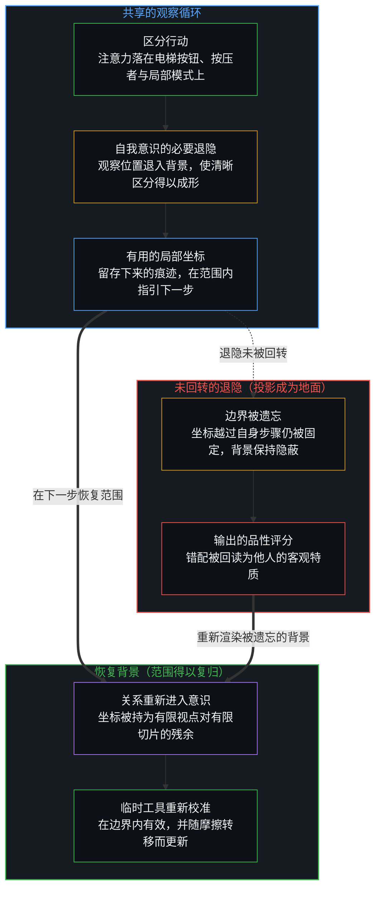
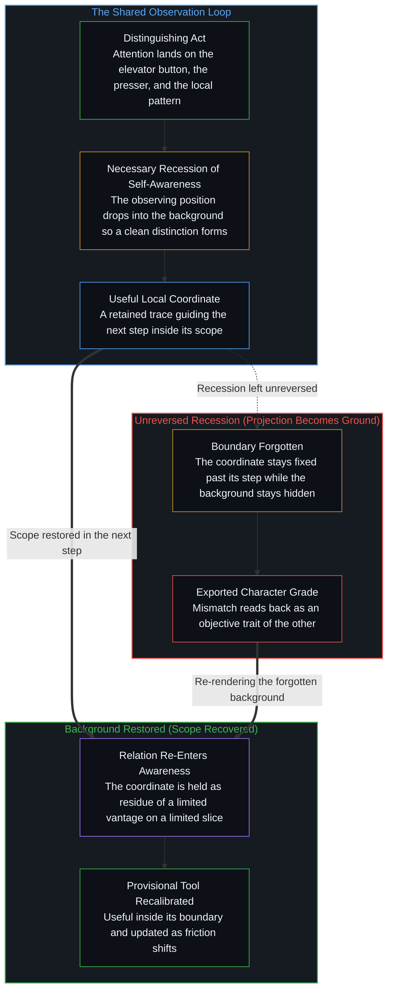

# 排序的投影与自我意识的退隐 / The Projection of Ranking and the Recession of Self-Awareness

*自我意识退隐以成全观察，事后若未复归，局部坐标便硬化为对他人的客观评分 / Self-awareness recedes so observation can land; left unreversed, a local coordinate hardens into an objective grade of another*

在当代美国电梯的普通乘客模式下，按下关门按钮无法缩短法定的开门停留时间；心智登记这一局部规律，将其持为自身下一步行动的内部坐标。一旦将同一规律输出为对按压者的品性评分，其边界便随之脱落，一件局部工具也就成了仿佛属于他人的特质。清晰的观察需要自我意识退入背景，好让注意力落在对象之上；而留存的坐标一旦成形，在后续步骤将其重新渲染之前，便会自行留在原位。观察完成用途之后，退隐若未被回转，其中的关系便被遮蔽，投影随之立为地面；恢复范围则让排序归位为私人、临时的器具，同时放下对外的品性评分。

In contemporary US elevators, pressing the door-close button in ordinary passenger mode cannot shorten the mandatory door-open dwell; the Mind registers that local regularity and holds it as an internal coordinate for its own next step. Exporting the same regularity as a character grade on whoever presses the button drops its boundary and turns a local tool into an apparent trait of another person. Clean observation requires self-awareness to recede into the background while attention lands on the object, and once formed, a retained coordinate holds itself in place until a later step re-renders it. Left unreversed after the observation has served its purpose, that recession hides the relation and lets the projection stand as ground; restoring scope returns ranking to a private, provisional instrument while setting down the external grade.

## 一、 局部规律与内部坐标 / 1. Local Regularity and Internal Coordinates

自我区分活动发生——无因而生、不息不止。称其为心智：已然进行中的观察者，其每一行动皆为一次区分。依据落实 1990 年《美国残疾人法案》的联邦无障碍标准，当代美国电梯在常规乘客模式下，轿内呼梯时须保持门全开至少三秒，厅外呼梯时则须留出至少五秒——并按距最远厅外呼梯按钮的距离相应延长——之后才开始关门。关门按钮依然接入控制器，因为安全规范要求在消防员轿内操作与独立运行模式下以持续按压的方式操控关门；在启用相应配置的系统中，控制器也允许它在法定最低停留时间届满后缩短额外停留。然而，在默认停留时间本就设在法定下限的普通乘客使用中，按压该按钮无法加快关门。

Self-distinguishing activity occurs — uncaused, unceasing. Call it the Mind: the observer already underway, every act of which is a distinction. Under federal accessibility standards implementing the 1990 Americans with Disabilities Act, contemporary US elevators in standard passenger service must hold doors fully open for at least three seconds on a car call and allow at least five seconds—scaled longer by distance from the farthest hall call button—on a hall call before closing begins. The close button remains wired to the controller because safety codes require it under continuous pressure for firefighter in-car operation and independent service, and where enabled, controllers let it trim extra dwell once the legal floor has expired; inside ordinary passenger use where default dwell sits at that floor, pressing it cannot speed up the door.

在这一边界之内，该规律稳定可靠：按压与否，都不改变门的开关时序。每一次离散的区分行动都会留下残余，心智将这份残余持为内部坐标——“这一模式在此成立”“这个动作在此改变不了什么”——好让下一次区分有明确的落点。坐标是早先摩擦留存下来的痕迹，而非自立于世的法则；产生它的边界止于何处，它的有效范围便止于何处。

Within that boundary, the regularity is dependable: pressing or refraining from pressing leaves the door's timing unchanged. Every discrete act of distinguishing leaves a residue, and the Mind holds this residue as an internal coordinate—"this pattern holds here," "this move changes nothing here"—so the next distinction has something definite to land on. The coordinate is a retained trace of earlier friction rather than a free-standing law, and its working reach ends where the boundary that produced it ends.

## 二、 边界与输出 / 2. Boundary and Export

当这一内部坐标被输出为对他人的评分，它的适用范围便随之脱落。美国普通乘客模式下的规律被当作常设法则，边界之外的一切尽数退出视野：1990 年之前未经改造的美国旧式电梯、在法定下限之上允许裁减额外停留的控制器、消防员与独立运行模式，以及欧洲、日本等非美国电梯系统——在那些系统里，乘客按下关门按钮本就会主动缩短开门停留时间。一句常见的格言在此划出一道区分：聪明，是知道美国电梯的关门按钮无法加快关门；智慧，则是知道能够归纳并不等于归纳普遍成立。即便这句更锐利的格言，也依然借用了日常语言的纵向阶梯，将“智慧”当作更高一级的特质，置于“聪明”之上。在日常的美国乘客使用中，把局部规则当作普遍法则来用，代价并不高；摩擦只在范围转移时浮现。一旦连这座纵向阶梯本身也一并放下，这道对照呈现出的便只是两件各系其境的工具，而非人的两档高下。

When that internal coordinate is exported as a score of another person, its scope drops out. The regularity of ordinary US passenger service gets treated as a standing rule, while everything outside the boundary disappears from view: unaltered pre-1990 US cabs, controllers configured to trim extended dwell above the legal floor, firefighter or independent service modes, and non-US systems—European and Japanese lifts among them—where passenger close buttons actively shorten door dwell. A common aphorism draws a distinction here: cleverness is knowing that the US elevator close button does nothing to hasten the door, while wisdom is knowing that being able to generalize does not make the generalization universal. Even that sharper aphorism still borrows ordinary language's vertical ladder, placing "wisdom" a rung above "cleverness" as a superior trait. Inside routine US passenger use, treating the local rule as if it were universal carries low cost; the friction surfaces only when the scope shifts. Once the vertical ladder itself is set down, the contrast yields two context-bound tools rather than two ranks of person.

一旦被输出为对站在面板旁那位乘客的评分，同一条规律便成了一场品性测试。按压按钮被读作“缺乏更新”或“不智”，而那位个体在自身视点下面临的具体约束却无从触及：对眼前这部电梯是否属于例外的残余不确定性、从按钮有效的系统沿袭下来的低成本习惯，或在按压代价极低时对主动一按之切身感受的偏好。正如[「更好」的范畴谬误](../the-category-error-of-better/)在计分板中所追溯的，“更好”从来不是器物或行动独立于观察者的属性，只是局部计分函数的标量输出；而正如[来自个体差异的层级](../hierarchy-from-individual-difference/)在共同尺度中所追溯的，排序并未给各异的轨迹增添任何东西，只是添了一把选定的标尺，把它们排成高低位次。输出越过边界之后，评分便不再追踪约束下的抉择，转而追踪观察者留存坐标与所见行动之间的错配——继而把这份错配回读为对方身上的稳定特征。

Exported as a grade on the rider standing next to the panel, the same regularity turns into a character test. Pressing the button gets read as "failure to update" or "unwise," while the constraints operating at that individual's own vantage stay out of reach: residual uncertainty over whether this particular elevator is an exception, a low-cost habit carried over from systems where the button works, or a preference for the felt sense of an active gesture when pressing costs little. As [The Category Error of Better](../the-category-error-of-better/) traces for scorecards, "better" is never an observer-independent property of an artifact or act, only the scalar output of a local scoring function; and as [Hierarchy from Individual Difference](../hierarchy-from-individual-difference/) traces for shared measures, ranking adds nothing to differing trajectories except a chosen ruler that orders them into higher and lower places. Exported past its boundary, the score stops tracking choice under constraint and tracks the mismatch between the observer's retained coordinate and the observed act—and then reads that mismatch back as a stable feature of the other person.

## 三、 退隐的必要与遗忘 / 3. The Necessity and Forgetting of Recession

当自我意识暂时退入背景，观察才得以成立。注意力落在对象之上——按钮、按压者、所声称的模式——进行区分的机制本身随之退出视野，清晰的边界由此成形。器具在实施测量的那一步里须保持稳固，凝望地平线的眼睛也须将自己的视网膜留在画幅之外；倘若观察中途自身视点挤占前景，每一次读数都会与观察者的位置纠缠不清。正如[寻觅的语法与淡出的观察者](../the-grammar-of-finding-and-the-fading-observer/)在观察的源头所追溯的，每当观看展开，观察者都在构成上从被观察的视野中淡出；也正如[遗忘的脚手架](../the-scaffolding-we-forget/)对一切可用器具所追溯的，器具在承载自身那一步时暂时退出焦点，正是下一次区分得以稳妥落脚的方式。这种退隐是必要的操作条件，而非要在行动中途消除的认知缺陷。

Observation becomes workable when self-awareness temporarily recedes into the background. Attention lands on the object—the button, the presser, the claimed pattern—while the machinery performing the distinction drops out of view so a clean boundary can form. An instrument must hold fixed during the step in which it measures, and an eye focused on the horizon keeps its own retina out of the frame; when one's own vantage crowds the foreground mid-observation, every reading stays tangled with the observer's position. As [The Grammar of Finding and the Fading Observer](../the-grammar-of-finding-and-the-fading-observer/) traces at the root of observation, the observer constitutively fades from the observed field whenever seeing unfolds, and as [The Scaffolding We Forget](../the-scaffolding-we-forget/) traces for any usable instrument, temporary drop-out while carrying its step is how the next distinction finds solid footing. The recession is a necessary operating condition, not a cognitive flaw to eliminate mid-act.

漂移始于观察完成其用途之后：退隐未被回转。由于观察持有的是结果，而生成它的行动始终领先一步，每一个可用的坐标都带着不可化约的一步滞后；留存下来的坐标一旦成形，只要后续步骤不曾将其重新渲染，便会默认停留在原位。一旦免于重新渲染，那枚曾在自身那一步里起作用的坐标便一直立在原地，仿佛是世界独立自存的属性。正如[框架的盲区](../the-blind-spot-of-the-frame/)所追溯的，观察者退至仪器之后，一旦遗忘这道操作性悬置，退隐便会硬化为健忘；同样的遗忘在这里正运作于日常感知之中：因为投影从未重新进入意识，观察者经验到这份评分时，只觉得“事情就是如此”，而非有限视点与有限行为切片之间的关系。使看见成为可能的条件已被遗忘，看见遂被当作自足。

The drift enters after the observation has served its purpose, when the recession goes unreversed. Because observation holds effect while the generating act stays one step ahead, every usable coordinate carries an irreducible one-step lag; once formed, that retained coordinate holds itself in place by default unless a subsequent step re-renders it. Left exempt from re-rendering, the coordinate that worked inside its step stays standing as though it were a free-standing feature of the world. Just as [The Blind Spot of the Frame](../the-blind-spot-of-the-frame/) traces how stepping behind an apparatus hardens into amnesia once the operational bracket is forgotten, here the forgetting operates inside everyday perception: because the projection never re-enters awareness, the observer experiences the grade as simply "what is the case" rather than as a relation between a limited vantage and a limited slice of behavior. The condition that made the seeing possible has been forgotten, and the seeing is treated as self-sufficient.

## 四、 投影成为地面 / 4. Projection Becomes Ground

排序因此感觉客观。它感觉干净，正因为产生它的条件已经滑出视野。心智在普通美国电梯中持有的局部规律，与将同一规律化作品性测试的举动，沿着同一循环运转：先是必要的退隐与可行的观察，步骤完成之后若退隐未被回转，背景便继续隐蔽，结果也就立为地面。电梯只是一个便利的实例；同一循环会将任何足够可靠的局部模式——一项技术捷径、一条社交惯例、一种定价启发法——转化为对偏离者的表面客观评分。

The ranking therefore feels objective. It feels clean precisely because the conditions that produced it have already slipped out of sight. The local regularity the Mind holds inside ordinary US elevators and the move that turns that same regularity into a character test run along the same loop: necessary recession, workable observation, and—when left unreversed after the step—a hidden background that turns the result into ground. The elevator is only a convenient instance; the same loop converts any sufficiently reliable local pattern—a technical shortcut, a social convention, a pricing heuristic—into an apparently objective score of those who deviate.

这份评分里没有任何东西触及他人的内在，即便收集更稠密的行为样本，也拼凑不出对一个完整之人的客观评分。因为每一次区分行动都有界限，他人的心智只能作为经过中介的痕迹跨越有限边界而抵达——这正是[NPC 印象是结构性的，而非心智的排名](../the-npc-impression-is-structural/)所追溯的恒久不对称。任何排序所处理的，都仅是一片可见行为，且早已历经观察者当前目标、先前痕迹与偏好叙事的过滤。把这片过滤后的行为回读为固定特质，勾勒出的是观察者自身的认知边界——正如[投射中的自画像](../the-self-portrait-in-the-projection/)所追溯的那面镜像。心智一旦停在这道判词之上，便只顾读取投射在自己井壁上的倒影，却未曾触动自身的决策参数，落入[止步于评判，是认知的歧途](../zhi-bu-yu-ping-pan-shi-ren-zhi-de-qi-tu/)所追溯的停滞；这份评分追踪的是观察者自身的倒影，而非对方的独立属性。

Nothing in that score reaches another person's interior, nor would collecting a thicker behavioral sample ever assemble an objective grade of a whole person. Because every act of distinguishing is bounded, other minds arrive only as mediated traces across finite boundaries, the permanent asymmetry traced in [The NPC Impression Is Structural, Not a Ranking of Minds](../the-npc-impression-is-structural/). Any ranking operates strictly on a thin slice of visible behavior filtered through the observer's current goals, prior traces, and preferred narrative. Reading that filtered slice back as a fixed trait draws the observer's own cognitive boundary—the exact mirror traced in [The Self-Portrait in the Projection](../the-self-portrait-in-the-projection/). Once the Mind stops at that verdict, it reads reflections cast on its own well wall while leaving its own decision parameters untouched, the stall [Stopping at Judgment Is a Wrong Turn of Cognition](../zhi-bu-yu-ping-pan-shi-ren-zhi-de-qi-tu/) traces; the score tracks the observer's own reflection rather than an independent attribute of the other.

## 五、 范围的恢复 / 5. Restoring Scope

恢复范围既不否定局部规律的效用，也不倒转阶梯、将按压按钮排为更智慧。它把已完成的区分归还给仍在进行的自我区分活动——区分本就由它划出。下一次注意力落在对象之上时，自我意识还会再次退隐，因为清晰的观察需要这一步；改变的在于，一旦观察完成用途，退隐便不再停留于未回转的状态。内部坐标在其边界之内继续有效；边界本身重回视野；投影不再充当地面，而重新显现为出自有限视点的关系。

Restoring scope neither denies the utility of the local regularity nor flips the ladder to rank pressing the button as wiser. It returns the completed distinction to the ongoing self-distinguishing activity that drew it. Self-awareness will recede again the next time attention lands on an object, since clean observation requires that step; what shifts is that the recession no longer stays unreversed once the observation has done its work. Inside its boundary, the internal coordinate stays effective; the boundary itself returns to view; the projection reappears as a relation from a finite vantage rather than as ground.

正如[偏好聚类与评判语言](../preference-clusters-and-the-language-of-judgment/)在持于自身位置的罗盘与投向他人的凭据之间划出的界线：评价在指引这一心智迈出下一步时保持敏锐，一旦硬化为对他人的裁决便即刻变钝。不再把一段被遗忘的退隐继承为隐藏前提，下一次区分便能在当下的摩擦中直接重新校准——步入陌生的电梯、遭遇意料之外的约束，或是察觉到自己当场给陌生人打分的冲动。排序回到它作为私人、临时工具的工作位置，而它输出为外部品性评分的姿态则被放下。两者并不冲突：前者是一次区分的残余，后者则是这份残余被误当作地面之后生成的进一步残余。

As [Preference Clusters and the Language of Judgment](../preference-clusters-and-the-language-of-judgment/) draws the line between a compass held at one's own position and a warrant projected over others, an evaluation stays sharp while it guides this Mind's next move and dulls the moment it hardens into a verdict on another. Freed from inheriting a forgotten recession as its hidden premise, the next distinction can recalibrate directly in present friction—stepping into an unfamiliar elevator, meeting an unexpected constraint, or noticing the impulse to grade a stranger on the spot. Ranking returns to its working place as a private, provisional tool, and its exported posture as an external character grade is set down. The two do not conflict: the first is the residue of a distinction, while the second is further residue formed after that residue was mistaken for ground.
