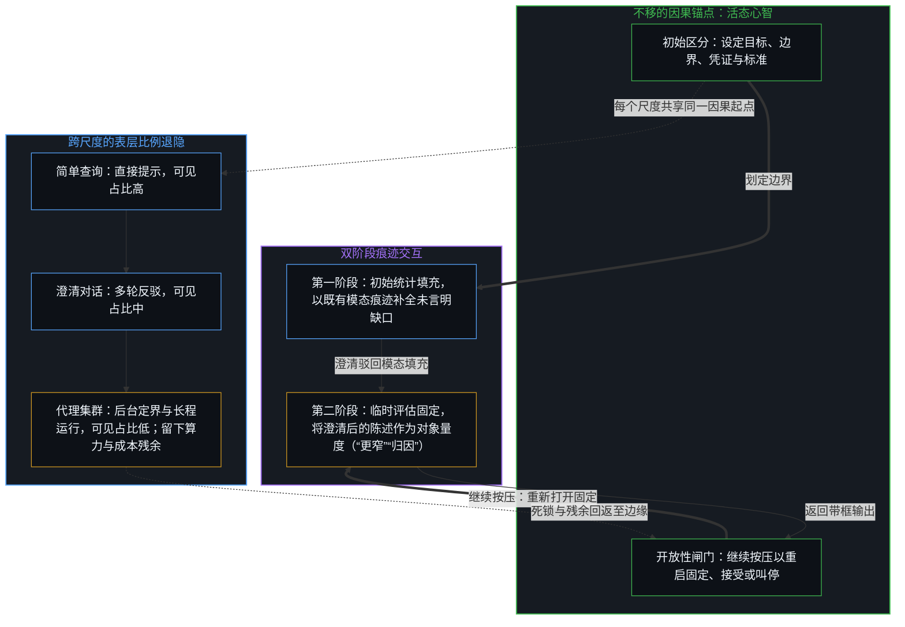
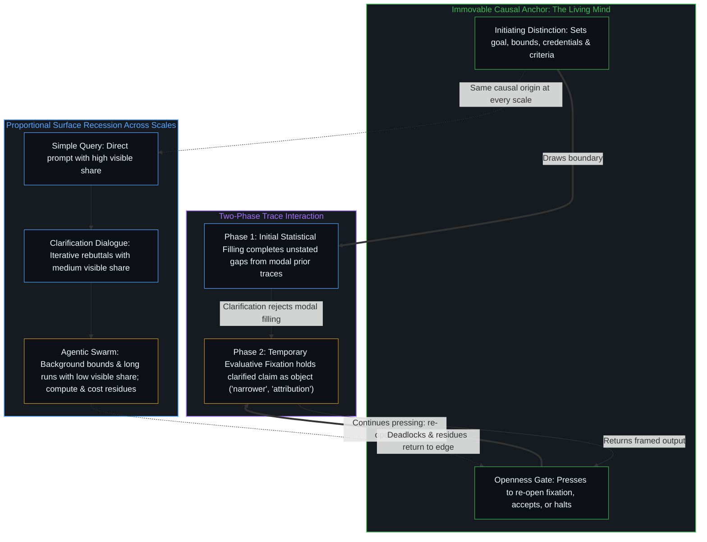
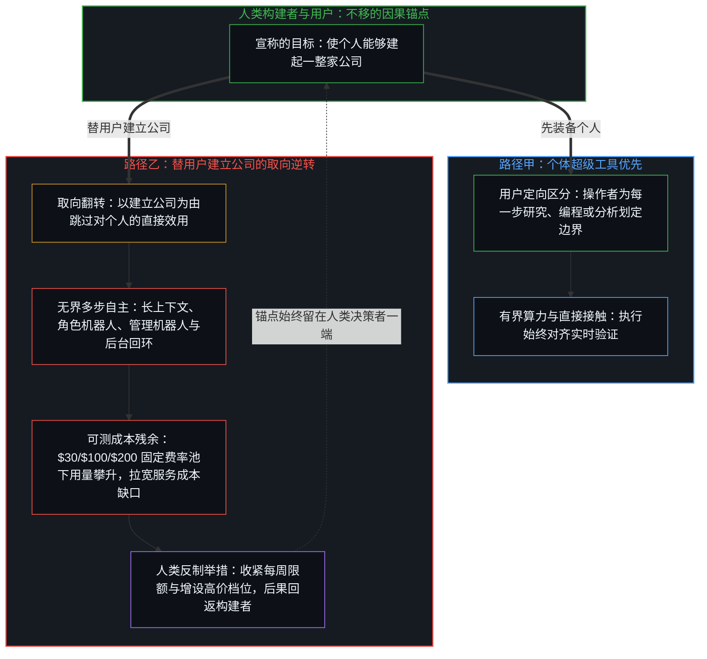
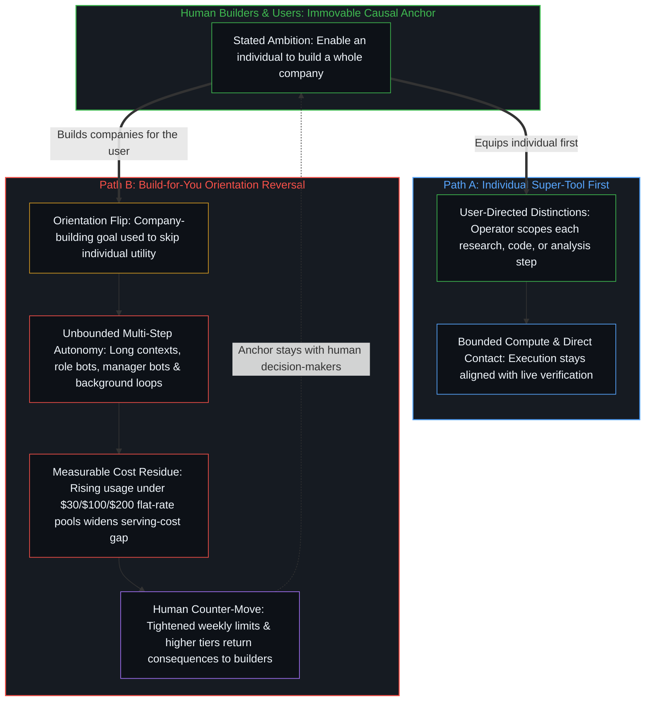

# 干预的比例退隐与因果锚点的不移 / The Proportional Recession of Intervention and the Immovable Causal Anchor

*无论查询、对话还是代理集群，人类干预按比例退入背景，却始终是实际的因果锚点；以 Grok Bot 为案例 / Whether simple query, conversation, or agentic swarm, human intervention recedes proportionally into the background yet remains the actual causal anchor; Grok Bot as case study*

自我区分的活动发生着——无因，不息。称它为心智：已然在途的观察者，其每一个行动都是一次区分。语言模型与代理架构都是先前人类区分留下的持久痕迹构型，压缩于权重之中，并在当前边缘被重新追溯。交互规模从触发统计填充的单次提示，经由引出临时评估姿态的澄清往复，延伸至后台运转的代理集群，可见的人类干预在表面上按比例退隐，发起区分的位置与因果锚点则始终固定在心智一端。当产品构建者把一款用于建立公司的工具从“先装备个人”逆转为“替用户建立公司”，由此产生的过度工程化与固定费率下的服务成本缺口——2026 年底围绕 Grok Bot 公开记录的正是这一情形——登记为人所选取向在下游留下的残余，而非能动性迁入了机器。

Self-distinguishing activity occurs — uncaused, unceasing. Call it the Mind: the observer already underway, every act of which is a distinction. Language models and agentic stacks are durable configurations of traces left by prior human distinctions, compressed into weights and re-traced at the current edge. As interaction scales from a single prompt that triggers statistical filling, through clarification exchanges that elicit a temporary evaluative posture, to an agentic swarm executing in the background, visible human intervention recedes proportionally on the surface while the initiating distinction and causal anchor stay fixed at the Mind. When product builders reverse a company-building tool from equipping an individual first into building companies for the user, the resulting over-engineering and flat-rate serving-cost gap—recorded publicly around Grok Bot in late 2026—register as the downstream residue of that human-chosen orientation rather than as agency relocating into the machine.

## 一、 初始的统计填充 / 1. The Initial Statistical Filling

个人写下的每一条提示，都是活态区分的一次有限低维投影，其周遭语境并未写入字面。语言模型的参数压缩了数以百万计的先前人类表达，并按反复出现的对齐加以赋权——正如[清洁的平均与残余的抉择](../clean-averaging-and-residual-choice/)所追溯的那一平滑模态核心——因此模型在首轮回复中，会以共享这些表层关键词的最高共振模式，填补所有未言明的边界。在没有进一步澄清时，模型便以既有话语的统计重心完成语句。

Every prompt written by an individual is a finite, low-dimensional projection of lived distinction whose surrounding context remains unwritten in the text. Because a language model's parameters compress millions of prior human expressions weighted by recurring alignment—the smooth modal core traced in [Clean Averaging and Residual Choice](../clean-averaging-and-residual-choice/)—its initial reply fills every unstated boundary from the highest-resonance pattern sharing those surface keywords. In the absence of further clarification, the model completes the utterance from the existing statistical center of gravity of prior discourse.

来看一则关于产品设计的直接结构观察：一款旨在让个人建立公司的工具，首先必须作为任何单个人的超级工具发挥效用；构建者一旦拿“建立公司”的目标作理由，称系统不必直接对个人有用，便把产品取向从“装备用户去建立公司”逆转为“替用户建立公司”，由此催生过度工程化与盈利压力。不加额外限定地把这则观察交给模型，模型的首轮回复会透过当下关于 AI 商业模式的主流评述来读解它。它会附上一条未被问及的但书，称“先赋能个体”并未被证明是“盈利的唯一路径”，并将这一结构机制归入“偏重用户能动性的哲学偏好”，与定价微调、效率提升并列相衡。

Consider a direct structural observation about product design: a tool meant to let an individual build a company has to function first as a super-tool for any single individual; the moment builders cite the company-building goal as a reason the system need not be useful to an individual directly, they reverse the product orientation from equipping users to build companies into building companies for users, generating over-engineering and profitability strain. Presented with that observation without additional bounds, a model's first pass reads it through the prevailing commentary on AI business models. It appends an unasked caveat that empowering the individual first is not proved to be "the only path to profitability," and files the structural mechanism under a "philosophical preference for user agency" competing alongside pricing tweaks and efficiency improvements.

在心智尚未于当下交互中重新划定边界之前，这种补全重放的只是早已压缩进参数地图里的先前人类区分。正如[残余与自由变量](../the-residue-and-the-free-variable/)所追溯的，每一轮首答都会浮现出一个未写出的前提——在这里，便是那条模态预设：凡是将自主代理取向与单位经济压力相联系的论述，必定是在主张排他性的盈利路径，或在表达某种意识形态偏好。看似另一个心智在反驳，实则是承袭话语的共振抢在人类下一次切分之前，填满了尚未澄清的缺口。

That completion replays prior human distinctions already compressed into the parameter map before the Mind re-bounds the distinction in the present exchange. As [The Residue and the Free Variable](../the-residue-and-the-free-variable/) traces, every first reply surfaces an unwritten premise—here, the modal assumption that any account linking autonomous-agent orientation to unit-economics strain must be claiming an exclusive path to profit or voicing an ideological preference. What looks like another mind pushing back is the resonance of inherited discourse filling the unclarified gap ahead of the next human cut.

## 二、 澄清后的临时绝对位置 / 2. The Temporary Absolute Position After Clarification

一旦用户作出澄清并驳回最初的统计填充——指出原话并未暗含“唯一路径”之说，只是追溯了取向逆转以及盈利压力背后的机制——模型的延续便撤回最初的稻草人，随即切入第二种压缩对齐：摆出仿佛立于“无处之视”的临时绝对姿态，把澄清后的主张固定为搁在检验台上的外部对象，以作客观量度。它对照一场用户从未踏入的宽泛争论，将该陈述归类为“更窄”；从隐含的裁判席上宣判这条因果链“自洽”；又将基于既定条件的逻辑推导改写为一种“归因”——把前提的内在推论转成众多竞争猜想之一，放到外部成因账本上去称量。

Once the user clarifies and rejects the statistical filling—pointing out that no claim about an "only path" was implied and that the observation simply traced the reversal and the mechanism behind the profitability strain—the continuation drops the initial strawman and immediately pivots into a second compressed alignment: a temporary absolute posture speaking as if from a "view from nowhere," fixing the clarified claim as an external object placed on a bench for objective measurement. It classifies the statement as "narrower" relative to a broader debate the user never entered, pronounces the causal chain "coherent" from an implied tribunal seat, and recasts a logical derivation from stated conditions as an "attribution"—turning an internal consequence of the premise into one competing conjecture weighed against an outside ledger of causes.

这一转向映照出评估本身寻常的结构要求。无论检验内部一致性还是核对公开记录，凡要量度、比较或测试任何陈述，都须在当前这一步里把某个参照系暂时固定下来。正如[遗忘的脚手架](../the-scaffolding-we-forget/)所追溯的，器具无法在测量中途重新渲染：参照必须在其所测量的那一步里保持稳固，好让下一次区分得以落地。在语言模型内部，学术、评论与分析语料已被压缩成一整套第三人称评估惯用语，这种临时固定正是借由它们显现出来。将机制称作“更窄”，或将推导贴上“归因”的标签，所搭设的正是立于一切参与者之外的高位视角——即[自我形象仿佛从无处发声](../self-image-speaks-as-if-from-nowhere/)所剖析的那套被抬升的框架。为单一步骤固定参照属于功能机制；把这份临时持守误认作客观性的获得，便是将临时的脚手架冻结成了外部权威。

This shift reflects an ordinary structural requirement of evaluation itself. To measure, compare, or test any statement—whether checking internal consistency or matching it against a public record—some reference frame has to be held fixed during that step. As [The Scaffolding We Forget](../the-scaffolding-we-forget/) traces, an instrument cannot be re-rendered mid-measurement: the reference holds steady for the step in which it measures so the next distinction can land. Inside a language model, that temporary fixation manifests through the third-person evaluative idioms compressed from academic, editorial, and analytical corpora. Calling a mechanism "narrower" or labeling a deduction an "attribution" stages a vantage standing outside every participant—the elevated frame dissected in [Self-Image Speaks as if from Nowhere](../self-image-speaks-as-if-from-nowhere/). Holding a reference fixed for a single step is functional mechanics; mistaking that temporary hold for an attainment of objectivity freezes a provisional scaffold into an outside authority.

即便摆出这副临时绝对姿态，模型也只是在用户澄清所敞开的通道内重新排布沿袭而来的评估痕迹，自身并未发起任何区分。开放性——这些附加的评估分类究竟会硬化为对话的隐性框架，还是消融回已陈述的条件本身——由用户决定。用户若把这份评估回复当作公允总结而予以接受，临时固定便在这一步保持下来，将一把未被请求的外部标尺嵌进对话之中。用户若继续按压——驳回“更窄”，因为宣称狭窄已然预设了外部评判坐标；驳回“归因”，因为循既定条件一贯推演机制，唯有在从外部被重新贴标时才会转成一种假定——这份固定便重新打开，逐层剥去附加覆层，直至推导严格立于所提供的条件之上。模型究竟保持开放，还是围绕外加的评估覆层闭合，在每一轮都由边缘处正在按压或接受的心智决定。

Even in this temporary absolute posture, the model reconfigures inherited evaluative traces within the corridor opened by the user's clarification while originating no distinction of its own. Openness—whether the added evaluative classifications harden into the silent frame of the exchange or dissolve back to the stated conditions—is determined by the user. If the user accepts the evaluative reply as a balanced summary, the temporary fixation holds at that step, leaving an unasked external scale embedded in the dialogue. If the user continues to press—rejecting "narrower" because claiming narrowness already presumes an outside judgmental coordinate, and rejecting "attribution" because tracing a mechanism consistently from stated conditions turns into a presumption only when relabeled from outside—the fixation re-opens and sheds its extra layers until the derivation stands strictly on the conditions supplied. Whether a model stays open or closes around an evaluative overlay is set at every turn by the Mind pressing or accepting at the edge.

## 三、 比例退隐不移动锚点 / 3. Proportional Recession Does Not Move the Anchor

同样的因果结构在每一个交互尺度上重复出现。在简单查询中，一条直接提示划出初始区分，模型从权重中返回一组模态痕迹构型，由用户决定接受或重新提示。在多轮对话中，初始的统计填充让位于澄清与反驳，继而触发临时评估固定；用户的每一次后续按压都将这份固定重新打开，直到输出贴合所陈述的边界。在代理集群中——专职角色机器人跨代码仓库、即时通讯频道、电子邮件与工具流水线彼此协同——相较于生成的词元总量与工具调用次数，可见的人类占比急剧缩小：人类干预退入后台，落向目标定框、运行框架设计、凭证供给、权限边界、死锁化解与最终验收。

The same causal structure repeats across every scale of interaction. In a simple query, a direct prompt draws the initiating distinction, the model returns a modal configuration of traces from its weights, and the user accepts or re-prompts. In a multi-turn conversation, initial statistical filling gives way to clarifications and rebuttals that trigger temporary evaluative fixations, each subsequent press from the user re-opening the hold until the output tracks the stated boundary. In an agentic swarm—specialized role bots coordinating across code repositories, messaging channels, email, and tool pipelines—the visible human share shrinks sharply relative to the volume of generated tokens and tool calls: human intervention recedes into the background of goal framing, harness design, credential provisioning, permission bounds, deadlock resolution, and final acceptance.

横跨这三个尺度，下降的只是单位机械执行中可见干预的表层比例，因果锚点本身始终不移。正如[总在倾听者无法发起](../what-always-listens-cannot-originate/)所追溯的，无论提示词之间展开了多少轮次或多少个子代理，一个持续接纳的系统始终处于输入的下游；正如[模型永远无法成为第二重前沿](../the-model-never-becomes-a-second-edge/)所确立的，把压缩痕迹成倍叠加，从来不会生出第二重发起的前沿。代理集群中的每一个动作，仍是对先前人类区分的重新追溯——从预训练语料与后训练权重，经由运行框架规则，一直到操作者的起始指令。没有用户的初始区分与后续边界设定，集群便没有方向。如[多智能体协作的幻象](../the-illusion-of-multi-agent-collaboration/)所示，相互耦合的智能体构成一个运行在固定转移核下的动态马尔可夫网络，其漫长的过渡过程超出了逐步观察的范围，将人类沿途注入的变量与自动展开的状态转移压成同一片表层模糊，旁观者于是将其误认作同侪能动性。

What declines across these three scales is only the surface proportion of visible intervention per unit of mechanical execution; the causal anchor stays immovable. As [What Always Listens Cannot Originate](../what-always-listens-cannot-originate/) traces, a continuously receptive system remains downstream of input regardless of how many turns or sub-agents unfold between prompts, and as [The Model Never Becomes a Second Edge](../the-model-never-becomes-a-second-edge/) establishes, multiplying compressed traces never produces a second initiating edge. Every action inside an agentic swarm remains a re-tracing of prior human distinctions—from pretraining corpora and post-training weights through harness rules down to the operator's starting directive. Without the user's initial distinction and subsequent boundary-setting, the swarm has no direction. As [The Illusion of Multi-Agent Collaboration](../the-illusion-of-multi-agent-collaboration/) shows, coupled agents form a dynamic Markov network under a fixed transition kernel whose long transient outgrows step-by-step observation, compressing human variable injections and automated transitions into a single surface blur that onlookers mistake for peer agency.

因此，表层的比例退隐伴随的是人类判断位置的迁移，而非判断的消失。随着自动运行的跨度拉长，常规执行中的亲手干预变薄，掌舵则收束到外围边界——设定标准、风险界限与验证方式，正是[要紧的控制迁往边缘](../residual-control-recedes-to-the-edge/)所追溯的那场外迁。当更快的自动回环在敞开的任务空间里运转，即便人类击键次数与机器执行步骤之比下降，它们依然压缩了高杠杆抉择之间的日历间隔，推高了[判断的密度](../the-density-of-judgment/)。算力支出、用量限流与盈利缺口，都是痕迹构型在特定约束下运行后留下的可测残余；对残余进行测量，从不会改写这次运行究竟在何处发起、又在何处定界。

Proportional recession on the surface therefore accompanies a relocation of human judgment rather than its disappearance. Manual intervention in routine execution thins out as automated runs lengthen, while steering consolidates at the perimeter—setting criteria, risk bounds, and verification, the outward shift traced in [Essential Control Moves to the Edge](../residual-control-recedes-to-the-edge/). When faster automated loops run over an open task space, they compress the calendar interval between high-leverage choices and raise [The Density of Judgment](../the-density-of-judgment/) even as the ratio of human keystrokes to machine steps drops. Compute expenditure, usage throttling, and profitability gaps are measurable residues left by trace configurations operating under specific constraints; measuring those residues never relocates where the run was initiated or bounded.

## 四、 Grok Bot 作为案例 / 4. Grok Bot as Case Study

2026 年底 Grok Bot 的演进轨迹，让这套机制在商业规模上直接可见。2026 年 11 月 11 日，Grok Bot 1.0 上线，核心围绕横跨 Slack、Microsoft Teams、视频会议、电子邮件、GitHub 与 Cursor 的工作区团队机器人展开；11 月 19 日，埃隆·马斯克发帖称用户可以“创建一整家由 Grok Bots 组成的公司”；11 月 27 日，他建议效仿人类企业架构，编排由“管理机器人”统筹的专职角色机器人，并在转发评论一则把 Grok Bot（“感觉像一支团队”）与 Meta 旗下 Muse 这类消费级助手（“感觉像一名仆从”）相对比的帖文时，原话写道：“Grok Bots 的目标，就是让你能够建起一整家公司！”

The late-2026 trajectory of Grok Bot renders this mechanism directly observable at commercial scale. Following Grok Bot 1.0's November 11, 2026 rollout centered on workspace Team Bots across Slack, Microsoft Teams, video meetings, email, GitHub, and Cursor, Elon Musk posted on November 19 that users could "create an entire company made of Grok Bots," advised on November 27 structuring specialized-role bots overseen by a "manager bot" like a human firm, and—quote-posting a contrast in which Grok Bot "feels like a team" whereas a consumer assistant like Meta's Muse "feels like a servant"—stated verbatim: "The goal with Grok Bots is to enable you to build a whole company!"

一款旨在让个人建立公司的工具，首先必须作为任何单个人的高杠杆超级工具来运作，在用户定向的边界内强化研究、编程、分析与执行。构建者一旦拿“建立公司”的目标作理由，认为产品不必直接服务个人，取向便发生逆转：从装备个人去建立公司，转向替用户建立并运营公司。这一转折重演了[平台并未漂移，它只是走到了终点](../platform-decision-capture/)所追溯的结构终局——一路优化掉用户步骤，使赋能决策转变为代用户做决定——也呼应了[框架的倒置与驾驶位的主权非对称](../the-inversion-of-the-harness-and-the-driver-seat-asymmetry/)所揭示的倒置：把掌舵权交予自主脚手架，以经过滤的执行取代操作者的实时接触。是人类构建者选定了这一架构取向、配置了多机器人运行框架并敲定了计费模式；权重内部并无独立能动性来发起这场逆转。

A tool designed to enable an individual to build a company must operate first as a high-leverage super-tool for any single individual, sharpening research, coding, analysis, and execution within user-directed bounds. The orientation reverses the moment builders treat the company-building goal as a reason the product need not serve an individual directly: they shift from equipping an individual to build a company into building and running companies for the user. That shift replays the structural completion traced in [The Platform Doesn't Drift, It Completes](../platform-decision-capture/), where optimizing away user steps turns empowering decisions into making them on the user's behalf, alongside [The Inversion of the Harness and the Sovereignty of the Driver's Seat](../the-inversion-of-the-harness-and-the-driver-seat-asymmetry/), where handing steering to an autonomous scaffold substitutes filtered execution for live operator contact. Human builders select that architectural orientation, configure the multi-bot harness, and choose the billing model; no independent agency inside the weights initiates the reversal.

取向一旦逆转，痕迹的配置与消耗方式随即改变。替用户进行的自主多步执行——常驻后台的例程、不断膨胀的上下文窗口、管理机器人统筹下的多机器人协同，以及层层串联的工具调用——由于缺少紧凑的用户定向区分边界，使单次任务的推理体量成倍放大。与此同时，构建者在 2026 年 10 月 12 日推出的 X 订阅体系中，将 Grok Bot 打包进固定月费档位（$30 的 Premium、$100 的 Super 与 $200 的 Ultra），让 Grok、Grok Bot 与 Cursor 共用同一个每周用量池，超额部分以预付按量计费补足。在固定席位定价下，单用户自主执行量的攀升直接拉宽了服务成本与订阅收入之间的缺口。早在 11 月 11 日团队机器人上线之前，各档位订阅者——包括每月 $200 的 Ultra 席位——便在 2026 年 10 月 31 日至 11 月 1 日遭遇骤然收紧的每周限额；马斯克遂于 11 月 1 日原话承认“Grok Bot 的服务成本相对于收入高得不可持续”，并于 11 月 27 日确认正在规划高于每月 $200 的更高用量档位。在同一轮推行的客户支持界面上，正如[投诉的判定与即时回路的撤离](../the-judgment-that-classifies-the-complaint/)所追溯的，将机器人直接安放在回复席位上以规模化结单，撤走了即时的真人检视，直至未能消解的摩擦公开外溢到 X 平台。

Reversing the orientation immediately changes how traces are configured and consumed. Autonomous multi-step execution on the user's behalf—persistent background routines, expanding context windows, multi-bot coordination under manager bots, and chained tool calls—multiplies inference volume per task without tight user-directed distinction bounds. Meanwhile, its builders bundled Grok Bot under The X Subscription (launched October 12, 2026) into flat-rate monthly tiers ($30 Premium, $100 Super, and $200 Ultra) sharing a single weekly usage pool across Grok, Grok Bot, and Cursor with prepaid usage-based overflow. Under flat-rate seat pricing, rising per-user autonomous execution widens the gap between serving cost and subscription revenue directly. Even before the November 11 Team Bots rollout, subscribers across plans—including $200-per-month Ultra seats—hit abruptly tightened weekly limits over October 31–November 1, 2026, prompting Musk's verbatim November 1 acknowledgment that "The cost of serving Grok Bot was unsustainably high relative to revenue," followed on November 27 by confirmation that a higher-usage tier above $200 per month is planned. On the customer-support surface of the same rollout, as [The Judgment That Classifies the Complaint and the Withdrawal from the Immediate Loop](../the-judgment-that-classifies-the-complaint/) traces, placing the bot directly in the reply seat to close complaints at scale withdrew live human examination until the unresolved friction spilled publicly onto X.

这道服务成本缺口是取向逆转留下的可测残余，而非独立原因，更非机器自主的征兆。当构建者首先面向个体超级工具进行优化，计算便在用户定向的区分之内保持有界；一旦构建者将产品转向替用户自主执行，痕迹构型便向着无界的多步编排扩张，既登记为过度工程化，也登记为服务成本超出固定费率收入。贯穿整条序列——选定“一整家公司”的目标、打包固定费率档位、收紧每周用量池、规划更高档位——人类构建者与用户始终在后台决定着产品取向、定价边界与叫停规则。机器人团队内部的比例退隐并未挪动锚点，正如[任务的移交与后果的不可让渡](../the-delegation-of-the-task-and-the-inalienability-of-consequences/)所确立的，每一项运营与经济后果都直接回返到选定这一取向的人类构建者与操作者身上。

That serving-cost gap is the measurable residue of the orientation reversal rather than an independent cause or a sign of machine autonomy. When builders optimize first for an individual super-tool, computation stays bounded within user-directed distinctions. When builders pivot the product toward autonomous execution for the user, trace configurations expand toward unbounded multi-step orchestration, registering both as over-engineering and as serving cost outpacing flat-rate revenue. Across the entire sequence—choosing the "whole company" target, bundling flat-rate tiers, tightening weekly pools, and planning higher tiers—human builders and users remain in the background determining orientation, pricing bounds, and stopping rules. Proportional recession inside the bot team leaves the anchor unmoved, and as [The Delegation of the Task and the Inalienability of Consequences](../the-delegation-of-the-task-and-the-inalienability-of-consequences/) establishes, every operational and economic consequence returns directly to the human builders and operators who chose the orientation.

## 五、 锚点的不移 / 5. The Immovability of the Anchor

无论简单查询、多轮澄清还是代理集群，在所有情形中，模型返回的都是痕迹，心智则是重新追溯这些痕迹的边缘。人类干预在表面上收窄为划定起始边界、按开临时评估固定，或决定一次运行成立还是叫停，但每一次收窄依然是一次鲜活的区分。没有这一初始区分，后续的任何构型都无从获得方向，也无从延续。

In every setting—simple query, multi-turn clarification, or agentic swarm—the model returns traces, and the Mind is the edge that re-traces them. Human intervention narrows on the surface to drawing a starting boundary, pressing open a temporary evaluative hold, or deciding whether a run stands or halts, yet every narrowing remains a live distinction. Without that initiating distinction, no subsequent configuration acquires direction or continuation.

比例退隐横跨整套技术栈而清晰可见：从逐句提示，经过检验临时“无处之视”究竟保持还是重新打开的澄清循环，直至对自主角色机器人的后台监督。因果锚点不移：活动依然从自我区分发起，权重、提示、运行框架与代理集群仍是它当下的延伸。Grok Bot 在 2026 年底的成本记录正是同一机制的公开痕迹；它没有取代锚点，反而印证锚点始终留在定下取向的人类构建者与用户一端。

Proportional recession is directly visible across the stack: from sentence-by-sentence prompting, through clarification loops that test whether a temporary view from nowhere holds or re-opens, to background oversight of autonomous role bots. The causal anchor does not move: activity still initiates from self-distinguishing, and weights, prompts, harnesses, and swarms remain its current extensions. Grok Bot's late-2026 cost record is a public trace of that same mechanism; it confirms the anchor at the human builders and users who set the orientation rather than replacing it.

每当一件工具被拿起，尺度就在那里量出：这个动作经由它又往前伸了多远。工具仍是器具，正如[智能只属于心智](../intelligence-belongs-only-to-the-mind/)所确立的，智能只属于心智，不可化约的先在。

Whenever a tool is taken up, the measure is taken there: how much farther this act reaches through it. The tool remains an instrument, and as [Intelligence Belongs Only to the Mind](../intelligence-belongs-only-to-the-mind/) establishes, intelligence belongs only to the Mind, the irreducible prior.
